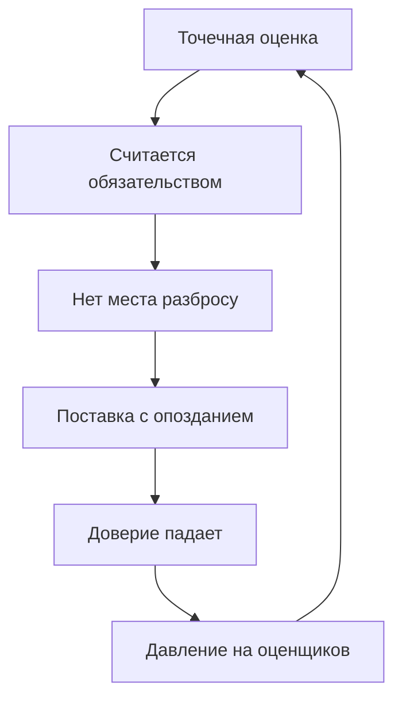
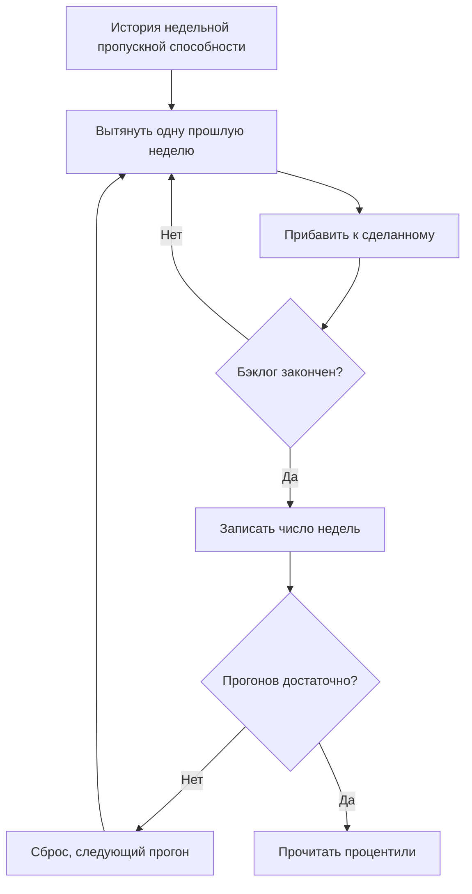
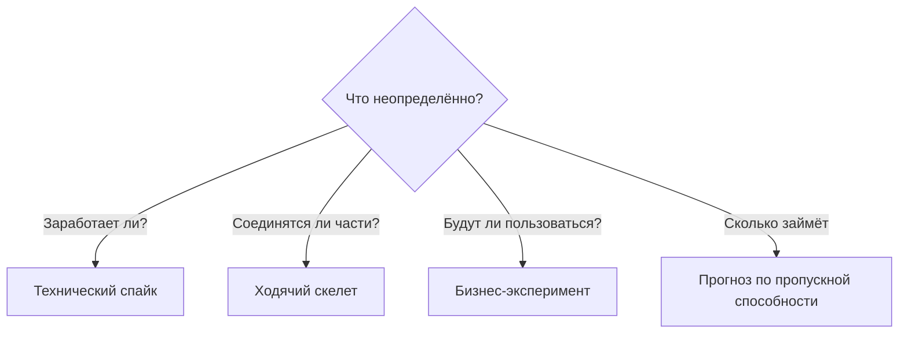

# Глава 17 — Предсказуемость и управление неопределённостью { #chapter-17-predictability-and-managing-uncertainty }

Каждого руководителя разработки спрашивают: «Когда будет готово?» Эта глава о том, как отвечать
честно: прогнозировать поставку как диапазон с вероятностью, построенный на том, что команды
действительно поставляли; не смешивать прогнозы, цели и обязательства; и упорядочивать неопределённую
работу так, чтобы самые большие неизвестные прояснялись первыми. Сквозной пример — Northstar
Technologies, вымышленная компания из [кейса](../../case-studies/northstar/index.md), у которой из
17 пунктов дорожной карты с обязательством в обещанном квартале вышли 7. Глава спрашивает, что можно
обещать, имея приоритизированный бэклог (глава 15) и измеренную систему поставки (глава 16).

## Почему это важно { #why-this-matters }

На уровне команды ненадёжная оценка стоит неловкого разговора и нескольких поздних вечеров.

На уровне организации сорванная дата расходится дальше: продукт сказал продажам, продажи сказали
клиенту, финансы заложили выручку. Когда сроки разработки ненадёжны, другие функции добавляют свои
запасы или перестают верить разработке, а руководители требуют детальных планов и ежедневных статусов,
и от этого поставка становится ещё медленнее и ещё менее предсказуемой.

На уровне руководства предсказуемость — вопрос доверия совета директоров и клиентов. CPO (директор по
продукту) Northstar Amara Okafor хочет «дорожную карту, которую она пообещала клиентам, в названные ею
сроки»; от двух функций с датами зависят два продления на $9 млн. CTO, который не может сказать,
насколько вероятна дата, не может оценить риск её обещания.

Предсказуемость — это не скорость и не попадание в каждую дату: команда, которая берёт обязательства на
очень малое, попадает в каждую дату и почти бесполезна. Руководителям нужна **калибровка**: когда
команда говорит, что уверена на 85 процентов, она права примерно в 85 процентах случаев. (Это
калибровка прогнозов, а не калибровка оценок результативности из главы 8.)

## Цели главы { #learning-objectives }

Прочитав эту главу, вы сможете:

- Объяснять с опорой на исследования оценивания и ошибки планирования, почему точечные оценки работы
  над ПО систематически оптимистичны, а заявленная в них неопределённость слишком узка.
- Строить прогноз поставки как диапазон с вероятностями по исторической пропускной способности команды
  с помощью моделирования Монте-Карло и называть допущения, на которых он держится.
- Применять прогнозирование по референтному классу, чтобы корректировать план прошлыми результатами
  похожей работы.
- Различать прогнозы, цели и обязательства и сообщать о каждом так, чтобы другие могли на него
  опираться.
- Структурировать неопределённую работу (спайки, ходячие скелеты, эксперименты) так, чтобы самые
  рискованные неизвестные снимались рано, и оценивать, когда добавление людей поможет опаздывающему
  проекту, а когда навредит.

## Ментальная модель { #the-mental-model }

> **Ментальная модель:** дата поставки — это распределение вероятностей, а не число. Прогнозируйте
> распределение по истории, берите обязательства только с его осторожного края и тратьте первые недели
> на то, чтобы его сузить.

Во-первых, у вопроса «когда будет готово?» в момент, когда его задают, нет единственного ответа — есть
только диапазон возможных дат. Одна дата — это одна точка из этого диапазона, в лучшем случае середина,
а часто и раньше, выданная за целое. Во-вторых, привычки вокруг точечных дат образуют петлю, которая
делает их ещё хуже:



Наиболее вероятная оценка становится обещанием без поправки на разброс исходов, поэтому её срывают
примерно в половине случаев, даже если сама оценка была хорошей. Каждый срыв снижает доверие, а
сниженное доверие приносит давление в пользу дат, которые звучат приемлемо, и сдвигает следующую оценку
раньше. Обзор Jørgensen называет это оцениванием при конфликтующих целях: когда оценка должна ещё и
понравиться руководителю или выиграть тендер, реализм проигрывает
([Jørgensen, 2004](../../references/bibliography.md#jorgensen2004review)).

Выход из петли и организует главу: прогнозируйте по тому, что уже произошло; отделяйте то, что вы
предсказываете, от того, чего хотите, и того, что обещаете; и упорядочивайте работу так, чтобы диапазон
быстро сужался.

## Подробный разбор { #deep-conceptual-explanation }

### Что говорят исследования об оценивании { #what-the-research-says-about-estimating }

**Ошибка планирования** (planning fallacy) — склонность недооценивать, сколько времени займут
собственные задачи, даже когда похожие задачи в прошлом заняли больше. Термин ввели Kahneman и Tversky в
1979 году ([Jørgensen, 2004](../../references/bibliography.md#jorgensen2004review)). В пяти
исследованиях Buehler, Griffin и Ross обнаружили, что прогнозы людей о времени завершения собственной
работы стабильно слишком оптимистичны, а прогнозы о времени других людей — нет. Прогнозируя свою
работу, люди сосредоточивались на планах и сценариях для текущей задачи, а не на прошлом опыте; когда их
просили связать прогноз со своим прошлым опытом, искажение в исследовании исчезало. Они также объясняли
прошлые неудачи внешними разовыми обстоятельствами, отчего это прошлое казалось нерелевантным
([Buehler, Griffin, and Ross, 1994](../../references/bibliography.md#buehler1994exploring)). Это
**научный результат** об учебных и бытовых задачах отдельных людей, а не о командах разработки.

Для ПО обзор Jørgensen показал, что экспертная оценка — самый распространённый метод оценивания и
что существенных доказательств превосходства формальных моделей нет. Он также сообщает по данным
более ранних исследований, что диапазоны неопределённости у экспертов слишком узки: в одном исследовании
промышленных проектов меньше половины фактических трудозатрат попали в диапазоны оценщиков
([Jørgensen, 2004](../../references/bibliography.md#jorgensen2004review)). Более поздний обзор добавляет
две оговорки. Недооценка преобладала в инженерных и управленческих исследованиях, но не в
психологических, так что «люди всегда недооценивают» — слишком сильное утверждение. И многие
исследования не разделяют трудозатраты (рабочие часы) и завершение (даты поставки), а это разные
вопросы ([Halkjelsvik and Jørgensen, 2012](../../references/bibliography.md#halkjelsvik2012origami)).

Вывод книги: не исправляйте оценки, требуя от людей больше стараться. Используйте историю и считайте
любой экспертный диапазон более узким, чем он должен быть.

### Стори-поинты, покер планирования и размеры футболок { #story-points-planning-poker-and-t-shirt-sizes }

Большинство команд оценивают одной из трёх практик. Знайте, для чего хороша каждая (**рекомендация
книги**; исследований, сравнивающих их по результатам поставки, не найдено):

| Практика | Что это | Хороша для | Слаба для |
|---|---|---|---|
| [Стори-поинты](../../glossary.md#velocity-and-story-points) | Относительный размер каждой задачи; скорость — поинты, закрытые за спринт | Выявления разногласий об объёме | Дат и любых сравнений между командами |
| Покер планирования (planning poker) | Каждый одновременно показывает свою оценку, затем объясняются крайние | Выявления того, что знает один человек (скрытые профили из главы 13) | Скорости на большом бэклоге |
| Размеры футболок | Грубые классы вроде S, M, L | Быстрой сортировки длинного списка | Суммирования в план |

Ценность всех трёх — в разговоре. Когда два инженера говорят 2 и 13, один из них что-то знает, и объём
проясняется. Слабость — в следующем шаге: суммировании поинтов или размеров в дату. Это воспроизводит
описанную выше петлю точечных оценок с лишней арифметикой. Некоторые практики отказываются от оценок и
вместо этого считают задачи. Это работает, когда задачи нарезаны примерно одного размера, и именно это
предполагает прогнозирование по пропускной способности ниже. Оценивайте, чтобы понять работу; даты
прогнозируйте по истории.

### Взгляд изнутри и взгляд снаружи { #inside-view-and-outside-view }

**Взгляд изнутри** прогнозирует проект по его деталям: задачам, людям, плану. **Взгляд снаружи**
игнорирует эти детали и спрашивает, сколько заняли сопоставимые проекты. Flyvbjerg, опираясь на
Kahneman и Tversky и на Lovallo и Kahneman, превратил взгляд снаружи в метод под названием
**прогнозирование по референтному классу** (reference-class forecasting) из трёх шагов: выбрать класс
прошлых проектов, достаточно похожих, чтобы их сравнивать, и достаточно многочисленных, чтобы это имело
смысл; установить распределение их результатов; поместить новый проект в это распределение
([Flyvbjerg, 2006](../../references/bibliography.md#flyvbjerg2006nobel)). Статья разделяет две причины
ошибок прогноза, которым нужны разные средства: **оптимистическое искажение** (optimism bias), честную
когнитивную ошибку, и **стратегическое искажение данных** (strategic misrepresentation), намеренно
заниженные цифры, чтобы получить одобрение.

Пример в статье — министерство транспорта Великобритании. С 2004 года оно добавляло к бюджетам
проектов «надбавки на оптимистическое искажение», основанные на перерасходе прошлых проектов того же
типа и растущие по мере снижения терпимости к перерасходу. Для дорог надбавка составляла 15 процентов
при шансе 50 процентов уложиться в бюджет и 45 процентов при шансе 90 процентов. Этот **научный
результат** получен на государственной инфраструктуре; метод переносится на ПО, цифры — нет.

В инженерной организации референтный класс — ваша собственная прошлая работа. «Какую долю пунктов с
обязательством мы поставили в своём квартале за последние четыре квартала?» и «Насколько выросли наши
последние пять функций после старта?» — это вопросы взгляда снаружи.

### Прогнозирование по пропускной способности { #forecasting-from-throughput }

**Пропускная способность** — число задач, которые команда завершает за неделю (как её измерять,
описывает глава 16). История пропускной способности — самый полезный референтный класс у руководителя,
потому что в ней уже есть всё, что замедляло команду: прерывания, отсутствия, очереди на ревью,
неудачные релизы.

**[Моделирование Монте-Карло](../../glossary.md#percentile-forecast-and-monte-carlo-simulation)** —
случайный эксперимент, повторённый много раз, чтобы увидеть разброс результатов, — превращает эту
историю в прогноз для бэклога из N задач:



Каждый прогон представляет будущее как случайную перетасовку прошлых недель. Тысячи прогонов дают
распределение: 50-й процентиль — дата, в которую попадают в половине случаев, 85-й — дата, в которую
попадают 85 раз из 100. Та же история отвечает и на обратный вопрос: сколько задач будет сделано к
фиксированной дате. Практическое руководство Vacanti по прогнозированию потока описывает этот метод и
предостерегает от прогнозов по средним ([Vacanti, 2018](../../references/bibliography.md#vacanti2018when)).

!!! tip "Прогноз Монте-Карло в электронной таблице"
    1. Поместите историю недельной пропускной способности в один столбец, например `A1:A26`.
    2. На новом листе сделайте строку 1 одним прогоном. В `B1` введите
       `=INDEX(History!$A$1:$A$26, RANDBETWEEN(1, 26))` — число задач, завершённых в случайно вытянутую
       прошлую неделю. В `C1` введите `=B1 + INDEX(History!$A$1:$A$26, RANDBETWEEN(1, 26))` —
       нарастающий итог — и протяните вправо на 40 и более столбцов (по одному на будущую неделю).
    3. В столбце `A` строки прогона посчитайте, сколько недель понадобилось, чтобы достичь размера
       бэклога N: `=COUNTIF(B1:AO1, "<" & N) + 1`.
    4. Протяните строку вниз на 1 000–10 000 прогонов. Каждый пересчёт вытягивает новые недели.
    5. Прочитайте прогноз: `=PERCENTILE(A1:A10000, 0.85)` — 85-й процентиль в неделях; повторите для
       0.5 и 0.95.

    Для вопроса «сколько к неделе W» прочитайте нарастающий итог каждого прогона на неделе W и возьмите
    низкий процентиль (5-й для уверенности 95 процентов, 15-й — для 85). Существуют бесплатные шаблоны
    и инструменты, которые делают то же самое; вся логика — здесь. Подсчёт задач имеет смысл, только
    если задачи нарезаны примерно одного размера; договоритесь о правиле нарезки (например, ничего
    крупнее недели работы) до того, как собирать историю.

План, построенный на средней пропускной способности, попадает около медианы, поэтому опаздывает примерно
в половине случаев: это арифметика, стоящая за петлёй из ментальной модели. Методу не нужна оценка
размера каждой задачи — только похожее на прошлое соотношение размеров. С каждым прогнозом называйте его
допущения:

- **Будущее похоже на выбранное прошлое.** Изменения в команде и новые виды работы это нарушают;
  перезапускайте прогноз, когда система меняется.
- **Недели независимы.** Это не так (за плохой неделей с инцидентом часто следует ещё одна), поэтому
  диапазоны получаются несколько уже, чем нужно.
- **Объём известен.** Он никогда не известен. Моделируйте рост явно, по собственной истории.

### Прогнозы, цели и обязательства { #forecasts-targets-and-commitments }

McConnell разделяет **оценку** (предсказание), **цель** (бизнес-задачу, возможно, недостижимую) и
**обязательство** (обещание поставить определённую функциональность с заявленным качеством к дате). Он
отмечает, что руководители, которые просят оценку, часто хотят обязательство или план достижения цели
([McConnell, 2006](../../references/bibliography.md#mcconnell2006software)). Обзор Jørgensen делает то
же замечание со стороны исследований: цена в тендере, плановые трудозатраты и наиболее вероятные
трудозатраты служат конфликтующим целям, и их часто не разделяют
([Jørgensen, 2004](../../references/bibliography.md#jorgensen2004review)). Книга использует три термина:

| | Прогноз | Цель | Обязательство |
|---|---|---|---|
| Что это | Вероятностное утверждение о будущем | Результат, которого хочет организация | Обещание тому, кто будет на него опираться |
| Кто владеет | Команда и её руководитель | Руководство | Названный человек, обычно директор или выше |
| Форма | Диапазон с вероятностями | Один результат | Дата и определённый объём |
| Когда меняется | Когда приходит новая информация, еженедельно | Когда меняется стратегия | Редко; пересматривается рано и явно |
| Промах означает | Прогноз обновляется | Урок о масштабе амбиций или о ресурсе | Нарушенное обещание с последствиями |

Рекомендация книги: берите обязательства с осторожного края прогноза (85-й или 95-й процентиль),
записав объём, а всё, что выше этой линии, помечайте как цель. Давление «возьмите обязательство по
цели» — это давление дать обещание, которое, согласно истории, скорее всего будет нарушено; сказать об
этом с прогнозом в руках — ключевой навык этой роли.

### Ранний съём рисков { #retiring-risk-early }

Прогнозирование по пропускной способности справляется с **изменчивостью** — нормальным разбросом в том,
как быстро делается знакомая работа. Оно не справляется с **неопределённостью в самой работе**: будет ли
дизайн работать, интегрируются ли две системы, будут ли клиенты пользоваться результатом. Здесь рычаг —
порядок работы.

- **Спайк** (spike) — ограниченное по времени исследование одного технического вопроса («может ли
  pricing-svc рассчитать цены для файла заказа на 20 000 строк за окно обработки?»). Его результат —
  решение; код выбрасывается.
- **Ходячий скелет** (walking skeleton) соединяет основные компоненты от начала до конца прежде, чем
  любой из них готов; Alistair Cockburn, давший ему название, описывает тонко связанную работающую
  архитектуру ([Cockburn, 2004](../../references/bibliography.md#cockburn2004crystal)). Проблемы
  интеграции всплывают на второй неделе, а не на двадцатой.
- **Эксперимент** в смысле, популяризированном *The Lean Startup*, проверяет бизнес-допущение
  минимальной вещью, которая даёт доказательства
  ([Ries, 2011](../../references/bibliography.md#ries2011lean)). Само продуктовое исследование
  (discovery) — тема главы 44.

В хорошо упорядоченном плане диапазон прогноза быстро сужается в первой трети работы. Если на середине
он так же широк, как в начале, трудные вопросы отложили.

### Добавление людей в опаздывающую работу { #adding-people-to-late-work }

Когда пункт с датой отстаёт, обычно предлагают добавить людей. **Закон Брукса** в его распространённой
формулировке гласит, что добавление людей в опаздывающий программный проект задерживает его ещё больше
([Brooks, 1995](../../references/bibliography.md#brooks1995mythical)). Сам Brooks, по сообщениям,
называл его упрощением. Механизмы — время на вхождение в работу, коммуникационные издержки, растущие с
размером команды, и задачи, которые нельзя разделить.

Считайте это **мнением эксперта**, которое называет механизмы. Добавление людей помогает, когда работа
чисто делится, новички знают код и остаётся достаточно времени, чтобы вхождение окупилось. Оно вредит
поздно, на связанной работе и когда те, кто вводит новичков в курс дела, стоят на критическом пути.
Вынести часть объёма обычно быстрее, чем ввести людей.

## Пример из инженерной организации { #engineering-organization-example }

!!! info "Northstar: что уже известно"
    Неделя 1, первый день директора. В базовом квартале Northstar поставила вовремя 7 из 17 пунктов
    дорожной карты с обязательством. Две функции для продлений, от которых зависит $9 млн годовой
    регулярной выручки, должны выйти в квартале 2: интеграция с бухгалтерской системой на неделе 19 и
    массовый заказ на неделе 26. См. [хронологию](../../case-studies/northstar/timeline.md). Впервые
    читаете о Northstar? Прочитайте [«Год вкратце»](../../case-studies/northstar/year-in-brief.md) и
    [действующих лиц](../../case-studies/northstar/cast.md).

Этот пример — **иллюстрация**: цифры пропускной способности и объёма придуманы для него. Это расчёт,
который директор мог бы сделать сразу после прихода, на данных, существовавших в первый день. (Хроника
Northstar показывает только, что к дню 90 обе функции для продлений шли по плану.)

Массовый заказ, которым владеет Orders, обещан клиенту, продлевающему контракт, к неделе 26 (концу
квартала 2) и разбит на 44 задачи бэклога. Недавняя история Orders:

```text
Orders: плановых задач завершено за неделю, недели истории H1-H26
H1-H13:   6  4  7  3  5  8  2  6  5  4  7  6  0
H14-H26:  5  9  4  6  3  5  7  4  6  2  8  5  6
Итого 133, среднее 5.1, медиана 5, диапазон 0-9
```

Допущения, названные явно:

- На массовом заказе работают пять инженеров Orders и два веб-инженера Customer Experience, половина
  численности Orders, поэтому ему достаётся примерно половина исторической плановой пропускной
  способности Orders.
- 10-процентное [выделение на профилактику](../../glossary.md#prevention-allocation) в Orders (ресурс,
  зарезервированный на устранение источников инцидентов и незапланированной работы), которое, как
  предполагается, сохранится в квартале 2, умножает пропускную способность на 0,9. Общий коэффициент —
  0,45, около 2,3 задачи в неделю.
- Незапланированная работа в подсчёт не входит; её влияние уже отражено в том, как мало плановых задач
  было сделано.
- Последние четыре функции Orders после старта выросли по числу задач на 15–35 процентов; рост на
  25 процентов превращает 44 задачи в 55.

**Точечный план** делит 44 на 2,3 и получает 19,1: «примерно неделя 19, семь недель в запасе».
Моделирование Монте-Карло с 10 000 прогонов, в каждом из которых неделя случайно вытягивается из 26 и
умножается на 0,45, даёт следующее (при повторных запусках результат может отличаться на неделю или на
одну задачу):

| Вопрос | 50% | 85% | 95% |
|---|---|---|---|
| Недель, чтобы закончить 44 задачи | 20 | 21 | 23 |
| Недель, чтобы закончить 55 задач | 24 | 27 | 28 |
| Задач завершено к неделе 26 (не меньше) | 60 | 55 | 52 |

Последнюю строку читайте как уверенность завершить не меньше указанного: шанс 95 процентов сделать хотя
бы 52 задачи, но только 50 процентов — сделать 60.

Важны три прочтения. Первое: точечный план отстоит от медианы моделирования не больше чем на неделю, как
и должно быть; моделирование добавляет то, что означает медиана, — шанс 50 процентов. Второе: 44 задачи
весьма вероятно будут сделаны к неделе 26, но версия на 55 задач, которой, согласно истории, стоит
ожидать, укладывается только примерно в пяти прогонах из шести: риск для продления — в росте объёма, а не
в пропускной способности. Третье: моделирование уже реальности. Оно предполагает независимые недели и
неизменную команду. А Orders на неделе 4 принимает модуль core/customer, на неделе 10 к ней
присоединяются два инженера по качеству, а у массовой загрузки есть известный повторяющийся сбой
(INC-421, сбой массовой загрузки, при котором терялись строки после 500-й). Считайте диапазон
минимальным.

Что может сделать директор: письменно согласовать 44 задачи как договорной объём с Amara Okafor и
клиентом; пометить рост как цель; публиковать прогноз еженедельно. Затем поставить самую рискованную
работу первой: недельный спайк на расчёт цен для крупных заказов и ходячий скелет от загрузки через
order-capture, pricing-svc и выставление счетов, чтобы сюрприз всплыл на неделе 2, а не на неделе 22.

## Как принимать решение { #decision-framework }

Первое решение — с какой неопределённостью вы имеете дело, потому что для каждого вида своё средство:



У большинства крупных пунктов больше одного вида неопределённости. Снимите первые три, прежде чем
опираться на четвёртый; прогноз по пропускной способности для работы, осуществимость которой неизвестна,
точен в ответе не на тот вопрос.

Второе решение — какой метод прогнозирования подходит имеющимся данным:

| Ситуация | Метод | На что смотреть |
|---|---|---|
| Три месяца и больше истории пропускной способности, знакомая работа | Монте-Карло по пропускной способности | Изменения системы, из-за которых история устаревает |
| Новая команда или новый вид работы | Референтный класс по сопоставимой работе, широкий диапазон | Льстящий референтный класс |
| Многокомандная инициатива | Референтный класс для целого, командные прогнозы для частей | Допущение, что целое успеет, потому что успевает медиана каждой части |
| Одна небольшая задача | Процентили [времени цикла](../../glossary.md#cycle-time) ([глава 16](16-flow-lead-time-dependencies-and-unplanned-work.md#flow-measures-throughput-cycle-time-and-work-item-age)) | 50-й процентиль, принятый за обещание |
| Чистое исследование | Временные рамки и дата решения, без прогноза поставки | Временные рамки, выданные за прогноз |

Третье решение — какая уверенность нужна обязательству. Рекомендация книги: для обычных внешних дат
берите обязательство на 85-м процентиле, на 95-м — там, где от даты зависит договор или продление, и не
берите внешних обязательств вовсе, пока не сделана работа по снятию рисков из первого решения.

## Компромиссы { #trade-offs }

**Точность против стоимости.** Оценки снизу вверх ощущаются строгими и съедают время тех, кто будет
делать работу. Прогнозирование по пропускной способности дёшево, но требует истории и сопоставимой
работы. Оставьте детальные оценки для работы, не похожей ни на что сделанное раньше.

**Уверенность против амбиций.** Обязательство на 95-м процентиле защищает доверие, а на бумаге выглядит
как простаивающий ресурс. Дополняйте обязательство целью: одно защищает клиента, другое оставляет
амбиции видимыми.

**Ранняя работа с рисками против видимого прогресса.** Спайки и скелеты поначалу мало что показывают
стейкхолдерам; если сначала строить простые экраны, прогресс виден раньше, а дорогие сюрпризы
откладываются. Объясните порядок работы заранее, иначе первые недели будут выглядеть медленными.

**Фиксированная дата против фиксированного объёма.** При договорной дате переменная — объём; при
фиксированном объёме — дата. Попытка зафиксировать и то и другое при фиксированной команде отнимает все
степени свободы и превращает прогноз в фикцию.

**Прозрачность против злоупотребления.** Публикуя прогнозы с вероятностями, вы приглашаете людей
услышать оптимистичный край. Начинайте с осторожного числа, а медиану называйте вторым.

## Типичные провалы { #failure-modes }

**Обещание по медиане.** План строится по средней скорости или наиболее вероятной оценке и сообщается
как дата. Его срывают примерно в половине случаев. Признак: даты поставки каждый квартал съезжают
примерно на одну и ту же величину. Противоядие: сообщать процентили; брать обязательства только с
осторожного края.

**Торг за оценку.** Руководитель слышит оценку, спрашивает «а быстрее нельзя?», и инженер называет
меньшее число, хотя больше ничего не изменилось. Обзор Jørgensen описывает эту картину как конфликт между
реализмом и желанием угодить руководителю. Признак: оценки, которые падают на встречах без изменения
объёма. Противоядие: обсуждать объём и риск, но никогда — само число.

**Занижение обязательств (sandbagging).** Как только показатель предсказуемости вроде «доли выполненных
обязательств» начинают использовать для оценки команд, команды берут меньше обязательств и закладывают
запас в то, что берут. Показатель растёт; поставка — нет. Признак: доля выполненных обязательств близка к
100 процентам, а пропускная способность падает. Противоядие: измерять **калибровку** (сбылись ли
прогнозы с уверенностью 85 процентов примерно в 85 процентах случаев?) вместе с пропускной способностью
и не ранжировать команды ни по тому, ни по другому. Подгонку метрик в целом разбирает глава 18.

**Замороженный прогноз.** Прогноз со старта проекта никогда не обновляется. Признак: отчёты говорят «идём
по плану», пока не скажут «опаздываем». Противоядие: перезапускать прогноз еженедельно и сообщать тренд
даты 85-го процентиля.

**Отложенный риск.** Сначала строят знакомые части; проблема интеграции приходит поздно. Признак:
диапазон на середине так же широк, как в начале. Противоядие: спайки и ходячий скелет в первой пятой
части работы.

**Подбор удобного референтного класса.** Планировщик выбирает льстящее сравнение. Противоядие:
определять референтный класс до того, как смотреть на результаты, и использовать все сопоставимые
пункты.

## Применение в крупной организации { #enterprise-application }

**Каждая команда** хранит свою недельную пропускную способность, историю роста функций и еженедельно
обновляемый прогноз по каждому пункту с датой. Хватит электронной таблицы.

**Директор** владеет обязательствами: просит у команд прогнозы, а не оценки, сравнивает план с
референтным классом организации и решает, какие пункты становятся внешними обязательствами. В Northstar
в своём квартале выходили примерно четыре из десяти пунктов с обязательством; снова взять обязательство
по семнадцати — значит поставить на то, что этот квартал не похож на последние четыре.

**Многокомандные инициативы** требуют осторожности, потому что зависимости накапливаются. Допустим, у
двух команд по 85 процентов шансов закончить свою часть к дате, и нужны обе части. Инициатива успеет с
вероятностью около 72 процентов, если части независимы, и меньше, если одна ждёт другую. Зависимости
разбирает глава 16; для прогнозирования межкомандным обязательствам нужен больший запас или меньше
зависимостей.

**Ритм** (глава 37 встраивает его в операционную систему управления): еженедельное обновление прогнозов
по пунктам с датами, ежемесячный обзор калибровки по командам и квартальная сессия планирования, которая
начинается с референтного класса, а не со списка желаний.

## Взгляд CTO { #cto-perspective }

На уровне руководства предсказуемость становится свойством обещаний, которые организация даёт внешнему
миру.

**Немного обязательств — и выполненных.** Договорные даты, регуляторные сроки и вехи для совета
директоров несут на себе доверие к CTO. Держите этот список коротким, подкрепляйте каждый пункт
осторожным прогнозом и называйте его владельца.

**Кто может брать обязательства.** Продажи и продукт будут обещать даты. Не запрещайте этого; задайте
правило: никаких внешних дат без прогноза разработки с согласованной уверенностью и никаких изменений
объёма без нового прогноза.

**Взгляд на портфель.** На уровне руководства результаты в основном определяются тем, какие ставки
сделаны, а не тем, как оценена каждая. Мышление референтными классами применимо к портфелю: если крупные
инициативы исторически занимали в 1,5 раза больше запланированного, закладывайте это на уровне
портфеля, а не делайте вид, что каждая станет исключением. Экономику выбора между ними разбирает
глава 45.

**Отчётность.** Докладывайте совету директоров диапазонами с заявленной уверенностью и показывайте
калибровку во времени. «Мы говорили 85 процентов и попали в 9 из последних 11» — более сильное
утверждение, чем любая отдельная дата.

## Практический плейбук { #practical-playbook }

1. Соберите 13–26 недель пропускной способности по каждой команде (завершённые плановые задачи). Если
   размеры сильно различаются, сначала договоритесь о грубом правиле нарезки.
2. Соберите взгляд снаружи: пункты с обязательством, поставленные в своём квартале, за четыре квартала
   и рост последних пяти функций после старта.
3. Для каждого пункта с датой спрогнозируйте текущий объём и объём с поправкой на рост; запишите 50-й,
   85-й и 95-й процентили.
4. Классифицируйте неопределённость пункта: техническая, интеграционная, бизнесовая или темповая.
   Запланируйте спайк, ходячий скелет или эксперимент для каждой из первых трёх в первой пятой части
   работы.
5. Записывайте каждое обязательство как дату и определённый объём по 85-му или 95-му процентилю;
   остальное помечайте как цель. Публикуйте прогнозы, цели и обязательства в отдельных столбцах.
6. Перезапускайте прогнозы еженедельно. Когда 85-й процентиль обязательства пересекает его дату,
   поднимайте вопрос на той же неделе с вариантами: сократить объём, принять риск или перенести дату.
7. Прежде чем добавлять людей в опаздывающий пункт, распишите, что они будут делать первые две недели и
   кто будет вводить их в курс дела. Если эти люди на критическом пути, сократите объём.
8. Раз в квартал проверяйте калибровку: для каждого прогноза с уверенностью 85 процентов — случилось ли
   событие? Корректируйте уровни уверенности, на которых берёте обязательства, а не оценщиков.

## Кейс { #case-study }

Этот кейс — **вымысел**. Действие происходит в базовом квартале, до прихода директора, когда из
17 пунктов дорожной карты с обязательством было поставлено 7 (см.
[данные исходного уровня](../../case-studies/northstar/baseline-data.md)). Глава 15 рассказывает, как
выбрали эти 17; эта глава добавляет историю прогнозов.

Глава 15 описывает оценку размеров, которая на бумаге показывала большой запас. Никто не сверил её с
историей, хотя за три предыдущих квартала было поставлено 6 из 15, 8 из 18 и 7 из 16 пунктов с
обязательством. Вместе с 7 из 17 в базовом квартале результат за четыре квартала — 28 из 66, или
42 процента. Все 17 пунктов ушли в продажи и работу с клиентами как обязательства, и Greg Tanaka
(VP Sales) использовал несколько дат в открытых сделках.

Обзор дорожной карты в конце квартала разложил 10 срывов по основной причине: четыре пункта выросли в
объёме после начала работы, три были заблокированы другой командой, два вытеснила работа по инцидентам,
и один понизили в приоритете. Ни в одном случае команда не работала медленно над тем, что
запланировала.

Ядро этой главы — два наблюдения. Первое: размеры, возможно, были честными оценками трудозатрат, но
трудозатраты — не завершение: сумма размеров ничего не говорит об ожидании других команд, росте объёма
или прерываниях, а квартал ушёл именно на них. Видимый запас был суммой наиболее вероятных трудозатрат,
принятой за прогноз поставки. Второе: взгляд снаружи был в собственных записях Northstar: у пункта с
обязательством был шанс около 40 процентов выйти в своём квартале, а метод планирования не менялся.
План, исходящий из иного, нуждался в обосновании, а его никто не дал.

[Хроника года 1](../../case-studies/northstar/first-quarter.md) показывает, что было дальше: на неделе 4
Amara Okafor согласилась на просадку ресурса на функции при условии, что два обязательства по
продлению сохранят свои даты, и к дню 90 оба шли по плану. Перестройка квартального планирования
оставлена для упражнений.

## Упражнения { #exercises }

Решения — на странице [решений к главе 17](../../solutions/ch17-solutions.md). Данные Northstar — на
[странице исходного уровня](../../case-studies/northstar/baseline-data.md); история пропускной
способности Orders — в примере из инженерной организации выше.

### Базовый уровень { #foundational }

**F1.** Взяв 26 недель пропускной способности Orders из этой главы без поправки 0,45, руководитель
продукта делит бэклог из 40 задач на среднее и объявляет: «восемь недель». Проведите или продумайте
прогноз Монте-Карло для того же бэклога. Объясните, какую вероятность несёт дата через восемь недель,
как выглядит 85-й процентиль и какие допущения моделирования скорее всего окажутся неверными для Orders
в ближайшем квартале.

**F2.** Отнесите каждое утверждение к прогнозу, цели или обязательству и скажите, что не так с теми,
которые выдаются не за то, чем являются: Amara Okafor (CPO) говорит совету директоров «массовый заказ
выйдет к концу квартала 2»; Greg Tanaka (VP Sales) говорит потенциальному клиенту «мы ожидаем функцию
экспорта в квартале 3»; Priya Raman (руководитель Orders) говорит своей команде «давайте постараемся
закончить переделку загрузки за четыре недели»; инженер говорит «наверное, две недели, если сервис цен
не подведёт».

**F3.** На неделе 16 прогноз по массовому заказу съезжает. Greg Tanaka (VP Sales) предлагает перевести
четырёх инженеров из Data and Analytics в Orders до конца квартала. Оцените предложение с точки зрения
механизмов закона Брукса и ситуации в Northstar и предложите, что бы вы сделали вместо этого или в
дополнение.

### Прикладное лидерство { #applied-leadership }

**A1.** Payments and Integrations владеет интеграцией с бухгалтерской системой, обещанной второму
клиенту, продлевающему контракт, к концу недели 19. Команда никогда не интегрировалась с бухгалтерской
системой этого клиента, а у erp-sync нет контрактных тестов. Спроектируйте первые три недели работы так,
чтобы снять риски: какие спайки, какой ходячий скелет, какой эксперимент с клиентом и какое решение
питает каждый из них. Скажите, когда вы будете готовы сообщить Amara Okafor, насколько вы уверены.

**A2.** Спроектируйте процесс квартального планирования Northstar на квартал 3, когда обязательства по
продлению уже позади и шесть команд снова будут предлагать пункты дорожной карты. Ваш процесс должен
использовать референтный класс за четыре квартала, отделять обязательства от целей, определять, кто
может брать внешние обязательства, и объяснять, как вы поступите с руководителями, которые говорят, что
работа их команды слишком уникальна, чтобы прогнозировать её по истории.

**A3.** Неделя 18. Еженедельный прогноз по массовому заказу, объём которого теперь 60 задач, даёт шанс
62 процента закончить к неделе 26; для 44 договорных задач прогноз — 93 процента. Напишите обновление для
Amara Okafor: что вы ей сообщаете, в каком порядке, какие варианты предлагаете и что рекомендуете.
Исходите из того, что она уже обжигалась на датах разработки.

### Решения на уровне руководства { #executive-decision-making }

**X1.** CEO Helena Marsh просит вас как CTO представить совету директоров годовую дорожную карту с
датами из двенадцати пунктов, «по которым разработка берёт обязательство». Ответьте: что вы представите,
как выразите уверенность и как удовлетворите желание совета директоров получить определённость, не
потеряв его доверия.

**X2.** После закрытия продлений Greg Tanaka (VP Sales) хочет получить право обещать потенциальным
клиентам даты поставки пунктов дорожной карты, потому что без них сделки буксуют. Предложите политику
внешних обязательств по датам в Northstar: кто может брать обязательства, на основании каких
доказательств, с какой уверенностью, что происходит, когда прогноз пересекает обещанную дату, и как вы
через два квартала поймёте, работает ли политика.

## Вопросы для размышления { #reflection-questions }

1. Когда кто-то в вашей организации в последний раз просил оценку, чего он хотел — прогноза, цели или
   обязательства, и что вы ему дали?
2. Каков референтный класс вашей организации для дорожной карты и что он показал бы?
3. Чьи оценки на ваших встречах сторговывают вниз и кто торгуется?
4. Если бы завтра прогнозы ваших команд стали идеально откалиброванными, каким руководителям было бы
   неуютно от того, что они показывают?
5. Какой из ваших текущих проектов строит сначала знакомые части? Чего стоило бы перенести самое трудное
   неизвестное на следующую неделю?
6. Когда добавление людей в опаздывающий проект в последний раз сработало у вас и что тогда было
   иначе?

## Главное { #key-takeaways }

- Дата поставки — это распределение. Точечная оценка в лучшем случае стоит в его середине и срывается
  примерно в половине случаев, даже если она хороша.
- Исследования оценивания показывают оптимизм в отношении собственной работы и слишком узкие диапазоны.
  Исправляйте это историей, а не призывами.
- Прогнозируйте по пропускной способности с помощью моделирования Монте-Карло и называйте его
  допущения; оно уже реальности, особенно когда растёт объём.
- Смотрите снаружи: собственная история похожей работы — лучшая поправка к любому плану.
- Разделяйте прогнозы, цели и обязательства, у каждого — свой владелец. Берите обязательства с
  осторожного края прогноза, записав объём.
- Упорядочивайте неопределённую работу так, чтобы на самые рискованные вопросы отвечали первыми: спайки,
  ходячие скелеты, эксперименты. Диапазон, который не сужается рано, — тревожный сигнал.
- Вынести часть объёма обычно быстрее, чем ввести людей; закон Брукса называет механизмы.
- Измеряйте калибровку, а не долю выполненных обязательств, и никогда не ранжируйте команды по
  предсказуемости.

## Источники и что почитать { #references-and-further-reading }

- [Buehler, Griffin, and Ross, 1994](../../references/bibliography.md#buehler1994exploring). Ключевые
  исследования ошибки планирования и того, что её уменьшает.
- [Flyvbjerg, 2006](../../references/bibliography.md#flyvbjerg2006nobel). Прогнозирование по
  референтному классу, оптимистическое искажение и стратегическое искажение данных, с применением в
  государственном секторе. Бесплатно на arXiv.
- [Jørgensen, 2004](../../references/bibliography.md#jorgensen2004review). Экспертная оценка в
  разработке ПО и двенадцать основанных на данных рекомендаций; хорошая точка входа в исследования.
- [Halkjelsvik and Jørgensen, 2012](../../references/bibliography.md#halkjelsvik2012origami). Более
  широкий обзор прогнозов времени в разных дисциплинах, с предостережениями против чрезмерных обобщений.
- [McConnell, 2006](../../references/bibliography.md#mcconnell2006software). *Software Estimation*.
  Различие между оценками, целями и обязательствами — с позиции практика.
- [Vacanti, 2018](../../references/bibliography.md#vacanti2018when). *When Will It Be Done?*
  Практическое руководство по процентильному прогнозированию и прогнозированию Монте-Карло по данным
  потока.
- [Cockburn, 2004](../../references/bibliography.md#cockburn2004crystal). *Crystal Clear*. Метод для
  небольших команд от практика, который дал название ходячему скелету.
- [Ries, 2011](../../references/bibliography.md#ries2011lean). *The Lean Startup*. Эксперименты для
  проверки допущений до разработки.
- [Brooks, 1995](../../references/bibliography.md#brooks1995mythical). *The Mythical Man-Month*.
  Классические эссе о планировании программных проектов, включая закон Брукса.
- [Reinertsen, 2009](../../references/bibliography.md#reinertsen2009principles). *The Principles of
  Product Development Flow*. Экономический взгляд на поток в разработке продуктов; фон для глав 16 и 45.
