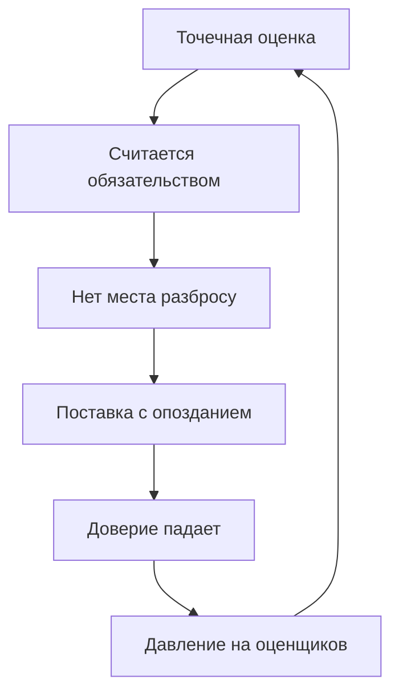
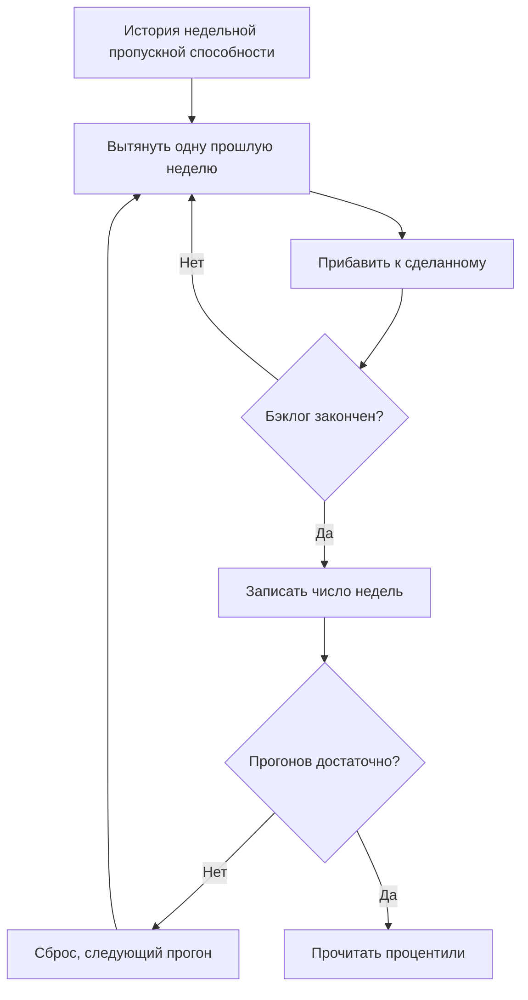
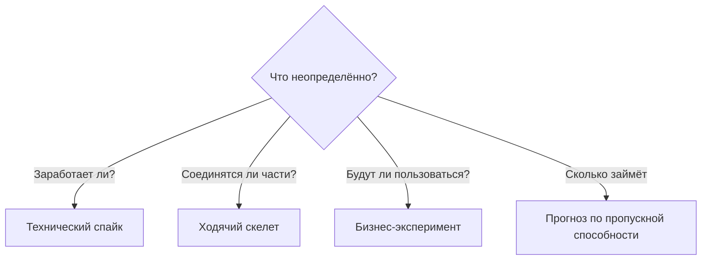

# Глава 17 — Предсказуемость и управление неопределённостью { #chapter-17-predictability-and-managing-uncertainty }

Каждому руководителю разработки задают вопрос: «Когда будет готово?» Эта глава о том, как отвечать на
него честно. Для этого нужно три вещи: прогнозировать поставку диапазоном с вероятностью, опираясь на
то, что команды действительно поставляли; не смешивать прогнозы, цели и обязательства; выстраивать
неопределённую работу так, чтобы самые крупные неизвестные прояснялись первыми. Сквозной пример —
Northstar Technologies, вымышленная компания из [кейса](../../case-studies/northstar/index.md): из
17 пунктов дорожной карты, по которым она взяла обязательства, в обещанном квартале вышли 7. Глава
отвечает на вопрос, что можно обещать, когда есть приоритизированный бэклог (глава 15) и измеренная
система поставки (глава 16).

## Почему это важно { #why-this-matters }

Для команды ненадёжная оценка обходится неловким разговором и несколькими поздними вечерами.

Для организации последствия сорванной даты расходятся дальше: продукт сказал продажам, продажи —
клиенту, финансы заложили выручку. Когда сроки разработки ненадёжны, другие подразделения закладывают
свои запасы или перестают верить разработке, а руководители требуют детальных планов и ежедневных
статусов. От этого поставка становится ещё медленнее и ещё менее предсказуемой.

Для высшего руководства предсказуемость — вопрос доверия совета директоров и клиентов. Amara Okafor,
CPO (директор по продукту) Northstar, хочет «дорожную карту, которую она пообещала клиентам, в
названные ею сроки»; от двух функций с датами зависят два продления на $9 млн. CTO, который не может
сказать, насколько вероятна дата, не может оценить и риск, на который идёт, обещая её.

Предсказуемость — это не скорость и не попадание в каждую дату: команда, которая обязуется сделать
совсем немного, попадает в каждую дату и почти бесполезна. Руководителям нужна **калибровка**: если
команда говорит, что уверена на 85 процентов, она права примерно в 85 процентах случаев. (Речь о
калибровке прогнозов, а не оценок результативности из главы 8.)

## Цели главы { #learning-objectives }

Прочитав эту главу, вы сможете:

- Объяснять, опираясь на исследования оценивания и ошибки планирования, почему точечные оценки работы
  над ПО систематически оптимистичны, а заявленные в них диапазоны неопределённости слишком узки.
- Строить прогноз поставки в виде диапазона с вероятностями по исторической пропускной способности
  команды, используя моделирование Монте-Карло, и называть допущения, на которых он держится.
- Применять прогнозирование по референтному классу, чтобы выверять план по прошлым результатам похожей
  работы.
- Различать прогнозы, цели и обязательства и сообщать о каждом так, чтобы другие могли на него
  опираться.
- Выстраивать неопределённую работу (спайки, ходячие скелеты, эксперименты) так, чтобы самые
  рискованные неизвестные снимались рано, и оценивать, когда новые люди помогут опаздывающему проекту,
  а когда навредят.

## Ментальная модель { #the-mental-model }

> **Ментальная модель:** дата поставки — это распределение вероятностей, а не число. Прогнозируйте
> распределение по истории, берите обязательства только с его осторожного края и тратьте первые недели
> на то, чтобы его сузить.

Во-первых, в тот момент, когда звучит вопрос «когда будет готово?», единственного ответа на него нет —
есть только диапазон возможных дат. Названная дата — лишь одна точка этого диапазона, выданная за весь
диапазон: в лучшем случае его середина, а часто и более ранняя точка. Во-вторых, привычки, сложившиеся
вокруг точечных дат, образуют петлю, которая всё сильнее портит сами даты:



Наиболее вероятная оценка превращается в обещание без поправки на разброс исходов, поэтому её срывают
примерно в половине случаев, даже если сама оценка была хорошей. Каждый срыв подрывает доверие. Чем
меньше доверия, тем сильнее давят в пользу дат, которые звучат приемлемо, и следующая оценка
сдвигается ещё раньше. В обзоре Jørgensen это названо оцениванием при конфликтующих целях: если оценка
должна ещё и понравиться руководителю или выиграть тендер, реализм проигрывает
([Jørgensen, 2004](../../references/bibliography.md#jorgensen2004review)).

Выход из этой петли задаёт план главы: прогнозируйте по тому, что уже произошло; отделяйте то, что вы
предсказываете, от того, чего хотите, и от того, что обещаете; выстраивайте работу так, чтобы диапазон
быстро сужался.

## Подробный разбор { #deep-conceptual-explanation }

### Что говорят исследования об оценивании { #what-the-research-says-about-estimating }

**Ошибка планирования** (planning fallacy) — склонность недооценивать, сколько времени займут
собственные задачи, даже когда похожие задачи в прошлом заняли больше. Термин ввели Kahneman и Tversky в
1979 году ([Jørgensen, 2004](../../references/bibliography.md#jorgensen2004review)). В пяти
исследованиях Buehler, Griffin и Ross обнаружили, что прогнозы людей о времени завершения собственной
работы стабильно слишком оптимистичны, а прогнозы о чужой работе — нет. Прогнозируя свою работу, люди
думали о планах и сценариях текущей задачи, а не о прошлом опыте. Когда их просили связать прогноз с
этим опытом, искажение в исследовании исчезало. Кроме того, прошлые неудачи участники объясняли
внешними разовыми обстоятельствами, и поэтому прошлое казалось им не относящимся к делу
([Buehler, Griffin, and Ross, 1994](../../references/bibliography.md#buehler1994exploring)). Это
**научный результат** об учебных и бытовых задачах отдельных людей, а не о командах разработки.

В разработке ПО, как показал обзор Jørgensen, чаще всего применяют экспертную оценку, и существенных
доказательств того, что формальные модели лучше, нет. Ссылаясь на более ранние работы, обзор сообщает
и о том, что эксперты задают явно слишком узкие диапазоны неопределённости: в одном исследовании
промышленных проектов фактические трудозатраты попали в диапазоны оценщиков меньше чем в половине
случаев ([Jørgensen, 2004](../../references/bibliography.md#jorgensen2004review)). Более поздний обзор
делает две оговорки. Во-первых, недооценка преобладала в инженерных и управленческих исследованиях, но
не в психологических, так что утверждение «люди всегда недооценивают» слишком сильное. Во-вторых,
многие исследования не разделяют трудозатраты (рабочие часы) и завершение (даты поставки), а это
разные вопросы ([Halkjelsvik and Jørgensen, 2012](../../references/bibliography.md#halkjelsvik2012origami)).

Вывод книги: не пытайтесь исправить оценки, требуя от людей стараться лучше. Опирайтесь на историю и
исходите из того, что любой экспертный диапазон уже, чем следует.

### Стори-поинты, покер планирования и размеры футболок { #story-points-planning-poker-and-t-shirt-sizes }

Большинство команд пользуются для оценки одной из трёх практик. Знайте, для чего годится каждая
(**рекомендация книги**; исследований, сравнивающих их по результатам поставки, не найдено):

| Практика | Что это | Хороша для | Слаба для |
|---|---|---|---|
| [Стори-поинты](../../glossary.md#velocity-and-story-points) | Относительный размер каждой задачи; скорость — поинты, закрытые за спринт | Выявления разногласий об объёме | Дат и любых сравнений между командами |
| Покер планирования (planning poker) | Все одновременно показывают оценки, затем авторы крайних объясняют свои | Выявления того, что знает один человек (скрытые профили из главы 13) | Скорости на большом бэклоге |
| Размеры футболок | Грубые классы вроде S, M, L | Быстрой сортировки длинного списка | Суммирования в план |

Ценность всех трёх — в разговоре. Если один инженер говорит 2, а другой 13, кто-то из них что-то знает,
и объём проясняется. Слабое место — следующий шаг, когда поинты или размеры складывают в дату. Так
воспроизводится описанная выше петля точечных оценок, только с лишней арифметикой. Некоторые
специалисты-практики обходятся без оценок и вместо этого считают задачи. Это работает, когда задачи
нарезаны примерно одного размера, — именно это и предполагает прогнозирование по пропускной
способности, о котором речь ниже. Оценивайте, чтобы понять работу; даты прогнозируйте по истории.

### Взгляд изнутри и взгляд снаружи { #inside-view-and-outside-view }

**Взгляд изнутри** строит прогноз по деталям проекта: задачам, людям, плану. **Взгляд снаружи**
игнорирует эти детали и спрашивает, сколько заняли сопоставимые проекты. Flyvbjerg, опираясь на работы
Kahneman и Tversky, а также Lovallo и Kahneman, превратил взгляд снаружи в метод —
**прогнозирование по референтному классу** (reference-class forecasting). Метод состоит из трёх шагов:
выбрать класс прошлых проектов, достаточно похожих, чтобы их сравнивать, и достаточно многочисленных,
чтобы сравнение имело смысл; построить распределение их результатов; найти место нового проекта в этом
распределении ([Flyvbjerg, 2006](../../references/bibliography.md#flyvbjerg2006nobel)). Статья различает
две причины ошибок прогноза, и лечат их по-разному: **оптимистическое искажение** (optimism bias) —
честная когнитивная ошибка, **стратегическое искажение данных** (strategic misrepresentation) — цифры,
намеренно заниженные ради одобрения.

В статье разобран пример министерства транспорта Великобритании. С 2004 года оно добавляло к бюджетам
проектов «надбавки на оптимистическое искажение». Их размер брали из перерасхода прошлых проектов того
же типа, и чем меньше перерасхода готовы были допустить, тем больше была надбавка. Для дорог она
составляла 15 процентов, если шанс уложиться в бюджет должен быть 50 процентов, и 45 процентов — при
шансе 90 процентов. Этот **научный результат** получен на государственной инфраструктуре; метод на ПО
переносится, цифры — нет.

В инженерной организации референтный класс — ваша собственная прошлая работа. Взгляд снаружи задаёт
вопросы вроде «Какую долю пунктов с обязательством мы поставили в обещанном квартале за последние
четыре квартала?» и «Насколько выросли после старта наши последние пять функций?».

### Прогнозирование по пропускной способности { #forecasting-from-throughput }

**Пропускная способность** — число задач, которые команда завершает за неделю (как её измерять,
описывает глава 16). История пропускной способности — самый полезный референтный класс у руководителя:
в ней уже учтено всё, что замедляло команду, — прерывания, отсутствия, очереди на ревью, неудачные
релизы.

**[Моделирование Монте-Карло](../../glossary.md#percentile-forecast-and-monte-carlo-simulation)** —
случайный эксперимент, повторённый много раз, чтобы увидеть разброс результатов, — превращает эту
историю в прогноз для бэклога из N задач:



Каждый прогон изображает будущее как случайную перетасовку прошлых недель. Тысячи прогонов складываются
в распределение: 50-й процентиль — дата, к которой успевают в половине случаев, 85-й — дата, к которой
успевают 85 раз из 100. Та же история отвечает и на обратный вопрос: сколько задач будет сделано к
фиксированной дате. Этот метод описан в практическом руководстве Vacanti по прогнозированию потока; там
же автор предостерегает от прогнозов по средним
([Vacanti, 2018](../../references/bibliography.md#vacanti2018when)).

!!! tip "Прогноз Монте-Карло в электронной таблице"
    1. Поместите историю недельной пропускной способности в один столбец, например `A1:A26`.
    2. На новом листе отведите строку 1 под один прогон. В `B1` введите
       `=INDEX(History!$A$1:$A$26, RANDBETWEEN(1, 26))` — число задач, завершённых в случайно вытянутую
       прошлую неделю. В `C1` введите `=B1 + INDEX(History!$A$1:$A$26, RANDBETWEEN(1, 26))` —
       нарастающий итог — и протяните вправо на 40 и более столбцов (по одному на будущую неделю).
    3. В столбце `A` той же строки посчитайте, сколько недель понадобилось, чтобы нарастающий итог
       достиг размера бэклога N: `=COUNTIF(B1:AO1, "<" & N) + 1`.
    4. Протяните строку вниз на 1 000–10 000 прогонов. Каждый пересчёт листа вытягивает недели заново.
    5. Прочитайте прогноз: `=PERCENTILE(A1:A10000, 0.85)` — 85-й процентиль в неделях; повторите для
       0.5 и 0.95.

    Чтобы ответить на вопрос «сколько будет сделано к неделе W», возьмите нарастающий итог каждого
    прогона на неделе W и прочитайте низкий процентиль (5-й для уверенности 95 процентов, 15-й — для
    85). То же самое делают бесплатные шаблоны и инструменты; вся их логика — здесь. Считать задачи
    имеет смысл, только если они нарезаны примерно одного размера, поэтому договоритесь о правиле
    нарезки (например, ничего крупнее недели работы) ещё до того, как начнёте собирать историю.

План, построенный на средней пропускной способности, оказывается около медианы и поэтому опаздывает
примерно в половине случаев — вот арифметика, которая стоит за петлёй из ментальной модели. Оценивать
размер каждой задачи методу не нужно: достаточно, чтобы соотношение размеров было похоже на прошлое.
Вместе с каждым прогнозом называйте его допущения:

- **Будущее похоже на выбранное прошлое.** Изменения в команде и новые виды работы это допущение
  нарушают; перезапускайте прогноз, когда система меняется.
- **Недели независимы.** На деле это не так (за плохой неделей с инцидентом часто следует ещё одна),
  поэтому диапазоны выходят несколько уже, чем нужно.
- **Объём известен.** Он никогда не бывает известен. Моделируйте его рост явно, по собственной истории.

### Прогнозы, цели и обязательства { #forecasts-targets-and-commitments }

McConnell разделяет **оценку** (предсказание), **цель** (бизнес-задачу, возможно, недостижимую) и
**обязательство** (обещание поставить определённую функциональность с заявленным качеством к
определённой дате). Он замечает, что руководитель, который просит оценку, часто хочет получить
обязательство или план достижения цели
([McConnell, 2006](../../references/bibliography.md#mcconnell2006software)). Обзор Jørgensen приходит к
тому же со стороны исследований: цена в тендере, плановые трудозатраты и наиболее вероятные
трудозатраты служат конфликтующим целям, а их часто не разделяют
([Jørgensen, 2004](../../references/bibliography.md#jorgensen2004review)). В книге используются три
термина:

| | Прогноз | Цель | Обязательство |
|---|---|---|---|
| Что это | Вероятностное утверждение о будущем | Результат, которого хочет организация | Обещание тому, кто будет на него опираться |
| Кто владеет | Команда и её руководитель | Руководство | Названный человек, обычно директор или выше |
| Форма | Диапазон с вероятностями | Один результат | Дата и определённый объём |
| Когда меняется | Когда приходит новая информация, еженедельно | Когда меняется стратегия | Редко; пересматривается рано и явно |
| Промах означает | Прогноз обновляется | Урок о масштабе амбиций или о ресурсе | Нарушенное обещание с последствиями |

Рекомендация книги: берите обязательства с осторожного края прогноза (85-й или 95-й процентиль) и
записывайте объём, а всё, что выше этой линии, помечайте как цель. Когда на вас давят: «возьмите
обязательство по цели», — от вас требуют обещания, которое, судя по истории, скорее всего будет
нарушено. Сказать это вслух, с прогнозом в руках, — ключевой навык в этой роли.

### Ранний съём рисков { #retiring-risk-early }

Прогнозирование по пропускной способности справляется с **изменчивостью** — нормальным разбросом
скорости, с которой делается знакомая работа. Но с **неопределённостью в самой работе** оно не
справляется: заработает ли дизайн, удастся ли интегрировать две системы, станут ли клиенты
пользоваться результатом. Здесь рычаг — порядок работы.

- **Спайк** (spike) — ограниченное по времени исследование одного технического вопроса («может ли
  pricing-svc рассчитать цены для файла заказа на 20 000 строк за окно обработки?»). Результат спайка —
  решение, а код выбрасывают.
- **Ходячий скелет** (walking skeleton) связывает основные компоненты сквозным путём ещё до того, как
  готов хотя бы один из них. Alistair Cockburn, который дал ему название, описывает его как работающую
  архитектуру, где компоненты соединены лишь тонкими связями
  ([Cockburn, 2004](../../references/bibliography.md#cockburn2004crystal)). В результате проблемы
  интеграции всплывают на второй неделе, а не на двадцатой.
- **Эксперимент** в том смысле, который популяризировала книга *The Lean Startup*, проверяет
  бизнес-допущение самым малым средством, способным дать доказательства
  ([Ries, 2011](../../references/bibliography.md#ries2011lean)). Продуктовому исследованию (discovery)
  как таковому посвящена глава 44.

В хорошо выстроенном плане диапазон прогноза быстро сужается уже в первой трети работы. Если к
середине он так же широк, как в начале, значит, трудные вопросы отложили.

### Добавление людей в опаздывающую работу { #adding-people-to-late-work }

Когда пункт с датой отстаёт, обычно предлагают добавить людей. Распространённая формулировка **закона
Брукса**: если добавить людей в опаздывающий программный проект, он задержится ещё больше
([Brooks, 1995](../../references/bibliography.md#brooks1995mythical)). Сам Brooks, по имеющимся
сведениям, называл этот закон упрощением. За ним стоят три механизма: время на вхождение в работу,
издержки на коммуникацию, которые растут с размером команды, и задачи, которые нельзя разделить.

Считайте это **мнением эксперта**, которое называет механизмы. Новые люди помогают, когда работа
чисто делится, новички знают код, а до даты остаётся достаточно времени, чтобы вхождение окупилось.
Они вредят, когда их добавляют поздно, на тесно связанную работу и когда те, кто вводит новичков в курс
дела, сами стоят на критическом пути. Вынести часть объёма обычно быстрее, чем ввести людей.

## Пример из инженерной организации { #engineering-organization-example }

!!! info "Northstar: что уже известно"
    Неделя 1, первый день директора. В базовом квартале Northstar вовремя поставила 7 из 17 пунктов
    дорожной карты с обязательством. Две функции для продлений, от которых зависит $9 млн годовой
    регулярной выручки, должны выйти в квартале 2: интеграция с бухгалтерской системой на неделе 19 и
    массовый заказ на неделе 26. См. [хронологию](../../case-studies/northstar/timeline.md). Впервые
    читаете о Northstar? Прочитайте [«Год вкратце»](../../case-studies/northstar/year-in-brief.md) и
    [действующих лиц](../../case-studies/northstar/cast.md).

Этот пример — **иллюстрация**: цифры пропускной способности и объёма придуманы специально для него.
Такой расчёт директор мог бы сделать сразу после прихода, по данным, которые были у него в первый день.
(Хроника Northstar сообщает лишь, что к Дню 90 обе функции для продлений шли по плану.)

Массовым заказом владеет команда Orders. Его обещали клиенту, который продлевает контракт, к
неделе 26 (концу квартала 2); в бэклоге он разбит на 44 задачи. Недавняя история Orders:

```text
Orders: плановых задач завершено за неделю, недели истории H1-H26
H1-H13:   6  4  7  3  5  8  2  6  5  4  7  6  0
H14-H26:  5  9  4  6  3  5  7  4  6  2  8  5  6
Итого 133, среднее 5.1, медиана 5, диапазон 0-9
```

Явные допущения:

- На массовом заказе работают пять инженеров Orders и два веб-инженера из Customer Experience — это
  половина численности Orders, поэтому на него приходится примерно половина исторической плановой
  пропускной способности команды.
- В Orders действует 10-процентное [выделение на профилактику](../../glossary.md#prevention-allocation):
  этот ресурс зарезервирован на устранение источников инцидентов и незапланированной работы.
  Предполагается, что выделение сохранится и в квартале 2, поэтому пропускная способность умножается
  на 0,9. Общий коэффициент — 0,45, то есть около 2,3 задачи в неделю.
- Незапланированная работа отдельно не учитывается: её влияние уже видно по тому, как мало плановых
  задач успели сделать.
- Последние четыре функции Orders после старта выросли на 15–35 процентов по числу задач; при росте на
  25 процентов 44 задачи превращаются в 55.

**Точечный план** делит 44 на 2,3 и получает 19,1: «примерно неделя 19, семь недель в запасе».
Моделирование Монте-Карло на 10 000 прогонов (в каждом неделя случайно вытягивается из 26 и
умножается на 0,45) даёт такой результат; при повторных запусках он может сдвинуться на неделю или на
одну задачу:

| Вопрос | 50% | 85% | 95% |
|---|---|---|---|
| Недель, чтобы закончить 44 задачи | 20 | 21 | 23 |
| Недель, чтобы закончить 55 задач | 24 | 27 | 28 |
| Задач завершено к неделе 26 (не меньше) | 60 | 55 | 52 |

Последняя строка — это уверенность завершить не меньше указанного числа задач: с вероятностью
95 процентов будет сделано хотя бы 52 задачи, а 60 — лишь с вероятностью 50 процентов.

Из таблицы следуют три вывода. Первый: точечный план расходится с медианой моделирования не больше чем
на неделю, как и должно быть; моделирование добавляет понимание того, что значит медиана, — шанс
50 процентов. Второй: 44 задачи к неделе 26 весьма вероятно будут сделаны. Но версия на 55 задач — а
именно её, судя по истории, и стоит ожидать — укладывается в срок лишь примерно в пяти прогонах из
шести. Риск для продления — в росте объёма, а не в пропускной способности. Третий: диапазон
моделирования уже реального. Моделирование предполагает независимые недели и неизменную команду. А
команда Orders на неделе 4 принимает модуль core/customer, на неделе 10 к ней присоединяются два
инженера по качеству, а у массовой загрузки есть известный повторяющийся сбой (INC-421: при массовой
загрузке терялись строки после 500-й). Считайте этот диапазон минимальным.

Что может сделать директор? Письменно согласовать с Amara Okafor и клиентом 44 задачи как договорной
объём, рост объёма пометить как цель и публиковать прогноз каждую неделю. Затем поставить в начало
самую рискованную работу: недельный спайк на расчёт цен для крупных заказов и ходячий скелет от
загрузки через order-capture и pricing-svc до выставления счетов. Тогда сюрприз всплывёт на неделе 2,
а не на неделе 22.

## Как принимать решение { #decision-framework }

Первое решение — понять, с какой неопределённостью вы имеете дело: у каждого вида своё средство.



У большинства крупных пунктов неопределённость не одного вида. Снимите первые три, прежде чем
опираться на четвёртый: если неизвестно, осуществима ли работа, прогноз по пропускной способности
точно отвечает не на тот вопрос.

Второе решение — какой метод прогнозирования подходит к имеющимся данным:

| Ситуация | Метод | На что смотреть |
|---|---|---|
| Три месяца и больше истории пропускной способности, знакомая работа | Монте-Карло по пропускной способности | Изменения системы, из-за которых история устаревает |
| Новая команда или новый вид работы | Референтный класс по сопоставимой работе, широкий диапазон | Льстящий референтный класс |
| Многокомандная инициатива | Референтный класс для целого, командные прогнозы для частей | Допущение, что целое успеет, потому что успевает медиана каждой части |
| Одна небольшая задача | Процентили [времени цикла](../../glossary.md#cycle-time) ([глава 16](16-flow-lead-time-dependencies-and-unplanned-work.md#flow-measures-throughput-cycle-time-and-work-item-age)) | 50-й процентиль, принятый за обещание |
| Чистое исследование | Временные рамки и дата решения, без прогноза поставки | Временные рамки, выданные за прогноз |

Третье решение — какой уверенности требует обязательство. Рекомендация книги: для обычных внешних дат
берите обязательство по 85-му процентилю, а там, где от даты зависит договор или продление, — по
95-му. И не берите внешних обязательств вовсе, пока не выполнена работа по снятию рисков, о которой
говорит первое решение.

## Компромиссы { #trade-offs }

**Точность против стоимости.** Оценки снизу вверх выглядят строгими и при этом съедают время тех, кто
будет делать работу. Прогнозирование по пропускной способности дёшево, но требует истории и
сопоставимой работы. Детальные оценки оставьте для работы, не похожей ни на что сделанное раньше.

**Уверенность против амбиций.** Обязательство по 95-му процентилю бережёт доверие, но на бумаге
выглядит как простаивающий ресурс. Ставьте рядом с обязательством цель: первое защищает клиента, второе
не даёт амбициям исчезнуть из виду.

**Ранняя работа с рисками против видимого прогресса.** Спайки и скелеты поначалу мало что дают
показать стейкхолдерам. Если же начать с простых экранов, прогресс виден раньше, но и дорогие сюрпризы
приходят позже. Объясните порядок работы заранее, иначе первые недели покажутся медленными.

**Фиксированная дата против фиксированного объёма.** Если дата договорная, переменной становится объём;
если зафиксирован объём — дата. Зафиксировав и то и другое при неизменной команде, вы лишаетесь всех
степеней свободы, и прогноз превращается в фикцию.

**Прозрачность против злоупотребления.** Публикуя прогнозы с вероятностями, вы провоцируете людей
слышать только оптимистичный край. Начинайте с осторожного числа, а медиану называйте вторым числом.

## Типичные провалы { #failure-modes }

**Обещание по медиане.** План строят по средней скорости или наиболее вероятной оценке и объявляют
как дату. Его срывают примерно в половине случаев. Как заметить: даты поставки каждый квартал съезжают
примерно на одну и ту же величину. Что делать: сообщать процентили; брать обязательства только с
осторожного края.

**Торг вокруг оценки.** Руководитель слышит оценку, спрашивает «а быстрее нельзя?», и инженер называет
меньшее число, хотя больше ничего не изменилось. Обзор Jørgensen описывает эту картину как конфликт
между реализмом и желанием угодить руководителю. Как заметить: оценки снижаются прямо на встречах, хотя
объём не менялся. Что делать: обсуждать объём и риск, но никогда — само число.

**Занижение обязательств (sandbagging).** Стоит начать оценивать команды по показателю
предсказуемости вроде «доли выполненных обязательств», как они берут меньше обязательств и закладывают
запас в то, что всё-таки берут. Показатель растёт, поставка — нет. Как заметить: доля выполненных
обязательств близка к 100 процентам, а пропускная способность падает. Что делать: измерять
**калибровку** (сбылись ли прогнозы с уверенностью 85 процентов примерно в 85 процентах случаев?)
вместе с пропускной способностью и не ранжировать команды ни по тому, ни по другому. Подгонку метрик в
целом разбирает глава 18.

**Замороженный прогноз.** Прогноз, сделанный на старте проекта, больше не обновляют. Как заметить: в
отчётах «идём по плану» — до тех пор, пока не появится «опаздываем». Что делать: перезапускать прогноз
каждую неделю и сообщать, как движется дата 85-го процентиля.

**Отложенный риск.** Сначала строят знакомые части, и проблема интеграции всплывает поздно. Как
заметить: на середине работы диапазон так же широк, как в начале. Что делать: спайки и ходячий скелет
в первой пятой части работы.

**Подбор удобного референтного класса.** Планировщик выбирает льстящее сравнение. Что делать:
определять референтный класс до того, как смотреть на результаты, и включать в него все сопоставимые
пункты.

## Применение в крупной организации { #enterprise-application }

**Каждая команда** ведёт историю недельной пропускной способности и роста функций, а также прогноз по
каждому пункту с датой, обновляемый раз в неделю. Для этого хватит электронной таблицы.

**Директор** отвечает за обязательства: просит у команд прогнозы, а не оценки, сравнивает план с
референтным классом организации и решает, какие пункты становятся внешними обязательствами. В Northstar
в обещанном квартале выходили примерно четыре пункта с обязательством из десяти; снова взять
обязательство по семнадцати — значит поставить на то, что новый квартал окажется не похож на последние
четыре.

**Многокомандные инициативы** требуют осторожности: зависимости накапливаются. Допустим, каждая из
двух команд закончит свою часть к дате с вероятностью 85 процентов, а нужны обе части. Тогда
инициатива успеет с вероятностью около 72 процентов, если части независимы, и с меньшей, если одна ждёт
другую. Зависимости разбирает глава 16, а для прогнозирования вывод такой: межкомандным обязательствам
нужен больший запас или меньше зависимостей.

**Ритм** (в операционную систему управления его встраивает глава 37): раз в неделю — обновление
прогнозов по пунктам с датами, раз в месяц — обзор калибровки по командам, раз в квартал — сессия
планирования, которая начинается с референтного класса, а не со списка желаний.

## Взгляд CTO { #cto-perspective }

Для CTO предсказуемость становится свойством обещаний, которые организация даёт внешнему миру.

**Мало обязательств, зато выполненных.** На договорных датах, регуляторных сроках и вехах для совета
директоров держится доверие к CTO. Пусть этот список будет коротким; каждый пункт подкрепляйте
осторожным прогнозом и называйте его владельца.

**Кто может брать обязательства.** Продажи и продукт всё равно будут обещать даты. Не запрещайте
этого, а задайте правило: никаких внешних дат без прогноза разработки с согласованной уверенностью и
никаких изменений объёма без нового прогноза.

**Взгляд на портфель.** На этом уровне результат в основном зависит от того, какие ставки сделаны, а не
от того, как оценена каждая из них. Мыслить референтными классами можно и на уровне портфеля: если
крупные инициативы исторически занимали в 1,5 раза больше запланированного, закладывайте эту поправку
в портфель, а не делайте вид, что каждая станет исключением. Экономику выбора между ставками разбирает
глава 45.

**Отчётность.** Докладывайте совету директоров диапазоны с указанной уверенностью и показывайте, как
калибровка менялась со временем. Фраза «Мы говорили о 85 процентах и попали в 9 случаях из
последних 11» весомее любой отдельной даты.

## Практический плейбук { #practical-playbook }

1. Соберите по каждой команде 13–26 недель истории пропускной способности (завершённые плановые
   задачи). Если размеры задач сильно различаются, сначала договоритесь о грубом правиле нарезки.
2. Подготовьте взгляд снаружи: сколько пунктов с обязательством за четыре квартала вышло в обещанном
   квартале и насколько выросли после старта последние пять функций.
3. Для каждого пункта с датой спрогнозируйте текущий объём и объём с поправкой на рост; запишите 50-й,
   85-й и 95-й процентили.
4. Определите, в чём неопределённость пункта: в технике, в интеграции, в бизнесе или в темпе. Для
   каждого из первых трёх видов запланируйте спайк, ходячий скелет или эксперимент в первой пятой части
   работы.
5. Записывайте каждое обязательство как дату и определённый объём по 85-му или 95-му процентилю;
   остальное помечайте как цель. Публикуйте прогнозы, цели и обязательства в отдельных столбцах.
6. Перезапускайте прогнозы каждую неделю. Как только 85-й процентиль по обязательству выходит за
   обещанную дату, поднимайте вопрос в ту же неделю и предлагайте варианты: сократить объём, принять
   риск или перенести дату.
7. Прежде чем добавлять людей в опаздывающий пункт, распишите, что они будут делать первые две недели и
   кто будет вводить их в курс дела. Если эти наставники стоят на критическом пути, сократите объём.
8. Раз в квартал проверяйте калибровку: сбылось ли событие по каждому прогнозу с уверенностью
   85 процентов? Поправляйте уровни уверенности, по которым берёте обязательства, а не самих
   оценщиков.

## Кейс { #case-study }

Этот кейс — **вымысел**. Действие происходит в базовом квартале, до прихода директора, когда из
17 пунктов дорожной карты с обязательством поставили 7 (см.
[данные исходного уровня](../../case-studies/northstar/baseline-data.md)). Как отбирали эти 17,
рассказывает глава 15; здесь к этой истории добавляется сторона прогнозов.

В главе 15 описана оценка размеров, которая на бумаге давала большой запас. Никто не сверил её с
историей, а за три предыдущих квартала поставили 6 из 15, 8 из 18 и 7 из 16 пунктов с обязательством.
Вместе с базовым кварталом (7 из 17) за четыре квартала выходит 28 из 66, или 42 процента. Все
17 пунктов ушли в продажи и к клиентам как обязательства, и Greg Tanaka (VP Sales) назвал несколько
этих дат в открытых сделках.

На обзоре дорожной карты в конце квартала 10 срывов разложили по основным причинам: четыре пункта
выросли в объёме уже после начала работы, три заблокировала другая команда, два вытеснила работа над
инцидентами, один понизили в приоритете. Ни в одном случае команда не работала медленно над тем, что
запланировала.

Суть главы — в двух наблюдениях. Первое: размеры, возможно, честно оценивали трудозатраты, но
трудозатраты — ещё не завершение. Сумма размеров ничего не говорит об ожидании других команд, росте
объёма или прерываниях, а квартал ушёл именно на них. Видимый запас был суммой наиболее вероятных
трудозатрат, которую приняли за прогноз поставки. Второе: взгляд снаружи лежал в собственных записях
Northstar. У пункта с обязательством был шанс около 40 процентов выйти в обещанном квартале, а метод
планирования не менялся. План, исходивший из чего-то другого, требовал обоснования, но его никто не
дал.

Что было дальше, показывает [хроника года 1](../../case-studies/northstar/first-quarter.md): на
неделе 4 Amara Okafor согласилась на просадку ресурса на функции при условии, что два обязательства
по продлению сохранят свои даты, и к Дню 90 оба шли по плану. Как перестроить квартальное
планирование, вы решите в упражнениях.

## Упражнения { #exercises }

Разборы упражнений — на странице [решений к главе 17](../../solutions/ch17-solutions.md). Данные
Northstar — на [странице исходного уровня](../../case-studies/northstar/baseline-data.md); история
пропускной способности Orders — в примере из инженерной организации выше.

### Базовый уровень { #foundational }

**F1.** Руководитель продукта берёт из этой главы 26 недель пропускной способности Orders без
поправки 0,45, делит на среднее бэклог из 40 задач и объявляет: «восемь недель». Проведите прогноз
Монте-Карло для того же бэклога или продумайте его. Объясните, какова вероятность успеть к дате через
восемь недель, каков 85-й процентиль и какие допущения моделирования, скорее всего, не выполнятся для
Orders в ближайшем квартале.

**F2.** Определите, что перед вами в каждом случае — прогноз, цель или обязательство, — и объясните,
что не так с утверждениями, которые выдают себя не за то, чем являются: Amara Okafor (CPO) говорит
совету директоров «массовый заказ выйдет к концу квартала 2»; Greg Tanaka (VP Sales) говорит
потенциальному клиенту «мы ожидаем функцию экспорта в квартале 3»; Priya Raman (руководитель Orders)
говорит команде «давайте постараемся закончить переделку загрузки за четыре недели»; инженер говорит
«наверное, две недели, если сервис цен не подведёт».

**F3.** На неделе 16 прогноз по массовому заказу съезжает. Greg Tanaka (VP Sales) предлагает
перевести четырёх инженеров из Data and Analytics в Orders до конца квартала. Оцените предложение,
исходя из механизмов закона Брукса и ситуации в Northstar, и скажите, что бы вы сделали вместо этого
или вдобавок.

### Прикладное лидерство { #applied-leadership }

**A1.** Команда Payments and Integrations отвечает за интеграцию с бухгалтерской системой; её обещали
к концу недели 19 второму клиенту, который продлевает контракт. Команда никогда не интегрировалась с
бухгалтерской системой этого клиента, а у erp-sync нет контрактных тестов. Спланируйте первые три
недели работы так, чтобы снять риски: какие спайки, какой ходячий скелет, какой эксперимент с клиентом
и на какое решение работает каждый из них. Скажите, когда вы будете готовы сообщить Amara Okafor,
насколько вы уверены.

**A2.** Спроектируйте процесс квартального планирования Northstar на квартал 3: обязательства по
продлению уже позади, и шесть команд снова будут предлагать пункты дорожной карты. Процесс должен
опираться на референтный класс за четыре квартала, отделять обязательства от целей и определять, кто
может брать внешние обязательства. Объясните также, как вы поступите с руководителями, которые
заявят, что работа их команды слишком уникальна, чтобы прогнозировать её по истории.

**A3.** Неделя 18. Объём массового заказа теперь составляет 60 задач, и еженедельный прогноз даёт
шанс 62 процента закончить к неделе 26; для 44 договорных задач шанс — 93 процента. Напишите
обновление для Amara Okafor: что вы ей сообщите, в каком порядке, какие варианты предложите и что
порекомендуете. Учтите, что она уже обжигалась на датах разработки.

### Решения на уровне руководства { #executive-decision-making }

**X1.** CEO Helena Marsh просит вас, CTO, представить совету директоров годовую дорожную карту из
двенадцати пунктов с датами, «по которым разработка берёт обязательство». Что вы представите, как
выразите уверенность и как ответите на желание совета директоров получить определённость, не потеряв
его доверия?

**X2.** После закрытия продлений Greg Tanaka (VP Sales) хочет получить право обещать потенциальным
клиентам даты поставки пунктов дорожной карты: без них сделки буксуют. Предложите политику внешних
обязательств по датам в Northstar: кто может брать обязательства, на основании каких доказательств, с
какой уверенностью, что происходит, когда прогноз выходит за обещанную дату, и как через два квартала
вы поймёте, работает ли политика.

## Вопросы для размышления { #reflection-questions }

1. Когда кто-то в вашей организации в последний раз просил оценку, чего он хотел — прогноза, цели или
   обязательства? И что вы ему дали?
2. Что служит вашей организации референтным классом для дорожной карты и что он показал бы?
3. Чьи оценки на ваших встречах сторговывают вниз и кто торгуется?
4. Если бы завтра прогнозы ваших команд стали идеально откалиброванными, каким руководителям стало бы
   неуютно от того, что они показывают?
5. Какой из ваших текущих проектов сначала строит знакомые части? Чего стоило бы заняться самым
   трудным неизвестным уже на следующей неделе?
6. Когда в последний раз добавление людей в опаздывающий проект у вас сработало и что тогда было
   иначе?

## Главное { #key-takeaways }

- Дата поставки — это распределение. Точечная оценка в лучшем случае приходится на его середину и
  срывается примерно в половине случаев, даже когда сама оценка хороша.
- Исследования оценивания показывают: о собственной работе люди судят оптимистично, а диапазоны задают
  слишком узкие. Исправляйте это историей, а не призывами.
- Прогнозируйте по пропускной способности с помощью моделирования Монте-Карло и называйте его
  допущения: диапазон моделирования уже реального, особенно когда растёт объём.
- Смотрите снаружи: собственная история похожей работы — лучшая поправка к любому плану.
- Разделяйте прогнозы, цели и обязательства; у каждого из них свой владелец. Берите обязательства с
  осторожного края прогноза и записывайте объём.
- Выстраивайте неопределённую работу так, чтобы самые рискованные вопросы получали ответ первыми:
  спайки, ходячие скелеты, эксперименты. Если диапазон не сужается рано, это тревожный сигнал.
- Вынести часть объёма обычно быстрее, чем ввести людей; почему — объясняют механизмы закона Брукса.
- Измеряйте калибровку, а не долю выполненных обязательств, и никогда не ранжируйте команды по
  предсказуемости.

## Источники и что почитать { #references-and-further-reading }

- [Buehler, Griffin, and Ross, 1994](../../references/bibliography.md#buehler1994exploring). Ключевые
  исследования ошибки планирования и того, что её уменьшает.
- [Flyvbjerg, 2006](../../references/bibliography.md#flyvbjerg2006nobel). Прогнозирование по
  референтному классу, оптимистическое искажение и стратегическое искажение данных, с применением в
  государственном секторе. Доступна бесплатно на arXiv.
- [Jørgensen, 2004](../../references/bibliography.md#jorgensen2004review). Экспертная оценка в
  разработке ПО и двенадцать рекомендаций, опирающихся на данные; хорошая точка входа в исследования.
- [Halkjelsvik and Jørgensen, 2012](../../references/bibliography.md#halkjelsvik2012origami). Более
  широкий обзор прогнозов времени в разных дисциплинах, с предостережениями против чрезмерных обобщений.
- [McConnell, 2006](../../references/bibliography.md#mcconnell2006software). *Software Estimation*.
  Различие между оценками, целями и обязательствами — с позиции практика.
- [Vacanti, 2018](../../references/bibliography.md#vacanti2018when). *When Will It Be Done?*
  Практическое руководство по процентильному прогнозированию и прогнозированию Монте-Карло по данным
  потока.
- [Cockburn, 2004](../../references/bibliography.md#cockburn2004crystal). *Crystal Clear*. Метод для
  небольших команд от практика, давшего название ходячему скелету.
- [Ries, 2011](../../references/bibliography.md#ries2011lean). *The Lean Startup*. Эксперименты, которые
  проверяют допущения до начала разработки.
- [Brooks, 1995](../../references/bibliography.md#brooks1995mythical). *The Mythical Man-Month*.
  Классические эссе о планировании программных проектов, включая закон Брукса.
- [Reinertsen, 2009](../../references/bibliography.md#reinertsen2009principles). *The Principles of
  Product Development Flow*. Экономический взгляд на поток в разработке продуктов; фон для глав 16 и 45.
