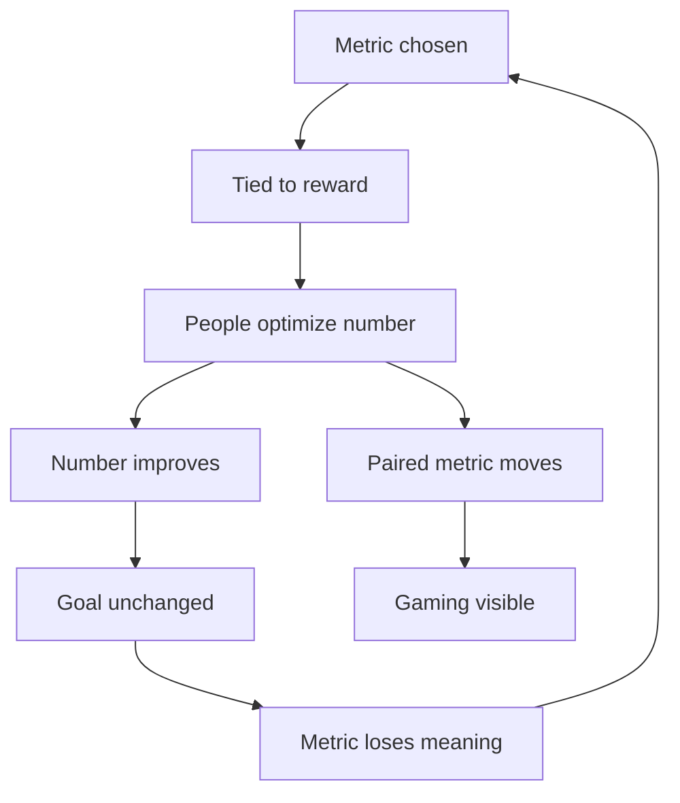
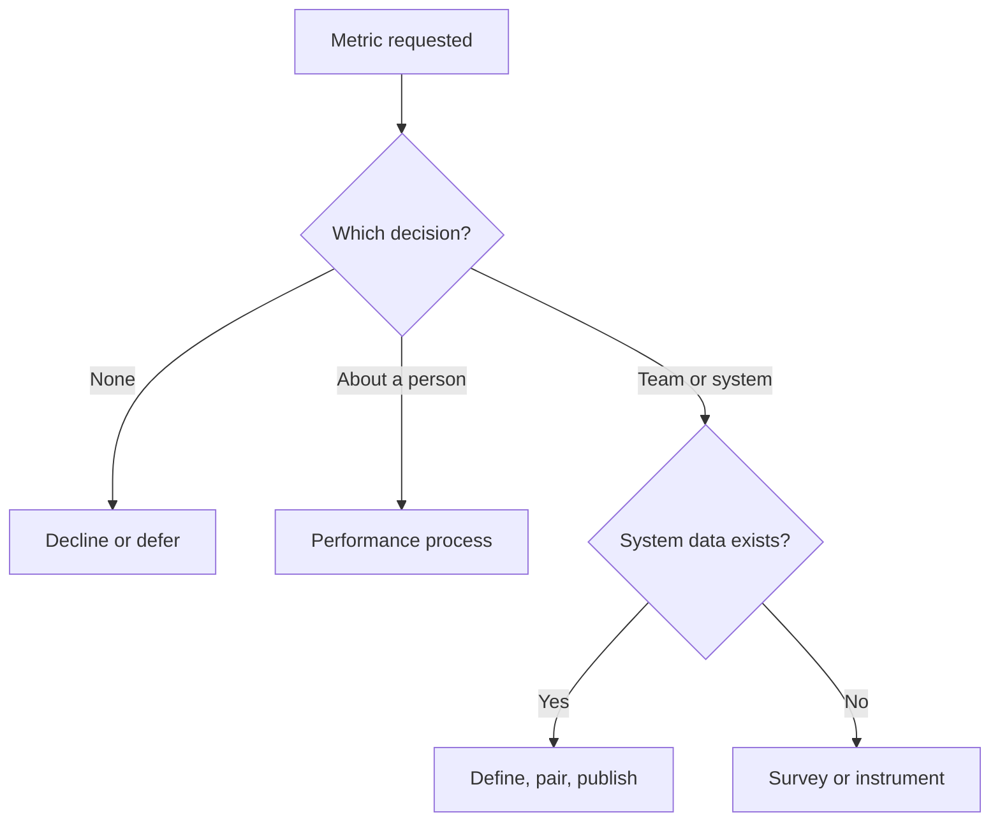

# Chapter 18 — Measuring Engineering Productivity: DORA, SPACE, and Their Limits

Sooner or later someone senior asks how productive engineering is, and wants one number. This chapter
explains what the best-known measurement frameworks measure, how their evidence was produced, how every
metric gets gamed, and why the book refuses to score individual engineers with delivery metrics. Related
topics have their own chapters. They are flow and lead time from commitment to customer (Chapter 16), quality
measures ([Chapter 19](../05-engineering-quality/19-defining-measuring-and-owning-quality.md)), the
quality scorecard ([Chapter 27](../05-engineering-quality/27-quality-transformation-at-enterprise-scale.md)),
scorecards in the operating system (Chapter 38), individual performance (Chapter 9), and claims about AI
and productivity (Chapter 54).

## Why This Matters

**For a team**, measurement is a feedback loop. A team that sees its
[change lead time](../../glossary.md#lead-time) (commit to running in production) and its
[change failure rate](../../glossary.md#change-failure-rate) (share of deployments that fail) can tell
whether last month's pipeline work helped.

**For an organization of 50 to 150 engineers**, measurement is how a director sees work they no longer
touch. It is also where damage starts: numbers useful as feedback get copied into slides, compared across
teams, and attached to goals. Then people optimize the number, and the director loses the view it gave.

**For executives**, the question arrives in financial form. Engineering is often the largest operating
expense the CFO cannot explain line by line. Sales has quota attainment; why does engineering not have
output per engineer? The question is legitimate. "Engineering cannot be measured" invites someone else to
pick the metric; a per-engineer activity count destroys the information it is meant to provide. The third
answer: measure the system, in pairs, for improvement, and translate it into what executives must decide.

## Learning Objectives

After this chapter you will be able to:

- State what each DORA metric measures, how DORA's research was produced, and what that evidence cannot
  tell you about your own organization.
- Build a balanced measurement set that combines system data with developer-experience measures, using
  SPACE and DevEx as checklists rather than scorecards.
- Predict how each metric will be gamed, and pair it with a measure that exposes the gaming.
- Explain, with reasons an executive will accept, why you will not score individual engineers with
  delivery or activity metrics, and offer something better.

## The Mental Model

> **Mental model:** A metric is a question you ask a system, not a verdict on a person. Any number used
> to reward or rank will be optimized, so measure systems rather than individuals, in pairs, and for learning.

The first idea is the **chain from effort to impact**. Kent Beck and Gergely Orosz describe software work
as a chain: effort (planning, coding) produces output (code, features), output changes customer behavior
(outcome), and changed behavior produces business value (impact)
([Orosz and Beck, 2023](../../references/bibliography.md#orosz2023measuring)). Effort and output are easy
to count and easy to inflate. Outcomes and impact are what the business wants, and hard to attribute to
one person. Delivery metrics such as DORA's sit between output and outcome: they measure how safely and
quickly changes reach users, not whether the changes were worth making.

The second idea is the **gaming loop**. Donald Campbell is usually credited with the observation that an
indicator relied on for decisions comes under pressure that bends both the number and the activity it
was meant to track ([Campbell, 1979](../../references/bibliography.md#campbell1979assessing)). The popular
version, "when a measure becomes a target", is called Goodhart's law. The book credits both for the idea,
not for any exact wording.

The loop is not about bad people; it is what intelligent people do when a number decides their bonus or
promotion. The defense is design: choose the level of measurement, pair measures so that gaming one moves
the other, and keep learning measures apart from judging ones.

## Deep Conceptual Explanation

### What the DORA metrics measure

DORA (DevOps Research and Assessment, now part of Google Cloud) publishes the most widely used delivery
metrics, the [DORA metrics](../../glossary.md#dora-metrics). Its current guide (January 2026) lists
**five** metrics in two groups, not the "four keys" many dashboards still show
([DORA, metrics guide](../../references/bibliography.md#dora-metrics-guide)):

| Group | Metric | What it measures |
|---|---|---|
| Throughput | Change lead time | Time from commit to version control to deployment in production |
| Throughput | Deployment frequency | Deployments over a period, or time between them |
| Throughput | Failed deployment recovery time | Time to recover from a deployment that needs immediate intervention |
| Instability | Change fail rate (DORA's term; this book says change failure rate) | Share of deployments needing immediate intervention, such as a rollback or hotfix |
| Instability | Deployment rework rate | Share of deployments that are unplanned and caused by a production incident |

Three properties matter. The metrics describe **a delivery system**: the guide applies them to one
application or service at a time and warns that comparing very different applications misleads. They say
nothing about **whether the right things were built**. And the guide warns that making them goals makes
gaming more likely, and that the aim is improvement over time, not competition between teams.

Definitions change. Recovery time sits under throughput in this version and rework rate is new, so an
older dashboard may show different metrics under the same labels. Local definitions differ too: Northstar
counts a release as failed if a hotfix, rollback, or linked incident follows within 72 hours, which is not
DORA's definition ([Chapter 23](../05-engineering-quality/23-code-review-ci-cd-and-release-engineering.md#change-approval-and-pipeline-outcomes)).
Compare an organization with itself over time, under one written definition.

### How the research was produced, and what it cannot tell you

DORA's claims rest on an annual survey. The 2023 report's methodology describes recruiting through blog
posts, email, social media, and snowball sampling (people forwarding the survey), topped up with a
panel to reach under-represented groups and industries. Nearly 3,000 professionals responded that year,
more than 36,000 over the program's life. Survey items are grouped into constructs validated with factor
analysis, and hypothesized models are tested with Bayesian structural equation models
([DORA, 2023](../../references/bibliography.md#dora2023accelerate)). *Accelerate* presents earlier years
of the program for a general audience
([Forsgren, Humble, and Kim, 2018](../../references/bibliography.md#forsgren2018accelerate)).

This is serious **industry research**, and its limits follow from its design:

- **Self-report.** Respondents estimate their own lead time and failure rate; nobody checks pipelines.
- **Self-selection.** People who answer a DevOps survey are not a random sample of organizations.
- **Changing samples.** DORA's FAQ says each year's respondents differ (though probably overlap), that some
  year-to-year shifts may be sampling artifacts, and that a new finding is suspect until replicated
  ([DORA, FAQ](../../references/bibliography.md#dora-faq)).
- **Causal claims rest on models.** The 2023 methodology discusses confounding openly and specifies causal
  models to decide what to control for, while acknowledging that not every bias can be captured.

So when the guide states that speed and stability are not trade-offs, read it as: across many
self-selected organizations, those reporting fast delivery also tend to report stable delivery. That is
good evidence that the trade-off is not a law. It is not evidence that deploying more often will reduce
*your* failures; the mechanism (smaller batches are easier to test, diagnose, and roll back) is plausible
and has to be tested in your own data. The evidence on this is contested, and that is the book's
position.

### SPACE: a checklist of dimensions

[SPACE](../../glossary.md#space) says developer productivity has several dimensions and cannot be
captured by one metric. The article, by Nicole Forsgren, Margaret-Anne Storey, and colleagues at GitHub
and Microsoft Research, argues in its abstract that productivity is more than an individual's activity
or the efficiency of engineering systems
([Forsgren et al., 2021](../../references/bibliography.md#forsgren2021space)). A post by Forsgren names
the five dimensions ([Forsgren, 2023](../../references/bibliography.md#forsgren2023navigating)). A GitHub
summary gives their long forms, advises using at least three, and calls activity the most common and most
misused measure ([Alwell, 2021](../../references/bibliography.md#alwell2021measuring)).

The table makes each dimension usable. The measures and questions are **this book's illustration**, not
part of SPACE:

| Dimension | What it asks | One system measure | One survey question | How it is gamed |
|---|---|---|---|---|
| Satisfaction and well-being | Are people fulfilled, healthy, and likely to stay? | After-hours pages per person; attrition | "How likely are you to be working here in a year?" | Managers lobbying for answers |
| Performance | Did the work achieve its outcome? | Change failure rate; customer-reported defects | "How often does work you ship do what it was meant to?" | Redefining the outcome after the fact |
| Activity | How much work was done? | Deployments or merged pull requests, team level only | Rarely worth asking | Splitting work into trivial pieces |
| Communication and collaboration | How well do information and work move between people and teams? | Review wait; wait on other teams | "How easy is it to get help from another team?" | Rubber-stamp reviews to cut the wait |
| Efficiency and flow | Can people make progress without interruption and delay? | Change lead time; pipeline duration; unplanned work share | "How often are you interrupted during focus time?" | Starting the clock late; relabeling interrupts |

Read SPACE as a **checklist against blind spots**. A set that is all activity (commits, pull requests,
tickets) misses burnout and whether work reaches anyone; a set that is all satisfaction misses whether
anything ships. Several dimensions, including one gathered by survey, make the set harder to game, because
improving one dimension at another's expense becomes visible.

### Developer experience (DevEx)

A 2023 article by Abi Noda, Margaret-Anne Storey, Nicole Forsgren, and Michaela Greiler frames
[developer experience](../../glossary.md#developer-experience-devex) as how developers experience their
daily work and its friction. It proposes measuring it by combining developer feedback with
engineering-system data ([Noda et al., 2023](../../references/bibliography.md#noda2023devex)). The first
author's company names the three dimensions as **feedback loops** (how quickly
and well tools and people respond), **cognitive load** (the mental effort to complete tasks and navigate
systems), and **flow state** (focus without interruption)
([DX, DevEx report](../../references/bibliography.md#dx-devex-report)). That company sells this kind of
measurement, and the claim that better developer experience improves business outcomes is the authors'
argument, not a quantified result.

DevEx points at **causes** a manager can change. A long change lead time is an outcome; a 21-hour wait for
first review is a feedback loop, and fixing it is a decision. Pairing a survey question ("how often do slow
reviews block you?") with the system measure is stronger than either: the survey finds friction no system
logs, and the system data keeps the survey from becoming a popularity poll.

### The 2023 dispute about measuring individuals

In August 2023 McKinsey published "Yes, you can measure software developer productivity"
([Gnanasambandam et al., 2023](../../references/bibliography.md#mckinsey2023productivity)). It proposes building on DORA and SPACE with
"opportunity-focused" measures: time in the inner loop (coding, building, unit testing) versus the outer
loop (integration, release, deployment), a benchmark survey, a talent capability score, and **contribution
analysis**, which assesses individuals' contributions to a team's backlog from tools such as Jira,
normalized with a proprietary algorithm. It reports results at nearly 20 companies, including 20 to 30
percent fewer customer-reported defects, with no method, baseline, or comparison group, so those figures
are claims, not evidence. It also notes that deployment frequency is not useful for tracking individuals
and that counting commits invites gaming.

Orosz and Beck's response argues that most of the new measures sit at the effort and output end of the
chain, that measuring individuals changes behavior, and that the framework will likely harm engineering
culture ([Orosz and Beck, 2023](../../references/bibliography.md#orosz2023measuring)). Their sharpest
evidence is Beck's account of Facebook's developer surveys: useful for about a year, then turned into a
score, used in performance reviews, and rolled up to managers, after which pressure and negotiation left
the company knowing less than before. They also concede the executive's point: leaders who refuse to
answer will have someone else's answer imposed.

Neither side offers controlled evidence; the book labels both **expert opinion**. The question is
contested, and the next section states the book's position.

### How each metric is gamed, and its pair

Gaming is rarely fraud; it is mostly reclassification, splitting, timing, and selective attention.

| Metric | How it is gamed | Pair it with |
|---|---|---|
| Deployment frequency | Splitting changes into trivial deploys; deploying empty or configuration-only changes | Lead time per change; change failure rate |
| Change lead time | Starting the clock late (squashing commits before merge); doing easy work first | Commitment-to-delivery lead time (Chapter 16); age of oldest open work |
| Change failure rate | Not linking failures; calling them "configuration issues"; deploying less | Deployment frequency; audited incidents with no linked deployment |
| Failed deployment recovery time | Closing the incident when a workaround starts; opening a new one for the rest | Customer-reported duration; reopened incidents |
| Deployment rework rate | Labeling an incident fix as planned work | Incidents followed by a deployment within a day |
| Pull requests or commits per person | Splitting work; avoiding review, pairing, and incident work | Do not use for individuals |
| Survey scores | Managers lobbying for answers; strategic answering once scores matter | Response rate; system data on the same friction |
| Incident counts by severity | Rating incidents below the tracked level | Customer-detected share; [severity audit](../05-engineering-quality/25-incidents-postmortems-and-change-failure-analysis.md#severity-definitions-that-resist-reclassification) |

These are the general rules for delivery measurement, and Chapter 27 applies them to quality in its
[scorecard rules](../05-engineering-quality/27-quality-transformation-at-enterprise-scale.md#scorecard-design-rules).
Prefer system data to human classification and audit what
remains; report distributions, not only medians; prefer measures built from many events; and publish the
definition, its weaknesses, and its owner next to the number.

### Why the book refuses individual productivity scoring

The book's position on a contested question: **measure delivery and developer experience at team and system
level, for improvement; do not score individual engineers with delivery or activity metrics.** This is
**this book's recommendation**, for five reasons:

1. **Attribution.** Software is produced through shared code, reviews, and pipelines. A change ships fast
   because someone reviewed it quickly and someone built the pipeline; credit to the committer is taken
   from them.
2. **Only effort and output can be counted per person.** The work that most raises a team's output
   (reviewing, mentoring, incident response, design, deleting code) lowers the person's own count.
3. **Gaming is certain and cheap.** Splitting one change into five pull requests takes minutes.
4. **The numbers are noise.** One engineer's quarter has too few events and too much variation in task
   difficulty to separate skill from assignment.
5. **It destroys the instrument.** Once data judges people, people change what they report and how they
   work. The Facebook account illustrates exactly this.

This is not refusing to assess people. Individual performance is judged through evidence of impact and
behavior (Chapter 9); delivery data can open a conversation, not deliver the verdict.

## Engineering Organization Example

!!! info "Northstar so far"
    This example uses the baseline quarter, before the director arrived: 30 Sev1 and Sev2 incidents (the
    two highest severity levels), 34 percent of capacity on unplanned work, and Core shipping on a
    two-week release train. The case study below moves to the start of quarter 2 (week 14). See the
    [timeline](../../case-studies/northstar/timeline.md).

This example is **illustrative**. It uses Northstar's fictional baseline to show what a "deployments per
engineer" league table would say. Deployments per month are from `teams.csv`; quarterly figures assume
three equal months.

| Team | Engineers | Deploys per month | Per engineer | Change failure rate | Failures in a quarter (approx.) | 95% interval |
|---|---|---|---|---|---|---|
| Payments and Integrations | 12 | 22 | 1.83 | 21% | 14 of 66 | 13–33% |
| Customer Experience | 15 | 26 | 1.73 | 17% | 13 of 78 | 10–26% |
| Platform Operations | 12 | 14 | 1.17 | 15% | 6 of 42 | 7–28% |
| Data and Analytics | 11 | 11 | 1.00 | 12% | 4 of 33 | 5–27% |
| Orders | 14 | 11 | 0.79 | 29% | 10 of 33 | 17–47% |
| Billing | 13 | 8 | 0.62 | 34% | 8 of 24 | 18–53% |

The intervals are Wilson score intervals, a standard way to state the uncertainty of a proportion from a
small count. Four readings:

**The ranking measures architecture.** Orders and Billing ship most changes through the Core
[release train](../../glossary.md#release-train), a release that left on a fixed schedule twice a month
carrying every ready change. Their low counts describe the train; ranking their engineers lower would blame them
for a system they did not choose.

**The denominator is wrong.** Seven of Platform Operations' 12 people are QA engineers who do not deploy.
Per deploying engineer, the team is at 2.8, the highest in the organization.

**The rates are too noisy to rank.** Every team's interval overlaps every other team's. One quarter of
rates cannot even separate Billing from Customer Experience; the case that the Core train is the problem
rests on the incident data and the mechanism, not on a ranking.

**Counts and rates disagree.** Payments and Integrations has a lower failure rate than Orders but more
failed deployments (about 4.6 a month against 3.2), because it deploys twice as often. Which is better
depends on how large each failure is and how fast it is recovered.

If this table entered the budget pack, teams would rise fastest by splitting deployments. The number would
rise; the director would learn nothing.

## Decision Framework

Every request for a metric has a decision behind it. Find the decision first.

"Performance process" means the manager's evidence-based assessment (Chapter 9), not a number.

| Question | Measure | Level | Pair | Source |
|---|---|---|---|---|
| Are we delivering safely and fast? | DORA throughput and instability | Service, rolled up to team | Each other | Pipeline and incident events |
| Are we delivering what we promised? | Committed items delivered and forecast calibration (Chapter 17) | Organization; teams against own trend | Throughput | Planning tool |
| Where is the friction? | Review wait, pipeline time, main-branch red time, flaky failures | Repository, team | DevEx survey on the same friction | Code host, CI |
| Are people sustainable? | Satisfaction, burnout, on-call load | Team, minimum group size | Attrition, response rate | Survey, paging tool |
| Where does the money go? | Capacity by category (features, prevention, unplanned) | Organization | Outcomes per category | Planning tool, time sampling |

The last row is usually what a CFO's productivity question is really about.

## Trade-offs

**System against perceptual data.** System data is cheap once instrumented and blind to friction that
leaves no trace (unclear requirements, waiting on an answer in chat). Surveys see that friction, cost
people's time, and degrade if over-used or weaponized. Use both; ask fewer, better questions.

**Standard against local definitions.** DORA's definitions allow comparison with research; local ones may
fit the business better (Northstar's 72-hour window catches slow-burning failures). Pick one per metric,
write it down, and change it only with a dated note.

**Transparency against gaming pressure.** Publishing every team's numbers company-wide adds accountability
and pressure to optimize. A middle course: team numbers visible to the team, its manager, and the
director's staff; aggregates reported upward.

**Instrumentation cost against quality.** One event stream from four CI systems is real work; a
hand-joined spreadsheet is cheaper and silently wrong.

**Buying against building.** Commercial engineering-analytics tools assemble data quickly and arrive with
per-person views and leaderboards switched on. Switch them off before anyone sees them.

## Failure Modes

**The leaderboard.** Per-engineer or per-team rankings appear in a slide, usually with good intent.
Signal: people ask how the number is computed so they can move it. Countermeasure: no rankings; teams
compare with their own trend.

**The single number.** A composite "productivity index" replaces the set. Signal: nobody can say what
moved it. Countermeasure: keep the pairs separate and show them together.

**Survey weaponization.** Experience scores enter managers' objectives; managers lobby; candor falls.
Signal: scores rise while attrition and incident load do not improve. Countermeasure: results belong to the
team and its manager, never to anyone's rating.

**Definition drift.** A definition changes silently (a new deployment counter, a new incident category).
Signal: a step change nobody can explain. Countermeasure: a definitions page with an owner and change log.

**Benchmark envy.** An executive sets a published "elite" lead time as a target. Signal: a target with no
mechanism. Countermeasure: answer with the mechanism (batch size, review wait, release cadence) and a plan.

**Dashboard without decisions.** Metrics nobody discusses. Countermeasure: every metric has a forum and an
owner, or is switched off (Chapter 37).

## Enterprise Application

At 50 to 150 engineers, measurement needs an owner, a definitions page, and plumbing.

**Ownership.** One person, often a staff engineer with platform engineers, owns definitions and the data
pipeline. The director decides which metrics exist and where they are used; managers act on their team's.

**Plumbing.** Every pipeline emits the same deployment event (service, version, time, commit range,
result) to one store, and incidents are linked to deployments in the incident tool. Until then, every
number carries an asterisk.

**Developer-experience survey.** Twice a year, about 15 questions, anonymous, reported only for groups of
at least five (a threshold that is this book's recommendation). Teams pick one or two frictions to fix;
the director looks for friction shared across teams, usually platform work.

**Cadence and access.** Delivery metrics reviewed monthly by team and quarterly for the organization
(Chapter 38 covers scorecards and capacity allocation; the
[quality scorecard template](../../templates/engineering-quality-scorecard.md) runs alongside). Access rules
are written before the first dashboard ships, including that no per-person view exists.
## CTO Perspective

At executive level, "how productive is engineering?" usually means one of three questions, and none is
answered by a per-engineer count.

**Are we getting value for the money?** Answer with where capacity goes (new capability, prevention,
unplanned work) and what the largest investments produced. That is the language of Chapter 45's economics
and Chapter 52's budgeting, and a CFO can use it.

**Can we go faster?** Answer with the constraint: where work waits and what removing the wait would cost.
DORA's throughput metrics and the friction measures locate it.

**Are we competitive?** Benchmarks tempt most here and mislead most: self-selected respondents, other
definitions.

The CTO also protects the instrument. A per-engineer number admitted to the board pack is hard to remove,
and every later productivity claim, including the AI tool claims of Chapter 54, will be argued in it.

## Practical Playbook

1. **List the decisions** measurement must support: delivery health, friction, capacity allocation,
   executive reporting. Drop metrics that support none.
2. **Inventory sources**: each pipeline, incident tool, and planning tool, what it records, who joins it.
3. **Define each metric** on one page: formula, source, unit of analysis, owner, gaming paths, pair. Use
   DORA's current definitions unless you record a reason not to.
4. **Instrument deployment events** from every pipeline into one store, starting where most change flows.
5. **Publish a baseline quarter** before any target, with event counts or intervals next to rates.
6. **Run the developer-experience survey**, paired with system data on the same friction; results go back
   to teams within two weeks and never into performance ratings.
7. **Write the access rules** before the first dashboard.
8. **Prepare the executive answer**: capacity by category, delivery trend, investment outcomes, and the
   reasons for not reporting per-person output.
9. **Review the set every six months**: retire unused metrics, check for drift and gaming.

## Case Study

This case is **fictional**. It describes how Northstar measures delivery at baseline and a decision the
reader faces at the start of the director's second quarter. Quarter 1 cut Sev1 and Sev2 incidents from
30 to 21 and moved Core to weekly releases
([the director's first quarter](../../case-studies/northstar/first-quarter.md)).

**How delivery is measured today.** Deployment counts and lead times come from pipeline logs in four CI
systems, joined by hand; the four shell-script services log nothing, so their numbers are estimates from
chat history. Change failure rate links releases to hotfixes, rollbacks, and incidents within 72 hours,
manually, so unlinked failures are missed. Unplanned work comes from a two-week sample of ticket types.
One Platform Operations infrastructure engineer spends about two days a month assembling these numbers in
a spreadsheet. Before the director arrived, the only engineering figures in the CEO's monthly board pack
were committed roadmap items delivered and the Sev1 and Sev2 count. No developer survey had been run in
the previous two years.

The first quarter's headline delivery figures (Core change failure rate from 31 to 22 percent) came from
the same hand-joined data, and were reported with that caveat.

**The request (a decision the reader faces).** At the start of quarter 2, preparing next year's budget,
Rajiv Menon (CFO) asks for an output-per-engineer figure by team for the budget pack. Operating expense is
flat, the board has asked whether 80 engineers are used well when 41 percent of committed roadmap items
shipped on time in the baseline quarter, and a consultancy article he was sent says this can be measured.
Helena Marsh (CEO) supports the request.

**The director's proposed measurement set.** The director's draft reply declines the per-engineer figure
and offers:

| Area | Measures | Level | Source and status |
|---|---|---|---|
| Delivery | Four DORA metrics now (all but rework rate), rework rate later | Component, rolled up to team | Shared deployment-event store (to build); DORA definitions shown beside the 72-hour rule for two quarters |
| Commitments | Committed roadmap items delivered and forecast calibration (Chapter 17); unplanned work share | Organization; teams against own trend | Planning tool; quarterly time sampling |
| Quality | Chapter 27's scorecard pairs | Organization, team | Already running |
| Friction | Review wait (21 working hours at baseline), Core pipeline duration (74 minutes), main-branch red time, failures unrelated to the change | Repository | Code host and CI |
| Experience | Twice-yearly survey: feedback loops, cognitive load, flow, satisfaction | Team, at least five respondents | New; first run in quarter 2 |
| Investment | Capacity by category: features, [prevention](../../glossary.md#prevention-allocation) (12 [FTE](../../glossary.md#fte), full-time equivalent engineers), unplanned work | Organization | Planning tool, time sampling |
| Excluded | Per-engineer counts; story points across teams; survey scores in reviews | | Written into the access rules |

The director estimates about six engineer-weeks of Platform Operations time, paid from
the prevention allocation, to build the shared deployment-event store, which retires the monthly hand join.

Refusing alone does not win the conversation. The director must show that the investment view answers
Rajiv's real question (is the money going to the right places, and is that improving?) and commit to a
date for the first report. Exercise X1 asks whether it does.

## Exercises

Solutions are in [chapter 18 solutions](../../solutions/ch18-solutions.md). Data are on the
[Northstar baseline page](../../case-studies/northstar/baseline-data.md).

### Foundational

**F1.** A dashboard built three years ago at your company shows "the four DORA keys": deployment frequency,
lead time for changes, change failure rate, and time to restore service. Using DORA's current guide,
explain what has changed and what each current metric measures. Then decide which definition you will report
next quarter and how you will bridge the trend across the definition change.

**F2.** A colleague says: "DORA proved that deploying more often reduces failures, so we should set a target
of daily deployments for every team." Using what you know about how the DORA research was produced, explain
what the evidence does and does not support, and propose how your organization could test the claim in its
own data.

**F3.** Northstar wants to report change failure rate by team every quarter. Using the team table in this
chapter, explain which comparisons between teams one quarter of data can support and which it cannot. Then
propose how the report should present the numbers so that readers do not over-interpret them.

### Applied Leadership

**A1.** Daniel Cho (Customer Experience's engineering manager) proposes adding "pull requests merged per engineer per week" to his
team's dashboard "just for visibility, not for evaluation." Two of his senior engineers spend much of their
time reviewing and coordinating mobile releases. Decide whether to allow it, and write what you would say to
Daniel, including what you would offer instead.

**A2.** Design the first Northstar developer-experience survey: no more than 15 questions, mapped to
dimensions, each paired with a system measure where one exists. State the anonymity rules, who sees what,
how results return to teams, and what you commit never to use the results for. Use Northstar's known
frictions as a guide.

**A3.** Six months after the deployment-event store is built, deployment frequency has doubled in two
Northstar teams, while their change lead times have not moved and the share of deployments with no code
change has risen. Explain what is probably happening, how you would confirm it without accusing anyone, and
what you would change in the measurement design.

### Executive Decision-Making

**X1.** You are the director. Write the reply to the request from Rajiv Menon (CFO) for an output-per-engineer figure by
team (no more than one page). It must answer the board's underlying question, explain in business terms why
you will not provide a per-engineer number, propose what you will provide and when, and state what you need
from him. Assume Helena Marsh (CEO) has already said she supports his request.

**X2.** A vendor offers Northstar an engineering-analytics platform for $90,000 a year that would connect to
all four CI systems, the code hosts, and the planning tool within a month, replacing the planned six
engineer-weeks of internal work. Its default views include per-developer activity rankings. Using the
constraints in the Northstar overview, decide whether to buy it, what conditions you would set, and what
evidence after one quarter would show you were wrong.

## Reflection Questions

1. Which metric in your organization would change most if people stopped believing it affected their
   rating? What does that say about the number today?
2. When were you last asked for a productivity number, and what decision was it meant to support? Did
   anyone ask?
3. Which of your metrics have a written definition, an owner, and a change log?
4. What important engineering work in your organization is invisible to every metric you collect?
5. If your developer-experience survey results were shown to your CEO next week, would people answer the
   next survey the same way?

## Key Takeaways

- Ask what decision a metric supports before collecting it; drop metrics that support none.
- DORA's current guide has five metrics in throughput and instability groups; they describe a delivery
  system, per service, and say nothing about whether the right things were built.
- DORA's evidence is survey-based, self-selected, and correlational. It shows the speed-stability trade-off
  is not a law; it does not predict the effect of a change in your organization.
- Use SPACE and DevEx as checklists: several dimensions, at least one perceptual, paired with system data.
- Every metric is gamed in predictable ways; publish each with its gaming paths and a pair.
- Do not score individual engineers with delivery or activity metrics: attribution fails, counts reward
  the wrong work, the numbers are noise, and the instrument stops working.
- Answer executive productivity questions with capacity by category, delivery trends, and investment outcomes.
- Fix the plumbing: a hand-joined number is a number nobody can audit.

## References and Further Reading

- [DORA, metrics guide](../../references/bibliography.md#dora-metrics-guide). The five current metrics and
  DORA's warnings against goals and team comparisons; re-check before use.
- [DORA, 2023](../../references/bibliography.md#dora2023accelerate). The methodology section shows how the
  survey evidence is produced.
- [DORA, FAQ](../../references/bibliography.md#dora-faq). DORA's caveats on changing samples and replication.
- [Forsgren, Humble, and Kim, 2018](../../references/bibliography.md#forsgren2018accelerate). *Accelerate*,
  the earlier research for a general audience.
- [Forsgren et al., 2021](../../references/bibliography.md#forsgren2021space). SPACE: why productivity
  cannot be one metric. Short secondary accounts:
  [Forsgren, 2023](../../references/bibliography.md#forsgren2023navigating) and
  [Alwell, 2021](../../references/bibliography.md#alwell2021measuring).
- [Noda et al., 2023](../../references/bibliography.md#noda2023devex) and
  [DX, DevEx report](../../references/bibliography.md#dx-devex-report). The developer-experience framework;
  note the vendor interest.
- [Gnanasambandam et al., 2023](../../references/bibliography.md#mckinsey2023productivity) and
  [Orosz and Beck, 2023](../../references/bibliography.md#orosz2023measuring). The 2023 dispute; read both.
- [Campbell, 1979](../../references/bibliography.md#campbell1979assessing). The source usually credited for
  the distortion of indicators used in decisions.
