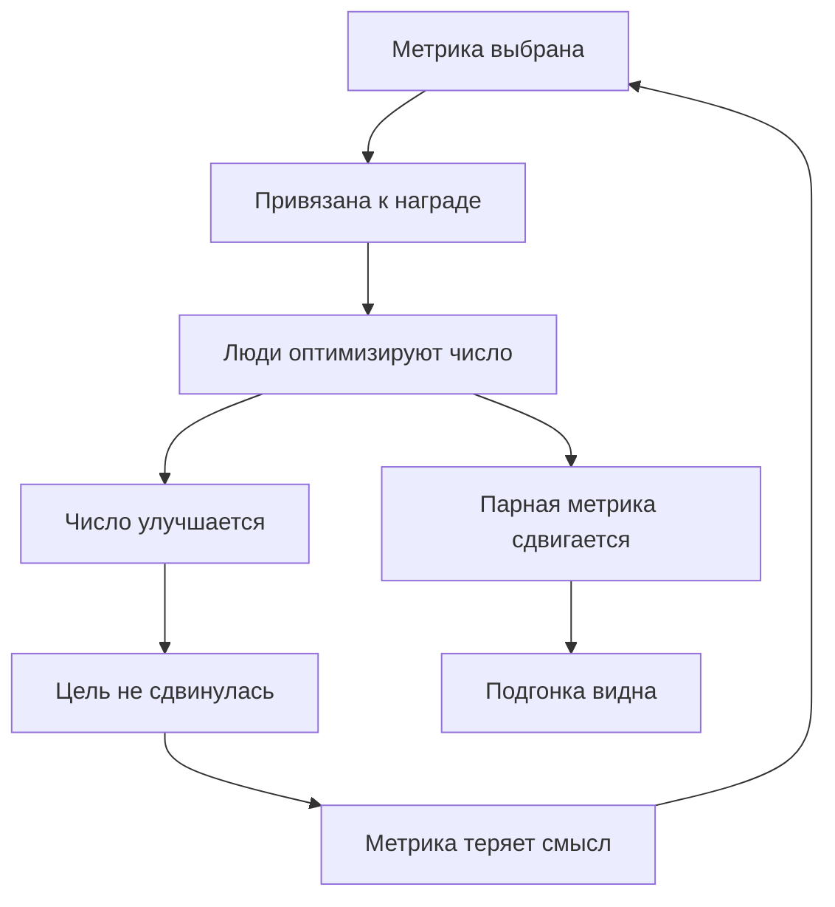
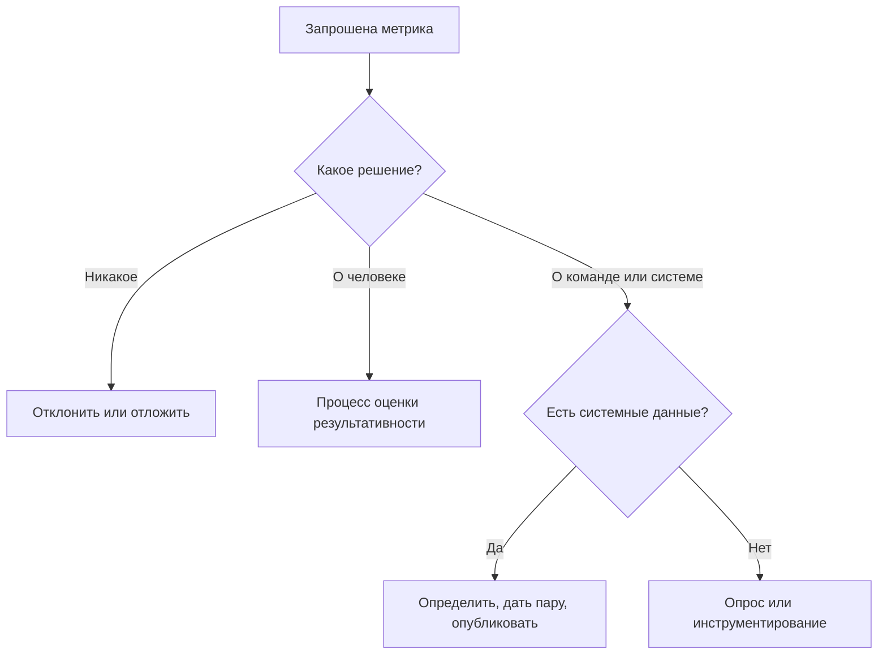

# Глава 18 — Измерение продуктивности разработки: DORA, SPACE и их пределы { #chapter-18-measuring-engineering-productivity-dora-space-and-their-limits }

Рано или поздно кто-то из руководства спрашивает, насколько продуктивна разработка, и ждёт в ответ
одно число. В этой главе разобрано, что измеряют самые известные фреймворки, откуда берутся их
доказательства, как подгоняют каждую метрику и почему книга отказывается оценивать отдельных инженеров
по метрикам поставки. Потоку (глава 16), показателям качества
([глава 19](../05-engineering-quality/19-defining-measuring-and-owning-quality.md)), индивидуальной
результативности (глава 9) и заявлениям о росте продуктивности благодаря ИИ (глава 54) посвящены
отдельные главы.

## Почему это важно { #why-this-matters }

**Для команды** измерение — это петля обратной связи. Если команда видит своё
[время внесения изменений](../../glossary.md#lead-time) (от коммита до работы в продакшене) и
[долю неудачных изменений](../../glossary.md#change-failure-rate) (change failure rate — доля изменений,
которые дают сбой в продакшене), она может понять, помогла ли работа над пайплайном в прошлом месяце.

**Для организации из 50–150 инженеров** измерение — способ увидеть работу, к которой директор сам уже
не прикасается. Здесь же начинается и вред: цифры, полезные как обратная связь, переносят в слайды,
сравнивают между командами и привязывают к целям. Тогда люди начинают оптимизировать число, и директор
теряет картину, которую оно давало.

**Для руководства компании** вопрос звучит на языке финансов. Разработка — часто крупнейшая статья
операционных расходов, и CFO (финансовый директор) не может разложить её построчно. У продаж есть
выполнение плана; почему у разработки нет выработки на инженера? Вопрос законный. Ответ «разработку
нельзя измерить» означает, что метрику выберет кто-то другой; подсчёт активности на инженера уничтожает
ту самую информацию, которую должен давать. Есть третий ответ: измеряйте систему, парами показателей,
ради улучшения, и переводите результат в решения, которые предстоит принять руководству.

## Цели главы { #learning-objectives }

Прочитав эту главу, вы сможете:

- Называть, что измеряет каждая метрика DORA, как проводились исследования DORA и чего эти
  доказательства не могут сказать о вашей организации.
- Строить сбалансированный набор измерений, в котором системные данные сочетаются с показателями опыта
  разработчиков, и использовать SPACE и DevEx как чек-листы, а не как карты показателей.
- Предсказывать, как будут подгонять каждую метрику, и подбирать к ней парный показатель, который
  выдаст подгонку.
- Объяснять доводами, которые примет руководство, почему вы не будете оценивать отдельных инженеров по
  метрикам поставки или активности, и предлагать лучшую альтернативу.

## Ментальная модель { #the-mental-model }

> **Ментальная модель:** метрика — это вопрос, который вы задаёте системе, а не приговор человеку.
> Любое число, от которого зависят награды или место в рейтинге, начнут оптимизировать. Поэтому
> измеряйте системы, а не людей, парами показателей и ради обучения.

Первая идея — **цепочка от усилий к влиянию**. Kent Beck и Gergely Orosz описывают работу над ПО как
цепочку: усилия (планирование, написание кода) дают выпуск (код, функции), выпуск меняет поведение
клиентов (результат), а изменённое поведение даёт ценность для бизнеса (влияние)
([Orosz and Beck, 2023](../../references/bibliography.md#orosz2023measuring)). Усилия и выпуск легко
посчитать и легко раздуть. Результаты и влияние — это то, чего хочет бизнес, но их трудно приписать
одному человеку. Метрики поставки, например метрики DORA, лежат между выпуском и результатом: они
показывают, насколько безопасно и быстро изменения доходят до пользователей, но не то, стоило ли эти
изменения делать.

Вторая идея — **петля подгонки**. Если на индикатор опираются при принятии решений, он попадает под
давление, которое искажает и само число, и деятельность, которую оно должно отслеживать. Это наблюдение
обычно приписывают Donald Campbell
([Campbell, 1979](../../references/bibliography.md#campbell1979assessing)). Популярная версия —
«когда мера становится целью» — известна как закон Гудхарта. Книга приписывает обоим авторам саму
идею, а не какую-либо точную формулировку.

Эта петля не о плохих людях: так поступают умные люди, когда от числа зависит их бонус или повышение.
Защита закладывается при проектировании: выбрать уровень измерения, объединять показатели в пары так,
чтобы подгонка одного сдвигала другой, и держать показатели для обучения отдельно от показателей для
оценки.

## Подробный разбор { #deep-conceptual-explanation }

### Что измеряют метрики DORA { #what-the-dora-metrics-measure }

DORA (DevOps Research and Assessment, теперь часть Google Cloud) публикует самые распространённые
метрики поставки — [метрики DORA](../../glossary.md#dora-metrics). В текущем руководстве DORA (январь
2026 года) перечислены **пять** метрик в двух группах, а не «четыре ключевые», которые до сих пор
показывают многие дашборды ([DORA, metrics guide](../../references/bibliography.md#dora-metrics-guide)):

| Группа | Метрика | Что измеряет |
|---|---|---|
| Пропускная способность | Время внесения изменений | Время от коммита в систему контроля версий до развёртывания в продакшене |
| Пропускная способность | Частота развёртываний | Число развёртываний за период или время между ними |
| Пропускная способность | Время восстановления после неудачного развёртывания | Время восстановления после развёртывания, которое требует немедленного вмешательства |
| Нестабильность | Доля неудачных изменений | Доля развёртываний, требующих немедленного вмешательства, например отката или хотфикса |
| Нестабильность | Доля развёртываний-переделок | Доля развёртываний, которые не были запланированы и вызваны инцидентом в продакшене |

Важны три свойства. Во-первых, метрики описывают **систему поставки**: руководство DORA применяет их к
одному приложению или сервису за раз и предупреждает, что сравнение очень разных приложений вводит в
заблуждение. Во-вторых, они ничего не говорят о том, **то ли построили**. В-третьих, руководство
предупреждает: если сделать метрики целями, подгонка становится вероятнее, а их смысл — в улучшении со
временем, а не в соревновании между командами.

Определения меняются. В этой версии время восстановления отнесено к пропускной способности, а доля
переделок — новая метрика, так что старый дашборд может показывать под теми же названиями другие
метрики. Расходятся и локальные определения: Northstar считает релиз неудачным, если в течение
72 часов за ним следует хотфикс, откат или связанный инцидент, а это не определение DORA
([глава 23](../05-engineering-quality/23-code-review-ci-cd-and-release-engineering.md#change-approval-and-pipeline-outcomes)).
Сравнивайте организацию с ней самой во времени, по одному записанному определению.

### Как были получены исследования и чего они не могут сказать { #how-the-research-was-produced-and-what-it-cannot-tell-you }

Утверждения DORA опираются на ежегодный опрос. Согласно методологии отчёта 2023 года, респондентов
набирали через блоги, электронную почту, соцсети и методом снежного кома (люди пересылают опрос
дальше), а чтобы охватить недопредставленные группы и отрасли, добавляли панель. В тот год ответили
почти 3 000 специалистов, а за всё время программы — более 36 000. Связанные вопросы DORA объединяет в
показатели и с помощью статистических моделей проверяет, какие практики предсказывают какие результаты
([DORA, 2023](../../references/bibliography.md#dora2023accelerate)). Более ранние годы программы
изложены для широкой аудитории в книге *Accelerate*
([Forsgren, Humble, and Kim, 2018](../../references/bibliography.md#forsgren2018accelerate)).

Это серьёзное **отраслевое исследование**, и его ограничения вытекают из самого устройства:

- **Самоотчёт.** Респонденты сами оценивают свой lead time и долю сбоев; пайплайны никто не проверяет.
- **Самоотбор.** Те, кто отвечает на опрос о DevOps, — не случайная выборка организаций.
- **Меняющиеся выборки.** В FAQ DORA сказано, что каждый год отвечают разные люди (хотя состав,
  вероятно, пересекается), что некоторые сдвиги от года к году могут быть артефактами выборки и что к
  новому выводу стоит относиться с подозрением, пока его не воспроизвели
  ([DORA, FAQ](../../references/bibliography.md#dora-faq)).
- **Причинные утверждения опираются на модели.** В методологии 2023 года открыто обсуждаются
  смешивающие факторы; чтобы решить, что контролировать, авторы задают причинные модели и признают, что
  учесть все искажения невозможно.

Поэтому утверждение руководства DORA, что скорость и стабильность — не компромисс, читайте так: среди
множества самоотобранных организаций те, кто сообщает о быстрой поставке, как правило, сообщают и о
стабильной. Это хорошее доказательство того, что такой компромисс — не закон. Но это не доказательство
того, что более частые развёртывания уменьшат *ваши* сбои. Механизм (малые партии проще тестировать,
диагностировать и откатывать) правдоподобен, но проверять его нужно на собственных данных. Данные по
этому вопросу противоречивы, и такое прочтение — позиция книги.

### SPACE: чек-лист измерений { #space-a-checklist-of-dimensions }

Фреймворк [SPACE](../../glossary.md#space) исходит из того, что у продуктивности разработчиков
несколько измерений и одной метрикой её не охватить. Nicole Forsgren, Margaret-Anne Storey и их
коллеги из GitHub и Microsoft Research утверждают в аннотации своей статьи, что продуктивность — это
больше, чем активность отдельного человека или эффективность инженерных систем
([Forsgren et al., 2021](../../references/bibliography.md#forsgren2021space)). Пять измерений перечислены
в посте Forsgren ([Forsgren, 2023](../../references/bibliography.md#forsgren2023navigating)). Обзор
GitHub приводит их полные формулировки, советует использовать не меньше трёх и называет активность самым
распространённым показателем и тем, который чаще всего используют неправильно
([Alwell, 2021](../../references/bibliography.md#alwell2021measuring)).

Таблица ниже переводит каждое измерение в практику. Показатели и вопросы в ней — **иллюстрация
книги**, а не часть SPACE:

| Измерение | О чём спрашивает | Один системный показатель | Один вопрос опроса | Как подгоняют |
|---|---|---|---|---|
| Удовлетворённость и благополучие | Реализуют ли себя люди, здоровы ли они, собираются ли остаться? | Вызовы в нерабочее время на человека; текучесть | «Насколько вероятно, что через год вы будете работать здесь?» | Руководители выпрашивают нужные ответы |
| Результативность | Достигла ли работа своего результата? | Доля неудачных изменений; дефекты, о которых сообщили клиенты | «Как часто выпущенная вами работа делает то, для чего предназначалась?» | Задним числом переопределяют результат |
| Активность | Сколько работы сделано? | Развёртывания или слитые пул-реквесты, только на уровне команды | Спрашивать редко имеет смысл | Дробят работу на тривиальные куски |
| Коммуникация и сотрудничество | Насколько хорошо информация и работа переходят между людьми и командами? | Ожидание ревью; ожидание других команд | «Насколько легко получить помощь от другой команды?» | Ревью «для галочки», чтобы сократить ожидание |
| Эффективность и поток | Могут ли люди продвигаться без прерываний и задержек? | Время внесения изменений; длительность пайплайна; доля незапланированной работы | «Как часто вас прерывают во время сосредоточенной работы?» | Запускают отсчёт позже; переименовывают прерывания |

Читайте SPACE как **чек-лист против слепых зон**. Набор из одной активности (коммиты, пул-реквесты,
тикеты) не видит ни выгорания, ни того, доходит ли работа хоть до кого-то; набор из одной
удовлетворённости не видит, выходит ли вообще что-нибудь. Если измерений несколько и хотя бы одно
собрано опросом, подгонять труднее: улучшение одного измерения за счёт другого становится заметным.

### Опыт разработчиков (DevEx) { #developer-experience-devex }

В статье 2023 года Abi Noda, Margaret-Anne Storey, Nicole Forsgren и Michaela Greiler описывают
[опыт разработчиков](../../glossary.md#developer-experience-devex) (DevEx) как то, как разработчики
переживают свою повседневную работу и её трение. Измерять его авторы предлагают, сочетая обратную связь
от разработчиков с данными инженерных систем
([Noda et al., 2023](../../references/bibliography.md#noda2023devex)). Компания первого автора выделяет
три измерения: **петли обратной связи** (насколько быстро и качественно отвечают инструменты и люди),
**когнитивную нагрузку** (умственные усилия, которых требуют задачи и ориентирование в системах) и
**состояние потока** (сосредоточенная работа без прерываний)
([DX, DevEx report](../../references/bibliography.md#dx-devex-report)). Эта компания продаёт такие
измерения, а утверждение, что лучший опыт разработчиков улучшает бизнес-результаты, — аргумент авторов,
а не количественный результат.

DevEx указывает на **причины**, на которые руководитель может повлиять. Долгое время внесения
изменений — это итог; 21 час ожидания первого ревью — это петля обратной связи, и её исправление —
вопрос управленческого решения. Вопрос опроса («как часто вас блокируют медленные ревью?») в паре с системным
показателем сильнее, чем каждый из них по отдельности: опрос находит трение, которое не попадает ни в
один системный лог, а системные данные не дают опросу превратиться в конкурс популярности.

### Спор 2023 года об измерении отдельных людей { #the-2023-dispute-about-measuring-individuals }

В августе 2023 года McKinsey опубликовала статью «Yes, you can measure software developer productivity»
(«Да, продуктивность разработчиков можно измерить»)
([Gnanasambandam et al., 2023](../../references/bibliography.md#mckinsey2023productivity)). Авторы
предлагают надстроить над DORA и SPACE показатели, «ориентированные на возможности»: время во
внутреннем цикле (написание кода, сборка, модульное тестирование) в сравнении с временем во внешнем
цикле (интеграция, релиз, развёртывание), опрос для сравнения с эталонами, оценку способностей
сотрудников и **анализ вклада** (contribution analysis). Последний оценивает вклад отдельных людей в
бэклог команды по данным инструментов вроде Jira, нормализованным проприетарным алгоритмом. Статья
сообщает о результатах почти в 20 компаниях, в том числе о сокращении числа дефектов, о которых
сообщили клиенты, на 20–30 процентов. Но метода, исходного уровня и контрольной группы в ней нет, так
что эти цифры — утверждения, а не доказательства. Статья также отмечает, что частота развёртываний
бесполезна для отслеживания отдельных людей и что подсчёт коммитов провоцирует подгонку.

Orosz и Beck в ответной статье утверждают, что большинство новых показателей относятся к звеньям
усилий и выпуска, что измерение отдельных людей меняет их поведение и что фреймворк, скорее всего,
навредит инженерной культуре ([Orosz and Beck, 2023](../../references/bibliography.md#orosz2023measuring)).
Самый сильный их довод — рассказ Beck об опросах разработчиков в Facebook. Около года опросы приносили
пользу, затем их превратили в оценку: результаты стали учитывать при оценке результативности и сводить
по руководителям. Начались давление и торг, и в итоге компания знала меньше, чем раньше. При этом
авторы признают, что в одном руководство право: тем, кто отказывается отвечать, навяжут чужой ответ.

Контролируемых доказательств не приводит ни одна сторона; книга помечает обе позиции как **мнение
эксперта**. Вопрос спорный; позиция книги изложена через раздел.

### Как подгоняют каждую метрику и с чем её ставить в пару { #how-each-metric-is-gamed-and-its-pair }

Подгонка редко бывает мошенничеством. Чаще это переклассификация, дробление, игры со временем и
избирательное внимание.

| Метрика | Как подгоняют | В пару к ней |
|---|---|---|
| Частота развёртываний | Дробят изменения на тривиальные развёртывания; развёртывают пустые изменения или изменения только конфигурации | Lead time на изменение; доля неудачных изменений |
| Время внесения изменений | Запускают отсчёт позже (сплющивают коммиты перед слиянием); сначала делают лёгкую работу | Lead time от обязательства до поставки (глава 16); возраст самой старой открытой работы |
| Доля неудачных изменений | Не связывают сбои с развёртываниями; называют их «проблемами конфигурации»; развёртывают реже | Частота развёртываний; проверенные инциденты без связанного развёртывания |
| Время восстановления после неудачного развёртывания | Закрывают инцидент, когда начинает действовать обходной путь; на остальное открывают новый | Длительность по данным клиентов; переоткрытые инциденты |
| Доля развёртываний-переделок | Помечают исправление инцидента как плановую работу | Инциденты, за которыми в течение дня последовало развёртывание |
| Пул-реквесты или коммиты на человека | Дробят работу; избегают ревью, парной работы и работы с инцидентами | Не использовать для отдельных людей |
| Результаты опросов | Руководители выпрашивают нужные ответы; стратегические ответы, как только результаты начинают что-то значить | Доля ответивших; системные данные о том же трении |
| Число инцидентов по серьёзности | Оценивают инциденты ниже отслеживаемого уровня | Доля инцидентов, обнаруженных клиентами; [аудит серьёзности](../05-engineering-quality/25-incidents-postmortems-and-change-failure-analysis.md#severity-definitions-that-resist-reclassification) |

Общие правила измерения поставки таковы. Предпочитайте системные данные классификации, которую делают
люди, а то, что остаётся за людьми, проверяйте. Сообщайте распределения, а не только медианы.
Предпочитайте показатели, построенные на множестве событий. Публикуйте рядом с числом его определение,
слабые места и владельца. Глава 27 применяет эти правила к качеству в своих
[правилах карты показателей](../05-engineering-quality/27-quality-transformation-at-enterprise-scale.md#scorecard-design-rules).

### Почему книга отказывается от оценки индивидуальной продуктивности { #why-the-book-refuses-individual-productivity-scoring }

Позиция книги по спорному вопросу: **измеряйте поставку и опыт разработчиков на уровне команды и
системы, ради улучшения; не оценивайте отдельных инженеров по метрикам поставки или активности.** Это
**рекомендация книги**, и за ней стоят пять причин:

1. **Атрибуция.** ПО создают сообща: через общий код, ревью и пайплайны. Изменение выходит быстро,
   потому что кто-то быстро его отревьюил, а кто-то построил пайплайн; приписывая заслугу автору
   коммита, её отнимают у них.
2. **На человека можно посчитать только усилия и выпуск.** Работа, которая сильнее всего повышает
   выпуск команды (ревью, менторство, реагирование на инциденты, проектирование, удаление кода),
   снижает личный счёт человека.
3. **Подгонка неизбежна и дёшева.** Раздробить одно изменение на пять пул-реквестов — дело нескольких
   минут.
4. **Цифры — шум.** За квартал у одного инженера набирается слишком мало событий, а сложность задач
   слишком разная, чтобы отделить мастерство от того, какие задачи ему достались.
5. **Это разрушает инструмент.** Как только по данным начинают судить людей, люди меняют и то, что
   сообщают, и то, как работают. Именно это иллюстрирует рассказ о Facebook.

Это не отказ оценивать людей. Индивидуальную результативность оценивают по доказательствам влияния и
поведения (глава 9); данные о поставке могут стать поводом для разговора, но не приговором.

## Пример из инженерной организации { #engineering-organization-example }

!!! info "Northstar: что уже известно"
    Пример относится к базовому кварталу, до прихода директора: 30 инцидентов Sev1 и Sev2 (два высших
    уровня серьёзности), 34 процента ресурса уходит на незапланированную работу, Core выпускается
    двухнедельным релизным поездом. Кейс ниже переносит действие в начало квартала 2 (неделя 14). См.
    [хронологию](../../case-studies/northstar/timeline.md). Впервые читаете о Northstar? Прочитайте
    [«Год вкратце»](../../case-studies/northstar/year-in-brief.md) и
    [действующих лиц](../../case-studies/northstar/cast.md).

Этот пример — **иллюстрация**. На вымышленном исходном уровне Northstar он показывает, что сказала бы
турнирная таблица «развёртываний на инженера». Число развёртываний в месяц взято из `teams.csv`.

| Команда | Инженеров | Развёртываний в месяц | На инженера | Доля неудачных изменений | Правдоподобный диапазон |
|---|---|---|---|---|---|
| Payments and Integrations | 12 | 22 | 1.83 | 21% | 13–33% |
| Customer Experience | 15 | 26 | 1.73 | 17% | 10–26% |
| Platform Operations | 12 | 14 | 1.17 | 15% | 7–28% |
| Data and Analytics | 11 | 11 | 1.00 | 12% | 5–27% |
| Orders | 14 | 11 | 0.79 | 29% | 17–47% |
| Billing | 13 | 8 | 0.62 | 34% | 18–53% |

Правдоподобный диапазон — стандартный 95-процентный интервал для доли, посчитанной по небольшому числу
развёртываний за один квартал (от 24 до 78 на команду). Из таблицы следуют четыре вывода:

**Рейтинг измеряет архитектуру.** Orders и Billing выпускают большую часть изменений через
[релизный поезд](../../glossary.md#release-train) Core — релиз, который уходил по фиксированному
расписанию дважды в месяц и забирал каждое готовое изменение. Низкие цифры этих команд описывают поезд;
поставить их инженеров ниже в рейтинге значило бы винить людей за систему, которую они не выбирали.

**Знаменатель неверен.** Семь из 12 человек в Platform Operations — QA-инженеры, а они не
развёртывают. В расчёте на инженера, который развёртывает, у команды 2,8 — больше всех в организации.

**Доли слишком шумные, чтобы ранжировать.** Интервал каждой команды пересекается с интервалами всех
остальных. По долям за один квартал нельзя отличить даже Billing от Customer Experience. Довод, что
проблема в поезде Core, опирается на данные об инцидентах и на механизм, а не на рейтинг.

**Абсолютные числа и доли расходятся.** У команды Payments and Integrations доля сбоев ниже, чем у
Orders, но неудачных развёртываний больше (около 4,6 в месяц против 3,2): она развёртывает вдвое чаще.
Что лучше, зависит от того, насколько серьёзен каждый сбой и как быстро после него восстанавливаются.

Попади эта таблица в бюджетный пакет, быстрее всех поднимались бы в ней команды, которые дробят
развёртывания. Число росло бы, а директор ничего бы не узнал.

## Как принимать решение { #decision-framework }

За каждым запросом метрики стоит решение. Сначала найдите его.

«Процесс оценки результативности» — это оценка, которую руководитель выносит на основе доказательств
(глава 9), а не число.

| Вопрос | Показатель | Уровень | Пара | Источник |
|---|---|---|---|---|
| Поставляем ли мы безопасно и быстро? | Пропускная способность и нестабильность DORA | Сервис, со сводкой по команде | Друг друга | События пайплайнов и инцидентов |
| Поставляем ли мы обещанное? | Выполненные пункты с обязательством и калибровка прогнозов (глава 17) | Организация; команды — относительно собственного тренда | Пропускная способность | Инструмент планирования |
| Где трение? | Ожидание ревью, время пайплайна, время, когда основная ветка красная, нестабильные падения | Репозиторий, команда | Опрос DevEx о том же трении | Хостинг кода, CI |
| Устойчив ли темп для людей? | Удовлетворённость, выгорание, нагрузка от дежурств | Команда, минимальный размер группы | Текучесть, доля ответивших | Опрос, инструмент вызовов |
| Куда уходят деньги? | Ресурс по категориям (функции, профилактика, незапланированная работа) | Организация | Результаты по категориям | Инструмент планирования, выборочный учёт времени |

Вопрос CFO о продуктивности обычно сводится к последней строке.

## Компромиссы { #trade-offs }

**Системные данные против данных восприятия.** Системные данные дёшевы, когда инструментирование уже
налажено, но слепы к трению, которое не оставляет следов (неясные требования, ожидание ответа в чате).
Опросы это трение видят, но отнимают у людей время и теряют ценность, если проводить их слишком часто
или использовать как оружие. Используйте и то и другое; вопросов задавайте меньше, но лучше.

**Стандартные определения против локальных.** Определения DORA позволяют сравнивать себя с
исследованиями, а локальные могут лучше подходить бизнесу (окно Northstar в 72 часа ловит медленно
разгорающиеся сбои). Выберите для каждой метрики одно определение, запишите его и меняйте только с
пометкой о дате изменения.

**Прозрачность против давления подгонки.** Если цифры каждой команды видны всей компании, растёт и
подотчётность, и давление на оптимизацию числа. Средний путь: цифры команды видят сама команда, её
руководитель и окружение директора, а наверх уходят агрегаты.

**Стоимость инструментирования против качества.** Свести события из четырёх CI-систем в один поток —
серьёзная работа; таблица, сведённая вручную, дешевле, но ошибается молча.

**Покупка против собственной разработки.** Коммерческие инструменты инженерной аналитики быстро
собирают данные, но поставляются с уже включёнными представлениями по людям и таблицами лидеров.
Отключите их раньше, чем кто-нибудь их увидит.

## Типичные провалы { #failure-modes }

**Таблица лидеров.** Рейтинги по инженерам или по командам попадают в слайды, обычно из лучших
побуждений. Как заметить: люди спрашивают, как считается число, — чтобы его сдвинуть. Что делать:
никаких рейтингов; команды сравнивают себя с собственным трендом.

**Единое число.** Сводный «индекс продуктивности» заменяет набор показателей. Как заметить: никто не
может сказать, что его сдвинуло. Что делать: держать пары раздельно и показывать их вместе.

**Опрос как оружие.** Результаты опроса об опыте разработчиков попадают в цели руководителей;
руководители выпрашивают нужные ответы; откровенность падает. Как заметить: результаты растут, а
текучесть и нагрузка от инцидентов не снижаются. Что делать: результаты принадлежат команде и её
руководителю и никогда не влияют ни на чью оценку.

**Дрейф определений.** Определение молча меняется (новый счётчик развёртываний, новая категория
инцидентов). Как заметить: скачок, который никто не может объяснить. Что делать: страница определений
с владельцем и журналом изменений.

**Зависть к бенчмаркам.** Руководитель ставит целью опубликованный «элитный» lead time. Как заметить:
цель поставлена, а механизма нет. Что делать: ответить механизмом (размер партии, ожидание ревью, ритм
релизов) и планом.

**Дашборд без решений.** Метрики, которые никто не обсуждает. Что делать: у каждой метрики должны быть
форум и владелец, иначе её отключают (глава 37).

## Применение в крупной организации { #enterprise-application }

При 50–150 инженерах измерению нужны владелец, страница определений и инфраструктура данных.

**Владение.** За определения и конвейер данных отвечает один человек, часто staff-инженер, которому помогают
платформенные инженеры. Директор решает, какие метрики заводить и где их использовать; руководители
действуют по метрикам своих команд.

**Инфраструктура данных.** Каждый пайплайн отправляет событие развёртывания одного и того же формата
(сервис, версия, время, диапазон коммитов, результат) в общее хранилище, а инциденты в инструменте
инцидентов связаны с развёртываниями. Пока этого нет, у каждого числа стоит звёздочка.

**Опрос об опыте разработчиков.** Дважды в год, около 15 вопросов, анонимно, с отчётами только по
группам не меньше пяти человек (этот порог — рекомендация книги). Команды выбирают одно-два источника
трения и устраняют их; директор ищет трение, общее для нескольких команд, — обычно это платформенная
работа.

**Ритм и доступ.** Метрики поставки разбирают ежемесячно по командам и ежеквартально по организации
(карты показателей и распределение ресурсов описаны в главе 38; параллельно работает
[шаблон карты показателей качества](../../templates/engineering-quality-scorecard.md)). Правила доступа
пишут до запуска первого дашборда, и одно из них гласит: представлений по отдельным людям нет.

## Взгляд CTO { #cto-perspective }

Когда руководство спрашивает, насколько продуктивна разработка, за этим обычно стоит один из трёх
вопросов, и ни на один из них подсчёт на инженера не отвечает.

**Получаем ли мы ценность за свои деньги?** Отвечайте, показывая, куда уходит ресурс (новые
возможности, профилактика, незапланированная работа) и что дали крупнейшие инвестиции. Это язык
экономики из главы 45 и бюджетирования из главы 52, и CFO может с ним работать.

**Можем ли мы двигаться быстрее?** Отвечайте, назвав узкое место: где работа ждёт и во что обошлось бы
убрать это ожидание. Найти его помогают метрики пропускной способности DORA и показатели трения.

**Конкурентоспособны ли мы?** Здесь бенчмарки соблазнительнее и обманчивее всего: респонденты отобрали
себя сами, определения другие.

Нужный тон показывает **иллюстративный** ответ CFO в гипотетической компании:

> «Вы спросили, продуктивны ли наши 120 инженеров. В прошлом году 38 процентов их времени ушло на новые
> возможности, 22 процента — на профилактику и 40 процентов — на незапланированную работу, в основном
> на инциденты. Профилактика снизила долю незапланированной работы с 48 процентов, и это вернуло к
> работе над продуктом около десяти инженеров. Время от коммита до продакшена сократилось с 12 дней
> до 5, а доля неудачных изменений не выросла. На следующий квартал нужно решить, сохранять ли
> профилактику на уровне 22 процентов. Я рекомендую сохранить и буду каждый месяц сообщать долю
> незапланированной работы. Выработку на инженера я сообщать не буду: она поощряла бы дробление работы
> и наказывала бы за ревью и работу с инцидентами, а именно благодаря им получены эти результаты».

Полный формат задаёт [шаблон отчёта для руководства](../../templates/executive-update.md).

Кроме того, CTO защищает сам инструмент. Если число на инженера однажды попало в пакет для совета
директоров, убрать его трудно, и каждое следующее заявление о продуктивности, включая заявления об
ИИ-инструментах из главы 54, будут мерить этим числом.

## Практический плейбук { #practical-playbook }

1. **Перечислите решения**, которые должно поддерживать измерение: здоровье поставки, трение,
   распределение ресурсов, отчётность для руководства. Отбросьте метрики, которые не поддерживают ни
   одного.
2. **Проведите инвентаризацию источников**: для каждого пайплайна, инструмента инцидентов и
   инструмента планирования выясните, что он записывает и кто сводит данные.
3. **Определите каждую метрику** на одной странице: формула, источник, единица анализа, владелец,
   способы подгонки, пара. Используйте текущие определения DORA, если не записали причину от них
   отказаться.
4. **Настройте отправку событий развёртывания** из каждого пайплайна в общее хранилище; начните с
   пайплайнов, через которые проходит больше всего изменений.
5. **Опубликуйте данные базового квартала** раньше, чем появится любая цель; рядом с долями указывайте
   число событий или интервалы.
6. **Проведите опрос об опыте разработчиков** в паре с системными данными о том же трении; верните
   результаты командам в течение двух недель и никогда не используйте их в оценке результативности.
7. **Напишите правила доступа** до первого дашборда.
8. **Подготовьте ответ для руководства**: ресурс по категориям, тренд поставки, результаты инвестиций и
   причины, по которым вы не сообщаете выработку на человека.
9. **Пересматривайте набор метрик каждые шесть месяцев**: убирайте неиспользуемые, проверяйте, нет ли
   дрейфа и подгонки.

## Кейс { #case-study }

Этот кейс — **вымысел**. В нём описано, как Northstar измеряет поставку на исходном уровне, и решение,
которое предстоит принять читателю в начале второго квартала директора, после того как в квартале 1
Core перевели на еженедельные релизы (см. [хронику года 1](../../case-studies/northstar/first-quarter.md)).

**Как поставку измеряют сегодня.** Число развёртываний и lead time берут из логов пайплайнов в четырёх
CI-системах и сводят вручную. Четыре сервиса на shell-скриптах ничего не логируют, поэтому их цифры —
оценки по истории чатов. Для доли неудачных изменений релизы вручную связывают с хотфиксами, откатами
и инцидентами в пределах 72 часов, поэтому сбои, которые не удалось связать, теряются. Данные о
незапланированной работе берут из двухнедельной выборки типов тикетов. Один инженер инфраструктуры из
Platform Operations тратит около двух дней в месяц, чтобы собрать эти цифры в таблицу. До прихода
директора в ежемесячном пакете CEO для совета директоров из цифр разработки были только число
выполненных пунктов дорожной карты с обязательством и число инцидентов Sev1 и Sev2. Опросов
разработчиков за предыдущие два года не проводили.

Главные цифры поставки за первый квартал (доля неудачных изменений Core снизилась с 31 до
22 процентов) посчитаны по тем же данным, сведённым вручную, и представлены с этой оговоркой.

**Запрос (решение, которое предстоит читателю).** В начале квартала 2 Rajiv Menon (CFO) готовит бюджет
на следующий год и просит включить в бюджетный пакет выработку на инженера по командам. Операционные
расходы не растут; совет директоров спросил, хорошо ли используются 80 инженеров, если в базовом
квартале вовремя вышел 41 процент пунктов дорожной карты с обязательством; а в статье консалтинговой компании,
которую прислали Rajiv, говорится, что это можно измерить. Helena Marsh (CEO) запрос поддерживает.

**Предлагаемый директором набор измерений.** В черновике ответа директор отказывается давать цифру на
инженера и предлагает:

| Область | Показатели | Уровень | Источник и статус |
|---|---|---|---|
| Поставка | Сейчас четыре метрики DORA (все, кроме доли переделок), долю переделок — позже | Компонент, со сводкой по команде | Общее хранилище событий развёртывания (предстоит построить); два квартала определения DORA показываются рядом с правилом 72 часов |
| Обязательства | Выполненные пункты дорожной карты с обязательством и калибровка прогнозов (глава 17); доля незапланированной работы | Организация; команды — относительно собственного тренда | Инструмент планирования; ежеквартальный выборочный учёт времени |
| Качество | Парные метрики карты показателей из главы 27 | Организация, команда | Уже работает |
| Трение | Ожидание ревью (21 рабочий час на исходном уровне), длительность пайплайна Core (74 минуты), время, когда основная ветка красная, падения, не связанные с изменением | Репозиторий | Хостинг кода и CI |
| Опыт | Опрос дважды в год: петли обратной связи, когнитивная нагрузка, поток, удовлетворённость | Команда, не меньше пяти респондентов | Новое; первый запуск в квартале 2 |
| Инвестиции | Ресурс по категориям: функции, [профилактика](../../glossary.md#prevention-allocation) (12 [FTE](../../glossary.md#fte), эквивалент инженеров на полной ставке), незапланированная работа | Организация | Инструмент планирования, выборочный учёт времени |
| Исключено | Подсчёты на инженера; [стори-поинты](../../glossary.md#velocity-and-story-points) (относительные оценки размера) между командами; результаты опросов в оценке результативности | | Записано в правила доступа |

По оценке директора, построить общее хранилище событий развёртывания стоит примерно шести
инженеро-недель Platform Operations за счёт выделения на профилактику; зато хранилище избавит от
ежемесячного ручного сведения.

Одним отказом разговор не выиграть. Директор должен показать, что взгляд на инвестиции отвечает на
настоящий вопрос Rajiv (идут ли деньги туда, куда нужно, и становится ли лучше?), и назвать дату
первого отчёта. Получится ли это, проверяет упражнение X1.

## Упражнения { #exercises }

Разборы упражнений — на странице [решений к главе 18](../../solutions/ch18-solutions.md). Данные — на
[странице исходного уровня Northstar](../../case-studies/northstar/baseline-data.md).

### Базовый уровень { #foundational }

**F1.** Дашборд, построенный в вашей компании три года назад, показывает «четыре ключевые метрики DORA»:
частоту развёртываний, lead time for changes, долю неудачных изменений и время восстановления сервиса.
Опираясь на текущее руководство DORA, объясните, что изменилось и что измеряет каждая текущая метрика.
Затем решите, по какому определению вы будете отчитываться в следующем квартале и как не прервать
тренд при смене определения.

**F2.** Коллега говорит: «DORA доказала, что более частые развёртывания уменьшают число сбоев, так что
давайте поставим каждой команде цель — ежедневные развёртывания». Исходя из того, как проводились
исследования DORA, объясните, что доказательства подтверждают, а что нет, и предложите, как ваша
организация могла бы проверить это утверждение на собственных данных.

**F3.** Northstar хочет каждый квартал сообщать долю неудачных изменений по командам. Опираясь на
таблицу команд из этой главы, объясните, какие сравнения между командами данные за один квартал
выдерживают, а какие нет. Затем предложите, как подать цифры в отчёте, чтобы читатели не делали из них
слишком широких выводов.

### Прикладное лидерство { #applied-leadership }

**A1.** Daniel Cho (руководитель разработки Customer Experience) предлагает добавить на дашборд своей
команды «слитые пул-реквесты на инженера в неделю» — «просто для наглядности, не для оценки». Двое его
senior-инженеров тратят много времени на ревью и координацию мобильных релизов. Решите, разрешить ли
это, и напишите, что вы скажете Daniel, в том числе что предложите взамен.

**A2.** Спроектируйте первый опрос об опыте разработчиков в Northstar: не больше 15 вопросов, каждый
привязан к измерению и, если такой показатель есть, к парному системному показателю. Изложите правила
анонимности, а также кто что видит, как результаты возвращаются командам и для чего вы обязуетесь
никогда их не использовать. Ориентируйтесь на известные источники трения в Northstar.

**A3.** Через шесть месяцев после того, как построили хранилище событий развёртывания, частота
развёртываний в двух командах Northstar удвоилась. При этом их время внесения изменений не сдвинулось,
а доля развёртываний без изменений кода выросла. Объясните, что, вероятно, происходит, как вы проверите
это, никого не обвиняя, и что измените в устройстве измерений.

### Решения на уровне руководства { #executive-decision-making }

**X1.** Вы — директор. Напишите ответ на запрос Rajiv Menon (CFO) о выработке на инженера по командам
(не больше одной страницы). Ответ должен закрывать вопрос, стоящий за запросом совета директоров,
объяснять на языке бизнеса, почему вы не дадите число на инженера, предлагать, что и когда вы дадите, и
называть, что вам нужно от Rajiv. Исходите из того, что Helena Marsh (CEO) уже поддержала его запрос.

**X2.** Вендор предлагает Northstar платформу инженерной аналитики за $90 000 в год. За месяц она
подключится ко всем четырём CI-системам, хостингам кода и инструменту планирования и заменит
запланированные шесть инженеро-недель внутренней работы. В её стандартных представлениях есть рейтинги
активности по разработчикам. Исходя из ограничений, описанных в обзоре Northstar, решите, покупать ли
платформу, какие условия вы поставите и какие данные через квартал показали бы, что вы ошиблись.

## Вопросы для размышления { #reflection-questions }

1. Какая метрика в вашей организации изменилась бы сильнее всего, если бы люди перестали верить, что
   она влияет на их оценку? Что это говорит о нынешнем значении этого числа?
2. Когда вас в последний раз просили назвать показатель продуктивности? Какое решение он должен был
   поддержать — и спросил ли об этом кто-нибудь?
3. У каких ваших метрик есть записанное определение, владелец и журнал изменений?
4. Какая важная инженерная работа в вашей организации невидима для всех метрик, которые вы собираете?
5. Если бы результаты вашего опроса об опыте разработчиков показали CEO на следующей неделе, стали бы
   люди отвечать на следующий опрос так же?

## Главное { #key-takeaways }

- Прежде чем собирать метрику, спросите, какое решение она поддерживает; отбрасывайте метрики, которые
  не поддерживают ни одного.
- В текущем руководстве DORA пять метрик в группах пропускной способности и нестабильности; они
  описывают систему поставки отдельно по каждому сервису и ничего не говорят о том, то ли построили.
- Доказательства DORA основаны на опросах, самоотборе и корреляциях. Они показывают, что компромисс
  между скоростью и стабильностью — не закон, но не предсказывают, как подействует изменение в вашей
  организации.
- Используйте SPACE и DevEx как чек-листы: несколько измерений, хотя бы одно — по данным восприятия, в
  паре с системными данными.
- Каждую метрику подгоняют предсказуемыми способами; публикуйте каждую вместе со способами подгонки и
  парной метрикой.
- Не оценивайте отдельных инженеров по метрикам поставки или активности: атрибуция не работает,
  подсчёты вознаграждают не ту работу, цифры — шум, а сам инструмент портится.
- На вопросы руководства о продуктивности отвечайте распределением ресурса по категориям, трендами
  поставки и результатами инвестиций.
- Наладьте инфраструктуру данных: число, сведённое вручную, — число, которое никто не может проверить.

## Источники и что почитать { #references-and-further-reading }

- [DORA, metrics guide](../../references/bibliography.md#dora-metrics-guide). Пять текущих метрик и
  предупреждения DORA против целей и сравнения команд; перед использованием сверьтесь с актуальной
  версией.
- [DORA, 2023](../../references/bibliography.md#dora2023accelerate). Раздел о методологии показывает, как
  получают доказательства из опросов.
- [DORA, FAQ](../../references/bibliography.md#dora-faq). Оговорки DORA о меняющихся выборках и
  воспроизводимости.
- [Forsgren, Humble, and Kim, 2018](../../references/bibliography.md#forsgren2018accelerate).
  *Accelerate* — более ранние исследования для широкой аудитории.
- [Forsgren et al., 2021](../../references/bibliography.md#forsgren2021space). SPACE: почему
  продуктивность не сводится к одной метрике. Короткие вторичные изложения:
  [Forsgren, 2023](../../references/bibliography.md#forsgren2023navigating) и
  [Alwell, 2021](../../references/bibliography.md#alwell2021measuring).
- [Noda et al., 2023](../../references/bibliography.md#noda2023devex) и
  [DX, DevEx report](../../references/bibliography.md#dx-devex-report). Фреймворк опыта разработчиков;
  учитывайте коммерческий интерес вендора.
- [Gnanasambandam et al., 2023](../../references/bibliography.md#mckinsey2023productivity) и
  [Orosz and Beck, 2023](../../references/bibliography.md#orosz2023measuring). Спор 2023 года; читайте
  обе стороны.
- [Campbell, 1979](../../references/bibliography.md#campbell1979assessing). Источник, которому обычно
  приписывают мысль об искажении индикаторов, на которые опираются при принятии решений.
