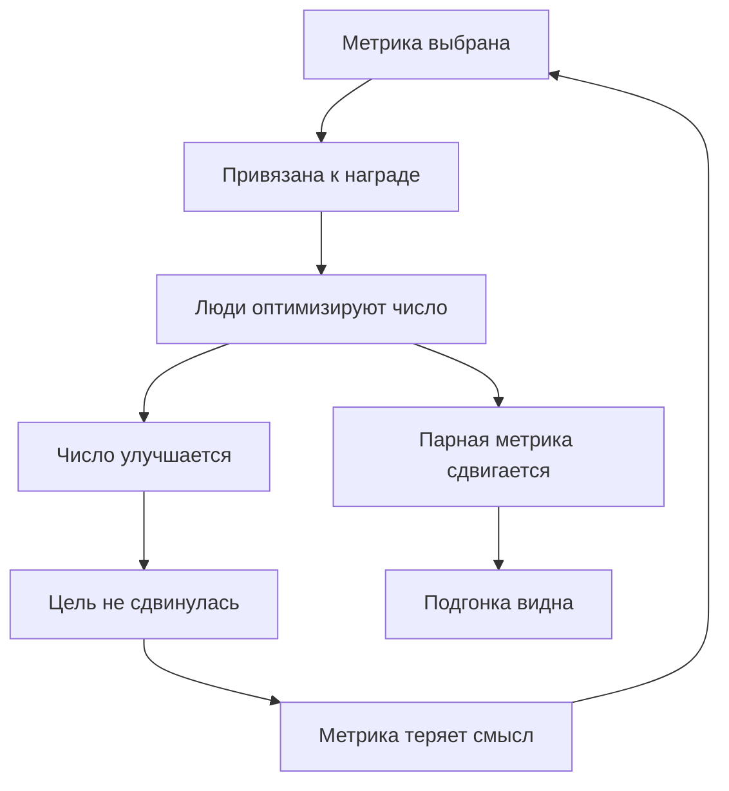
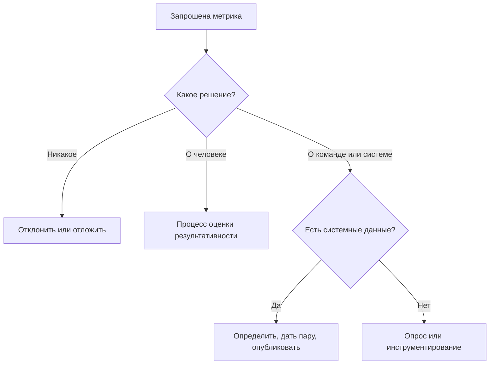

# Глава 18 — Измерение продуктивности разработки: DORA, SPACE и их пределы { #chapter-18-measuring-engineering-productivity-dora-space-and-their-limits }

Рано или поздно кто-то из руководства спрашивает, насколько продуктивна разработка, и хочет услышать
одно число. Эта глава объясняет, что измеряют самые известные фреймворки измерения, как были получены
их доказательства, как подгоняют каждую метрику и почему книга отказывается оценивать отдельных
инженеров по метрикам поставки. Потоку (глава 16), показателям качества
([глава 19](../05-engineering-quality/19-defining-measuring-and-owning-quality.md)), индивидуальной
результативности (глава 9) и заявлениям о продуктивности благодаря ИИ (глава 54) посвящены отдельные
главы.

## Почему это важно { #why-this-matters }

**Для команды** измерение — это петля обратной связи. Команда, которая видит своё
[время внесения изменений](../../glossary.md#lead-time) (от коммита до работы в продакшене) и свою
[долю неудачных изменений](../../glossary.md#change-failure-rate) (change failure rate, доля изменений,
которые дают сбой в продакшене), может понять, помогла ли работа над пайплайном в прошлом месяце.

**Для организации из 50–150 инженеров** измерение — это способ, которым директор видит работу, к
которой сам уже не прикасается. Здесь же начинается вред: цифры, полезные как обратная связь,
копируются в слайды, сравниваются между командами и привязываются к целям. Тогда люди оптимизируют
число, и директор теряет картину, которую оно давало.

**Для руководства компании** вопрос приходит в финансовой форме. Разработка — часто крупнейшая статья
операционных расходов, которую CFO (финансовый директор) не может объяснить построчно. У продаж есть
выполнение квоты; почему у разработки нет выработки на инженера? Вопрос законный. Ответ «разработку
нельзя измерить» приглашает выбрать метрику кого-то другого; подсчёт активности на инженера уничтожает ту
самую информацию, которую должен давать. Третий ответ: измеряйте систему, парами, ради улучшения, и
переводите результат в то, что руководству нужно решить.

## Цели главы { #learning-objectives }

Прочитав эту главу, вы сможете:

- Называть, что измеряет каждая метрика DORA, как были получены исследования DORA и чего эти
  доказательства не могут сказать о вашей собственной организации.
- Строить сбалансированный набор измерений, сочетающий данные систем с показателями опыта
  разработчиков, используя SPACE и DevEx как чек-листы, а не как карты показателей.
- Предсказывать, как будут подгонять каждую метрику, и ставить к ней в пару показатель, который
  обнаруживает подгонку.
- Объяснять с доводами, которые примет руководство, почему вы не будете оценивать отдельных инженеров
  по метрикам поставки или активности, и предлагать что-то лучшее.

## Ментальная модель { #the-mental-model }

> **Ментальная модель:** метрика — это вопрос, который вы задаёте системе, а не приговор человеку.
> Любое число, по которому вознаграждают или ранжируют, будут оптимизировать, поэтому измеряйте системы,
> а не людей, парами и ради обучения.

Первая идея — **цепочка от усилий к влиянию**. Kent Beck и Gergely Orosz описывают работу над ПО как
цепочку: усилия (планирование, написание кода) дают выпуск (код, функции), выпуск меняет поведение
клиентов (результат), а изменённое поведение даёт ценность для бизнеса (влияние)
([Orosz and Beck, 2023](../../references/bibliography.md#orosz2023measuring)). Усилия и выпуск легко
посчитать и легко раздуть. Результаты и влияние — то, чего хочет бизнес, и их трудно приписать одному
человеку. Метрики поставки вроде метрик DORA находятся между выпуском и результатом: они измеряют,
насколько безопасно и быстро изменения доходят до пользователей, а не то, стоило ли эти изменения
делать.

Вторая идея — **петля подгонки**. Наблюдение, что индикатор, на который опираются при принятии решений,
попадает под давление, искажающее и само число, и деятельность, которую он должен был отслеживать,
обычно приписывают Donald Campbell
([Campbell, 1979](../../references/bibliography.md#campbell1979assessing)). Популярная версия —
«когда мера становится целью» — называется законом Гудхарта. Книга приписывает обоим идею, а не
какую-либо точную формулировку.

Петля не про плохих людей; это то, что делают умные люди, когда число решает их бонус или повышение.
Защита — в проектировании: выбирать уровень измерения, ставить показатели в пары так, чтобы подгонка
одного сдвигала другой, и держать показатели для обучения отдельно от показателей для оценки.

## Подробный разбор { #deep-conceptual-explanation }

### Что измеряют метрики DORA { #what-the-dora-metrics-measure }

DORA (DevOps Research and Assessment, теперь часть Google Cloud) публикует самые распространённые
метрики поставки — [метрики DORA](../../glossary.md#dora-metrics). Его текущее руководство (январь
2026 года) перечисляет **пять** метрик в двух группах, а не «четыре ключевые», которые до сих пор
показывают многие дашборды ([DORA, metrics guide](../../references/bibliography.md#dora-metrics-guide)):

| Группа | Метрика | Что измеряет |
|---|---|---|
| Пропускная способность | Время внесения изменений | Время от коммита в систему контроля версий до развёртывания в продакшене |
| Пропускная способность | Частота развёртываний | Число развёртываний за период или время между ними |
| Пропускная способность | Время восстановления после неудачного развёртывания | Время восстановления после развёртывания, которое требует немедленного вмешательства |
| Нестабильность | Доля неудачных изменений | Доля развёртываний, требующих немедленного вмешательства, например отката или хотфикса |
| Нестабильность | Доля развёртываний-переделок | Доля развёртываний, которые не были запланированы и вызваны инцидентом в продакшене |

Важны три свойства. Метрики описывают **систему поставки**: руководство применяет их к одному
приложению или сервису за раз и предупреждает, что сравнение очень разных приложений вводит в
заблуждение. Они ничего не говорят о том, **то ли построили**. И руководство предупреждает, что если
сделать их целями, подгонка становится вероятнее, а смысл — в улучшении со временем, а не в соревновании
между командами.

Определения меняются. В этой версии время восстановления отнесено к пропускной способности, а доля
переделок — новая метрика, так что старый дашборд может показывать другие метрики под теми же
названиями. Различаются и локальные определения: Northstar считает релиз неудачным, если в течение
72 часов за ним следует хотфикс, откат или связанный инцидент, а это не определение DORA
([глава 23](../05-engineering-quality/23-code-review-ci-cd-and-release-engineering.md#change-approval-and-pipeline-outcomes)).
Сравнивайте организацию с ней самой во времени, по одному записанному определению.

### Как были получены исследования и чего они не могут сказать { #how-the-research-was-produced-and-what-it-cannot-tell-you }

Утверждения DORA опираются на ежегодный опрос. Методология отчёта 2023 года описывает набор
респондентов через посты в блогах, электронную почту, соцсети и метод снежного кома (люди пересылают
опрос дальше), дополненный панелью, чтобы охватить недопредставленные группы и отрасли. В тот год
ответили почти 3 000 специалистов, а за всё время программы — более 36 000. DORA объединяет связанные
вопросы в показатели и с помощью статистических моделей проверяет, какие практики предсказывают какие
результаты ([DORA, 2023](../../references/bibliography.md#dora2023accelerate)). *Accelerate*
представляет более ранние годы программы для широкой аудитории
([Forsgren, Humble, and Kim, 2018](../../references/bibliography.md#forsgren2018accelerate)).

Это серьёзное **отраслевое исследование**, и его ограничения вытекают из его устройства:

- **Самоотчёт.** Респонденты сами оценивают свой lead time и долю сбоев; пайплайны никто не проверяет.
- **Самоотбор.** Люди, которые отвечают на опрос о DevOps, — не случайная выборка организаций.
- **Меняющиеся выборки.** В FAQ DORA сказано, что респонденты каждого года разные (хотя, вероятно,
  пересекаются), что некоторые сдвиги от года к году могут быть артефактами выборки и что новый вывод
  под подозрением, пока его не воспроизвели ([DORA, FAQ](../../references/bibliography.md#dora-faq)).
- **Причинные утверждения опираются на модели.** Методология 2023 года открыто обсуждает смешивающие
  факторы и задаёт причинные модели, чтобы решить, что контролировать, признавая при этом, что учесть
  все искажения невозможно.

Поэтому, когда руководство утверждает, что скорость и стабильность — не компромисс, читайте это так:
среди множества самоотобранных организаций те, что сообщают о быстрой поставке, как правило, сообщают и
о стабильной. Это хорошее доказательство того, что такой компромисс — не закон. Но это не
доказательство того, что более частые развёртывания уменьшат *ваши* сбои; механизм (малые партии проще
тестировать, диагностировать и откатывать) правдоподобен, и его нужно проверить на собственных данных.
Данные по этому вопросу противоречивы, и такова позиция книги.

### SPACE: чек-лист измерений { #space-a-checklist-of-dimensions }

[SPACE](../../glossary.md#space) утверждает, что у продуктивности разработчиков несколько измерений и
одной метрикой её не охватить. Статья Nicole Forsgren, Margaret-Anne Storey и коллег из GitHub и
Microsoft Research в аннотации утверждает, что продуктивность — это больше, чем активность отдельного
человека или эффективность инженерных систем
([Forsgren et al., 2021](../../references/bibliography.md#forsgren2021space)). Пост Forsgren называет пять
измерений ([Forsgren, 2023](../../references/bibliography.md#forsgren2023navigating)). Обзор GitHub даёт
их полные формулировки, советует использовать минимум три и называет активность самым распространённым и
самым неправильно используемым показателем
([Alwell, 2021](../../references/bibliography.md#alwell2021measuring)).

Таблица делает каждое измерение применимым. Показатели и вопросы — **иллюстрация книги**, а не часть
SPACE:

| Измерение | О чём спрашивает | Один системный показатель | Один вопрос опроса | Как подгоняют |
|---|---|---|---|---|
| Удовлетворённость и благополучие | Реализуют ли себя люди, здоровы ли они, собираются ли остаться? | Вызовы в нерабочее время на человека; текучесть | «Насколько вероятно, что через год вы будете работать здесь?» | Руководители выпрашивают нужные ответы |
| Результативность | Достигла ли работа своего результата? | Доля неудачных изменений; дефекты, о которых сообщили клиенты | «Как часто выпущенная вами работа делает то, для чего предназначалась?» | Задним числом переопределяют результат |
| Активность | Сколько работы сделано? | Развёртывания или слитые пул-реквесты, только на уровне команды | Спрашивать редко имеет смысл | Дробят работу на тривиальные куски |
| Коммуникация и сотрудничество | Насколько хорошо информация и работа переходят между людьми и командами? | Ожидание ревью; ожидание других команд | «Насколько легко получить помощь от другой команды?» | Ревью «для галочки», чтобы сократить ожидание |
| Эффективность и поток | Могут ли люди продвигаться без прерываний и задержек? | Время внесения изменений; длительность пайплайна; доля незапланированной работы | «Как часто вас прерывают во время сосредоточенной работы?» | Запускают отсчёт позже; переименовывают прерывания |

Читайте SPACE как **чек-лист против слепых зон**. Набор, состоящий только из активности (коммиты,
пул-реквесты, тикеты), не видит выгорания и того, доходит ли работа до кого-нибудь; набор, состоящий
только из удовлетворённости, не видит, выходит ли что-нибудь вообще. Несколько измерений, включая одно,
собранное опросом, затрудняют подгонку, потому что улучшение одного измерения за счёт другого становится
заметным.

### Опыт разработчиков (DevEx) { #developer-experience-devex }

Статья 2023 года Abi Noda, Margaret-Anne Storey, Nicole Forsgren и Michaela Greiler описывает
[опыт разработчиков](../../glossary.md#developer-experience-devex) (DevEx) как то, как разработчики
переживают свою ежедневную работу и её трение. Она предлагает измерять его, сочетая обратную связь от
разработчиков с данными инженерных систем
([Noda et al., 2023](../../references/bibliography.md#noda2023devex)). Компания первого автора называет
три измерения: **петли обратной связи** (насколько быстро и хорошо отвечают инструменты и люди),
**когнитивная нагрузка** (умственные усилия, нужные, чтобы выполнять задачи и ориентироваться в системах)
и **состояние потока** (сосредоточенность без прерываний)
([DX, DevEx report](../../references/bibliography.md#dx-devex-report)). Эта компания продаёт такие
измерения, и утверждение, что лучший опыт разработчиков улучшает бизнес-результаты, — аргумент авторов,
а не количественный результат.

DevEx указывает на **причины**, которые руководитель может изменить. Долгое время внесения изменений —
это результат; 21 час ожидания первого ревью — это петля обратной связи, и её исправление — решение.
Вопрос опроса («как часто вас блокируют медленные ревью?») в паре с системным показателем сильнее
каждого по отдельности: опрос находит трение, которое не попадает ни в один системный лог, а системные
данные не дают опросу превратиться в голосование о популярности.

### Спор 2023 года об измерении отдельных людей { #the-2023-dispute-about-measuring-individuals }

В августе 2023 года McKinsey опубликовала статью «Yes, you can measure software developer productivity»
(«Да, продуктивность разработчиков можно измерить»)
([Gnanasambandam et al., 2023](../../references/bibliography.md#mckinsey2023productivity)). Она предлагает
надстроить над DORA и SPACE показатели, «ориентированные на возможности»: время во внутреннем цикле
(написание кода, сборка, модульное тестирование) в сравнении с внешним циклом (интеграция, релиз,
развёртывание), опрос для сравнения с эталонами, оценку способностей сотрудников и **анализ вклада**
(contribution analysis), который оценивает вклад отдельных людей в бэклог команды по данным
инструментов вроде Jira, нормализованным проприетарным алгоритмом. Статья сообщает о результатах почти в
20 компаниях, включая сокращение на 20–30 процентов числа дефектов, о которых сообщили клиенты, но без
метода, исходного уровня и контрольной группы, так что эти цифры — утверждения, а не доказательства. Она
также отмечает, что частота развёртываний бесполезна для отслеживания отдельных людей и что подсчёт
коммитов провоцирует подгонку.

Ответ Orosz и Beck утверждает, что большинство новых показателей находятся на стороне усилий и выпуска
в цепочке, что измерение отдельных людей меняет поведение и что фреймворк, скорее всего, навредит
инженерной культуре ([Orosz and Beck, 2023](../../references/bibliography.md#orosz2023measuring)). Их
самое сильное доказательство — рассказ Beck об опросах разработчиков в Facebook: около года они были
полезны, затем их превратили в оценку, стали использовать при оценке результативности и сводить по
руководителям, после чего давление и торг привели к тому, что компания знала меньше, чем раньше. Они же
признают правоту руководства: тем, кто отказывается отвечать, навяжут чужой ответ.

Ни одна сторона не приводит контролируемых доказательств; книга помечает обе позиции как **мнение
эксперта**. Вопрос спорный, и позицию книги излагает следующий раздел.

### Как подгоняют каждую метрику и с чем её ставить в пару { #how-each-metric-is-gamed-and-its-pair }

Подгонка редко бывает мошенничеством; в основном это переклассификация, дробление, игра со временем и
избирательное внимание.

| Метрика | Как подгоняют | В пару к ней |
|---|---|---|
| Частота развёртываний | Дробят изменения на тривиальные развёртывания; развёртывают пустые изменения или изменения только конфигурации | Lead time на изменение; доля неудачных изменений |
| Время внесения изменений | Запускают отсчёт позже (сплющивают коммиты перед слиянием); сначала делают лёгкую работу | Lead time от обязательства до поставки (глава 16); возраст самой старой открытой работы |
| Доля неудачных изменений | Не связывают сбои с развёртываниями; называют их «проблемами конфигурации»; развёртывают реже | Частота развёртываний; проверенные инциденты без связанного развёртывания |
| Время восстановления после неудачного развёртывания | Закрывают инцидент, когда начинает действовать обходной путь; на остальное открывают новый | Длительность по данным клиентов; переоткрытые инциденты |
| Доля развёртываний-переделок | Помечают исправление инцидента как плановую работу | Инциденты, за которыми в течение дня последовало развёртывание |
| Пул-реквесты или коммиты на человека | Дробят работу; избегают ревью, парной работы и работы с инцидентами | Не использовать для отдельных людей |
| Результаты опросов | Руководители выпрашивают нужные ответы; стратегические ответы, как только результаты начинают что-то значить | Доля ответивших; системные данные о том же трении |
| Число инцидентов по серьёзности | Оценивают инциденты ниже отслеживаемого уровня | Доля инцидентов, обнаруженных клиентами; [аудит серьёзности](../05-engineering-quality/25-incidents-postmortems-and-change-failure-analysis.md#severity-definitions-that-resist-reclassification) |

Это общие правила измерения поставки, а глава 27 применяет их к качеству в своих
[правилах карты показателей](../05-engineering-quality/27-quality-transformation-at-enterprise-scale.md#scorecard-design-rules).
Предпочитайте системные данные классификации людьми и проверяйте то, что остаётся за людьми; сообщайте
распределения, а не только медианы; предпочитайте показатели, построенные на множестве событий; и
публикуйте рядом с числом его определение, слабые места и владельца.

### Почему книга отказывается от оценки индивидуальной продуктивности { #why-the-book-refuses-individual-productivity-scoring }

Позиция книги по спорному вопросу: **измеряйте поставку и опыт разработчиков на уровне команды и
системы, ради улучшения; не оценивайте отдельных инженеров по метрикам поставки или активности.** Это
**рекомендация книги**, и у неё пять причин:

1. **Атрибуция.** ПО создаётся через общий код, ревью и пайплайны. Изменение выходит быстро, потому что
   кто-то быстро его отревьюил, а кто-то построил пайплайн; заслугу, приписанную автору коммита, отнимают
   у них.
2. **На человека можно посчитать только усилия и выпуск.** Работа, которая сильнее всего повышает
   выпуск команды (ревью, менторство, реагирование на инциденты, проектирование, удаление кода),
   снижает личный счёт человека.
3. **Подгонка неизбежна и дёшева.** Чтобы раздробить одно изменение на пять пул-реквестов, нужны
   минуты.
4. **Цифры — шум.** В квартале одного инженера слишком мало событий и слишком велик разброс сложности
   задач, чтобы отделить мастерство от того, какие задачи ему достались.
5. **Это разрушает инструмент.** Как только данные начинают судить людей, люди меняют то, что сообщают,
   и то, как работают. Рассказ о Facebook иллюстрирует именно это.

Это не отказ оценивать людей. Индивидуальную результативность оценивают по доказательствам влияния и
поведения (глава 9); данные о поставке могут открыть разговор, но не вынести приговор.

## Пример из инженерной организации { #engineering-organization-example }

!!! info "Northstar: что уже известно"
    Этот пример использует базовый квартал, до прихода директора: 30 инцидентов Sev1 и Sev2 (два высших
    уровня серьёзности), 34 процента ресурса на незапланированной работе, а Core выпускается
    двухнедельным релизным поездом. Кейс ниже переносится в начало квартала 2 (неделя 14). См.
    [хронологию](../../case-studies/northstar/timeline.md). Впервые читаете о Northstar? Прочитайте
    [«Год вкратце»](../../case-studies/northstar/year-in-brief.md) и
    [действующих лиц](../../case-studies/northstar/cast.md).

Этот пример — **иллюстрация**. Он использует вымышленный исходный уровень Northstar, чтобы показать,
что сказала бы турнирная таблица «развёртываний на инженера». Число развёртываний в месяц взято из
`teams.csv`.

| Команда | Инженеров | Развёртываний в месяц | На инженера | Доля неудачных изменений | Правдоподобный диапазон |
|---|---|---|---|---|---|
| Payments and Integrations | 12 | 22 | 1.83 | 21% | 13–33% |
| Customer Experience | 15 | 26 | 1.73 | 17% | 10–26% |
| Platform Operations | 12 | 14 | 1.17 | 15% | 7–28% |
| Data and Analytics | 11 | 11 | 1.00 | 12% | 5–27% |
| Orders | 14 | 11 | 0.79 | 29% | 17–47% |
| Billing | 13 | 8 | 0.62 | 34% | 18–53% |

Правдоподобный диапазон — стандартный 95-процентный интервал для доли, построенной на небольшом числе
развёртываний за один квартал (от 24 до 78 на команду). Четыре прочтения:

**Рейтинг измеряет архитектуру.** Orders и Billing выпускают большую часть изменений через
[релизный поезд](../../glossary.md#release-train) Core — релиз, который отправлялся по фиксированному
расписанию дважды в месяц и вёз каждое готовое изменение. Их низкие цифры описывают поезд; ставить их
инженеров ниже в рейтинге значило бы винить их за систему, которую они не выбирали.

**Знаменатель неверен.** Семь из 12 человек в Platform Operations — QA-инженеры, которые не
развёртывают. В расчёте на развёртывающего инженера у команды 2,8 — больше всех в организации.

**Доли слишком шумные, чтобы ранжировать.** Интервал каждой команды пересекается с интервалами всех
остальных. Доли за один квартал не позволяют отличить даже Billing от Customer Experience; аргумент о
том, что проблема в поезде Core, опирается на данные об инцидентах и на механизм, а не на рейтинг.

**Количества и доли расходятся.** У Payments and Integrations доля сбоев ниже, чем у Orders, но неудачных
развёртываний больше (около 4,6 в месяц против 3,2), потому что она развёртывает вдвое чаще. Что лучше,
зависит от того, насколько велик каждый сбой и как быстро после него восстанавливаются.

Если бы эта таблица попала в бюджетный пакет, быстрее всего поднимались бы команды, дробящие
развёртывания. Число росло бы; директор не узнал бы ничего.

## Как принимать решение { #decision-framework }

За каждым запросом на метрику стоит решение. Сначала найдите решение.

«Процесс оценки результативности» означает оценку руководителем на основе доказательств (глава 9), а не
число.

| Вопрос | Показатель | Уровень | Пара | Источник |
|---|---|---|---|---|
| Поставляем ли мы безопасно и быстро? | Пропускная способность и нестабильность DORA | Сервис, со сводкой по команде | Друг друга | События пайплайнов и инцидентов |
| Поставляем ли мы обещанное? | Выполненные пункты с обязательством и калибровка прогнозов (глава 17) | Организация; команды — относительно собственного тренда | Пропускная способность | Инструмент планирования |
| Где трение? | Ожидание ревью, время пайплайна, время, когда основная ветка красная, нестабильные падения | Репозиторий, команда | Опрос DevEx о том же трении | Хостинг кода, CI |
| Устойчиво ли людям? | Удовлетворённость, выгорание, нагрузка от дежурств | Команда, минимальный размер группы | Текучесть, доля ответивших | Опрос, инструмент вызовов |
| Куда уходят деньги? | Ресурс по категориям (функции, профилактика, незапланированная работа) | Организация | Результаты по категориям | Инструмент планирования, выборочный учёт времени |

Вопрос CFO о продуктивности обычно на самом деле касается последней строки.

## Компромиссы { #trade-offs }

**Системные данные против данных восприятия.** Системные данные дёшевы после инструментирования и слепы
к трению, которое не оставляет следов (неясные требования, ожидание ответа в чате). Опросы видят это
трение, стоят людям времени и деградируют, если их использовать слишком часто или как оружие.
Используйте и то и другое; задавайте меньше вопросов, но лучше.

**Стандартные определения против локальных.** Определения DORA позволяют сравнивать с исследованиями;
локальные могут лучше подходить бизнесу (окно Northstar в 72 часа ловит медленно разгорающиеся сбои).
Выберите одно определение на метрику, запишите его и меняйте только с датированной пометкой.

**Прозрачность против давления подгонки.** Публикация цифр каждой команды на всю компанию добавляет
подотчётности и давления оптимизировать. Средний путь: цифры команды видны самой команде, её
руководителю и окружению директора; наверх сообщаются агрегаты.

**Стоимость инструментирования против качества.** Один поток событий из четырёх CI-систем — реальная
работа; таблица, сведённая вручную, дешевле и молча ошибается.

**Купить против построить.** Коммерческие инструменты инженерной аналитики быстро собирают данные и
приходят с включёнными представлениями по людям и таблицами лидеров. Отключите их до того, как
кто-нибудь их увидит.

## Типичные провалы { #failure-modes }

**Таблица лидеров.** Рейтинги по инженерам или по командам появляются в слайде, обычно из лучших
побуждений. Признак: люди спрашивают, как считается число, чтобы его сдвинуть. Противоядие: никаких
рейтингов; команды сравнивают себя с собственным трендом.

**Единое число.** Сводный «индекс продуктивности» заменяет набор. Признак: никто не может сказать, что
его сдвинуло. Противоядие: держать пары раздельно и показывать их вместе.

**Опрос как оружие.** Результаты опроса об опыте попадают в цели руководителей; руководители выпрашивают
ответы; откровенность падает. Признак: результаты растут, а текучесть и нагрузка от инцидентов не
улучшаются. Противоядие: результаты принадлежат команде и её руководителю и никогда не влияют ни на чью
оценку.

**Дрейф определений.** Определение молча меняется (новый счётчик развёртываний, новая категория
инцидентов). Признак: скачок, который никто не может объяснить. Противоядие: страница определений с
владельцем и журналом изменений.

**Зависть к бенчмаркам.** Руководитель ставит целью опубликованный «элитный» lead time. Признак: цель без
механизма. Противоядие: ответить механизмом (размер партии, ожидание ревью, ритм релизов) и планом.

**Дашборд без решений.** Метрики, которые никто не обсуждает. Противоядие: у каждой метрики есть форум и
владелец, иначе её отключают (глава 37).

## Применение в крупной организации { #enterprise-application }

При 50–150 инженерах измерению нужны владелец, страница определений и инфраструктура данных.

**Владение.** Один человек, часто staff-инженер вместе с платформенными инженерами, владеет
определениями и конвейером данных. Директор решает, какие метрики существуют и где они используются;
руководители действуют по метрикам своей команды.

**Инфраструктура данных.** Каждый пайплайн отправляет одно и то же событие развёртывания (сервис,
версия, время, диапазон коммитов, результат) в одно хранилище, а инциденты в инструменте инцидентов
связываются с развёртываниями. До тех пор у каждого числа есть звёздочка.

**Опрос об опыте разработчиков.** Дважды в год, около 15 вопросов, анонимно, с отчётами только по
группам не меньше пяти человек (этот порог — рекомендация книги). Команды выбирают одно-два трения, чтобы
их устранить; директор ищет трение, общее для нескольких команд, — обычно это платформенная работа.

**Ритм и доступ.** Метрики поставки разбирают ежемесячно по командам и ежеквартально по организации
(карты показателей и распределение ресурсов разбирает глава 38; параллельно с этим работает
[шаблон карты показателей качества](../../templates/engineering-quality-scorecard.md)). Правила доступа
пишут до выпуска первого дашборда, включая правило, что представлений по отдельным людям не существует.

## Взгляд CTO { #cto-perspective }

На уровне руководства «насколько продуктивна разработка?» обычно означает один из трёх вопросов, и ни на
один из них не отвечает подсчёт на инженера.

**Получаем ли мы ценность за свои деньги?** Отвечайте тем, куда уходит ресурс (новые возможности,
профилактика, незапланированная работа), и тем, что дали крупнейшие инвестиции. Это язык экономики из
главы 45 и бюджетирования из главы 52, и CFO может им пользоваться.

**Можем ли мы двигаться быстрее?** Отвечайте ограничением: где работа ждёт и сколько стоило бы убрать
это ожидание. Метрики пропускной способности DORA и показатели трения помогают его найти.

**Конкурентоспособны ли мы?** Здесь бенчмарки соблазняют сильнее всего и сильнее всего вводят в
заблуждение: самоотобранные респонденты, другие определения.

**Иллюстративный** ответ CFO от гипотетической компании показывает нужный регистр:

> «Вы спросили, продуктивны ли наши 120 инженеров. В прошлом году 38 процентов их времени ушло на новые
> возможности, 22 процента — на профилактику и 40 процентов — на незапланированную работу, в основном
> на инциденты. Профилактика снизила эту долю незапланированной работы с 48 процентов, что вернуло к
> работе над продуктом около десяти инженеров. Время от коммита до продакшена сократилось с 12 дней до
> 5, а доля неудачных изменений не выросла. Решение на следующий квартал — сохранять ли профилактику на
> уровне 22 процентов. Я рекомендую сохранить и буду ежемесячно сообщать долю незапланированной работы.
> Выработку на инженера я сообщать не буду: она вознаграждала бы дробление работы и наказывала бы за
> ревью и работу с инцидентами, благодаря которым и получены эти результаты».

Полный формат даёт [шаблон отчёта для руководства](../../templates/executive-update.md).

CTO также защищает инструмент. Число на инженера, однажды допущенное в пакет для совета директоров,
трудно убрать, и каждое последующее заявление о продуктивности, включая заявления об ИИ-инструментах из
главы 54, будут обсуждать в его терминах.

## Практический плейбук { #practical-playbook }

1. **Перечислите решения**, которые должно поддерживать измерение: здоровье поставки, трение,
   распределение ресурсов, отчётность для руководства. Отбросьте метрики, которые не поддерживают ни
   одного.
2. **Инвентаризируйте источники**: каждый пайплайн, инструмент инцидентов и инструмент планирования —
   что он записывает и кто сводит данные.
3. **Определите каждую метрику** на одной странице: формула, источник, единица анализа, владелец, пути
   подгонки, пара. Используйте текущие определения DORA, если только не записали причину этого не
   делать.
4. **Инструментируйте события развёртывания** из каждого пайплайна в одно хранилище, начиная с тех мест,
   через которые проходит больше всего изменений.
5. **Опубликуйте базовый квартал** до любой цели, с числом событий или интервалами рядом с долями.
6. **Проведите опрос об опыте разработчиков** в паре с системными данными о том же трении; результаты
   возвращаются командам в течение двух недель и никогда не попадают в оценку результативности.
7. **Напишите правила доступа** до первого дашборда.
8. **Подготовьте ответ для руководства**: ресурс по категориям, тренд поставки, результаты инвестиций и
   причины, по которым вы не сообщаете выработку на человека.
9. **Пересматривайте набор каждые шесть месяцев**: убирайте неиспользуемые метрики, проверяйте дрейф и
   подгонку.

## Кейс { #case-study }

Этот кейс — **вымысел**. Он описывает, как Northstar измеряет поставку на исходном уровне, и решение,
которое предстоит читателю в начале второго квартала директора, после того как квартал 1 перевёл Core
на еженедельные релизы (см. [хронику года 1](../../case-studies/northstar/first-quarter.md)).

**Как поставку измеряют сегодня.** Число развёртываний и lead time берутся из логов пайплайнов в
четырёх CI-системах и сводятся вручную; четыре сервиса на shell-скриптах ничего не логируют, поэтому их
цифры — оценки по истории чатов. Доля неудачных изменений вручную связывает релизы с хотфиксами,
откатами и инцидентами в пределах 72 часов, поэтому несвязанные сбои теряются. Данные о
незапланированной работе берутся из двухнедельной выборки типов тикетов. Один инженер инфраструктуры из
Platform Operations тратит около двух дней в месяц, собирая эти цифры в таблице. До прихода директора
единственными цифрами разработки в ежемесячном пакете CEO для совета директоров были число выполненных
пунктов дорожной карты с обязательством и число инцидентов Sev1 и Sev2. Опросов разработчиков за
предыдущие два года не проводилось.

Главные цифры поставки за первый квартал (доля неудачных изменений Core снизилась с 31 до 22 процентов)
получены на тех же вручную сведённых данных и были представлены с этой оговоркой.

**Запрос (решение, которое предстоит читателю).** В начале квартала 2, готовя бюджет на следующий год,
Rajiv Menon (CFO) просит для бюджетного пакета цифру выработки на инженера по командам. Операционные
расходы не растут, совет директоров спросил, хорошо ли используются 80 инженеров, если в базовом квартале
вовремя вышел 41 процент пунктов дорожной карты с обязательством, а в присланной ему статье
консалтинговой компании говорится, что это можно измерить. Helena Marsh (CEO) поддерживает запрос.

**Предлагаемый директором набор измерений.** Черновик ответа директора отклоняет цифру на инженера и
предлагает:

| Область | Показатели | Уровень | Источник и статус |
|---|---|---|---|
| Поставка | Сейчас четыре метрики DORA (все, кроме доли переделок), долю переделок — позже | Компонент, со сводкой по команде | Общее хранилище событий развёртывания (предстоит построить); два квартала определения DORA показываются рядом с правилом 72 часов |
| Обязательства | Выполненные пункты дорожной карты с обязательством и калибровка прогнозов (глава 17); доля незапланированной работы | Организация; команды — относительно собственного тренда | Инструмент планирования; ежеквартальный выборочный учёт времени |
| Качество | Парные метрики карты показателей из главы 27 | Организация, команда | Уже работает |
| Трение | Ожидание ревью (21 рабочий час на исходном уровне), длительность пайплайна Core (74 минуты), время, когда основная ветка красная, падения, не связанные с изменением | Репозиторий | Хостинг кода и CI |
| Опыт | Опрос дважды в год: петли обратной связи, когнитивная нагрузка, поток, удовлетворённость | Команда, не меньше пяти респондентов | Новое; первый запуск в квартале 2 |
| Инвестиции | Ресурс по категориям: функции, [профилактика](../../glossary.md#prevention-allocation) (12 [FTE](../../glossary.md#fte), эквивалент инженеров на полной ставке), незапланированная работа | Организация | Инструмент планирования, выборочный учёт времени |
| Исключено | Подсчёты на инженера; [стори-поинты](../../glossary.md#velocity-and-story-points) (относительные оценки размера) между командами; результаты опросов в оценке результативности | | Записано в правила доступа |

Директор оценивает построение общего хранилища событий развёртывания примерно в шесть инженеро-недель
времени Platform Operations, оплачиваемых из выделения на профилактику; хранилище избавит от ежемесячного
ручного сведения.

Одним отказом разговор не выиграть. Директор должен показать, что взгляд на инвестиции отвечает на
настоящий вопрос Rajiv (идут ли деньги туда, куда нужно, и становится ли лучше?), и назвать дату первого
отчёта. Упражнение X1 спрашивает, получается ли это.

## Упражнения { #exercises }

Решения — на странице [решений к главе 18](../../solutions/ch18-solutions.md). Данные — на
[странице исходного уровня Northstar](../../case-studies/northstar/baseline-data.md).

### Базовый уровень { #foundational }

**F1.** Дашборд, построенный в вашей компании три года назад, показывает «четыре ключевые метрики DORA»:
частоту развёртываний, lead time for changes, долю неудачных изменений и время восстановления сервиса.
Опираясь на текущее руководство DORA, объясните, что изменилось и что измеряет каждая текущая метрика.
Затем решите, по какому определению вы будете отчитываться в следующем квартале и как сохраните
непрерывность тренда при смене определения.

**F2.** Коллега говорит: «DORA доказала, что более частые развёртывания уменьшают число сбоев, так что
давайте поставим каждой команде цель — ежедневные развёртывания». Опираясь на то, что вы знаете о том,
как были получены исследования DORA, объясните, что доказательства поддерживают, а что нет, и
предложите, как ваша организация могла бы проверить это утверждение на собственных данных.

**F3.** Northstar хочет каждый квартал сообщать долю неудачных изменений по командам. Опираясь на
таблицу команд из этой главы, объясните, какие сравнения между командами могут поддержать данные за
один квартал, а какие нет. Затем предложите, как отчёт должен представлять цифры, чтобы читатели не
истолковывали их слишком широко.

### Прикладное лидерство { #applied-leadership }

**A1.** Daniel Cho (руководитель разработки Customer Experience) предлагает добавить на дашборд своей
команды «слитые пул-реквесты на инженера в неделю» — «просто для наглядности, не для оценки». Двое его
senior-инженеров тратят много времени на ревью и координацию мобильных релизов. Решите, разрешить ли
это, и напишите, что вы скажете Daniel, включая то, что предложите взамен.

**A2.** Спроектируйте первый опрос об опыте разработчиков в Northstar: не больше 15 вопросов,
привязанных к измерениям, каждый в паре с системным показателем, если такой есть. Изложите правила
анонимности, кто что видит, как результаты возвращаются командам и для чего вы обязуетесь никогда не
использовать результаты. Ориентируйтесь на известные трения Northstar.

**A3.** Через шесть месяцев после построения хранилища событий развёртывания частота развёртываний в
двух командах Northstar удвоилась, а их время внесения изменений не сдвинулось, и доля развёртываний без
изменений кода выросла. Объясните, что, вероятно, происходит, как вы это подтвердите, никого не обвиняя,
и что измените в устройстве измерений.

### Решения на уровне руководства { #executive-decision-making }

**X1.** Вы — директор. Напишите ответ на запрос Rajiv Menon (CFO) о цифре выработки на инженера по
командам (не больше одной страницы). Ответ должен отвечать на вопрос, стоящий за запросом совета
директоров, объяснять в бизнес-терминах, почему вы не дадите число на инженера, предлагать, что и когда
вы дадите, и называть, что вам нужно от него. Исходите из того, что Helena Marsh (CEO) уже сказала, что
поддерживает его запрос.

**X2.** Вендор предлагает Northstar платформу инженерной аналитики за $90 000 в год, которая за месяц
подключится ко всем четырём CI-системам, хостингам кода и инструменту планирования и заменит
запланированные шесть инженеро-недель внутренней работы. В её представлениях по умолчанию есть рейтинги
активности по разработчикам. Опираясь на ограничения из обзора Northstar, решите, покупать ли её, какие
условия вы поставите и какие данные через квартал показали бы, что вы ошиблись.

## Вопросы для размышления { #reflection-questions }

1. Какая метрика в вашей организации изменилась бы сильнее всего, если бы люди перестали верить, что
   она влияет на их оценку? Что это говорит о нынешнем значении этого числа?
2. Когда вас в последний раз просили назвать показатель продуктивности и какое решение он должен был
   поддержать? Спросил ли об этом кто-нибудь?
3. У каких ваших метрик есть записанное определение, владелец и журнал изменений?
4. Какая важная инженерная работа в вашей организации невидима для всех метрик, которые вы собираете?
5. Если бы результаты вашего опроса об опыте разработчиков на следующей неделе показали CEO, ответили бы
   люди на следующий опрос так же?

## Главное { #key-takeaways }

- Прежде чем собирать метрику, спросите, какое решение она поддерживает; отбрасывайте метрики, которые
  не поддерживают ни одного.
- В текущем руководстве DORA пять метрик в группах пропускной способности и нестабильности; они
  описывают систему поставки по каждому сервису и ничего не говорят о том, то ли построили.
- Доказательства DORA основаны на опросах, самоотборе и корреляциях. Они показывают, что компромисс
  между скоростью и стабильностью — не закон; они не предсказывают эффект изменения в вашей организации.
- Используйте SPACE и DevEx как чек-листы: несколько измерений, хотя бы одно — по данным восприятия, в
  паре с системными данными.
- Каждую метрику подгоняют предсказуемыми способами; публикуйте каждую с путями подгонки и парой.
- Не оценивайте отдельных инженеров по метрикам поставки или активности: атрибуция не работает, подсчёты
  вознаграждают не ту работу, цифры — шум, а инструмент перестаёт работать.
- Отвечайте на вопросы руководства о продуктивности ресурсом по категориям, трендами поставки и
  результатами инвестиций.
- Наладьте инфраструктуру данных: число, сведённое вручную, — число, которое никто не может проверить.

## Источники и что почитать { #references-and-further-reading }

- [DORA, metrics guide](../../references/bibliography.md#dora-metrics-guide). Пять текущих метрик и
  предупреждения DORA против целей и сравнения команд; перепроверяйте перед использованием.
- [DORA, 2023](../../references/bibliography.md#dora2023accelerate). Раздел о методологии показывает, как
  получают доказательства из опросов.
- [DORA, FAQ](../../references/bibliography.md#dora-faq). Оговорки DORA о меняющихся выборках и
  воспроизводимости.
- [Forsgren, Humble, and Kim, 2018](../../references/bibliography.md#forsgren2018accelerate).
  *Accelerate* — более ранние исследования для широкой аудитории.
- [Forsgren et al., 2021](../../references/bibliography.md#forsgren2021space). SPACE: почему
  продуктивность не может быть одной метрикой. Короткие вторичные изложения:
  [Forsgren, 2023](../../references/bibliography.md#forsgren2023navigating) и
  [Alwell, 2021](../../references/bibliography.md#alwell2021measuring).
- [Noda et al., 2023](../../references/bibliography.md#noda2023devex) и
  [DX, DevEx report](../../references/bibliography.md#dx-devex-report). Фреймворк опыта разработчиков;
  учитывайте коммерческий интерес вендора.
- [Gnanasambandam et al., 2023](../../references/bibliography.md#mckinsey2023productivity) и
  [Orosz and Beck, 2023](../../references/bibliography.md#orosz2023measuring). Спор 2023 года; читайте
  обе стороны.
- [Campbell, 1979](../../references/bibliography.md#campbell1979assessing). Источник, которому обычно
  приписывают мысль об искажении индикаторов, используемых для решений.
