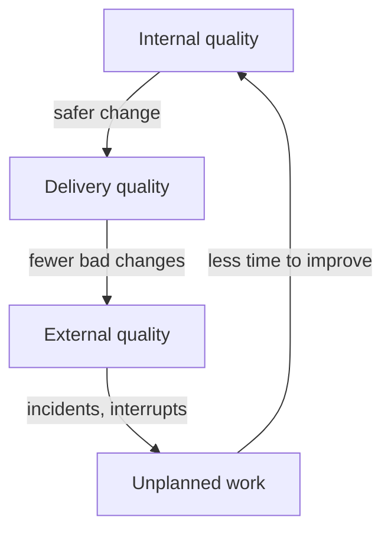
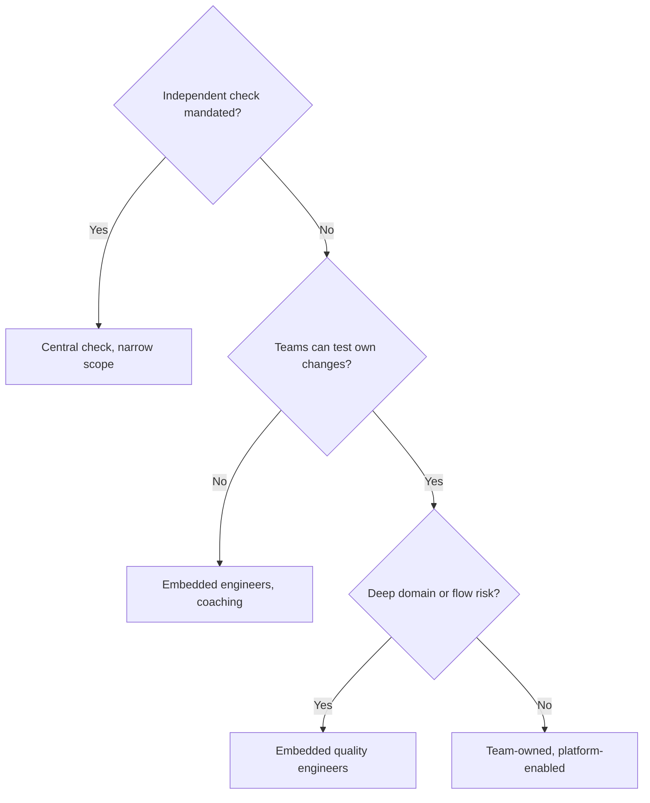

# Chapter 19 — Defining, Measuring, and Owning Software Quality

Few engineering organizations can say what quality means for their own product. This chapter
separates the three meanings of quality that leaders mix up (external, internal, and delivery
quality) and turns each into a few measurable properties of a specific product. It compares four ways
of owning quality (central quality assurance or QA, embedded quality engineers, team ownership, and
platform-enabled ownership) and says when each fits. And it shows how to choose a few quality measures, with an
honest account of how each misleads. The running example is Northstar Technologies, the fictional
company in the [case study](../../case-studies/northstar/index.md).

**Part V at a glance.** The nine quality chapters work as one system. This chapter defines quality
and who owns it. Chapter 20 turns the few properties that must hold everywhere into standards;
Chapter 21 prices technical debt; Chapter 22 designs the tests; Chapter 23 shapes the path from
merge to customer. Chapter 24 sets reliability targets and readiness, Chapter 25 handles incidents and
what they teach, and Chapter 26 treats security as one more quality attribute. Chapter 27 combines
them into one funded program. Each chapter follows one workstream of the same Northstar quarter, the
director's first. The director arrives after a quarter of 30 serious incidents (Sev1 and Sev2, defined below) and publishes severity
definitions in week 3. In week 4 the director reserves 12 FTE (full-time equivalent engineers) for
prevention work, and Core, the main monolith, moves from a two-week to a weekly release in week 5.
The seven QA engineers join product teams in week 10. By day 90, serious incidents have fallen from
30 to 21. The [timeline](../../case-studies/northstar/timeline.md) lists every week.

## Why This Matters

At team scale, an undefined notion of quality produces arguments that never resolve: more tests,
fewer incidents, fewer complaints, each a different property. The loudest view wins.

At organization scale, the cost is ownership. If quality is "what QA checks", it belongs to the
people who run the checks, and the teams that write the code learn about their defects late,
second-hand, and in a batch. Northstar's managers describe quality as the job of the QA group and the
release train. Yet 14 of last quarter's 30 Sev1 and Sev2 incidents were first reported by a customer.
(Sev1 and Sev2 are the two highest [severity](../../glossary.md#severity-sev1-sev2-sev3) ratings. At
Northstar, Sev1 means an order or payment path is down for any customer, or a customer can see a wrong
financial record. Sev2 is a narrower or partial failure.) A definition that lives in a test plan cannot
catch what the plan never described.

At executive scale, the cost is credibility. A chief technology officer (CTO) who reports that quality is improving because bug
counts fell, while customers report more outages, has used the wrong meaning of the word. Executives
need a definition tied to what customers and contracts care about, and measures that cannot be
improved by reclassification.

## Learning Objectives

After this chapter you will be able to:

- Define quality operationally for a specific product, separating external, internal, and delivery
  quality, and state each as a short list of measurable attributes.
- Compare the four ownership models (central QA, embedded quality engineers, team-owned quality, and
  platform-enabled quality) and choose a mix that fits your product's risks and your teams'
  capabilities.
- Classify escaped defects by detection point and use the result to decide who should own which
  kind of check.
- Select a small set of quality measures, pair each with one that exposes its distortion, and
  explain how each can mislead.
- Recognize the failure modes of quality ownership early enough to correct them.

## The Mental Model

> **Mental model:** Quality is not one property and not one team's job. Name the few properties your
> customers and contracts depend on, measure each with a pair of signals, and give ownership of each
> to the people whose decisions change it.

The first half is about definition. "Quality" covers three different things that move on different
timescales:

- **External quality** is what customers experience: correct results, availability, performance,
  intact data. It is the outcome that matters commercially.
- **Internal quality** is how easy the system is to change safely: clear structure, a test suite
  that fails when behavior breaks, manageable technical debt (Chapter 21).
- **Delivery quality** is how reliably the organization turns intent into working change: how often
  changes fail, how fast failures are repaired, how predictable releases are.

They are linked in a loop, which is why improving one in isolation disappoints:

Poor internal quality makes changes risky, failures generate interrupts, and interrupts consume
the time that would have improved the code. This is a reinforcing loop
([Chapter 3](../01-foundations/03-managerial-leverage-and-systems-thinking.md) introduces the idea):
it makes quality decline without anyone deciding to lower standards.

The second half is about ownership. A property should be owned by whoever makes the decisions that
change it. The authoring team decides how much of its logic is tested; a platform team decides
whether contract tests are cheap to write; product and engineering together decide whether a
requirement was understood. Assigning all of these to one QA group puts ownership
where the information arrives last.

## Deep Conceptual Explanation

### Why quality resists definition

The difficulty is not specific to software. David Garvin's 1984 article identified five approaches
to defining product quality, drawn from philosophy, economics, marketing, and operations management.
They are transcendent (excellence you recognize but cannot define), product-based (the amount of a desirable
attribute), user-based (fitness for the user's purpose), manufacturing-based (conformance to
specification), and value-based (performance relative to price). He then proposed eight dimensions
of quality, among them performance, reliability, conformance, and serviceability
([Garvin, 1984](../../references/bibliography.md#garvin1984product)).

The approaches map onto familiar arguments: the QA lead counting passed test cases is
manufacturing-based, the customer success lead counting complaints is user-based. Each is
incomplete, and an organization that does not choose measures whatever is easiest to count, usually
conformance.

Conformance is a dangerous default for software because the specification is part of what can be
wrong. At Northstar, 27 of 212 [escaped defects](../../glossary.md#escaped-defect) last quarter (13
percent) were built exactly as specified and still failed the customer. An escaped defect is a
customer-reported bug confirmed as a defect: one that got past every check before release. No
conformance test finds those 27.

### Making quality operational

A definition becomes operational when it names the properties that matter for this product and
states each as something observable. ISO/IEC 25010, the product quality model in the SQuaRE family
of standards, defines nine quality characteristics divided into subcharacteristics. It presents them
as a reference model for specifying, measuring, and evaluating product quality, including eliciting
requirements and setting test objectives
([ISO/IEC 25010:2023](../../references/bibliography.md#iso25010-2023)). Treat it as a **standard**: a
checklist that stops you forgetting a property, not evidence that any property matters for you.

Do not adopt the whole model; a product does not need nine priorities. For each critical user path,
ask which two or three properties customers and contracts depend on, and write each with a
threshold. "Invoicing is reliable" is a wish. "Invoices on the payment path have correct totals,
taxes, and currency, and after-the-fact corrections stay below an agreed rate per thousand invoices"
is a property a team can own.

Three rules keep the list honest:

1. **Tie each attribute to a path and a consequence.** Northstar's contracts make availability of
   the order and payment paths a commercial term. So availability is on the list for those paths and
   not, at the same weight, for the reporting API.
2. **Include at least one attribute that conformance testing cannot verify**, such as "a customer can
   complete a bulk order without calling support". This keeps the user's view in the definition.
3. **Keep internal and delivery attributes on a separate list.** They are means, not outcomes.

Where the property is a service level, it becomes a service level indicator and objective; Chapter 24
owns their design. This chapter only asks that the attribute be named and owned.

### The four ownership models

Organizations distribute responsibility for quality in four recognizable ways, and most mix them.

**Central QA.** A separate group tests what development teams produce, usually before a scheduled
release. Its strengths are independence, accumulated knowledge of customer workflows, and a clear
home for mandated sign-off. Its weaknesses follow from its position at the end: it tests in batches,
finds problems after the authors have moved on, and lets development teams treat testing as someone
else's job.

**Embedded quality engineers.** Quality specialists sit in product teams. They own test strategy for
the team's risk areas, do exploratory testing, coach developers, and build automation, rather than
executing every check themselves. Without a clear mandate, they become a one-person QA department
inside the team.

**Team-owned quality.** There is no separate quality role; developers write their own tests and
answer for their components' defects and incidents. The feedback loop is as short as possible, but
specialized skills (exploratory, performance, and complex-domain test design) disappear under
schedule pressure unless someone builds them. *Software Engineering at Google* is widely known for
describing an organization in which engineers test their own code, backed by heavy investment in
shared testing infrastructure
([Winters, Manshreck, and Wright, 2020](../../references/bibliography.md#winters2020software)). That
is **documented practice** at one very large company, not evidence that the model transfers.

**Platform-enabled quality.** A platform team makes good testing the easy path: fast pipelines, test
environments, contract-testing tooling, test data, automated rollback. Teams still own their quality;
the platform lowers its cost. *Team Topologies* is known for the idea of platform teams that provide
self-service capabilities and enabling teams that help other teams acquire skills
([Skelton and Pais, 2019](../../references/bibliography.md#skelton2019team)); Chapter 33 develops
those team types. *Continuous Delivery* is known for the argument that quality is built in through an
automated deployment pipeline rather than inspected in at the end
([Humble and Farley, 2010](../../references/bibliography.md#humble2010continuous)).

### What the evidence says about the models

The evidence is thin. No study **directly compares** central, embedded, and team-owned QA on outcomes
such as escaped defects. What exists is indirect.

A case study of three software product companies examined who actually tested and how many defects
each group found. Two organized testing as a team effort; one had a specialized testing group.
Testing was not done only by specialists, and testing by people with customer contact and domain
expertise was an important form of validation. Defects found by developers had the highest fix
rates, those reported by specialized testers the lowest
([Mäntylä, Itkonen, and Iivonen, 2012](../../references/bibliography.md#mantyla2012who)). This is a
**research finding** from three companies. Fix rate is not detection effectiveness, and the study
does not say which model let fewer defects escape. It does support two mechanisms: domain knowledge
is a testing asset wherever it sits, and defects raised inside the team are more likely to be acted
on.

A study of Mozilla Firefox's mostly manual system testing from 2006 to 2012 found that rapid releases
narrowed testing to the features and regressions with the highest risk. The faster cadence also made
a large testing community harder to sustain, so Mozilla added contractors
([Mäntylä et al., 2013](../../references/bibliography.md#mantyla2013rapid)). It is one open-source
project: evidence that a central manual testing function changes shape when release cadence rises,
not a verdict on the function.

The case for central independence is real in specific contexts: regulated products that require an
independent check, safety-critical systems, and specialized testing (performance, accessibility,
security) that no single team does often enough to do well. The question is contested, so the
position here is **this book's recommendation**, not a research finding. Teams own the quality
outcomes of their changes. Quality engineers are embedded where risk or domain complexity justifies
them. A platform makes testing cheap. Central QA is kept for specialized or independently mandated
testing.

### Detection points tell you who should own a check

The most useful input to an ownership decision is a classification of escaped defects by the earliest
point at which a reasonable check would have caught them. Each detection point has a natural owner
(the Engineering Organization Example tabulates Northstar's 212 escaped defects this way). Unit logic
belongs to the team that wrote it.
Contract defects need the teams on both sides and tooling that makes contract tests cheap.
End-to-end flow defects are where testers with domain knowledge add most. Migration and configuration
defects are caught by pipeline checks a platform builds and teams use. Misunderstood requirements are
caught by how product and engineering work together, not by testing. Chapter 22 owns how to design
the tests at each level; the point here is who answers for each level.

### Choosing measures, and how each misleads

Choose five to seven measures covering all three meanings, each paired with a measure that exposes
its distortion. Chapter 18 owns the delivery metrics and the general mechanics of metric gaming; this
table covers measures specific to quality.

| Measure | Meaning | How it misleads | Pair it with |
|---|---|---|---|
| Escaped defects by detection point | External | Depends on support triage; defects argued into "feature requests" | Sampled triage audit |
| Customer-detected share of incidents | External | Falls if incidents are rated below the tracked severity | Severity distribution over time |
| Path correctness rate (for example, invoice corrections) | External | Depends on which corrections are logged | Customer escalations on that path |
| Change failure rate | Delivery | Falls if teams deploy less or failures go unlinked | Deployment frequency |
| Regression share of escaped defects | Internal | Falls if new features get buggier | Escaped defect count |

**Line coverage** is a poor target (Chapter 22 summarizes the evidence); keep it a team diagnostic.
Northstar's managers quote 41 percent coverage for Core, the main monolith; the number says how much code runs under test,
not whether the tests would notice a fault.

**Defect counts per team** mislead through exposure: a team with a large customer-facing surface
receives more reports than a team whose code customers rarely touch. For
[change failure rate](../../glossary.md#change-failure-rate), the share of releases that fail, use the
current definitions in the guide from DORA (DevOps Research and Assessment). The guide also warns that
setting its metrics as goals invites gaming, and that they describe a service or application rather
than rank teams
([DORA, metrics guide](../../references/bibliography.md#dora-metrics-guide); see also
[Forsgren, Humble, and Kim, 2018](../../references/bibliography.md#forsgren2018accelerate)).

## Engineering Organization Example

!!! info "Northstar so far"
    Weeks 1 to 3 of the director's first year. The baseline quarter has just closed: 30 Sev1 and Sev2
    incidents, 99.62 percent availability against a 99.9 percent commitment, and $410,000 in service
    credits. Nothing has changed yet. See the [timeline](../../case-studies/northstar/timeline.md).

This analysis is **illustrative**: the figures are Northstar's fictional baseline, and the proposals
are the director's.

**Who finds the problems today.** [Core](../../glossary.md#core), Northstar's Java monolith, ships
on a two-week [release train](../../glossary.md#release-train). Before each release, seven QA
engineers in Platform Operations run about 1,900 manual regression cases over three days, at about
$440,000 a year in QA time. Yet 212 defects escaped last quarter, and 81 of them (38 percent) were
regressions, exactly what a regression pass exists to catch. The pass is a late sample of known
workflows against a large batch.

**Who should own detection.**

| Detection point | Count | Share | Natural owner |
|---|---|---|---|
| Unit-level logic | 57 | 27% | Authoring team |
| Integration or contract | 49 | 23% | Teams on both sides, platform tooling |
| End-to-end or UI flow | 41 | 19% | Team, embedded quality engineers |
| Data migration or configuration | 38 | 18% | Team, platform pipeline checks |
| Requirement misunderstood | 27 | 13% | Product and engineering |

Half the escaped defects (106 of 212) sit at unit and contract level, where the authoring teams' own
automated tests are the cheapest check. Only the end-to-end group (41) is the kind a separate testing
function is best placed to find, and the asset that finds it is domain knowledge. The data do not
support "quality belongs to QA". They support a mix.

**Normalizing defect counts, and how it misleads.** Dividing each team's escaped defects by its size,
or by its deployments, looks fair. It is not.

| Team | Escaped defects | Engineers | Per engineer | Deployments in the quarter | Per deployment |
|---|---|---|---|---|---|
| Billing | 58 | 13 | 4.5 | 24 | 2.4 |
| Orders | 51 | 14 | 3.6 | 33 | 1.5 |
| Customer Experience | 44 | 15 | 2.9 | 78 | 0.56 |
| Payments and Integrations | 31 | 12 | 2.6 | 66 | 0.47 |
| Data and Analytics | 19 | 11 | 1.7 | 33 | 0.58 |
| Platform Operations | 9 | 12 | 0.75 | 42 | 0.21 |

Deployments in the quarter are three times the baseline monthly figure.

Both views put Billing and Orders on top, for a reason neither shows: those teams ship most changes
through the Core release train, so each release carries two weeks of several teams' work. And
Platform Operations' low count reflects how few of its changes reach customers directly. Ranking
managers on either table would rank their positions in the architecture.

**A measure set.** Six measures come from data Northstar already has:

1. escaped defects by detection point, with a sampled triage audit;
2. customer-detected share of Sev1 and Sev2 incidents (47 percent);
3. an invoice correctness rate on the payment path;
4. change failure rate paired with deployment frequency;
5. regression share of escaped defects (38 percent);
6. the share of [tier 1](../../glossary.md#tier-1) components (the 15 on the order or payment path)
   that meet the four [operational minimums](../../glossary.md#tier-1-operational-minimums): an owning
   team, complete user-facing alerts, a runbook, and on-call. Today 3 of 15 meet all four, and 6 of 15
   have a runbook.

Coverage stays a team diagnostic.

**An ownership mix.** One defensible allocation of the seven QA engineers:

- two each to Orders and Billing, which have the highest escaped-defect counts and the Core modules
  with the most complex rules;
- two to Customer Experience, for end-to-end and mobile flows;
- one to Payments and Integrations, for bank and accounting integrations.

Data and Analytics stays team-owned. Platform Operations' five infrastructure engineers become the
platform-enabled part: test environments, contract tooling, and pipeline checks for migrations and
configuration. This is the mix Northstar later adopted. Chapter 27 describes how the move was
announced and what the delay cost.

## Decision Framework

Choose the ownership model per product area, not once for the company:

"Mandated" means required by regulation, contract, or a safety case, not preferred by a manager. In
every branch, if several teams pay the same testing cost (environments, test data, contract tooling),
a platform should absorb it.

| Model | Fits when | Fails when | Early warning |
|---|---|---|---|
| Central QA | Mandated independence; specialized testing; rare, high-risk releases | It is the main filter for frequent changes | Release cadence set by the test calendar |
| Embedded quality engineers | Complex domain rules; long user flows; teams new to testing | The engineer becomes the team's tester | Their time goes to executing manual cases |
| Team-owned | Testing skill and fast pipelines; low domain complexity | Teams lack skill or time | No exploratory or performance testing anywhere |
| Platform-enabled | Several teams share testing costs | Tools nobody adopts; platform assumed to "own quality" | Platform paged for product defects |

For measures, apply three tests: Does it describe an attribute in the quality profile? Can its owner
change it through their own decisions? Would a paired measure move if this one were gamed? Drop any
measure that fails two.

## Trade-offs

**Independence against speed of feedback.** An independent tester has no stake in the change passing.
The cost is distance: defects are found days later, by someone else, in a batch. For frequent changes
speed usually matters more; for rare, irreversible ones (a ledger migration), independence may be
worth the delay.

**Specialist depth against self-sufficiency.** Embedded quality engineers bring skill and cost
headcount. Team ownership costs nothing extra on paper and loses specialist skills unless someone
builds them.

**A small measure set against completeness.** Six measures cannot describe everything; more measures
are harder to game in aggregate and harder to act on. Keep diagnostics such as coverage and flaky-test
rate available to teams but off the scorecard.

**Transition cost.** Changing ownership models costs a quarter or more of reduced effectiveness:
testers retrain toward automation and strategy, and teams taking on testing go slower at first. The
people in the old model carry knowledge the new one needs.

## Failure Modes

**Quality as a department.** Quality is the QA group's job, and managers measure their teams by
features shipped. Signal: teams cannot name their own escaped defects or change failure rate, as at
Northstar. Countermeasure: put each team's external measures in its own review, owned by its manager.

**The single number.** Leadership tracks bug count; teams improve it by reclassifying or delaying
triage. Signal: the number improves while escalations do not. Countermeasure: paired measures and a
sampled classification audit.

**The coverage target.** Teams write tests that execute code without asserting much. Signal: coverage
rises, escaped defects in covered code do not fall. Countermeasure: keep coverage diagnostic; direct
test investment by detection point.

**The embedded tester.** Quality engineers move into teams and keep running manual cases for the
developers. Signal: the quality engineer is the release gate. Countermeasure: a written mandate and a
manager who protects it.

**The platform that owns nothing.** Product teams treat the platform as the owner of quality and page
it when tests fail. Countermeasure: the platform owns its tooling; teams own their tests and outcomes.

**Ranking by exposure.** Defect counts compare managers, rewarding teams whose code customers rarely
touch. Countermeasure: compare each team with its own baseline.

## Enterprise Application

In an organization of 50 to 150 engineers, the director owns three one-page artifacts: the quality
profile (named attributes per critical path), the measure set with its pairs, and the ownership map
(who owns which detection point, per area). All three are reviewed at least quarterly.

Engineering managers own their teams' external and delivery measures. A manager who cannot explain
last month's escaped defects by detection point has not yet taken ownership. Staff engineers own cross-cutting internal attributes: testability of shared
modules, contract boundaries, the test architecture (Chapter 22). A remaining quality lead changes
the question from "did this release pass?" to "where are our checks missing, and who should add
them?"

Northstar's Platform Operations combines five infrastructure engineers
and seven QA engineers under one manager and carries the highest unplanned-work share (46 percent),
because other teams' failures arrive there as interrupts. Housing central QA inside a platform team
makes quality look like infrastructure, something provided to product teams rather than done by them.
Product teams should own outcomes and the platform capabilities, visibly in the org chart.

## CTO Perspective

At CTO level the quality definition is a business instrument. With the chief executive (CEO) and
chief product officer (CPO), the CTO decides
which properties of which products are commercial commitments (Northstar's 99.9 percent availability
on the order and payment paths is one), which are internal standards, and which may vary. That
tiering decision should be explicit.

The CTO also sets the ownership philosophy, which shapes hiring and careers. A remaining QA career
track needs a defined senior role (strategy, tooling, specialized testing). If the company moves to
team ownership, fund the platform and enabling work that makes it practical. Otherwise the change is
a cost cut presented as a quality improvement.

Report upward in business terms: availability against commitment, customer-detected share,
correctness on paid-for paths, and the trend. The board does not need coverage or bug counts. Refuse
targets that invite reclassification, such as a fixed defect count, and commit to rates with stated
confidence.

## Practical Playbook

1. **Write the quality profile.** For each critical path, two or three external attributes with
   thresholds; add two delivery and two internal attributes. Check against ISO/IEC 25010 for gaps.
2. **Classify a quarter of escaped defects** by earliest practical detection point; sample at least
   100 if volume is large.
3. **Map detection points to owners,** today's and the intended, and list every mismatch.
4. **Choose the ownership model per area** with the decision framework, and write a mandate for each
   quality engineer role.
5. **Choose five to seven measures,** each tied to an attribute and paired. Keep coverage as a team
   diagnostic.
6. **Baseline before targets.** Measure for one or two months and audit human classifications
   (severity, triage) first.
7. **Put the measures in each team's own review** before any cross-team view exists.
8. **Price the transition** and agree it with product before starting.
9. **Review quarterly,** and retire attributes no decision used.

## Case Study

This case is **fictional**. It takes place in the director's first month at Northstar, while the
director was also classifying the baseline quarter's incidents, and uses only the
[baseline data](../../case-studies/northstar/baseline-data.md).

In the first one-to-ones, the director asked each manager: "Who is responsible for the quality of
what your team ships?" Four answers named the QA group or the release train. Tom Becker (Platform
Operations), who manages the QA engineers, said they caught problems "before the train leaves".
Elena Sokolova (Payments and Integrations) said her team was, and could name its last three escaped
defects. Her team deploys 22 times a month, and
its change failure rate (21 percent) is well below the 29 and 34 percent of the two teams that ship
through the Core train.

In week 3, the director ran a two-hour session with the managers, the staff engineers, and two QA
engineers. Instead of debating roles, the group took a sample of escaped defects and asked where the
earliest reasonable check would have been and who would have run it. Most of the room expected "QA
should have caught it". The sample said otherwise: half were unit or contract problems the authoring
team's tests could have caught cheaply, and about one in eight came from a misunderstood requirement.

The QA engineers changed the conversation: the end-to-end defects came mostly from workflows the
regression suite did not cover, because nobody had told them the workflows had changed. Their problem
was distance from the teams, not effort, and hearing it from them moved the managers more than the
data did.

Marcus Oyelaran (Billing) objected that his team, with three people carrying most on-call pages, had
no capacity to take on testing it had never owned. The director recorded the concern as a transition
cost, not a reason to keep the old model. The session ended with a draft quality profile for the
order and payment paths, the six measures, and an ownership map with two open disputes. No role
changes were announced. That was right for the analysis and hard on the QA engineers, who left
knowing their roles would change without knowing how. The new roles were announced only in week 10,
after two QA engineers had asked whether they were being automated out of a job.

## Exercises

Solutions are in [chapter 19 solutions](../../solutions/ch19-solutions.md). Data are on the
[Northstar baseline page](../../case-studies/northstar/baseline-data.md).

### Foundational

**F1.** Northstar's head of customer success says quality is "fewer angry customers", the QA lead
says it is "the regression suite passing", and Ines Carvalho (staff engineer, Core domain) says it is
"code we can change without fear". Identify which of the three meanings of quality (and which of Garvin's approaches) each person
holds, explain why each is incomplete on its own, and propose one measure for each that the others
would accept as legitimate.

**F2.** Write a quality profile for Northstar's payment path: three external attributes stated as
observable properties with thresholds, one attribute that conformance testing could not verify, and
one sentence per attribute naming its owner. Say what you left out and why, and mark any invented
threshold as illustrative.

**F3.** A manager proposes ranking Northstar's six teams by escaped defects per engineer and
rewarding the best. Using the team table in this chapter, state the ranking, then explain at least
two reasons it would mislead, and propose a way to use the same data that would not.

### Applied Leadership

**A1.** Tom Becker argues that moving QA engineers into product teams will destroy their independence
and that defects will rise, because developers "always test the happy path". Prepare: which parts
of his argument the evidence supports, which it does not, what data you bring, and what you concede.

**A2.** Design the mandate for an embedded quality engineer in Northstar's Billing team. Specify what
they own, what they explicitly do not do, how their time should divide in their first quarter and
after it, and what signal would tell you after six months that the role has collapsed back into
manual testing.

**A3.** Elena Sokolova's team already owns its quality well and does not want an embedded quality
engineer, but the detection-point analysis shows integration and contract defects at its boundaries
with Core. Decide whether to place a quality engineer there, and how you would get the contract
defects owned without undermining the team's existing ownership.

### Executive Decision-Making

**X1.** Victor Lindqvist (CTO) asks you to justify keeping any quality specialists at all, since several
companies he admires have "no QA". You have seven QA engineers, a $440,000-a-year manual regression
pass, and a 99.9 percent contractual commitment. Write the recommendation you would give him, with the
evidence and its limits, and say what would change your mind.

**X2.** The board asks for a single quality number to track quarterly. Propose what you would give
the board instead, in no more than five measures, say how each could be distorted under board
attention, and explain how you would protect the measures that teams use for improvement from
becoming board targets.

## Reflection Questions

1. If you asked your managers who is responsible for quality, how many would name someone outside
   their own team? What does that tell you about where defect information arrives?
2. Which of your quality measures is computed by people with a stake in the result? How would you know
   if it were drifting?
3. Which quality attribute of your product is written into a contract or a sales promise, and does any
   team own it by name?
4. Where do people with customer contact and domain knowledge test your software today, formally or
   informally? What would you lose if they stopped?
5. Which check in your organization exists mainly because no one upstream owns the problem it catches?

## Key Takeaways

- Say which quality you mean: external, internal, or delivery. They move on different timescales.
- Make quality operational as a short profile per critical path: a few attributes, each observable,
  with a threshold and a named owner.
- Assign ownership by detection point: authoring teams for unit and contract logic, quality engineers
  for complex flows, a platform for shared checks, product and engineering for requirements.
- No study directly compares the QA models; the indirect evidence favors domain knowledge and short
  feedback loops wherever testing sits.
- Keep central QA for mandated or specialized testing, not as the main filter for frequent change.
- Choose five to seven paired measures, and keep line coverage off the scorecard.
- Do not rank teams by defect counts; exposure and architecture explain much of the difference.
- Price the transition between models, and say what people in the old model do next. Include at
  least one attribute in the profile that conformance testing cannot verify.

## References and Further Reading

- [Garvin, 1984](../../references/bibliography.md#garvin1984product). The classic map of competing
  definitions of quality; useful when people in one meeting mean different things.
- [ISO/IEC 25010:2023](../../references/bibliography.md#iso25010-2023). The SQuaRE product quality
  model; a checklist for writing a quality profile.
- [Mäntylä, Itkonen, and Iivonen, 2012](../../references/bibliography.md#mantyla2012who). Testing as a
  cross-cutting activity in three companies; the closest research to the ownership question.
- [Mäntylä et al., 2013](../../references/bibliography.md#mantyla2013rapid). How Firefox's manual
  system testing changed under rapid releases.
- [Inozemtseva and Holmes, 2014](../../references/bibliography.md#inozemtseva2014coverage). The study
  to cite when someone proposes a coverage target.
- [DORA metrics guide](../../references/bibliography.md#dora-metrics-guide) and
  [Forsgren, Humble, and Kim, 2018](../../references/bibliography.md#forsgren2018accelerate). Current
  delivery-metric definitions and the research program behind them.
- [Humble and Farley, 2010](../../references/bibliography.md#humble2010continuous). Building quality in
  through an automated pipeline.
- [Winters, Manshreck, and Wright, 2020](../../references/bibliography.md#winters2020software). Free
  online; engineer-owned testing supported by shared infrastructure at very large scale.
- [Skelton and Pais, 2019](../../references/bibliography.md#skelton2019team). Platform and enabling
  teams, the structures behind platform-enabled quality.
