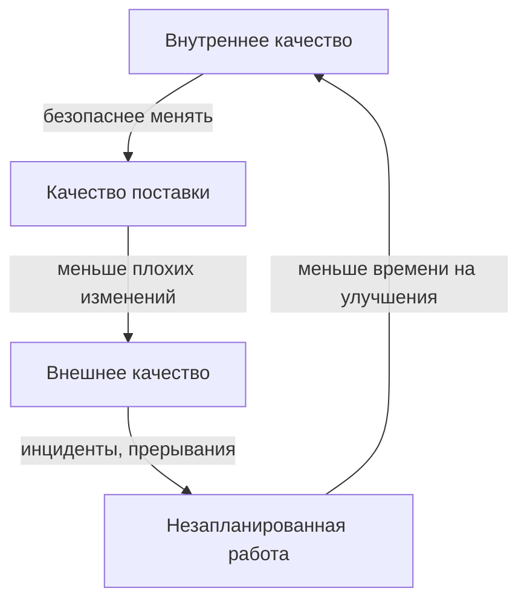
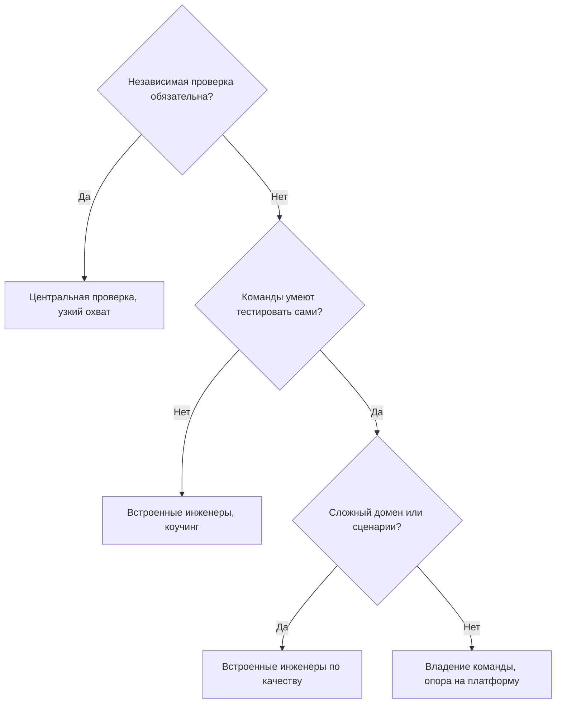

# Глава 19 — Качество ПО: определение, измерение и ответственность { #chapter-19-defining-measuring-and-owning-software-quality }

Мало какая инженерная организация может сказать, что значит качество для её собственного продукта. Эта
глава разводит три значения слова «качество», которые руководители путают: внешнее качество, внутреннее и
качество поставки. Каждое из них она превращает в несколько измеримых свойств конкретного продукта. Затем
она сравнивает четыре способа владеть качеством (централизованный отдел контроля качества, или QA;
встроенные в команды инженеры по качеству; владение силами команды; владение с опорой на платформу) и
показывает, когда какой из них подходит. Наконец, она объясняет, как выбрать несколько показателей
качества и честно признать, чем каждый из них вводит в заблуждение. Сквозной пример — Northstar
Technologies, вымышленная компания из [кейса](../../case-studies/northstar/index.md).

**Часть V вкратце.** Девять глав о качестве работают как одна система:

- Глава 19 (эта): что такое качество и кто за него отвечает.
- Глава 20: стандарты для немногих свойств, которые должны соблюдаться везде.
- Глава 21: как оценить технический долг в деньгах.
- Глава 22: как спроектировать тесты.
- Глава 23: путь от слияния кода до клиента.
- Глава 24: целевые уровни надёжности и операционная готовность.
- Глава 25: инциденты и чему они учат.
- Глава 26: безопасность как ещё один атрибут качества.
- Глава 27: как свести всё это в одну профинансированную программу.

Каждая глава прослеживает одно направление работы в первом квартале директора в Northstar; за этот
квартал число серьёзных инцидентов падает с 30 до 21. В [хронологии](../../case-studies/northstar/timeline.md)
расписаны все недели, а в списке [действующих лиц](../../case-studies/northstar/cast.md) — все люди.

## Почему это важно { #why-this-matters }

Для команды размытое понятие качества оборачивается бесконечными спорами: что считать качеством —
больше тестов, меньше инцидентов или меньше жалоб? Каждый ответ описывает своё свойство, и побеждает
тот, кто громче.

Для организации цена определяется тем, кто владеет качеством. Если качество — это «то, что проверяет
QA», оно принадлежит проверяющим, а команды, которые пишут код, узнают о своих дефектах поздно, из
вторых рук и сразу пачкой. Руководители Northstar описывают качество как работу QA-группы и релизного
поезда (release train). Тем не менее в прошлом квартале о 14 из 30 инцидентов Sev1 и Sev2 первым сообщил
клиент. (Sev1 и Sev2 — два высших уровня [серьёзности](../../glossary.md#severity-sev1-sev2-sev3).
В Northstar Sev1 означает, что путь заказа или оплаты не работает хотя бы для одного клиента или клиент
может увидеть неверную финансовую запись. Sev2 — более узкий или частичный сбой.) Если определение
качества живёт в тест-плане, оно не поймает того, чего в этом плане никогда не было.

Для высшего руководства цена — доверие. Если CTO (технический директор) докладывает о росте качества,
потому что упало число багов, а клиенты сообщают о всё новых сбоях, значит, он выбрал не то значение
слова. Руководству нужны определение, привязанное к тому, что важно клиентам и контрактам, и показатели,
которые нельзя улучшить переклассификацией.

## Цели главы { #learning-objectives }

Прочитав эту главу, вы сможете:

- Давать операционное определение качества для конкретного продукта: разделять внешнее, внутреннее и
  качество поставки и описывать каждое коротким списком измеримых атрибутов.
- Сравнивать четыре модели владения (централизованный QA, встроенные инженеры по качеству, качество во
  владении команды и качество с опорой на платформу) и выбирать сочетание, которое подходит рискам
  вашего продукта и возможностям ваших команд.
- Классифицировать пропущенные дефекты по точке обнаружения и по итогам решать, кому какую проверку
  вести.
- Отбирать небольшой набор показателей качества, давать каждому парную метрику, которая выявляет его
  искажение, и объяснять, чем каждый может ввести в заблуждение.
- Распознавать типичные провалы во владении качеством так рано, чтобы успеть их исправить.

## Ментальная модель { #the-mental-model }

> **Ментальная модель:** качество — это не одно свойство и не работа одной команды. Назовите те немногие
> свойства, от которых зависят ваши клиенты и контракты, измеряйте каждое парой сигналов и отдайте
> владение каждым тем, чьи решения его меняют.

Первая половина модели — об определении. «Качество» охватывает три разные вещи, которые меняются в
разных масштабах времени:

- **Внешнее качество** — то, с чем сталкиваются клиенты: правильные результаты, доступность,
  производительность, целые данные. Для бизнеса важен именно этот результат.
- **Внутреннее качество** — насколько легко менять систему без риска: понятная структура, набор тестов,
  который падает, когда ломается поведение, технический долг в управляемых пределах (глава 21).
- **Качество поставки** — насколько надёжно организация превращает замысел в работающее изменение: как
  часто изменения приводят к сбоям, как быстро сбои устраняют, насколько предсказуемы релизы.

Все три связаны в петлю, поэтому улучшение одного в отрыве от остальных не оправдывает ожиданий:

Из-за плохого внутреннего качества изменения становятся рискованными, сбои порождают прерывания, а
прерывания съедают время, которое могло бы пойти на улучшение кода. Это усиливающая петля (идею вводит
[глава 3](../01-foundations/03-managerial-leverage-and-systems-thinking.md)): качество падает, хотя никто
не решал снижать стандарты.

Вторая половина модели — о владении. Свойством должен владеть тот, чьи решения его меняют. Команда-автор
решает, какая доля её логики покрыта тестами; платформенная команда — дёшево ли писать контрактные
тесты; продукт и разработка вместе — правильно ли понято требование. Если отдать всё это одной
QA-группе, владение окажется там, куда информация приходит последней.

## Подробный разбор { #deep-conceptual-explanation }

### Почему качество не поддаётся определению { #why-quality-resists-definition }

Эта трудность свойственна не только ПО. David Garvin в статье 1984 года выделил пять подходов к
определению качества продукта, взятых из философии, экономики, маркетинга и управления производством.
Это трансцендентный подход (совершенство, которое узнаёшь, но не можешь определить), продуктовый
(сколько в продукте желаемого атрибута), пользовательский (пригодность для целей пользователя),
производственный (соответствие спецификации) и ценностный (соотношение характеристик и цены). Затем он
предложил восемь измерений качества, среди них эксплуатационные характеристики, надёжность, соответствие
спецификации и удобство обслуживания ([Garvin, 1984](../../references/bibliography.md#garvin1984product)).

Эти подходы легко узнать в привычных спорах. Руководитель QA, который считает пройденные тест-кейсы,
стоит на производственном подходе, а руководитель службы работы с клиентами, который считает жалобы, — на
пользовательском. Каждый подход неполон. Если организация не сделала выбор, она измеряет то, что проще
всего посчитать, — обычно соответствие спецификации.

Для ПО соответствие спецификации — опасный выбор по умолчанию: ошибочной может оказаться сама
спецификация. В Northstar в прошлом квартале 27 из 212 [пропущенных дефектов (escaped
defects)](../../glossary.md#escaped-defect), то есть 13 процентов, точно соответствовали спецификации и
всё равно подвели клиента. Пропущенный дефект — это баг, о котором сообщил клиент и который подтвердили
как дефект: он проскочил все проверки перед релизом. Эти 27 дефектов не найдёт ни один тест на
соответствие.

### Как сделать качество операционным { #making-quality-operational }

Определение становится операционным, когда называет свойства, важные для этого продукта, и описывает
каждое как нечто наблюдаемое. ISO/IEC 25010, модель качества продукта из семейства стандартов SQuaRE,
определяет девять характеристик качества, разделённых на подхарактеристики. Стандарт подаёт их как
эталонную модель, по которой задают, измеряют и оценивают качество продукта, в том числе выявляют
требования и ставят цели тестирования ([ISO/IEC 25010:2023](../../references/bibliography.md#iso25010-2023)).
Относитесь к нему как к **стандарту**: это чек-лист, который не даёт забыть какое-то свойство, а не
доказательство того, что это свойство важно именно для вас.

Не берите модель целиком: продукту не нужны девять приоритетов. Для каждого критического пользовательского
пути спросите, от каких двух-трёх свойств зависят клиенты и контракты, и запишите каждое с порогом.
«Выставление счетов работает надёжно» — это пожелание. «В счетах на пути оплаты верны итоговые суммы,
налоги и валюта, а доля исправлений задним числом остаётся ниже согласованного уровня на тысячу счетов» —
это свойство, которым команда может владеть.

Честным список помогают держать три правила:

1. **Привязывайте каждый атрибут к пути и к последствию.** По контрактам Northstar доступность путей
   заказа и оплаты — коммерческое условие. Поэтому для этих путей доступность в списке есть, а для API
   отчётности с тем же весом — нет.
2. **Включите хотя бы один атрибут, который тестирование на соответствие проверить не может**, например
   «клиент может оформить массовый заказ, не обращаясь в поддержку». Так определение сохраняет взгляд
   пользователя.
3. **Держите атрибуты внутреннего качества и качества поставки в отдельном списке.** Это средства, а не
   результаты.

Если свойство описывает уровень сервиса, оно становится индикатором уровня сервиса (SLI) и целевым
уровнем (SLO); как их проектировать, разбирает глава 24. Здесь достаточно, чтобы у атрибута были имя и
владелец.

### Четыре модели владения { #the-four-ownership-models }

Организации распределяют ответственность за качество четырьмя узнаваемыми способами, и большинство
организаций их сочетает.

**Централизованный QA.** Отдельная группа тестирует то, что делают команды разработки, обычно перед
плановым релизом. Её сильные стороны — независимость, накопленное знание клиентских сценариев и понятное
место для обязательного утверждения релиза. Слабые стороны вытекают из её положения в конце цепочки: она
тестирует пачками, находит проблемы, когда авторы уже заняты другим, и позволяет командам разработки
считать тестирование чужой работой.

**Встроенные инженеры по качеству.** Специалисты по качеству работают внутри продуктовых команд. Они
владеют стратегией тестирования для зон риска команды, проводят исследовательское тестирование, учат
разработчиков и строят автоматизацию, а не выполняют каждую проверку сами. Без чёткого мандата такой
инженер превращается в QA-отдел из одного человека внутри команды.

**Качество во владении команды.** Отдельной роли по качеству нет: разработчики пишут свои тесты и
отвечают за дефекты и инциденты своих компонентов. Петля обратной связи предельно коротка, но
специальные навыки (исследовательское тестирование, тестирование производительности, проектирование
тестов для сложной предметной области) под давлением сроков исчезают, если их никто не развивает.
Книга *Software Engineering at Google* широко известна описанием организации, где инженеры сами
тестируют свой код, опираясь на крупные вложения в общую инфраструктуру тестирования
([Winters, Manshreck, and Wright, 2020](../../references/bibliography.md#winters2020software)). Это
**задокументированная практика** одной очень большой компании, а не доказательство того, что модель
переносится на другие.

**Качество с опорой на платформу.** Платформенная команда делает так, чтобы хорошо тестировать было
проще всего: быстрые пайплайны, тестовые окружения, инструменты для контрактных тестов, тестовые данные,
автоматический откат. Команды по-прежнему владеют своим качеством, а платформа снижает его цену. Книга
*Team Topologies* известна идеей двух типов команд: платформенных, которые дают другим возможности в
режиме самообслуживания, и команд содействия (enabling), которые помогают другим командам осваивать
навыки ([Skelton and Pais, 2019](../../references/bibliography.md#skelton2019team)); подробно эти типы
команд разбирает глава 33. *Continuous Delivery* известна доводом, что качество встраивают в продукт
через автоматизированный пайплайн развёртывания, а не проверяют инспекцией в конце
([Humble and Farley, 2010](../../references/bibliography.md#humble2010continuous)).

### Что говорят данные о моделях { #what-the-evidence-says-about-the-models }

Данных мало. Ни одно исследование **не сравнивает напрямую** централизованный, встроенный и командный QA
по таким результатам, как пропущенные дефекты. Есть только косвенные данные.

Кейс-исследование трёх компаний, выпускающих программные продукты, выясняло, кто на самом деле
тестировал и сколько дефектов нашла каждая группа. В двух компаниях тестирование было общим делом
команды, в одной была специализированная группа тестирования. Тестировали не только специалисты: важной
формой проверки оказалось тестирование силами людей, которые общаются с клиентами и знают предметную
область. Дефекты, найденные разработчиками, исправляли чаще всего, а дефекты от специализированных
тестировщиков — реже всего
([Mäntylä, Itkonen, and Iivonen, 2012](../../references/bibliography.md#mantyla2012who)). Это **научный
результат** по трём компаниям. Доля исправленных дефектов — не то же самое, что эффективность их
обнаружения, и исследование не говорит, при какой модели дефектов ускользало меньше. Зато оно
подтверждает два механизма: знание предметной области помогает тестированию, где бы ни сидел его
носитель, а по дефектам, найденным внутри команды, чаще принимают меры.

Другое исследование изучило системное тестирование Mozilla Firefox в 2006–2012 годах, в основном ручное.
Быстрые релизы сузили его до функций и регрессий с наибольшим риском. При более частом ритме стало
труднее поддерживать большое сообщество тестировщиков, и Mozilla привлекла подрядчиков
([Mäntylä et al., 2013](../../references/bibliography.md#mantyla2013rapid)). Это один open-source-проект.
Он показывает, что с ростом частоты релизов централизованное ручное тестирование меняет форму, но
приговора этой функции не выносит.

В некоторых контекстах довод в пользу централизованной независимости реален. Это регулируемые продукты,
где нужна независимая проверка, системы, критичные для безопасности, и специальное тестирование
(производительности, доступности интерфейса (accessibility), безопасности), которое ни одна команда не
проводит так часто, чтобы делать его хорошо. Вопрос спорный, поэтому дальше — **рекомендация книги**, а
не научный результат. Качеством своих изменений владеют сами команды. Инженеров по качеству встраивают
туда, где это оправдано риском или сложностью предметной области. Платформа делает тестирование дешёвым.
Централизованный QA сохраняют для специального тестирования и для тестирования, независимость которого
предписана.

### Точки обнаружения подсказывают, кому владеть проверкой { #detection-points-tell-you-who-should-own-a-check }

Решать вопрос о владении лучше всего с опорой на классификацию пропущенных дефектов: в какой самой ранней
точке их поймала бы разумная проверка. У каждой точки обнаружения есть естественный владелец (ниже, в
примере из инженерной организации, так разложены 212 пропущенных дефектов Northstar). Логика модульного
уровня принадлежит команде, которая её написала. Для дефектов контрактов нужны команды по обе стороны и
инструменты, которые делают контрактные тесты дешёвыми. С дефектами сквозных сценариев лучше всего
справляются тестировщики, знающие предметную область. Дефекты миграций и конфигурации ловят проверки в
пайплайне: строит их платформа, а применяют команды. Неправильно понятые требования ловит не
тестирование, а совместная работа продукта и разработки. Как проектировать тесты на каждом уровне,
разбирает глава 22; здесь важно, кто за каждый уровень отвечает.

### Как выбирать показатели и чем каждый вводит в заблуждение { #choosing-measures-and-how-each-misleads }

Выберите пять–семь показателей, которые покрывают все три значения качества, и дайте каждому парную
метрику, выявляющую его искажение. Метрики поставки и общие механизмы подгонки метрик (gaming) разбирает
глава 18; в этой таблице — показатели, специфичные для качества.

| Показатель | Значение | Чем вводит в заблуждение | Парная метрика |
|---|---|---|---|
| Пропущенные дефекты по точке обнаружения | Внешнее | Зависит от сортировки обращений в поддержке; дефекты задним числом объявляют «запросами на доработку» | Выборочный аудит сортировки |
| Доля инцидентов, обнаруженных клиентами | Внешнее | Падает, если инцидентам ставят серьёзность ниже отслеживаемой | Распределение по серьёзности во времени |
| Доля корректных результатов на пути (например, исправления счетов) | Внешнее | Зависит от того, какие исправления регистрируют | Эскалации клиентов на этом пути |
| Доля неудачных изменений | Поставка | Падает, если команды реже развёртывают или сбои не связывают с изменениями | Частота развёртываний |
| Доля регрессий среди пропущенных дефектов | Внутреннее | Падает, если в новых функциях становится больше багов | Число пропущенных дефектов |

**Покрытие строк** — плохая цель (данные кратко изложены в главе 22); пусть оно остаётся диагностикой
для команды. Руководители Northstar называют для Core, основного монолита, покрытие в 41 процент. Это
число говорит, какая доля кода выполняется под тестами, но не говорит, заметят ли тесты ошибку.

**Число дефектов по командам** вводит в заблуждение из-за разной открытости клиентам: команда с большой
клиентской поверхностью получает больше сообщений, чем команда, чей код клиенты почти не трогают. Для
[доли неудачных изменений (change failure rate)](../../glossary.md#change-failure-rate), то есть доли
релизов, закончившихся сбоем, берите актуальные определения из руководства DORA (DevOps Research and
Assessment). Руководство предупреждает о двух вещах: метрики, ставшие целями, начинают подгонять, и
описывают они сервис или приложение, а не служат для ранжирования команд
([DORA, metrics guide](../../references/bibliography.md#dora-metrics-guide); см. также
[Forsgren, Humble, and Kim, 2018](../../references/bibliography.md#forsgren2018accelerate)).

## Пример из инженерной организации { #engineering-organization-example }

!!! info "Northstar: что уже известно"
    Недели 1–3 первого года директора. Базовый квартал только что закрыт: 30 инцидентов Sev1 и Sev2,
    доступность 99,62% при обязательстве 99,9% и $410 000 сервисных кредитов. Пока ничего не изменилось.
    См. [хронологию](../../case-studies/northstar/timeline.md). Впервые читаете о Northstar? Прочитайте
    [«Год вкратце»](../../case-studies/northstar/year-in-brief.md) и
    [действующих лиц](../../case-studies/northstar/cast.md).

Этот разбор — **иллюстрация**: цифры взяты из вымышленного исходного уровня Northstar, предложения
принадлежат директору.

**Кто находит проблемы сегодня.** [Core](../../glossary.md#core), Java-монолит Northstar, выходит
двухнедельным [релизным поездом](../../glossary.md#release-train). Перед каждым релизом семь QA-инженеров
из Platform Operations три дня прогоняют около 1 900 ручных регрессионных тест-кейсов; время QA обходится
примерно в $440 000 в год. И всё же в прошлом квартале ускользнули 212 дефектов, и 81 из них
(38 процентов) оказался регрессией — то есть ровно тем, ради чего регрессионный прогон и существует. По
сути, этот прогон — поздняя выборка известных сценариев на большой пачке изменений.

**Кому владеть обнаружением.**

| Точка обнаружения | Число | Доля | Естественный владелец |
|---|---|---|---|
| Логика модульного уровня | 57 | 27% | Команда-автор |
| Интеграция или контракт | 49 | 23% | Команды с обеих сторон, инструменты платформы |
| Сквозной сценарий или UI | 41 | 19% | Команда, встроенные инженеры по качеству |
| Миграция данных или конфигурация | 38 | 18% | Команда, проверки в пайплайне платформы |
| Неправильно понятое требование | 27 | 13% | Продукт и разработка |

Половина пропущенных дефектов (106 из 212) приходится на модульный уровень и уровень контрактов, где
самая дешёвая проверка — собственные автотесты команд-авторов. Отдельная функция тестирования лучше
других найдёт только дефекты сквозной группы (41), и находит их знание предметной области. Данные не
подтверждают тезис «качество принадлежит QA». Они говорят в пользу сочетания моделей.

**Нормирование числа дефектов и чем оно вводит в заблуждение.** Поделить пропущенные дефекты каждой
команды на её размер или на число её развёртываний кажется справедливым. Но это не так.

| Команда | Пропущенные дефекты | Инженеров | На инженера | Развёртываний за квартал | На развёртывание |
|---|---|---|---|---|---|
| Billing | 58 | 13 | 4.5 | 24 | 2.4 |
| Orders | 51 | 14 | 3.6 | 33 | 1.5 |
| Customer Experience | 44 | 15 | 2.9 | 78 | 0.56 |
| Payments and Integrations | 31 | 12 | 2.6 | 66 | 0.47 |
| Data and Analytics | 19 | 11 | 1.7 | 33 | 0.58 |
| Platform Operations | 9 | 12 | 0.75 | 42 | 0.21 |

Развёртывания здесь посчитаны за квартал, поэтому их втрое больше, чем в месячном показателе исходного
уровня.

Оба способа нормирования ставят наверх Billing и Orders, но причины не видно ни в одном: эти команды выпускают
большинство изменений через релизный поезд Core, и каждый релиз несёт две недели работы нескольких
команд. А низкое число у Platform Operations говорит лишь о том, как мало её изменений напрямую доходит
до клиентов. Ранжируя руководителей по любой из этих таблиц, вы ранжируете их положение в архитектуре.

**Набор показателей.** Шесть показателей можно получить из данных, которые у Northstar уже есть:

1. пропущенные дефекты по точке обнаружения, с выборочным аудитом сортировки;
2. доля инцидентов Sev1 и Sev2, обнаруженных клиентами (47 процентов);
3. доля корректных счетов на пути оплаты;
4. доля неудачных изменений в паре с частотой развёртываний;
5. доля регрессий среди пропущенных дефектов (38 процентов);
6. доля компонентов [tier 1](../../glossary.md#tier-1) (15 компонентов на пути заказа или оплаты),
   которые выполняют четыре [операционных минимума](../../glossary.md#tier-1-operational-minimums): есть
   команда-владелец, полный набор алертов по видимым пользователю симптомам, ранбук (runbook) и дежурство.
   Сегодня все четыре выполняют 3 из 15, а ранбук есть у 6 из 15.

Покрытие остаётся диагностикой для команды.

**Сочетание моделей владения.** Вот один из обоснованных вариантов распределить семь QA-инженеров:

- по два — в Orders и Billing: у них больше всего пропущенных дефектов и модули Core с самыми сложными
  правилами;
- два — в Customer Experience, для сквозных и мобильных сценариев;
- один — в Payments and Integrations, для интеграций с банками и бухгалтерскими системами.

Data and Analytics остаётся на командном владении. Пять инженеров инфраструктуры из Platform Operations
становятся платформенной частью модели: тестовые окружения, инструменты для контрактов, проверки миграций
и конфигурации в пайплайне. Именно такое сочетание Northstar позже и приняла. Как об этом объявили и
чего стоила задержка, рассказывает глава 27.

## Как принимать решение { #decision-framework }

Выбирайте модель владения для каждой продуктовой области, а не один раз для всей компании:

«Обязательна» значит предписана регулированием, контрактом или обоснованием безопасности (safety case), а
не просто предпочтительна для какого-то руководителя. В любой ветке действует одно правило: если
несколько команд несут одни и те же расходы на тестирование (окружения, тестовые данные, инструменты для
контрактов), эти расходы должна взять на себя платформа.

| Модель | Подходит, когда | Не работает, когда | Ранний сигнал |
|---|---|---|---|
| Централизованный QA | Предписанная независимость; специальное тестирование; редкие релизы с высоким риском | Она служит главным фильтром для частых изменений | Ритм релизов задаёт календарь тестирования |
| Встроенные инженеры по качеству | Сложные правила предметной области; длинные пользовательские сценарии; команды, которые только начинают тестировать | Инженер становится тестировщиком команды | Его время уходит на ручные тест-кейсы |
| Владение команды | Навыки тестирования и быстрые пайплайны; невысокая сложность предметной области | Командам не хватает навыков или времени | Исследовательского тестирования и тестирования производительности нет нигде |
| С опорой на платформу | Несколько команд несут общие расходы на тестирование | Инструментами никто не пользуется; считается, что платформа «владеет качеством» | Дежурных платформы вызывают из-за дефектов продукта |

К показателям примените три проверки. Описывает ли показатель атрибут из профиля качества? Может ли
владелец изменить его своими решениями? Сдвинется ли парная метрика, если этот показатель начнут
подгонять? Если показатель не проходит две проверки из трёх, уберите его.

## Компромиссы { #trade-offs }

**Независимость или скорость обратной связи.** Независимому тестировщику всё равно, пройдёт изменение или
нет. Цена — дистанция: дефекты находят через несколько дней, находит их кто-то другой, и сразу пачкой.
Для частых изменений скорость обычно важнее; для редких и необратимых (например, миграции бухгалтерской
книги) независимость может стоить задержки.

**Глубина специалиста или самодостаточность.** Встроенные инженеры по качеству приносят навыки, но
занимают штатные места. Командное владение на бумаге ничего не стоит, но специальные навыки теряются,
если их никто не развивает.

**Небольшой набор показателей или полнота.** Шесть показателей не опишут всего. Чем показателей больше,
тем труднее подогнать их все разом, но и действовать по ним тоже труднее. Диагностические показатели
вроде покрытия и доли нестабильных тестов (flaky) держите доступными для команд, но не выносите в карту
показателей (scorecard).

**Стоимость перехода.** Смена модели владения оборачивается кварталом или больше пониженной
эффективности: тестировщики переучиваются на автоматизацию и стратегию, а команды, которые берут на себя
тестирование, поначалу работают медленнее. Люди из старой модели несут знания, которые нужны новой.

## Типичные провалы { #failure-modes }

**Качество как отдел.** Качество считается работой QA-группы, а руководители оценивают свои команды по
выпущенным функциям. Как заметить: команды не могут назвать собственные пропущенные дефекты или свою долю
неудачных изменений — как в Northstar. Что делать: включить внешние показатели каждой команды в её
собственное ревью и сделать их владельцем руководителя этой команды.

**Одно число.** Руководство следит за числом багов; команды улучшают его переклассификацией или
откладывают сортировку. Как заметить: число улучшается, а эскалаций меньше не становится. Что делать:
парные показатели и выборочный аудит классификации.

**Цель по покрытию.** Команды пишут тесты, которые выполняют код, но почти ничего не проверяют. Как
заметить: покрытие растёт, а пропущенных дефектов в покрытом коде меньше не становится. Что делать:
оставить покрытие диагностикой; направлять вложения в тесты по точкам обнаружения.

**Встроенный тестировщик.** Инженеры по качеству переходят в команды и продолжают прогонять ручные
тест-кейсы за разработчиков. Как заметить: инженер по качеству превратился в ворота релиза. Что делать:
письменный мандат и руководитель, который его защищает.

**Платформа, которая ничем не владеет.** Продуктовые команды считают платформу владельцем качества и
вызывают её, когда падают тесты. Что делать: платформа владеет своими инструментами, а команды — своими
тестами и результатами.

**Ранжирование по открытости клиентам.** Руководителей сравнивают по числу дефектов, и выигрывают команды,
чей код клиенты почти не трогают. Что делать: сравнивать каждую команду с её собственным исходным уровнем.

## Применение в крупной организации { #enterprise-application }

В организации из 50–150 инженеров директор владеет тремя одностраничными документами: профилем качества
(названные атрибуты для каждого критического пути), набором показателей с их парами и картой владения (кто
владеет какой точкой обнаружения в каждой области). Все три пересматривают как минимум раз в квартал.

Руководители разработки владеют внешними показателями и показателями поставки своих команд. Если
руководитель не может объяснить пропущенные дефекты прошлого месяца по точкам обнаружения, владение он ещё
не принял. Staff-инженеры владеют сквозными внутренними атрибутами: тестируемостью общих модулей,
границами контрактов, архитектурой тестов (глава 22). Руководитель по качеству, если такая роль осталась,
задаёт уже не вопрос «прошёл ли этот релиз?», а вопрос «где нам не хватает проверок и кто должен их
добавить?».

В Northstar под одним руководителем Platform Operations собраны пять инженеров инфраструктуры и семь
QA-инженеров. У этой команды самая высокая доля незапланированной работы (46 процентов): сбои других
команд приходят туда прерываниями. Когда централизованный QA живёт внутри платформенной команды, качество
начинает выглядеть как инфраструктура — как то, что продуктовым командам предоставляют, а не то, что они
делают сами. Оргструктура должна показывать, что результатами качества владеют продуктовые команды, а
платформенная команда владеет возможностями, которые делают тестирование дешёвым.

## Взгляд CTO { #cto-perspective }

На уровне CTO определение качества становится инструментом бизнеса. Вместе с CEO (генеральным
директором) и CPO (директором по продукту) CTO решает, какие свойства каких продуктов — коммерческие
обязательства (доступность 99,9% на путях заказа и оплаты в Northstar — одно из них), какие — внутренние
стандарты, а какие могут меняться. Такое разделение по уровням должно быть явным.

Кроме того, CTO задаёт философию владения, а от неё зависят найм и карьерные пути. Если QA-трек
сохраняется, в нём нужна описанная старшая роль (стратегия, инструменты, специальное тестирование). Если
компания переходит к командному владению, профинансируйте платформенную работу и работу команд
содействия: без них командное владение не заработает. Иначе переход окажется сокращением расходов под
видом улучшения качества.

Наверх докладывайте на языке бизнеса: доступность относительно обязательства, доля инцидентов,
обнаруженных клиентами, корректность на оплачиваемых путях и динамика. Совету директоров не нужны покрытие
и число багов. Отказывайтесь от целей, которые подталкивают к переклассификации, например от
фиксированного числа дефектов, и берите обязательства по долям с явно названной уверенностью.

## Практический плейбук { #practical-playbook }

1. **Напишите профиль качества.** Для каждого критического пути — два-три внешних атрибута с порогами;
   добавьте два атрибута поставки и два внутренних. Сверьтесь с ISO/IEC 25010, чтобы найти пробелы.
2. **Классифицируйте пропущенные дефекты за квартал** по самой ранней практичной точке обнаружения; если
   их много, возьмите выборку хотя бы из 100.
3. **Сопоставьте точки обнаружения с владельцами** — нынешними и будущими — и выпишите все расхождения.
4. **Выберите модель владения для каждой области** по схеме принятия решения и напишите мандат для каждой
   роли инженера по качеству.
5. **Выберите пять–семь показателей**, каждый с привязкой к атрибуту и с парой. Покрытие оставьте
   диагностикой для команды.
6. **Сначала исходный уровень, потом цели.** Измеряйте месяц-два и прежде всего проверьте классификации,
   которые делают люди (серьёзность, сортировку).
7. **Включите показатели в собственное ревью каждой команды** раньше, чем появится любой межкомандный
   срез.
8. **Оцените стоимость перехода** и согласуйте её с продуктом до начала.
9. **Пересматривайте раз в квартал** и убирайте атрибуты, на которые не опиралось ни одно решение.

## Кейс { #case-study }

Кейс — **вымысел**. Действие происходит в первый месяц директора в Northstar, параллельно с
классификацией инцидентов базового квартала. Кейс опирается только на
[данные исходного уровня](../../case-studies/northstar/baseline-data.md).

На первых встречах один на один (1:1) директор спросил каждого руководителя: «Кто отвечает за качество
того, что выпускает ваша команда?» Четверо указали на QA-группу или релизный поезд. Tom Becker,
руководитель Platform Operations и её QA-инженеров, сказал, что они ловят проблемы «до отправления
поезда». Elena Sokolova (руководитель Payments and Integrations) ответила, что отвечает её команда, и
смогла назвать три последних пропущенных дефекта. Её команда развёртывает 22 раза в месяц, а доля
неудачных изменений у неё (21 процент) заметно ниже, чем у двух команд, выпускающихся через поезд Core
(29 и 34 процента).

На неделе 3 директор провёл двухчасовую сессию с руководителями, staff-инженерами и двумя QA-инженерами.
Вместо спора о ролях группа взяла выборку пропущенных дефектов и для каждого спросила, где была бы самая
ранняя разумная проверка и кто бы её проводил. Большинство в комнате ожидали ответа «QA должен был это
поймать». Выборка показала другое: половина дефектов оказалась проблемами модульного уровня или
контрактов, которые дёшево поймали бы тесты команды-автора, а примерно каждый восьмой возник из-за
неправильно понятого требования.

Переломили разговор QA-инженеры. Дефекты сквозных сценариев, рассказали они, возникали в основном в
сценариях, которых регрессионный набор не покрывал: никто не говорил им, что эти сценарии изменились. Их
проблемой была дистанция от команд, а не недостаток старания, и услышанное от них подействовало на
руководителей сильнее, чем данные.

Marcus Oyelaran (руководитель Billing) возразил: в его команде большинство вызовов дежурных приходится на
трёх человек, и у неё нет ресурса браться за тестирование, которым она никогда не владела. Директор
записал это возражение как стоимость перехода, а не как довод в пользу старой модели. Сессия закончилась
черновиком профиля качества для путей заказа и оплаты, шестью показателями и картой владения с двумя
открытыми спорами. Об изменениях ролей не объявили. Для анализа это было правильно, но QA-инженерам
пришлось тяжело: они ушли, зная, что их роли изменятся, но не зная как. Новые роли объявили только на
неделе 10 (эту часть рассказывает [глава 27](27-quality-transformation-at-enterprise-scale.md#case-study)).

Урок: пусть владение распределяют данные о дефектах, а не оргструктура, и говорите заранее, чем займутся
люди, чьи роли меняются.

## Упражнения { #exercises }

Разборы упражнений — на странице [решений к главе 19](../../solutions/ch19-solutions.md). Данные — на
[странице исходного уровня Northstar](../../case-studies/northstar/baseline-data.md).

### Базовый уровень { #foundational }

**F1.** Руководитель службы работы с клиентами Northstar говорит, что качество — это «меньше рассерженных
клиентов», руководитель QA — что это «регрессионный набор проходит», а Ines Carvalho (staff-инженер, домен
Core) — что это «код, который мы можем менять без страха». Определите, какого из трёх значений качества (и
какого из подходов Garvin) придерживается каждый, объясните, почему каждое из них само по себе неполно, и
предложите для каждого один показатель, который остальные признали бы законным.

**F2.** Напишите профиль качества для пути оплаты Northstar: три внешних атрибута, сформулированных как
наблюдаемые свойства с порогами, один атрибут, который тестирование на соответствие проверить не может, и
по одному предложению на атрибут с именем его владельца. Скажите, что вы не включили и почему, и пометьте
каждый придуманный порог как иллюстрацию.

**F3.** Руководитель предлагает ранжировать шесть команд Northstar по числу пропущенных дефектов на
инженера и награждать лучшую. По таблице команд из этой главы составьте рейтинг, затем назовите хотя бы
две причины, по которым он введёт в заблуждение, и предложите, как использовать те же данные без этого
эффекта.

### Прикладное лидерство { #applied-leadership }

**A1.** Tom Becker утверждает, что перевод QA-инженеров в продуктовые команды уничтожит их независимость
и дефектов станет больше, потому что разработчики «всегда тестируют только счастливый путь».
Подготовьтесь к разговору: какие части его аргумента подтверждаются данными, какие нет, какие данные вы
принесёте и в чём уступите.

**A2.** Спроектируйте мандат встроенного инженера по качеству в команде Billing в Northstar. Укажите, чем
он владеет, чего он явно не делает, как должно распределяться его время в первый квартал и после него и
какой сигнал через шесть месяцев скажет вам, что роль скатилась обратно к ручному тестированию.

**A3.** Команда Elena Sokolova уже хорошо владеет своим качеством и не хочет встроенного инженера по
качеству, но анализ точек обнаружения показывает дефекты интеграций и контрактов на её границах с Core.
Решите, ставить ли туда инженера по качеству и как добиться, чтобы у дефектов контрактов появился
владелец, не подорвав уже сложившееся владение в команде.

### Решения на уровне руководства { #executive-decision-making }

**X1.** Victor Lindqvist (CTO) просит вас обосновать, зачем вообще держать специалистов по качеству, если
в нескольких компаниях, которыми он восхищается, «нет QA». У вас семь QA-инженеров, ручной регрессионный
прогон стоимостью $440 000 в год и договорное обязательство 99,9%. Напишите рекомендацию, которую вы бы
ему дали, с данными и их ограничениями, и скажите, что заставило бы вас передумать.

**X2.** Совет директоров просит одно число о качестве, чтобы отслеживать его каждый квартал. Предложите,
что вы дадите совету вместо одного числа (не больше пяти показателей); скажите, как каждый может
исказиться под вниманием совета, и объясните, как вы защитите показатели, по которым команды улучшают
работу, от превращения в цели для совета.

## Вопросы для размышления { #reflection-questions }

1. Если спросить ваших руководителей, кто отвечает за качество, сколько из них назовут кого-то за
   пределами своей команды? Что это говорит о том, куда приходит информация о дефектах?
2. Какой из ваших показателей качества вычисляют люди, заинтересованные в результате? Как вы узнаете, что
   он начал дрейфовать?
3. Какой атрибут качества вашего продукта записан в контракт или в обещание продаж, и владеет ли им
   какая-нибудь команда поимённо?
4. Где сегодня ваше ПО тестируют люди, которые общаются с клиентами и знают предметную область, —
   формально или неформально? Что вы потеряете, если они перестанут?
5. Какая проверка в вашей организации существует в основном потому, что выше по цепочке никто не владеет
   проблемой, которую она ловит?

## Главное { #key-takeaways }

- Говорите, какое качество имеете в виду: внешнее, внутреннее или качество поставки. Они меняются в
  разных масштабах времени.
- Делайте качество операционным с помощью короткого профиля для каждого критического пути: несколько
  наблюдаемых атрибутов, у каждого порог и названный владелец.
- Распределяйте владение по точкам обнаружения: модульная и контрактная логика — командам-авторам, сложные
  сценарии — инженерам по качеству, общие проверки — платформе, требования — продукту и разработке.
- Ни одно исследование не сравнивает модели QA напрямую; косвенные данные говорят в пользу знания
  предметной области и коротких петель обратной связи, где бы ни сидело тестирование.
- Сохраняйте централизованный QA для предписанного или специального тестирования, а не как главный фильтр
  для частых изменений.
- Выбирайте пять–семь показателей с парами и не выносите покрытие строк в карту показателей.
- Не ранжируйте команды по числу дефектов: разница во многом объясняется открытостью клиентам и
  архитектурой.
- Оценивайте стоимость перехода между моделями и говорите, чем займутся люди из старой модели. Включайте в
  профиль хотя бы один атрибут, который тестирование на соответствие проверить не может.

## Источники и что почитать { #references-and-further-reading }

- [Garvin, 1984](../../references/bibliography.md#garvin1984product). Классическая карта конкурирующих
  определений качества; полезна, когда люди на одной встрече имеют в виду разное.
- [ISO/IEC 25010:2023](../../references/bibliography.md#iso25010-2023). Модель качества продукта SQuaRE;
  чек-лист для составления профиля качества.
- [Mäntylä, Itkonen, and Iivonen, 2012](../../references/bibliography.md#mantyla2012who). Тестирование как
  сквозная деятельность в трёх компаниях; из всех исследований ближе всего подходит к вопросу о владении.
- [Mäntylä et al., 2013](../../references/bibliography.md#mantyla2013rapid). Как менялось ручное
  системное тестирование Firefox при быстрых релизах.
- [Inozemtseva and Holmes, 2014](../../references/bibliography.md#inozemtseva2014coverage). Исследование,
  на которое стоит сослаться, когда кто-то предлагает цель по покрытию.
- [DORA metrics guide](../../references/bibliography.md#dora-metrics-guide) и
  [Forsgren, Humble, and Kim, 2018](../../references/bibliography.md#forsgren2018accelerate). Актуальные
  определения метрик поставки и исследовательская программа, на которой они основаны.
- [Humble and Farley, 2010](../../references/bibliography.md#humble2010continuous). Как встраивать
  качество через автоматизированный пайплайн.
- [Winters, Manshreck, and Wright, 2020](../../references/bibliography.md#winters2020software). Доступна
  бесплатно онлайн; тестирование силами инженеров при поддержке общей инфраструктуры в очень большом
  масштабе.
- [Skelton and Pais, 2019](../../references/bibliography.md#skelton2019team). Платформенные команды и
  команды содействия — структуры, на которых держится качество с опорой на платформу.
