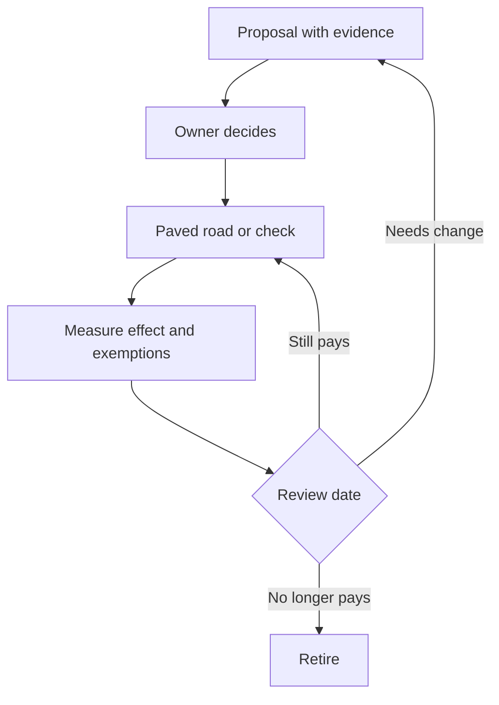
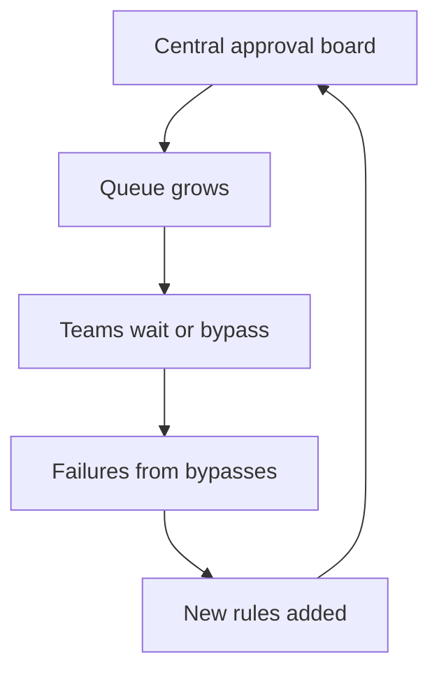
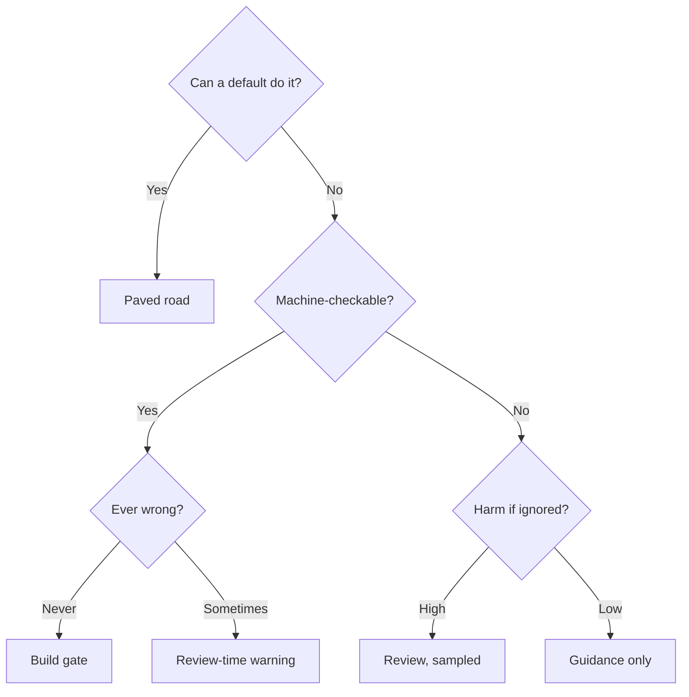

# Chapter 20 — Engineering Standards and Their Governance

Every engineering organization above a few teams has standards, written or not. Some are real: what
actually happens to every change because a tool or a habit makes it happen. Others are aspirational:
rules on a wiki page that nobody checks. This chapter is about closing that gap: how to write a
standard, enforce it through defaults and automation before review boards, measure it without
compliance theater, retire it, and govern the set without creating a queue. The running example is
the fictional [Northstar Technologies](../../case-studies/northstar/index.md).

## Why This Matters

In one team, a standard is a conversation, and drift is noticed. At 50 to 150 engineers, the
conversation no longer reaches everyone. Components change hands, and teams that never talk depend on
each other's services at three in the morning. Without shared minimums, every incident review
discovers a component with no alerts, no runbook, or no owner. Standards are how an organization makes
a few properties true everywhere without supervising every change.

Scale also makes bad standards expensive. A rule costing each engineer ten minutes a week costs an
80-person organization about 690 hours a year, more than a third of an engineer-year (assuming about
1,840 working hours per engineer-year), before anyone asks what it prevents. A board that approves
changes adds waiting time to all of them. And a page of 52 "musts" that nobody follows teaches
engineers that "must" is decorative, which weakens the few rules that matter.

At executive scale, standards are a governance instrument. A CTO cannot inspect quality directly and
relies on a few properties guaranteed everywhere. Whether those guarantees are real or ceremonial
decides whether the CTO's reports to the board are true.

## Learning Objectives

After this chapter you will be able to:

- Write a standard that states intent, scope, requirement level, owner, verification, exemption path,
  and review date, and rewrite a vague rule into that form.
- Choose an enforcement mechanism for each standard, preferring paved roads and automated checks to
  review boards, and justify it by the cost of false alarms and of violations.
- Tier standards so that they apply in proportion to risk, and keep the mandatory set small.
- Measure adoption and effect without compliance theater, and recognize decoupling between written
  rules and practice.
- Design governance that keeps standards current and retires them without becoming a queue.

## The Mental Model

> **Mental model:** A standard is a product with users, a running cost, and a lifetime. Make the
> standard way the easiest way, check what a machine can check, review only what needs judgment, and
> retire whatever no longer pays for itself.

First, **every standard has a cost and must earn it**. *Software Engineering at Google* makes
this a guiding principle of its style rules: each rule costs something to learn and to maintain, so the
set is kept deliberately small ([Schwartz, 2020](../../references/bibliography.md#schwartz2020style)).
That is **documented practice** from one very large organization, not proof that small rule sets
produce better outcomes, but the reasoning transfers: a rule whose purpose nobody can explain is
followed mechanically, worked around, or ignored.

Second, the **enforcement ladder**. The same property can be made true in five ways, in falling order
of reliability: a **default** (the paved road does it), an **automated check**, **human review**, an
after-the-fact **audit**, and **exhortation** (a wiki page asks). Go down the ladder only as far as the
property requires. Most organizations climb it the other way, adding review when exhortation fails and
a board when review fails.

The lifecycle that keeps a standard honest:

Retirement is a normal outcome, not a failure.

## Deep Conceptual Explanation

### Anatomy of a standard

Most written standards state only a property. A complete standard has seven parts:

| Part | Question | Example |
|---|---|---|
| Intent | What failure does it prevent? | "On-call engineers can diagnose a component they did not build." |
| Scope | What does it apply to? | "Tier 1 components." |
| Level | Must, should, or may? | "Must." |
| Owner | Who decides questions and exemptions? | A named staff engineer |
| Verification | How do we know it holds? | "Readiness check in the pipeline; quarterly sample." |
| Exemption path | What does a team that cannot comply do? | "Request to owner; decision in 10 working days; maximum two quarters." |
| Review date | When do we decide whether to keep it? | "End of Q3." |

**Intent** is most often missing and matters most. Without it, edge cases cannot be judged and the
rule can only be obeyed or evaded; with it, the rule can be met in a better way than its author
imagined.

**Level** needs precise words. RFC 2119 defines "must" as an absolute requirement, "should" as a
recommendation that may be ignored for valid reasons once the implications are weighed, and "may" as
optional, and advises using the imperatives sparingly, only where needed for interoperation or to limit
harm ([Bradner, 1997](../../references/bibliography.md#bradner1997rfc2119)). That **standard** was
written for protocols and fits engineering standards well: reserve "must" for properties whose
violation harms someone outside the violating team. Schwartz draws the same line between **rules**,
which are mandatory and set aside only by approved exception, and **guidance**, which leaves room for
judgment. Keep them visibly separate. Six rules that matter, mixed with 46 preferences, get read as 52
preferences.

**The exemption path** makes a "must" credible. Without one, teams that cannot comply go silent, and
silent non-compliance is invisible. A recorded exemption with owner, reason, compensating control, and
expiry turns a gap into managed risk, and exemption requests are a standard's best feedback; Schwartz
notes that frequent requests can signal that a rule needs revisiting. **The review date** makes
retirement routine by putting the burden of proof back on the standard.

### Paved roads before review boards

A paved road is the supported default: a service template with health checks, logging, and alert rules;
a shared pipeline that runs the agreed checks and records every deployment. A team on it meets most
standards without thinking. It is the cheapest enforcement because it removes the per-change cost, and
it reframes autonomy: teams may leave the road, and the road's quality persuades them to stay.
*Team Topologies* gives the organizational form: **platform teams** provide internal services that
reduce other teams' cognitive load, and **enabling teams** help teams acquire a capability and then
step away ([Skelton and Pais, 2019](../../references/bibliography.md#skelton2019team); credited at
idea level). Chapter 33 covers team types; here the point is that whoever owns the paved road makes
standards cheap.

### Automated checks, and why most fail

The best public account of what makes checks work is an experience report from the team that built
Google's static analysis platform ([Sadowski et al., 2018](../../references/bibliography.md#sadowski2018lessons)),
**documented practice** from one company. It defines an **effective false positive** as a finding on
which developers took no action, whatever the tool's technical correctness. It then describes failures.
A nightly dashboard of findings saw little use because it sat outside developers' workflow. A
company-wide fix-it week reviewed 3,954 warnings and fixed 640, about 16 percent. A code-review
integration was dropped because noisy findings cost the tool developers' trust and per-person
customization made results inconsistent across a team.

What worked was a two-level policy. Checks that break the build must be understandable, actionable,
never wrong on correct code, and about correctness; existing violations are cleaned up first, because
developers ignored warnings. Checks shown in code review may be wrong up to 10 percent of the time (a
threshold the authors say was first chosen somewhat arbitrarily); a "Not useful" button reaches the
check's owners, and a check above a 10 percent not-useful rate is switched off until fixed.
Configuration is per project, not per person. Peer-reviewed work points the same way: in interviews
with 20 developers, all of whom thought static analysis beneficial, false positives and the way warnings
are presented were among the barriers to use ([Johnson et al., 2013](../../references/bibliography.md#johnson2013why)),
a **research finding** from a small qualitative sample.

This book draws four lessons. Put checks in the workflow, at the moment of change. Gate only on what is
never wrong. Clean up or baseline existing violations before enforcing. Give every check an owner and a
feedback channel, because a check is a standard in executable form.

Some standards concern whole-system properties: no module reads another's database, build time stays
under a limit. *Building Evolutionary Architectures* popularized the **fitness function**, an automated
test of such a property run continuously as the system changes
([Ford, Parsons, and Kua, 2017](../../references/bibliography.md#ford2017building); idea level). It
moves architectural rules from meetings into the pipeline. Which architectural decisions deserve that
protection, and who makes them, is Chapter 28's subject.

### Tiering

An internal export job and the payment path should not carry the same obligations. Uniform rules
produce either unaffordable burden on low-risk systems or quiet non-enforcement on high-risk ones.
Tiering assigns each component a tier by business impact and scopes each standard to tiers. SLSA, a
supply-chain security **standard**, shows the shape: separate tracks, each with ascending levels with
explicit content (version 1.2's build track runs from L0, no guarantees, to L3, a hardened build
platform) ([SLSA Specification](../../references/bibliography.md#slsa-spec)). An engineering
organization needs the same two features: named levels with explicit obligations, and a public
mapping of components to levels.

Expect **tier deflation**: teams arguing components down to escape obligations. Assign tiers by a
business criterion (is it on the order or payment path?) decided outside the owning team.

### Governance bodies, and how they become queues

Standards are governed by some mix of **guilds** (voluntary communities of practice, good at sharing
and surfacing problems, usually without decision rights), **councils** (groups with decision rights
meeting on a cadence), and **named owners** per standard. Councils are chosen most often and become
queues most easily. A council meeting every two weeks that can handle four requests per meeting has a
capacity of four per fortnight. If three requests arrive a week, six arrive per fortnight, and the
backlog grows by two every meeting, without limit. Teams learn the wait and route around it.

This is a reinforcing loop like those Chapter 27 describes. Three design choices, this book's
recommendation, keep governance out of it: **decide by owner, not by meeting**, with any council
deciding only changes to the mandatory set; **publish a decision service level** (say ten working days);
and **push repeated questions down the ladder**, changing the standard or the paved road instead of
approving the same exemption again. The AWS Well-Architected Framework describes its reviews as
constructive conversations rather than an audit mechanism
([AWS Well-Architected Framework](../../references/bibliography.md#aws-well-architected)), a useful
posture for any review a standard requires.

### Measuring without compliance theater

The obvious measure, share compliant, is the most exposed to gaming, because the people measured often
produce the data. A box can be ticked without the work; a runbook can exist and be useless. Meyer and
Rowan argued that organizations adopt formal structures for legitimacy and then **decouple** them from
the work actually done, replacing inspection and evaluation with a logic of confidence and good faith
([Meyer and Rowan, 1977](../../references/bibliography.md#meyer1977institutionalized)). That is
sociological theory about organizations in general; applying it to engineering standards is this book's
analogy, and a close one. An unchecked standards page, a checklist everyone ticks, and a guild that
decides nothing are structures decoupled from practice. The general problem of indicators distorted by
use is usually credited to Campbell ([Campbell, 1979](../../references/bibliography.md#campbell1979assessing));
Chapter 18 covers metric gaming.

Four choices resist theater. **Prefer system evidence**: a pipeline record of a rollback step beats a
team's confirmation. **Measure the intent, not the artifact**: whether on-call engineers used runbooks
in incidents and found them right, not how many exist. **Sample attestations** against the changes they
describe. **Track exemptions as data**: full compliance with no exemption requests means either a
perfect standard or one nobody checks.

### Standards and autonomy

Some autonomy should go: a team's freedom to deploy without an audit trail is one the organization
cannot afford. Schwartz describes consistency as layered, from file to team to project to codebase.
That suggests a rule: standardize at organization level what crosses team boundaries (service
interfaces, operational properties other teams' on-call engineers depend on, security, pipeline
guarantees), and leave to teams what stays inside them. Standardize **properties before tools**: "every
production change goes through an auditable pipeline with automated rollback" can be met several ways;
"everyone uses tool X" starts a fight about X.

## Engineering Organization Example

All figures are **illustrative** (see the [baseline](../../case-studies/northstar/baseline-data.md)).

Northstar's one standards document is a wiki page written in 2019 by an architect who left in 2021. It
has 52 rules (24 on style and naming, 10 on testing, 8 on APIs and data, 6 on operations, 4 on
security), all "must", none with intent, scope, owner, exemption path, or review date. One reads "Every
module must have at least 70 percent line coverage." Core is at 41 percent, and nobody treats that as
news.

| Build system | Components | What it checks |
|---|---|---|
| Jenkins | Core and four services | A 2019 style configuration, warnings only; about 2,300 standing warnings in Core |
| GitLab CI | Six services | A linter that fails the build on 9 rules |
| GitHub Actions | Two frontends | The frontend engineers' own linter, unrelated to the page |
| Shell scripts | Four services | Nothing |

Thirteen of the 52 rules are checked by a tool somewhere; none is checked the same way everywhere. The
Engineering Practices Guild, formed in 2022, averages five attendees and has never changed the page. In
a sample of 40 merged pull requests, 38 had every checklist box ticked, and 11 of those changed
production code with no test change while "tests added or updated" was ticked.

Meanwhile the properties the CTO's mandate needs are not on the page. Against Chapter 27's proposed
tier 1 minimums, `components.csv` gives, for the 15 proposed tier 1 components: clear owner 11, runbook
6, complete alerting 3, on-call rotation 12. Only 3 (pricing-svc, payments-gateway, bank-connectors)
meet all four, and auth-svc still deploys by script.

The director and the three staff engineers triaged the 52 rules with three questions: does breaking it
harm someone outside the team; can a tool check it without false alarms; has anyone cited it in the last
year? Result: **14 kept as mandatory** (9 to be tool-checked, 5 sampled in review), **17 rewritten as
guidance** with intent added, and **21 retired**, including the coverage rule (Chapter 22 argues for a
test portfolio designed from risk rather than a coverage target). Add the five tier 1 minimums and the
mandatory set falls from 52 unverified rules to 19, each checked, sampled, or reported per component.

Cost: writing the 19 in full is about two weeks of staff time. Automating the 9 checkable rules in
Jenkins and GitLab CI, including clearing existing violations, is about one engineer for most of a
quarter, roughly $40,000 of capacity at $185,000 per engineer-year, and would be cheaper on one
consolidated pipeline. Bringing 12 tier 1 components up to the minimums comes from the prevention
allocation in [Chapter 27](27-quality-transformation-at-enterprise-scale.md), not from new budget.

## Decision Framework

Two decisions per candidate standard.

**Mandatory or guidance?** "Must" only if violating it harms someone outside the violating team, the
organization will check it, and an exemption path can be stated. Otherwise it is guidance, however good
the practice.

**Which enforcement?** Go down the ladder only as far as needed:

| Mechanism | Use for | Watch for |
|---|---|---|
| Paved road | Properties every component needs, providable once | Teams leaving a road worse than their own |
| Build gate | Correctness and security checks with no false alarms | Gates before cleanup; bypass flags |
| Review-time warning | Useful checks that are sometimes wrong | Not-useful rate above threshold |
| Sampled review | Judgment-heavy, high-harm properties (irreversible migrations) | Rubber-stamping |
| Guidance | Practice whose violation stays inside the team | Guidance cited as a rule |

Tier obligations are set by Chapter 24's readiness bar; each standard here names the tiers it applies
to. Named owners decide exemptions within a published service level.

## Trade-offs

**Consistency against local fit.** Shared standards let engineers and tools move across teams and make
metrics comparable, but some fit badly: mobile release processes differ for reasons outside the team's
control. Exemptions and rewritten intent handle those cases.

**Automation against review.** A gate costs effort once and almost nothing per change; review costs
little to start and something forever, less consistently. Automate frequent checkable properties;
review rare judgment-heavy ones, because automating those yields noisy checks that destroy trust.

**Gates against flow.** A gate failing for reasons unrelated to the change behaves like a flaky test.
Northstar's Core pipeline already fails 9 percent of the time for such reasons; adding gates before that
falls adds frustration faster than safety.

**Small mandatory set against coverage of risk.** A short list is credible and leaves some risks to
guidance. Accept it: reliably enforcing 19 standards is safer than nominally enforcing 52.

**Paved road investment against freedom.** Without sustained platform investment, "use the template"
means "use the template nobody maintains", and autonomy becomes the rational choice.

## Failure Modes

**The wiki of musts.** Many mandatory rules, none checked. Signal: nobody can say which were violated
last month. Countermeasure: triage to a small verified set.

**Checkbox compliance.** Checklists ticked regardless of the change. Signal: near-100 percent completion
unrelated to content. Countermeasure: system evidence; sample the rest.

**The council queue.** Wait time exceeds teams' patience. Signal: rising waits, and production work that
never went to the board. Countermeasure: owner decisions, a service level, a board deciding only the
mandatory set.

**The noisy gate.** Signal: routine bypass flags, or the check set to warning-only "temporarily".
Countermeasure: measure not-useful rate; fix or remove.

**Warning wallpaper.** Thousands of standing warnings hide new ones, like Northstar's 2,300.
Countermeasure: baseline, fail on new warnings, burn down the baseline by owner.

**Tier deflation.** Signal: tier-change requests cluster after a new tier 1 obligation. Countermeasure:
business criterion, decided outside the team.

**Exemption sprawl.** Signal: the register grows and nothing leaves it. Countermeasure: every exemption
expires; repeated identical ones change the standard.

**Standards instead of ownership.** A runbook rule where 8 of 24 components lack a clear owner yields
runbooks written by nobody in particular. Ownership comes first (Chapter 19).

## Enterprise Application

In an organization of 50 to 150 engineers, the director cannot maintain standards personally.

- **The director** owns the mandatory set, the tiering policy, the exemption register, and the
  quarterly review, and approves every addition, because each spends every team's capacity.
- **Staff engineers** own standards or families of them: intent, verification, checks, exemption
  decisions, and proposed retirements. This is a natural mandate: cross-team technical judgment
  without owning components.
- **Engineering managers** own compliance for their components and the honesty of their teams'
  attestations. In Chapter 27's monthly quality review, compliance appears per component, not as a
  team score.
- **The platform team** owns the paved road, measured by adoption by choice.
- **The guild** shares practice and proposes standards. It should not approve: voluntary groups with
  decision rights produce either queues or rubber stamps.

Two artifacts make this run: a **standards register** (each mandatory standard with its seven parts,
compliance, and open exemptions) and an **exemption register** (owner, reason, compensating control,
expiry), reviewed together quarterly. The
[engineering quality scorecard template](../../templates/engineering-quality-scorecard.md) can carry
tier 1 minimums as a section, so compliance is read beside outcomes.

## CTO Perspective

**Keep the enterprise list short.** Chapter 27 proposes candidates: tier 1 ownership, alerts, runbook,
and on-call; an auditable pipeline for every production change; tracked reviews for every Sev1. The
CTO's job is to keep that list short, enforce it everywhere, and leave the rest to directors. A list of
dozens recreates the wiki of musts at a higher altitude.

**Report truthfully.** "Every production change goes through an auditable pipeline" must be true,
including for the four script-deployed services. Decoupling is most dangerous here, where a standard
can be adopted in order to be able to say it exists. The CTO should hold system evidence for every
enterprise minimum and report exemptions rather than hide them.

**Tiering is a business decision.** Which systems are tier 1 says which customer promises matter most.
At Northstar, tier 1 follows the order and payment paths that the availability commitment covers; the
CTO sets that criterion.

**Standards cost money.** Each enterprise standard spends capacity in every team. Before adding one,
ask each director what they would retire.

**External frameworks.** NIST's Secure Software Development Framework presents itself as a core set
of secure development practices and a common vocabulary for software purchasers and suppliers
([Souppaya, Scarfone, and Dodson, 2022](../../references/bibliography.md#nist2022ssdf)), a **standard**
that customers' security reviews may draw on. Mapping the internal register onto such a framework is cheaper than a parallel compliance program and
keeps evidence in the systems engineers already use.

## Practical Playbook

1. **Inventory**: every written rule, every pipeline check by build system, every checklist and
   governance body.
2. **Sample reality**: compare 30 to 50 recent changes with the rules and checklists.
3. **Triage**: harm outside the team? checkable without false alarms? cited in the last year? Sort into
   mandatory, guidance, retire.
4. **Write each mandatory standard in full.** If you cannot write its intent, retire it.
5. **Tier components** by a business criterion, confirmed outside the owning team.
6. **Assign owners** with exemption authority; publish the decision service level.
7. **Build down the ladder**: paved road first, then checks; clean up or baseline before any gate.
8. **Open the exemption register before announcing**, so the first team that cannot comply can say so.
9. **Measure** with system evidence, sampled attestations, and exemption counts, per component.
10. **Review quarterly**: retire, rewrite, or renew; ask what the mandatory set costs.

## Case Study

This case is **fictional** and runs alongside the transformation in
[Chapter 27](27-quality-transformation-at-enterprise-scale.md).

In week 3, the director read the standards page aloud to the staff engineers and asked, rule by rule,
who would notice a violation tomorrow. For 39 of the 52 (every rule no tool checked), the answer was
nobody. The triage followed, and each staff engineer took a standards domain beside their Chapter 27
work: Kwame Mensah the operational minimums and pipeline standards, Ines Carvalho the Core code
standards, Li Na Zhou data, migration, and configuration standards. Every request would get a decision
within ten working days.

The guild objected; its regulars had expected to become the approving body. The director kept it as
the place standards are proposed, explained the queue arithmetic, and declined to give it approval
rights. A Payments and Integrations engineer from the guild later wrote the first new guidance page.

The tier 1 minimums were announced in week 5 with the exemption register already open. Two exemptions
followed. core/permissions could not have on-call until someone owned it; its exemption carried a
compensating control (Platform Operations would page an incident lead assigned by the director's
office) and expired with the ownership decision. auth-svc could not use an auditable pipeline until it
left scripts; its exemption expired at the end of quarter 2.

Two things went badly. The first Jenkins check went live without clearing the Core backlog, produced 180
build failures on day one, and was reverted within hours; it returned two weeks later, failing only on
new violations. And Marcus Oyelaran argued that runbook work landing on Billing's three overloaded
on-call engineers, on top of a 25 percent prevention allocation, would read as more process. The
director counted it inside the allocation instead.

| Measure | Baseline | Day 90 |
|---|---|---|
| Mandatory rules | 52, none fully verified | 19, each with owner and verification |
| Tier 1 meeting the four operational minimums | 3 of 15 | 8 of 15 |
| Tier 1 with a runbook | 6 of 15 | 11 of 15 |
| Checkable mandatory rules automated | 0 of 9 consistently | 4 of 9 |
| Active exemptions | none (no process) | 2, both expiring |

The report to the CTO said the mandatory set was now small enough to be true, and that runbook
compliance still rested partly on attestation: whether the runbooks were any good would be known only
when incident reviews recorded whether on-call engineers used them.

## Exercises

Solutions are in [chapter 20 solutions](../../solutions/ch20-solutions.md). The component inventory
is linked from the [Northstar baseline page](../../case-studies/northstar/baseline-data.md).

### Foundational

**F1.** Northstar's standards page says "Every module must have at least 70 percent line coverage."
Core is at 41 percent and nobody has acted on the gap for years. Decide whether to keep, rewrite, or
retire the rule. If you keep or rewrite it, write it with all seven parts of a complete standard. If you
retire it, say what, if anything, replaces it and why.

**F2.** Place each candidate standard on the enforcement ladder and justify it: (a) code is formatted
by the standard formatter; (b) database migrations are backward compatible with the previous release;
(c) tier 1 services emit structured logs with a request identifier; (d) public API changes are reviewed
by a consumer team; (e) no secrets are committed. For each, state the cost of a false alarm and of a
missed violation.

**F3.** Of 40 sampled pull requests, 38 had every checklist box ticked, including 11 that ticked "tests
added or updated" with no test change. A manager argues the checklist works because almost everyone
completes it. Explain what the sample does and does not show, and propose what should replace the
checklist item.

### Applied Leadership

**A1.** Daniel Cho asks for a permanent exemption for the mobile app from the standard that every
production change goes through the shared pipeline with automated rollback, because app store releases
cannot be rolled back like services. Decide whether to grant it, in what form, with what compensating
controls, and what the request tells you about the standard.

**A2.** Guild members propose that the guild approve every new third-party library before it enters any
Northstar codebase, citing a recent vulnerability in a dependency. They are motivated and willing to
meet weekly. Respond: what problem the proposal addresses, how it would behave at Northstar's rate of
change, and what you would offer instead.

**A3.** After the tier 1 minimums are announced, Priya Raman proposes moving core/pricing-rules to tier
2 because it is "configuration, not a service". It has no runbook and partial alerting. Decide how to
handle the request, who decides, and what criterion settles it, then say what you will watch for across
the organization in the following month.

### Executive Decision-Making

**X1.** Victor Lindqvist is preparing for a security review with one of the two renewal customers and
wants to say that "every production change at Northstar goes through an auditable pipeline with
automated rollback." Four services still deploy by script, one tier 1, under an exemption expiring at
the end of quarter 2. Advise him what to say, what not to say, and what evidence to bring, and explain
the risk of making the statement without evidence.

**X2.** A year from now Northstar acquires a company with 30 engineers, its own standards and tooling,
and a well-run architecture council its engineers value. As CTO, decide which Northstar standards apply
to it, on what timeline, and what happens to its council. Say what you would standardize immediately,
what you would leave alone, and how you would decide later cases.

## Reflection Questions

1. Which rule in your organization would nobody notice being broken tomorrow, and why does it still
   exist?
2. Where do you rely on attestation for a property a system could record directly?
3. How long is the queue in front of your governance bodies, and what are teams doing while they wait?
4. Which of your standards could state their intent in one sentence?
5. When a team cannot comply with a standard, what actually happens: a path, or silence?
6. Which standards exist mainly so that someone can say they exist?

## Key Takeaways

- A standard has seven parts: intent, scope, level, owner, verification, exemption path, review date.
  Without intent it cannot be judged or improved.
- Reserve "must" for properties whose violation harms someone outside the team; keep rules and guidance
  separate.
- Enforce down the ladder (default, check, review, audit, exhortation) only as far as needed.
- Gate only on checks that are never wrong, put checks in the workflow, clean up before enforcing, and
  switch off checks people find useless.
- Tier by a business criterion decided outside the owning team.
- Govern through named owners with a decision service level; councils approving individual cases become
  queues.
- Measure intent and exemptions, prefer system evidence, sample attestations; universal compliance with
  no exemptions is a warning sign.
- Give every standard a review date; retirement is normal.

## References and Further Reading

- [Schwartz, 2020](../../references/bibliography.md#schwartz2020style). "Style Guides and Rules",
  chapter 8 of *Software Engineering at Google*: rules versus guidance, rules that earn their cost,
  change process, tool enforcement.
- [Sadowski et al., 2018](../../references/bibliography.md#sadowski2018lessons). The best public
  experience report on making automated checks stick.
- [Johnson et al., 2013](../../references/bibliography.md#johnson2013why). Interview study of why
  developers do not use static analysis tools.
- [Meyer and Rowan, 1977](../../references/bibliography.md#meyer1977institutionalized). The classic
  paper on formal structure adopted for legitimacy and decoupled from practice.
- [Bradner, 1997](../../references/bibliography.md#bradner1997rfc2119). RFC 2119: a model for writing
  requirement levels.
- [SLSA Specification](../../references/bibliography.md#slsa-spec). Tracks and levels as a model for
  tiered, verifiable guarantees.
- [Ford, Parsons, and Kua, 2017](../../references/bibliography.md#ford2017building). Fitness functions
  as automated architectural standards.
- [Skelton and Pais, 2019](../../references/bibliography.md#skelton2019team). Platform and enabling
  teams as owners of paved roads.
- [AWS Well-Architected Framework](../../references/bibliography.md#aws-well-architected). Reviews as
  conversations rather than audits.
- [Souppaya, Scarfone, and Dodson, 2022](../../references/bibliography.md#nist2022ssdf). NIST SSDF, a
  practice set to map internal standards onto.
- [Campbell, 1979](../../references/bibliography.md#campbell1979assessing). The usual source for
  indicators distorted by use.
- [Winters, Manshreck, and Wright, 2020](../../references/bibliography.md#winters2020software).
  *Software Engineering at Google*, free online; its static analysis and large-scale change chapters
  extend this one.
