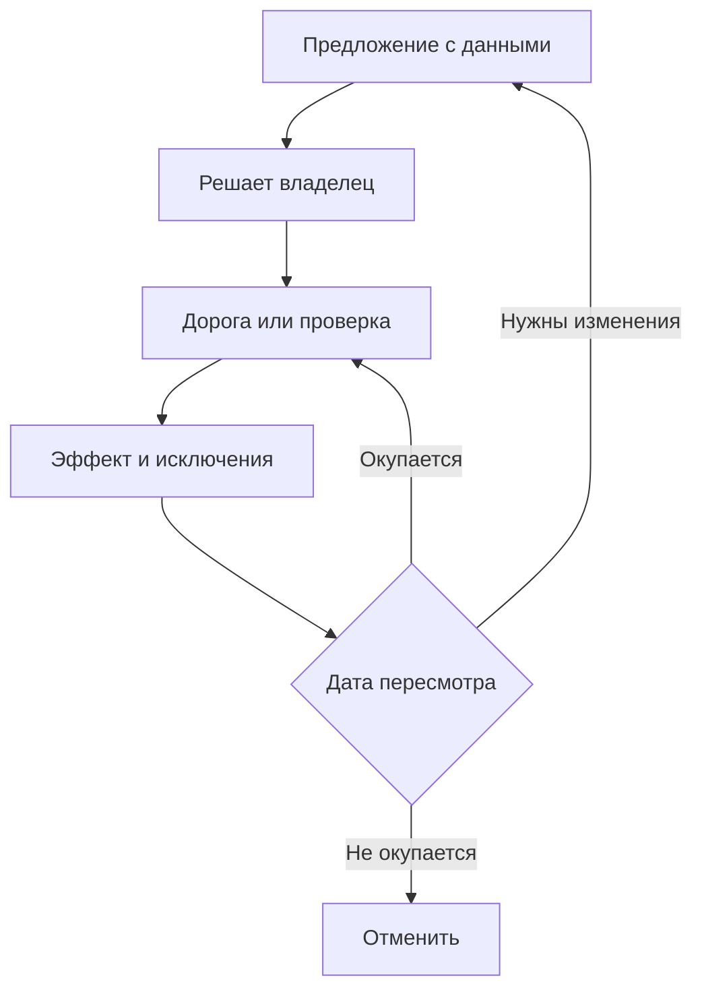
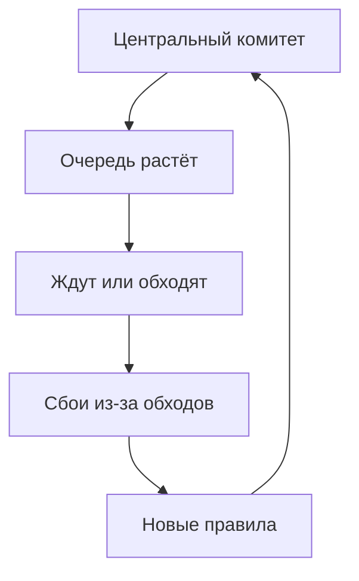
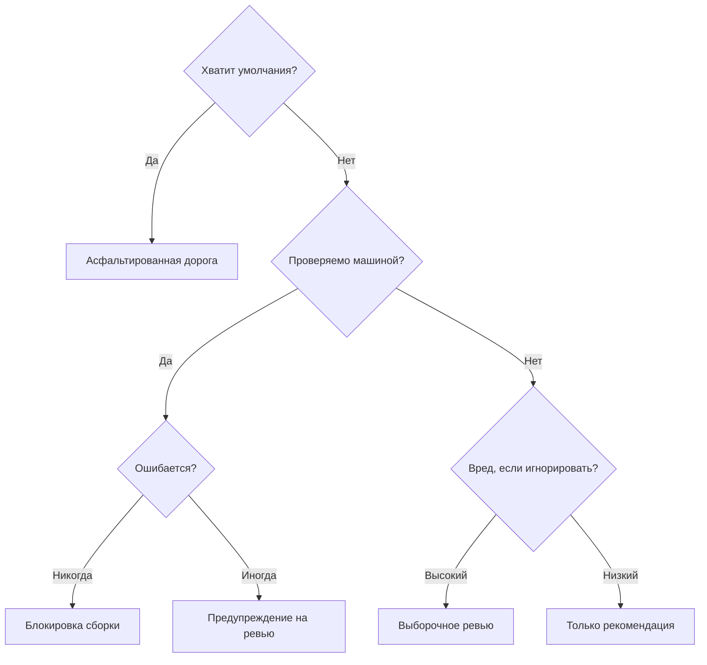

# Глава 20 — Инженерные стандарты и управление ими { #chapter-20-engineering-standards-and-their-governance }

В любой инженерной организации больше чем из нескольких команд есть стандарты — записанные или нет.
Одни настоящие: это то, что действительно происходит с каждым изменением, потому что так устроен
инструмент или так велит привычка. Другие — лишь благие пожелания: правила на вики-странице, которые
никто не проверяет. Эта глава о том, как закрыть разрыв между ними: как написать стандарт; как обеспечить
его соблюдение — сначала настройками по умолчанию и автоматизацией, а уже потом комитетами по ревью; как
измерять его без театра соответствия, вовремя отменять и управлять всем набором стандартов, не создавая
очереди. Сквозной пример — вымышленная компания [Northstar Technologies](../../case-studies/northstar/index.md).

## Почему это важно { #why-this-matters }

Внутри одной команды стандарт живёт в разговорах, и отклонения замечают. Когда инженеров 50–150,
разговор уже не доходит до всех. Компоненты переходят из рук в руки, а команды, которые никогда не
общаются, в три часа ночи зависят от сервисов друг друга. Без общих минимумов каждый разбор инцидента
натыкается на компонент без алертов, без ранбука (runbook) или без владельца. Стандарты позволяют
организации обеспечить несколько свойств везде, не надзирая за каждым изменением.

С ростом масштаба плохие стандарты становятся ещё и дорогими. Правило, которое отнимает у каждого
инженера десять минут в неделю, обходится организации из 80 человек примерно в 690 часов в год. Это
больше трети инженеро-года (если считать, что в инженеро-годе около 1 840 рабочих часов), и это ещё до
вопроса о том, что правило предотвращает. Комитет, который утверждает изменения, добавляет ожидание к
каждому из них. А страница из 52 обязательных правил, которые никто не соблюдает, приучает инженеров к
тому, что «обязательно» пишут для красоты. От этого слабеют и те немногие правила, которые действительно
важны.

Для высшего руководства стандарты — инструмент управления. CTO (технический директор) не может
проверить качество напрямую и опирается на несколько свойств, гарантированных везде. От того, настоящие
это гарантии или ритуальные, зависит, правдивы ли отчёты CTO совету директоров.

## Цели главы { #learning-objectives }

Прочитав эту главу, вы сможете:

- Писать стандарт, в котором указаны назначение, область действия, уровень требования, владелец, способ
  проверки, порядок исключений и дата пересмотра, а также переписывать расплывчатое правило в такую форму.
- Выбирать механизм обеспечения для каждого стандарта, предпочитая «асфальтированные дороги» и
  автоматические проверки комитетам по ревью, и обосновывать выбор ценой ложных тревог и ценой нарушений.
- Распределять стандарты по уровням критичности, чтобы они применялись соразмерно риску, и держать
  обязательный набор небольшим.
- Измерять внедрение и эффект без театра соответствия и распознавать расхождение между записанными
  правилами и практикой.
- Выстраивать управление, которое держит стандарты актуальными и отменяет их, не превращаясь в очередь.

## Ментальная модель { #the-mental-model }

> **Ментальная модель:** стандарт — это продукт, у которого есть пользователи, текущие расходы и срок
> жизни. Сделайте стандартный путь самым лёгким, проверяйте машиной всё, что может проверить машина,
> отдавайте на ревью только то, что требует суждения, и отменяйте всё, что больше не окупается.

Во-первых, **у каждого стандарта есть цена, и он должен её отрабатывать**. В *Software Engineering at
Google* это руководящий принцип правил стиля: каждое правило чего-то стоит (его нужно выучить и
поддерживать), поэтому набор намеренно держат небольшим
([Schwartz, 2020](../../references/bibliography.md#schwartz2020style)). Это **задокументированная
практика** одной очень большой организации, а не доказательство того, что небольшой набор правил даёт
лучшие результаты. Но само рассуждение переносится и на другие организации: правило, назначение которого
никто не может объяснить, соблюдают механически, обходят или игнорируют.

Во-вторых, **лестница контроля** (enforcement ladder). Одно и то же свойство можно обеспечить пятью
способами; вот они в порядке убывания надёжности: **по умолчанию** (это делает «асфальтированная
дорога»), **автоматической проверкой**, **ревью человеком**, **аудитом** задним числом и **призывами**
(об этом просит вики-страница). Спускайтесь по лестнице лишь настолько, насколько требует свойство.
Большинство организаций проходит её в обратном направлении: когда не сработали призывы, добавляют ревью,
а когда не сработало ревью — комитет.

Честным стандарт держит такой жизненный цикл:

Отмена стандарта — нормальный исход, а не провал.

## Подробный разбор { #deep-conceptual-explanation }

### Из чего состоит стандарт { #anatomy-of-a-standard }

Большинство записанных стандартов называют только свойство. У полного стандарта семь частей:

| Часть | Вопрос | Пример |
|---|---|---|
| Назначение | Какой сбой он предотвращает? | «Дежурный инженер может диагностировать компонент, который он не строил». |
| Область действия | К чему он применяется? | «Компоненты tier 1». |
| Уровень | Обязательно, следует или можно? | «Обязательно». |
| Владелец | Кто решает вопросы и исключения? | Конкретный staff-инженер |
| Проверка | Откуда мы знаем, что он соблюдается? | «Проверка готовности в пайплайне; ежеквартальная выборка». |
| Порядок исключений | Что делать команде, которая не может его выполнить? | «Запрос владельцу; решение за 10 рабочих дней; не дольше двух кварталов». |
| Дата пересмотра | Когда решаем, оставлять ли его? | «Конец Q3». |

Чаще всего не хватает **назначения**, хотя оно важнее всего. Без него о пограничных случаях судить
нельзя, и правило остаётся только исполнить или обойти. Зная назначение, правило можно выполнить даже
лучше, чем представлял себе автор.

**Уровень** требует точных слов. RFC 2119 — документ из серии интернет-стандартов о том, какими словами
записывать требования, — определяет «must» («обязательно») как абсолютное требование. «Should»
(«следует») — рекомендация, от которой можно отступить по веским причинам, взвесив последствия, а «may»
(«можно») — необязательный вариант. Документ советует пользоваться императивами скупо, только там, где
они нужны для совместимости или чтобы ограничить вред
([Bradner, 1997](../../references/bibliography.md#bradner1997rfc2119)). Этот **стандарт** написан для
протоколов, но хорошо подходит и для инженерных стандартов: оставляйте «обязательно» для свойств,
нарушение которых вредит кому-то за пределами нарушившей команды. Schwartz проводит ту же границу между
**правилами**, которые обязательны и допускают отступление только по одобренному исключению, и
**рекомендациями**, которые оставляют место для суждения. Держите их отдельно, и так, чтобы это было
видно. Шесть важных правил, перемешанных с 46 предпочтениями, читаются как 52 предпочтения.

**Порядок исключений** делает «обязательно» правдоподобным. Без него команды, которые не могут выполнить
требование, просто молчат, а молчаливое несоблюдение невидимо. Записанное исключение с владельцем,
причиной, компенсирующей мерой и сроком действия превращает пробел в управляемый риск. А запросы на
исключения — лучшая обратная связь для стандарта: Schwartz замечает, что частые запросы могут означать,
что правило пора пересмотреть. **Дата пересмотра** делает отмену рутиной: бремя доказательства каждый
раз снова ложится на стандарт.

### Сначала «асфальтированные дороги», потом комитеты { #paved-roads-before-review-boards }

[«Асфальтированная дорога» (paved road)](../../glossary.md#paved-road) — это поддерживаемый вариант по
умолчанию: шаблон сервиса с проверками работоспособности, логированием и правилами алертов; общий
пайплайн, который запускает согласованные проверки и записывает каждое развёртывание. Команда на такой
дороге выполняет большинство стандартов, не задумываясь. Это самый дешёвый способ обеспечения: затраты
на каждое изменение исчезают. Кроме того, он иначе ставит вопрос об автономии: команды могут сойти с
дороги, но её качество убеждает их остаться. Книга *Team Topologies* известна описанием организационной
формы: **платформенные команды** предоставляют внутренние сервисы, которые снижают когнитивную нагрузку
других команд, а **команды содействия** (enabling) помогают командам освоить новую возможность и затем
отходят в сторону ([Skelton and Pais, 2019](../../references/bibliography.md#skelton2019team)). Типы
команд разбирает глава 33; здесь важно, что тот, кто владеет «асфальтированной дорогой», делает
стандарты дешёвыми.

### Автоматические проверки и почему большинство из них не работает { #automated-checks-and-why-most-fail }

Лучшее публичное описание того, благодаря чему проверки работают, — отчёт об опыте команды, построившей
платформу статического анализа Google ([Sadowski et al., 2018](../../references/bibliography.md#sadowski2018lessons)).
Это **задокументированная практика** одной компании. Авторы определяют **фактически ложное срабатывание**
(effective false positive) как находку, по которой разработчики ничего не сделали, независимо от её
технической правильности. Затем они описывают неудачи. Ночным дашбордом с находками почти не
пользовались: он был вне рабочего процесса разработчиков. На общекомпанейской неделе исправлений (fix-it
week) просмотрели 3 954 предупреждения и исправили 640, то есть около 16 процентов. От встраивания в
код-ревью отказались: шумные находки подорвали доверие разработчиков к инструменту, а из-за персональных
настроек результаты внутри одной команды расходились.

Сработала двухуровневая политика. Проверка, которая ломает сборку, должна быть понятной, подсказывать,
что делать, никогда не ошибаться на правильном коде и касаться корректности. Существующие нарушения
перед этим вычищают, потому что предупреждения разработчики игнорировали. Проверки, которые
показываются на код-ревью, могут ошибаться не более чем в 10 процентах случаев (по словам авторов, этот
порог поначалу выбрали отчасти произвольно). Кнопка «Бесполезно» (Not useful) отправляет сигнал
владельцам проверки; если проверку признают бесполезной чаще чем в 10 процентах случаев, её отключают,
пока не исправят. Настройка задаётся на уровне проекта, а не человека. В ту же сторону указывают и
рецензируемые работы. В интервью с 20 разработчиками, каждый из которых считал статический анализ
полезным, среди препятствий к его использованию оказались ложные срабатывания и то, как подаются
предупреждения ([Johnson et al., 2013](../../references/bibliography.md#johnson2013why)). Это **научный
результат** на небольшой качественной выборке.

Отсюда книга выводит четыре урока. Встраивайте проверки в рабочий процесс, в момент изменения.
Блокируйте сборку только проверками, которые никогда не ошибаются. Прежде чем требовать соблюдения,
вычистите существующие нарушения или зафиксируйте их как исходный уровень. Дайте каждой проверке
владельца и канал обратной связи: проверка — это стандарт в исполняемой форме.

Некоторые стандарты касаются свойств системы в целом: ни один модуль не читает чужую базу данных, время
сборки не превышает предела. Книга *Building Evolutionary Architectures* популяризовала
**фитнес-функцию** (fitness function) — автоматический тест такого свойства, который запускается
непрерывно, пока система меняется ([Ford, Parsons, and Kua, 2017](../../references/bibliography.md#ford2017building)).
Фитнес-функция переносит архитектурные правила со встреч в пайплайн. Какие архитектурные решения
заслуживают такой защиты и кто их принимает, разбирает глава 28.

### Уровни критичности { #tiering }

Внутреннее задание выгрузки и путь оплаты не должны нести одинаковых обязательств. Единые правила либо
ложатся непосильной ношей на системы с низким риском, либо тихо перестают соблюдаться на системах с
высоким. При разделении по уровням критичности (tiering) каждому компоненту присваивают уровень по
влиянию на бизнес, а для каждого стандарта указывают, к каким уровням он относится. В Northstar
компонент относится к [tier 1](../../glossary.md#tier-1), если он стоит на пути заказа или оплаты (15 из
24 компонентов в году 1); у tier 2 и tier 3 обязательства легче — например, дежурство только в рабочие
часы. SLSA (Supply-chain Levels for Software Artifacts), **стандарт** безопасности цепочки поставки ПО,
показывает нужную форму: отдельные треки, в каждом — возрастающие уровни с явным содержанием (трек
сборки в версии 1.2 идёт от L0, без гарантий, до L3, защищённой платформы сборки)
([SLSA Specification](../../references/bibliography.md#slsa-spec)). Инженерной организации нужны те же
два свойства: именованные уровни с явными обязательствами и публичный список того, какой компонент к
какому уровню относится.

Будьте готовы к **занижению уровня критичности** (tier deflation): команды доказывают, что их компонент
относится к уровню пониже, чтобы уйти от обязательств. Присваивайте уровни по бизнес-критерию (стоит ли
компонент на пути заказа или оплаты?), и решать это должна не команда-владелец.

### Органы управления и как они превращаются в очереди { #governance-bodies-and-how-they-become-queues }

Стандартами управляет то или иное сочетание трёх органов. **Гильдии** — добровольные сообщества
практиков: они хорошо обмениваются опытом и выявляют проблемы, но прав на решения обычно не имеют.
**Советы** — группы с правами на решения, которые собираются в определённом ритме. **Назначенные
владельцы** отвечают за отдельные стандарты. Советы выбирают чаще всего, и в очереди они превращаются
легче всего. Если совет собирается раз в две недели и успевает рассмотреть четыре запроса за встречу,
его пропускная способность — четыре запроса за две недели. Если запросов приходит три в неделю, за две
недели их набирается шесть, и очередь с каждой встречей растёт на два запроса — без предела. Команды
привыкают ждать и начинают искать обходные пути.

Это усиливающая петля: каждый виток ухудшает следующий (идею вводит
[глава 3](../01-foundations/03-managerial-leverage-and-systems-thinking.md)). Не дать управлению попасть в
эту петлю помогают три проектных решения (рекомендация книги):

- **Пусть решает владелец, а не встреча**; совет, если он есть, решает только вопросы об изменении
  обязательного набора.
- **Опубликуйте уровень сервиса для решений** (decision service level), например десять рабочих дней.
- **Спускайте повторяющиеся вопросы вниз по лестнице**: вместо того чтобы снова одобрять то же
  исключение, измените стандарт или «асфальтированную дорогу».

AWS Well-Architected Framework от Amazon Web Services описывает свои ревью как конструктивные разговоры,
а не как механизм аудита ([AWS Well-Architected Framework](../../references/bibliography.md#aws-well-architected)).
Такая позиция полезна для любого ревью, которого требует стандарт.

### Измерение без театра соответствия { #measuring-without-compliance-theater }

Самый очевидный показатель — доля соответствия стандарту — сильнее всего подвержен подгонке: данные для
него часто дают сами измеряемые. Галочку можно поставить, не сделав работы; ранбук может существовать и
быть бесполезным. Meyer и Rowan утверждали, что организации вводят формальные структуры ради
легитимности, а затем **отделяют** (decouple) их от фактически выполняемой работы, заменяя проверку и
оценку логикой доверия и добросовестности
([Meyer and Rowan, 1977](../../references/bibliography.md#meyer1977institutionalized)). Это
социологическая теория об организациях вообще, и её применение к инженерным стандартам — аналогия
книги, хотя и близкая. Страница стандартов, которую никто не проверяет, чек-лист, в котором все ставят
галочки, и гильдия, которая ничего не решает, — всё это структуры, отделённые от практики. Общую
проблему индикаторов, которые искажаются от использования, обычно связывают с именем Campbell
([Campbell, 1979](../../references/bibliography.md#campbell1979assessing)); подгонку метрик разбирает
глава 18.

Против театра помогают четыре меры. **Предпочитайте системные свидетельства**: запись в пайплайне о шаге
отката надёжнее подтверждения от команды. **Измеряйте назначение, а не артефакт**: не сколько ранбуков
существует, а пользовались ли ими дежурные инженеры во время инцидентов и оказались ли ранбуки верными.
**Выборочно сверяйте подтверждения** (attestations) с изменениями, которые они описывают. **Считайте
исключения данными**: полное соответствие без единого запроса на исключение означает либо идеальный
стандарт, либо стандарт, который никто не проверяет.

### Стандарты и автономия { #standards-and-autonomy }

От части автономии стоит отказаться: свободу команды развёртывать без журнала аудита организация
позволить себе не может. Schwartz описывает согласованность как многоуровневую: от файла к команде, от
команды к проекту, от проекта ко всей кодовой базе. Отсюда напрашивается правило: стандартизируйте на
уровне организации то, что пересекает границы команд (интерфейсы сервисов, операционные свойства, от
которых зависят дежурные других команд, безопасность, гарантии пайплайна), и оставляйте командам то, что
остаётся внутри них. Стандартизируйте **свойства, а не инструменты**: требование «каждое изменение в
продакшене проходит через пайплайн с журналом аудита и автоматическим откатом» можно выполнить
несколькими способами, а требование «все пользуются инструментом X» открывает спор об X.

## Пример из инженерной организации { #engineering-organization-example }

!!! info "Northstar: что уже известно"
    Неделя 3 первого года директора. В базовом квартале было 30 инцидентов Sev1 и Sev2 и $410 000
    сервисных кредитов. Директор классифицировал эти инциденты и публикует определения серьёзности;
    история этой главы доходит до Дня 90. См. [хронологию](../../case-studies/northstar/timeline.md).
    Впервые читаете о Northstar? Прочитайте [«Год
    вкратце»](../../case-studies/northstar/year-in-brief.md) и [действующих лиц](../../case-studies/northstar/cast.md).

Все цифры — **иллюстрация** (см. [исходный уровень](../../case-studies/northstar/baseline-data.md)).

Единственный документ о стандартах в Northstar — вики-страница, которую в 2019 году написал архитектор,
ушедший в 2021-м. На ней 52 правила (24 о стиле и именовании, 10 о тестировании, 8 об API и данных, 6 об
эксплуатации, 4 о безопасности), все «обязательные», и ни у одного нет назначения, области действия,
владельца, порядка исключений или даты пересмотра. Одно из них гласит: «Каждый модуль обязан иметь не
менее 70 процентов покрытия строк». У [Core](../../glossary.md#core), Java-монолита Northstar, —
41 процент, и никто не считает это новостью.

| Система сборки | Компоненты | Что проверяет |
|---|---|---|
| Jenkins | Core и четыре сервиса | Конфигурация стиля 2019 года, только предупреждения; около 2,300 висящих предупреждений в Core |
| GitLab CI | Шесть сервисов | Линтер, который ломает сборку по 9 правилам |
| GitHub Actions | Два фронтенда | Собственный линтер фронтенд-инженеров, не связанный со страницей |
| Shell-скрипты | Четыре сервиса | Ничего |

Тринадцать из 52 правил где-то проверяет инструмент, но ни одно не проверяется везде одинаково. Гильдия
инженерных практик (Engineering Practices Guild), созданная в 2022 году, собирает в среднем пять человек
и ни разу не меняла страницу. В выборке из 40 уже слитых мерж-реквестов в 38 были отмечены все пункты
чек-листа, причём в 11 таких мерж-реквестах продакшен-код меняли, не трогая тестов, хотя пункт «тесты
добавлены или обновлены» стоял отмеченным.

Тем временем свойств, которые нужны для мандата CTO, на странице нет. Директор предлагает для каждого
компонента tier 1 четыре [операционных минимума](../../glossary.md#tier-1-operational-minimums):
команда-владелец, полный набор алертов по видимым пользователю симптомам, ранбук и график дежурств.
Реестр компонентов (`components.csv`) показывает, насколько далеки от них 15 компонентов tier 1:

| Минимум | Компоненты tier 1, которые ему соответствуют |
|---|---|
| Понятная команда-владелец | 11 из 15 |
| Ранбук | 6 из 15 |
| Полный набор алертов | 3 из 15 |
| График дежурств | 12 из 15 |
| Все четыре | 3 из 15 (pricing-svc, payments-gateway, bank-connectors) |

А auth-svc, сервис входа, до сих пор развёртывается shell-скриптом.

Директор и три staff-инженера рассортировали 52 правила по трём вопросам: вредит ли нарушение кому-то за
пределами команды; может ли инструмент проверять правило без ложных тревог; ссылался ли на него кто-нибудь
за последний год? Итог: **14 оставлены обязательными** (9 будут проверяться инструментами, 5 —
выборочно на ревью), **17 переписаны как рекомендации** с добавленным назначением, **21 отменено**, в
том числе правило о покрытии (глава 22 предлагает вместо цели по покрытию набор тестов, спроектированный
исходя из рисков). Если добавить пять стандартов для tier 1 (четыре операционных минимума и стандарт
пайплайна с журналом аудита), обязательный набор сокращается с 52 непроверяемых правил до 19. Каждое из
них проверяется — автоматически или выборочно — либо отражается в отчётности по компонентам.

Цена такая. Чтобы полностью расписать эти 19 стандартов, нужно около двух недель времени
staff-инженеров. Автоматизировать 9 проверяемых правил в Jenkins и GitLab CI, включая вычистку
существующих нарушений, — это примерно один инженер на большую часть квартала, около $40 000 ресурса при
$185 000 за инженеро-год. На едином пайплайне это обошлось бы дешевле. Работа по доведению 12 компонентов
tier 1 до минимумов оплачивается из [выделения на профилактику](../../glossary.md#prevention-allocation), а
не из нового бюджета. Это выделение — 12 [FTE](../../glossary.md#fte) (полных ставок инженеров),
зарезервированных в квартале 1 на работу, которая устраняет источники инцидентов; его согласовали на
неделе 4.

## Как принимать решение { #decision-framework }

По каждому стандарту-кандидату нужно принять два решения.

**Обязательный стандарт или рекомендация?** «Обязательно» — только при трёх условиях: нарушение вредит
кому-то за пределами нарушившей команды, организация будет это проверять и можно сформулировать порядок
исключений. Иначе это рекомендация, какой бы хорошей ни была практика.

**Какой механизм обеспечения?** Спускайтесь по лестнице лишь настолько, насколько нужно:

| Механизм | Для чего | На что смотреть |
|---|---|---|
| «Асфальтированная дорога» | Свойства, нужные каждому компоненту, которые можно предоставить один раз | Команды сходят с дороги, потому что она хуже их собственной |
| Блокировка сборки | Проверки корректности и безопасности без ложных тревог | Блокировки до вычистки; флаги обхода |
| Предупреждение на ревью | Полезные проверки, которые иногда ошибаются | Доля «бесполезно» выше порога |
| Выборочное ревью | Свойства, требующие суждения и с высоким вредом (необратимые миграции) | Утверждение не глядя |
| Рекомендация | Практика, нарушение которой не выходит за пределы команды | На рекомендацию ссылаются как на правило |

Обязательства по уровням критичности задаёт планка готовности из главы 24; каждый стандарт здесь
называет уровни, к которым он относится. Решения по исключениям назначенные владельцы принимают в сроки
опубликованного уровня сервиса.

## Компромиссы { #trade-offs }

**Единообразие или соответствие местным условиям.** Общие стандарты позволяют инженерам и инструментам
переходить между командами и делают метрики сопоставимыми, но некоторым командам они подходят плохо:
процессы мобильных релизов отличаются по причинам, которые от команды не зависят. Такие случаи решают
исключения и переписанное назначение.

**Автоматизация или ревью.** Блокирующая проверка требует усилий один раз, а потом почти ничего не стоит
на каждом изменении. Ревью дёшево на старте, но платить за него приходится каждый раз, и результат у
него менее единообразный. Автоматизируйте частые проверяемые свойства, а редкие, требующие суждения,
отдавайте на ревью: их автоматизация даёт шумные проверки, которые разрушают доверие.

**Блокировки или поток.** Блокировка, которая срабатывает по причинам, не связанным с изменением, ведёт
себя как нестабильный тест (flaky). Пайплайн Core в Northstar уже падает в 9 процентах случаев по таким
причинам; если добавлять блокировки, пока эта доля не снизится, раздражение будет расти быстрее, чем
безопасность.

**Небольшой обязательный набор или охват рисков.** Короткий список правдоподобен, но часть рисков
оставляет рекомендациям. С этим стоит смириться: надёжно обеспечивать 19 стандартов безопаснее, чем
номинально — 52.

**Вложения в «асфальтированную дорогу» или свобода.** Без постоянных вложений в платформу «используйте
шаблон» означает «используйте шаблон, который никто не поддерживает», и тогда уход в автономию —
рациональный выбор.

## Типичные провалы { #failure-modes }

**Вики обязательных правил.** Много обязательных правил, ни одно не проверяется. Как заметить: никто не
может сказать, какие из них нарушались в прошлом месяце. Что делать: рассортировать и оставить небольшой
проверяемый набор.

**Соблюдение для галочки.** Пункты чек-листа отмечают независимо от изменения. Как заметить: почти
100-процентное заполнение, не связанное с содержанием. Что делать: системные свидетельства; остальное
проверять выборочно.

**Очередь в совет.** Ждать приходится дольше, чем готовы терпеть команды. Как заметить: время ожидания
растёт, а изменения в продакшене идут мимо комитета. Что делать: решения владельцев, уровень сервиса, а
за комитетом — только обязательный набор.

**Шумная блокировка.** Как заметить: флаги обхода ставят по привычке, или проверку «временно» переводят
в режим только предупреждений. Что делать: измерять долю «бесполезно»; исправить или убрать.

**Обои из предупреждений.** Тысячи висящих предупреждений (в Northstar их 2 300) прячут новые. Что
делать: зафиксировать исходный уровень, ломать сборку на новых предупреждениях, сокращать исходный объём
силами владельцев.

**Занижение уровня критичности.** Как заметить: запросы на смену уровня скапливаются после нового
обязательства для tier 1. Что делать: бизнес-критерий, по которому решают вне команды.

**Разрастание исключений.** Как заметить: реестр растёт, и из него ничего не уходит. Что делать: у
каждого исключения есть срок; если одно и то же исключение повторяется, меняют стандарт.

**Стандарты вместо владения.** Если у 8 из 24 компонентов нет понятного владельца, правило о ранбуках
порождает ранбуки без конкретного автора. Сначала владение (глава 19).

## Применение в крупной организации { #enterprise-application }

В организации из 50–150 инженеров директор не может поддерживать стандарты лично.

- **Директор** владеет обязательным набором, политикой уровней критичности, реестром исключений и
  ежеквартальным пересмотром и утверждает каждый новый стандарт: любой из них расходует ресурс всех
  команд.
- **Staff-инженеры** владеют стандартами или их семействами: назначением, способом проверки,
  проверками, решениями по исключениям и предложениями об отмене. Это естественный мандат:
  межкомандное техническое суждение без владения компонентами.
- **Руководители разработки** отвечают за соблюдение стандартов в своих компонентах и за честность
  подтверждений своих команд. На ежемесячном разборе качества, который каждый руководитель проводит с
  директором, соблюдение показывают по компонентам, а не как оценку команды.
- **Платформенная команда** владеет «асфальтированной дорогой», и её успех измеряется тем, насколько
  дорогу выбирают добровольно.
- **Гильдия** обменивается практикой и предлагает стандарты. Утверждать она не должна: добровольные
  группы с правами на решения порождают либо очереди, либо утверждение не глядя.

Чтобы всё это работало, нужны два документа: **реестр стандартов** (каждый обязательный стандарт с семью
частями, соблюдением и открытыми исключениями) и **реестр исключений** (владелец, причина,
компенсирующая мера, срок действия); оба пересматривают вместе раз в квартал.
[Шаблон карты показателей инженерного качества](../../templates/engineering-quality-scorecard.md) может
включать минимумы tier 1 отдельным разделом, чтобы соблюдение было видно рядом с результатами.

## Взгляд CTO { #cto-perspective }

**Держите список общекорпоративных стандартов коротким.** Кандидаты в Northstar — четыре операционных
минимума tier 1, пайплайн с журналом аудита для каждого изменения в продакшене и отслеживаемый разбор
каждого инцидента Sev1 (высший уровень [серьёзности](../../glossary.md#severity-sev1-sev2-sev3): путь
заказа или оплаты не работает или клиенты видят неверную финансовую запись). Задача CTO — держать этот
список коротким, обеспечивать его везде и оставлять остальное директорам. Список из десятков пунктов
воссоздаёт вики обязательных правил, только этажом выше.

**Докладывайте правду.** Утверждение «каждое изменение в продакшене проходит через пайплайн с журналом
аудита» должно быть правдой, в том числе для четырёх сервисов, которые развёртываются скриптами. Именно
здесь отделение формы от практики опаснее всего: стандарт можно принять только ради того, чтобы сказать,
что он есть. У CTO должны быть системные свидетельства по каждому общекорпоративному минимуму, а
исключения он должен показывать в отчётах, а не прятать.

**Уровни критичности — бизнес-решение.** Список систем tier 1 показывает, какие обещания клиентам
важнее всего. В Northstar tier 1 определяется путями заказа и оплаты, на которые распространяется
обязательство по доступности; этот критерий задаёт CTO.

**Стандарты стоят денег.** Каждый общекорпоративный стандарт расходует ресурс каждой команды. Прежде чем
добавить новый, спросите каждого директора, что он отменил бы взамен.

**Внешние фреймворки.** Secure Software Development Framework (SSDF) от NIST, американского
Национального института стандартов и технологий, представляет себя как базовый набор практик безопасной
разработки и общий словарь для покупателей и поставщиков ПО
([Souppaya, Scarfone, and Dodson, 2022](../../references/bibliography.md#nist2022ssdf)). Это
**стандарт**, на который могут опираться проверки безопасности со стороны клиентов. Сопоставить
внутренний реестр с таким фреймворком дешевле, чем вести параллельную программу соответствия
требованиям (compliance), и свидетельства при этом остаются в системах, которыми инженеры уже
пользуются.

## Практический плейбук { #practical-playbook }

1. **Инвентаризация**: все записанные правила, все проверки в пайплайнах по системам сборки, все
   чек-листы и органы управления.
2. **Выборочная проверка реальности**: сравните 30–50 недавних изменений с правилами и чек-листами.
3. **Сортировка**: вред за пределами команды? проверяемо без ложных тревог? упоминалось за последний
   год? Разложите на обязательные, рекомендации и отменяемые.
4. **Напишите каждый обязательный стандарт полностью.** Если не получается сформулировать его
   назначение, отмените его.
5. **Распределите компоненты по уровням критичности** по бизнес-критерию, с подтверждением вне
   команды-владельца.
6. **Назначьте владельцев** с правом решать по исключениям; опубликуйте уровень сервиса для решений.
7. **Стройте сверху вниз по лестнице**: сначала «асфальтированная дорога», потом проверки; перед любой
   блокировкой вычистите нарушения или зафиксируйте исходный уровень.
8. **Откройте реестр исключений до объявления**, чтобы первая команда, которая не может выполнить
   требование, могла об этом сказать.
9. **Измеряйте** системными свидетельствами, выборочными проверками подтверждений и числом исключений,
   по компонентам.
10. **Пересматривайте раз в квартал**: отменяйте, переписывайте или продлевайте; спрашивайте, во что
    обходится обязательный набор.

## Кейс { #case-study }

Кейс — **вымысел**. Он охватывает первый квартал директора и идёт параллельно с более широкой
программой качества, которую целиком описывает глава 27.

На неделе 3 директор прочитал страницу стандартов вслух staff-инженерам и по каждому правилу спросил,
кто заметит его нарушение завтра. Для 39 из 52 (всех правил, которые не проверял ни один инструмент)
ответ был: никто. Затем прошла сортировка, и каждый staff-инженер взял на себя область стандартов в
дополнение к прочей работе в программе качества. Kwame Mensah (инфраструктура и надёжность) взял
операционные минимумы и стандарты пайплайна, Ines Carvalho (домен Core) — стандарты кода Core, а Li Na
Zhou (данные и интеграции) — стандарты данных, миграций и конфигурации. Решение по каждому запросу
полагалось принимать в течение десяти рабочих дней.

Гильдия возразила: её постоянные участники рассчитывали стать утверждающим органом. Директор оставил
гильдии роль площадки, где предлагают стандарты, объяснил арифметику очереди и права утверждения не дал.
Позже один из участников гильдии, инженер Payments and Integrations, написал первую новую страницу
рекомендаций.

Минимумы tier 1 объявили на неделе 5, когда реестр исключений уже был открыт. Две первые записи
показывают, из чего состоит запись реестра:

| Компонент | Пробел | Компенсирующая мера | Срок действия |
|---|---|---|---|
| core/permissions | Нет дежурства: нет команды-владельца | Platform Operations вызывает руководителя по инциденту, которого назначает директор | Пока не решён вопрос о владении |
| auth-svc | Нет пайплайна с журналом аудита: развёртывается скриптом | Не записана | Конец квартала 2 |

Две вещи пошли не так. Первую проверку в Jenkins запустили, не вычистив накопившиеся нарушения в Core.
В первый же день она дала 180 падений сборки, и через несколько часов её отключили. Вернулась она через
две недели и ломала сборку только на новых нарушениях. Кроме того, Marcus Oyelaran (руководитель
Billing) доказывал: работа над ранбуками ляжет на трёх перегруженных дежурных инженеров Billing и будет
восприниматься как очередной процесс поверх 25 процентов ресурса Billing, уже зарезервированных на
профилактику. Поэтому директор засчитал эту работу в счёт выделения, а не сверх него.

| Показатель | Исходный уровень | День 90 |
|---|---|---|
| Обязательные правила | 52, ни одно не проверяется полностью | 19, у каждого есть владелец и способ проверки |
| Tier 1, выполняющие четыре операционных минимума | 3 из 15 | 8 из 15 |
| Tier 1 с ранбуком | 6 из 15 | 11 из 15 |
| Автоматизированные проверяемые обязательные правила | 0 из 9 единообразно | 4 из 9 |
| Действующие исключения | нет (нет процесса) | 2, у обоих истекает срок |

В отчёте для CTO говорилось, что обязательный набор теперь достаточно мал, чтобы быть правдой. Но
соблюдение требования о ранбуках всё ещё отчасти держится на подтверждениях команд: хороши ли эти
ранбуки, станет ясно, только когда в разборах инцидентов начнут фиксировать, пользовались ли ими
дежурные.

## Упражнения { #exercises }

Разборы упражнений — на странице [решений к главе 20](../../solutions/ch20-solutions.md). Ссылка на
реестр компонентов есть на [странице исходного уровня Northstar](../../case-studies/northstar/baseline-data.md).

### Базовый уровень { #foundational }

**F1.** На странице стандартов Northstar написано: «Каждый модуль обязан иметь не менее 70 процентов
покрытия строк». У Core — 41 процент, и годами никто ничего с этим разрывом не делал. Решите, оставить
правило, переписать или отменить. Если вы его оставляете или переписываете, запишите его со всеми семью
частями полного стандарта. Если отменяете, скажите, что его заменит (если что-то заменит) и почему.

**F2.** Поставьте каждый стандарт-кандидат на ступень лестницы контроля и обоснуйте выбор: (a) код
отформатирован стандартным форматтером; (b) миграции базы данных обратно совместимы с предыдущим
релизом; (c) сервисы tier 1 пишут структурированные логи с идентификатором запроса; (d) изменения
публичного API проходят ревью у команды-потребителя; (e) секреты не попадают в коммиты. Для каждого
назовите цену ложной тревоги и цену пропущенного нарушения.

**F3.** Из 40 мерж-реквестов в выборке в 38 были отмечены все пункты чек-листа, в том числе в 11, где
пункт «тесты добавлены или обновлены» отмечен без изменения тестов. Руководитель утверждает, что
чек-лист работает, потому что его заполняют почти все. Объясните, что выборка показывает и чего не
показывает, и предложите, чем заменить этот пункт чек-листа.

### Прикладное лидерство { #applied-leadership }

**A1.** Daniel Cho (руководитель Customer Experience) просит для мобильного приложения бессрочное
исключение из стандарта, по которому каждое изменение в продакшене проходит через общий пайплайн с
автоматическим откатом. Довод: релизы в магазинах приложений нельзя откатить так, как откатывают
сервисы. Решите, давать ли исключение, в какой форме, с какими компенсирующими мерами и что этот запрос
говорит о самом стандарте.

**A2.** Участники гильдии предлагают, чтобы гильдия утверждала каждую новую стороннюю библиотеку, прежде
чем та попадёт в любую кодовую базу Northstar, и ссылаются на недавнюю уязвимость в одной из
зависимостей. Они полны энтузиазма и готовы собираться еженедельно. Ответьте: какую проблему решает это
предложение, как оно поведёт себя при нынешнем темпе изменений в Northstar и что вы предложите взамен.

**A3.** После объявления минимумов tier 1 Priya Raman (руководитель Orders) предлагает перевести
core/pricing-rules в tier 2, потому что это «конфигурация, а не сервис». Ранбука у компонента нет,
алерты есть лишь частично. Решите, как обработать запрос, кто принимает решение и какой критерий его
определяет, а затем скажите, за чем вы будете следить по всей организации в следующий месяц.

### Решения на уровне руководства { #executive-decision-making }

**X1.** Victor Lindqvist (CTO) готовится к проверке безопасности у одного из двух клиентов, чьи продления
зависят от [обязательств по продлению](../../glossary.md#renewal-commitments) (функции массового заказа и
интеграции с бухгалтерской системой), и хочет сказать, что «каждое изменение в продакшене Northstar
проходит через пайплайн с журналом аудита и автоматическим откатом». Четыре сервиса всё ещё
развёртываются скриптами; один из них относится к tier 1 и работает по исключению, которое истекает в
конце квартала 2. Посоветуйте ему, что сказать, чего не говорить и какие свидетельства принести, и
объясните, чем рискует тот, кто делает такое заявление без свидетельств.

**X2.** Через год Northstar покупает компанию с 30 инженерами, собственными стандартами и
инструментами и хорошо работающим архитектурным советом, который её инженеры ценят. Решите как CTO,
какие стандарты Northstar на неё распространяются, в какие сроки и что будет с её советом. Скажите, что
вы стандартизируете сразу, что оставите как есть и как будете решать последующие случаи.

## Вопросы для размышления { #reflection-questions }

1. Нарушение какого правила в вашей организации завтра никто не заметит, и почему это правило всё ещё
   существует?
2. Где вы полагаетесь на подтверждение людей там, где система могла бы записать свойство напрямую?
3. Какая очередь стоит перед вашими органами управления и чем заняты команды, пока ждут?
4. Назначение каких из ваших стандартов можно сформулировать одним предложением?
5. Что на самом деле происходит, когда команда не может выполнить стандарт: есть порядок действий или
   наступает молчание?
6. Какие стандарты существуют в основном для того, чтобы кто-то мог сказать, что они есть?

## Главное { #key-takeaways }

- У стандарта семь частей: назначение, область действия, уровень, владелец, способ проверки, порядок
  исключений, дата пересмотра. Без назначения о нём нельзя судить и его нельзя улучшить.
- Оставляйте «обязательно» для свойств, нарушение которых вредит кому-то за пределами команды; держите
  правила и рекомендации раздельно.
- Спускайтесь по лестнице контроля (умолчание, проверка, ревью, аудит, призывы) лишь настолько, насколько
  нужно.
- Блокируйте сборку только проверками, которые никогда не ошибаются, встраивайте проверки в рабочий
  процесс, вычищайте нарушения до того, как требовать соблюдения, и отключайте проверки, которые люди
  считают бесполезными.
- Распределяйте компоненты по уровням критичности по бизнес-критерию; решать это должна не
  команда-владелец.
- Управляйте через назначенных владельцев с уровнем сервиса для решений; советы, которые утверждают
  отдельные случаи, превращаются в очереди.
- Измеряйте назначение и исключения, предпочитайте системные свидетельства, проверяйте подтверждения
  выборочно; полное соответствие без исключений — тревожный знак.
- Дайте каждому стандарту дату пересмотра; отмена — это нормально.

## Источники и что почитать { #references-and-further-reading }

- [Schwartz, 2020](../../references/bibliography.md#schwartz2020style). «Style Guides and Rules», глава 8
  *Software Engineering at Google*: правила и рекомендации, правила, которые окупаются, процесс изменений,
  обеспечение соблюдения инструментами.
- [Sadowski et al., 2018](../../references/bibliography.md#sadowski2018lessons). Лучший публичный отчёт о
  том, как добиться, чтобы автоматические проверки прижились.
- [Johnson et al., 2013](../../references/bibliography.md#johnson2013why). Интервью-исследование о том,
  почему разработчики не пользуются инструментами статического анализа.
- [Meyer and Rowan, 1977](../../references/bibliography.md#meyer1977institutionalized). Классическая
  статья о формальной структуре, которую вводят ради легитимности и отделяют от практики.
- [Bradner, 1997](../../references/bibliography.md#bradner1997rfc2119). RFC 2119: образец того, как
  записывать уровни требований.
- [SLSA Specification](../../references/bibliography.md#slsa-spec). Треки и уровни как модель
  многоуровневых проверяемых гарантий.
- [Ford, Parsons, and Kua, 2017](../../references/bibliography.md#ford2017building). Фитнес-функции как
  автоматизированные архитектурные стандарты.
- [Skelton and Pais, 2019](../../references/bibliography.md#skelton2019team). Платформенные команды и
  команды содействия как владельцы «асфальтированных дорог».
- [AWS Well-Architected Framework](../../references/bibliography.md#aws-well-architected). Ревью как
  разговоры, а не аудиты.
- [Souppaya, Scarfone, and Dodson, 2022](../../references/bibliography.md#nist2022ssdf). NIST SSDF —
  набор практик, с которым можно сопоставить внутренние стандарты.
- [Campbell, 1979](../../references/bibliography.md#campbell1979assessing). Источник, на который обычно
  ссылаются, говоря об индикаторах, искажающихся от использования.
- [Winters, Manshreck, and Wright, 2020](../../references/bibliography.md#winters2020software).
  *Software Engineering at Google*, доступна бесплатно онлайн; её главы о статическом анализе и
  крупномасштабных изменениях продолжают эту главу.
