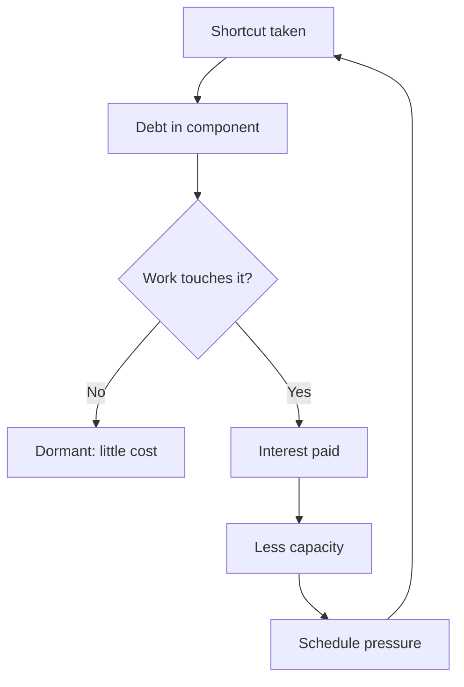
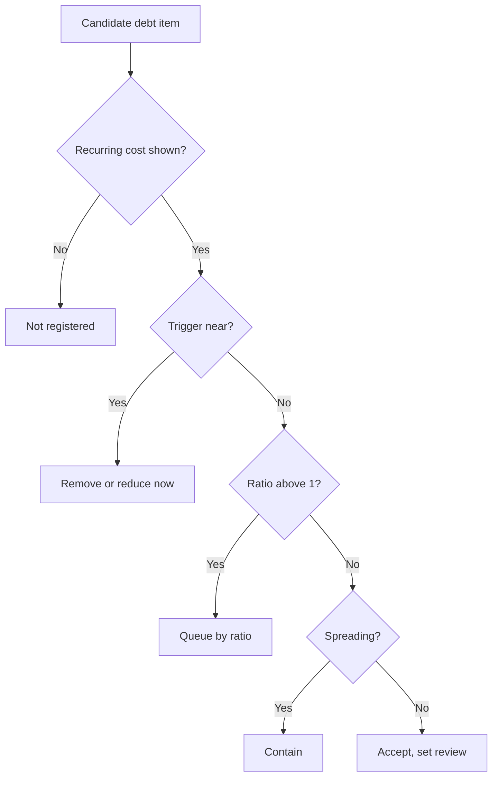

# Chapter 21 — Technical Debt: Identification, Economics, and Prioritization

This chapter treats [technical debt](../../glossary.md#technical-debt-principal-and-interest) as an economic
object: something with a recurring cost in time and risk, a price for removal, and a claim
on the same engineers as features. It covers where the metaphor helps and misleads, how to measure
interest instead of ugliness, how to rank debt against features, and how to secure capacity that
survives a roadmap crunch. The running example is the debt register of Northstar Technologies, the
fictional company in the [case study](../../case-studies/northstar/index.md).

This chapter owns the economics and the register; Chapter 27 shows how debt work fits into a wider
quality program. Chapter 45 treats cost of delay in depth.

## Why This Matters

On one team, debt is concrete: a good tech lead trades a little feature work for a fix without
asking anyone. Across 50 to 150 engineers, that judgment stops working. The team that pays the
interest is often not the team that took the loan: a shared module nobody owns slows four teams, and none can justify
fixing it alone. Debt arguments reach the director as competing requests for "refactoring time,"
backed by conviction rather than numbers. Product leaders, who see only that estimates keep growing,
conclude that "tech debt" is what engineers say when they want to do interesting work.

At executive level the stakes are capital allocation. A chief technology officer (CTO) who cannot say what debt costs per year,
what removing the worst of it would cost, and what the business gets back will see debt work cut
first. A CTO who can say it in money and capacity gets a standing budget. The difference is whether
the organization records **interest** (what the debt costs, recurrently) or only **principal** (what
it would cost to fix), and whether a debt item and a feature can be put on the same scale.

The external evidence that debt is costly is real but thinner than it is usually presented, and it
cannot tell you what your debt costs. Only your own measurement can.

## Learning Objectives

After this chapter you will be able to:

- Use the debt metaphor precisely, as Cunningham introduced it, and say where it breaks down.
- Identify debt beyond code (architecture, test, infrastructure, documentation, knowledge) and
  explain why it is often the most expensive kind.
- Build a debt register whose entries record interest as recurring cost, with evidence, instead of
  opinions about code quality.
- Prioritize debt against feature work with a common economic frame and explain the ranking to
  product and finance.
- Secure standing capacity for debt work and detect when it is spent on the wrong things.

## The Mental Model

> **Mental model:** Debt is defined by its interest, not by its principal. You pay interest only on
> debt that work touches, so the debt worth paying down is where change keeps flowing.

Two consequences follow, and most debt mistakes violate one of them.

First, **ugliness is not cost**. A tangled module that nobody changes, that rarely fails, and that no
planned feature needs is ugly and nearly free. A small inconsistency in a migration script that bites
every second release is cheap to look at and expensive to own. Ranking by how bad code looks ranks by
principal, the least important number.

Second, **interest is paid at the point of contact**: slower changes, extra testing, failed releases,
and incidents, in the places where people are working. That makes interest measurable from data the
organization already produces.

The loop is how debt compounds. The dormant branch is why a full inventory is the wrong starting
point: most of what it lists costs little.

## Deep Conceptual Explanation

### Where the metaphor came from

The term comes from Ward Cunningham's 1992 OOPSLA experience report on the WyCash portfolio system.
In a short passage he compares shipping first-time code to going into debt: a little debt speeds
development, provided it is paid back promptly with a rewrite. The danger is debt that is not repaid,
because time spent on not-quite-right code counts as interest, and an engineering organization can
be brought to a standstill under that load
([Cunningham, 1992](../../references/bibliography.md#cunningham1992wycash)).

Two features of the original are worth keeping: the debt is taken **deliberately**, to ship early
and learn, and the cost that matters is the **interest**. The report gives a metaphor, not evidence.

The term then stretched. Twenty years later, the abstract of an IEEE Software special issue's
introduction says the metaphor had been introduced to explain the need for refactoring to
non-technical stakeholders. By then it covered so many phenomena that the field needed an organizing
structure ([Kruchten, Nord, and Ozkaya, 2012](../../references/bibliography.md#kruchten2012technical)).
A systematic mapping of 94 publications from 1992 to 2013 reached a similar conclusion. Different
people used "debt" in different ways, which made it ambiguous, and code-level debt had received most
of the attention ([Li, Avgeriou, and Liang, 2015](../../references/bibliography.md#li2015systematic)).
That is **research** about the literature, and a decade old.

### Where the metaphor breaks down

Martin Fowler's refinement classifies debt as reckless or prudent and deliberate or inadvertent. His
most useful point is that prudent, inadvertent debt is unavoidable even for good teams, because they
learn what the design should have been only by building it
([Fowler, 2009](../../references/bibliography.md#fowler2009debtquadrant)). This is **expert
opinion**, and it removes the moral charge: much debt is the residue of learning, not a failure.

The quadrant also shows how far "debt" stretches. Reckless, inadvertent debt is not a loan anyone
chose; calling it debt can hide a skills or review problem behind a financial word. Beyond that, the
analogy fails in ways that change decisions:

- **No fixed rate.** Technical interest varies with how much work flows through the component. The
  same debt can be free one year and crippling the next, when the roadmap moves into that area.
- **Uncertain, growing principal.** The cost of removal grows as more code depends on the shortcut.
- **Default is possible.** Retiring a system cancels its debt. Consider that first.
- **The borrower and the payer differ.** A team that ships a shortcut in a shared module may pay
  little of the interest, which is why unowned components accumulate the worst debt (Chapter 33
  discusses how team boundaries produce this).
- **Not every gap is debt.** A system that became wrong because the business changed carries a cost,
  but nobody borrowed. Treating every gap as debt turns the register into a wish list.

The rule this book draws (**this book's recommendation**): use the metaphor to communicate and the
economics to decide. With a chief financial officer (CFO), "we are paying interest" works. In a register, the entry must say
how much, in whose time, and with what evidence.

### Debt beyond code

Because research and tooling concentrate on code, organizations look for debt with static analysis
and find what static analysis finds. Li and colleagues classified debt into ten types; the table uses
this book's own working categories:

| Kind | What it looks like | How interest shows up |
|---|---|---|
| Code | Duplication, tangled modules | Slower changes and more defects where work flows |
| Architecture | Wrong boundaries, shared databases | Cross-team coordination, large releases, cascading failures |
| Test | Flaky or slow suites, manual regression | Reruns, waiting, escaped defects, red main branch |
| Infrastructure | Hand-built deploys, several CI systems | Manual toil, failed rollbacks, security exposure |
| Documentation | No runbooks, stale design notes | Longer restores, slower onboarding |
| Knowledge | Components understood by one person or nobody | Single points of failure, stalled changes |

Ernst and colleagues surveyed 1,831 engineers and architects on long-lived projects in three large
organizations. Respondents named architectural decisions as the most important source of technical
debt, valued the metaphor for communication, and did not find existing tools helpful for managing
the details ([Ernst et al., 2015](../../references/bibliography.md#ernst2015measure)). That is a
**research finding** about perception, not measured cost, and a useful corrective to code-scanner
dashboards, which cannot see a wrong service boundary or a deploy script only one person understands.

### Measuring interest instead of ugliness

Interest has two parts, and a register should record both:

1. **Time interest**: engineering hours lost per period. Sources, in rough order of reliability:
   system data (pipeline reruns, manual deploy steps, time the main branch is red); work-item data
   (cycle times for changes touching a component, compared with similar work elsewhere); and
   structured self-report.
2. **Risk interest**: incidents, security exposure, and customer impact the debt causes or makes
   likely, from incidents classified by trigger and component, recurrences, and audit findings.

A third part, **option cost**, is debt that slows a specific planned feature. Record it against that
feature's cost of delay rather than estimating it in general.

How large is time interest in practice? The most cited figure is self-reported. Besker, Martini, and
Bosch ran a longitudinal study that surveyed 43 developers, with follow-up interviews of 16.
Developers reported wasting on average 23 percent of their development time because of technical debt
([Besker, Martini, and Bosch, 2018](../../references/bibliography.md#besker2018technical)). The
journal version adds a validation on an independent dataset, and reports that developers were often
forced to introduce new debt and that the extra time went most often to additional testing
([Besker, Martini, and Bosch, 2019](../../references/bibliography.md#besker2019productivity)). This is
a **research finding with a narrow base**: self-reported time from a small sample. It shows that
developers experience debt as a large drag, not that a quarter of any engineering budget is lost.

Different evidence comes from Tornhill and Borg, who analyzed 39 proprietary codebases (30,737
files), combining code analysis, version-control history, and issue data. Low-quality code had about
15 times more defects than high-quality code, and issues in it took on average 124 percent more
development time, with much less predictable cycle times
([Tornhill and Borg, 2022](../../references/bibliography.md#tornhill2022codered)). This **research
finding** is observational (harder problems may produce worse code and take longer), and "quality" is
one commercial tool's code-health measure. Its value for leaders is the method: it measures interest
where change meets the code.

The evidence is thin: no large peer-reviewed study measures the organizational cost of debt across
many companies with system data. Quote external figures only with their samples, and use them to
motivate measurement, not to replace it.

Two cautions. Self-reported debt time inflates once debt claims win capacity; pair it with system
data. And unplanned work is not the same as debt interest: much of it has other causes.

### Prioritizing debt against features

Debt competes with features for the same people, so it needs the same scale: what waiting costs per
unit of time, and how much capacity the work consumes.

For features, that is **cost of delay**, the value lost per period while work is not done, an idea
widely credited to Donald Reinertsen's *The Principles of Product Development Flow*
([Reinertsen, 2009](../../references/bibliography.md#reinertsen2009principles)); Chapter 45 develops
it. A popular operational form is **Weighted Shortest Job First (WSJF)**, which the Scaled Agile
Framework (SAFe) defines as relative cost of delay divided by relative job size
([SAFe, WSJF](../../references/bibliography.md#safe-wsjf)). WSJF as a named method belongs to SAFe.

For debt, the analog is direct:

- **Cost of delay** is interest per period: time interest, plus a conservative money value for risk,
  plus any option cost against a named feature.
- **Job size** is principal: the effort to remove or reduce the debt, as a range.
- **Ratio**: annual interest over principal. Above 1, the fix pays back within a year if the
  estimates hold.
- **Trigger**: the date or threshold at which interest jumps (a departing expert, a renewal, a volume
  peak, an end-of-life date). A near trigger overrides the ratio.

This is the rule in the [technical debt register template](../../templates/technical-debt-register.md).
Its value is not precision: it puts debt and features in one unit, so product leaders argue about
inputs rather than the category's legitimacy. And it favors cheap fixes for items that cost a lot every
month over grand refactors.

The ratio does not decide alone. Every entry has four options, cheapest effective first: **remove**
(pay the principal), **reduce** (pay part of it to cut most of the interest), **contain** (stop it
spreading, for example by freezing a format), and **accept** (record that the interest is tolerable,
with a review date).

## Engineering Organization Example

!!! info "Northstar so far"
    Week 3 of the director's first year. The baseline quarter had 30 Sev1 and Sev2 incidents and
    $410,000 in service credits, and about a third of capacity went to unplanned work. In week 4 the
    director will reserve 12 FTE for prevention, with Billing's share at 25 percent. See the
    [timeline](../../case-studies/northstar/timeline.md). New to Northstar? Read [the year in
    brief](../../case-studies/northstar/year-in-brief.md) and the [cast](../../case-studies/northstar/cast.md).

The [register template](../../templates/technical-debt-register.md) holds Northstar's first five
entries, TD-001 to TD-005 (the [register IDs](../../glossary.md#register-ids)). Here the director adds
two non-code entries, TD-006 and TD-007, and prices the top of the register. Every number is
**illustrative**. Northstar figures come from the
[baseline](../../case-studies/northstar/baseline-data.md), including its extended section on technical
debt, which supplies the pipeline volume of [Core](../../glossary.md#core) (the Java monolith) and CI
maintenance effort.

Assumptions:

- An engineer-day costs about $800. This is Finance's day rate ($185,000 a year over about 230
  working days). It is higher per day than the book's planning rate of $3,558 per engineer-week
  because Finance counts only working days.
- Core's pipelines run about 1,000 times a month (baseline). At the baseline's 9 percent
  of runs failing for reasons unrelated to the change, that is about 90 spurious failures a month,
  each assumed to cost 30 minutes of an engineer's attention. Waiting for the 74-minute pipeline to
  rerun is not counted.
- Running four continuous integration (CI) systems costs about 1.5 [FTE](../../glossary.md#fte)
  (full-time equivalent engineers) of infrastructure time a year (baseline).
- Risk is valued conservatively: half the average service credit per serious incident, about $6,850
  ($410,000 over 30 incidents, halved). Serious means Sev1 or Sev2, the two highest
  [severity](../../glossary.md#severity-sev1-sev2-sev3) ratings: an order or payment path down, or
  wrong financial records, for Sev1; narrower failures for Sev2.

| Entry | Annual interest | Principal | Ratio | Trigger |
|---|---|---|---|---|
| TD-001 Core release process | $440,000 of QA time (incidents not counted) | $370,000 | 1.2 | Renewals in 2 quarters |
| TD-002 Deploy scripts | $29,000 | $32,000 | 0.9 | One engineer leaving |
| TD-003 Unowned Core modules | Not priced: review delays | $800 (a decision) | — | None |
| TD-004 Migration practice | $82,000 of risk | $20,000 | 4.1 | Year-end volumes |
| TD-006 Four CI systems (new) | $278,000 | $370,000 | 0.75 | None known |
| TD-007 Flaky Core tests (new) | $54,000 | $20,000 | 2.7 | None known |

In engineer time: TD-001 interest 2.4 engineer-years, principal 2 engineer-years; TD-002 36 and 40
engineer-days; TD-004 principal 25 engineer-days; TD-006 1.5 FTE and 2 engineer-years; TD-007 68 and 25
engineer-days. TD-004's risk is about 12 migration-triggered incidents a year (3 last quarter) at
$6,850. TD-007's time is 90 failures × 0.5 hours × 12 months = 540 hours. TD-005, the webhook
payload format, is contained by a freeze on format changes and is not priced here.

Three observations.

First, the ranking surprises. The items engineers discuss most, the release process and the CI
systems, have the largest principal and middling ratios. The highest ratios belong to small items
nobody had proposed: migration checks and flaky-test repair, about a month of one engineer each.

Second, the ratio is not the whole story. TD-001's ratio counts only QA time and ignores nine
incidents a quarter; with any risk value it rises above 2. TD-002's ratio is below 1, but its trigger
could arrive any week and would leave a tier 1 service unmaintainable. Both move up by judgment, with
the reason written in the decision field.

Third, TD-003 (three Core modules shared by four teams with no owner) has a principal of about one day:
the ownership decision. A debt with near-zero principal is not a project; it is a decision someone
has been avoiding.

## Decision Framework

Every candidate passes the same gate, and every entry gets one of four options:

"Not registered" does not mean forbidden. Small improvements made during feature work need no entry.
The register is for items that need capacity beyond that, or a decision by someone outside the team.

| Situation | Preferred option | Why |
|---|---|---|
| High interest, small principal | Remove now from standing capacity | Pays back within months |
| High interest, large principal | Reduce: the slice that removes most interest | Large programs stall; slices show results |
| Low interest, spreading | Contain: freeze, wrap, or deprecate | Stops principal growing cheaply |
| Low interest, stable | Accept with a review date | Dormant debt costs little |
| Interest falls on another team | Escalate to the director | The paying team cannot fund it alone |
| System near retirement | Accept or retire faster | Default cancels the debt |

Who decides follows who pays: a team decides within its own components and share; cross-team debt,
or debt larger than a team's quarterly share, goes to the director.

## Trade-offs

**Precision against adoption.** Demanding measured interest for every entry yields five entries and
misses real costs that are hard to measure; accepting any estimate fills the register with guesses.
Middle course: a stated estimate with its source is enough to enter, and system data is required
before an item consumes more than one engineer-quarter.

**Standing share against project funding.** A fixed share per team protects small, frequent items
from roadmap pressure. Large items (TD-001, TD-006) exceed any team's share and need project funding
with a business case. Most organizations need both.

**Team autonomy against central priority.** Teams know their own debt; the director sees cross-team
interest no team sees. Free spending risks interesting work winning over costly work; central control
kills ownership. Let teams choose within their share and account for it monthly; direct only
cross-team entries.

**Debt work against prevention.** Northstar's [prevention allocation](../../glossary.md#prevention-allocation)
funds work aimed at defect inflow. Some debt items
are prevention (TD-004); others are not (a slow but reliable build). When capacity is scarce, debt
that reduces defect inflow comes first.

## Failure Modes

**The debt wiki.** A "tech debt week" produces a hundred uncosted items that nobody reads again.
Signal: the list grows and almost nothing closes. Countermeasure: archive every entry without an
interest estimate and an owner; keep the register short.

**Principal-first ranking.** The biggest refactor wins, takes two quarters, and returns little
because the code changes rarely. Signal: the top entries have the largest estimates. Countermeasure:
rank by interest over principal; ask where changes actually flow.

**The rewrite pitch.** A team proposes to remove the debt by rewriting the component, which carries
the full principal and delivers nothing until finished. Signal: no intermediate deliverable.
Countermeasure: require a first slice that reduces measurable interest within one quarter.

**Allocation leakage.** The standing share is quietly spent on features under deadline pressure, or
on enjoyable work with no recorded interest. Signal: the monthly account cannot name the entries it
moved. Countermeasure: report spending against entries; make borrowing an explicit, recorded decision.

**Debt as a blame word.** "That's tech debt" becomes a way to say a previous team was careless, and
people stop registering debt they created. Signal: entries describe people, not mechanisms.
Countermeasure: treat most debt as prudent learning and thank teams for registering their own.

**Interest inflation.** Once capacity follows estimates, estimates rise. Signal: claimed interest
grows faster than the system data behind it. Countermeasure: pair self-report with pipeline, ticket,
and incident data, and have a staff engineer spot-check the top entries each quarter.

## Enterprise Application

In an organization of 50 to 150 engineers, the register works only inside the planning cycle.
**Teams** keep their entries, estimate interest from their data, and spend a standing share on their
top entries without asking permission. **Staff engineers** own cross-cutting entries, review estimates
at the top of the register, and turn large entries into sliced plans. **The director** reviews the top
quarterly, funds entries that exceed team shares, assigns owners to shared components (an unowned
entry cannot be scheduled), and reports upward.

The size of the share is a judgment, not a research result; no study identifies a correct
percentage. At Northstar the standing share comes out of the prevention allocation (12 FTE in quarter
1, sized per team), not on top of it. **This book's recommendation**: start at 10 to 20 percent per team, higher where
unplanned work and recorded interest are high, and adjust each quarter on two signals: whether the
top entries move and whether their interest falls. A share never spent on register entries is too
large or poorly governed; a register whose top never moves is underfunded.

Three mechanics make the share survive pressure. It is a line in the quarterly plan, visible to
product. Its spending is reported monthly against named entries, in the same review as features
(Chapter 37 covers that cadence). And borrowing from it, sometimes the right call, is recorded with a
date for paying it back. A share that can be borrowed silently will be.

Large entries such as TD-001 and TD-006 (about two engineer-years each) are funded as projects with
a business case, a receiving owner, and interim slices, as Northstar funded the release-train work
through a release working group with owners from the teams.

## CTO Perspective

At executive level, debt sounds like a balance-sheet item, something owed. The argument that wins is
about cash flow: what the debt costs every year, and what removing it returns.

**Report interest, not inventory.** "We have 140 items of technical debt" invites "so what?" "Debt
in our release process and test suite costs about $500,000 a year in engineering time and sits behind
a third of our incidents, and removing the worst of it costs about $400,000" is a capital decision a
CFO can evaluate. Chapter 52 shows how to budget it.

**Portfolio across directors.** Ask each director for the top five entries by interest and their
trend, never the register's size, which rewards short registers rather than low debt.

**Policy on deliberate debt.** Some debt should be taken on purpose, to hit a market window or to
learn before investing. Make that safe by requiring deliberate debt to be registered when taken, with
expected interest and a payback date, and by honoring the payback in the next plan. That is
Cunningham's original loan; debt taken without a record is how organizations reach the standstill he
warned about.

**Retirement as a lever.** Retiring a feature with few users removes principal and interest at once,
and only the business can make that call.

## Practical Playbook

1. **Start from interest.** Pull a quarter of incidents by component, pipeline failure and rerun data,
   and cycle times by component. Find where change flows and where it is slow or fails.
2. **Ask teams for up to five candidates each**, with a recurring cost and its source. No cost, no
   entry.
3. **Ask explicitly about non-code debt**: tests, deploys, runbooks, components one person
   understands.
4. **Price the top of the register** at a standard engineer-day cost, with risk valued conservatively
   and every assumption stated on the entry.
5. **Rank by interest over principal, then apply triggers**, writing down every override.
6. **Choose remove, reduce, contain, or accept** for each top entry, with an owner and a review date.
7. **Secure the standing share** in the quarterly plan with product's agreement; fund larger entries
   as projects.
8. **Review monthly, re-rank quarterly**, retiring entries whose interest has gone.
9. **Report interest removed** to the CTO each quarter, with its uncertainty.

## Case Study

This case is **fictional**. It continues the Northstar story from the
[baseline](../../case-studies/northstar/baseline-data.md) and the
[register template](../../templates/technical-debt-register.md).

In week 3, the director found Northstar's existing debt list: a wiki page of 143 items from a "tech
debt week" eighteen months earlier, nine closed, none with an owner or a cost. The most-voted item
was a redesign of the core/customer module, proposed by Ines Carvalho (staff engineer, Core domain) at
about three engineer-years.

Ines's case was strong on the code. The director asked what it cost per year and where. Nobody knew;
the module had no owner, no alerts, and no change-level data. The director did not reject the
proposal. Ownership came first (core/customer went to Orders in week 4, as in TD-003). Priya Raman's
Orders team then tagged every change touching the module for a quarter, recording review wait and
rework.

Meanwhile the priced register put two small items on top. The first was the migration checks
(TD-004) of Li Na Zhou (staff engineer, data and integration): a pipeline step that rejects a release
when a migration and its dependent code are out of order, and flags migrations likely to lock large
tables. They took about five weeks and landed in week 11. That was two weeks after the week-9 Billing
Sev1 they would have prevented, the repeat of INC-427 in which credit notes were applied twice
([Chapter 25](25-incidents-postmortems-and-change-failure-analysis.md#case-study) tells it in full).

The second was flaky-test repair (TD-007). A release working group led by Kwame Mensah (staff
engineer, infrastructure and reliability) quarantined the flakiest Core tests from week 4, each with
an owning team and a fix-or-delete deadline. Pipeline failures unrelated to the change fell from 9 to
4 percent over the quarter.

Marcus Oyelaran (Billing manager) objected that Billing's share was going to "other people's debt." The register
answered him: three of the top five entries charged interest that landed on Billing, in migration
repairs, release failures, and red-branch time.

What went wrong: in the second month, Customer Experience spent its whole share on an unregistered
frontend framework upgrade whose interest nobody could state. The director let it stand and asked
that the next quarter's upgrade work enter the register first. It did.

At quarter end, changes touching core/customer took longer in review than comparable changes, but
only about 30 changes had touched it. The redesign was split: a permissions extraction, which most of
the slow changes touched, was funded for the next quarter, led by Ines; the rest was accepted with a
review date.

The lesson: a big proposal earns funding with interest data, and the cheap, high-interest items go
first.

## Exercises

Solutions are in [chapter 21 solutions](../../solutions/ch21-solutions.md). Data files are linked
from the [Northstar baseline page](../../case-studies/northstar/baseline-data.md).

### Foundational

**F1.** A team lead tells you the payments module is "full of tech debt" and asks for six weeks to
clean it up. The module is 30,000 lines, has no tests for its retry logic, and has been changed
twice in the last year, both times without incident. Using the debt metaphor precisely, explain
whether and how this is debt, what its interest is, and what you would ask for before deciding.

**F2.** Classify each of these Northstar facts into a kind of debt (code, architecture, test,
infrastructure, documentation, or knowledge), and for each say what interest it charges and what
data would measure it: 17 of 24 components without a runbook; auth-svc deployed by scripts one
person understands; Core main branch red 22 percent of working hours; core/scheduler shared by four
teams with no owner.

**F3.** A colleague cites "developers lose 23 percent of their time to technical debt" to argue that
Northstar, with 80 engineers, is losing about 18 engineers' worth of capacity. Evaluate the argument: what the source
measured, how it was measured, what it can and cannot support, and what Northstar should measure
instead.

### Applied Leadership

**A1.** Ines Carvalho presents the core/customer redesign (about three engineer-years) to the
engineering leadership meeting, with strong technical arguments and support from two managers. You
have no interest data for the module. Plan your response in the meeting and the next quarter: what
you agree to, what you ask for, and how you avoid both rejecting a good engineer's proposal and
funding a rewrite on conviction.

**A2.** Amara Okafor, the chief product officer (CPO), has agreed to the quarter's 12 FTE prevention
allocation: 25 percent of Billing's capacity, 10 percent in Orders and in Payments and Integrations,
and 15 percent elsewhere. Those two teams get less because they own the two
[renewal commitments](../../glossary.md#renewal-commitments), a bulk-ordering feature and an accounting
integration that the two largest renewals depend on. She now asks why any of it should go to "debt"
rather than to incident fixes while those commitments are due.
Prepare the conversation using the priced register in this chapter: what you show her, what part of
the allocation you propose for register entries and why, what you will not give up, and how you will
report the results to her each month.

**A3.** Three months after introducing a standing share, you find that two teams spent most of
theirs on items not in the register, and one team spent none because its manager kept borrowing it
for features. Diagnose what each pattern tells you about the mechanism, and redesign the governance
without turning it into a permission process.

### Executive Decision-Making

**X1.** As CTO, you are asked by the CFO to choose between funding TD-006 (consolidating four CI
systems, about two engineer-years) and a revenue feature with an estimated cost of delay of $60,000
a month and a similar size. Using a common economic frame, make the decision, state the assumptions
that would reverse it, and say what you would tell the team whose proposal lost.

**X2.** The board asks the CTO for a single number that shows whether technical debt at Northstar is
getting better or worse. Propose the number (or the smallest set of numbers) you would report,
explain how each could be gamed by directors, and describe how you would prevent that while keeping
the report to one slide.

## Reflection Questions

1. Where does the team that pays the interest differ from the team that could remove the debt? Who
   would have to decide for it to be fixed?
2. When you last borrowed from a debt allocation to hit a date, was it recorded, and repaid?
3. Which component would you retire tomorrow if the business agreed, and how much debt would go
   with it?
4. If interest estimates started deciding capacity, whose would rise first, and how would you know?
5. What deliberate debt has your organization taken in the last year, and could anyone list it?

## Key Takeaways

- Use the metaphor to communicate and economics to decide; every entry states interest, principal,
  evidence, and a decision.
- Interest is paid where work touches the debt. Dormant debt is cheap; debt on busy paths is
  expensive, however tidy it looks.
- Test, infrastructure, documentation, knowledge, and architecture debt are often larger and less
  visible than code debt.
- Measure interest from system data first; treat self-report as a lead, and expect it to inflate
  once capacity follows it.
- Rank by annual interest over principal, override with near triggers, and try the cheapest effective
  option first.
- Put a standing share in the plan, report it monthly against named entries, and record borrowing
  with a payback date.
- Fund large entries as projects with slices that cut interest within a quarter.

## References and Further Reading

- [Cunningham, 1992](../../references/bibliography.md#cunningham1992wycash). The WyCash experience
  report; the origin of the metaphor and of interest as the danger.
- [Fowler, 2009](../../references/bibliography.md#fowler2009debtquadrant). "Technical Debt Quadrant";
  prudent versus reckless, deliberate versus inadvertent.
- [Kruchten, Nord, and Ozkaya, 2012](../../references/bibliography.md#kruchten2012technical). Guest
  editors' introduction to an IEEE Software special issue, read at abstract level only; a map of how
  far the term had stretched.
- [Li, Avgeriou, and Liang, 2015](../../references/bibliography.md#li2015systematic). A systematic
  mapping of debt research to 2013.
- [Ernst et al., 2015](../../references/bibliography.md#ernst2015measure). A large practitioner
  survey; architecture as the debt practitioners consider most important.
- [Besker, Martini, and Bosch, 2018](../../references/bibliography.md#besker2018technical) and
  [2019](../../references/bibliography.md#besker2019productivity). The most cited estimate of time
  lost to debt; read the method and sample before quoting it.
- [Tornhill and Borg, 2022](../../references/bibliography.md#tornhill2022codered). Code health linked
  to defects and issue time across 39 codebases; a model for measuring interest at the point of change.
- [Reinertsen, 2009](../../references/bibliography.md#reinertsen2009principles). The book widely
  credited with cost of delay as a decision tool.
- [SAFe, WSJF](../../references/bibliography.md#safe-wsjf). The framework's definition of Weighted
  Shortest Job First; a method, not evidence that it works.
