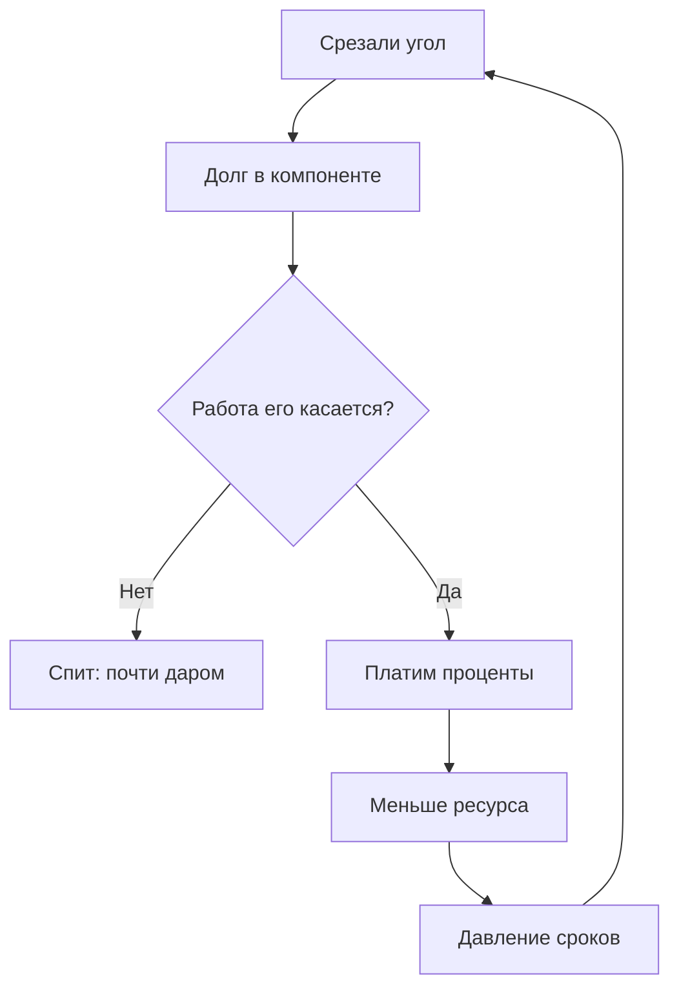
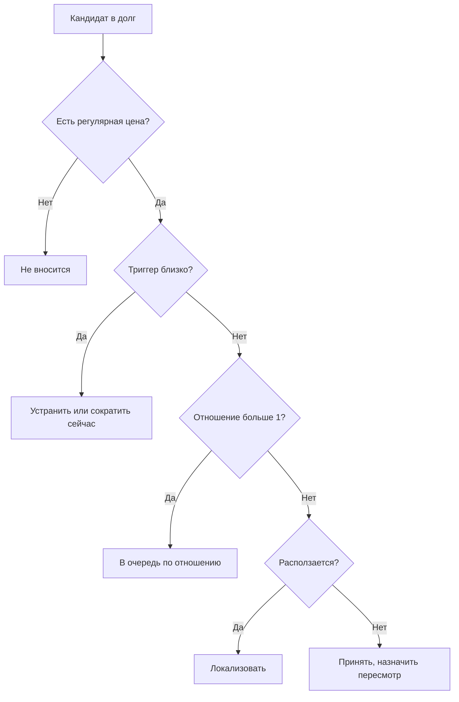

# Глава 21 — Технический долг: выявление, экономика и приоритизация { #chapter-21-technical-debt-identification-economics-and-prioritization }

В этой главе [технический долг](../../glossary.md#technical-debt-principal-and-interest) рассматривается
как экономический объект. У него есть регулярная цена во времени и риске, есть цена погашения, и он
претендует на тех же инженеров, что и функции продукта. Речь пойдёт о том, где метафора помогает, а где
вводит в заблуждение; как измерять проценты, а не уродливость кода; как ранжировать долг вместе с
функциями и как добиться выделенного ресурса, который переживёт аврал в дорожной карте. Сквозной пример —
реестр долга Northstar Technologies, вымышленной компании из
[кейса](../../case-studies/northstar/index.md).

Экономика долга и реестр — тема этой главы; как работа с долгом встраивается в более широкую программу
качества, показывает глава 27. Стоимость задержки (cost of delay) подробно разбирает глава 45.

## Почему это важно { #why-this-matters }

В пределах одной команды долг осязаем: хороший техлид, ни у кого не спрашивая, отдаёт исправлениям
небольшую часть времени, отведённого на функции. Когда инженеров от 50 до 150, такое суждение перестаёт
работать. Проценты часто платит не та команда, которая брала заём: общий модуль без владельца тормозит
четыре команды, и ни одна не может обосновать, почему чинить его должна именно она. До директора споры о
долге доходят в виде конкурирующих просьб дать «время на рефакторинг», и подкреплены они убеждённостью, а
не цифрами. Продуктовые руководители видят только, что оценки всё растут, и решают, что слово «техдолг»
инженеры произносят, когда хотят заняться интересной работой.

Для высшего руководства на кону распределение капитала. Если CTO (технический директор) не может
сказать, во что долг обходится за год, сколько будет стоить убрать худшую его часть и что бизнес
получит взамен, работу над долгом урежут первой. CTO, который может выразить это в деньгах и ресурсе,
получает постоянный бюджет. Разница в том, учитывает ли организация **проценты** (во что долг
обходится регулярно) или только **основной долг** (во что обойдётся исправление) и можно ли поставить
пункт долга и функцию на одну шкалу.

Внешние доказательства того, что долг обходится дорого, есть, но они скромнее, чем их обычно подают, и не
скажут, во что обходится именно ваш долг. Это покажут только собственные измерения.

## Цели главы { #learning-objectives }

Прочитав эту главу, вы сможете:

- Точно пользоваться метафорой долга в том смысле, в каком её ввёл Cunningham, и называть, где она
  перестаёт работать.
- Находить долг за пределами кода (в архитектуре, тестах, инфраструктуре, документации, знаниях) и
  объяснять, почему он часто обходится дороже всего.
- Строить реестр долга, в котором проценты записаны как регулярная цена и подкреплены данными, а не
  мнениями о качестве кода.
- Приоритизировать долг вместе с работой над функциями в общей экономической рамке и объяснять такое
  ранжирование продукту и финансам.
- Добиваться постоянного ресурса на работу с долгом и замечать, когда его тратят не на то.

## Ментальная модель { #the-mental-model }

> **Ментальная модель:** долг определяется процентами, а не основным долгом. Проценты платятся только
> за тот долг, которого касается работа, поэтому гасить стоит долг там, где непрерывно идут изменения.

Отсюда два следствия, и большинство ошибок с долгом нарушает одно из них.

Во-первых, **уродливость — ещё не цена**. Возьмём запутанный модуль: его никто не меняет, он редко падает
и не нужен ни одной запланированной функции. Он уродлив, но почти ничего не стоит. А мелкая
несогласованность в скрипте миграции, которая даёт о себе знать в каждом втором релизе, выглядит
безобидно, но обходится дорого. Ранжируя по тому, насколько плохо выглядит код, вы ранжируете по
основному долгу, то есть по наименее важному числу.

Во-вторых, **проценты платятся в точке контакта**: замедлением изменений, лишним тестированием,
неудачными релизами и инцидентами — там, где идёт работа. Поэтому проценты можно измерить по данным,
которые организация и так собирает.

По этой петле долг и нарастает. А ветка спящего долга объясняет, почему начинать с полной инвентаризации
неверно: большая часть того, что в неё попадёт, стоит мало.

## Подробный разбор { #deep-conceptual-explanation }

### Откуда взялась метафора { #where-the-metaphor-came-from }

Термин появился в 1992 году в отчёте об опыте, который Ward Cunningham представил на OOPSLA; речь в нём
шла о портфельной системе WyCash. В коротком фрагменте Cunningham сравнивает с займом выпуск кода,
написанного впервые: небольшой долг ускоряет разработку, если вскоре вернуть его, переписав код. Опасен
долг, который не возвращают. Время, потраченное на не совсем правильный код, — это проценты, и под их
тяжестью может встать вся инженерная организация ([Cunningham,
1992](../../references/bibliography.md#cunningham1992wycash)).

Из оригинала стоит сохранить две черты: долг берут **намеренно**, чтобы выпустить код раньше и чему-то
научиться, и важны именно **проценты**. Отчёт даёт метафору, а не доказательства.

Потом термин растянулся. Двадцать лет спустя вышел специальный выпуск IEEE Software, и в аннотации
вступительной статьи к нему сказано: метафору ввели, чтобы объяснить нетехническим стейкхолдерам, зачем
нужен рефакторинг. Но к тому времени она охватывала столько явлений, что области понадобилась
упорядочивающая структура ([Kruchten, Nord, and Ozkaya,
2012](../../references/bibliography.md#kruchten2012technical)). К похожему выводу пришло систематическое
картирование (systematic mapping) 94 публикаций с 1992 по 2013 год: разные люди понимали «долг»
по-разному, отчего термин стал двусмысленным, а больше всего внимания доставалось долгу на уровне кода
([Li, Avgeriou, and Liang, 2015](../../references/bibliography.md#li2015systematic)). Это
**исследование** литературы, причём десятилетней давности.

### Где метафора перестаёт работать { #where-the-metaphor-breaks-down }

Martin Fowler уточнил понятие и разделил долг на безрассудный и благоразумный, намеренный и
непреднамеренный. Самая полезная его мысль: благоразумный непреднамеренный долг неизбежен даже у
хороших команд, потому что каким должен был быть дизайн, становится ясно, только когда система построена
([Fowler, 2009](../../references/bibliography.md#fowler2009debtquadrant)). Это **мнение эксперта**, и
оно снимает моральный оттенок: большая часть долга — след обучения, а не провал.

Квадрант заодно показывает, как далеко растягивается слово «долг». Безрассудный непреднамеренный долг —
не заём, который кто-то выбрал. Если называть его долгом, за финансовым словом можно спрятать проблему
с навыками или с ревью. Кроме того, аналогия ломается там, где это влияет на решения:

- **Нет фиксированной ставки.** Технические проценты зависят от того, сколько работы проходит через
  компонент. Один и тот же долг может в этом году ничего не стоить, а в следующем стать неподъёмным,
  когда дорожная карта придёт в эту область.
- **Основной долг неопределён и растёт.** Цена погашения растёт по мере того, как от срезанного угла
  начинает зависеть всё больше кода.
- **Дефолт возможен.** Вывод системы из эксплуатации списывает её долг. Рассмотрите этот вариант первым.
- **Заёмщик и плательщик — разные люди.** Команда, которая срезала угол в общем модуле, может платить
  лишь малую часть процентов. Поэтому худший долг копится в компонентах без владельца (как такую
  ситуацию порождают границы команд, обсуждает глава 33).
- **Не всякий разрыв — долг.** Система, которая перестала подходить изменившемуся бизнесу, обходится
  дорого, но никто ничего не занимал. Если считать долгом любой разрыв, реестр превращается в список
  желаний.

Отсюда правило (**рекомендация книги**): метафорой объясняйте, экономикой решайте. В разговоре с CFO
(финансовым директором) фраза «мы платим проценты» работает. Но запись в реестре должна говорить, сколько
мы платим, чьим временем и на основании каких данных.

### Долг за пределами кода { #debt-beyond-code }

Исследования и инструменты сосредоточены на коде, поэтому организации ищут долг статическим анализом и
находят то, что находит статический анализ. Li с коллегами разделили долг на десять типов; в таблице —
рабочие категории самой книги:

| Вид | Как выглядит | В чём проявляются проценты |
|---|---|---|
| Код | Дублирование, запутанные модули | Изменения медленнее и дефектов больше там, где идёт работа |
| Архитектура | Неверные границы, общие базы данных | Межкомандная координация, крупные релизы, каскадные отказы |
| Тесты | Нестабильные (flaky) или медленные наборы тестов, ручная регрессия | Перезапуски, ожидание, пропущенные дефекты (escaped defects), красная основная ветка |
| Инфраструктура | Развёртывание вручную, несколько CI-систем | Ручная рутина, неудачные откаты, уязвимость для атак |
| Документация | Нет ранбуков (runbooks), устаревшие заметки о дизайне | Восстановление дольше, онбординг медленнее |
| Знания | Компоненты, которые понимает один человек или никто | Единые точки отказа, застрявшие изменения |

Ernst с коллегами опросили 1 831 инженера и архитектора, работающих над долгоживущими проектами в трёх
крупных организациях. Главным источником технического долга респонденты назвали архитектурные решения.
Метафору они оценили как средство общения, а вот существующие инструменты, когда дело доходит до деталей,
полезными не сочли ([Ernst et al., 2015](../../references/bibliography.md#ernst2015measure)). Это
**научный результат** о восприятии, а не об измеренной цене. Зато он полезно отрезвляет тех, кто
полагается на дашборды сканеров кода: такие дашборды не видят ни неверной границы сервиса, ни скрипта
развёртывания, который понимает только один человек.

### Измерять проценты, а не уродливость { #measuring-interest-instead-of-ugliness }

У процентов две части, и реестр должен фиксировать обе:

1. **Проценты временем**: инженерные часы, потерянные за период. Источники, примерно в порядке
   надёжности: системные данные (перезапуски пайплайна, ручные шаги развёртывания, время, когда основная
   ветка красная); данные по задачам (время цикла изменений, затрагивающих компонент, в сравнении с
   похожей работой в других местах); структурированный самоотчёт.
2. **Проценты риском**: инциденты, угрозы безопасности и ущерб клиентам, которые долг вызывает или
   делает вероятными. Источники — инциденты, классифицированные по триггеру и компоненту, повторные
   инциденты и замечания аудита.

Третья часть — **цена упущенной возможности (option cost)**: долг, который тормозит конкретную
запланированную функцию. Относите её на стоимость задержки этой функции, а не оценивайте в общем виде.

Насколько велики проценты временем на практике? Самая цитируемая цифра основана на самоотчётах. Besker,
Martini и Bosch провели лонгитюдное исследование: опросили 43 разработчиков, а затем проинтервьюировали
16 из них. По словам разработчиков, из-за технического долга они теряли в среднем 23 процента рабочего
времени ([Besker, Martini, and Bosch, 2018](../../references/bibliography.md#besker2018technical)).
Журнальная версия работы добавляет проверку на независимом наборе данных. В ней сказано, что
разработчиков часто вынуждали вносить новый долг, а лишнее время чаще всего уходило на дополнительное
тестирование ([Besker, Martini, and Bosch,
2019](../../references/bibliography.md#besker2019productivity)). Это **научный результат с узкой базой**:
самоотчёт о времени на небольшой выборке. Он показывает, что разработчики ощущают долг как сильный
тормоз, но не доказывает, что теряется четверть любого инженерного бюджета.

Данные другого рода приводят Tornhill и Borg. Они проанализировали 39 проприетарных кодовых баз
(30 737 файлов), сочетая анализ кода, историю системы контроля версий и данные по задачам. В
низкокачественном коде дефектов было примерно в 15 раз больше, чем в высококачественном, задачи в нём
требовали в среднем на 124 процента больше времени разработки, а время цикла было гораздо менее
предсказуемым ([Tornhill and Borg, 2022](../../references/bibliography.md#tornhill2022codered)). Это
**научный результат** наблюдательного исследования: возможно, более трудные задачи сами порождают худший
код и занимают больше времени. К тому же «качество» здесь — метрика здоровья кода одного коммерческого
инструмента. Ценность для руководителей — в методе: проценты измеряются там, где изменение встречается с
кодом.

Доказательств мало: ни одно крупное рецензируемое исследование не измеряет организационную цену долга по
системным данным многих компаний. Приводите внешние цифры только вместе с их выборками и используйте их
как довод в пользу собственных измерений, а не вместо них.

Две оговорки. Самоотчёты о времени, потерянном из-за долга, раздуваются, как только заявки на долг
начинают выигрывать ресурс, поэтому дополняйте их системными данными. И незапланированная работа — не
то же самое, что проценты по долгу: у значительной её части другие причины.

### Приоритизация долга наравне с функциями { #prioritizing-debt-against-features }

Долг и функции претендуют на одних и тех же людей, поэтому долгу нужна та же шкала: во что обходится
ожидание за единицу времени и сколько ресурса поглощает работа.

Для функций это **стоимость задержки**: ценность, которая теряется за каждый период, пока работа не
сделана. Эту идею обычно связывают с книгой Donald Reinertsen *The Principles of Product Development
Flow* ([Reinertsen, 2009](../../references/bibliography.md#reinertsen2009principles)); подробно её
развивает глава 45. Популярный способ применять её на практике — **Weighted Shortest Job First (WSJF)**.
Scaled Agile Framework (SAFe) определяет её как относительную стоимость задержки, делённую на
относительный размер работы ([SAFe, WSJF](../../references/bibliography.md#safe-wsjf)). WSJF как
именованный метод принадлежит SAFe.

Для долга аналогия прямая:

- **Стоимость задержки** — проценты за период: проценты временем, плюс консервативная денежная оценка
  риска, плюс цена упущенной возможности для конкретной функции, если она есть.
- **Размер работы** — основной долг: усилия на то, чтобы убрать или уменьшить долг, в виде диапазона.
- **Отношение** — годовые проценты, делённые на основной долг. Если оно больше 1, исправление окупится за
  год (если оценки верны).
- **Триггер** — дата или порог, после которого проценты резко растут (уход эксперта, продление
  контракта, пик нагрузки, окончание поддержки). Близкий триггер важнее отношения.

Это правило из [шаблона реестра технического долга](../../templates/technical-debt-register.md). Ценно
оно не точностью. Правило переводит долг и функции в одну единицу, и продуктовые руководители спорят о
входных данных, а не о том, имеет ли эта категория работы право на существование. Кроме того, правило
отдаёт предпочтение дешёвым исправлениям пунктов, которые дорого обходятся каждый месяц, а не грандиозным
рефакторингам.

Однако одного отношения для решения мало. У каждой записи четыре варианта, и предпочтение отдают самому
дешёвому из действенных: **устранить** (выплатить основной долг), **сократить** (выплатить часть, чтобы
срезать большую часть процентов), **локализовать** (не дать долгу расползаться, например заморозив
формат) и **принять** (записать, что проценты терпимы, и назначить дату пересмотра).

## Пример из инженерной организации { #engineering-organization-example }

!!! info "Northstar: что уже известно"
    Неделя 3 первого года директора. В базовом квартале было 30 инцидентов Sev1 и Sev2 и $410 000
    сервисных кредитов (компенсаций по SLA), а около трети ресурса уходило на незапланированную работу.
    На неделе 4 директор зарезервирует 12 FTE на профилактику, причём у Billing эта доля составит
    25 процентов. См. [хронологию](../../case-studies/northstar/timeline.md). Впервые читаете о
    Northstar? Прочитайте [«Год вкратце»](../../case-studies/northstar/year-in-brief.md) и
    [действующих лиц](../../case-studies/northstar/cast.md).

В [шаблоне реестра](../../templates/technical-debt-register.md) уже есть первые пять записей Northstar,
от TD-001 до TD-005 (см. [идентификаторы реестров](../../glossary.md#register-ids)). Здесь директор
добавляет две записи не о коде, TD-006 и TD-007, и оценивает верхнюю часть реестра. Все числа —
**иллюстрация**. Данные о Northstar взяты из [исходного
уровня](../../case-studies/northstar/baseline-data.md), в том числе из его расширенного раздела о
техническом долге: оттуда взяты объём пайплайнов [Core](../../glossary.md#core) (монолита на Java) и
трудозатраты на поддержку CI.

Допущения:

- Инженеро-день стоит около $800. Это дневная ставка, которой пользуются финансы: $185 000 в год,
  делённые примерно на 230 рабочих дней. Она выше плановой ставки книги ($3 558 за инженеро-неделю) в
  пересчёте на день, потому что финансы считают только рабочие дни.
- Пайплайны Core запускаются около 1 000 раз в месяц (исходный уровень). На исходном уровне 9 процентов
  запусков падают по причинам, не связанным с изменением, — это около 90 ложных падений в месяц. Принято,
  что каждое отнимает 30 минут внимания инженера; ожидание, пока 74-минутный пайплайн перезапустится, не
  учитывается.
- Поддержка четырёх систем непрерывной интеграции (CI) стоит около 1,5 [FTE](../../glossary.md#fte)
  (полной ставки инженера) инфраструктурного времени в год (исходный уровень).
- Риск оценивается консервативно: половина среднего сервисного кредита на один серьёзный инцидент, около
  $6 850 ($410 000 на 30 инцидентов, пополам). Серьёзный — значит Sev1 или Sev2, две высшие оценки
  [серьёзности](../../glossary.md#severity-sev1-sev2-sev3). Sev1 — это остановка пути заказа или оплаты
  либо неверные финансовые записи, Sev2 — более узкие отказы.

| Запись | Годовые проценты | Основной долг | Отношение | Триггер |
|---|---|---|---|---|
| TD-001 Процесс релизов Core | $440,000 времени QA (без учёта инцидентов) | $370,000 | 1.2 | Продления через 2 квартала |
| TD-002 Скрипты развёртывания | $29,000 | $32,000 | 0.9 | Уход одного инженера |
| TD-003 Модули Core без владельца | Не оценено: задержки ревью | $800 (одно решение) | — | Нет |
| TD-004 Практика миграций | $82,000 риска | $20,000 | 4.1 | Объёмы конца года |
| TD-006 Четыре CI-системы (новая) | $278,000 | $370,000 | 0.75 | Неизвестен |
| TD-007 Нестабильные тесты Core (новая) | $54,000 | $20,000 | 2.7 | Неизвестен |

В инженерном времени: у TD-001 проценты — 2,4 инженеро-года, основной долг — 2 инженеро-года; у TD-002 —
36 и 40 инженеро-дней; основной долг TD-004 — 25 инженеро-дней; у TD-006 — 1,5 FTE и 2 инженеро-года; у
TD-007 — 68 и 25 инженеро-дней. Риск TD-004 — около 12 инцидентов в год, вызванных миграциями (3 в
прошлом квартале), по $6 850. Время TD-007: 90 падений × 0,5 часа × 12 месяцев = 540 часов. TD-005
(формат полезной нагрузки вебхуков) локализован запретом на изменение формата и здесь не оценивается.

Из таблицы следуют три наблюдения.

Первое: ранжирование неожиданное. У пунктов, о которых инженеры спорят больше всего (процесс релизов и
CI-системы), самый крупный основной долг и средние отношения. А самые высокие отношения — у мелких
пунктов, которые никто не предлагал: проверок миграций и починки нестабильных тестов, примерно по месяцу
работы одного инженера.

Второе: отношение — ещё не вся картина. Отношение TD-001 учитывает только время QA, а девять инцидентов в
квартал в него не входят; с любой оценкой риска оно превысит 2. Отношение TD-002 ниже 1, но его триггер
может сработать в любую неделю, и тогда сервис tier 1 (высшего уровня критичности) станет невозможно
сопровождать. Оба пункта поднимают в ранжировании по суждению, а обоснование записывают в поле решения.

Третье: у TD-003 (три модуля Core, общие для четырёх команд, без владельца) основной долг — около одного
дня: нужно лишь решить, кто владелец. Когда основной долг почти нулевой, перед вами не проект, а решение,
которое кто-то откладывает.

## Как принимать решение { #decision-framework }

Каждый кандидат проходит один и тот же фильтр, и каждая запись получает один из четырёх вариантов:

«Не вносится» не значит «запрещено». Мелкие улучшения по ходу работы над функциями записи не требуют.
Реестр — для пунктов, которым нужен ресурс сверх этого или решение кого-то за пределами
команды.

| Ситуация | Предпочтительный вариант | Почему |
|---|---|---|
| Высокие проценты, небольшой основной долг | Устранить сейчас за счёт постоянной доли | Окупается за несколько месяцев |
| Высокие проценты, крупный основной долг | Сократить: взять срез, который убирает большую часть процентов | Крупные программы буксуют, срезы дают результат |
| Низкие проценты, долг расползается | Локализовать: заморозить, обернуть или объявить устаревшим | Дёшево останавливает рост основного долга |
| Низкие проценты, долг стабилен | Принять с датой пересмотра | Спящий долг стоит мало |
| Проценты платит другая команда | Эскалировать директору | Платящая команда не может профинансировать исправление одна |
| Система близка к выводу из эксплуатации | Принять или вывести быстрее | Дефолт списывает долг |

Кто решает, зависит от того, кто платит. Команда решает сама в пределах своих компонентов и своей доли;
межкомандный долг и долг, который превышает квартальную долю команды, уходит к директору.

## Компромиссы { #trade-offs }

**Точность или готовность пользоваться реестром.** Если требовать измеренных процентов для каждой записи,
записей наберётся пять, а реальные, но трудноизмеримые затраты останутся за бортом. Если принимать любую
оценку, реестр заполнится догадками. Средний путь: чтобы попасть в реестр, достаточно оценки с указанным
источником, а системные данные нужны, прежде чем пункт потребует больше одного инженеро-квартала.

**Постоянная доля или проектное финансирование.** Фиксированная доля у каждой команды защищает мелкие
частые пункты от давления дорожной карты. Крупные пункты (TD-001, TD-006) не помещаются ни в чью долю,
и для них нужно проектное финансирование с бизнес-кейсом. Большинству организаций нужно и то и другое.

**Автономия команд или центральный приоритет.** Команды знают свой долг, а директор видит межкомандные
проценты, которых не видит ни одна команда. Если тратить свободно, интересная работа может победить ту,
что обходится дорого; если всё контролировать из центра, пропадает чувство владения. Пусть команды
выбирают в пределах своей доли и ежемесячно отчитываются, а директор распоряжается только межкомандными
записями.

**Работа с долгом или профилактика.** [Выделение на профилактику](../../glossary.md#prevention-allocation)
в Northstar финансирует работу, которая сокращает приток дефектов. Одни пункты долга — это
профилактика (TD-004), другие нет (медленная, но надёжная сборка). Когда ресурса мало, первым идёт
долг, который сокращает приток дефектов.

## Типичные провалы { #failure-modes }

**Вики долга.** «Неделя техдолга» порождает сотню неоценённых пунктов, которые больше никто не
перечитывает. Как заметить: список растёт, а почти ничего не закрывается. Что делать: отправить в архив
каждую запись без оценки процентов и владельца; держать реестр коротким.

**Ранжирование по основному долгу.** Побеждает самый крупный рефакторинг: он занимает два квартала и
почти ничего не возвращает, потому что код меняется редко. Как заметить: наверху реестра стоят пункты с
самыми большими оценками. Что делать: ранжировать по отношению процентов к основному долгу; выяснять, где
действительно идут изменения.

**Предложение всё переписать.** Команда предлагает избавиться от долга, переписав компонент. То есть
выплатить весь основной долг разом и ничего не получить до конца работы. Как заметить: нет промежуточного
результата. Что делать: требовать первый срез, который сократит измеримые проценты в пределах одного
квартала.

**Утечка доли.** Под давлением сроков постоянную долю тихо тратят на функции или на приятную работу без
записанных процентов. Как заметить: в ежемесячном отчёте никто не может назвать записи, по которым есть
движение. Что делать: отчитываться о тратах по записям; любой заём из доли оформлять как явное решение и
записывать.

**Долг как обвинение.** «Это техдолг» становится способом сказать, что предыдущая команда была
небрежной, и люди перестают вносить в реестр долг, который создали сами. Как заметить: записи описывают
людей, а не механизмы. Что делать: считать большую часть долга благоразумным обучением и благодарить
команды, которые вносят в реестр собственный долг.

**Инфляция процентов.** Как только ресурс начинает следовать за оценками, оценки растут. Как заметить:
заявленные проценты растут быстрее, чем системные данные, на которых они основаны. Что делать: дополнять
самоотчёт данными пайплайнов, тикетов и инцидентов; раз в квартал поручать staff-инженеру выборочную
проверку верхних записей.

## Применение в крупной организации { #enterprise-application }

В организации на 50–150 инженеров реестр работает, только если встроен в цикл планирования. **Команды**
ведут свои записи, оценивают проценты по собственным данным и, не спрашивая разрешения, тратят постоянную
долю на верхние записи. **Staff-инженеры** отвечают за сквозные записи, проверяют оценки в верхней части
реестра и превращают крупные записи в планы, разбитые на срезы. **Директор** раз в квартал просматривает
верх реестра, финансирует записи, которые не помещаются в доли команд, назначает владельцев общих
компонентов (запись без владельца нельзя поставить в план) и отчитывается наверх.

Размер доли — вопрос суждения, а не результат исследований: ни одно исследование не называет правильного
процента. В Northstar постоянная доля входит в выделение на профилактику (12 FTE в квартале 1 с разбивкой
по командам), а не добавляется к нему. **Рекомендация книги**: начните с 10–20 процентов на команду,
больше — там, где много незапланированной работы и записанных процентов, и каждый квартал корректируйте
долю по двум сигналам: двигаются ли верхние записи и падают ли их проценты. Если долю никогда не тратят
на записи реестра, она слишком велика или плохо управляется; если верх реестра не двигается, реестр
недофинансирован.

Пережить давление доле помогают три механизма. Первый: она стоит отдельной строкой в квартальном плане, и
продукт её видит. Второй: о расходах из неё ежемесячно отчитываются по названным записям на том же
разборе, что и о функциях (этот ритм описывает глава 37). Третий: заём из доли (иногда это правильный
ход) записывают вместе с датой возврата. Если из доли можно занимать молча, из неё будут занимать молча.

Крупные записи вроде TD-001 и TD-006 (примерно по два инженеро-года каждая) финансируются как проекты: с
бизнес-кейсом, владельцем, который примет результат, и промежуточными срезами. Именно так Northstar
профинансировала переход на релизный поезд (release train): через рабочую группу по релизам с владельцами
из команд.

## Взгляд CTO { #cto-perspective }

На уровне высшего руководства долг звучит как статья баланса: то, что компания должна. Но выигрывает
аргумент о денежном потоке: во что долг обходится каждый год и что даст его устранение.

**Докладывайте о процентах, а не о длине списка.** Фраза «у нас 140 пунктов технического долга»
напрашивается на ответ «и что?». А вот «долг в процессе релизов и в наборе тестов обходится нам примерно
в $500 000 инженерного времени в год и стоит за третью наших инцидентов, а устранить худшую его часть
будет стоить около $400 000» — это решение о капитале, которое CFO может оценить. Как заложить его в
бюджет, показывает глава 52.

**Портфель по директорам.** Просите у каждого директора пять верхних записей по процентам и их
динамику, но никогда не спрашивайте размер реестра: такой показатель вознаграждает короткие реестры, а
не низкий долг.

**Политика намеренного долга.** Иногда долг стоит брать сознательно: чтобы успеть к рыночному окну или
чтобы научиться, прежде чем вкладываться. Сделайте это безопасным. Требуйте вносить намеренный долг в
реестр в тот момент, когда его берут, с ожидаемыми процентами и датой возврата, и действительно заложите
возврат в следующий план. Это и есть изначальный заём Cunningham; долг, взятый без записи, ведёт
организацию к той остановке, о которой он предупреждал.

**Вывод из эксплуатации как рычаг.** Если вывести из эксплуатации функцию, которой мало кто
пользуется, уходят сразу и основной долг, и проценты. Но такое решение может принять только бизнес.

## Практический плейбук { #practical-playbook }

1. **Начните с процентов.** Соберите за квартал инциденты по компонентам, данные о падениях и
   перезапусках пайплайна и время цикла по компонентам. Найдите, где идут изменения и где они
   застревают или проваливаются.
2. **Попросите у каждой команды до пяти кандидатов**, для каждого — регулярная цена и её источник. Нет
   цены — нет записи.
3. **Отдельно спросите о долге за пределами кода**: тесты, развёртывания, ранбуки, компоненты, которые
   понимает один человек.
4. **Оцените верх реестра** по стандартной стоимости инженеро-дня: риск — консервативно, каждое
   допущение — в самой записи.
5. **Ранжируйте по отношению процентов к основному долгу, затем учтите триггеры** и записывайте каждое
   отступление от ранжирования.
6. **Выберите для каждой верхней записи вариант: устранить, сократить, локализовать или принять**, с
   владельцем и датой пересмотра.
7. **Закрепите постоянную долю** в квартальном плане с согласия продукта; крупные записи финансируйте
   как проекты.
8. **Пересматривайте ежемесячно, переранжируйте ежеквартально** и закрывайте записи, проценты по
   которым исчезли.
9. **Каждый квартал докладывайте CTO о снятых процентах** вместе с неопределённостью этой оценки.

## Кейс { #case-study }

Этот кейс — **вымысел**. Он продолжает историю Northstar из
[исходного уровня](../../case-studies/northstar/baseline-data.md) и
[шаблона реестра](../../templates/technical-debt-register.md).

На неделе 3 директор нашёл список долга, который уже был в Northstar: вики-страницу со 143 пунктами,
оставшуюся от «недели техдолга» полуторагодовой давности. Закрыты девять, и ни у одного пункта нет ни
владельца, ни оценки. Больше всего голосов набрало предложение Ines Carvalho (staff-инженер, домен Core)
переработать модуль core/customer — примерно на три инженеро-года.

С точки зрения кода аргументы Ines были сильными. Директор спросил, во что модуль обходится в год и где
именно. Никто не знал: у модуля не было ни владельца, ни алертов, ни данных на уровне изменений.
Отклонять предложение директор не стал. Сначала решили вопрос владения: на неделе 4 core/customer перешёл
к Orders, как в TD-003. Затем команда Orders (её руководитель — Priya Raman) целый квартал помечала
каждое изменение, затрагивающее модуль, и фиксировала ожидание ревью и переделки.

Тем временем оценённый реестр вывел наверх два мелких пункта. Первый — проверки миграций (TD-004),
за которые отвечала Li Na Zhou (staff-инженер, данные и интеграции). Это шаг пайплайна: он отклоняет
релиз, если миграция и зависящий от неё код идут не в том порядке, и помечает миграции, которые могут
заблокировать большие таблицы. На них ушло около пяти недель, и заработали они на неделе 11 — через две
недели после Sev1 в Billing на неделе 9, который они бы предотвратили. Тот инцидент повторял INC-427,
когда кредит-ноты применялись дважды (полностью эту историю рассказывает
[глава 25](25-incidents-postmortems-and-change-failure-analysis.md#case-study)).

Второй пункт — починка нестабильных тестов (TD-007). Рабочая группа по релизам под руководством Kwame
Mensah (staff-инженер, инфраструктура и надёжность) с недели 4 отправляла самые нестабильные тесты Core в
карантин, назначая каждому команду-владельца и срок «исправить или удалить». За квартал доля падений
пайплайна, не связанных с изменением, снизилась с 9 до 4 процентов.

Marcus Oyelaran (руководитель Billing) возражал, что доля Billing уходит на «чужой долг». Ответ дал
реестр: три из пяти верхних записей начисляли проценты, которые платила как раз Billing: ремонтом после
миграций, неудачными релизами и временем, пока ветка красная.

Что пошло не так. Во второй месяц команда Customer Experience потратила всю долю на обновление
фронтенд-фреймворка. Этого обновления не было в реестре, и назвать проценты по нему никто не мог.
Директор не стал ничего отменять, но попросил, чтобы в следующем квартале работа по обновлению сначала
попала в реестр. Так и сделали.

К концу квартала выяснилось, что изменения в core/customer проходят ревью дольше сопоставимых, но таких
изменений было всего около 30. Переработку разделили на части. Вынесение проверок прав (его касалось
большинство медленных изменений) профинансировали на следующий квартал и поручили Ines; остальное приняли
с датой пересмотра.

Урок: крупное предложение получает деньги, когда за ним стоят данные о процентах, а дешёвые пункты с
высокими процентами идут первыми.

## Упражнения { #exercises }

Разборы упражнений — на странице [решений к главе 21](../../solutions/ch21-solutions.md). Ссылки на
файлы данных есть на [странице исходного уровня Northstar](../../case-studies/northstar/baseline-data.md).

### Базовый уровень { #foundational }

**F1.** Тимлид говорит вам, что платёжный модуль «полон техдолга», и просит шесть недель на чистку.
В модуле 30 000 строк, логика повторных попыток не покрыта тестами, а за последний год модуль меняли
дважды, оба раза без инцидентов. Точно пользуясь метафорой долга, объясните, долг ли это и в каком
смысле, каковы его проценты и что вы запросили бы, прежде чем принимать решение.

**F2.** Отнесите каждый из этих фактов Northstar к виду долга (код, архитектура, тесты,
инфраструктура, документация или знания) и для каждого скажите, какие проценты он начисляет и какие
данные позволили бы их измерить: у 17 из 24 компонентов нет ранбука; auth-svc развёртывается
скриптами, которые понимает один человек; основная ветка Core красная 22 процента рабочего времени;
core/scheduler пользуются четыре команды, а владельца у него нет.

**F3.** Коллега ссылается на то, что «разработчики теряют 23 процента времени из-за технического
долга», и доказывает, что Northstar с её 80 инженерами теряет ресурс примерно 18 инженеров. Оцените
этот аргумент: что измерял источник, как измерял, что он может подтвердить, а что нет, и что вместо
этого стоит измерять Northstar.

### Прикладное лидерство { #applied-leadership }

**A1.** Ines Carvalho представляет переработку core/customer (около трёх инженеро-лет) на встрече
руководства разработки. У неё сильные технические аргументы и поддержка двух руководителей. Данных о
процентах по модулю у вас нет. Спланируйте, как вы отреагируете на встрече и что будете делать в
следующем квартале: на что вы соглашаетесь, что просите и как избежать обеих крайностей — отклонить
предложение хорошего инженера или профинансировать переписывание на одной убеждённости.

**A2.** Amara Okafor, CPO (директор по продукту), согласилась на выделение на профилактику в этом
квартале — 12 FTE: 25 процентов ресурса Billing, по 10 процентов в Orders и в Payments and
Integrations и 15 процентов в остальных командах. Этим двум командам досталось меньше, потому что они
отвечают за два [обязательства по продлению](../../glossary.md#renewal-commitments): функцию
массового заказа и интеграцию с бухгалтерской системой, от которых зависят два крупнейших продления.
Теперь она спрашивает, почему хоть что-то из этого должно идти на «долг», а не на исправление
инцидентов, пока эти обязательства не выполнены. Подготовьтесь к разговору, опираясь на оценённый
реестр из этой главы: что вы ей покажете, какую часть выделения предложите отдать записям реестра и
почему, чем не поступитесь и как будете каждый месяц отчитываться ей о результатах.

**A3.** Через три месяца после введения постоянной доли вы обнаруживаете, что две команды потратили
большую часть своей доли на пункты, которых нет в реестре, а одна не потратила ничего, потому что её
руководитель всё время занимал долю под функции. Определите, что каждая из этих картин говорит о
механизме, и перестройте управление долей так, чтобы оно не превратилось в процесс выдачи разрешений.

### Решения на уровне руководства { #executive-decision-making }

**X1.** CFO просит вас, CTO, выбрать, что финансировать: TD-006 (объединение четырёх CI-систем, около
двух инженеро-лет) или функцию, которая приносит выручку, с оценочной стоимостью задержки $60 000 в
месяц и похожим размером. Пользуясь общей экономической рамкой, примите решение, назовите допущения,
при которых оно сменилось бы на противоположное, и решите, что вы скажете команде, чьё предложение
проиграло.

**X2.** Совет директоров просит CTO назвать одно число, которое показало бы, улучшается или ухудшается
ситуация с техническим долгом в Northstar. Предложите это число (или минимальный набор чисел),
объясните, как директора могли бы подгонять каждое из них, и опишите, как вы это предотвратите,
уложив отчёт в один слайд.

## Вопросы для размышления { #reflection-questions }

1. Где команда, которая платит проценты, не совпадает с командой, которая могла бы убрать долг? Кто
   должен принять решение, чтобы долг исправили?
2. Когда вы в последний раз занимали из доли на долг, чтобы успеть к дате, — это записали? Вернули?
3. Какой компонент вы вывели бы из эксплуатации завтра, если бы бизнес согласился, и сколько долга ушло
   бы вместе с ним?
4. Если бы оценки процентов начали определять ресурс, чьи оценки выросли бы первыми и как бы вы это
   заметили?
5. Какой намеренный долг ваша организация взяла за последний год и смог бы кто-нибудь его перечислить?

## Главное { #key-takeaways }

- Метафорой объясняйте, экономикой решайте; каждая запись называет проценты, основной долг,
  доказательства и решение.
- Проценты платятся там, где работа касается долга. Спящий долг дёшев; долг на оживлённых путях дорог,
  как бы аккуратно он ни выглядел.
- Долг в тестах, инфраструктуре, документации, знаниях и архитектуре часто больше и заметен хуже, чем
  долг в коде.
- Измеряйте проценты прежде всего по системным данным; самоотчёт считайте подсказкой и ждите, что он
  раздуется, как только за ним начнёт следовать ресурс.
- Ранжируйте по отношению годовых процентов к основному долгу, отступайте от ранжирования при близких
  триггерах и сначала пробуйте самый дешёвый действенный вариант.
- Включите постоянную долю в план, ежемесячно отчитывайтесь о ней по названным записям и записывайте
  каждый заём из неё с датой возврата.
- Крупные записи финансируйте как проекты, со срезами, которые сокращают проценты в пределах квартала.

## Источники и что почитать { #references-and-further-reading }

- [Cunningham, 1992](../../references/bibliography.md#cunningham1992wycash). Отчёт об опыте с WyCash;
  отсюда пошла метафора и представление о процентах как о главной опасности.
- [Fowler, 2009](../../references/bibliography.md#fowler2009debtquadrant). «Technical Debt Quadrant»:
  благоразумный и безрассудный, намеренный и непреднамеренный долг.
- [Kruchten, Nord, and Ozkaya, 2012](../../references/bibliography.md#kruchten2012technical).
  Вступительная статья приглашённых редакторов к специальному выпуску IEEE Software;
  карта того, насколько растянулся термин.
- [Li, Avgeriou, and Liang, 2015](../../references/bibliography.md#li2015systematic). Систематическое
  картирование исследований долга до 2013 года.
- [Ernst et al., 2015](../../references/bibliography.md#ernst2015measure). Большой опрос практиков;
  архитектура как долг, который практики считают самым важным.
- [Besker, Martini, and Bosch, 2018](../../references/bibliography.md#besker2018technical) и
  [2019](../../references/bibliography.md#besker2019productivity). Самая цитируемая оценка времени,
  которое теряется из-за долга; прежде чем её цитировать, прочитайте о методе и выборке.
- [Tornhill and Borg, 2022](../../references/bibliography.md#tornhill2022codered). Связь здоровья кода
  с дефектами и временем на задачи в 39 кодовых базах; образец того, как измерять проценты в точке
  изменения.
- [Reinertsen, 2009](../../references/bibliography.md#reinertsen2009principles). Книга, с которой
  обычно связывают стоимость задержки как инструмент принятия решений.
- [SAFe, WSJF](../../references/bibliography.md#safe-wsjf). Определение Weighted Shortest Job First в
  этом фреймворке; это метод, а не доказательство того, что он работает.
