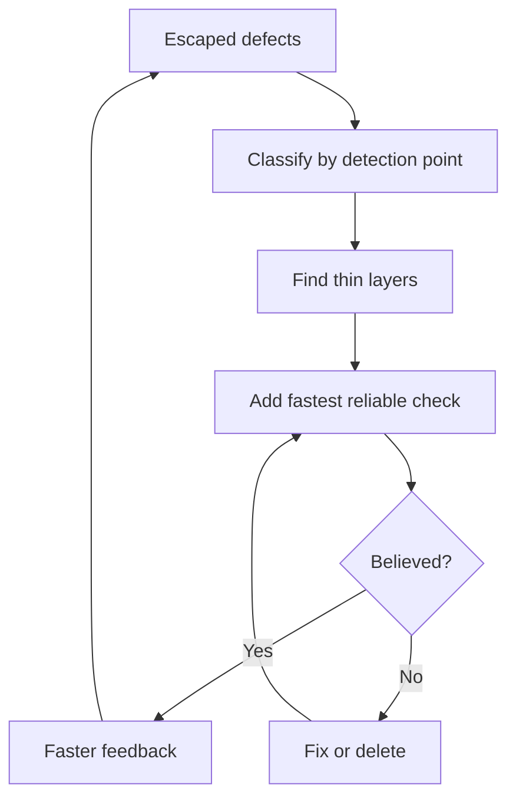
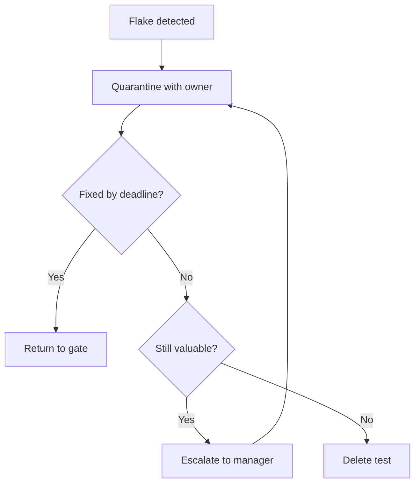
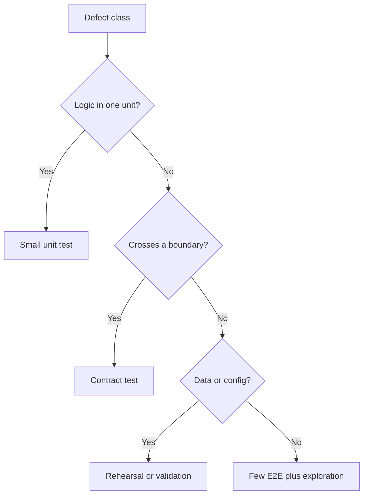

# Chapter 22 — Testing Strategy and Test Architecture

Most engineering leaders inherit a test suite rather than design one. This chapter treats the suite as a portfolio: investments that each buy early warning about one
kind of defect, at a price in feedback time and maintenance. It covers how to choose that portfolio
from where defects actually escape, how to run flaky tests as a reliability problem, what coverage and
mutation testing can tell you, and how to take a manual regression gate out of the release path. The
running example is Northstar Technologies, the fictional company in the
[case study](../../case-studies/northstar/index.md). Quality definitions and QA ownership models belong
to Chapter 19; pipelines and release mechanics to Chapter 23.

## Why This Matters

For a team, the suite decides how fast an engineer learns a change is wrong. A suite that answers in
five minutes and is believed gets used on every change. One that answers in an hour and is wrong one run
in ten gets worked around: changes are batched and failures rerun unread.

For an organization of 50 to 150 engineers, the suite is a commons. Every team adds tests; no team owns
the whole. At Northstar the Core main branch is red for 22 percent of working hours, and 9 percent of
pipeline runs fail for reasons unrelated to the change.

At executive scale, testing is money. Northstar spends about 2.4 engineer-years a year (about $440,000)
on a three-day manual regression pass, has about 11,400 automated tests, and still had 212 confirmed
customer-reported defects last quarter, 81 of them regressions. Asked what that buys, a director who
answers with coverage percentages cannot defend or redirect the spend; one who answers with which
defects are caught where, how fast, and at what cost can do both.

## Learning Objectives

After this chapter you will be able to:

- Design a test portfolio from risk and feedback time, using escaped-defect data, instead of from a
  pyramid picture.
- Distinguish test size from scope, and treat hermeticity as a design requirement.
- Run flaky tests as a reliability problem with an owner, a budget, and an escalation path.
- Explain what coverage does and does not measure, and use mutation testing as a check.
- Decide what manual testing remains valuable, and move regression gates out of the release path.
- Plan contract, test-data, and migration testing for the boundaries where defects escape.

## The Mental Model

> **Mental model:** A test is an investment that buys early, believable warning about one class of
> defect. Choose tests by the defects you need to catch and the feedback time you can afford, and
> treat any test that is not believed as a liability.

Two quantities organize the rest.

**Risk by detection point.** Every defect has an earliest point at which a reasonable check would have
caught it: a unit test, a check at a component boundary, an end-to-end flow, a migration rehearsal, or
a conversation about requirements. Northstar's escapes split 27 percent unit-level, 23 percent
integration or contract, 19 percent end-to-end, 18 percent migration and configuration, and 13 percent
misunderstood requirements. That profile tells you where the portfolio is thin.

**Feedback time and trust.** A check that runs in minutes on every change shapes every engineer's work.
One that runs three days before a release shapes almost nothing. One that fails at random is worse than slow; it teaches people to ignore failures.

Better checks change the escape profile, which moves the next investment; the portfolio has no fixed
shape.

## Deep Conceptual Explanation

### Pyramids, trophies, and honeycombs

The **test pyramid**, popularized by Mike Cohn and described by Martin Fowler, argues for many fast unit
tests and very few user-interface tests, because broad UI tests tend to be slow, brittle, and
non-deterministic. Fowler adds that if high-level tests were fast, reliable, and cheap to change, the
case for the pyramid would weaken ([Fowler, 2012](../../references/bibliography.md#fowler2012testpyramid)).
The shape follows from the costs.

Kent C. Dodds's **testing trophy**, written for frontend code, makes integration tests the widest band
and frames the choice as confidence gained per unit of time
([Dodds, 2021](../../references/bibliography.md#dodds2021trophy)). Spotify's **testing honeycomb**
argues that a small microservice's complexity lies in its interactions, so most tests should exercise
it through its interfaces, with few tests of internals and ideally none that depend on other live
systems ([Schaffer, 2018](../../references/bibliography.md#schaffer2018honeycomb)). Google's published
guideline is closer to the pyramid: roughly 80 percent unit, 15 percent integration, 5 percent
end-to-end by count, with the "ice cream cone" (mostly end-to-end) and the "hourglass" (thin middle) as
antipatterns ([Bender, 2020](../../references/bibliography.md#bender2020testing)).

Read these as **expert opinion and documented practice** from particular kinds of system; this book
found no research showing that one distribution yields fewer escapes. What transfers is the reasoning: check where it is fastest and most
reliable for the defects your system produces, in proportions set by your own data.

### Size, scope, and hermeticity

*Software Engineering at Google* separates two properties most teams blur
([Bender, 2020](../../references/bibliography.md#bender2020testing); summarized, as the book is licensed
for non-derivative use). **Size** is the resources a test may use: small tests stay in one process with
no sleeping, blocking, disk, or network; medium tests stay on one machine; large tests span machines.
**Scope** is how much code a test is meant to validate. A narrow-scope test can still be large, for
example a "unit" test that reaches a shared database. The same chapter asks that all tests be
**hermetic**: they set up and tear down what they need and do not depend on shared state or test order.

Size, not scope, predicts speed and flakiness, because every resource touched adds nondeterminism.
About 1,350 of Core's 11,400 tests run against one shared test database (Northstar's extended
[baseline](../../case-studies/northstar/baseline-data.md)). Written as unit tests, they behave like large ones: slow, interfering, failing when
another run leaves data behind.

### Contracts at boundaries

Twenty-three percent of Northstar's escapes sit at boundaries such as invoicing and the payments
gateway. The usual defense, a shared environment running everything together, is slow, fragile, and
unclear about whose change broke what.

**Consumer-driven contracts** are the alternative. In Ian Robinson's description, each consumer states,
as executable expectations, the parts of a provider's interface it depends on; the provider runs all
consumers' expectations in its own build and so learns which change would break which consumer
([Robinson, 2006](../../references/bibliography.md#robinson2006cdc)). The provider learns of a breaking change in its own pipeline, in minutes, with the consumer named,
instead of from an incident.

The idea works inside a monolith too. Core's three unowned modules (customer, permissions, scheduler)
are changed by four teams, and a tested module contract is one of the few safety nets available before
ownership is settled. The risk is real: in a study of continuous testing at Google, Memon and colleagues
report that very few tests ever fail, that failing tests sit close to the code they test, and that code
recently modified by more than three developers breaks more often
([Memon et al., 2017](../../references/bibliography.md#memon2017taming)). That is **industry research**
from one company, and an association rather than a cause.

Contracts check an interaction, not a whole business flow, and a contract that checks field names but
not what a currency field means will pass while invoices go out wrong.

### Flaky tests as a reliability problem

A **flaky test** passes and fails on the same code. The first extensive study, by Luo and colleagues,
analyzed 201 commits fixing likely flaky tests in 51 open-source projects and classified root causes and
fixes ([Luo et al., 2014](../../references/bibliography.md#luo2014flaky)). A later survey of 76 papers
makes the essential point: flakiness undermines any practice that assumes a test's result depends only
on the code it covers ([Parry et al., 2022](../../references/bibliography.md#parry2022flaky)). Every
merge gate assumes that.

Google's 2016 account describes the cost: about 1.5 percent of test runs flaky,
almost 16 percent of tests showing some flakiness, and about 84 percent of observed pass-to-fail
transitions in post-submit testing involving a flaky test. New flakiness arrived about as fast as it was
fixed, and engineers sometimes dismissed real failures as flakes
([Micco, 2016](../../references/bibliography.md#micco2016flaky)). *Software Engineering at Google*
later reports a rate around 0.15 percent, apparently measured differently, and that tests lose value as
flakiness approaches 1 percent ([Bender, 2020](../../references/bibliography.md#bender2020testing)).
These are **documented practice** at one company, not benchmarks. The mechanism is general: when alarms
are often false, people stop responding to alarms.

Three consequences follow. First, flakiness is a **reliability problem** with a rate, a cost, and an
inflow; it needs an owner and a budget with a consequence, borrowing the error-budget idea from
Chapter 24. Second, cheap mitigations hide it. Retries and "fail only after three consecutive failures" turn the gate green while
delaying detection of real breakage; quarantine protects everyone's flow but, as Google's account
notes, can mask a real bug. Third, flakiness has a **creation rate**. Prevention sits where tests are
written: hermetic fixtures by default, new tests run many times before they join the gate, and review
that asks how a test could fail without the code being wrong.

### What coverage measures

Line coverage says which lines the tests executed, not whether any test would fail if those lines were
wrong. Inozemtseva and Holmes generated 31,000 test suites for five large Java systems and measured
fault detection with mutation testing. Once suite size was controlled for, coverage showed only a low to
moderate correlation with effectiveness, stronger coverage criteria did no better, and the authors
advised against using coverage as a quality target
([Inozemtseva and Holmes, 2014](../../references/bibliography.md#inozemtseva2014coverage)). That is a
**research finding** from open-source Java systems with generated suites; other studies report
different strengths of relationship.

Use coverage to find code no test executes; a gap is informative, a covered line is not. The
[quality transformation chapter](27-quality-transformation-at-enterprise-scale.md) names the coverage
mandate as a failure mode.

### Mutation testing as a check

**Mutation testing** asks what coverage cannot: if the code were wrong, would a test notice? A tool makes
small deliberate changes (flipping a comparison, removing a call) and reruns the tests. A change no test
detects is a surviving mutant, pointing at behavior nobody checks.

Do mutants stand in for real faults? Just and colleagues studied 357 real faults
in five open-source applications and found a statistically significant correlation between mutant
detection and real-fault detection, independent of coverage, while noting the technique's limits
([Just et al., 2014](../../references/bibliography.md#just2014mutants)). That is a **research finding**
with a narrow population and the best available evidence that mutation scores mean something.

The objection is cost. Google's published answer mutates only changed code during code review, filters
mutants developers find uninteresting, and caps mutants per line and per review; the authors report use
by more than 24,000 developers with orders of magnitude fewer mutants
([Petrović et al., 2022](../../references/bibliography.md#petrovic2021mutation)). That shows
practicality, not defect reduction. The transferable lesson is scope: changed lines in high-risk modules,
results shown to reviewers, and never a mutation-score target.

### Manual testing and moving gates out of the release path

Automated checks confirm known behavior; they miss what nobody specified, such as a confusing flow or
two features failing together. That is the job of **exploratory testing**, in which a skilled person works to a
time-boxed charter ("explore bulk order upload with malformed files for 90 minutes"), learning and
designing tests as they go. This is **practitioner consensus**; the book found no controlled industrial
study comparing it with scripted testing.

Separate **manual regression**, which repeats a script, from **manual exploration**. Regression is the
most automatable work in the organization, and as a gate it lengthens every release and enlarges every
batch. Exploration finds what automation cannot, and it need not be a gate. *Continuous Delivery* makes
the general case for an automated pipeline that runs fast checks on every change and keeps software
releasable ([Humble and Farley, 2010](../../references/bibliography.md#humble2010continuous)); Chapter
27 shows how Northstar's manual pass made the release train its constraint, and Chapter 23 covers
release mechanics.

Moving a gate out of the path means relocating each check, not dropping it. Scripted cases that guard
stable, high-value flows become automated tests on every change. Cases needing judgment become
exploration charters on the change, run before or after it ships behind a flag. Duplicates and cases
for unused features are deleted. For a period the organization pays for both, and the people running the pass know customers' use of
the product best; Chapter 19 covers keeping that knowledge in the teams.

### Test data and migration testing

Migrations and configuration produce 18 percent of Northstar's escapes and caused 8 of its 30
incidents (5 configuration, 3 migration). They escape because test environments do not resemble
production in the one respect that matters: data. A migration tested on an empty schema will not meet
the eleven-year-old customer record with a null where the code assumes a value.

Three practices help, all **this book's recommendation**. **Migration rehearsal**: run each migration
against a recent, anonymized, production-scale copy and check row counts, invariants (every invoice
has a ledger entry), and duration. **Ordering checks**: when code and a migration ship together, test
new code on the old schema and old code on the new one; expand-and-contract migrations make this
possible. **Configuration as code**: version configuration, validate it against a schema in the
pipeline, and test risky changes like code.

## Engineering Organization Example

This example is **illustrative**. It uses Northstar's
[baseline](../../case-studies/northstar/baseline-data.md), including the extended baseline's split of
Core's tests and their stage runtimes.

The director asks whether Core's test investment matches where defects escape.

| Earliest detection point | Escaped defects | What Core has | Feedback time |
|---|---|---|---|
| Unit-level logic | 57 (27%) | about 9,800 in-process unit tests | about 9 minutes |
| Integration or contract | 49 (23%) | about 1,350 shared-database tests; no contract tests | about 38 minutes |
| End-to-end flow | 41 (19%) | about 250 browser tests; 1,900 manual cases | 21 minutes; 3 days |
| Migration or configuration | 38 (18%) | nothing automated | production |
| Requirement misunderstood | 27 (13%) | not a testing problem | weeks |

The heaviest manual effort guards end-to-end flows (19 percent of escapes); migration and configuration
(18 percent) has no automated check. The integration layer has volume
without design: about 38 of the 74 pipeline minutes, most of the flaky failures on the director's
sampling, and no contract checks, although boundaries produce 23 percent of escapes. The unit layer still
lets through 57 defects a quarter; 41 percent coverage cannot say how many were in code tests run but do
not check, and a mutation run on invoicing and ledger would.

Core merges about 85 changes a week, each running the full pipeline (extended baseline), or about
17 runs per working day. At 9 percent non-change failures that is about 1.5 spurious red runs a day,
about 350 a year over 230 working days. At an assumed 1.5 engineer-hours each, the direct cost is about
530 hours, under a third of an engineer-year, about $53,000 at $185,000 per engineer-year. That is small. The larger costs are indirect: merges waiting while main is red (22
percent of working hours), and the habit of rerunning failures unread, which is how real regressions get
through.

The director's draft reallocation, **this book's recommendation** for Northstar:

| Investment | Addresses | Rough cost |
|---|---|---|
| Contracts on the six busiest Core-to-service boundaries | 23% boundary escapes | 2 engineers, one quarter |
| Migration rehearsal and ordering checks | 18% escapes; 8 incidents | 1.5 engineers, one quarter |
| Make shared-database tests hermetic, or delete them | Flakiness; 38 minutes | 2 engineers, two quarters |
| Triage 1,900 manual cases: automate, explore, delete | The release-path gate | 7 QA engineers, part-time, one quarter |
| Flakiness owner and budget | 9% non-change failures | 20% of one person, rotating |

Nothing here raises a coverage number; all of it changes where defects are caught.

## Decision Framework

For each class of risk, choose the fastest check reliable enough to be believed. Start from the defect,
not the tool.

| Question | Prefer | When the alternative is right |
|---|---|---|
| Unit or integration emphasis? | The layer where escapes concentrate | Thin services: integration-heavy; rich logic: unit-heavy |
| Shared environment or contracts? | Contracts plus a few end-to-end journeys | One team owns both sides of few services |
| Retry or fix flaky tests? | Quarantine with owner and deadline, list capped | Retry only as a short, visible stopgap |
| Coverage target? | None; review gaps in high-risk code | A floor on new code in a regulated module, paired with mutation results |
| Manual regression as gate? | Automate stable flows; explore new ones | Regulation requires documented human sign-off; keep it scoped |

## Trade-offs

**Speed against realism.** Small hermetic tests are fast and test a world you built; large tests meet
the real world and are slow and noisy. The escape data says which way to lean.

**Contracts against coordination.** Consumers must write expectations and providers accept being
blocked; where ownership is disputed, that negotiation is the hard part.

**Quarantine against hidden bugs.** Quarantine protects flow and risks hiding a real defect. The
mitigation is the two-part rule below (a capped list; a per-test owner and fix-or-delete deadline),
with list size and age reviewed weekly.

**Rescue against replace.** A week spent making old tests hermetic is a week not spent on contracts. A
slow, flaky test that duplicates a unit test is not worth rescuing.

**Automation against judgment.** Automating the manual pass saves Northstar 2.4 engineer-years a year and
removes the moment when someone who knows customers looks at the product. Keep the person; move the
moment to exploration of changes.

**Realistic data against privacy.** Production-shaped data finds the defects that matter and creates a
privacy obligation; anonymization must itself be tested.

## Failure Modes

**The pyramid as policy.** A mandated ratio of test types; teams with interaction defects write unit
tests that mock everything. Signal: ratio met, escape profile unchanged. Countermeasure: set investment
per system from escape classification.

**Retry as a cure.** Retries turn the gate green while flakiness grows unseen. Signal: retries rising,
reported flakiness falling. Countermeasure: count retried passes as failures; give retries an expiry date.

**The quarantine graveyard.** Tests enter quarantine and never return, and coverage quietly vanishes.
Signal: quarantine size and median age rising. Countermeasure: the two-part rule, a cap on the list
(when it is full, a new quarantine needs a fix or a deletion first) and an owner and fix-or-delete
deadline per test; past the deadline, fix or delete by decision.

**The shared-environment tar pit.** One integration environment, always partly broken, owned by nobody.
Signal: daily "is it just me?" messages. Countermeasure: contracts and hermetic service tests.

**Automating the script, losing the tester.** The pass is automated and the QA engineers leave or are
moved without a plan. Signal: escapes in new features rise. Countermeasure: the role change in Chapter
19, announced early, with exploration charters on significant changes.

**Migrations tested on empty databases.** Migrations pass the pipeline and fail in production. Signal:
"unexpected data" in incident reviews. Countermeasure: mandatory rehearsal for tier 1 data.

## Enterprise Application

At 50 to 150 engineers the test suite is a platform needing platform ownership.

**The director owns** a short testing strategy (escape classification, investment priorities,
flakiness budget, coverage policy, manual-testing plan), reviewed quarterly in Chapter 27's cadence.
**Each team owns** its tests' speed and flakiness; flaky tests consume a shared budget, and the monthly
review says so with numbers. **A platform team owns** test infrastructure (hermetic fixtures, flakiness
detection, quarantine tooling); at Northstar, Platform Operations with Kwame Mensah. **Staff engineers
own** cross-team standards: Chapter 27 assigns Ines Carvalho contract tests and Li Na Zhou migration and
configuration safety.

Two policies work well at this scale: a **flakiness budget** per suite (for example, non-change failures
below 2 percent of main-branch runs, weekly) whose breach redirects the owning teams' next work, and a
**new-test admission check** that runs each new test repeatedly before it joins the gate.

Both can be gamed: flakiness falls if tests are deleted without replacement, and pipeline time falls
if slow tests move to a nightly job nobody reads. Pair them with escapes, as the
[engineering quality scorecard template](../../templates/engineering-quality-scorecard.md) shows.

## CTO Perspective

At CTO level testing is a cost line, a risk control, and an enabler of speed at once.

**Spend as a portfolio.** The CTO should see roughly what goes to manual testing, test maintenance, and
test infrastructure, and what each buys in detection.

**Gates as policy.** Gates created after bad incidents make releases larger and slower for years. Treat
each new mandatory gate as an experiment with an expiry date and a measured effect on batch size.

**Contracts as a standard.** Consumer-driven contracts at tier 1 boundaries are an enterprise minimum
worth enforcing, and one of the few testing practices that needs top-down sponsorship, because costs and
benefits land on different teams.

**Customer and regulatory evidence.** Satisfy evidence requirements with automated test records and a
documented exploratory process, not a manual gate the clause does not require.

**People.** Every engineer watches how QA engineers are treated during automation.

## Practical Playbook

1. Classify at least 100 escaped defects by earliest practical detection point, with a staff engineer.
   Repeat quarterly.
2. Inventory tests by size (in-process, single-machine, multi-machine, manual) with runtime and failure
   rate, and set them beside the escapes to find thin layers.
3. Measure flakiness: non-change failure rate, red-main share, retries, and the tests responsible.
4. Name a flakiness owner, set a budget, quarantine the worst tests under a capped list with a per-test
   owner and fix-or-delete deadline, and add a new-test admission check.
5. Introduce consumer-driven contracts on the busiest tier 1 boundary whose teams are willing.
6. Require migration rehearsal on production-shaped data for tier 1 data, and schema-validate
   configuration in the pipeline.
7. Triage the manual suite with the people who run it, after agreeing their role change (Chapter 19).
8. Shrink the manual pass as automated equivalents land, then move what remains out of the release path.
9. Drop coverage targets; report gaps in high-risk modules and pilot mutation testing on changed lines.
10. Each quarter, check whether the escape profile moved, and reallocate.

## Case Study

This case is **fictional**: the testing workstream in the quarter
[Chapter 27](27-quality-transformation-at-enterprise-scale.md) describes, from the
[baseline](../../case-studies/northstar/baseline-data.md) and the
[first-quarter record](../../case-studies/northstar/first-quarter.md).

In week 3, Kwame Mensah pulled a month of Core pipeline history. About 140 tests accounted for most
non-change failures, almost all using the shared test database. Kwame proposed retries; the director
allowed them for two weeks only. The release working group he led, with owners from the teams,
quarantined the 40 worst in week 4 and all 140 by day 90, each with an owner and a fix-or-delete
deadline.

Marcus Oyelaran's Billing team owned 38 of the 140 and said it had no capacity. The director pointed to
the budget rule (past the deadline, fix or delete by decision) and to Billing's 25 percent prevention
allocation from Chapter 27. Billing deleted 15 tests that duplicated unit tests and rewrote 23 against
containerized databases.

Ines Carvalho started contracts on order capture to the pricing service, both owned by Orders. The
second, invoicing to the payments gateway,
required Elena Sokolova's team to accept being blocked by Billing's expectations. Elena agreed on
condition that Billing reviewed every expectation for meaning, not just shape. In week 8 that contract
caught a gateway change that would have rounded multi-currency amounts differently.

Migration safety came too late for one incident. The week 9 Billing Sev1 in Chapter 27 (credit notes
applied twice) came from a migration and a code change shipped together with no ordering check. Li Na
Zhou's rehearsal, still a pilot, became mandatory for tier 1 data in week 10; the ordering check promised
after INC-427 had slipped and landed in week 11.

All seven QA engineers triaged the manual suite with the teams, and five also automated cases; two
chose to run the weekly regression subset. By day 90 they had classified about
1,100 of 1,900 cases: about 400 to automate, 450 to delete, and 250 to convert into exploration charters.
Meanwhile the pass itself became the one-day, risk-based run of about 600 cases before each weekly train
that Chapter 23 describes: still in the release path, smaller, not gone.

| Measure | Baseline | Day 90 |
|---|---|---|
| Core non-change pipeline failures | 9% | 4% |
| Core main branch red, share of working hours | 22% | 9% (last four weeks) |
| Tier 1 boundaries with contracts | 0 | 4 |
| Tier 1 migrations rehearsed | none | all, from week 10 |
| Manual regression pass per release | 3 days, about 1,900 cases | 1 day, about 600 cases |

The director claimed no effect on escaped defects: one quarter is too short, and one contract catch is
an anecdote. The mechanisms had moved. Next quarter: finish the triage, take the pass out of the release
path, and pilot mutation testing in invoicing and ledger.

## Exercises

Solutions are in [chapter 22 solutions](../../solutions/ch22-solutions.md). Northstar data is on the
[baseline page](../../case-studies/northstar/baseline-data.md).

### Foundational

**F1.** Using Northstar's escape classification and the test inventory in this chapter's example, a
manager argues that next quarter's testing investment should go into browser tests "because customers find the
bugs in the UI." Respond with the data. Where would you put ten engineer-weeks, and what evidence would
change that allocation after one quarter?

**F2.** Core's main pipeline runs about 17 times per working day with a 9 percent non-change failure
rate. A team lead proposes automatic retries of up to three attempts on every failed test, promising to
halve red-main time within a week. Estimate what retries would do to the measured numbers and to the
real problem, and propose an alternative with a measurable target.

**F3.** The CFO reads that Core's line coverage is 41 percent and asks why it should not reach 80 percent
by year end, reported monthly. Reply briefly: what coverage measures and does not, what you would report
instead, and what coverage commitment you would accept.

### Applied Leadership

**A1.** You want consumer-driven contracts between Core invoicing (Billing) and the payments gateway
(Payments and Integrations). Elena Sokolova says her team will not be blocked by tests it did not write
and does not understand. Marcus Oyelaran says Billing has no capacity to write expectations. Plan the
first contract: who writes what, who fixes a failing contract, how disputes are resolved, and what you
trade for agreement.

**A2.** Design the triage of the 1,900 manual regression cases with Tom Becker and the seven QA
engineers. Specify the categories and criteria, who decides contested cases, how releases stay safe
while the pass shrinks, and how you will know whether the exploration charters find anything.

**A3.** Write a one-page flakiness policy for the Core suite: measure, budget, owner, consequence of a
breach, and quarantine rules. Then anticipate the strongest objection from a team lead who owns many
flaky tests and is behind on a renewal commitment, and show how the policy handles it.

### Executive Decision-Making

**X1.** One of the two customers in the $9M renewal asks for a clause requiring "full manual regression
testing before every production release." Sofia Alvarez wants to accept it to close the renewal. As CTO, decide how to respond, what you offer
instead, and how you explain it to the CEO.

**X2.** For two quarters you can fund one investment of about four engineers. Option A: make Core's 1,350
shared-database tests hermetic, cutting an estimated 25 pipeline minutes and most flakiness. Option B:
build migration rehearsal on production-shaped data and configuration validation for all tier 1
components. Using the baseline, recommend one, state what you give up, and name the leading indicator
that would show within six weeks whether you chose well.

## Reflection Questions

1. How do engineers react to a red build in your organization, and what does that say about whether they
   believe the tests?
2. Which of your gates was created after a specific incident, and has anyone measured its cost since?
3. Who knows best how customers use the product, and where does that knowledge show up in your testing?
4. When a contract between two teams' components breaks, how long until the right team knows?
5. Which testing number do you report upward, and would it change if your tests stopped checking
   anything?

## Key Takeaways

- Design the portfolio from escaped-defect classification and feedback time; pyramid, trophy, and
  honeycomb each fit some systems and none is proven best.
- Classify tests by size as well as scope; size predicts speed and flakiness, and hermeticity is the
  main defense.
- Put contract tests at the boundaries where defects escape instead of relying on a shared environment.
- Run flakiness as a reliability problem with an owner, a budget, quarantine deadlines, and admission
  checks; count retried passes as failures.
- Use coverage to find untested code, never as a target; use mutation testing on changed high-risk code.
- Keep human testing for exploration, and move scripted regression out of the release path in steps,
  with a plan for the people who run it.
- Test migrations and configuration on production-shaped data.

## References and Further Reading

- [Bender, 2020](../../references/bibliography.md#bender2020testing). Chapter 11 of *Software Engineering
  at Google* ([Winters, Manshreck, and Wright, 2020](../../references/bibliography.md#winters2020software)):
  size, scope, hermeticity, flakiness, and coverage at one very large organization.
- [Fowler, 2012](../../references/bibliography.md#fowler2012testpyramid),
  [Dodds, 2021](../../references/bibliography.md#dodds2021trophy), and
  [Schaffer, 2018](../../references/bibliography.md#schaffer2018honeycomb). Pyramid, trophy, honeycomb.
- [Robinson, 2006](../../references/bibliography.md#robinson2006cdc). The original consumer-driven
  contracts pattern.
- [Luo et al., 2014](../../references/bibliography.md#luo2014flaky) and
  [Parry et al., 2022](../../references/bibliography.md#parry2022flaky). The first large empirical study
  of flaky tests, and a survey of the research since.
- [Micco, 2016](../../references/bibliography.md#micco2016flaky). Google's flakiness rates, costs, and
  mitigations, including the risks of retries and quarantine.
- [Memon et al., 2017](../../references/bibliography.md#memon2017taming). Which tests fail at Google.
- [Inozemtseva and Holmes, 2014](../../references/bibliography.md#inozemtseva2014coverage). Coverage
  versus test-suite effectiveness.
- [Just et al., 2014](../../references/bibliography.md#just2014mutants) and
  [Petrović et al., 2022](../../references/bibliography.md#petrovic2021mutation). Whether mutants stand in
  for real faults, and how to run mutation testing at scale.
- [Humble and Farley, 2010](../../references/bibliography.md#humble2010continuous). *Continuous
  Delivery*: fast automated checks on every change.
