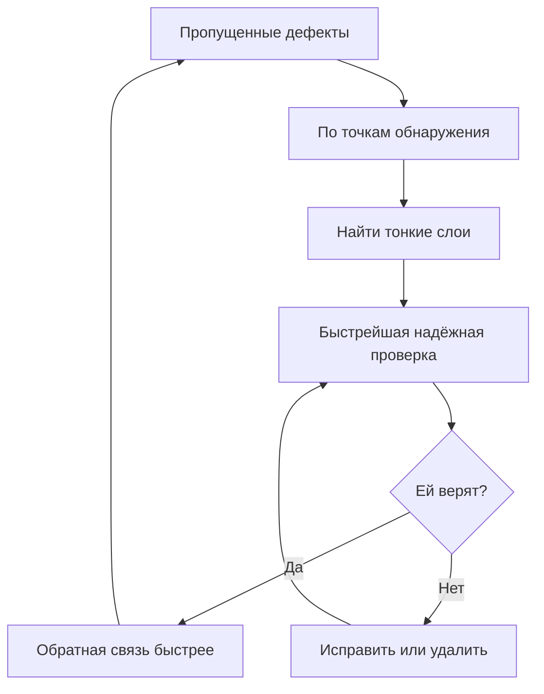
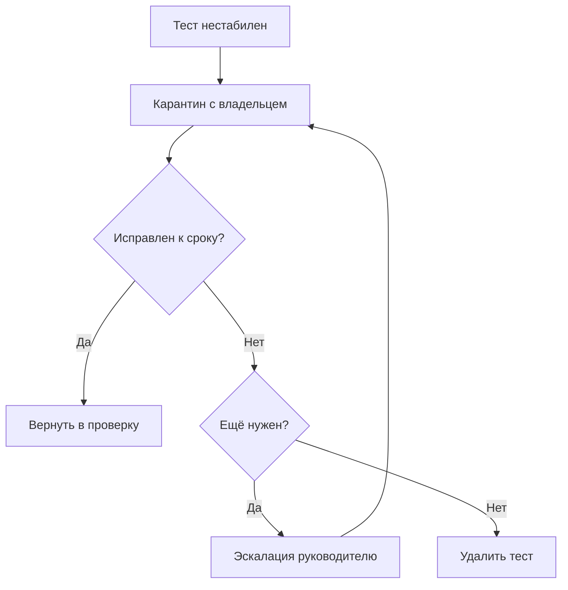
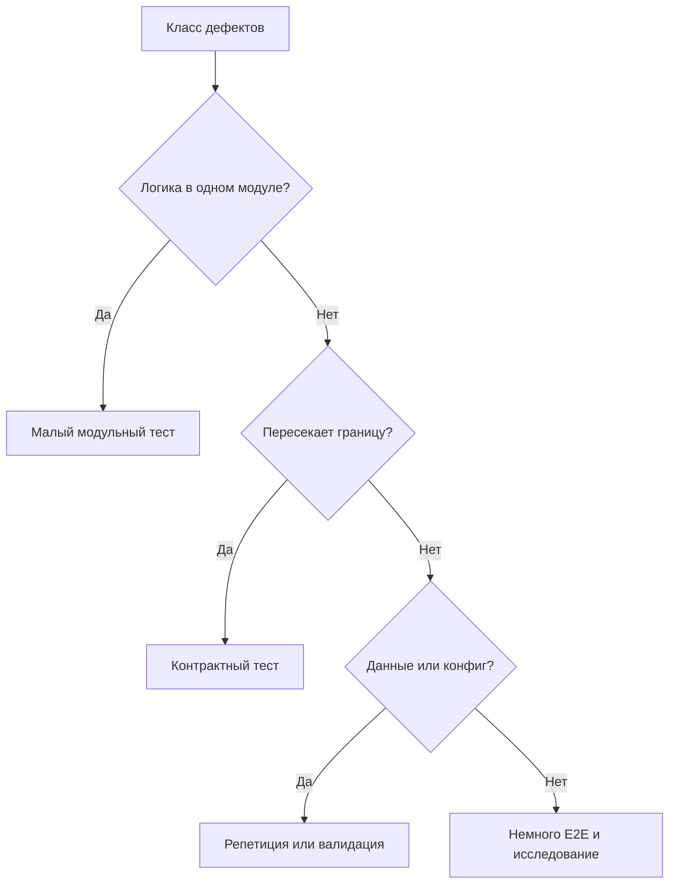

# Глава 22 — Стратегия тестирования и архитектура тестов { #chapter-22-testing-strategy-and-test-architecture }

Большинство руководителей разработки получают набор тестов в наследство, а не проектируют его. В этой
главе набор тестов рассматривается как портфель вложений: каждое вложение покупает раннее предупреждение
об одном виде дефектов, а платят за него временем обратной связи и поддержкой. Речь пойдёт о том, как
выбирать этот портфель, исходя из того, где дефекты действительно проскакивают; как работать с
нестабильными (flaky) тестами как с проблемой надёжности; что могут сказать покрытие и мутационное
тестирование; как убрать ручную регрессию из пути релиза. Сквозной пример — Northstar Technologies,
вымышленная компания из [кейса](../../case-studies/northstar/index.md). Определения качества и модели
владения QA — тема главы 19, пайплайны и механика релизов — главы 23.

## Почему это важно { #why-this-matters }

Для команды набор тестов определяет, как быстро инженер узнаёт, что изменение неверно. Если набор
отвечает за пять минут и ему верят, его запускают на каждом изменении. Если он отвечает за час и
ошибается в одном прогоне из десяти, его начинают обходить: изменения копят в пачки, а упавшие прогоны
перезапускают, не читая.

Для организации на 50–150 инженеров набор тестов — общее достояние. Тесты добавляет каждая команда, но
целым не владеет ни одна. В Northstar основная ветка [Core](../../glossary.md#core), монолита на Java,
красная 22 процента рабочего времени, а 9 процентов запусков пайплайна падают по причинам, не связанным
с изменением.

На уровне высшего руководства тестирование — это деньги. Northstar тратит на трёхдневный ручной
регрессионный прогон около 2,4 инженеро-года в год (около $440 000) и держит около 11 400 автоматических
тестов. И всё же в прошлом квартале она получила 212 [пропущенных дефектов (escaped
defects)](../../glossary.md#escaped-defect) (ошибок, о которых сообщили клиенты и которые подтвердились
как дефекты); 81 из них — регрессии. Если на вопрос, что покупают эти деньги, директор отвечает
процентами покрытия, он не может ни защитить эти траты, ни перенаправить их. Директор, который может
сказать, какие дефекты где ловятся, как быстро и какой ценой, может и то и другое.

## Цели главы { #learning-objectives }

Прочитав эту главу, вы сможете:

- Проектировать портфель тестов исходя из риска и времени обратной связи, по данным о пропущенных
  дефектах, а не по картинке пирамиды.
- Отличать размер теста от его охвата и считать герметичность требованием к дизайну.
- Работать с нестабильными тестами как с проблемой надёжности: с владельцем, бюджетом и путём эскалации.
- Объяснять, что покрытие измеряет и чего не измеряет, и использовать мутационное тестирование как
  проверку.
- Решать, какое ручное тестирование остаётся ценным, и выводить регрессионные контрольные точки из пути
  релиза.
- Планировать контрактное тестирование, тестовые данные и тестирование миграций для границ, на которых
  проскакивают дефекты.

## Ментальная модель { #the-mental-model }

> **Ментальная модель:** тест — это вложение, которое покупает раннее предупреждение об одном классе
> дефектов, причём такое, которому верят. Выбирайте тесты по дефектам, которые нужно ловить, и по
> времени обратной связи, которое вы можете себе позволить, а любой тест, которому не верят, считайте
> обузой.

Всё остальное строится вокруг двух величин.

**Риск по точкам обнаружения.** У каждого дефекта есть самая ранняя точка, в которой его поймала бы
разумная проверка: модульный тест, проверка на границе компонента, сквозной сценарий, репетиция миграции
или разговор о требованиях. По этому признаку глава 19 классифицирует пропущенные дефекты Northstar, а
пример в этой главе сопоставляет полученное распределение с тестами Core. Такой профиль показывает, где
портфель тонок.

**Время обратной связи и доверие.** Проверка, которая за минуты отрабатывает на каждом изменении,
определяет, как работает каждый инженер. Трёхдневная проверка перед релизом не определяет почти ничего. А
проверка, которая падает случайно, хуже медленной: она приучает людей не обращать внимания на падения.

Когда проверки становятся лучше, меняется профиль пропусков, а с ним и следующее вложение; постоянной
формы у портфеля нет.

## Подробный разбор { #deep-conceptual-explanation }

### Пирамиды, кубки и соты { #pyramids-trophies-and-honeycombs }

**Пирамиду тестирования** популяризировал Mike Cohn, а описал Martin Fowler. Она советует иметь
много быстрых модульных тестов и очень мало тестов через пользовательский интерфейс, потому что широкие UI-тесты
обычно медленные, хрупкие и недетерминированные. Fowler добавляет: будь высокоуровневые тесты быстрыми,
надёжными и дешёвыми в изменении, доводы в пользу пирамиды ослабли бы
([Fowler, 2012](../../references/bibliography.md#fowler2012testpyramid)). Форма вытекает из затрат.

**Кубок тестирования** (testing trophy) Kent C. Dodds придумал для фронтенд-кода. Самая широкая полоса в
нём — интеграционные тесты, а выбор сводится к тому, сколько уверенности даёт единица времени ([Dodds,
2021](../../references/bibliography.md#dodds2021trophy)). **Соты тестирования** (testing honeycomb) из
Spotify исходят из того, что сложность небольшого микросервиса заключена в его взаимодействиях. Поэтому
большинство тестов должно проверять его через интерфейсы, тестов внутреннего устройства — немного, а
тестов, зависящих от других работающих систем, в идеале ни одного ([Schaffer,
2018](../../references/bibliography.md#schaffer2018honeycomb)). Опубликованное руководство Google ближе к
пирамиде: по количеству примерно 80 процентов модульных, 15 процентов интеграционных и 5 процентов
сквозных тестов. «Рожок мороженого» (в основном сквозные тесты) и «песочные часы» (тонкая середина) там
названы антипаттернами ([Bender, 2020](../../references/bibliography.md#bender2020testing)).

Считайте всё это **мнением экспертов и задокументированной практикой** для определённых видов систем: ни
одно исследование не показывает, что какое-то распределение даёт меньше пропусков. Переносить на свою
систему стоит само рассуждение: ловите каждый вид дефектов, которые она порождает, там, где это быстрее и
надёжнее всего, а пропорции пусть задают ваши собственные данные.

### Размер, охват и герметичность { #size-scope-and-hermeticity }

В *Software Engineering at Google* разведены два свойства, которые большинство команд смешивает
([Bender, 2020](../../references/bibliography.md#bender2020testing)). **Размер** — это ресурсы, которые
тесту разрешено использовать. Малые тесты остаются в одном процессе, без ожиданий (sleep), блокировок,
диска и сети; средние не выходят за пределы одной машины; большие охватывают несколько машин.
**Охват** (scope) — это объём кода, который тест должен проверить. Тест узкого охвата всё равно может
быть большим: например, «модульный» тест, который обращается к общей базе данных. Та же глава требует,
чтобы все тесты были **герметичными**: сами подготавливали и убирали всё, что им нужно, и не зависели
от общего состояния или порядка тестов.

Скорость и нестабильность предсказывает размер, а не охват: каждый задействованный ресурс добавляет
недетерминированности. Около 1 350 из 11 400 тестов Core работают с одной общей тестовой базой данных.
Написаны они как модульные, а ведут себя как большие: они медленные, мешают друг другу и падают, если
другой прогон оставил после себя данные.

### Контракты на границах { #contracts-at-boundaries }

Двадцать три процента пропусков Northstar приходятся на границы, например между выставлением счетов и
платёжным шлюзом. Обычная защита — общее окружение, где всё работает вместе. Но оно медленное, хрупкое и
не даёт понять, чьё изменение что сломало.

Альтернатива — **контракты, задаваемые потребителем** (consumer-driven contracts). В описании Ian
Robinson каждый потребитель фиксирует те части интерфейса поставщика, от которых зависит, в виде
исполняемых ожиданий. Поставщик прогоняет ожидания всех потребителей в своей сборке и так узнаёт, какое
изменение сломает какого потребителя ([Robinson,
2006](../../references/bibliography.md#robinson2006cdc)). В итоге ломающее изменение обнаруживается в
собственном пайплайне поставщика, за минуты и с именем потребителя, а не в ходе инцидента.

Идея работает и внутри монолита. Три модуля Core без владельца (customer, permissions, scheduler) меняют
четыре команды, и проверенный тестами контракт модуля — одна из немногих страховочных сеток, пока
владение не определено. Риск реален. Memon с коллегами, изучавшие непрерывное тестирование в Google,
сообщают: падает очень мало тестов, и падающие находятся близко к проверяемому коду. А код, который
недавно меняли больше трёх разработчиков, ломается чаще ([Memon et al.,
2017](../../references/bibliography.md#memon2017taming)). Это **отраслевое исследование** одной компании,
и оно показывает связь, а не причину.

Контракты проверяют взаимодействие, а не весь бизнес-процесс. Контракт, который проверяет имена полей,
но не то, что означает поле валюты, будет проходить, даже когда счета уходят с ошибками.

### Нестабильные тесты как проблема надёжности { #flaky-tests-as-a-reliability-problem }

**Нестабильный тест** на одном и том же коде то проходит, то падает. В первом обширном исследовании этой
темы Luo с коллегами разобрали 201 коммит из 51 проекта с открытым кодом, исправлявший предположительно
нестабильные тесты, и классифицировали первопричины и исправления ([Luo et al.,
2014](../../references/bibliography.md#luo2014flaky)). Более поздний обзор 76 работ формулирует главное:
нестабильность подрывает любую практику, которая предполагает, что результат теста зависит только от
проверяемого кода ([Parry et al., 2022](../../references/bibliography.md#parry2022flaky)). А именно это
предполагает каждая проверка перед слиянием.

Нестабильность встречается часто даже там, где тестирование зрелое. По отчёту Google за 2016 год,
нестабильными были около 1,5 процента прогонов тестов, а почти 16 процентов тестов проявляли хоть
какую-то нестабильность. Новая нестабильность появлялась примерно так же быстро, как её исправляли, и
инженеры иногда отмахивались от настоящих падений, принимая их за случайные ([Micco,
2016](../../references/bibliography.md#micco2016flaky)). Позже в *Software Engineering at Google*
добавлено, что тесты теряют ценность, когда нестабильность приближается к 1 проценту ([Bender,
2020](../../references/bibliography.md#bender2020testing)). Это **задокументированная практика** одной
компании, а не эталон. Механизм же общий: когда тревоги часто ложные, люди перестают на них реагировать.

Отсюда три следствия. Во-первых, нестабильность — это **проблема надёжности** с частотой, ценой и
притоком. Ей нужны владелец и бюджет с последствиями; эту идею книга заимствует у [бюджета ошибок (error
budget)](../../glossary.md#error-budget-and-burn-rate) из главы 24, то есть согласованного допустимого
уровня отказов. Во-вторых, дешёвые меры её прячут. Перезапуски и правило «падать только после трёх неудач
подряд» делают проверку зелёной, но откладывают обнаружение настоящих поломок. Карантин защищает поток
для всех, но, как отмечается в отчёте Google, может скрыть настоящий баг. В-третьих, у нестабильности
есть **скорость появления**. Предотвращать её нужно там, где пишут тесты: герметичные фикстуры по
умолчанию, многократный прогон новых тестов, прежде чем они войдут в проверку перед слиянием, и ревью, на
котором спрашивают, как тест мог бы упасть при верном коде.

### Что измеряет покрытие { #what-coverage-measures }

Покрытие строк говорит, какие строки выполнили тесты, но не говорит, упал бы хоть один тест, будь эти
строки неверными. Inozemtseva и Holmes сгенерировали 31 000 наборов тестов для пяти крупных систем на
Java и измерили обнаружение дефектов с помощью мутационного тестирования. С поправкой на размер набора
покрытие лишь слабо или умеренно коррелировало с эффективностью, более строгие критерии покрытия ничего
не улучшили, и авторы советовали не делать покрытие целевым показателем качества ([Inozemtseva and
Holmes, 2014](../../references/bibliography.md#inozemtseva2014coverage)). Это **научный результат**,
полученный на Java-системах с открытым кодом и сгенерированных наборах тестов; другие исследования
находят связь иной силы.

Используйте покрытие, чтобы находить код, который не выполняет ни один тест: пробел информативен,
покрытая строка — нет.

### Мутационное тестирование как проверка { #mutation-testing-as-a-check }

**Мутационное тестирование** отвечает на вопрос, на который не отвечает покрытие: если бы код был
неверным, заметил бы это тест? Инструмент вносит небольшие намеренные изменения (переворачивает
сравнение, удаляет вызов) и заново запускает тесты. Изменение, которого не заметил ни один тест, —
выживший мутант; он указывает на поведение, которое никто не проверяет.

Могут ли мутанты заменить настоящие дефекты? Just с коллегами изучили 357 реальных дефектов в пяти
приложениях с открытым кодом. Они нашли статистически значимую корреляцию между обнаружением мутантов и
обнаружением реальных дефектов, не зависящую от покрытия, хотя и отметили ограничения метода
([Just et al., 2014](../../references/bibliography.md#just2014mutants)). Это **научный результат** на
узкой совокупности и лучшее из имеющихся доказательств того, что показатели мутационного тестирования
что-то значат.

Главное возражение — цена. Опубликованный ответ Google: мутировать только изменённый код во время
код-ревью, отфильтровывать мутантов, которых разработчики считают неинтересными, и ограничивать число
мутантов на строку и на ревью. Авторы сообщают, что такой системой пользуются больше 24 000
разработчиков, а мутантов она порождает на порядки меньше ([Petrović et al.,
2022](../../references/bibliography.md#petrovic2021mutation)). Это доказывает, что подход практичен, но
не что он снижает число дефектов. Урок, который можно перенести, касается охвата: мутировать изменённые
строки в модулях высокого риска, показывать результаты ревьюерам и не ставить целей по показателю
мутационного тестирования.

### Ручное тестирование и вывод контрольных точек из пути релиза { #manual-testing-and-moving-gates-out-of-the-release-path }

Автоматические проверки подтверждают известное поведение и пропускают то, чего никто не описал: например,
запутанный пользовательский сценарий или две функции, которые ломаются вместе. Такие дефекты ищет
**исследовательское тестирование**. Опытный человек работает по исследовательскому сценарию (charter) с
ограничением по времени, например «90 минут исследовать загрузку массового заказа с повреждёнными
файлами», и по ходу изучает систему и придумывает тесты. Это **консенсус практиков**: ни одно
контролируемое исследование в промышленности не сравнивает такой подход со скриптовым тестированием.

Отделяйте **ручную регрессию**, которая повторяет скрипт, от **ручного исследования**. Регрессия — то,
что в организации легче всего автоматизировать, а в роли контрольной точки она удлиняет каждый релиз и
укрупняет каждую пачку изменений. Исследование находит то, чего не найдёт автоматизация, и ему не
обязательно быть контрольной точкой. *Continuous Delivery* приводит общие доводы в пользу автоматического
пайплайна, который прогоняет быстрые проверки на каждом изменении и держит ПО готовым к релизу ([Humble
and Farley, 2010](../../references/bibliography.md#humble2010continuous)). В Northstar трёхдневный ручной
прогон — одна из причин, по которым Core выпускается только раз в две недели, крупными пачками, — а
именно такие пачки вызывают многие его инциденты. Механику релизов описывает глава 23.

Вывести контрольную точку из пути релиза — значит перенести каждую проверку, а не выбросить её.
Скриптовые кейсы, которые охраняют стабильные и ценные сценарии, становятся автоматическими тестами на
каждом изменении. Кейсы, требующие суждения, превращаются в исследовательские сценарии для конкретного
изменения; их выполняют до выпуска или после, пока изменение скрыто за флагом. Дубликаты и кейсы для
неиспользуемых функций удаляются. Какое-то время организация платит и за старое, и за новое. И ещё одно:
люди, которые проводят прогон, лучше всех знают, как клиенты пользуются продуктом; как сохранить эти
знания в командах, описывает глава 19.

### Тестовые данные и тестирование миграций { #test-data-and-migration-testing }

Миграции и конфигурация дают 18 процентов пропусков Northstar и стали причиной 8 из 30 её инцидентов (5
из-за конфигурации, 3 из-за миграций). Дефекты здесь проскакивают потому, что тестовые окружения
отличаются от продакшена в единственном важном отношении — данными. Миграция, проверенная на пустой
схеме, не встретит одиннадцатилетнюю запись клиента с null там, где код ожидает значение.

Помогают три практики, все три — **рекомендация книги**. **Репетиция миграции**: прогоняйте каждую
миграцию на свежей анонимизированной копии продакшен-масштаба и проверяйте число строк, инварианты (у
каждого счёта есть запись в ledger) и длительность. **Проверки порядка**: когда код и миграция выходят
вместе, проверяйте новый код на старой схеме и старый код на новой. Так можно делать благодаря миграциям
по принципу **расширения и сужения** (expand-and-contract): добавить новую схему рядом со старой,
выпустить код, который работает с обеими, затем удалить старую (о том, как это выглядит со стороны
релиза, рассказывает
[глава 23](23-code-review-ci-cd-and-release-engineering.md#progressive-delivery-and-rollback)).
**Конфигурация как код**: версионируйте конфигурацию, проверяйте её по схеме в пайплайне и тестируйте
рискованные изменения так же, как код.

### Тестирование производительности и нагрузки { #performance-and-load-testing }

Функциональные тесты проверяют, верен ли ответ; нагрузочные — остаётся ли он верным и быстрым при
реальном трафике. Дефекты такого рода (утечка памяти, медленный запрос, слишком долго удерживаемая
блокировка) проходят все функциональные тесты и проявляются только при больших объёмах. В Northstar таким
был INC-415: регрессия по памяти в проверке заказов, из-за которой поды сервиса под нагрузкой
перезапускались.

Большинство потребностей покрывают три уровня; это **консенсус практиков**, а не результат исследований:

- **Бюджеты на каждое изменение**: небольшой фиксированный бенчмарк самых горячих путей запускается в
  пайплайне и падает, когда задержка или потребление памяти выходят за согласованный запас. Это дёшево
  и ловит регрессии вроде INC-415.
- **Плановые нагрузочные тесты**: трафик того же состава, что в продакшене, на окружении
  продакшен-размера, раз в неделю или перед известным пиком (выставление счетов в конце месяца, запуск
  крупного клиента).
- **Канареечные релизы**: реальный трафик на небольшой доле серверов с автоматическим откатом
  (глава 23). Это последняя линия обороны, а не замена двум другим уровням.

Распределяйте нагрузочное тестирование по степени риска: пути tier 1 (высшего уровня критичности) с
пиками трафика получают все три уровня, внутренним инструментам может не понадобиться ни один.
Нагрузочное окружение, которое никто не поддерживает в реалистичном состоянии, даёт ложную уверенность,
поэтому назначьте ему владельца.

## Пример из инженерной организации { #engineering-organization-example }

!!! info "Northstar: что уже известно"
    Неделя 3 первого года директора. В базовом квартале было 30 инцидентов Sev1 и Sev2 — двух высших
    оценок [серьёзности](../../glossary.md#severity-sev1-sev2-sev3). Core выпускается двухнедельным
    релизным поездом после трёхдневного ручного прогона, который проводят семь QA-инженеров. На
    неделе 4 директор резервирует 12 FTE (полных ставок инженеров) на профилактику. См.
    [хронологию](../../case-studies/northstar/timeline.md). Впервые читаете о Northstar? Прочитайте
    [«Год вкратце»](../../case-studies/northstar/year-in-brief.md) и
    [действующих лиц](../../case-studies/northstar/cast.md).

Этот пример — **иллюстрация**. Он опирается на [исходный
уровень](../../case-studies/northstar/baseline-data.md) Northstar, в том числе на разбивку тестов Core и
время их этапов из расширенного раздела.

Директор хочет понять, соответствуют ли вложения в тесты Core тому, где проскакивают дефекты.

| Самая ранняя точка обнаружения | Пропущенные дефекты | Что есть в Core | Время обратной связи |
|---|---|---|---|
| Логика на уровне модуля | 57 (27%) | около 9,800 модульных тестов внутри процесса | около 9 минут |
| Интеграция или контракт | 49 (23%) | около 1,350 тестов на общей базе данных; контрактных тестов нет | около 38 минут |
| Сквозной сценарий | 41 (19%) | около 250 браузерных тестов; 1,900 ручных кейсов | 21 минута; 3 дня |
| Миграция или конфигурация | 38 (18%) | ничего автоматического | продакшен |
| Неверно понятое требование | 27 (13%) | не проблема тестирования | недели |

Больше всего ручного труда уходит на охрану сквозных сценариев (19 процентов пропусков), а у миграций и
конфигурации (18 процентов) нет ни одной автоматической проверки. Интеграционный слой велик, но никто его
не проектировал: на него приходятся около 38 из 74 минут пайплайна и большая часть нестабильных падений в
выборке директора, а контрактных проверок нет ни одной, хотя на границы приходится 23 процента пропусков.
Модульный слой всё ещё пропускает 57 дефектов за квартал. Покрытие в 41 процент не скажет, сколько из них
сидело в коде, который тесты выполняют, но не проверяют, а мутационный прогон по выставлению счетов и
ledger скажет.

Прямая цена ложных красных прогонов невелика: около $53 000 в год, меньше трети инженеро-года. Косвенные
издержки крупнее. Во-первых, слияния ждут, пока основная ветка красная (22 процента рабочего времени).
Во-вторых, закрепляется привычка перезапускать упавшие прогоны, не читая, а именно так проскакивают
настоящие регрессии.

??? note "Как получена оценка $53 000"
    Core принимает около 85 изменений в неделю, и для каждого запускается полный пайплайн: около
    17 прогонов за рабочий день. При 9 процентах падений, не связанных с изменением, это около 1,5
    ложного красного прогона в день, или около 350 в год при 230 рабочих днях. Если принять, что каждый
    обходится в 1,5 инженеро-часа, выходит около 530 часов по цене $185 000 за инженеро-год.

Черновик перераспределения, подготовленный директором (**рекомендация книги** для Northstar):

| Вложение | На что направлено | Примерная цена |
|---|---|---|
| Контракты на шести самых загруженных границах между Core и сервисами | 23% пропусков на границах | 2 инженера, один квартал |
| Репетиция миграций и проверки порядка | 18% пропусков; 8 инцидентов | 1.5 инженера, один квартал |
| Сделать тесты на общей базе данных герметичными или удалить их | Нестабильность; 38 минут | 2 инженера, два квартала |
| Разобрать 1,900 ручных кейсов: автоматизировать, исследовать, удалить | Контрольная точка в пути релиза | 7 QA-инженеров, частично, один квартал |
| Владелец и бюджет нестабильности | 9% падений, не связанных с изменением | 20% времени одного человека, по ротации |

Ничто из этого не повышает показатель покрытия, зато всё это меняет то, где ловятся дефекты.

## Как принимать решение { #decision-framework }

Для каждого класса риска выбирайте самую быструю проверку, достаточно надёжную, чтобы ей верили.
Начинайте с дефекта, а не с инструмента.

| Вопрос | Что предпочесть | Когда верна альтернатива |
|---|---|---|
| Упор на модульные или интеграционные тесты? | Слой, где сосредоточены пропуски | Тонкие сервисы: больше интеграционных; богатая логика: больше модульных |
| Общее окружение или контракты? | Контракты плюс несколько сквозных сценариев | Одна команда владеет обеими сторонами немногих сервисов |
| Перезапускать или чинить нестабильные тесты? | Карантин с владельцем и сроком, список ограничен | Перезапуски — только как короткая видимая временная мера |
| Цель по покрытию? | Никакой; разбирать пробелы в коде высокого риска | Нижний порог для нового кода в регулируемом модуле, в паре с результатами мутационного тестирования |
| Ручная регрессия как контрольная точка? | Автоматизировать стабильные сценарии, исследовать новые | Регулирование требует задокументированного подтверждения человеком; ограничьте его охват |

## Компромиссы { #trade-offs }

**Скорость или реализм.** Малые герметичные тесты быстры и проверяют мир, который вы построили сами;
большие тесты встречаются с реальным миром, но медленны и шумны. В какую сторону склоняться, подскажут
данные о пропусках.

**Контракты или координация.** Потребители должны писать ожидания, а поставщики — смириться с тем, что
их могут заблокировать. Там, где владение спорно, труднее всего именно договориться.

**Карантин или скрытые баги.** Карантин защищает поток, но может скрыть настоящий дефект. Риск смягчает
правило из двух частей. Первая: ограничьте список; когда он заполнен, новый тест попадает в карантин
только после того, как другой исправят или удалят. Вторая: у каждого теста в карантине есть владелец и
срок «исправить или удалить». Размер и возраст списка пересматривайте еженедельно.

**Спасать или заменять.** Неделя, потраченная на то, чтобы сделать старые тесты герметичными, — это
неделя, не потраченная на контракты. Медленный нестабильный тест, который дублирует модульный, спасать
не стоит.

**Автоматизация или суждение.** Автоматизация ручного прогона экономит Northstar 2,4 инженеро-года в
год, но убирает момент, когда на продукт смотрит человек, знающий клиентов. Сохраните человека, а этот
момент перенесите в исследование изменений.

**Реалистичные данные или приватность.** Данные, похожие на продакшен, находят важные дефекты, но
создают обязательства по защите приватности; саму анонимизацию тоже нужно тестировать.

## Типичные провалы { #failure-modes }

**Пирамида как политика.** Соотношение типов тестов спускают сверху, и команды, у которых дефекты
возникают во взаимодействиях, пишут модульные тесты, где всё заменено моками. Как заметить: соотношение
соблюдено, а профиль пропусков не изменился. Что делать: планировать вложения для каждой системы по её
классификации пропусков.

**Перезапуск как лекарство.** Перезапуски делают проверку зелёной, а нестабильность тем временем
незаметно растёт. Как заметить: перезапусков всё больше, а заявленная нестабильность падает. Что
делать: считать прохождение после перезапуска падением; задать перезапускам срок действия.

**Кладбище карантина.** Тесты попадают в карантин и не возвращаются, а покрытие тихо исчезает. Как
заметить: размер карантина и медианный возраст тестов в нём растут. Что делать: правило из двух частей
из раздела «Компромиссы» (ограниченный список, владелец и срок у каждого теста); после срока —
исправить или удалить по решению.

**Трясина общего окружения.** Одно интеграционное окружение, всегда частично сломанное и без владельца.
Как заметить: каждый день кто-то спрашивает «это только у меня?». Что делать: контракты и герметичные тесты
сервисов.

**Скрипт автоматизировали, тестировщика потеряли.** Прогон автоматизировали, а QA-инженеры ушли или их
перевели без плана. Как заметить: растут пропуски в новых функциях. Что делать: смена роли из
главы 19, объявленная заранее, и исследовательские сценарии для значимых изменений.

**Миграции, проверенные на пустых базах.** Миграции проходят пайплайн и падают в продакшене. Как
заметить: в разборах инцидентов звучит «неожиданные данные». Что делать: обязательная репетиция для
данных [tier 1](../../glossary.md#tier-1), то есть данных компонентов на пути заказа или оплаты.

## Применение в крупной организации { #enterprise-application }

При 50–150 инженерах набор тестов — это платформа, и владеть им нужно как платформой.

**Директор владеет** короткой стратегией тестирования (классификация пропусков, приоритеты вложений,
бюджет нестабильности, политика по покрытию, план ручного тестирования) и раз в квартал пересматривает
её с руководителями. **Каждая команда владеет** скоростью и нестабильностью своих тестов: нестабильные
тесты расходуют общий бюджет, и ежемесячный разбор показывает это в цифрах. **Платформенная команда
владеет** тестовой инфраструктурой (герметичные фикстуры, обнаружение нестабильности, инструменты
карантина); в Northstar это Platform Operations и Kwame Mensah (staff-инженер, инфраструктура и
надёжность). **Staff-инженеры владеют** межкомандными стандартами. В Northstar Ines Carvalho (домен
Core) ведёт контрактные тесты, а Li Na Zhou (данные и интеграции) — безопасность миграций и
конфигурации.

На таком масштабе хорошо работают две политики. Первая — **бюджет нестабильности** для каждого набора
тестов (например, падений, не связанных с изменением, меньше 2 процентов прогонов основной ветки за
неделю); если бюджет превышен, команды-владельцы направляют на нестабильность свою следующую работу.
Вторая — **проверка допуска новых тестов**: каждый новый тест многократно прогоняют, прежде чем он войдёт
в проверку перед слиянием.

Обе политики можно подогнать. Нестабильность падает, если удалять тесты без замены, а время пайплайна —
если перенести медленные тесты в ночную задачу, результаты которой никто не читает. Поэтому ставьте обе
метрики в пару с пропусками, как показывает [шаблон карты показателей инженерного
качества](../../templates/engineering-quality-scorecard.md).

## Взгляд CTO { #cto-perspective }

На уровне CTO тестирование — одновременно статья расходов, средство контроля рисков и условие скорости.

**Траты как портфель.** CTO должен примерно видеть, сколько уходит на ручное тестирование, поддержку
тестов и тестовую инфраструктуру и что каждая статья даёт для обнаружения дефектов.

**Контрольные точки как политика.** Контрольные точки, введённые после тяжёлых инцидентов, годами делают
релизы крупнее и медленнее. Считайте каждую новую обязательную контрольную точку экспериментом со сроком
действия и измеренным влиянием на размер пачки.

**Контракты как стандарт.** Контракты, задаваемые потребителем, на границах tier 1 — корпоративный
минимум, который стоит требовать. Это одна из немногих практик тестирования, которым нужна поддержка
сверху, потому что затраты и выгоды достаются разным командам.

**Доказательства для клиентов и регуляторов.** Требования к доказательствам закрывайте автоматическими
записями о тестах и задокументированным процессом исследовательского тестирования, а не ручной
контрольной точкой, которой пункт договора не требует.

**Люди.** Как обходятся с QA-инженерами во время автоматизации, видит каждый инженер.

## Практический плейбук { #practical-playbook }

1. Вместе со staff-инженером классифицируйте не меньше 100 пропущенных дефектов по самой ранней
   практической точке обнаружения. Повторяйте раз в квартал.
2. Проведите инвентаризацию тестов по размеру (внутри процесса, на одной машине, на нескольких
   машинах, ручные) с временем выполнения и частотой падений и поставьте её рядом с пропусками, чтобы
   найти тонкие слои.
3. Измерьте нестабильность: долю падений, не связанных с изменением, долю времени с красной основной
   веткой, перезапуски и тесты, которые за этим стоят.
4. Назначьте владельца нестабильности, задайте бюджет, отправьте худшие тесты в карантин (список
   ограничен, у каждого теста владелец и срок «исправить или удалить») и добавьте проверку допуска
   новых тестов.
5. Введите контракты, задаваемые потребителем, на самой загруженной из тех границ tier 1, где команды к
   этому готовы.
6. Требуйте репетиции миграций на данных, похожих на продакшен, для данных tier 1 и проверяйте
   конфигурацию по схеме в пайплайне.
7. Согласуйте смену роли людей, которые прогоняют ручной набор (глава 19), а затем разберите набор вместе
   с ними.
8. Сокращайте ручной прогон по мере появления автоматических аналогов, а затем выведите то, что
   осталось, из пути релиза.
9. Откажитесь от целей по покрытию; докладывайте о пробелах в модулях высокого риска и опробуйте
   мутационное тестирование на изменённых строках.
10. Каждый квартал проверяйте, сдвинулся ли профиль пропусков, и перераспределяйте вложения.

## Кейс { #case-study }

Этот кейс — **вымысел**. Он описывает работу над тестированием в первом квартале директора (недели 3–13)
по данным [исходного уровня](../../case-studies/northstar/baseline-data.md) и
[хроники года 1](../../case-studies/northstar/first-quarter.md).

На неделе 3 Kwame Mensah выгрузил месяц истории пайплайна Core. Большую часть падений, не связанных с
изменением, давали примерно 140 тестов, и почти все они использовали общую тестовую базу данных. Kwame
предложил перезапуски; директор разрешил их только на две недели. Рабочая группа по релизам во главе с
Kwame, куда входили владельцы из команд, на неделе 4 отправила в карантин 40 худших тестов, а к Дню 90 —
все 140, каждому назначив владельца и срок «исправить или удалить».

Команде Billing (руководитель — Marcus Oyelaran) принадлежали 38 из 140 тестов, и она заявила, что
ресурса на них нет. Директор напомнил о правиле бюджета (после срока — исправить или удалить по решению)
и о 25 процентах ресурса Billing, зарезервированных на профилактику с недели 4. В итоге Billing удалила
15 тестов, дублировавших модульные, а 23 переписала на контейнеризованные базы данных.

Ines Carvalho начала с контракта между приёмом заказов и сервисом цен; обеими сторонами владеет Orders.
Второй контракт, между выставлением счетов и платёжным шлюзом, требовал согласия команды Elena Sokolova
(руководитель Payments and Integrations): её теперь могли заблокировать ожидания Billing. Elena
согласилась с условием: Billing проверяет каждое ожидание по смыслу, а не только по форме. На неделе 8
этот контракт поймал изменение шлюза, из-за которого суммы в нескольких валютах округлялись бы иначе.

Для одного инцидента меры по безопасности миграций опоздали: на неделе 9 в Billing случился Sev1 —
повторение INC-427, когда кредит-ноты применялись дважды (эту историю рассказывает
[глава 25](25-incidents-postmortems-and-change-failure-analysis.md#case-study)). Репетиция миграций,
которую Li Na Zhou тогда ещё вела как пилот, на неделе 10 стала обязательной для данных tier 1, а
проверка порядка заработала на неделе 11.

Все семь QA-инженеров разбирали ручной набор вместе с командами, а пятеро ещё и автоматизировали кейсы;
двое решили вести еженедельный регрессионный поднабор. К Дню 90 они классифицировали около 1 100 из
1 900 кейсов: около 400 — автоматизировать, 450 — удалить, 250 — превратить в исследовательские сценарии.
Тем временем сам прогон сократился до одного дня: перед каждым еженедельным поездом прогоняют около
600 кейсов, отобранных по риску (как описано в главе 23). Прогон по-прежнему стоит в пути релиза: он стал
меньше, но не исчез.

| Показатель | Исходный уровень | День 90 |
|---|---|---|
| Падения пайплайна Core, не связанные с изменением | 9% | 4% |
| Основная ветка Core красная, доля рабочего времени | 22% | 9% (последние четыре недели) |
| Границы tier 1 с контрактами | 0 | 4 |
| Отрепетированные миграции tier 1 | нет | все, с недели 10 |
| Ручной регрессионный прогон на релиз | 3 дня, около 1,900 кейсов | 1 день, около 600 кейсов |

Директор не заявлял о влиянии на пропущенные дефекты: квартал — слишком короткий срок, а один дефект,
пойманный контрактом, — единичный случай. Но механизмы изменились. План на следующий квартал: закончить
разбор, вывести прогон из пути релиза и опробовать мутационное тестирование в выставлении счетов и
ledger.

## Упражнения { #exercises }

Разборы упражнений — на странице [решений к главе 22](../../solutions/ch22-solutions.md). Данные
Northstar — на [странице исходного уровня](../../case-studies/northstar/baseline-data.md).

### Базовый уровень { #foundational }

**F1.** Один из руководителей доказывает, что вложения в тестирование в следующем квартале нужно
направить в браузерные тесты, «потому что клиенты находят баги в UI». Ответьте ему данными, опираясь на
классификацию пропусков Northstar и инвентаризацию тестов из примера в этой главе. Куда бы вы направили
десять инженеро-недель и какие данные заставили бы вас изменить это распределение через квартал?

**F2.** Основной пайплайн Core запускается около 17 раз за рабочий день, и 9 процентов запусков падают
по причинам, не связанным с изменением. Тимлид предлагает автоматически перезапускать каждый упавший
тест до трёх раз и обещает за неделю вдвое сократить время, когда основная ветка красная. Оцените, что
перезапуски сделают с измеряемыми цифрами и с реальной проблемой, и предложите альтернативу с
измеримой целью.

**F3.** CFO (финансовый директор) читает, что покрытие строк Core — 41 процент, и спрашивает, почему бы
не довести его до 80 процентов к концу года с ежемесячной отчётностью. Ответьте коротко: что покрытие
измеряет и чего не измеряет, о чём вы будете докладывать вместо него и на какое обязательство по
покрытию вы согласились бы.

### Прикладное лидерство { #applied-leadership }

**A1.** Вы хотите ввести контракты, задаваемые потребителем, между выставлением счетов в Core (Billing)
и платёжным шлюзом (Payments and Integrations). Elena Sokolova говорит, что не допустит, чтобы её
команду блокировали тесты, которые она не писала и не понимает. Marcus Oyelaran говорит, что у Billing
нет ресурса писать ожидания. Спланируйте первый контракт: кто что пишет, кто чинит упавший контракт,
как разрешаются споры и что вы отдаёте в обмен на согласие.

**A2.** Спроектируйте разбор 1 900 ручных регрессионных кейсов вместе с Tom Becker (руководитель
Platform Operations) и семью QA-инженерами. Определите категории и критерии, кто решает по спорным
кейсам, как релизы остаются безопасными, пока прогон сокращается, и как вы узнаете, находят ли
что-нибудь исследовательские сценарии.

**A3.** Напишите одностраничную политику нестабильности для набора тестов Core: метрика, бюджет,
владелец, последствия превышения и правила карантина. Затем предскажите самое сильное возражение
тимлида, которому принадлежит много нестабильных тестов и который отстаёт по
[обязательству по продлению](../../glossary.md#renewal-commitments) (одной из двух функций, обещанных
двум крупнейшим клиентам), и покажите, как политика с ним справляется.

### Решения на уровне руководства { #executive-decision-making }

**X1.** Один из двух крупнейших клиентов (их продления вместе стоят $9 млн в год) просит включить в
договор пункт, требующий «полного ручного регрессионного тестирования перед каждым релизом в продакшен».
Sofia Alvarez (VP по работе с клиентами) хочет согласиться, чтобы закрыть продление. Решите как CTO, что
ответить, что предложить взамен и как объяснить это CEO (генеральному директору).

**X2.** На два квартала вы можете профинансировать одно вложение примерно в четыре инженера. Вариант A:
сделать герметичными 1 350 тестов Core на общей базе данных, что, по оценке, сократит пайплайн на
25 минут и устранит большую часть нестабильности. Вариант B: построить репетицию миграций на данных,
похожих на продакшен, и валидацию конфигурации для всех компонентов tier 1. Опираясь на исходный
уровень, порекомендуйте один вариант, скажите, чем вы жертвуете, и назовите опережающий индикатор,
который за шесть недель покажет, правильно ли вы выбрали.

## Вопросы для размышления { #reflection-questions }

1. Как инженеры в вашей организации реагируют на красную сборку и что это говорит о том, верят ли они
   тестам?
2. Какая из ваших контрольных точек появилась после конкретного инцидента и измерял ли кто-нибудь с тех
   пор её цену?
3. Кто лучше всех знает, как клиенты пользуются продуктом, и где эти знания видны в вашем тестировании?
4. Когда ломается контракт между компонентами двух команд, через сколько времени об этом узнаёт нужная
   команда?
5. О каком показателе тестирования вы докладываете наверх и изменился бы он, если бы ваши тесты
   перестали что-либо проверять?

## Главное { #key-takeaways }

- Проектируйте портфель по классификации пропущенных дефектов и времени обратной связи; пирамида, кубок
  и соты подходят одним системам и не подходят другим, и превосходство ни одной из форм не доказано.
- Классифицируйте тесты не только по охвату, но и по размеру: размер предсказывает скорость и
  нестабильность, а главная защита — герметичность.
- Ставьте контрактные тесты на границах, где проскакивают дефекты, вместо того чтобы полагаться на общее
  окружение.
- Работайте с нестабильностью как с проблемой надёжности: владелец, бюджет, сроки карантина и проверка
  допуска; прохождение после перезапуска считайте падением.
- Используйте покрытие, чтобы находить непротестированный код, но никогда не как цель; мутационное
  тестирование применяйте к изменённому коду высокого риска.
- Оставьте людям исследовательское тестирование, а скриптовую регрессию выводите из пути релиза
  поэтапно, с планом для тех, кто её проводит.
- Тестируйте миграции и конфигурацию на данных, похожих на продакшен.

## Источники и что почитать { #references-and-further-reading }

- [Bender, 2020](../../references/bibliography.md#bender2020testing). Глава 11 книги *Software
  Engineering at Google* ([Winters, Manshreck, and Wright,
  2020](../../references/bibliography.md#winters2020software)): размер, охват, герметичность,
  нестабильность и покрытие в одной очень крупной организации.
- [Fowler, 2012](../../references/bibliography.md#fowler2012testpyramid),
  [Dodds, 2021](../../references/bibliography.md#dodds2021trophy) и
  [Schaffer, 2018](../../references/bibliography.md#schaffer2018honeycomb). Пирамида, кубок, соты.
- [Robinson, 2006](../../references/bibliography.md#robinson2006cdc). Исходное описание паттерна
  контрактов, задаваемых потребителем.
- [Luo et al., 2014](../../references/bibliography.md#luo2014flaky) и
  [Parry et al., 2022](../../references/bibliography.md#parry2022flaky). Первое крупное эмпирическое
  исследование нестабильных тестов и обзор работ, вышедших после него.
- [Micco, 2016](../../references/bibliography.md#micco2016flaky). Частота нестабильности в Google, её
  цена и меры борьбы с ней, включая риски перезапусков и карантина.
- [Memon et al., 2017](../../references/bibliography.md#memon2017taming). Какие тесты падают в Google.
- [Inozemtseva and Holmes, 2014](../../references/bibliography.md#inozemtseva2014coverage). Покрытие и
  эффективность набора тестов.
- [Just et al., 2014](../../references/bibliography.md#just2014mutants) и
  [Petrović et al., 2022](../../references/bibliography.md#petrovic2021mutation). Заменяют ли мутанты
  реальные дефекты и как проводить мутационное тестирование в большом масштабе.
- [Humble and Farley, 2010](../../references/bibliography.md#humble2010continuous). *Continuous
  Delivery*: быстрые автоматические проверки на каждом изменении.
