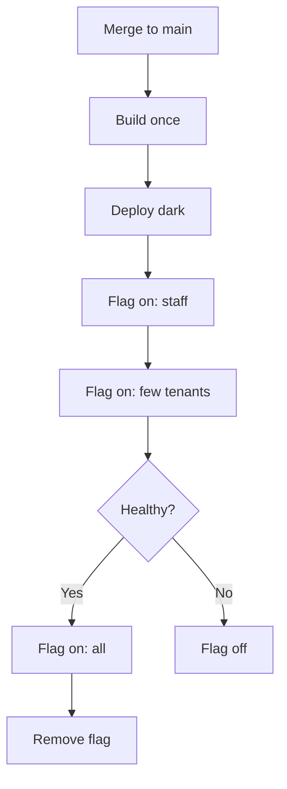
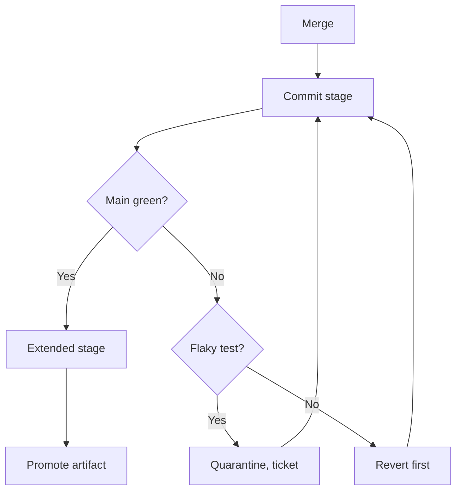
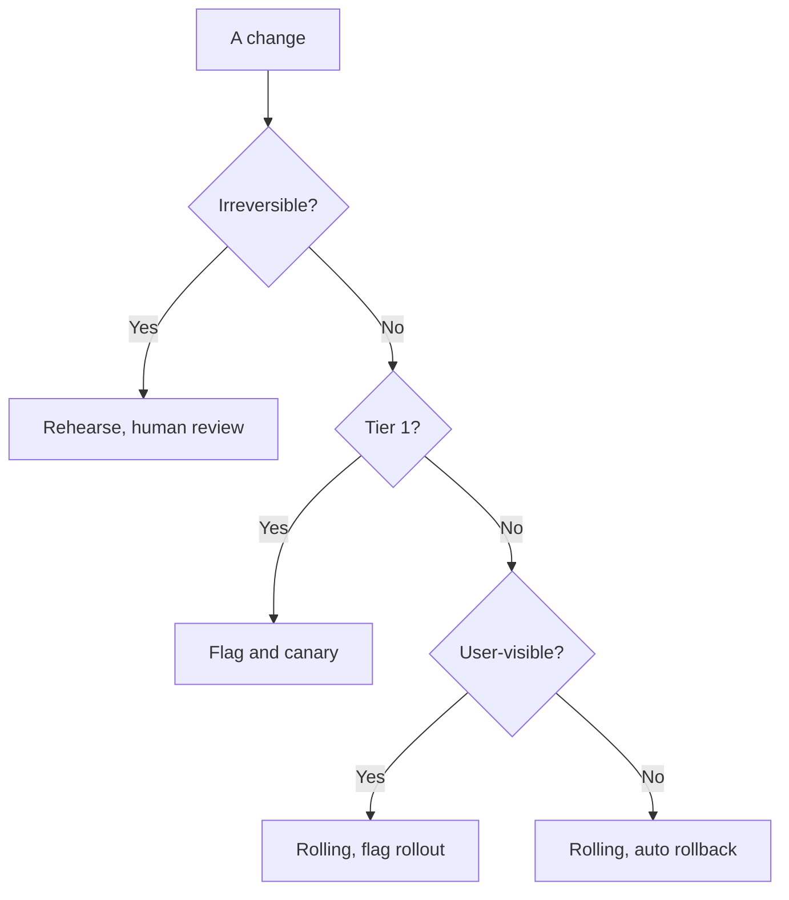
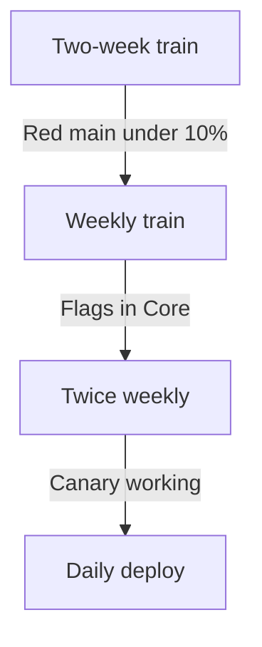

# Chapter 23 — Code Review, CI/CD, and Release Engineering

This chapter is about the path a change travels from a branch to a customer: review, integration,
pipeline, deployment, and release. Few leaders design that path on purpose. It accretes: a review
rule after one incident, a manual gate after another, a deploy script written by someone who has
since left. Yet the path decides how large each change is, how long it waits, how it fails, and how
fast it can be undone. Chapter 27 decided that Northstar's Core monolith should move from a two-week
train to weekly and then more frequent releases; this chapter works out how. Test strategy belongs to
Chapter 22, and the DORA metrics in depth to Chapter 18.

## Why This Matters

For a team, the delivery path is a daily irritation: a slow pipeline, a red build, a review that
waits. Each cost looks small.

For an organization of 50 to 150 engineers, the same path sets batch size for everyone. Northstar's
Core ships every two weeks, so each release carries about 170 merge requests from four teams (a
fictional figure, like all Northstar data). When a release fails, nobody knows which change caused
it, and rollback removes everyone's work. Nine of the quarter's 30 Sev1 and Sev2 incidents came
through that train. Five were configuration changes, including two flag or setting mistakes in one
service and a deploy-script change that broke rollback for four services. With three migrations and
two service deployments, 19 of the 30 incidents entered production through the delivery path.

At executive scale the delivery path is an undesigned risk control. Asked how changes reach
production, a CTO who can answer "reviewed, built once, deployed progressively, reversible in
minutes" has a different conversation from one who says "the release manager checks".

## Learning Objectives

After this chapter you will be able to:

- State what code review reliably achieves according to the evidence, and what it does not, and set
  review policy accordingly.
- Specify the properties of a trustworthy pipeline and a healthy main branch, and diagnose a pipeline
  whose signal engineers have stopped believing.
- Separate deploy from release with feature flags and progressive delivery, and manage flags as a
  source of risk in their own right.
- Choose a release strategy by risk tier and change type, including where a human gate is still right.
- Plan a staged move from a release train to frequent deployment, with entry criteria for each stage.

## The Mental Model

> **Mental model:** Deploying is moving code; releasing is exposing behavior. Make deploys small,
> boring, and reversible, and make release a separate, gradual decision.

Two ideas organize the chapter.

**The delivery path sets batch size, and batch size sets risk.** A change that travels alone is easy
to review, test, diagnose, and reverse. A change that travels with 170 others is none of those. Every
gate on the path makes changes wait, and waiting changes pile up into batches. *Continuous Delivery*
builds on the opposite move: keep the software always releasable and automate the path to production
so that releases can be small
([Humble and Farley, 2010](../../references/bibliography.md#humble2010continuous)).

**Deployment and release are different events.** Deployment puts a new version into production.
Release exposes new behavior to users. When they are one event, every deploy is a bet on every
feature it carries. When they are separated, code goes to production dark and the feature is turned
on for staff, then a few customers, then everyone, and off again without a deploy. *The DevOps
Handbook* is widely known for making this separation a core practice
([Kim et al., 2016](../../references/bibliography.md#kim2016devops)).

Everything after "Deploy dark" is release, reversible without a deploy.

## Deep Conceptual Explanation

### What code review achieves

Organizations usually justify review as defect detection; the evidence says that is the stated
motivation, not the main outcome. Bacchelli and Bird studied tool-based review at Microsoft and found
that finding defects was the main reason developers gave for reviewing, but that reviews found fewer
defects than expected and delivered other benefits: knowledge transfer, team awareness, and
alternative solutions. Understanding the change was the central difficulty
([Bacchelli and Bird, 2013](../../references/bibliography.md#bacchelli2013expectations)).

Comparing review at Google, Microsoft, AMD, and in open source, Rigby and Bird found that review
increased the number of distinct files a developer knew about by 66 to 150 percent, depending on the
project ([Rigby and Bird, 2013](../../references/bibliography.md#rigby2013convergent)). McIntosh and
colleagues found, in three open-source systems, that review coverage (the share of changes reviewed)
and participation (how involved reviewers were) were significantly linked with quality; low coverage
or participation was estimated to add up to two and five post-release defects per component
respectively ([McIntosh et al., 2014](../../references/bibliography.md#mcintosh2014impact)). All three
are observational **research findings**, read at abstract level. Sadowski and colleagues' study of
review at Google, drawing on logs of about 9 million reviewed changes, is best read as **documented
practice** ([Sadowski et al., 2018](../../references/bibliography.md#sadowski2018modern)).

For policy this means: review every change, mainly for knowledge and design; do not rely on review
as a defect gate, because a reviewer reading a diff will not reliably catch an integration failure, a
data-dependent bug, or a configuration mistake; and make changes easy to understand. Practitioners
widely believe smaller changes get better reviews, but this book did not verify a study of change size
and review effectiveness, so treat that as **practitioner consensus**.

### What review costs

Review's main cost is waiting. The median Core merge request waits 21 working hours for a first
review, and any one engineer's approval suffices. Waiting changes are unintegrated changes, so
branches live longer. DORA lists multi-approval review and asynchronous review queues among the
pitfalls of trunk-based development
([DORA, trunk-based development](../../references/bibliography.md#dora-cap-trunk-based)). Adding an
approver after an incident doubles the queue. Better
levers are turnaround, smaller changes, and owner-based reviewers; at Northstar the last needs owners
for the three unowned Core modules (customer, permissions, scheduler) first.

### A trustworthy pipeline and a healthy main branch

A pipeline is trustworthy when green means the change is safe to deploy and red means something is
wrong with the change. A pipeline that fails for unrelated reasons teaches engineers to rerun real
failures too. This book's working definition has six properties:

| Property | Meaning | Northstar baseline |
|---|---|---|
| Fast first signal | Commit stage reports within about ten minutes | One 74-minute stage |
| Deterministic | Failures come from the change | 9 percent of runs fail for unrelated reasons |
| Build once | One artifact, promoted through environments | Varies across four CI systems |
| Everything as code | Pipeline, deploy, configuration, rollback in version control, reviewed | Shell scripts on a build host; payments configuration edited on the server |
| Observable | Every deploy emits an event | Four shell-script services log nothing |
| Reversible | Rollback automated and exercised | INC-416: a script change broke rollback for four services |

DORA's continuous integration guidance supplies the ten-minute figure (it cites research pointing to
about ten minutes as an upper limit for test feedback), defines CI as merging to trunk at least daily
with automated build and tests on every change, and treats a broken build as the top priority
([DORA, continuous integration](../../references/bibliography.md#dora-cap-continuous-integration)).
That is **industry research**. Peer-reviewed evidence is observational: in open-source projects CI
appears to help projects release more often
([Hilton et al., 2016](../../references/bibliography.md#hilton2016usage)) and is associated with
integrating more contributions without an observable loss of quality
([Vasilescu et al., 2015](../../references/bibliography.md#vasilescu2015quality)).

Core's main branch is red for 22 percent of working hours, about 9 hours a week. An **illustrative**
calculation: the full pipeline runs on every merge, about 85 a week; at 9 percent unrelated failures
that is about 8 false reds, and at one 74-minute rerun each, up to about 10 hours. Reds overlap, so
this is an upper bound, but it suggests the 22 percent may be mostly a pipeline problem.

The rule this chapter owns is **revert first**: when a change turns main red, revert it within minutes
and fix it off main, unless a fix is already in hand. A red caused by a flaky test is not a reason to
revert; that test leaves the blocking set under the quarantine rule in
[Chapter 22](22-testing-strategy-and-test-architecture.md#flaky-tests-as-a-reliability-problem), which
pairs a capped quarantine list with a per-test owner and fix-or-delete deadline.

### Trunk-based development or long-lived branches

One practitioner position builds features on branches and merges them when complete; the other merges
small changes daily and hides unfinished work behind flags. DORA reports that its 2016 and 2017
survey data showed higher delivery and operational performance among teams with three or fewer active
branches, daily merges to trunk, and no code freezes
([DORA, trunk-based development](../../references/bibliography.md#dora-cap-trunk-based)), which is
**industry research**, correlational. This book recommends trunk-based development for services and
Core, with two exceptions: software shipped on someone else's schedule (the mobile app, as INC-426
showed) needs release branches, and a team cannot give up branches until it can hide unfinished work.
Core has 11 feature branches older than 30 days precisely because it has no flags.

### Flags: separating deploy from release

A feature flag is a runtime switch between code paths. Pete Hodgson's widely used article separates
short-lived release toggles for unfinished work from experiment, ops, and permissioning toggles, some
of which live for years; it treats flags as inventory with a carrying cost that needs expiry dates
and removal work, and advises testing the production configuration and the fallback rather than
every combination ([Hodgson, 2017](../../references/bibliography.md#hodgson2017featuretoggles)).
A **research** study agrees: across 39 Chrome releases, Rahman and colleagues found that toggles reconcile rapid
releases with long-term feature work, and also add technical debt and maintenance
([Rahman et al., 2016](../../references/bibliography.md#rahman2016feature)).

The leadership point is that **a flag change is a production change**. In INC-410 a flag meant for
one tenant was enabled for all; in INC-430 a rate limit was lowered tenfold by a typo. Both were edits
to a configuration file on the payments-gateway server, outside review and outside the pipeline.

The costliest public example is in a regulator's findings. The U.S. Securities and Exchange
Commission's 2013 order against Knight Capital describes new code that reused a flag formerly used by
long-retired code, a staged deployment in which one of eight servers never received the new code, and
no second-person review of the deployment. Orders carrying the reused flag ran the old code on that
server, and in about 45 minutes the firm took positions that cost it about $460 million. Removing the
new code from the seven correct servers made things worse, because the flag then activated the old
code there too ([SEC, 2013](../../references/bibliography.md#sec2013knight)). This book's lessons:
never reuse a flag, verify that a deployment reached every instance, delete dead code, and know what
a rollback will do.

### Progressive delivery and rollback

Progressive delivery exposes a change to a growing share of traffic and stops when it misbehaves.
A **canary** sends a small subset of traffic to the new version and compares it with the rest.
Google's SRE workbook chapter treats this as an experiment between canary and control, warns that
metrics must be split by population because an aggregate can hide a serious problem in a small
canary. It also notes that a
single **blue-green** cutover is a before-and-after comparison that is hard to evaluate, unless
traffic is split gradually
([Warner and Davidovič, 2018](../../references/bibliography.md#warner2018canarying)), which is
**documented practice** from one company. A **rolling** deploy compares nothing and stops only if a
health check fails. A **flag rollout** grows exposure by tenant after the deploy.

The fastest rollback is a flag. Redeploying the previous artifact works only if it still matches the
database, and migrations are the usual reason it does not. The discipline is **expand and contract**:
add new schema beside old, deploy code that handles both, migrate, and remove the old schema in a
later release. INC-419, a migration that ran before the code expecting it, is the failure it prevents.

### Change approval and pipeline outcomes

DORA reports finding that heavyweight external change approval hurts delivery performance, with no
evidence that it lowers change fail rates, and explains this by batch size
([DORA, change approval](../../references/bibliography.md#dora-cap-change-approval)); it keeps
recorded peer review as the approval that satisfies segregation of duties. The pipeline's outcomes
are DORA's **throughput** and **instability** measures
([DORA, metrics guide](../../references/bibliography.md#dora-metrics-guide)), which Chapter 18 owns.
Two points belong here: a pipeline that emits no deploy events cannot be measured, and Northstar's
72-hour failure definition differs from DORA's change fail rate, so compare Northstar with itself
over time, not with published benchmarks.

## Engineering Organization Example

This example is **illustrative**. It decomposes Core's 19-day median lead time to show what changing
cadence will and will not fix. Assumptions: merges arrive evenly; regression plus release takes about
four calendar days; a change spends about five days from first commit to merge (a 21-hour review wait,
rework, a second review); the remainder is changes that miss a train because they were pulled or
blocked by a red main.

| Component | Two-week train | Weekly, one-day regression | Daily deploy |
|---|---|---|---|
| First commit to merge | 5 days | 5 days | 5 days |
| Waiting for the cut (half the interval) | 7 days | 3.5 days | 0.5 days |
| Regression and release | 4 days | 1.5 days | under 1 day |
| Missed trains, red main | 3 days | 1.5 days | under 1 day |
| **Approximate median** | **19 days** | **11.5 days** | **about 6 days** |
| Merge requests per release | about 170 | about 85 | about 17 |

First, cadence is the largest single lever: a weekly train removes about seven days and halves batch
size. Second, a one-day regression pass is the precondition; three days of regression in a five-day
week leaves no room to fix what it finds. The QA engineers ran about 1,900 cases in 21 person-days, about
90 per person-day, so one day of seven people covers about 630. The weekly train needs a risk-based
subset of roughly 600 cases, chosen from where escaped defects and train incidents came from, while
the rest is automated or retired.

Third, once cadence improves, review becomes the bottleneck: at daily deployment, five of six days
are spent before merge.

## Decision Framework

Choose the release strategy by the component's risk and the type of change. Northstar's tiers (tier 1
is the order or payment path) are a usable start.

| Situation | Strategy | Way back | Human gate? |
|---|---|---|---|
| Tier 1 code | Deploy dark, canary with population-split metrics, flag rollout by tenant | Flag off; previous artifact | No; automated analysis |
| Tier 1 configuration or flag | Version control, review, schema and bounds validation, rollout per tenant | Revert through the same path | Peer review only |
| Tier 2 or 3 code | Rolling deploy, health checks, automatic rollback | Previous artifact | No |
| Contract between components | Consumer contract check in the provider's pipeline; versioned interface | Old version kept until consumers move | No |
| Reversible schema change | Expand and contract across two or more releases | Previous artifact still works | No |
| Irreversible data change | Rehearsal on a production-like copy, back-out plan, scheduled window | Restore or compensating change | Yes, owning-team reviewer |
| Mobile app | Release branch, staged store rollout, server-side flags | Server-side flag | Yes, at submission |

The rule is **this book's recommendation**: put human judgment where changes are rare and cannot be
undone, and use automation and progressive exposure everywhere else. INC-405, in which mobile-bff was
deployed against an older pricing-svc contract, is the case for the contract row: the two components
build on different CI systems, and nothing checked the contract between them.

## Trade-offs

**Review depth against flow.** More reviewers catch a little more and cost waiting on every change.
One knowledgeable, fast reviewer usually beats two in a queue. The exception is code where one mistake is catastrophic and hard to detect automatically,
such as permissions logic, where a specialist second reviewer is worth the wait.

**Flags against complexity.** Flags buy the separation of deploy from release. Each also adds a code
path to test and later remove. Flags without expiry dates trade today's release risk for next year's
maintenance risk.

**Pipeline speed against coverage.** A fast commit stage with a slower extended stage gives quick
feedback but lets some failures reach main. That is acceptable when reverts are cheap; checks whose
failures are costly to undo belong in the commit stage despite the time.

**Standard pipeline against team choice.** Four CI systems mean four ways to fail (INC-428 stopped
every Jenkins deploy at once). Standardizing the six properties before the tool lets risk fall while
teams migrate at different speeds.

**Cadence against coordination.** Leaving the train removes the coordination point teams used to
sequence migrations and contract changes; contract checks and migration discipline must replace it.

## Failure Modes

**The rubber-stamp review.** A turnaround target is met by approving without reading. Signal: large
changes approved within minutes. Countermeasure: pair turnaround with a monthly sample of large
approved changes.

**The red main nobody owns.** Everyone assumes someone else is fixing the build. Signal: red time and
reruns rising. Countermeasure: revert-first, a named build steward each day, red time on the team
scorecard. When the reds come from flaky tests, the fix is Chapter 22's quarantine rule, not more
reruns.

**Flag debt.** Flags accumulate, many on for everyone, some with forgotten purposes. Northstar's
payments-gateway has 64 flags and settings, 23 over a year old. Countermeasure: expiry date at
creation, a removal ticket created with the flag, and a test that fails when a release toggle
outlives its date.

**The untested rollback.** Rollback fails when needed, as in INC-416, or does something nobody
predicted, as in the Knight Capital response. Signal: nobody knows when rollback last ran in
production. Countermeasure: exercise it routinely on tier 1 components.

**The renamed train.** Continuous delivery is announced, but changes still queue behind a manual gate.
Signal: deploy count rises while merge requests per deploy and lead time barely move. Countermeasure:
measure batch size and lead time, not deploy count alone.

## Enterprise Application

In an organization of 50 to 150 engineers, the delivery path is shared infrastructure with many
users, and its policy must be set centrally.

**The director sets the minimums**: every production change, including configuration and flags, goes
through version control, review, and an auditable pipeline; every tier 1 component has exercised,
automated rollback; main-branch rules apply in every repository. The director also funds the tooling
that makes the minimums cheap, because a standard without tooling is a tax.

**A platform team owns the paved road**: pipeline templates, the flag service, deploy and rollback
tooling, the deploy event stream. At Northstar that is Platform Operations' infrastructure group, with
Kwame Mensah setting direction. Its measure is how many components use the road and how fast their
pipelines are.

**Product teams own their use of it**: pipeline health, flag lifecycle, release strategy within the
tier rules, and review turnaround.

**Auditors** asking about segregation of duties are usually satisfied by recorded peer review plus an
automated, logged deployment.

## CTO Perspective

At CTO level, release engineering is a risk control and a cost, and both need business terms.

**Blast radius is the board-level concept**: how much of the customer base one bad change can affect,
and for how long. Canarying, per-tenant
flags, and fast rollback all shrink it, and the CTO can report it: the share of tier 1 changes
released progressively, and median time from detection to rollback.

**Resist the freeze reflex.** After a visible outage, executives often ask for a freeze or a change
board. A short freeze around a known high-risk period can be sensible. As standing policy it produces
larger releases afterwards, and DORA's change approval findings point the same way. The CTO's job is
to offer a better control and explain why it is safer.

**Fund release safety as one program.** Fund the flag service, CI consolidation, and canary tooling
together against measured outcomes (change fail rate, recovery time, lead time), not as separate
tool purchases.

## Practical Playbook

A staged move from a release train to frequent deployment, each stage gated by criteria, not dates.

**Stage 0: make the signal trustworthy (weeks 1 to 4).**

1. Measure duration, unrelated-failure rate, red time, merges per week, and review wait.
2. Split the pipeline into a commit stage of ten to fifteen minutes and an extended stage.
3. Adopt revert-first, and quarantine flaky tests under Chapter 22's rule (capped list, per-test owner
   and fix-or-delete deadline).
4. Put every pipeline, deploy script, and configuration file under version control with review, and
   exercise rollback once for every tier 1 component.

**Stage 1: weekly train (from about week 5).** Entry: main red under 10 percent of working hours.

5. Choose a one-day, risk-based regression subset from defect and incident data.
6. Automate the highest-value remaining cases each week, starting where train incidents came from.
7. Require expand and contract for every schema change.

**Stage 2: twice weekly (next quarter).** Entry: change fail rate falling for eight weeks; flags in Core.

8. Introduce release toggles in Core; stop opening long-lived branches and retire existing ones.
9. Set review norms: first response within four working hours, owner-based reviewers, a size guideline.
10. Turn manual regression from a gate into scheduled exploratory testing of risk areas.

**Stage 3: daily deploy (the quarter after).** Entry: canary analysis on order-capture; deploy events
from every pipeline.

11. Deploy from green main daily with canary and automated rollback; release by tenant through flags.
12. Step back a stage if change fail rate rises for two consecutive months, and say so openly.

## Case Study

This case is **fictional**. It continues the story in
[chapter 27](27-quality-transformation-at-enterprise-scale.md) from the
[baseline](../../case-studies/northstar/baseline-data.md).

The release working group, led by Kwame Mensah with owners from the teams, began by measuring: most
red periods began with a test that passed on rerun. The group split the pipeline into a 15-minute
commit stage and a 38-minute extended stage in parallel shards, and quarantined the 40 worst flaky
tests in week 4 and 140 by day 90 (about 1.2 percent of the suite), each with an owner and a
fix-or-delete deadline. Teams adopted revert-first. Red time fell below
10 percent in week 4 and averaged 9 percent over the last four weeks of the quarter.

The first weekly train ran in week 5. Two QA engineers chose about 600 regression cases, weighted
toward invoicing, ledger, and order capture; all seven triaged the manual suite with the teams, and
five also automated cases. Core made
eleven releases in the quarter instead of six or seven. In week 6, after reviewing INC-410 and INC-430
together, Payments and Integrations moved its flags and settings into version control with schema and
bounds checks and per-tenant rollout. Its deployment frequency did not fall.

One thing went badly: the week 9 Sev1 that Chapter 27 describes, credit notes applied twice after a
migration and a code change shipped in the same train. Release engineering made it longer. Rolling
the train back failed, because the migration had already changed the schema the previous version
read, so service was restored by a forward fix. Expand and contract had been a written rule that nothing
enforced. The pipeline check promised after INC-427 had slipped; the review added an interim rule (no
release may contain a ledger migration and code that depends on it) until the check landed in week 11
(Chapter 25).

At the quarterly reset the group proposed stage 2, and the director added one condition: Core's flag
mechanism would be a paved road with expiry dates required from the first flag, so that Core would
not reproduce the payments-gateway's 23 flags and settings more than a year old.

## Exercises

Solutions are in [chapter 23 solutions](../../solutions/ch23-solutions.md). Northstar data is on the
[baseline page](../../case-studies/northstar/baseline-data.md).

### Foundational

**F1.** After INC-427 (credit notes applied twice after a Core release), Marcus Oyelaran proposes that
every Core merge request require two approvals, one of them from a senior engineer, "so that defects
like this are caught in review". Using what the research says code review does and does not achieve,
evaluate the proposal. Say what you would change in Core's review practice instead, and what you would
expect each change to do to lead time.

**F2.** Northstar's quarter had five configuration-change incidents: INC-404, INC-410, INC-412,
INC-416, and INC-430. For each, identify which property of a trustworthy delivery path was missing
and which single control would most likely have prevented the incident or limited its impact. Then
say which of your controls would also have helped in the Knight Capital deployment.

**F3.** A colleague says that moving Core from a two-week to a weekly train will halve its lead time
from 19 to about 9 days. Using the lead-time decomposition in this chapter, explain whether that is
right, what a weekly train cannot fix, and which measure you would watch to confirm that batch size
actually fell.

### Applied Leadership

**A1.** Priya Raman (Orders) and Marcus Oyelaran (Billing) complain that Core main is red so often
that their engineers have stopped trusting the pipeline and rerun failures by habit. Tom Becker says
his infrastructure engineers own the Jenkins servers, not the tests. Design the main-branch policy
for Core, decide who owns which part of it, and plan the conversation in which you introduce
revert-first to engineers who see it as an accusation.

**A2.** After INC-410 and INC-430, the payments-gateway's 64 flags and settings will move into version
control with review. Elena Sokolova worries that this will slow her team, which deploys 22 times a
month and often changes rate limits during partner-bank incidents. Design the change process so that
routine changes are safe and emergency changes are still fast, and say how you will know if it works.

**A3.** For the first weekly train, the QA engineers must cut manual regression from about 1,900 cases
to about 600. One senior QA engineer refuses to sign off on a release "with two thirds of the
regression suite untested". Kwame Mensah says the three-day pass caught none of the nine
train-triggered incidents. Decide how the subset is chosen, who is accountable for the release, and
what you say to the QA engineer.

### Executive Decision-Making

**X1.** In week 9, after a Sev1 at the largest customer, Helena Marsh (CEO) asks Victor Lindqvist
(CTO) to introduce a weekly change advisory board that approves every production change, and a
freeze on Core releases until the board is running. You are Victor. Write what you say in the
meeting and the follow-up note, including what you offer instead and what you would accept.

**X2.** Victor must decide between two policies for the next year: mandate a single CI system for all
24 components now, retiring Jenkins, the shell scripts, and either GitLab CI or GitHub Actions; or
mandate the six pipeline properties for every tier 1 component and let teams keep their tools for a
year. Using INC-416, INC-428, the baseline data, and the budget constraints, recommend one, say what
you give up, and say what evidence after one quarter would change your mind.

## Reflection Questions

1. If your organization stopped requiring code review tomorrow, what would you lose first: defects
   caught, or people who understand each other's code? How do you know?
2. When your main branch is red, who notices, who acts, and how long does it take? Do your engineers
   still believe red?
3. Which gate in your delivery path exists because of one incident years ago, and does it still
   prevent anything?
4. How many feature flags exist in your systems, and who could tell you which are safe to delete?
5. When did you last see a rollback fail, and what changed afterwards?
6. If a board member asked how much of your customer base one bad change could affect, what number
   would you give, and how would you measure it?

## Key Takeaways

- Review every change, mainly for knowledge transfer and design; review is a weak defect gate on its
  own, so do not answer incidents by adding approvers.
- Review cost is mostly waiting; turnaround and change size matter more than approver count.
- A pipeline is trustworthy only if red means the change is wrong. Get speed and determinism first,
  and take flaky tests out of the blocking path the day they appear.
- Separate deploy from release: deploy small and dark, release gradually, keep a fast way back.
- Treat every flag and configuration change as a production change, with review, validation, staged
  rollout, and a removal date.
- Choose release strategy by tier and change type; reserve human gates for rare, irreversible changes.
- Move from a train to frequent deployment in stages with entry criteria, and measure batch size and
  lead time, not deploy count.
- Once cadence improves, review turnaround becomes the bottleneck; plan for it.

## References and Further Reading

- [Bacchelli and Bird, 2013](../../references/bibliography.md#bacchelli2013expectations),
  [Rigby and Bird, 2013](../../references/bibliography.md#rigby2013convergent),
  [McIntosh et al., 2014](../../references/bibliography.md#mcintosh2014impact), and
  [Sadowski et al., 2018](../../references/bibliography.md#sadowski2018modern). The core evidence on
  what modern code review delivers; start with Bacchelli and Bird.
- [Humble and Farley, 2010](../../references/bibliography.md#humble2010continuous) and
  [Kim et al., 2016](../../references/bibliography.md#kim2016devops). The deployment pipeline, small
  batches, and decoupling deployment from release.
- [Hilton et al., 2016](../../references/bibliography.md#hilton2016usage) and
  [Vasilescu et al., 2015](../../references/bibliography.md#vasilescu2015quality). Observational
  studies of continuous integration in open source.
- DORA capability guides on [continuous integration](../../references/bibliography.md#dora-cap-continuous-integration),
  [trunk-based development](../../references/bibliography.md#dora-cap-trunk-based), and
  [change approval](../../references/bibliography.md#dora-cap-change-approval), and the
  [metrics guide](../../references/bibliography.md#dora-metrics-guide). Short, with research basis and
  pitfalls.
- [Hodgson, 2017](../../references/bibliography.md#hodgson2017featuretoggles) and
  [Rahman et al., 2016](../../references/bibliography.md#rahman2016feature). Flag types and lifetimes;
  research on flags' value and debt.
- [Warner and Davidovič, 2018](../../references/bibliography.md#warner2018canarying). The SRE workbook
  chapter on canarying, free online.
- [SEC, 2013](../../references/bibliography.md#sec2013knight). The regulator's account of the Knight
  Capital deployment: a short argument for flag hygiene and deployment verification.
- [Winters, Manshreck, and Wright, 2020](../../references/bibliography.md#winters2020software).
  *Software Engineering at Google*, free online; one organization's code review and CI practice at
  very large scale.
