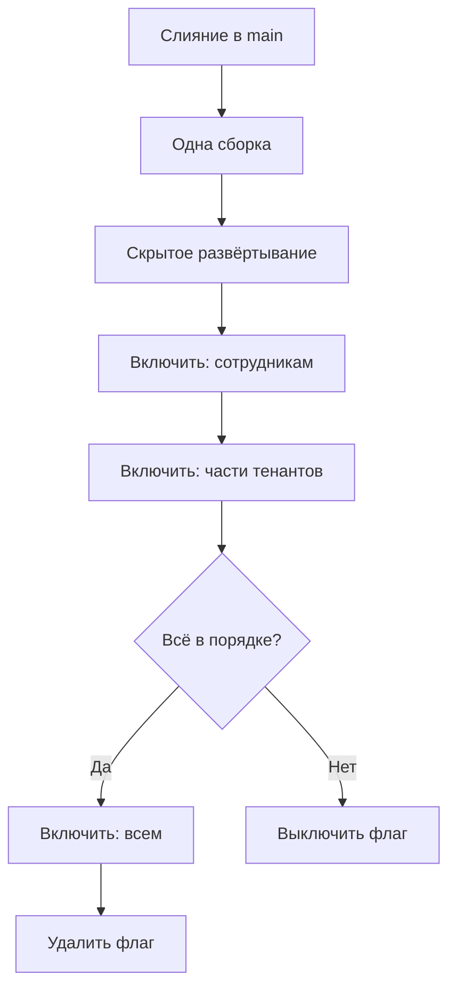
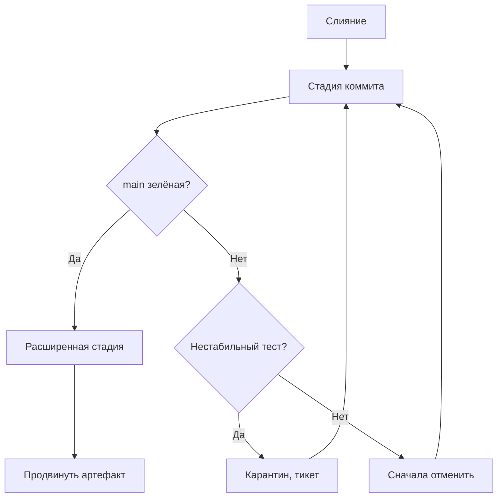
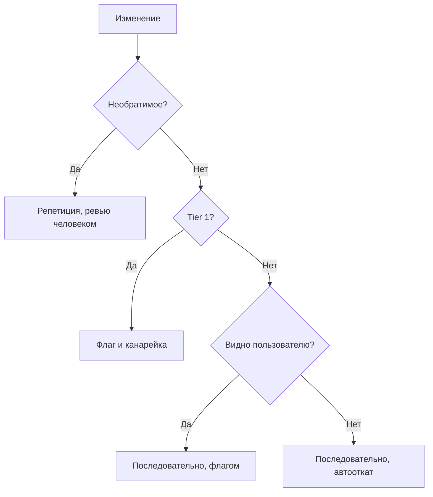
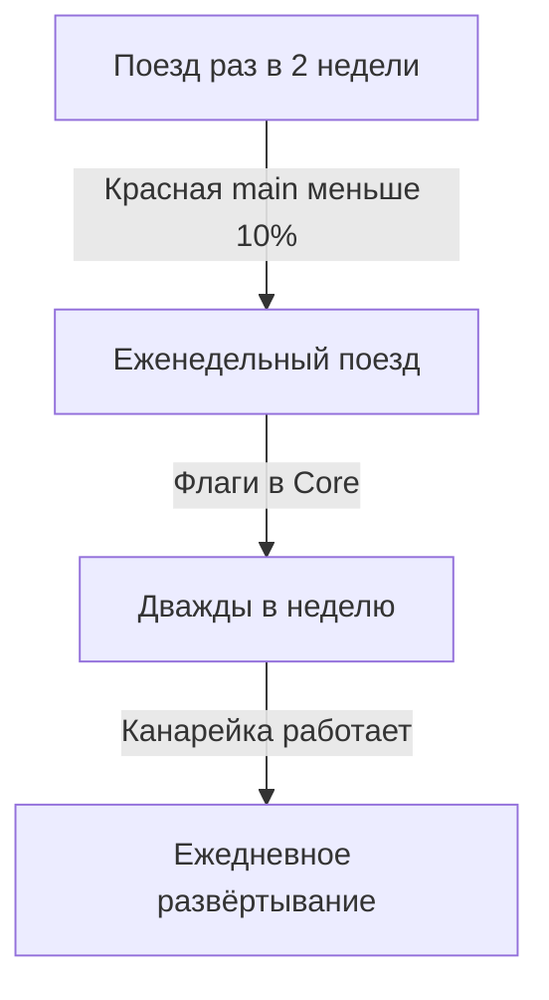

# Глава 23 — Код-ревью, CI/CD и релиз-инжиниринг { #chapter-23-code-review-cicd-and-release-engineering }

Эта глава о пути, который изменение проходит от ветки до клиента: ревью, интеграция, пайплайн,
развёртывание и релиз. Мало кто из руководителей проектирует этот путь сознательно. Он складывается сам собой:
правило ревью после одного инцидента, ручная проверка после другого, скрипт развёртывания, который
написал давно ушедший сотрудник. А ведь именно этот путь определяет, насколько велико каждое изменение,
сколько оно ждёт, как ломается и как быстро его можно отменить. В Northstar, сквозном примере книги,
директор выяснил, что главный источник инцидентов — двухнедельный релизный поезд (release train)
монолита Core, и решил перевести его на еженедельные, а затем и более частые релизы. Эта глава
разбирает, как это сделать. Стратегия тестирования — тема главы 22, а метрики DORA (DevOps Research and
Assessment) — главы 18.

## Почему это важно { #why-this-matters }

Для команды путь поставки — ежедневное раздражение: медленный пайплайн, красная сборка, ревью, которое
никак не начнётся. Каждая такая издержка кажется мелкой.

Для организации из 50–150 инженеров тот же путь задаёт размер пачки (batch size) для всех.
[Core](../../glossary.md#core), Java-монолит Northstar, выходит раз в две недели, поэтому каждый релиз
везёт около 170 мерж-реквестов от четырёх команд (цифра вымышленная, как и все данные Northstar).
Когда релиз ломается, никто не знает, какое изменение виновато, а откат отменяет работу всех сразу. В
базовом квартале 19⍽из⍽30 инцидентов Sev1 и Sev2 в Northstar попали в продакшен через путь поставки. (Sev1 и
Sev2 — две высшие степени [серьёзности](../../glossary.md#severity-sev1-sev2-sev3): Sev1 — это
недоступный путь заказа или оплаты либо неверная финансовая запись, Sev2 — более узкие отказы.)

| Путь в продакшен | Инциденты |
|---|---|
| Релизный поезд Core | 9 |
| Изменения конфигурации | 5 |
| Миграции базы данных | 3 |
| Развёртывания сервисов | 2 |

Десять из этих инцидентов глава называет по [номерам INC](../../glossary.md#inc-numbers) и каждый раз
добавляет несколько слов о том, что произошло.

??? note "Десять инцидентов этой главы"
    Из журнала инцидентов Northstar (`incidents-last-quarter.csv`, ссылка на него есть на
    [странице исходного уровня](../../case-studies/northstar/baseline-data.md)).

    | Инцидент | Что произошло | Команда |
    |---|---|---|
    | INC-404 | В продакшен-конфигурации auth-svc изменили время жизни токена; мобильные сессии оборвались | Platform Operations |
    | INC-405 | mobile-bff развернули против старого контракта pricing-svc; суммы в корзине стали пустыми | Customer Experience |
    | INC-410 | Флаг в payments-gateway включили для всех тенантов вместо одного | Payments and Integrations |
    | INC-412 | В шаблоне письма переименовали переменную; подтверждения заказов ушли пустыми | Customer Experience |
    | INC-416 | Изменение общего скрипта развёртывания сломало откат для четырёх сервисов | Platform Operations |
    | INC-419 | Миграция правил ценообразования выполнилась раньше кода, который на неё рассчитывал | Orders |
    | INC-426 | Офлайн-синхронизация в мобильном приложении портила черновики; исправление ждало проверки в магазине приложений | Customer Experience |
    | INC-427 | После релиза Core кредит-ноты применились дважды; данные исправляли вручную | Billing |
    | INC-428 | Падали все развёртывания через Jenkins; причину так и не нашли | Platform Operations |
    | INC-430 | Из-за опечатки в значении лимит запросов payments-gateway снизился в десять раз | Payments and Integrations |

Для высшего руководства путь поставки — механизм контроля рисков, который никто не проектировал.
Спросите технического директора (CTO), как изменения попадают в продакшен. Тот, кто может ответить
«ревью, одна сборка, прогрессивное развёртывание, откат за минуты», ведёт совсем другой разговор, чем
тот, у кого ответ — «релиз-менеджер проверяет».

## Цели главы { #learning-objectives }

Прочитав эту главу, вы сможете:

- Объяснять, чего код-ревью, по данным исследований, надёжно добивается, а чего нет, и строить
  политику ревью с учётом этого.
- Формулировать свойства пайплайна, которому можно доверять, и здоровой основной ветки; диагностировать
  пайплайн, сигналу которого инженеры перестали верить.
- Отделять развёртывание от релиза с помощью фича-флагов и прогрессивной поставки и управлять флагами
  как самостоятельным источником риска.
- Выбирать стратегию релиза по уровню критичности и типу изменения, в том числе видеть, где ручная
  проверка человеком всё ещё уместна.
- Планировать поэтапный переход от релизного поезда к частым развёртываниям с критериями входа для
  каждого этапа.

## Ментальная модель { #the-mental-model }

> **Ментальная модель:** развернуть — значит перенести код; выпустить релиз — значит открыть поведение.
> Делайте развёртывания маленькими, скучными и обратимыми, а релиз превратите в отдельное постепенное
> решение.

Главу организуют две идеи.

**Путь поставки задаёт размер пачки, а размер пачки задаёт риск.** Изменение, которое едет в одиночку,
легко проверить на ревью, протестировать, диагностировать и отменить. С изменением, которое едет вместе
со 170 другими, ничего этого сделать нельзя. Каждая контрольная точка на пути заставляет изменения
ждать, а ждущие изменения копятся в пачки. *Continuous Delivery* исходит из обратного: держать ПО
всегда готовым к релизу и автоматизировать путь в продакшен, чтобы релизы могли быть
маленькими ([Humble and Farley, 2010](../../references/bibliography.md#humble2010continuous)).

**Развёртывание и релиз — разные события.** Развёртывание помещает новую версию в продакшен. Релиз
открывает пользователям новое поведение. Если это одно событие, каждое развёртывание — ставка на все
функции, которые оно везёт. Если их разделить, код уходит в продакшен скрыто, а функцию включают
сначала для сотрудников, потом для нескольких клиентов, потом для всех — и выключают обратно без
развёртывания. *The DevOps Handbook* широко известна тем, что сделала это разделение базовой практикой
([Kim et al., 2016](../../references/bibliography.md#kim2016devops)).

Всё, что идёт после скрытого развёртывания, — уже релиз, и его можно отменить без нового развёртывания.

## Подробный разбор { #deep-conceptual-explanation }

### Что даёт код-ревью { #what-code-review-achieves }

Организации обычно оправдывают ревью поиском дефектов, но, по данным исследований, это заявленный
мотив, а не главный результат. Bacchelli и Bird изучали в Microsoft ревью, которое проводят в
специальных инструментах.
Главной причиной ревью разработчики называли поиск дефектов, однако дефектов ревью находили меньше,
чем ожидалось, а пользу приносили другую: передачу знаний, осведомлённость команды и альтернативные
решения. Главной трудностью было понять само изменение
([Bacchelli and Bird, 2013](../../references/bibliography.md#bacchelli2013expectations)).

Rigby и Bird сравнили ревью в Google, Microsoft, AMD и в open source. Оказалось, что ревью увеличивает
число разных файлов, с которыми знаком разработчик, на 66–150 процентов в зависимости от проекта
([Rigby and Bird, 2013](../../references/bibliography.md#rigby2013convergent)). McIntosh с коллегами
на материале трёх open-source-систем сопоставили с качеством два показателя: покрытие ревью (долю
изменений, прошедших ревью) и участие в нём (насколько вовлечены ревьюеры). По их оценке, низкое покрытие добавляло до двух, а низкое
участие — до пяти дефектов после релиза на компонент
([McIntosh et al., 2014](../../references/bibliography.md#mcintosh2014impact)). Все три работы —
наблюдательные **научные результаты**. А работу Sadowski с коллегами о ревью в Google (логи примерно
9⍽миллионов изменений, прошедших ревью) лучше читать как **задокументированную практику** ([Sadowski et al., 2018](../../references/bibliography.md#sadowski2018modern)).

Для политики отсюда следуют три вывода. Проводите ревью каждого изменения — прежде всего ради знаний и
дизайна. Не полагайтесь на ревью как на фильтр дефектов: ревьюер, читающий diff, не сможет надёжно
ловить сбои интеграции, ошибки, зависящие от данных, или ошибки конфигурации. И делайте изменения
понятными. Среди практиков широко распространено убеждение, что небольшие изменения получают более
качественное ревью; считайте это **консенсусом практиков**, а не научным результатом.

### Во что обходится ревью { #what-review-costs }

Главная цена ревью — ожидание. Медианный мерж-реквест в Core ждёт первого ревью 21 рабочий час, хотя
для слияния хватает одобрения любого инженера. Пока изменение ждёт, оно не интегрировано, поэтому ветки
живут дольше. DORA относит ревью с несколькими одобрениями и асинхронные очереди ревью к
ловушкам разработки в основной ветке (trunk-based development)
([DORA, trunk-based development](../../references/bibliography.md#dora-cap-trunk-based)). Если после
инцидента добавить ещё одного одобряющего, очередь удвоится. Рычаги получше — скорость ответа на ревью,
изменения поменьше и ревьюеры из числа владельцев кода. Но чтобы воспользоваться последним, Northstar
сначала должна назначить владельцев трём модулям Core, у которых их нет (customer, permissions,
scheduler).

### Пайплайн, которому можно доверять, и здоровая основная ветка { #a-trustworthy-pipeline-and-a-healthy-main-branch }

Пайплайну можно доверять, когда зелёный цвет значит, что изменение безопасно развернуть, а красный —
что с изменением что-то не так. Пайплайн, который падает по посторонним причинам, приучает инженеров
перезапускать и настоящие падения. Рабочее определение книги включает шесть свойств:

| Свойство | Что оно значит | Исходный уровень Northstar |
|---|---|---|
| Быстрый первый сигнал | Стадия коммита сообщает результат примерно за десять минут | Одна стадия на 74 минуты |
| Детерминированность | Падения вызваны самим изменением | 9 процентов прогонов падают по посторонним причинам |
| Одна сборка | Один артефакт, который продвигается по окружениям | По-разному в четырёх CI-системах |
| Всё как код | Пайплайн, развёртывание, конфигурация и откат лежат в системе контроля версий и проходят ревью | Shell-скрипты на сборочном сервере; конфигурацию платежей правят прямо на сервере |
| Наблюдаемость | Каждое развёртывание порождает событие | Четыре сервиса на shell-скриптах ничего не логируют |
| Обратимость | Откат автоматизирован и регулярно проверяется на практике | INC-416: изменение скрипта сломало откат для четырёх сервисов |

Десять минут взяты из рекомендаций DORA по непрерывной интеграции. Они ссылаются на исследования,
по которым примерно десять минут — верхний предел для обратной связи от тестов. Там же
непрерывная интеграция (continuous integration, CI) определена как слияние в основную ветку не реже
раза в день с автоматической сборкой и тестами на каждое изменение, а сломанная сборка названа главным
приоритетом
([DORA, continuous integration](../../references/bibliography.md#dora-cap-continuous-integration)).
Это **отраслевое исследование**. Рецензируемые данные — наблюдательные: в open-source-проектах CI,
по-видимому, помогает выпускать релизы чаще
([Hilton et al., 2016](../../references/bibliography.md#hilton2016usage)) и связана с тем, что проект
принимает больше вкладов без заметной потери качества
([Vasilescu et al., 2015](../../references/bibliography.md#vasilescu2015quality)).

Основная ветка Core остаётся красной 22⍽процента рабочего времени, около 9⍽часов в неделю. А верхняя
оценка ложных красных периодов (около 10⍽часов в неделю, см. примечание; это **иллюстрация**)
превышает всё измеренное красное время. Значит, большая часть этих 22 процентов — скорее шум пайплайна, чем
сломанные изменения.

??? note "Как получена оценка в 10 часов"
    Полный пайплайн запускается на каждое слияние, а их около 85 в неделю. При 9⍽процентах посторонних
    падений это около 8 ложных красных сборок, и если каждое требует одного перезапуска на 74 минуты,
    набегает до 10 часов. Красные периоды перекрываются, поэтому это верхняя оценка.

Эта глава вводит правило **сначала отменить** (revert first): если изменение сделало main красной,
отмените его (revert) в течение нескольких минут и чините вне main, если только исправление уже не
готово. Красный цвет из-за нестабильного (flaky) теста — не повод для отмены:
такой тест выводят из блокирующего набора по **правилу карантина** из
[главы 22](22-testing-strategy-and-test-architecture.md#flaky-tests-as-a-reliability-problem). Список
карантина ограничен, у каждого теста в нём есть владелец и срок, к которому тест исправят или удалят.

### Разработка в основной ветке или долгоживущие ветки { #trunk-based-development-or-long-lived-branches }

Среди практиков есть две позиции. Одна — разрабатывать функции в ветках и сливать их по готовности.
Другая — каждый день сливать небольшие изменения в основную ветку («ствол», trunk) и прятать
незаконченную работу за флагами. По данным опросов DORA 2016 и 2017⍽годов, показатели поставки и
эксплуатации выше у команд, где активных веток не больше трёх, в trunk сливают ежедневно, а заморозок
кода нет
([DORA, trunk-based development](../../references/bibliography.md#dora-cap-trunk-based)). Это
**отраслевое исследование**, причём корреляционное. Книга рекомендует разработку в основной ветке для
сервисов и Core с двумя исключениями. Первое: ПО, которое выходит по чужому расписанию, нуждается в
релизных ветках: так, в INC-426 исправление мобильного приложения ждало проверки в магазине приложений.
Второе: команда не может отказаться от веток, пока не умеет прятать незаконченную работу. У Core
11 функциональных веток старше 30 дней именно потому, что флагов в нём нет.

### Флаги: развёртывание отдельно от релиза { #flags-separating-deploy-from-release }

[Фича-флаг](../../glossary.md#feature-flag) — это переключатель между путями выполнения кода во время
работы программы. Популярная статья Pete Hodgson отделяет короткоживущие релизные переключатели
(release toggles) для незаконченной работы от переключателей для экспериментов, эксплуатации и
управления доступом; некоторые из них живут годами. Hodgson смотрит на флаги как на складские запасы,
хранение которых стоит денег: им нужны сроки действия и отдельная работа по удалению. Ещё он советует
тестировать продакшен-конфигурацию и резервный путь, а не все комбинации
([Hodgson, 2017](../../references/bibliography.md#hodgson2017featuretoggles)). С этим согласуется
**научный результат**: изучив 39⍽релизов Chrome, Rahman с коллегами обнаружили, что переключатели позволяют
совмещать быстрые релизы с долгой работой над функциями, но добавляют технический долг и работу по
поддержке ([Rahman et al., 2016](../../references/bibliography.md#rahman2016feature)).

Главное для руководителя: **изменение флага — это изменение в продакшене**. В INC-410 флаг,
предназначенный для одного тенанта, включили для всех; в INC-430 опечатка снизила лимит запросов в
десять раз. Оба раза правили файл конфигурации прямо на сервере payments-gateway, в обход ревью и
пайплайна.

Самый дорогой публичный пример известен из материалов регулятора: приказ Комиссии по ценным бумагам и
биржам США (SEC) 2013⍽года по делу Knight Capital описывает три сбоя. Новый код повторно использовал
флаг, которым раньше управлялся давно выведенный из работы код. При поэтапном развёртывании один из
восьми серверов так и не получил новый код. И само развёртывание никто не проверял. На этом сервере
заявки с повторно использованным флагом запускали старый код, и примерно за 45⍽минут фирма набрала
позиции, которые обошлись ей примерно в $460⍽млн. Когда новый код удалили с семи правильно обновлённых
серверов, стало только хуже: флаг начал включать старый код и на них
([SEC, 2013](../../references/bibliography.md#sec2013knight)). Книга выводит отсюда такие уроки:
никогда не используйте флаг повторно, проверяйте, что развёртывание дошло до каждого экземпляра,
удаляйте мёртвый код и знайте заранее, что сделает откат.

### Прогрессивная поставка и откат { #progressive-delivery-and-rollback }

Прогрессивная поставка открывает изменение растущей доле трафика и останавливается, если оно ведёт
себя неправильно. **Канареечный релиз** (canary) направляет на новую версию небольшую часть трафика и
сравнивает её с остальным трафиком. Глава воркбука Google по инженерии надёжности (site reliability
engineering, SRE) рассматривает это как эксперимент, в котором канарейку сравнивают с контрольной
группой. Авторы предупреждают, что метрики нужно разделять по группам: в общем агрегате серьёзная
проблема маленькой канарейки может потеряться. Ещё они отмечают, что разовое **сине-зелёное**
(blue-green) переключение — это сравнение «до и после», которое трудно оценить, если только трафик не
переводят постепенно
([Warner and Davidovič, 2018](../../references/bibliography.md#warner2018canarying)); это
**задокументированная практика** одной компании. **Последовательное** (rolling) развёртывание ничего не
сравнивает и останавливается, только если не пройдена проверка работоспособности (health check).
**Раскатка через флаг** (flag rollout) расширяет охват по тенантам уже после развёртывания.

Самый быстрый откат — флаг. Вернуться к предыдущему артефакту можно, только если он всё ещё совместим с
базой данных, а совместимость обычно ломают миграции. Отсюда дисциплина
**расширения и сужения** (expand and contract): добавить новую схему рядом со старой, развернуть код,
который работает с обеими, перенести данные и удалить старую схему в одном из следующих релизов.
Именно от такого сбоя она защищает: в INC-419 миграция выполнилась раньше кода, который на неё
рассчитывал.

### Согласование изменений и результаты пайплайна { #change-approval-and-pipeline-outcomes }

По данным DORA, тяжеловесное внешнее согласование изменений вредит показателям поставки, а
свидетельств того, что оно снижает [долю неудачных изменений](../../glossary.md#change-failure-rate)
(change failure rate), нет. DORA объясняет это размером пачки
([DORA, change approval](../../references/bibliography.md#dora-cap-change-approval)). Требованию
**разделения обязанностей** (segregation of duties), по мнению DORA, удовлетворяет записанное ревью
коллегой. Разделение обязанностей — правило аудита: один человек не может без проверки
и написать изменение, и развернуть его. Результаты пайплайна — это показатели DORA по **пропускной
способности** (насколько быстро идут изменения: lead time, частота развёртываний) и по
**нестабильности** (насколько часто они ломаются: доля неудачных изменений)
([DORA, metrics guide](../../references/bibliography.md#dora-metrics-guide)). Подробно их разбирает
глава 18.

Здесь важны два момента. Первый: пайплайн, который не порождает событий развёртывания, нельзя
измерить. Второй: Northstar считает релиз неудачным, если в течение 72⍽часов за ним последовали
хотфикс, откат или связанный инцидент. Это локальное определение отличается от определения DORA,
поэтому сравнивайте Northstar с её же прошлыми показателями, а не с опубликованными бенчмарками.

## Пример из инженерной организации { #engineering-organization-example }

!!! info "Northstar: что уже известно"
    Неделя 4 первого года директора. Core выходит раз в две недели после трёхдневного ручного
    регрессионного прогона, и за 31 процентом его релизов следуют хотфикс, откат или инцидент. На этой
    неделе поездом занимается рабочая группа по релизам во главе с Kwame Mensah (staff-инженер,
    инфраструктура и надёжность); первый еженедельный релиз выходит на неделе 5. См.
    [хронологию](../../case-studies/northstar/timeline.md). Впервые читаете о Northstar? Прочитайте
    [«Год вкратце»](../../case-studies/northstar/year-in-brief.md) и
    [действующих лиц](../../case-studies/northstar/cast.md).

Этот пример — **иллюстрация**. Он раскладывает на составляющие медианное
[время внесения изменений](../../glossary.md#lead-time) Core в 19 дней (от первого коммита до работы в
продакшене), чтобы показать, что смена ритма исправит, а что нет. Допущения: слияния приходят
равномерно; регрессия вместе с релизом занимает около четырёх календарных дней; от первого коммита до
слияния изменение проводит около пяти дней (21 час ожидания ревью, доработка, второе ревью); остаток
приходится на изменения, которые пропустили поезд, потому что их сняли или задержала красная main.

| Составляющая | Двухнедельный поезд | Еженедельный, регрессия за день | Ежедневное развёртывание |
|---|---|---|---|
| От первого коммита до слияния | 5 дней | 5 дней | 5 дней |
| Ожидание среза релиза (половина интервала) | 7 дней | 3.5 дня | 0.5 дня |
| Регрессия и релиз | 4 дня | 1.5 дня | меньше 1 дня |
| Пропущенные поезда, красная main | 3 дня | 1.5 дня | меньше 1 дня |
| **Примерная медиана** | **19 дней** | **11.5 дня** | **около 6 дней** |
| Мерж-реквестов на релиз | около 170 | около 85 | около 17 |

Из таблицы видно три вещи. Во-первых, ритм — самый сильный отдельный рычаг: еженедельный поезд убирает около семи дней и вдвое
уменьшает пачку. Во-вторых, без однодневного регрессионного прогона не обойтись: если регрессия занимает три
дня из пяти рабочих, исправить найденное уже некогда. Еженедельному поезду нужно отобранное по
риску подмножество примерно из 600 тест-кейсов. Отбирают их там, откуда приходили пропущенные дефекты
(escaped defects) и инциденты поездов, а остальное автоматизируют или выводят из набора. Как раз
столько семь QA-инженеров успевают пройти за день в исходном темпе — около 90 тест-кейсов на
человека в день.

В-третьих, когда ритм улучшится, узким местом станет ревью: при ежедневном развёртывании пять дней из
шести уходят на то, что происходит до слияния.

## Как принимать решение { #decision-framework }

Выбирайте стратегию релиза по риску компонента и типу изменения. Уровни критичности Northstar — хорошая
отправная точка: компонент [tier 1](../../glossary.md#tier-1) находится на пути заказа или оплаты, а у
tier 2 и tier 3 обязательства легче.

| Ситуация | Стратегия | Путь назад | Нужен человек? |
|---|---|---|---|
| Код tier 1 | Скрытое развёртывание, канарейка с метриками по группам трафика, раскатка флагом по тенантам | Выключить флаг; предыдущий артефакт | Нет; автоматический анализ |
| Конфигурация или флаг tier 1 | Контроль версий, ревью, проверка схемы и допустимых значений, раскатка по тенантам | Отмена тем же путём | Только ревью коллегой |
| Код tier 2 или 3 | Последовательное развёртывание, проверки работоспособности, автоматический откат | Предыдущий артефакт | Нет |
| Контракт между компонентами | Проверка контракта потребителя в пайплайне поставщика; версионированный интерфейс | Старая версия живёт, пока потребители не перейдут | Нет |
| Обратимое изменение схемы | Расширение и сужение на протяжении двух и более релизов | Предыдущий артефакт по-прежнему работает | Нет |
| Необратимое изменение данных | Репетиция на копии, близкой к продакшену, план отступления, назначенное окно | Восстановление или компенсирующее изменение | Да, ревьюер из команды-владельца |
| Мобильное приложение | Релизная ветка, поэтапная раскатка в магазине приложений, серверные флаги | Серверный флаг | Да, при отправке в магазин |

Это правило — **рекомендация книги**: ставьте суждение человека туда, где изменения редки и
необратимы, а во всех остальных случаях полагайтесь на автоматизацию и постепенное открытие. Строку о
контрактах обосновывает INC-405, когда mobile-bff развернули против старого контракта pricing-svc: два
компонента собираются в разных CI-системах, и контракт между ними никто не проверял.

## Компромиссы { #trade-offs }

**Глубина ревью против потока.** Больше ревьюеров ловят чуть больше ошибок, но заставляют ждать каждое
изменение. Один знающий и быстрый ревьюер обычно лучше двух в очереди. Исключение — код, где одна
ошибка катастрофична и её трудно поймать автоматически, например логика прав доступа. Там второй
ревьюер-специалист стоит ожидания.

**Флаги против сложности.** Флаги позволяют разделить развёртывание и релиз. Но каждый флаг добавляет
путь выполнения, который нужно тестировать, а потом удалить. Флаги без срока действия меняют
сегодняшний риск релиза на риск поддержки в следующем году.

**Скорость пайплайна против покрытия.** Быстрая стадия коммита в паре с более медленной расширенной
стадией даёт быструю обратную связь, но пропускает часть сбоев в main. Это приемлемо, когда отменить
изменение дёшево. Проверкам, чьи сбои дорого исправлять, место в стадии коммита, даже ценой времени.

**Стандартный пайплайн против выбора команд.** Четыре CI-системы — это четыре способа сломаться
(INC-428 разом остановил все развёртывания через Jenkins). Если сначала стандартизировать шесть
свойств, а инструмент потом, риск снижается уже на время переезда, пока каждая команда мигрирует в
своём темпе.

**Ритм против координации.** Без поезда исчезает точка координации, вокруг которой команды выстраивали
порядок миграций и изменений контрактов. Заменить её должны проверки контрактов и дисциплина миграций.

## Типичные провалы { #failure-modes }

**Ревью для галочки.** Цель по скорости ответа выполняют, одобряя изменения не глядя. Как заметить:
большие изменения одобряют за считаные минуты. Что делать: дополнить цель по скорости ежемесячной
выборочной проверкой больших одобренных изменений.

**Красная main, за которую никто не отвечает.** Все думают, что сборку чинит кто-то другой. Как
заметить: красное время и число перезапусков растут. Что делать: правило «сначала отменить», каждый
день — назначенный дежурный по сборке, красное время в карте показателей команды. Если красный цвет
вызывают нестабильные тесты, помогает правило карантина, а не новые перезапуски.

**Долг по флагам.** Флаги накапливаются, многие включены для всех, о назначении некоторых уже забыли.
У payments-gateway в Northstar 64 флага и настройки, 23 из них старше года. Что делать: срок действия
при создании, тикет на удаление, заведённый вместе с флагом, и тест, который падает, когда релизный
переключатель переживает свой срок.

**Непроверенный откат.** Откат не срабатывает, когда он нужен, как в INC-416, или делает то, чего
никто не ожидал, как при попытке Knight Capital исправить ситуацию. Как заметить: никто не знает, когда
откат последний раз запускали в продакшене. Что делать: регулярно проверять его на компонентах tier 1.

**Переименованный поезд.** Объявлена непрерывная поставка, но изменения по-прежнему стоят в очереди
перед ручной контрольной точкой. Как заметить: число развёртываний растёт, а число мерж-реквестов на
развёртывание и lead time почти не меняются. Что делать: измерять размер пачки и lead time, а не одно
только число развёртываний.

## Применение в крупной организации { #enterprise-application }

В организации из 50–150 инженеров путь поставки — общая инфраструктура с множеством пользователей, и
политику для неё нужно задавать централизованно.

**Директор задаёт минимумы**: каждое изменение в продакшене, включая конфигурацию и флаги, проходит
через контроль версий, ревью и аудируемый пайплайн; у каждого компонента tier 1 есть автоматический
откат, проверенный на практике; правила для основной ветки действуют в каждом репозитории. Директор
также финансирует инструменты, которые делают минимумы дешёвыми: стандарт без инструментов превращается
в налог.

**Платформенная команда владеет «асфальтированной дорогой» (paved road)**: шаблонами пайплайнов,
сервисом флагов, инструментами развёртывания и отката, потоком событий развёртывания. В Northstar это
инфраструктурная группа Platform Operations, а направление задаёт Kwame Mensah. Её успех измеряют
тем, сколько компонентов пользуются дорогой и насколько быстры их пайплайны.

**Продуктовые команды отвечают за то, как они ею пользуются**: за здоровье пайплайна, жизненный цикл
флагов, стратегию релиза в пределах правил для уровней критичности и скорость ответа на ревью.

**Аудиторов**, которые спрашивают о разделении обязанностей, обычно устраивает записанное ревью
коллегой плюс автоматическое развёртывание с журналом.

## Взгляд CTO { #cto-perspective }

На уровне CTO релиз-инжиниринг — это и механизм контроля рисков, и статья затрат, и о том и о другом
нужно говорить на языке бизнеса.

**Радиус поражения (blast radius) — понятие уровня совета директоров**: какую часть клиентской базы
может задеть одно плохое изменение и на какое время. Канареечные релизы, флаги по тенантам и быстрый
откат уменьшают его, и CTO может о нём отчитываться: доля изменений tier 1, выпущенных прогрессивно, и
медианное время от обнаружения до отката.

**Не поддавайтесь рефлексу заморозки.** После заметного отказа руководство часто просит заморозить
изменения или завести совет по изменениям. Короткая заморозка вокруг заранее известного рискованного
периода бывает разумной. Но если заморозка становится постоянной политикой, после неё выходят более крупные
релизы, и выводы DORA о согласовании изменений указывают в ту же сторону. Задача CTO — предложить контроль
получше и объяснить, почему он безопаснее.

**Финансируйте безопасность релизов как одну программу.** Сервис флагов, консолидацию CI и инструменты
канареечных релизов финансируйте вместе и под измеряемые результаты (доля неудачных изменений, время
восстановления, lead time), а не как отдельные покупки инструментов.

## Практический плейбук { #practical-playbook }

Этот плейбук — поэтапный переход от релизного поезда к частым развёртываниям. На следующий этап
переходят по критериям, а не по датам.

**Этап 0: сделать сигнал надёжным (недели 1–4).**

1. Измерьте длительность пайплайна, долю посторонних падений, красное время, число слияний в неделю и
   ожидание ревью.
2. Разделите пайплайн на стадию коммита на 10–15 минут и расширенную стадию.
3. Введите правило «сначала отменить», а нестабильные тесты отправляйте в карантин по правилу
   карантина.
4. Поместите каждый пайплайн, скрипт развёртывания и файл конфигурации в систему контроля версий с
   ревью и по разу проверьте откат для каждого компонента tier 1.

**Этап 1: еженедельный поезд (примерно с недели 5).** Вход: main красная меньше 10 процентов рабочего
времени.

5. Выберите однодневное подмножество регрессии по риску, опираясь на данные о дефектах и инцидентах.
6. Каждую неделю автоматизируйте самые ценные из оставшихся тест-кейсов, начиная с областей, откуда
   приходили инциденты поездов.
7. Требуйте расширения и сужения для каждого изменения схемы.

**Этап 2: дважды в неделю (следующий квартал).** Вход: доля неудачных изменений снижается восемь недель
подряд; в Core есть флаги.

8. Введите в Core релизные переключатели; перестаньте заводить долгоживущие ветки и закройте
   существующие.
9. Задайте нормы ревью: первый ответ в течение четырёх рабочих часов, ревьюеры из числа владельцев,
   ориентир по размеру изменения.
10. Превратите ручную регрессию из контрольной точки в плановое исследовательское тестирование
    рискованных областей.

**Этап 3: ежедневное развёртывание (ещё через квартал).** Вход: канареечный анализ на order-capture;
события развёртывания от каждого пайплайна.

11. Разворачивайте из зелёной main каждый день с канарейкой и автоматическим откатом; выпускайте
    функции по тенантам через флаги.
12. Если доля неудачных изменений растёт два месяца подряд, вернитесь на этап назад и открыто об этом
    скажите.

## Кейс { #case-study }

Этот кейс — **вымысел**. Он прослеживает работу над релизами в первом квартале директора, недели 4–13,
начиная с [исходного уровня](../../case-studies/northstar/baseline-data.md).

Рабочая группа по релизам под руководством Kwame Mensah начала с измерений, и они показали: большинство
красных периодов начиналось с теста, который проходил при перезапуске. Группа разделила пайплайн на
15-минутную стадию коммита и 38-минутную расширенную стадию, которая выполняется параллельными шардами.
С недели⍽4 группа применяла правило карантина (эту часть рассказывает
[глава 22](22-testing-strategy-and-test-architecture.md#case-study)), а команды приняли правило
«сначала отменить». Красное время упало ниже 10 процентов на неделе 4 и за последние четыре недели
квартала составило в среднем 9 процентов.

Первый еженедельный поезд вышел на неделе 5. Два QA-инженера отобрали около 600 регрессионных
тест-кейсов с упором на выставление счетов, ledger и приём заказов. За квартал Core выпустил
одиннадцать релизов вместо шести-семи. На неделе 6, разобрав вместе INC-410 и INC-430, команда
Payments and Integrations перенесла свои флаги и настройки в систему контроля версий, добавила проверки
схемы и допустимых значений и раскатку по тенантам. Частота её развёртываний не снизилась.

Одно пошло не так: Sev1 в Billing на неделе⍽9, повтор INC-427. Кредит-ноты снова применились дважды,
после того как миграция и зависящий от неё код вышли в одном поезде (полностью эту историю
рассказывает [глава 25](25-incidents-postmortems-and-change-failure-analysis.md#case-study)).
Из-за того, как были устроены релизы, инцидент затянулся. Откатить поезд не удалось: миграция уже изменила схему,
которую читала предыдущая версия, поэтому сервис восстановили исправлением вперёд (forward fix).
Расширение и сужение было правилом на бумаге: его соблюдение ничто не обеспечивало. Тогда ввели
временное правило (ни один релиз не может содержать миграцию ledger вместе с зависящим от неё кодом),
и оно действовало, пока на неделе 11 не заработала проверка в пайплайне. Урок двойной. Правило, которое ничто
не обеспечивает, — это не механизм контроля. А откат хорош ровно настолько, насколько он совместим с
данными.

На квартальной перезагрузке группа предложила этап 2, и директор добавил одно условие: механизм флагов
в Core станет «асфальтированной дорогой», где срок действия обязателен с первого же флага. Так Core не
повторит историю payments-gateway с его 23 флагами и настройками старше года.

## Упражнения { #exercises }

Разборы упражнений — на странице [решений к главе 23](../../solutions/ch23-solutions.md). Данные
Northstar — на [странице исходного уровня](../../case-studies/northstar/baseline-data.md).

### Базовый уровень { #foundational }

**F1.** После INC-427 (кредит-ноты применились дважды после релиза Core) Marcus Oyelaran (руководитель
Billing) предлагает требовать для каждого мерж-реквеста в Core два одобрения, одно из них от
senior-инженера, «чтобы такие дефекты ловились на ревью». Опираясь на то, что исследования говорят о
возможностях и пределах код-ревью, оцените это предложение. Скажите, что бы вы изменили в практике
ревью Core вместо этого и как, по-вашему, каждая такая мера повлияет на lead time.

**F2.** За квартал в Northstar было пять инцидентов из-за изменений конфигурации: INC-404, INC-410,
INC-412, INC-416 и INC-430. Каждый описан в списке инцидентов в разделе «Почему это важно», а в
`incidents-last-quarter.csv` есть время обнаружения и восстановления. Для каждого определите, какого
свойства надёжного пути поставки не хватало и какая одна мера контроля скорее всего предотвратила бы
инцидент или ограничила его последствия. Затем скажите, какие из ваших мер помогли бы и при
развёртывании в Knight Capital.

**F3.** Коллега говорит, что перевод Core с двухнедельного на еженедельный поезд вдвое сократит его
lead time — с 19 примерно до 9 дней. Опираясь на разложение lead time из этой главы, объясните, прав ли
он, чего еженедельный поезд исправить не может и за каким показателем вы бы следили, чтобы убедиться,
что размер пачки действительно уменьшился.

### Прикладное лидерство { #applied-leadership }

**A1.** Priya Raman (руководитель Orders) и Marcus Oyelaran (руководитель Billing) жалуются, что main
в Core так часто красная, что их инженеры перестали доверять пайплайну и перезапускают упавшие сборки
по привычке. Tom Becker (руководитель Platform Operations) говорит, что его инженеры инфраструктуры
владеют серверами Jenkins, а не тестами. Спроектируйте политику для основной ветки Core, решите, кто
какой её частью владеет, и спланируйте разговор, в котором вы вводите правило «сначала отменить» для
инженеров, воспринимающих его как обвинение.

**A2.** После INC-410 и INC-430 флаги и настройки payments-gateway (их 64) переедут в систему контроля
версий с ревью. Elena Sokolova (руководитель Payments and Integrations) опасается, что это замедлит её
команду: та разворачивается 22 раза в месяц и часто меняет лимиты запросов во время инцидентов у
банков-партнёров. Спроектируйте процесс изменений так, чтобы рутинные изменения были безопасными, а
экстренные оставались быстрыми, и скажите, как вы поймёте, что он работает.

**A3.** К первому еженедельному поезду QA-инженеры должны сократить ручную регрессию примерно с 1 900
до примерно 600 тест-кейсов. Один senior QA-инженер отказывается подписывать релиз, «в котором две
трети регрессионного набора не протестированы». Kwame Mensah говорит, что трёхдневный прогон не поймал
ни одного из девяти инцидентов, вызванных поездом. Решите, как отбирать подмножество, кто отвечает за
релиз и что вы скажете QA-инженеру.

### Решения на уровне руководства { #executive-decision-making }

**X1.** На неделе 9, после Sev1 у крупнейшего клиента, Helena Marsh (CEO) просит Victor Lindqvist
(CTO) ввести еженедельный консультативный совет по изменениям (change advisory board), который
одобряет каждое изменение в продакшене, и заморозить релизы Core, пока совет не заработает. Вы —
Victor. Напишите, что вы скажете на встрече и в письме по её итогам, включая то, что вы предлагаете
взамен и на что готовы согласиться.

**X2.** Victor должен выбрать одну из двух политик на следующий год. Первая: сейчас же перевести все
24 компонента на единую CI-систему, выведя из работы Jenkins, shell-скрипты и либо GitLab CI, либо
GitHub Actions. Вторая: обязать каждый компонент tier 1 обеспечить шесть свойств пайплайна, а
инструменты оставить командам ещё на год. Опираясь на INC-416, INC-428, данные исходного уровня и
бюджетные ограничения, порекомендуйте один вариант, скажите, чем вы жертвуете и какие данные через
квартал заставили бы вас передумать.

## Вопросы для размышления { #reflection-questions }

1. Если бы ваша организация завтра перестала требовать код-ревью, что бы вы потеряли первым: пойманные
   дефекты или людей, которые понимают код друг друга? Откуда вы это знаете?
2. Когда ваша основная ветка красная, кто это замечает, кто действует и сколько на это уходит времени?
   Верят ли ваши инженеры красному цвету до сих пор?
3. Какая контрольная точка на вашем пути поставки появилась из-за одного инцидента много лет назад и
   предотвращает ли она что-нибудь сейчас?
4. Сколько фича-флагов в ваших системах и кто мог бы сказать, какие из них можно безопасно удалить?
5. Когда вы последний раз видели, как откат не сработал, и что изменилось после этого?
6. Если бы член совета директоров спросил, какую часть клиентской базы может задеть одно плохое
   изменение, какое число вы бы назвали и как бы его измерили?

## Главное { #key-takeaways }

- Проводите ревью каждого изменения, прежде всего ради передачи знаний и дизайна. Само по себе ревью —
  слабый фильтр дефектов, поэтому не отвечайте на инциденты новыми одобряющими.
- Цена ревью — в основном ожидание; скорость ответа и размер изменения важнее числа одобряющих.
- Пайплайну можно доверять, только если красный цвет означает, что изменение неправильное. Сначала
  добейтесь скорости и детерминированности, а нестабильные тесты убирайте из блокирующего пути в тот же
  день, когда они появились.
- Отделяйте развёртывание от релиза: разворачивайте маленькими порциями и скрыто, выпускайте
  постепенно, держите быстрый путь назад.
- Относитесь к каждому изменению флага и конфигурации как к изменению в продакшене: ревью, валидация,
  поэтапная раскатка и дата удаления.
- Выбирайте стратегию релиза по уровню критичности и типу изменения; ручные контрольные точки
  оставляйте для редких необратимых изменений.
- Переходите от поезда к частым развёртываниям этапами с критериями входа и измеряйте размер пачки и
  lead time, а не число развёртываний.
- Когда ритм улучшится, узким местом станет скорость ответа на ревью; планируйте это заранее.

## Источники и что почитать { #references-and-further-reading }

- [Bacchelli and Bird, 2013](../../references/bibliography.md#bacchelli2013expectations),
  [Rigby and Bird, 2013](../../references/bibliography.md#rigby2013convergent),
  [McIntosh et al., 2014](../../references/bibliography.md#mcintosh2014impact) и
  [Sadowski et al., 2018](../../references/bibliography.md#sadowski2018modern). Основные данные о том,
  что даёт современное код-ревью; начните с Bacchelli и Bird.
- [Humble and Farley, 2010](../../references/bibliography.md#humble2010continuous) и
  [Kim et al., 2016](../../references/bibliography.md#kim2016devops). Пайплайн развёртывания, небольшие
  пачки и отделение развёртывания от релиза.
- [Hilton et al., 2016](../../references/bibliography.md#hilton2016usage) и
  [Vasilescu et al., 2015](../../references/bibliography.md#vasilescu2015quality). Наблюдательные
  исследования непрерывной интеграции в open source.
- Руководства DORA по практикам: [непрерывная интеграция](../../references/bibliography.md#dora-cap-continuous-integration),
  [разработка в основной ветке](../../references/bibliography.md#dora-cap-trunk-based) и
  [согласование изменений](../../references/bibliography.md#dora-cap-change-approval), а также
  [руководство по метрикам](../../references/bibliography.md#dora-metrics-guide). Короткие тексты с
  исследовательской базой и типичными ловушками.
- [Hodgson, 2017](../../references/bibliography.md#hodgson2017featuretoggles) и
  [Rahman et al., 2016](../../references/bibliography.md#rahman2016feature). Типы флагов и сроки их
  жизни; исследование пользы флагов и долга, который они создают.
- [Warner and Davidovič, 2018](../../references/bibliography.md#warner2018canarying). Глава воркбука
  SRE о канареечных релизах, бесплатно доступна онлайн.
- [SEC, 2013](../../references/bibliography.md#sec2013knight). Изложение регулятором истории
  развёртывания в Knight Capital: короткий аргумент в пользу гигиены флагов и проверки развёртываний.
- [Winters, Manshreck, and Wright, 2020](../../references/bibliography.md#winters2020software).
  *Software Engineering at Google*, бесплатно доступна онлайн; практика код-ревью и CI одной
  организации в очень большом масштабе.
