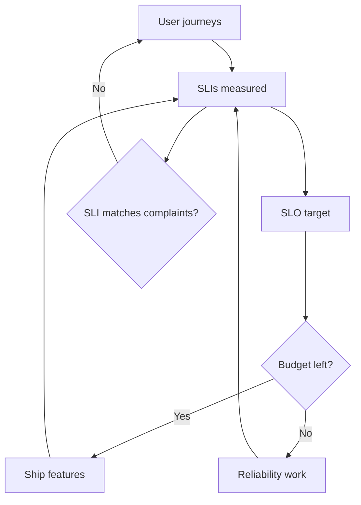
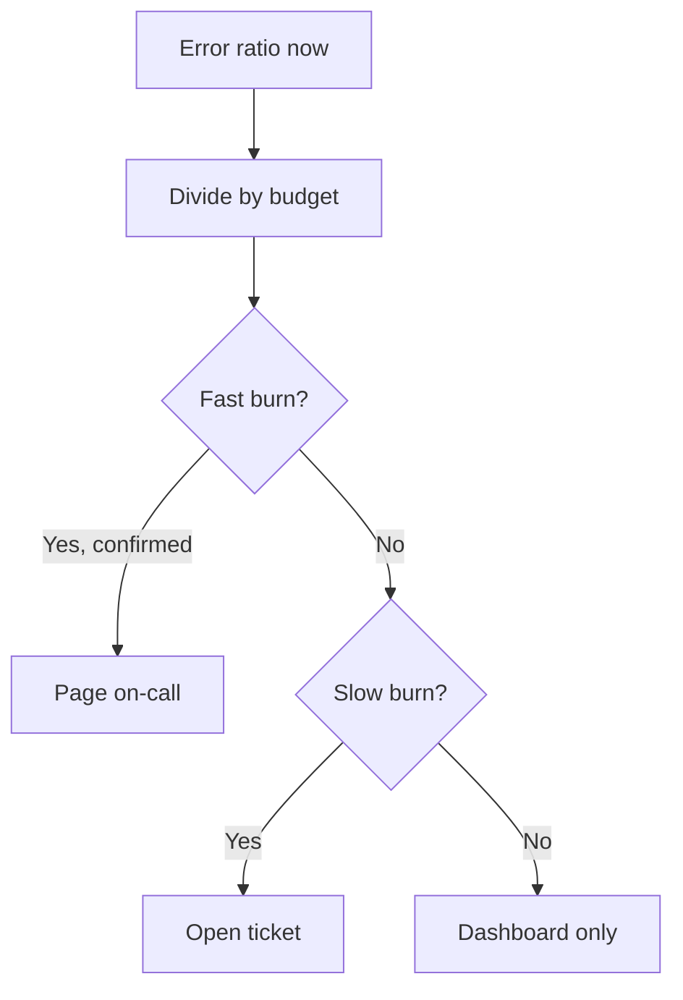
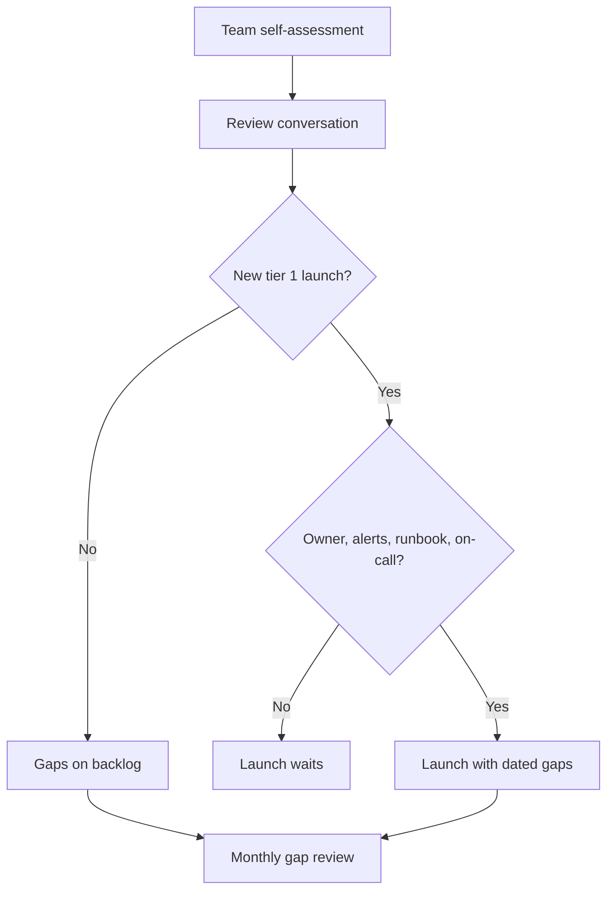

# Chapter 24 — Reliability Engineering: SLOs, Error Budgets, Observability, and Operational Readiness

This chapter turns "be more reliable" into decisions an engineering organization can make every
week: service level objectives (SLOs) that describe what users experience, error budgets that settle
arguments between product and engineering, alerts on the budget instead of on every symptom, and a
readiness bar that says who runs a service and at what cost to the people on call. The running
example is Northstar Technologies, the fictional company in the
[case study](../../case-studies/northstar/index.md), whose contract promises 99.9 percent and whose
measurements cannot yet say whether it keeps that promise. Chapter 27 places this work inside a
whole quality transformation, and Chapter 25 owns what happens once an incident has started.

## Why This Matters

For a team, reliability is a stream of small decisions: ship or fix, page or wait. Without an agreed
target, each is settled by whoever argues loudest.

For an organization of 50 to 150 engineers, the missing target becomes a coordination failure.
Product hears "we need a reliability quarter" with no way to judge how much is enough. Twenty-four
components each have their own idea of healthy, and nobody can add them up into the number the
contract cares about.

At Northstar that number is 99.9 percent availability per quarter on the order and payment paths,
with service credits. Last quarter the measured figure was 99.62 percent, about 8.2 hours of
unavailability against an allowance of about 2.2, and the company paid $410,000 in credits. The
measurement itself is weak: synthetic checks from one region that never exercise the mobile path.
Customers found 14 of the 30 Sev1 and Sev2 incidents before any alert fired, with a median detection
time of 108 minutes against 6 minutes when monitoring caught the problem. (Sev1 and Sev2 are the two
highest [severity](../../glossary.md#severity-sev1-sev2-sev3) ratings: an order or payment path down
or a wrong financial record for Sev1, narrower failures for Sev2.)

At executive scale, reliability is a commercial promise. The chief technology officer (CTO) needs to know whether the company
can keep what it signed, at what cost, and how fast anyone would know it was breaking.

## Learning Objectives

After this chapter you will be able to:

- Write SLOs that reflect user experience, starting from user journeys, and that can be measured
  with data you have or can get within a quarter.
- Calculate an error budget and its burn rate, and design alerting that pages on fast budget
  consumption and files tickets on slow consumption.
- Use an error budget policy as a decision mechanism between product and engineering, and recognize
  when it will not work.
- Define operational readiness per service tier and review it without blocking delivery.
- Design on-call rotations whose load is measured, bounded, and sustainable.

## The Mental Model

> **Mental model:** Reliability is a budget, not a virtue. Decide how much unreliability users will
> tolerate, measure how fast you are spending it, and let the balance decide what the team works on.

Google's site reliability engineering (SRE) book argues that 100 percent is probably never the right reliability target and that
reliability should be matched to the risk the business is willing to accept
([Alvidrez, Embracing Risk](../../references/bibliography.md#google2017embracing)). The gap between
target and perfection is a budget: at 99.9 percent, 0.1 percent of events may fail, paying for
releases, migrations, and misbehaving dependencies. When it runs out, the next work buys reliability.

The budget only works if the measure is honest. An SLO that measures something users do not care
about will be met while customers leave, so the outer loop below matters as much as the inner one.

## Deep Conceptual Explanation

### SLI, SLO, SLA

The SRE book's chapter on service level objectives supplies the vocabulary most organizations use
([Jones et al., Service Level Objectives](../../references/bibliography.md#google2017service)). A
**service level indicator (SLI)** is a carefully defined quantitative measure of some aspect of the
service. A **service level objective (SLO)** is a target value or range for an SLI. A **service level
agreement (SLA)** is a contract that attaches consequences to meeting or missing its SLOs; without a
consequence, the chapter treats the commitment as an SLO. This is **documented practice**, widely
adopted.

The three have different owners. The SLA belongs to sales, legal, and finance and changes at renewal.
The SLO belongs to engineering and product together and should change whenever it stops predicting
customer pain. The SLI belongs to the owning team and changes when measurement improves. Northstar has
an SLA and no SLO, so the only number anyone watches is the one that costs money after the fact.

### Choosing SLIs from user journeys

The SRE Workbook's chapter on implementing SLOs recommends expressing an SLI as good events divided by
valid events, so that the error budget is simply 100 percent minus the SLO. It separates the **SLI
specification** (the outcome users care about) from the **SLI implementation** (how it is measured).
Server logs, load balancers, probes, and client instrumentation each give different coverage at
different cost. The chapter lists common SLI types, including availability, latency, freshness, and
correctness. It recommends modeling multi-step **critical user journeys**, and suggests a four-week
rolling window as a default
([Thurgood and Ferguson, Implementing SLOs](../../references/bibliography.md#thurgood2018implementing)).

The leadership skill is choosing which journeys and which SLI types. Ask what a user loses when this
breaks. A Northstar distributor loses the ability to take orders and to get paid: availability and
latency journeys. But the 14 customer-detected incidents reveal a third loss:

| What the customer noticed | Incidents | Seen by an order or payment availability SLI? |
|---|---|---|
| Orders could not be submitted | INC-403 (legacy price lists rejected), INC-429 (next-year delivery dates rejected) | INC-403 yes; INC-429 only if wrongly rejected orders count as bad |
| Wrong money or wrong order data | INC-401 (invoice rounding), 405 (blank cart totals), 409 (duplicate invoices), 412 (blank confirmation emails), 414 (missing tax rate), 417 (payments in the wrong period), 421 (bulk-order lines dropped), 427 (credit notes applied twice) | No: requests succeeded with wrong results |
| Other paths | INC-408 (month-end report timeout), 411 (catalog import rejected), 418 (webhook signature change), 426 (mobile drafts corrupted) | No |

Eight of the 14 were correctness failures: invoices rounded wrongly or duplicated, payments posted to
the wrong period, credit notes applied twice, order lines silently dropped. An availability SLO would
have reported a healthy quarter through most of them. The SLI types must follow how your users are
actually hurt, which you learn from incident and support history, not from a list of standard
signals.

### Error budgets as a decision mechanism

The SRE book presents the error budget as a shared, objective metric that lets product development
and SRE decide how much risk to take without negotiation by politics. Releases proceed while budget
remains and slow or stop when it is exhausted
([Alvidrez, Embracing Risk](../../references/bibliography.md#google2017embracing)). The Workbook adds
governance: the product manager, the developers, and the SREs should all approve the **error budget
policy**, and if they will not enforce it, the SLOs need revisiting. Its example policy halts changes
other than the most urgent (P0) issues and security fixes when the four-week budget is exceeded. It
requires a postmortem for any single incident that consumes more than 20 percent of the budget, says
the policy is not a punishment, and escalates disagreements to the CTO
([Thurgood, Example Error Budget Policy](../../references/bibliography.md#thurgood2018policy)). This is
**documented practice** at one company, with no published outcome data.

Its value is a decision made in advance, in calm, by the people who will live with it.

### When error budgets do not work

In this book's judgment, budgets break down under six conditions:

1. **The service is far below target.** At 99.62 against 99.9, Northstar's budget would be gone on
   the first day of every window, and a freeze rule would freeze the fixes too. Below target the
   budget is a diagnostic, and the response is a funded program of prevention work.
2. **The SLI does not match user pain.** The budget protects the wrong thing and product leaders learn
   to ignore it.
3. **Traffic is low.** A single failure produces a huge burn rate; the Workbook suggests synthetic
   traffic, combining services, or a lower SLO or longer window
   ([Thurgood et al., Alerting on SLOs](../../references/bibliography.md#thurgood2018alerting)).
4. **A dependency spends the budget.** The Workbook records two schools of thought on whether a
   dependency miss should freeze changes. Freezing feature releases will not bring a partner bank
   back; resilience work on that dependency might.
5. **Nobody can enforce it.** If product did not agree, the first exhausted budget becomes an
   escalation, and the policy dies in that meeting.
6. **The numbers are gamed**, as the Failure Modes section shows.

### Alerting on the budget

The Workbook's chapter on alerting on SLOs judges alerting strategies by **precision** (share of
alerts that mattered), **recall** (share of significant events that alerted), **detection time**, and
**reset time**. It recommends alerting on **burn rate**: how fast the service consumes its budget
relative to the SLO. A burn rate of 1 spends exactly the budget over the window. Its starting point
for a 99.9 percent SLO over 30 days uses **multiwindow** alerts: each long window is confirmed over a
short window about a twelfth as long, so the alert stops soon after the problem does
([Thurgood et al., Alerting on SLOs](../../references/bibliography.md#thurgood2018alerting)).

| Action | Burn rate | Long window | Short window | Budget spent in the long window |
|---|---|---|---|---|
| Page | 14.4 | 1 hour | about 5 minutes | 2% |
| Page | 6 | 6 hours | about 30 minutes | 5% |
| Ticket | 1 | 3 days | about 6 hours | 10% |

Where 14.4 comes from: spending 2 percent of a 30-day (720-hour) budget in one hour means burning at
0.02 × 720 = 14.4 times the allowed rate.

Burn-rate alerting replaces dozens of cause-based alerts (CPU, queue depth, log volume) with a few on
what users experience. The SRE book's monitoring chapter draws the same line: page mainly on symptoms,
use causes for debugging, and make every page urgent, actionable, and in need of human judgment
([Ewaschuk, Monitoring Distributed Systems](../../references/bibliography.md#google2017monitoring)).

### Observability in practice

SLOs tell you **that** users are hurting; observability decides how long it takes to learn **why**.
Monitoring answers questions you knew to ask: dashboards and alerts on predefined signals, such as the
SRE book's four golden signals of latency, traffic, errors, and saturation
([Ewaschuk](../../references/bibliography.md#google2017monitoring)). Observability, as Charity Majors, Liz Fong-Jones, and
George Miranda use the term, is the ability to ask new questions of a running system about failures
nobody anticipated ([Majors, Fong-Jones, and Miranda, 2022](../../references/bibliography.md#majors2022observability)).
That is **expert opinion** from authors at an observability vendor; the distinction is widely used.
Northstar shows the gap: in INC-428, deploys failed for every Jenkins-based service and the cause was
never found.

**Three signal types.** OpenTelemetry, the vendor-neutral instrumentation standard, names them
([OpenTelemetry, Signals](../../references/bibliography.md#otel-signals)):

| Signal | What it is | Good for | Weakness |
|---|---|---|---|
| Metrics | Measurements captured at runtime, aggregated | SLIs, alerts, trends; cheap to keep | Cannot explain one request |
| Logs | Records of events | Detail on what one component did | Costly at volume; useless if unstructured |
| Traces | The path of a request through the services | Where the time went and which hop failed | Need instrumentation in every service |

The signals become far more useful joined. **Context propagation** carries a request's trace ID from
service to service, and SDKs can stamp it on every log line, so an engineer can move from an alert to
the trace to the logs of the failing hop
([OpenTelemetry, Context propagation](../../references/bibliography.md#otel-context-propagation)).

**What to instrument first** (this book's recommendation), in order:

1. The SLI events of each tier 1 journey, measured where users meet the system.
2. A request ID created at the edge, passed through every service, and written to every log line.
3. Structured logs with fixed fields (time, service, request ID, tenant, outcome), not free text.
4. Traces across the services on tier 1 paths.
5. Deploys and flag changes as events on the same timeline, so "what changed?" takes seconds.

**Cost.** Telemetry bills grow with volume and with the number of distinct label values kept, so cost
is a design choice. Sample traces: OpenTelemetry calls sampling one of the most effective ways to cut
observability cost, and tail sampling can keep every trace that contains an error
([OpenTelemetry, Sampling](../../references/bibliography.md#otel-sampling)). Keep debug logs short-lived, and never put
per-request values such as order IDs into metric labels. Judge a tool by one test: for last quarter's
incidents, could on-call have gone from alert to cause with the data it would hold?

### Operational readiness

The SRE book describes Google's **Production Readiness Review** as a prerequisite for an SRE team
taking on a service, covering architecture and dependencies, monitoring, emergency response, capacity,
change management, and performance. It also records that the model did not scale, since each
onboarding took two or three SREs several quarters, and that Google moved toward shared frameworks and
platforms ([Cruz and Bhambhani, Evolving SRE Engagement Model](../../references/bibliography.md#google2017engagement)).
Amazon Web Services (AWS) describes its **Operational Readiness Review** as questions distilled from
its own post-incident analyses, answered by teams as self-assessments throughout a service's life
([AWS, Operational Readiness Reviews](../../references/bibliography.md#aws2022orr)). Both are **documented practice**.

Two lessons transfer: grow the questions from **your own incidents**, and let the **team own** the
review as a conversation, because a central gate becomes the bottleneck Google describes.

### On-call design and load

The Workbook's on-call chapter targets at most two incidents per 12-hour shift. It gives minimum
staffing of eight engineers for a single-site 24/7 rotation, or five per site for multi-site. It names
pager-load inputs (production bugs, alerting thresholds, and human processes such as manual changes),
and says out-of-hours on-call should be compensated
([Cook et al., On-Call](../../references/bibliography.md#cook2018oncall)). The SRE book caps on-call at
a quarter of an SRE's time and warns that underload is also a risk, because rarely used skills decay
([Spadaccini, Being On-Call](../../references/bibliography.md#google2017oncall)).

The health research is thinner and not about software. Reviews from other occupations found that
on-call work can pose risks to sleep, mental health, and personal life, and that on-call from home appears to
reduce sleep ([Nicol and Botterill, 2004](../../references/bibliography.md#nicol2004oncall);
[Hall et al., 2017](../../references/bibliography.md#hall2017oncall)). These are **research findings** from other
occupations; the evidence for software engineers specifically is thin. The
direction is still clear: on-call load is a cost borne by specific people,
and it should be measured like any other cost.

## Engineering Organization Example

!!! info "Northstar so far"
    Week 3 of the director's first year. Northstar has just published severity definitions written by
    the director, Kwame Mensah (staff engineer, infrastructure and reliability), and Sofia Alvarez (VP
    Customer Success). In week 4 the director reserves 12 FTE (full-time equivalent engineers) for
    prevention work. See the [timeline](../../case-studies/northstar/timeline.md).

This design is **illustrative**: Northstar's first SLOs. Assumptions: about 600,000 valid order
submissions (web and mobile) and about 240,000 payment attempts per 28 days, with traffic treated as
flat (real daytime peaks burn faster).

| Journey | SLI: good ÷ valid | Measured at | SLO, 28-day rolling |
|---|---|---|---|
| Submit an order | Successful submissions; wrongly rejected valid orders count as bad | Load balancer (web), mobile-bff (mobile) | 99.9% |
| Order latency | Successful submissions done within 2 seconds | Same | 99% |
| Collect a payment | Attempts reaching a final state (settled or bank-declined) within 60 seconds | payments-gateway | 99.9% |
| Invoice correctness (second wave) | Invoices and postings passing automated reconciliation | Nightly job, not yet built | 99.99% |

**Budgets.** The order journey may fail 600 times in 28 days and the payment journey 240 times. In
time terms, 0.1 percent of 28 days is about 40 minutes of total outage.

**INC-403 replayed.** Order submission failed for customers with legacy price lists for 380 minutes.
That one partial outage would have spent about 94 percent of the 28-day order budget. The one-hour page
would have fired about nine minutes in, against the customer's report at 22 minutes. The single-region
probe, whose test account did not use a legacy price list, would have seen nothing.

**INC-413 replayed.** A partner bank outage queued payments for 150 minutes. It would have spent about
3.7 times the payment budget, with no Northstar change involved. Whether that should freeze releases is
a policy question; whether it justifies a fallback route is not.

??? note "How the replays are calculated"
    INC-403: assume 10 percent of submissions failed. At about 14.9 submissions a minute, about 5,650
    were made in 380 minutes and 565 failed, against a budget of 600. The burn rate was 100, so the
    hour's error ratio passed the 1.44 percent page threshold (14.4 × 0.1 percent) about nine minutes in.
    INC-413: at about 6 attempts a minute, roughly 890 attempts missed the 60-second threshold in 150
    minutes, against a budget of 240.

**Blind spots.** The invoice reconciliation SLI is the only one that could have seen INC-401, 409,
417, and 427, and it depends on a job Northstar does not run. That job may be the most valuable
reliability investment in Billing's backlog, and no standard signal list would have suggested it.

**Alerts.** Northstar adopts the Workbook's burn rates unchanged; over 28 days rather than 30, a
one-hour burn at 14.4 spends about 2.1 percent of the budget instead of 2.

## Decision Framework

**Which SLI type per journey.** Follow the incident and support history:

| Users mostly hurt by | Primary SLI | Typical measurement point |
|---|---|---|
| Not being able to act | Availability | Load balancer or server; probes for low traffic |
| Slowness | Latency at thresholds, including the tail | Server; client instrumentation for mobile |
| Wrong results | Correctness | Reconciliation or invariant checks |
| Stale data | Freshness | Age of newest processed record |

**Whether to enforce an error budget policy now:**

| Condition | Stance |
|---|---|
| Near target, SLI trusted, product agreed | Full policy: exhaustion triggers reliability-first work |
| Far below target | Reporting mode: publish the budget, fund recovery, no automatic freeze |
| SLI not yet trusted | Shadow mode for one or two windows |
| Spend mainly from a dependency | Resilience work on it; no freeze of unrelated changes |
| Product has not agreed | No policy; resolve the disagreement first |

**Readiness bar per tier.** This is the book's recommendation; the CTO sets tier policy. At Northstar a
component is [tier 1](../../glossary.md#tier-1) if it is on the order or payment path: 15 of the 24
components, with 8 in tier 2 and 1 in tier 3 (`components.csv`, linked from the
[baseline page](../../case-studies/northstar/baseline-data.md), lists them). The first four rows are
the [tier 1 operational minimums](../../glossary.md#tier-1-operational-minimums); tested rollback
belongs to the pipeline standard Chapter 20 tracks.

| Requirement | Tier 1 | Tier 2 | Tier 3 |
|---|---|---|---|
| Named owning team | Yes (blocks) | Yes | Yes |
| User-facing alerts | SLO burn rate (blocks) | Symptom alerts | Health check |
| Runbook for known failures | Yes (blocks) | Yes | Restart notes |
| On-call | 24/7 (blocks) | Business hours | None |
| Rollback tested in 90 days | Yes (dated gap) | Recommended | No |

Against this bar, Northstar's 15 proposed tier 1 components fall well short: 3 have complete
alerting, 6 have a runbook, and 3 have nobody on call (8 of all 24 components lack a rotation); 3
of the 15 meet all four minimums. Only those four ever block, and only new tier 1 launches. Gaps in
existing components, and untested rollback, become dated gaps owned by the team. The review stays a
conversation, yet nothing reaches the payment path without someone to answer at 3 a.m.

## Trade-offs

**Tight targets against change.** A higher SLO leaves less budget for releases and costs more to meet.
An internal target above the contract buys warning time at the price of more frequent triggers; raise
it only once the service is reliably in budget.

**Request-based against time-based.** Counting requests captures partial outages; the contract's
probes count minutes. Northstar needs both until the contract changes: one to manage, one to settle
credits.

**Precision against recall.** Burn-rate alerting manages this trade without removing it; quiet paths
need synthetic traffic or longer windows.

**Central review against team ownership.** A central team brings consistency and becomes a queue;
self-assessment scales and is easier to game. The middle course: teams assess, a staff engineer joins
tier 1 conversations, and gaps are reviewed monthly.

**On-call breadth against depth.** The three Billing engineers who carry most pages are the team's
experts and its single point of failure. Spreading the load costs pairing time and slower first
responses for a quarter.

## Failure Modes

**The vanity SLO.** The SLO measures something easy and stays green while escalations rise.
Countermeasure: compare each window's misses with tickets and incidents, and change the SLI when they
disagree.

**SLI shrinkage.** "Valid" quietly narrows: maintenance excluded, then client errors, then a noisy
customer. Signal: valid volume falls while traffic does not. Countermeasure: every exclusion written and
reported next to the SLO.

**The 4xx blind spot.** Valid requests rejected by a bug return a client-error code and count as good;
INC-429 would have looked healthy. Countermeasure: classify rejections by reason and count unexpected
ones as bad.

**The permanent freeze.** A policy written for a healthy service is applied to one far below target;
everything stops or everyone ignores it. Countermeasure: reporting mode until in budget.

**Alert accretion.** Each incident review adds an alert and none are removed; pages rise without
incidents rising. Countermeasure: trial new pages in non-paging mode, as the Workbook's on-call chapter
suggests, and delete alerts that never led to action.

**Readiness theater.** Runbooks written to pass the review, rollback never tested. Signal: the runbook
went unused in the last incident. Countermeasure: game-day drills and scheduled rollback tests for
tier 1.

**Tier dodging.** Teams argue components down a tier to escape requirements. Countermeasure: the tier
follows user impact, decided under the CTO's policy.

**The invisible pager.** On-call load is never measured, and the people who carry it leave.
Countermeasure: report pages per shift and after-hours pages per person monthly, beside the SLOs.

## Enterprise Application

**The director** owns the list of critical journeys, the tiering of components, the error budget
policy and its agreement with product, the readiness standard, and a monthly page combining SLOs,
budgets, readiness gaps, and on-call load.

**Engineering managers** own their journeys' SLIs and their accuracy, their components' readiness
gaps, and their rotations: who is on call, how loaded, and how knowledge is spreading.

**Staff engineers** own the cross-cutting design: SLI measurement, alert rules, the readiness question
bank, and tier 1 review conversations. At Northstar, Kwame Mensah leads this as part of the
director's work on detection.

Three practices make it run. **One SLO document per journey**, with the Workbook's fields (authors,
approvers, review date, implementation, rationale); the rationale survives turnover. **A readiness
question bank grown from incidents**: every review (Chapter 25) asks whether a question would have
caught the failure. Northstar's first bank writes itself: certificate expiry monitored (INC-425),
migrations safe before or after the code (INC-419), rollback tested (INC-416), someone on call
(INC-407). And **a reliability section in the existing monthly review**, not a new meeting.

## CTO Perspective

SLOs change three executive conversations.

**Contracts.** If engineering has no SLO, the company signs promises it cannot measure. No SLA should
be offered on a journey without an SLO measured the same way, and the SLA should be looser than the
SLO. A customer asking for 99.95 percent on a path running at 99.62 is asking for a price, and the CTO
should be able to name it.

**Investment.** An error budget turns "reliability versus features" into a number the chief product
officer (CPO) and chief financial officer (CFO) can reason about. A budget consistently unspent means
over-investment in that journey; one consistently overspent means the trade has already been made, by
default.

**People.** On-call is a working-conditions policy with legal and health implications: compensation,
rest after night pages, rotation size. It belongs in the CTO's policy set, reviewed with HR.

A caution: an SLO never missed means the target is too low or the SLI is blind.

## Practical Playbook

A first 60 days for introducing SLOs:

1. List the three to five journeys whose failure stops customers' work or costs them money; confirm
   with product and customer success.
2. Classify last quarter's customer-detected incidents by what the customer lost, and choose SLI types
   from the result.
3. Write each SLI specification, then the cheapest honest implementation buildable within a month.
4. Run SLIs in shadow mode for one 28-day window; fix those whose misses disagree with tickets.
5. Set SLOs from user needs and the contract, not from current performance alone.
6. Write the error budget policy with the head of product: reporting or full mode, treatment of
   dependency spend, and an arbiter.
7. Replace cause-based pages on those journeys with multiwindow burn-rate alerts, each trialed
   without paging for a week.
8. Publish the tier policy and readiness standard; every tier 1 team self-assesses within 30 days.
9. Measure pages per shift and after-hours pages per person; put every tier 1 component on a rotation.
10. Add budgets, gaps, and on-call load to the monthly review.

## Case Study

This case is **fictional**. It follows Northstar's SLO work during the director's first quarter,
weeks 3 to 13, from the [baseline](../../case-studies/northstar/baseline-data.md).

In week 3, Kwame Mensah and the director classified the 14 customer-detected incidents by what each
customer lost. Eight were correctness failures, and five of those belonged to the Billing team of
Marcus Oyelaran (Billing manager): four in invoicing and the ledger, one in tax-svc. An invoice
reconciliation job joined the order and payment SLIs as a first-quarter deliverable, owned by Billing,
with Li Na Zhou (staff engineer, data and integration) advising.

The team of Elena Sokolova (Payments and Integrations manager) built the payment SLI in two weeks from gateway logs. Its first shadow window
showed payments stuck for minutes in a retry queue during partner-bank slowdowns, unseen by the probe.

The first order SLI counted every client-error response as good; a replay of INC-429 looked
perfect. The team began counting unexpected validation failures as bad.

The budget policy took two meetings with Amara Okafor (CPO). She refused a freeze rule while the renewal
commitments were in flight, and the director agreed, since the order journey was so far below target
that a freeze would have been permanent. They wrote a reporting-mode policy: budgets published weekly,
any incident spending more than a fifth of a journey's budget reviewed with a tracked action,
dependency spend routed to resilience work, and the full policy to start after the first 28-day window
in budget. Victor Lindqvist (CTO) was named arbiter.

Daniel Cho (Customer Experience manager) argued that notification-svc should not be tier 1, since a blank confirmation email stops
neither an order nor a payment. The director agreed, moved it to tier 2, assigned it to Orders (whose
engineers made most of its commits, with Billing's), and required a correctness check on rendered
templates instead of a 24/7 rotation, from quarter 2. Readiness counts for year 1 still use the
original list of 15, so that quarters compare. The shared
modules stayed tier 1: core/customer had gone to Orders in week 4; core/permissions was still
unowned at day 90, under a recorded exemption.

What went wrong: the first payment burn-rate alerts paged four times in one week at night, on single
failures in low traffic. The team added overnight synthetic payments, as the Workbook suggests.

By day 90, 8 of the 15 tier 1 components met all four operational minimums, up from 3, and 11 had a
runbook. Customers first reported 29 percent of Sev1 and Sev2 incidents, down from 47 percent.

## Exercises

Solutions are in [chapter 24 solutions](../../solutions/ch24-solutions.md). Data files are linked
from the [Northstar baseline page](../../case-studies/northstar/baseline-data.md).

### Foundational

**F1.** Northstar's contract measures 99.9 percent per calendar quarter with synthetic checks; the
proposed internal SLOs are request-based over a 28-day rolling window. Calculate the quarter's
allowance in minutes and the order journey's 28-day budget in failed submissions, using the chapter's
assumptions. Then describe a realistic incident that would consume most of one budget and almost none
of the other, and say which measure better reflects what customers experienced.

**F2.** Using `incidents-last-quarter.csv`, take the 16 incidents that monitoring or an engineer
detected. For each, say whether one of the four proposed SLIs (order availability, order latency,
payment final state, invoice correctness) would have spent budget, and which. What does the result
suggest about journeys or components still missing an SLI?

**F3.** The payment journey has a 99.9 percent SLO over 28 days. For two hours, 0.5 percent of payment
attempts fail. Compute the burn rate and the share of the 28-day budget consumed, and decide which of
the Workbook's starting alerts would fire. Was that the right outcome for a distributor waiting to be
paid?

### Applied Leadership

**A1.** Marcus Oyelaran tells you that three of his 13 Billing engineers take most after-hours pages
because only they understand the ledger, and one of them has asked to leave the rotation. Design a
rotation plan for the next two quarters that reduces their load without lengthening Billing's
restoration times. Say what you will measure, what it costs the team, and what you tell the engineer.

**A2.** Run the readiness review for auth-svc. It is proposed tier 1, deployed by shell scripts that one
person understands, its author has left, it has partial alerting and no runbook, and Platform
Operations keeps it running with five infrastructure engineers. Decide what the review concludes,
which gaps block what, who owns each, and what you escalate to the CTO.

**A3.** Six weeks into the reporting-mode policy, the order journey is still far below its SLO. Amara
Okafor asks you to stop publishing the weekly budget because her product managers find it
demoralizing and sales has started quoting it to explain delays. Prepare your response: what you will
and will not change, and how you keep the budget useful without turning it into an excuse.

### Executive Decision-Making

**X1.** One of the two renewal customers asks for contractual availability on the order and payment
paths to rise from 99.9 to 99.95 percent, measured to include the mobile app, in exchange for a
three-year renewal. Sales wants to agree this week. As CTO, decide what you tell the CEO, which
conditions you would accept, and what you need to know first.

**X2.** The CFO proposes ending paid out-of-hours on-call for tier 2 components and moving them to
business-hours support, which would leave all eight tier 2 components, plus the one tier 3 component,
without out-of-hours cover. As CTO, accept, reject, or amend the proposal. State the risks on both
sides, the data you would ask for, and how you would explain the decision to the engineers affected.

## Reflection Questions

1. If you published one SLO tomorrow, which journey would you choose, and would your customers agree
   it matters most?
2. Which current alerts would you delete if you could page only on symptoms users feel? Who would
   object, and what are they afraid of missing?
3. When did your product leaders last agree, in advance, to slow down if reliability fell below a
   threshold? If never, who really decides reliability investment?
4. How many people carry most of your pages, and what happens to restoration times if two of them
   leave?
5. Is there a way your customers are hurt that none of your dashboards would show?

## Key Takeaways

- Start SLIs from user journeys and from how customers have actually been hurt; expect correctness,
  not only availability.
- Express SLIs as good events over valid events, and write down every exclusion from "valid".
- Keep SLA, SLO, and SLI distinct, with different owners; never sell an SLA without an SLO measured
  the same way.
- Agree the error budget policy with product before it is needed; its value is the decision made in
  advance.
- Below target, run the budget in reporting mode and fund recovery; a freeze on a failing service
  becomes permanent or ignored.
- Page on fast burn, ticket slow burn, and retire cause-based pages.
- Grow readiness questions from your own incidents, let teams self-assess, and block only new tier 1
  launches lacking an owner, user-facing alerts, a runbook, or on-call.
- Measure on-call load per person, cap it, and treat it as a cost borne by specific people.

## References and Further Reading

- [Jones et al.](../../references/bibliography.md#google2017service) and
  [Alvidrez](../../references/bibliography.md#google2017embracing): the SLO vocabulary and the case
  for error budgets.
- [Thurgood and Ferguson](../../references/bibliography.md#thurgood2018implementing),
  [Thurgood et al.](../../references/bibliography.md#thurgood2018alerting), and
  [Thurgood](../../references/bibliography.md#thurgood2018policy): the most practical chapters on
  choosing SLIs, burn-rate alerting, and writing a budget policy.
- [Ewaschuk, Monitoring Distributed Systems](../../references/bibliography.md#google2017monitoring):
  symptoms versus causes and what deserves a page.
- [Cruz and Bhambhani](../../references/bibliography.md#google2017engagement) and
  [AWS, Operational Readiness Reviews](../../references/bibliography.md#aws2022orr): two designs for
  readiness review, and why the central one stopped scaling.
- [AWS Well-Architected Framework](../../references/bibliography.md#aws-well-architected): reviews as
  conversations.
- [Cook et al.](../../references/bibliography.md#cook2018oncall) and
  [Spadaccini](../../references/bibliography.md#google2017oncall): on-call load and rotation sizing.
- [Nicol and Botterill, 2004](../../references/bibliography.md#nicol2004oncall) and
  [Hall et al., 2017](../../references/bibliography.md#hall2017oncall): the health and sleep research on
  on-call work, mostly outside software.
- [Majors, Fong-Jones, and Miranda, 2022](../../references/bibliography.md#majors2022observability):
  the case for observability as distinct from monitoring.
- [OpenTelemetry: Signals](../../references/bibliography.md#otel-signals), [Context propagation](../../references/bibliography.md#otel-context-propagation),
  and [Sampling](../../references/bibliography.md#otel-sampling): signal types, joining them, and controlling cost.
- [Beyer et al., 2016](../../references/bibliography.md#beyer2016sre) and
  [Beyer et al., 2018](../../references/bibliography.md#beyer2018workbook): the free SRE books most of
  the above come from; read them as one company's practice.
