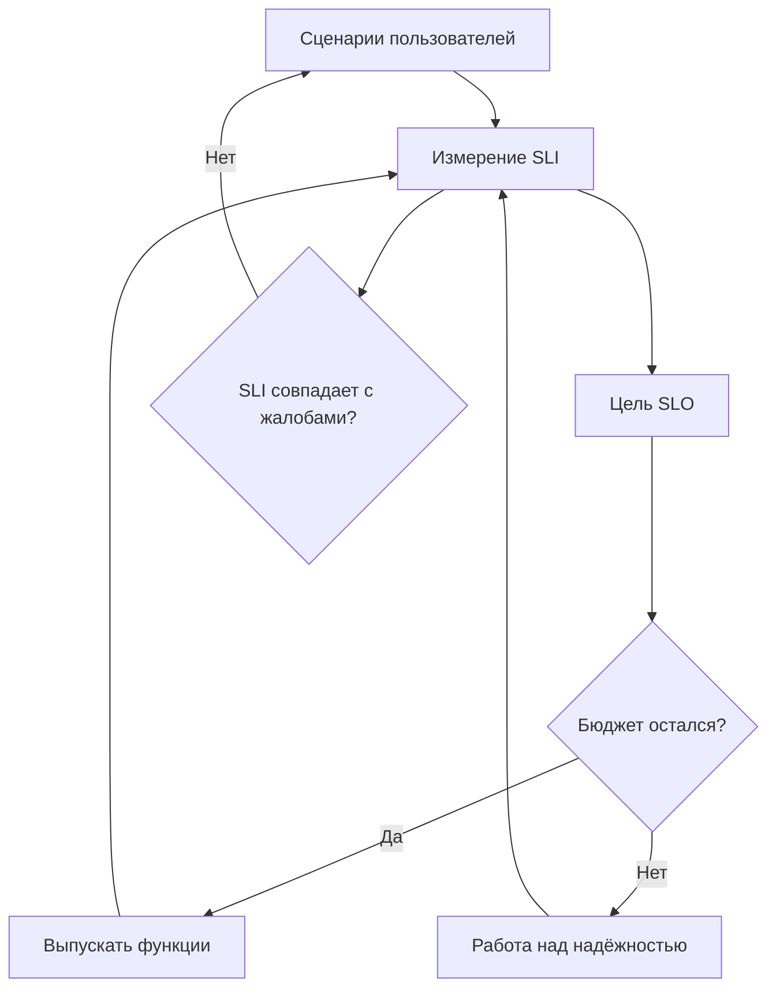
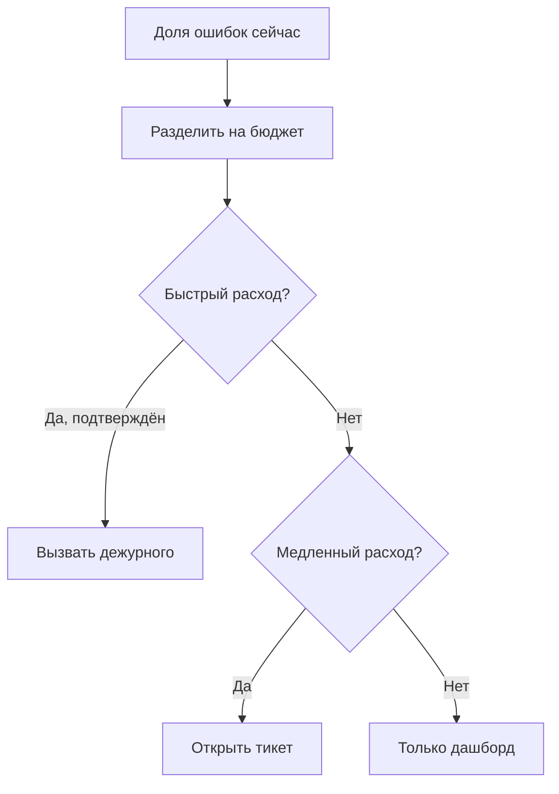
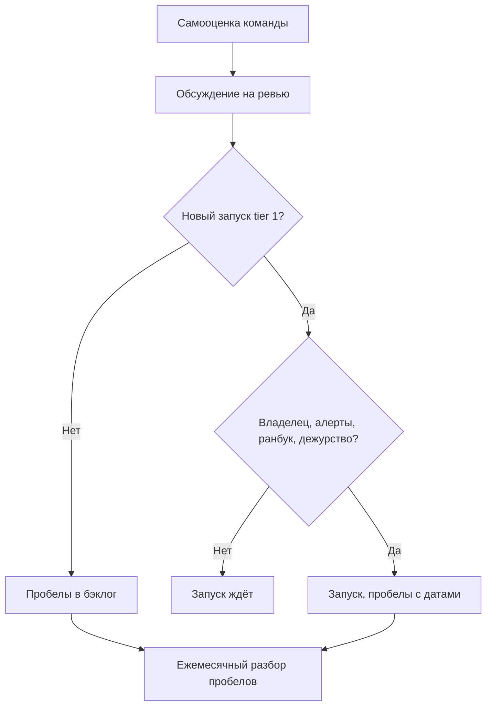

# Глава 24 — Инженерия надёжности: SLO, бюджеты ошибок, наблюдаемость и операционная готовность { #chapter-24-reliability-engineering-slos-error-budgets-observability-and-operational-readiness }

Эта глава превращает призыв «быть надёжнее» в решения, которые инженерная организация может принимать
каждую неделю. Целевые уровни сервиса (service level objectives, SLO) описывают то, что видят
пользователи. Бюджеты ошибок разрешают споры между продуктом и разработкой. Алерты срабатывают на
расход бюджета, а не на каждый симптом. Планка готовности определяет, кто эксплуатирует сервис и чего
это стоит дежурным. Сквозной пример — Northstar Technologies, вымышленная компания из
[кейса](../../case-studies/northstar/index.md): по договору она обещает 99,9%, но по её измерениям
пока нельзя сказать, выполняет ли она это обещание. Глава 27 встраивает эту работу в трансформацию
качества целиком, а то, что происходит после начала инцидента, разбирает глава 25.

## Почему это важно { #why-this-matters }

Для команды надёжность — это поток мелких решений: выпускать или чинить, вызывать дежурного или
подождать. Если согласованной цели нет, каждый такой спор выигрывает тот, кто громче.

Для организации из 50–150 инженеров отсутствие цели превращается в провал координации. Продукт слышит
«нам нужен квартал надёжности» и не может понять, сколько надёжности достаточно. У каждого из двадцати
четырёх компонентов своё представление о здоровье, и никто не может свести их к единственному числу,
которое важно по договору.

В Northstar это число — доступность 99,9% за квартал на путях заказа и оплаты, с сервисными кредитами
(компенсациями по SLA). В прошлом квартале измеренная доступность составила 99,62%, то есть около
8,2 часа недоступности при допустимых примерно 2,2 часа, и компания выплатила $410 000 в виде кредитов.
Слабо и само измерение: синтетические проверки из одного региона, которые никогда не затрагивают
мобильный путь. Из 30 инцидентов Sev1 и Sev2 клиенты обнаружили 14 раньше, чем сработал хоть один
алерт. Медианное время обнаружения в таких случаях — 108 минут, а когда проблему ловил мониторинг, —
6 минут. (Sev1 и Sev2 — две высшие степени [серьёзности](../../glossary.md#severity-sev1-sev2-sev3):
Sev1 — это недоступный путь заказа или оплаты либо неверная финансовая запись, Sev2 — более узкие
отказы.)

Для высшего руководства надёжность — коммерческое обещание. Техническому директору (CTO) нужно знать,
может ли компания выполнить то, что подписала, во что это обойдётся и как быстро кто-нибудь узнает,
что обещание нарушается.

## Цели главы { #learning-objectives }

Прочитав эту главу, вы сможете:

- Писать SLO, которые исходят из пользовательских сценариев, отражают опыт пользователей и измеримы
  данными, которые уже есть или появятся в течение квартала.
- Рассчитывать бюджет ошибок и скорость его расходования и проектировать алертинг, который вызывает
  дежурного при быстром расходе бюджета и заводит тикеты при медленном.
- Использовать политику бюджета ошибок как механизм принятия решений между продуктом и разработкой и
  распознавать, когда она не сработает.
- Определять операционную готовность для каждого уровня критичности и проверять её, не блокируя
  поставку.
- Проектировать графики дежурств, нагрузка в которых измерена, ограничена и посильна на длинной
  дистанции.

## Ментальная модель { #the-mental-model }

> **Ментальная модель:** надёжность — это бюджет, а не добродетель. Решите, сколько ненадёжности
> готовы терпеть пользователи, измеряйте, как быстро вы её тратите, и пусть остаток решает, над чем
> работает команда.

Книга Google по инженерии надёжности (site reliability engineering, SRE) утверждает, что 100%,
по-видимому, никогда не бывает правильной целью и что надёжность должна соответствовать риску,
который бизнес готов принять
([Alvidrez, Embracing Risk](../../references/bibliography.md#google2017embracing)). Разрыв между целью
и совершенством — это бюджет: при 99,9% может завершиться неудачей 0,1% событий, и этой долей
оплачиваются релизы, миграции и сбоящие зависимости. Когда бюджет кончается, следующая работа идёт
на надёжность.

Бюджет работает, только если мера честная. SLO, который измеряет что-то безразличное пользователям,
будет выполняться и тогда, когда клиенты уходят. Поэтому внешняя петля на схеме важна не меньше внутренней.

## Подробный разбор { #deep-conceptual-explanation }

### SLI, SLO, SLA { #sli-slo-sla }

Словарь, которым пользуется большинство организаций, дала книга SRE
([Jones et al., Service Level Objectives](../../references/bibliography.md#google2017service)).
**[Индикатор уровня сервиса (service level indicator, SLI)](../../glossary.md#sli-slo-and-sla)** —
тщательно определённая количественная мера какого-то аспекта сервиса. **Целевой уровень сервиса
(SLO)** — целевое значение или диапазон для SLI. **Соглашение об уровне сервиса (service level
agreement, SLA)** — договор, который привязывает последствия к выполнению или невыполнению его SLO;
обязательство без последствий глава считает SLO. Это широко принятая **задокументированная практика**.

У всех трёх разные владельцы. SLA принадлежит продажам, юристам и финансам и меняется при продлении
договора. SLO принадлежит разработке и продукту вместе и должен меняться всякий раз, когда перестаёт
предсказывать боль клиентов. SLI принадлежит команде-владельцу и меняется, когда улучшается измерение.
У Northstar есть SLA, но нет SLO, поэтому единственное число, за которым кто-то следит, — то, что
стоит денег уже задним числом.

### Как выбирать SLI по пользовательским сценариям { #choosing-slis-from-user-journeys }

Глава воркбука SRE о внедрении SLO рекомендует выражать SLI как отношение хороших событий к валидным,
чтобы бюджет ошибок был просто 100% минус SLO. Она отделяет **спецификацию SLI** (результат, важный
пользователям) от **реализации SLI** (того, как его измеряют). Серверные логи, балансировщики нагрузки,
пробы и инструментирование клиента дают разное покрытие за разную цену. Глава перечисляет типичные
виды SLI, среди них доступность, задержка, свежесть и корректность. Ещё авторы советуют моделировать
многошаговые **критические пользовательские сценарии** (critical user journeys) и по умолчанию
предлагают скользящее окно в четыре недели
([Thurgood and Ferguson, Implementing SLOs](../../references/bibliography.md#thurgood2018implementing)).

От руководителя требуется умение выбрать сценарии и виды SLI. Спросите себя, что теряет пользователь,
когда это ломается. Дистрибьютор, работающий с Northstar, теряет возможность принимать заказы и
получать оплату: это сценарии доступности и задержки. Но 14 инцидентов, обнаруженных клиентами,
показывают третью потерю. Разложим их по тому, что заметил клиент:

| Что заметил клиент | Инциденты |
|---|---|
| Не удавалось отправить заказ | 2 |
| Неверные деньги или неверные данные заказа | 8 |
| Другие пути | 4 |

Восемь из 14 были отказами корректности: счета округлялись неправильно или дублировались, платежи
попадали не в тот период, кредит-ноты применялись дважды, строки заказа молча пропадали. В каждом
случае запросы выполнялись успешно, но с неверным результатом, поэтому SLO доступности показал бы
здоровый квартал.

??? note "14 инцидентов по [номерам INC](../../glossary.md#inc-numbers)"
    Не удавалось заказать: INC-403 (отклонялись устаревшие прайс-листы), INC-429 (отклонялись даты
    доставки на следующий год). Неверные деньги или данные: INC-401 (округление в счетах), 405 (пустые
    суммы в корзине), 409 (дубли счетов), 412 (пустые письма-подтверждения), 414 (не хватало ставки
    налога), 417 (платежи не в том периоде), 421 (пропадали строки массовых заказов), 427 (кредит-ноты
    применялись дважды). Другие пути: INC-408 (тайм-аут отчёта на конец месяца), 411 (отклонялся импорт
    каталога), 418 (изменилась подпись вебхука), 426 (портились черновики в мобильном приложении).

Виды SLI должны отражать то, от чего действительно страдают ваши пользователи. Узнать это можно из
истории инцидентов и обращений в поддержку, а не из списка стандартных сигналов.

### Бюджет ошибок как механизм принятия решений { #error-budgets-as-a-decision-mechanism }

Книга SRE представляет бюджет ошибок (error budget) как общую объективную метрику, которая позволяет
продуктовой разработке и SRE решать, на какой риск идти, без политического торга. Релизы идут, пока
бюджет остаётся, и замедляются или останавливаются, когда он исчерпан
([Alvidrez, Embracing Risk](../../references/bibliography.md#google2017embracing)). Воркбук добавляет
к этому правила управления: **политику бюджета ошибок** должны одобрить продакт-менеджер, разработчики
и SRE, а если они не готовы её соблюдать, SLO нужно пересмотреть. Образец политики из воркбука при
превышении четырёхнедельного бюджета останавливает все изменения, кроме исправлений самых срочных (P0)
проблем и исправлений безопасности. Он требует постмортема для любого отдельного инцидента, который съел больше 20% бюджета,
оговаривает, что политика — не наказание, и передаёт разногласия на решение CTO
([Thurgood, Example Error Budget Policy](../../references/bibliography.md#thurgood2018policy)). Это
**задокументированная практика** одной компании; опубликованных данных о результатах нет.

Ценность политики в том, что решение принято заранее, в спокойной обстановке, теми, кому с ним жить.

### Когда бюджеты ошибок не работают { #when-error-budgets-do-not-work }

По оценке книги, бюджеты перестают работать в шести случаях:

1. **Сервис намного ниже цели.** При 99,62 против 99,9 бюджет Northstar кончался бы в первый же день
   каждого окна, а правило заморозки остановило бы и исправления. Ниже цели бюджет служит
   диагностикой, а ответом становится профинансированная программа профилактической работы.
2. **SLI не совпадает с болью пользователей.** Бюджет защищает не то, и руководители продукта
   привыкают его игнорировать.
3. **Трафик мал.** Один-единственный сбой даёт огромную скорость расходования; воркбук предлагает
   синтетический трафик, объединение сервисов или более длинное окно
   ([Thurgood et al., Alerting on SLOs](../../references/bibliography.md#thurgood2018alerting)).
4. **Бюджет тратит зависимость.** Заморозка релизов функций не вернёт к жизни банк-партнёр, а работа
   над устойчивостью к сбоям этой зависимости — может.
5. **Никто не может обеспечить соблюдение.** Если продукт не согласился, первый же исчерпанный бюджет
   превращается в эскалацию, и политика умирает на этой встрече.
6. **Числа подгоняют** — как именно, показывает раздел «Типичные провалы».

### Алерты на расход бюджета { #alerting-on-the-budget }

Глава воркбука об алертах по SLO оценивает стратегии алертинга по **точности** (precision, доля
алертов, которые оказались важны), **полноте** (recall, доля значимых событий, на которые сработал
алерт), **времени обнаружения** и **времени сброса**. Она рекомендует алерты по **скорости
расходования бюджета** (burn rate): насколько быстро сервис тратит свой бюджет относительно SLO. При
скорости 1 бюджет тратится ровно за окно. Отправная точка для SLO 99,9% за 30 дней — **многооконные**
алерты: каждое длинное окно подтверждается коротким, примерно в двенадцать раз короче, поэтому алерт
затихает вскоре после того, как проблема прекратилась
([Thurgood et al., Alerting on SLOs](../../references/bibliography.md#thurgood2018alerting)).

| Действие | Скорость расходования | Длинное окно | Короткое окно | Расход бюджета за длинное окно |
|---|---|---|---|---|
| Вызов дежурного | 14.4 | 1 час | около 5 минут | 2% |
| Вызов дежурного | 6 | 6 часов | около 30 минут | 5% |
| Тикет | 1 | 3 дня | около 6 часов | 10% |

Откуда берётся 14,4: потратить 2% бюджета за 30 дней (720 часов) за один час — значит расходовать его
в 0,02 × 720 = 14,4 раза быстрее допустимого.

Алерты по скорости расходования заменяют десятки алертов по причинам (загрузка CPU, глубина очереди,
объём логов) несколькими алертами на то, что видят пользователи. Глава книги SRE о мониторинге
проводит ту же границу: вызывать дежурного в основном по симптомам, причины использовать для отладки,
а каждый вызов должен быть срочным, требовать действий и человеческого суждения
([Ewaschuk, Monitoring Distributed Systems](../../references/bibliography.md#google2017monitoring)).

### Наблюдаемость на практике { #observability-in-practice }

SLO говорят вам, **что** пользователям плохо; от наблюдаемости зависит, как быстро вы узнаете,
**почему**. Мониторинг отвечает на вопросы, известные заранее: например, о четырёх золотых сигналах
из книги SRE (задержка, трафик, ошибки и насыщение)
([Ewaschuk](../../references/bibliography.md#google2017monitoring)). Наблюдаемость — это способность
задавать новые вопросы о сбоях, которых никто не предвидел. Таково **мнение экспертов** — авторов из
компании, которая продаёт инструменты наблюдаемости
([Majors, Fong-Jones, and Miranda, 2022](../../references/bibliography.md#majors2022observability)).
Northstar показывает этот разрыв: в INC-428 падали все развёртывания через Jenkins, а причину так и не
нашли.

**Три вида сигналов.** Их называет OpenTelemetry, независимый от вендоров стандарт
инструментирования ([OpenTelemetry, Signals](../../references/bibliography.md#otel-signals)):

| Сигнал | Что это | Для чего хорош | Слабость |
|---|---|---|---|
| Метрики | Измерения, снятые во время работы и агрегированные | SLI, алерты, тренды; хранить дёшево | Не объясняют отдельный запрос |
| Логи | Записи о событиях | Подробности о том, что сделал один компонент | Дороги при больших объёмах; бесполезны без структуры |
| Трассировки | Путь запроса через сервисы | Куда ушло время и на каком переходе сбой | Нужно инструментирование в каждом сервисе |

Сигналы гораздо полезнее, когда они связаны между собой. **Распространение контекста** (context
propagation) передаёт идентификатор трассировки запроса от сервиса к сервису, а SDK могут ставить его
в каждую строку лога. Так инженер может перейти от алерта к трассировке, а от неё — к логам сбойного
перехода
([OpenTelemetry, Context propagation](../../references/bibliography.md#otel-context-propagation)).

**Что инструментировать в первую очередь** (рекомендация книги), по порядку:

1. События SLI для каждого сценария tier 1, измеренные там, где пользователи соприкасаются с системой.
2. Идентификатор запроса, который создаётся на входе, проходит через все сервисы и пишется в каждую
   строку лога.
3. Структурированные логи с фиксированными полями (время, сервис, идентификатор запроса, тенант,
   исход), а не свободный текст.
4. Трассировки через сервисы на путях tier 1.
5. Развёртывания и изменения флагов как события на той же временной шкале, чтобы ответ на вопрос «что
   изменилось?» занимал секунды.

**Стоимость.** Счета за телеметрию растут с объёмом и с числом различных значений меток, так что
стоимость — это проектное решение. Сэмплируйте трассировки; хвостовое сэмплирование (tail sampling)
позволяет сохранять каждую трассировку, в которой есть ошибка
([OpenTelemetry, Sampling](../../references/bibliography.md#otel-sampling)). Храните отладочные логи
недолго и никогда не кладите в метки метрик значения, уникальные для запроса, например идентификаторы
заказов. Проверяйте инструмент на инцидентах прошлого квартала: смог бы дежурный по его данным пройти
от алерта до причины?

### Операционная готовность { #operational-readiness }

Книга SRE описывает принятый в Google **Production Readiness Review** — проверку перед тем, как
команда SRE берёт сервис на сопровождение. Проверка охватывает архитектуру, мониторинг, реагирование на
аварии, ёмкость и управление изменениями. Книга фиксирует, что эта модель не масштабировалась (каждое
подключение сервиса занимало двух-трёх SRE на несколько кварталов) и что Google перешла к общим
фреймворкам и платформам
([Cruz and Bhambhani, Evolving SRE Engagement Model](../../references/bibliography.md#google2017engagement)).
Amazon Web Services (AWS) описывает свой **Operational Readiness Review** как набор вопросов, выведенных
из собственных разборов инцидентов; команды отвечают на них в форме самооценки на протяжении всей
жизни сервиса
([AWS, Operational Readiness Reviews](../../references/bibliography.md#aws2022orr)). Оба подхода —
**задокументированная практика**.

Отсюда можно перенести два урока. Выращивайте вопросы из **собственных инцидентов**. И отдавайте
ревью-разговор во **владение команде**: центральная контрольная точка становится тем самым узким
местом, о котором пишет Google.

### Как устроить дежурства и нагрузку на них { #on-call-design-and-load }

Глава воркбука о дежурствах (on-call) ставит цель — не больше двух инцидентов за 12-часовую смену. Там же
назван минимальный состав: восемь инженеров для круглосуточного графика на одной площадке или по пять
на площадку при нескольких площадках. Перечислены и источники нагрузки вызовами (баги в продакшене,
пороги алертов и человеческие процессы вроде ручных изменений), а дежурства в нерабочее время, по
мнению авторов, должны оплачиваться
([Cook et al., On-Call](../../references/bibliography.md#cook2018oncall)). Книга SRE ограничивает
дежурства четвертью времени SRE и предупреждает, что недогрузка — тоже риск: редко применяемые навыки
угасают ([Spadaccini, Being On-Call](../../references/bibliography.md#google2017oncall)).

Нагрузка дежурств — это издержка, которую несут конкретные люди; измеряйте её, как любую другую
издержку. Обзоры по другим профессиям показали, что дежурства могут угрожать сну, психическому здоровью
и личной жизни и что дежурство из дома, по-видимому, сокращает сон
([Nicol and Botterill, 2004](../../references/bibliography.md#nicol2004oncall);
[Hall et al., 2017](../../references/bibliography.md#hall2017oncall)). Это **научные результаты**,
но полученные за пределами разработки ПО; по инженерам-программистам данных мало.

### Как спроектировать график дежурств { #designing-a-rotation }

Ограничения нагрузки говорят, сколько дежурств — уже слишком много; устройство графика определяет, кто
несёт эту нагрузку и как распространяются знания. Ниже пять элементов такого устройства; это
**консенсус практиков**, а не результат исследований:

- **Основной и резервный дежурный.** Основной отвечает на каждый вызов. Резервный берёт вызов на себя,
  если основной не подтвердил его за установленное время, и первым подключается, когда основному нужна
  помощь. Роль резервного — ещё и самое безопасное место для обучения.
- **Наблюдение, затем обратное наблюдение.** Новый инженер сначала дежурит «в тени» (shadow): видит
  каждый вызов, но не отвечает за него. Затем он становится основным, а опытный инженер наблюдает за
  ним (reverse shadow).
- **Передача смены.** Каждая смена заканчивается короткой письменной запиской: открытые инциденты,
  шумные алерты, предстоящие рискованные изменения. Без неё каждая смена заново восстанавливает один и
  тот же контекст.
- **Эскалация по договорённости.** Эксперты стоят за основным графиком как отдельный, явно названный
  уровень эскалации для проблем, которых не покрывает ранбук (runbook). Предел того, как часто их можно
  вызывать, согласован заранее.
- **Компенсация.** Оплачиваемая готовность, отгул после ночных вызовов или и то и другое; условия
  записаны и согласованы с HR.

Что стоит на кону, показывает Billing: большую часть вызовов принимают три эксперта по ledger. Описанная
схема переводит экспертов из первой линии графика на уровень эскалации, а каждая эскалация
заканчивается обновлением ранбука. Так с каждым месяцем экспертов вызывают реже.

## Пример из инженерной организации { #engineering-organization-example }

!!! info "Northstar: что уже известно"
    Неделя 3 первого года директора. Northstar только что опубликовала определения серьёзности,
    написанные директором, Kwame Mensah (staff-инженер, инфраструктура и надёжность) и Sofia Alvarez
    (VP по работе с клиентами). На неделе 4 директор резервирует 12 FTE (полных ставок инженеров) под
    профилактическую работу. См. [хронологию](../../case-studies/northstar/timeline.md). Впервые
    читаете о Northstar? Прочитайте [«Год вкратце»](../../case-studies/northstar/year-in-brief.md) и
    [действующих лиц](../../case-studies/northstar/cast.md).

Этот пример — **иллюстрация**: проект первых SLO Northstar. Допущения: около 600 000 валидных отправок заказа
(веб и мобильное приложение) и около 240 000 попыток оплаты за 28 дней; трафик считается равномерным
(реальные дневные пики расходуют бюджет быстрее).

| Сценарий | SLI: хорошие ÷ валидные | Где измеряется | SLO, скользящее окно 28 дней |
|---|---|---|---|
| Отправить заказ | Успешные отправки; ошибочно отклонённые валидные заказы считаются плохими | Балансировщик нагрузки (веб), mobile-bff (мобильное приложение) | 99.9% |
| Задержка заказа | Успешные отправки, выполненные за 2 секунды | Там же | 99% |
| Принять оплату | Попытки, которые дошли до конечного состояния (проведена или отклонена банком) за 60 секунд | payments-gateway | 99.9% |
| Корректность счетов (вторая волна) | Счета и проводки, прошедшие автоматическую сверку | Ночная задача, ещё не создана | 99.99% |

**Бюджеты.** Сценарий заказа может позволить себе 600⍽сбоев за 28⍽дней, сценарий оплаты — 240. В
пересчёте на время 0,1% от 28⍽дней — это около 40⍽минут полного отказа.

**Повтор INC-403.** У клиентов с устаревшими прайс-листами отправка заказов не работала 380 минут. Один
этот частичный отказ съел бы около 94% бюджета сценария заказа за 28 дней. Часовой алерт вызвал бы
дежурного примерно через девять минут, а клиент сообщил о проблеме через 22 минуты. Проба из одного
региона ничего бы не увидела: её тестовая учётная запись не использовала устаревший прайс-лист.

**Повтор INC-413.** Из-за отказа банка-партнёра платежи 150 минут стояли в очереди. Это съело бы примерно
в 3,7 раза больше, чем весь бюджет сценария оплаты, причём без всякого изменения со стороны Northstar.
Должно ли это замораживать релизы — вопрос политики. А вот оправдывает ли это резервный маршрут —
вопрос уже не политики.

??? note "Как рассчитаны повторы"
    INC-403: допустим, неудачей завершились 10% отправок. При примерно 14,9 отправки в минуту за
    380 минут было сделано около 5 650 отправок, из них 565 неудачных, при бюджете 600. Скорость
    расходования составила 100, поэтому доля ошибок за час превысила порог вызова в 1,44%
    (14,4 × 0,1%) примерно на девятой минуте. INC-413: при примерно 6 попытках в минуту за 150 минут
    в 60-секундный порог не уложились около 890 попыток, при бюджете 240.

**Слепые зоны.** Ошибки в счетах и проводках (INC-401 — округление, 409 — дубли, 417 — не тот период,
427 — двойные кредит-ноты) мог бы увидеть только SLI сверки счетов, а он зависит от задачи, которую
Northstar не запускает. Возможно, эта задача — самая ценная инвестиция в надёжность во всём бэклоге
Billing, и ни один стандартный список сигналов её бы не подсказал.

**Алерты.** Northstar берёт скорости расходования из воркбука без изменений; при окне 28 дней вместо
30 часовой расход со скоростью 14,4 тратит около 2,1% бюджета вместо 2%.

## Как принимать решение { #decision-framework }

**Какой вид SLI выбрать для сценария.** Ориентируйтесь на историю инцидентов и обращений в поддержку:

| От чего пользователи страдают чаще всего | Основной SLI | Типичная точка измерения |
|---|---|---|
| Не могут выполнить действие | Доступность | Балансировщик нагрузки или сервер; пробы при малом трафике |
| Медленная работа | Задержка относительно порогов, включая хвост распределения | Сервер; инструментирование клиента для мобильного приложения |
| Неверные результаты | Корректность | Сверка или проверки инвариантов |
| Устаревшие данные | Свежесть | Возраст самой новой обработанной записи |

**Вводить ли политику бюджета ошибок прямо сейчас:**

| Условие | Позиция |
|---|---|
| Близко к цели, SLI доверяют, продукт согласен | Полная политика: исчерпание бюджета включает приоритет надёжности |
| Намного ниже цели | Режим отчётности: публиковать бюджет, финансировать восстановление, без автоматической заморозки |
| SLI пока не доверяют | Теневой режим на одно-два окна |
| Бюджет тратит в основном зависимость | Работа над устойчивостью к её сбоям; не замораживать несвязанные изменения |
| Продукт не согласился | Никакой политики; сначала разрешить разногласие |

**Планка готовности по уровням критичности.** Это рекомендация книги; политику уровней задаёт CTO. В
Northstar компонент относится к [tier 1](../../glossary.md#tier-1), если он находится на пути заказа
или оплаты: таких 15 из 24 компонентов, ещё 8 относятся к tier 2 и 1 — к tier 3 (список — в
`components.csv`, ссылка на него есть на [странице исходного уровня](../../case-studies/northstar/baseline-data.md)).
Первые четыре строки таблицы — это
[операционные минимумы tier 1](../../glossary.md#tier-1-operational-minimums); проверенный откат
относится к стандарту пайплайна, который отслеживает глава 20.

| Требование | Tier 1 | Tier 2 | Tier 3 |
|---|---|---|---|
| Названная команда-владелец | Да (блокирует) | Да | Да |
| Алерты о проблемах, видимых пользователям | Скорость расходования SLO (блокирует) | Алерты по симптомам | Health check |
| Ранбук для известных отказов | Да (блокирует) | Да | Заметки о перезапуске |
| Дежурство | 24/7 (блокирует) | Рабочие часы | Нет |
| Откат проверен за 90 дней | Да (пробел с датой устранения) | Рекомендуется | Нет |

Компоненты, предложенные в tier⍽1 (их 15), сильно не дотягивают до планки: полный набор алертов есть у 3,
ранбук — у 6, а у 3 никто не дежурит; все четыре минимума выполняют 3 компонента. Блокировать могут
только эти четыре требования, и только новые запуски tier 1. Остальные пробелы становятся пробелами с
датой устранения, которыми владеет команда. Ревью остаётся разговором, и всё же ничто не попадает на
путь оплаты, пока нет человека, который ответит в три часа ночи.

## Компромиссы { #trade-offs }

**Жёсткие цели против изменений.** Чем выше SLO, тем меньше бюджета остаётся на релизы и тем дороже
его выполнять. Внутренняя цель строже договорной даёт время на реакцию ценой более частых срабатываний;
поднимайте её, только когда сервис стабильно укладывается в бюджет.

**Подсчёт запросов против подсчёта времени.** Подсчёт запросов улавливает частичные отказы, а пробы по
договору считают минуты. Пока договор не изменится, Northstar нужны оба: один — чтобы управлять,
другой — чтобы рассчитываться по кредитам.

**Ширина дежурств против глубины.** Три инженера Billing, на которых приходится большая часть вызовов,
— это эксперты команды и одновременно её единая точка отказа. Если распределить нагрузку, на квартал придётся заплатить временем на работу в паре и более
медленной первой реакцией.

## Типичные провалы { #failure-modes }

**SLO напоказ.** SLO измеряет что-то простое и остаётся зелёным, пока растут эскалации. Что делать:
сравнивать промахи каждого окна с тикетами и инцидентами и менять SLI, если они расходятся.

**Усыхание SLI.** Понятие «валидный» тихо сужается: сначала исключают обслуживание, потом ошибки
клиента, потом одного шумного клиента. Как заметить: объём валидных событий падает, а трафик — нет. Что
делать: каждое исключение записывать и показывать в отчёте рядом с SLO.

**Слепое пятно 4xx.** Валидные запросы, отклонённые из-за бага, возвращают код ошибки клиента и
считаются хорошими; INC-429 выглядел бы здоровым. Что делать: классифицировать отказы по причине и
считать неожиданные плохими.

**Вечная заморозка.** Политику, написанную для здорового сервиса, применяют к сервису, который намного
ниже цели: либо всё останавливается, либо политику все игнорируют. Что делать: режим отчётности, пока
сервис не уложится в бюджет.

**Нарастание алертов.** Каждый разбор инцидента добавляет алерт, и ни один не удаляют; вызовов
становится больше, хотя инцидентов не прибавляется. Что делать: обкатывать новые алерты, не вызывая
дежурного, и удалять те, которые ни разу не привели к действию.

**Театр готовности.** Ранбуки пишут, чтобы пройти ревью, а откат так и не проверяют. Как заметить:
ранбук не пригодился на последнем инциденте. Что делать: учения (game day) и плановые проверки отката
для tier 1.

**Невидимый пейджер.** Нагрузку дежурств никто не измеряет, и люди, которые её несут, уходят. Что
делать: каждый месяц показывать число вызовов за смену и вызовов в нерабочее время на человека рядом с
SLO.

## Применение в крупной организации { #enterprise-application }

**Директор** владеет списком критических сценариев, распределением компонентов по уровням
критичности, политикой бюджета ошибок и её согласованием с продуктом, стандартом готовности и
ежемесячной сводкой, в которой собраны SLO, бюджеты, пробелы в готовности и нагрузка дежурств.

**Руководители разработки (engineering managers, EM)** владеют SLI своих сценариев и их точностью,
пробелами в готовности своих компонентов и своими графиками дежурств: кто дежурит, насколько он
нагружен и как распространяются знания.

**Staff-инженеры** владеют сквозным дизайном: измерением SLI, правилами алертов, банком вопросов для
проверки готовности и ревью компонентов tier 1. В Northstar этим руководит Kwame Mensah: это часть
работы директора над обнаружением проблем.

Держится всё на трёх практиках. **Один документ SLO на сценарий**: авторы, утверждающие, дата пересмотра,
реализация и обоснование; обоснование переживает смену людей. **Банк вопросов готовности, выросший из
инцидентов**: каждый разбор (глава 25) спрашивает, поймал бы сбой какой-нибудь из вопросов. Первый банк
Northstar пишется сам собой: мониторится ли срок действия сертификатов (INC-425), безопасны ли миграции
до и после выхода кода (INC-419), проверен ли откат (INC-416), есть ли дежурный (INC-407). И
**раздел о надёжности в уже существующем ежемесячном разборе**, а не новая встреча.

## Взгляд CTO { #cto-perspective }

SLO меняют три разговора на уровне высшего руководства.

**Договоры.** Если у разработки нет SLO, компания подписывает обещания, которые не может измерить. SLA
нельзя предлагать для сценария, у которого нет SLO, измеряемого тем же способом, и SLA должно быть
мягче SLO. Клиент, который просит 99,95% на пути, работающем на 99,62%, по сути спрашивает о цене, и
CTO должен уметь её назвать.

**Инвестиции.** Бюджет ошибок превращает спор «надёжность против функций» в число, с которым могут
работать CPO (директор по продукту) и CFO (финансовый директор). Бюджет, который никогда не тратится,
означает переинвестирование; бюджет, который всегда перерасходован, означает, что выбор сделали по
умолчанию.

**Люди.** Дежурства — это вопрос условий труда, у которого есть юридические последствия и последствия
для здоровья: компенсация, отдых после ночных вызовов, размер графика. Этому вопросу место в наборе политик CTO,
согласованных с HR.

И предостережение: если SLO ни разу не нарушался, значит, цель слишком низкая или SLI ничего не
видит.

## Практический плейбук { #practical-playbook }

Первые 60 дней внедрения SLO:

1. Перечислите от трёх до пяти сценариев, сбой которых останавливает работу клиентов или стоит им денег;
   подтвердите список с продуктом и службой работы с клиентами.
2. Классифицируйте инциденты прошлого квартала, обнаруженные клиентами, по тому, что потерял клиент,
   и по итогам выберите виды SLI.
3. Напишите спецификацию каждого SLI, а затем самую дешёвую честную реализацию, которую можно сделать
   за месяц.
4. Запустите SLI в теневом режиме на одно 28-дневное окно; исправьте те, чьи промахи расходятся с
   тикетами.
5. Задавайте SLO исходя из потребностей пользователей и договора, а не только из текущих показателей.
6. Напишите политику бюджета ошибок вместе с руководителем продукта: режим отчётности или полный
   режим, отношение к расходу из-за зависимостей и арбитр.
7. Замените вызовы по причинам на этих сценариях многооконными алертами по скорости расходования;
   каждый алерт сначала неделю обкатывайте, не вызывая дежурного.
8. Опубликуйте политику уровней критичности и стандарт готовности; каждая команда tier 1 проводит
   самооценку в течение 30 дней.
9. Измеряйте число вызовов за смену и вызовов в нерабочее время на человека; включите каждый
   компонент tier 1 в график дежурств.
10. Добавьте бюджеты, пробелы и нагрузку дежурств в ежемесячный разбор.

## Кейс { #case-study }

Этот кейс — **вымысел**. Он прослеживает работу Northstar над SLO в первом квартале директора,
недели 3–13, начиная с [исходного уровня](../../case-studies/northstar/baseline-data.md).

На неделе 3 Kwame Mensah и директор классифицировали 14 инцидентов, обнаруженных клиентами, по тому,
что потерял каждый клиент. Восемь оказались отказами корректности, и пять из них пришлись на команду
Billing, которой руководит Marcus Oyelaran: четыре — в выставлении счетов и ledger, один — в tax-svc.
Задача сверки счетов вошла в результаты первого квартала наравне с SLI заказа и оплаты; владельцем
стала Billing, а консультировала Li Na Zhou (staff-инженер, данные и интеграции).

Payments and Integrations за две недели построила SLI оплаты по логам шлюза. Первое же теневое окно
показало, что во время замедлений у банков-партнёров платежи на минуты застревают в очереди повторных
попыток, а проба этого не видит. Первый SLI заказа считал хорошим любой ответ с ошибкой клиента, поэтому
повтор INC-429 (отклонялись валидные даты доставки на следующий год) выглядел безупречно; команда
начала считать неожиданные ошибки валидации плохими.

На политику бюджета ушло две встречи с Amara Okafor (CPO). Она не согласилась на правило заморозки, пока
идёт работа над [обязательствами по продлению](../../glossary.md#renewal-commitments) (двумя
функциями, от которых зависят крупнейшие продления), и директор согласился: сценарий заказа был
настолько ниже цели, что заморозка стала бы вечной. Они написали политику в режиме отчётности: бюджеты
публикуются каждую неделю; любой инцидент, съевший больше пятой части бюджета сценария, разбирается с
отслеживаемым действием; расход из-за зависимостей направляется на работу над устойчивостью; полная
политика вступает в силу после первого 28-дневного окна, уложившегося в бюджет. Арбитром назначили
Victor Lindqvist (CTO).

Daniel Cho (руководитель Customer Experience) доказывал, что notification-svc не должен относиться к
tier 1: пустое письмо-подтверждение не останавливает ни заказ, ни оплату. Директор согласился: с
квартала 2 сервис перешёл в tier 2 под управление Orders, и вместо круглосуточного дежурства для него
ввели проверку корректности отрисованных шаблонов. Общие модули Core остались в tier 1.

Что пошло не так: первые алерты по скорости расходования для оплаты за одну неделю четыре раза будили
дежурных ночью из-за единичных сбоев при малом трафике. Команда добавила ночные синтетические платежи,
как и советует воркбук.

К Дню 90 все четыре операционных минимума выполняли 8 из исходных 15 компонентов tier 1 (было 3), а
ранбук был у 11. Доля инцидентов Sev1 и Sev2, о которых первыми сообщили клиенты, снизилась с 47 до
29%. Урок: SLI нашли то, что пропускала проба, а политика бюджета, рассчитанная на сервис намного ниже
цели, удержала продукт за столом переговоров.

## Упражнения { #exercises }

Разборы упражнений — на странице [решений к главе 24](../../solutions/ch24-solutions.md). Ссылки на
файлы данных — на [странице исходного уровня Northstar](../../case-studies/northstar/baseline-data.md).

### Базовый уровень { #foundational }

**F1.** Договор Northstar измеряет 99,9% за календарный квартал синтетическими проверками; предлагаемые
внутренние SLO считают запросы в скользящем окне 28 дней. Рассчитайте допустимый простой за квартал в
минутах и бюджет сценария заказа за 28 дней в неудачных отправках, используя допущения главы. Затем
опишите реалистичный инцидент, который съест большую часть одного бюджета и почти не тронет другой, и
скажите, какая мера лучше отражает то, что испытали клиенты.

**F2.** Возьмите из `incidents-last-quarter.csv` 16 инцидентов, которые обнаружил мониторинг или
инженер. Для каждого скажите, потратил бы бюджет один из четырёх предложенных SLI (доступность заказа,
задержка заказа, конечное состояние оплаты, корректность счетов) и какой именно. Что результат
говорит о сценариях или компонентах, у которых SLI ещё нет?

**F3.** У сценария оплаты SLO 99,9% за 28 дней. В течение двух часов 0,5% попыток оплаты завершаются
неудачей. Вычислите скорость расходования и долю 28-дневного бюджета, которая при этом тратится, и
определите, какие из стартовых алертов воркбука сработали бы. Правильный ли это исход для
дистрибьютора, который ждёт оплаты?

### Прикладное лидерство { #applied-leadership }

**A1.** Marcus Oyelaran говорит вам, что трое из его 13 инженеров Billing принимают большую часть
вызовов в нерабочее время, потому что только они понимают ledger, и один из них попросил вывести его из
графика дежурств. Спроектируйте план графика на следующие два квартала, который снизит их нагрузку и не
увеличит время восстановления в Billing. Скажите, что вы будете измерять, чего это будет стоить команде
и что вы скажете этому инженеру.

**A2.** Проведите ревью готовности auth-svc. Его предлагают отнести к tier 1; он развёртывается
shell-скриптами, которые понимает один человек; его автор ушёл; алерты есть лишь частично, ранбука
нет; поддерживает его работу Platform Operations силами пяти инженеров инфраструктуры. Решите, к
какому выводу приходит ревью, какие пробелы что блокируют, кто владеет каждым из них и что вы
эскалируете CTO.

**A3.** Через шесть недель после введения политики в режиме отчётности сценарий заказа всё ещё намного
ниже своего SLO. Amara Okafor просит перестать публиковать еженедельный бюджет: её продакт-менеджеров он
деморализует, а продажи начали ссылаться на него, объясняя задержки. Подготовьте ответ: что вы
измените, а что нет и как сохраните пользу бюджета, не превратив его в оправдание.

### Решения на уровне руководства { #executive-decision-making }

**X1.** Один из двух клиентов, чьи продления зависят от обязательств по продлению, просит поднять
договорную доступность на путях заказа и оплаты с 99,9 до 99,95%, с учётом мобильного приложения в
измерении, в обмен на продление на три года. Продажи хотят согласиться на этой неделе. Как CTO решите,
что вы скажете CEO, на какие условия готовы пойти и что вам нужно узнать сначала.

**X2.** CFO предлагает прекратить оплачиваемые дежурства в нерабочее время для компонентов tier 2 и
перевести их на поддержку в рабочие часы. Тогда все восемь компонентов tier 2, а также единственный
компонент tier 3, останутся без прикрытия в нерабочее время. Как CTO примите, отклоните или измените
это предложение. Назовите риски с обеих сторон, данные, которые вы бы запросили, и то, как вы
объясните решение затронутым инженерам.

## Вопросы для размышления { #reflection-questions }

1. Если бы вы завтра опубликовали один SLO, какой сценарий вы бы выбрали и согласились бы ваши клиенты,
   что он важнее всего?
2. Какие из нынешних алертов вы бы удалили, если бы вызывать дежурного можно было только по симптомам,
   которые чувствуют пользователи? Кто бы возразил и что он боится пропустить?
3. Когда руководители продукта у вас последний раз заранее соглашались притормозить, если надёжность
   упадёт ниже порога? Если никогда, то кто на самом деле решает, сколько вкладывать в надёжность?
4. Сколько человек несут большую часть ваших вызовов и что станет со временем восстановления, если
   двое из них уйдут?
5. Страдают ли ваши клиенты от чего-то, чего не покажет ни один дашборд?

## Главное { #key-takeaways }

- Начинайте SLI с пользовательских сценариев и с того, от чего клиенты действительно страдали; ждите
  отказов корректности, а не только доступности.
- Выражайте SLI как отношение хороших событий к валидным и записывайте каждое исключение из
  «валидных».
- Не смешивайте SLA, SLO и SLI, у них разные владельцы; никогда не продавайте SLA без SLO, измеряемого
  тем же способом.
- Согласуйте политику бюджета ошибок с продуктом до того, как она понадобится; её ценность — в
  решении, принятом заранее.
- Ниже цели ведите бюджет в режиме отчётности и финансируйте восстановление; заморозка
  проблемного сервиса либо становится вечной, либо её игнорируют.
- Вызывайте дежурного при быстром расходе, заводите тикет при медленном и отказывайтесь от вызовов по
  причинам.
- Выращивайте вопросы готовности из собственных инцидентов, дайте командам оценивать себя самим и
  блокируйте только новые запуски tier 1, у которых нет владельца, алертов о проблемах, видимых
  пользователям, ранбука или дежурства.
- Измеряйте нагрузку дежурств на человека, ограничивайте её и относитесь к ней как к издержке, которую
  несут конкретные люди.

## Источники и что почитать { #references-and-further-reading }

- [Jones et al.](../../references/bibliography.md#google2017service) и
  [Alvidrez](../../references/bibliography.md#google2017embracing): словарь SLO и аргументы в пользу
  бюджетов ошибок.
- [Thurgood and Ferguson](../../references/bibliography.md#thurgood2018implementing),
  [Thurgood et al.](../../references/bibliography.md#thurgood2018alerting) и
  [Thurgood](../../references/bibliography.md#thurgood2018policy): самые практичные главы о выборе SLI,
  алертах по скорости расходования и о том, как написать политику бюджета.
- [Ewaschuk, Monitoring Distributed Systems](../../references/bibliography.md#google2017monitoring):
  симптомы против причин и то, что заслуживает вызова дежурного.
- [Cruz and Bhambhani](../../references/bibliography.md#google2017engagement) и
  [AWS, Operational Readiness Reviews](../../references/bibliography.md#aws2022orr): два способа
  устроить ревью готовности и причины, по которым централизованный перестал масштабироваться.
- [AWS Well-Architected Framework](../../references/bibliography.md#aws-well-architected): ревью как
  разговор.
- [Cook et al.](../../references/bibliography.md#cook2018oncall) и
  [Spadaccini](../../references/bibliography.md#google2017oncall): нагрузка дежурств и размер графика.
- [Nicol and Botterill, 2004](../../references/bibliography.md#nicol2004oncall) и
  [Hall et al., 2017](../../references/bibliography.md#hall2017oncall): исследования влияния дежурств на
  здоровье и сон, в основном за пределами разработки ПО.
- [Majors, Fong-Jones, and Miranda, 2022](../../references/bibliography.md#majors2022observability):
  аргументы в пользу наблюдаемости как чего-то отличного от мониторинга.
- [OpenTelemetry: Signals](../../references/bibliography.md#otel-signals), [Context propagation](../../references/bibliography.md#otel-context-propagation)
  и [Sampling](../../references/bibliography.md#otel-sampling): виды сигналов, их связывание и контроль
  стоимости.
- [Beyer et al., 2016](../../references/bibliography.md#beyer2016sre) и
  [Beyer et al., 2018](../../references/bibliography.md#beyer2018workbook): бесплатные книги SRE, из
  которых взято большинство источников выше; читайте их как практику одной компании.
