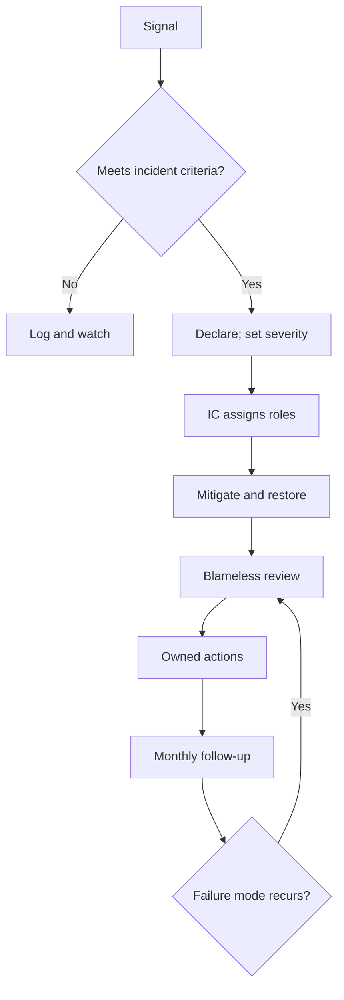
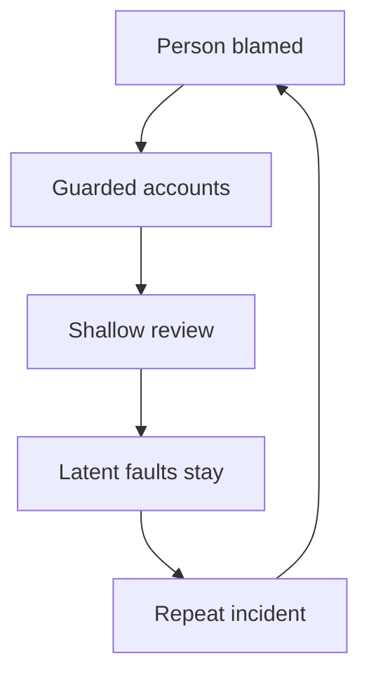
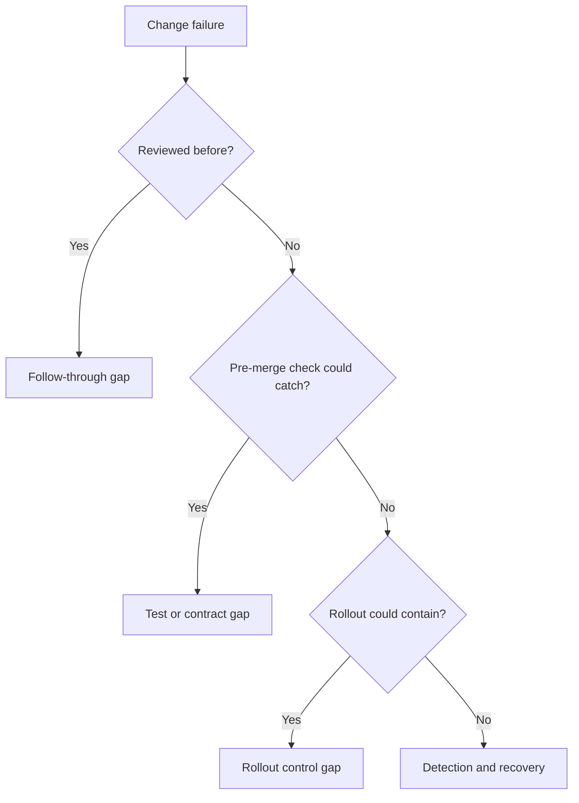

# Chapter 25 — Incidents, Postmortems, and Change Failure Analysis

What separates organizations is not whether they have incidents but what an incident leaves behind:
a fixed weakness and engineers who describe their mistakes honestly, or an unfinished action list and
a team that has learned to keep quiet. This chapter covers the three systems that decide which:
incident response (roles, severity, communication), blameless review (what the organization learns),
and change failure analysis (where a failure could most cheaply have been stopped). The running
example is the fictional [Northstar Technologies](../../case-studies/northstar/index.md). Chapter 24
owns SLOs and operational readiness, Chapter 23 owns CI/CD, and Chapter 57 owns crisis leadership.
Chapter 27 uses incident data to diagnose a quality decline; this chapter builds the system that
produces that data and acts on it.

## Why This Matters

At team scale, the leadership work is to make incident pressure produce learning rather than fear.

At organization scale, incidents become a data stream. Thirty incidents a quarter, each rated and
reviewed differently, cannot be compared. Severity was assigned
by the on-call engineer with no written definition. Of 96 corrective actions recorded over two
quarters, 31 closed (32 percent), and none had an owner above the engineer who wrote it. Eleven of the
quarter's 30 incidents (37 percent) repeated a known failure mode, and those 11 took 4,920 of the
quarter's 9,558 minutes of restoration time. Just over half the time spent restoring service went
into failures Northstar had already met.

At executive scale, the question is "how exposed are we, are we improving, and can I believe the
numbers". An incident system whose severity labels move under pressure, whose reviews name people, or
whose actions never close cannot answer it.

## Learning Objectives

After this chapter you will be able to:

- Run incident response with separated roles and severity definitions that resist downward
  reclassification.
- Communicate during an incident with customers, customer-facing staff, and executives on a cadence
  agreed in advance.
- Facilitate a blameless review that finds contributing factors rather than one root cause, and
  explain why that is not a lack of accountability.
- Design follow-up action tracking that closes the loop, and measure recurrence to test it.
- Classify change failures by prevention point, weigh them by cost as well as count, and choose the
  intervention with the most leverage.

## The Mental Model

> **Mental model:** An incident is paid for twice: once in the outage and once in the review. The
> second payment buys something only if people tell the truth and the actions land.

Two ideas organize the chapter. First, **incidents are produced by systems and reported by people**.
Richard Cook's short treatise on complex systems argues that an overt failure needs several small
faults to combine, that complex systems always carry latent faults, and that hindsight makes earlier
signals look more obvious than they were ([Cook, 1998](../../references/bibliography.md#cook1998complex)).
If so, the people nearest a failure are its best witnesses, and an organization that punishes its
witnesses loses its evidence.

Second, **learning is a loop that can break at any point**. Most organizations invest in detection
and response and neglect the steps after the review.

The return arrow matters most: a recurrence means an earlier review, or its follow-through, failed.

## Deep Conceptual Explanation

### Roles: separate coordinating from fixing

The common failure is that the most knowledgeable engineer tries to diagnose, change the system,
answer executives, and update customer success at once. Google's chapter on managing incidents
describes the alternative it uses: an **incident commander** who holds the overall state and assigns
work, an **operations** lead whose team alone changes the system, a **communications** role that sends
regular updates, and a **planning** role that files bugs, arranges handoffs, and records changes to
revert later. It also recommends explicit handoff of command, a shared live incident document, and
declaring early, with criteria such as needing a second team, customer-visible impact, or an issue
unsolved after about an hour ([Stribblehill, Managing Incidents](../../references/bibliography.md#google2017managing)).
This is **documented practice** from one organization, not outcome evidence; the logic is that one
person cannot debug and coordinate at once.

So on a Sev1 the commander does not debug; commanders come from a trained rotation, not from seniority
alone; and declaring early is cheap. At Northstar, median time to detect was 6 minutes
when monitoring caught an incident and 108 minutes when a customer reported it, so criteria that wait
for certainty widen the gap.

### Severity definitions that resist reclassification

Severity sets the response during an incident and becomes a measure afterwards. Once the measure is
watched, the person assigning it, usually from the team that will be counted, feels pressure to lower
it. Chapter 27 shows this happening in Northstar's transformation quarter.

Northstar's data shows what happens without definitions. INC-409 (duplicate invoices after a release)
was Sev1; INC-427 (credit notes applied twice, manual data repair, about 18 hours to restore) was Sev2.
Both put wrong financial records in front of customers. INC-425 (an expired certificate on the card
processor endpoint, 70 minutes) was Sev1, while INC-401 (multi-currency invoice totals rounded wrongly,
almost five hours) was Sev2. Together the ratings cannot be compared.

Definitions that resist reclassification have four properties (this book's recommendation):

1. **Observable customer impact**, not cause or effort. "Payment path unavailable for any customer"
   can be checked in minutes; "major bug" cannot.
2. **A class for wrong data**, not only unavailability. For an order-to-cash business a wrong invoice
   is often worse than a slow page.
3. **Asymmetry.** Anyone may raise severity; lowering it during the incident needs the incident
   commander and a recorded reason. In doubt, take the higher level.
4. **Audit.** The review confirms the final rating against the definition, and someone outside the
   team checks a weekly sample.

### Communicating during an incident

**Responders** need state, hypothesis, and assignments; the live document serves them.
**Customer-facing staff and executives** need impact, what is being done, what is unknown, and the next
update time, but not the hypothesis of the moment: a retracted explanation costs credibility.
Northstar's VP of Customer Success, Sofia Alvarez, wants honest status during incidents. In practice that means a fixed cadence on a Sev1 (for
example every 30 minutes, even with no news) and a list of affected accounts among the largest 40
customers, so her team calls them before they call in. **Customers** need to know the provider knows,
what they can and cannot do, and when they will hear next.

Two rules carry most of the weight (this book's recommendation): the first customer notice for a Sev1
goes out within a fixed time of declaration from a prepared template, without waiting for a cause; and
no cause is stated publicly until the review confirms it. At Northstar customers found 14 of 30
incidents first, so in those cases any message could only arrive after the customer already knew.
Routine executive updates should use the customer success format, so nobody holds a different version
of the truth; crisis communication belongs to Chapter 57.

### Blameless review and its critics

Google's postmortem chapter describes a blameless postmortem as one that looks for contributing causes
without indicting any individual or team, and recommends defining review triggers (user-visible
downtime, data loss, a monitoring failure) before incidents happen
([Lunney and Lueder, Postmortem Culture](../../references/bibliography.md#google2017postmortem)).

John Allspaw's 2012 essay gives the argument most practitioners cite
([Allspaw, 2012](../../references/bibliography.md#allspaw2012blameless)). It is about information: an
engineer who expects reprimand has every reason to leave out what they saw, expected, and assumed, and
without those details the failure is likely to recur. The essay borrows two ideas from safety research:
the "second story", in which human error is an effect of weaknesses in the system rather than its
cause, and the warning that hindsight bias and the habit of attributing outcomes to people rather than
situations cloud reviews and have to be actively worked against.

The usual objection is that blameless becomes accountability-free. The essay answers that engineers
are not off the hook; they are expected to help make the organization safer. This book makes that
concrete: accountability attaches to **telling the truth in the review** and to **follow-through on
the actions**, which Chapter 27 calls accountability for the system. Write the
boundary down in advance and keep it narrow: sabotage, dishonesty in the review, or repeated refusal of
an agreed safety practice are management matters. Drawn after an incident, around the person involved,
it reads as blame with extra steps.

### Why "root cause" misleads

Cook argues that complex-system failures have several contributors, each insufficient alone, that a
search for the single cause reflects a social need to blame more than a technical understanding, and
that remedies aimed at the last step before failure rarely prevent the next accident
([Cook, 1998](../../references/bibliography.md#cook1998complex)). Read this as **expert opinion** from
safety science, written mainly about healthcare, not an empirical result about software. Courtney Nash's 2022
talk on the VOID, an open database of public software incident reports, argues from the software side
that root cause analysis can make people less likely to admit mistakes and that mean time to repair
can be an unreliable metric ([Nash, 2022](../../references/bibliography.md#nash2022void)); that is
**industry research** known here only from the talk's abstract.

The single-cause habit survives because it yields one clear action, but analysis stops at the first
satisfying answer, usually a person or a step. Instead:

- Record the **trigger** as a fact. INC-430's trigger is a mistyped rate-limit value; that needs no
  softening.
- Record the **contributing factors**: why a value ten times too low could deploy without a range
  check, and why nothing compared it with the previous value. The
  [incident review template](../../templates/incident-review.md) asks for factors across code,
  pipeline, process, monitoring, ownership, documentation, and staffing. Its INC-427 example lists four
  (no ordering check, unknown migration duration at production volume, no ledger invariant alert, a
  batch of about 170 changes) where a single-cause review would list one.

### The evidence on blameless review (disputed claim D6)

This book found no peer-reviewed study measuring the effect of blameless review on incident outcomes in
software. The software research is qualitative and descriptive. Sillito and Kutomi analysed 30
incidents from interviews and published postmortems
([Sillito and Kutomi, 2020](../../references/bibliography.md#sillito2020failures)). An interview study
at a national space research center found failure learning informal and ad hoc, with recurring failures
persisting where no structured process existed
([Anandayuvaraj et al., 2026](../../references/bibliography.md#anandayuvaraj2026learning)). Neither
compares blameless with blaming reviews.

The transferable evidence comes from healthcare, where just culture began, and it is thin. A 2023
integrative review called the evidence on implementing just culture scant, noted that most of the
literature is theoretical, and called for research on patient safety outcomes
([Murray et al., 2023](../../references/bibliography.md#murray2023just)). A 2022 systematic review found
that a focus on safety rather than individual blame enhanced trust in error reporting, and that less
experienced staff reported more fear of blame
([van Marum et al., 2022](../../references/bibliography.md#vanmarum2022barriers)). Edmondson's study of
51 teams in one manufacturing company associated psychological safety with learning behavior, which in
turn was associated with performance
([Edmondson, 1999](../../references/bibliography.md#edmondson1999psychological)). These support the
**mechanism** (fear suppresses reporting) rather than the **outcome** (fewer or shorter incidents).

**This book's recommendation:** blameless toward individuals, strict about truthfulness and
follow-through, honest that the outcome benefit is unproven, and measured locally through recurrence,
action closure, and whether reviews grow more detailed or shorter over time.

This loop simplifies the cycle Allspaw describes: one blaming review degrades every review after it.

### Follow-up actions and recurrence

Northstar's 32 percent closure has structural causes. Cross-team actions (a pipeline check, a
monitoring standard) were owned by engineers who control no capacity. Actions outside the team's plan
lost to work inside it. Reviews produced too many small actions; the template caps them at five, each
tied to a contributing factor. And nothing checked recurrence: INC-427's recurrence check found that
the INC-406 review had recommended migration checks and the action was never scheduled.

Both measures are gamed predictably: closure rises when actions are trivial or quietly closed as
"won't do"; recurrence falls when failure modes are described too narrowly to match. Pair
them: closure of the actions marked most important, recurrence by broad category, and a monthly sample
of "won't do" closures. Dropping an action is legitimate. Dropping it silently is not.

### Classifying change failures to find the prevention point

DORA defines change fail rate as the ratio of deployments that need immediate intervention
([DORA, metrics guide](../../references/bibliography.md#dora-metrics-guide)). The rate says how often
changes fail, not where to intervene. For that, classify each failure by **prevention point**: the
earliest step at which a reasonable, affordable control would have stopped or contained it. Orthogonal
Defect Classification, developed at IBM, is the research precedent: classify defects by their meaning
so the distribution of classes gives feedback on the process while it runs
([Chillarege et al., 1992](../../references/bibliography.md#chillarege1992orthogonal)).

The first question is first on purpose: a failure mode already reviewed is a follow-through problem,
and more tests will not fix the process that let the earlier action lapse. Three rules keep the
classification honest (this book's recommendation): classify from the review, not the ticket title;
have two people classify a quarterly sample independently and discuss disagreements; and weigh each
category by cost (restoration time, customers affected) as well as count. Chapter 27 classifies
Northstar's escaped defects by detection point; the example below does the same for incidents.

## Engineering Organization Example

This classification is **illustrative**. It assigns each of Northstar's 19 change-induced incidents to
a control point from the one-line summaries in `incidents-last-quarter.csv`, using the diagram's later
questions. The first question needs review history, which the file records only as a recurrence flag,
so recurrences get their own column. Several rows could reasonably go another way.

| Control point | Incidents | Count | Restore minutes | Customer-detected | Recurrences |
|---|---|---|---|---|---|
| Logic and regression tests | 401, 403, 409, 411, 417, 421, 422 | 7 | 3,085 | 6 | 5 |
| Migration safety | 406, 419, 424, 427 | 4 | 1,970 | 1 | 3 |
| Contract checks | 405, 412, 418 | 3 | 775 | 3 | 1 |
| Configuration guards | 404, 410, 430 | 3 | 113 | 0 | 0 |
| Load test or canary | 415 | 1 | 160 | 0 | 0 |
| Testing pipeline changes | 416 | 1 | 120 | 0 | 0 |
| **Total** | | **19** | **6,223** | **10** | **9** |

Check: 6,223 is the 9,558 restore minutes for all 30 incidents minus 3,335 for the other 11.

Four observations change what a count alone suggests. **Configuration guards** would prevent three
cheap incidents (113 minutes, all caught by monitoring): worth doing, not first. **Migration safety** is
the most expensive per incident, almost 500 minutes each; three of the four were in Billing's ledger and
invoicing, and three (INC-406, INC-424, INC-427) were recurrences. **Contract failures** were all found
by customers; no alert caught the blank emails or the rejected webhooks. And **all
seven logic-test failures** shipped on the Core release train, six found by customers: tests would
have prevented some, smaller releases would have made the rest faster to diagnose (Chapter 27's constraint
argument).

The last column changes the reading most. Nine of the 11 recurrences were change-induced, including 5
of the 7 "test gaps", so much of what looks like missing tests may be missing follow-through. Recurrences
restored in a median 290 minutes against 160 for first-time failures. The first month's money belongs
in follow-through on existing migration and release-train actions, before new prevention work.

## Decision Framework

How much process an event needs (thresholds are this book's recommendation for an organization of
Northstar's size):

| Situation | Roles | Customer communication | Review | Action owner |
|---|---|---|---|---|
| Sev1, or wrong financial data visible to customers | IC, operations, communications, scribe | Fixed time to first notice; fixed cadence | Full, within five working days, neutral facilitator | Manager; director if cross-team |
| Sev2 on a tier 1 path | IC and operations; communications if customers are told | If customers are affected | Full | Manager |
| Sev2 elsewhere | One person may hold several roles | Usually none | Short written review | Team |
| High-potential near miss | None | None | Short, if new or recurring | Team |
| Recurrence of a reviewed failure mode | As severity requires | As severity requires | Start with the earlier actions | One level above the earlier owner |

**Who facilitates?** A neutral facilitator from another team
gets more candid accounts and spreads learning; the owning manager knows the system and owns
follow-through. Split it: the outsider runs the meeting, the manager owns the document and actions.
**What gets reviewed?** Define triggers in advance, and include recurrences and high-potential near
misses regardless of severity.

## Trade-offs

**Early declaration against noise.** Low thresholds shorten mobilization and page people for events
that prove minor. A false alarm costs an hour; a late declaration on the payment path costs service
credits. On tier 1 paths, err toward declaring.

**Strict definitions against judgment.** Written criteria make ratings comparable and misclassify
unusual events. Let the commander rate above the definition, never below, with a reason.

**Review depth against volume.** Depth should follow severity, novelty, and recurrence.

**Transparency against candor.** Reviews published verbatim get written for their audience. Keep the
review internal; write a separate external summary.

**Central tracking against ownership.** A central action list makes closure visible and can make
actions feel like someone else's job. Track centrally; plan locally, with every action in the owning
team's plan.

## Failure Modes

**Severity drift.** Sev1 and Sev2 counts fall while customer-detected incidents and credits hold steady.
Countermeasure: asymmetric definitions, weekly audit, paired measures.

**Hero response.** A few engineers carry most of the response (in Northstar's Billing team, three
people carry most pages), and they burn out. Signal: the same names in most timelines. Countermeasure: commander rotation,
runbooks, pairing newer engineers into response.

**The ceremonial review.** Templates are filled and nothing changes. Signal: closure below half and a
flat recurrence rate. Countermeasure: capped actions, manager owners, monthly review, recurrence checks.

**Blame by other means.** Nobody says "fault", but "human error" appears as a cause or the CEO's first
question is "who". Signal: reviews getting shorter and
fewer volunteers to lead them. Countermeasure: the facilitator checklist, and executives briefed in
advance.

**Root cause tunnel vision.** One cause is fixed and the condition that produces the next incident
through a different trigger survives. Signal: recurrences with different triggers. Countermeasure:
require contributing factors beyond the triggering change, including what made the incident longer.

**Action-item inflation.** Ten actions per review signal seriousness and bury the important ones.
Signal: rising action count, flat closure. Countermeasure: a hard cap, each action tied to a factor.

## Enterprise Application

In an organization of 50 to 150 engineers, the incident system needs a few shared standards and a
clear split of ownership.

**The director owns** severity definitions, review triggers, the commander rotation and its training,
the monthly cross-team action review, and the written boundary between blameless review and
performance management. **Engineering managers own** their components' reviews and actions, and put
those actions in their team's plan; asked why an action slipped, a manager should name a trade-off,
not a surprise. **Staff engineers own** cross-cutting contributing factors (migration safety, contract
testing, configuration guards) and make natural facilitators outside their own area. **Customer
success owns** the account list and the calls to the largest customers, using the communications
lead's updates.

Three standards carry most of the value: one severity definition, one review template, and one action
tracker with recurrence links. Teams may extend them, not replace them. The weekly operational review in Chapter 27 is where this system meets the
management system: last week's incidents, the severity audit, actions due, and any recurrence, in 30
minutes.

## CTO Perspective

At executive level three things change.

**Incidents become a disclosure question.** Contracts, regulated customers, and security obligations
set what must be said, to whom, and how fast; the CTO should settle in advance who approves customer
statements.

**The CTO sets the tone of the first question.** When a Sev1 hits the largest customer, the CEO's first
question becomes, within a week, how every engineer understands the incident system. A CTO who has
prepared the executive team ("we will tell you what happened, what the system allowed, and what we are
changing; we will not name a culprit") protects the information the company needs.

**Measures must survive scrutiny.** Report Sev1 counts, availability, and credits with their
definitions and paired measures, and be willing to show a re-rating that made the numbers worse. A
quarter in which incidents fell and credits rose loses a board's trust quickly.

Be honest about evidence: "this preserves the information we need, and we measure whether reviews
work" is defensible to a skeptical board member; "research proves blameless review works" is not.

## Practical Playbook

1. Write severity definitions in observable customer impact, with a class for wrong financial or
   customer data. Anyone can raise; only the incident commander can lower, with a reason.
2. Write declaration criteria and review triggers in advance, including any recurrence.
3. Train a commander rotation of 8 to 15 people; each runs a practice incident before a live shift.
4. Prepare communication templates for customers, customer success, and executives, with a fixed time
   to first notice and a fixed Sev1 cadence.
5. Adopt one review template (start from the [incident review template](../../templates/incident-review.md)):
   contributing factors, a recurrence check, at most five actions.
6. Triage the action backlog: keep the few on recurring or expensive failure modes, each with a manager
   owner and date; drop the rest explicitly, telling authors why.
7. Review open actions monthly. A slipped action on a recurring failure mode gets an interim control
   the same day, or an explicit decision to accept the risk.
8. Classify change failures by prevention point each quarter, weighted by cost, with a two-person check.
9. Report paired measures: severity with customer-detected share, closure with recurrence, restoration
   time as median and 90th percentile.
10. Write down the narrow boundary between blameless review and performance management, and brief
    executives on it.

## Case Study

This case is **fictional**. It continues the [baseline](../../case-studies/northstar/baseline-data.md)
and Chapter 27 through the director's first quarter. Facts not in the baseline are recorded as
Northstar additions for this chapter.

In week 3 the director published severity definitions written with Kwame Mensah and Sofia Alvarez:
Sev1 covered the order or payment path unavailable for any customer, and any wrong financial record
visible to customers. Applied to the baseline quarter, they moved INC-401 and INC-427 to Sev1 and left
three incidents (INC-414, INC-422, INC-424) as judgment calls the wording then had to settle. The
director published the re-rating, which made the numbers worse: seven Sev1 incidents became nine (the
baseline page keeps the original ratings). To objecting managers, the director said a flattering
baseline would make every later improvement unbelievable.

In weeks 4 and 5, twelve people (the six managers, three staff engineers, and three senior engineers)
trained as incident commanders. Marcus Oyelaran asked to be left out because Billing was overloaded;
the director kept him in and took him off two roadmap reviews instead.

Of the 96 recorded actions, 65 were open. The director and staff engineers kept 14, after merging 9
duplicates into them, and dropped 42 explicitly, each author getting a one-line reason. Every kept
action got a manager owner. Among them was INC-427's pipeline check blocking code that depends on an
unfinished migration, owned by Li Na Zhou with Billing and due in week 7.

It slipped: the check had to go into the Jenkins pipeline the release working group was changing. The
week 8 action review accepted a new date and put no interim control in place. In week 9 came the Sev1
Chapter 27 describes: credit notes applied twice, through a migration and dependent code shipped in the
same train. The review's first contributing factor was that the organization had known this failure
mode since INC-406, reviewed it twice, and let the action slip without a substitute. An interim control
(no release may contain a ledger migration and code that depends on it) was agreed in a day; the
pipeline check landed in week 11.

At day 90, 5 of the quarter's 21 incidents were recurrences (24 percent, against 37 percent). Of the 14
retained actions and the 23 raised by the quarter's reviews, 26 had closed (70 percent). Both rest on
few events and were reported as encouraging, not conclusive. The lesson carried forward: a slipped
action on a recurring failure mode needs an interim control the same day.

## Exercises

Solutions are in [chapter 25 solutions](../../solutions/ch25-solutions.md). The incident data is linked
from the [Northstar baseline page](../../case-studies/northstar/baseline-data.md).

### Foundational

**F1.** Using `incidents-last-quarter.csv` and the case study's severity definitions (Sev1: order or
payment path unavailable for any customer, or any wrong financial record visible to customers), re-rate
INC-401, INC-409, INC-414, INC-422, INC-424, INC-425, and INC-427. For each judgment call, state what
information you would need, and propose wording that would settle it without making Sev1 meaningless.

**F2.** A draft review of INC-430 reads: "Root cause: the engineer mistyped the rate-limit value and did
not double-check it before deploying. Action: remind all engineers to double-check configuration
values." Rewrite the cause and action sections in the form this chapter recommends. Show where
hindsight bias appears in the draft and which questions the facilitator should have asked.

**F3.** Classify Northstar's nine release-train incidents (`trigger` is `monolith-release`) by prevention
point without looking at the chapter's table, then compare. For each disagreement, say what information
from the review would decide it, and whether the disagreement changes which intervention has the most
leverage.

### Applied Leadership

**A1.** It is 10:40 on a Tuesday. Payments are being posted to the wrong accounting period after a Core
release, and you are incident commander. Marcus Oyelaran has joined and started debugging; the CEO has
posted "who shipped this?" in the incident channel; Sofia Alvarez wants updates every ten minutes for
three named customers. Describe your first twenty minutes, in order, and what you say to each of the
three.

**A2.** After the action triage, Elena Sokolova points out that 6 of the 42 dropped actions came from her
team's reviews, and her engineers now ask whether writing actions is worth the effort. Billing's actions
dominate the kept list. Prepare your response to her and her engineers, and decide whether to change
the triage.

**A3.** A manager asks for a formal warning for an engineer who shipped a ledger migration and dependent
code in the same release for the second time in six months. The engineer says the release checklist
never mentioned migration ordering and the first incident's action was never done. Decide what you do,
where the boundary of blameless review sits here, and how you explain it to the manager and the team.

### Executive Decision-Making

**X1.** One of Northstar's two largest customers, whose renewal is in question, suffers a Sev1 and
demands, within 48 hours, a written root cause analysis naming the root cause and the person
responsible. The contract requires an incident report within five business days and does not specify
its content. As CTO, decide what you send and when, and how you protect both the renewal and the
internal review. Outline the customer document.

**X2.** Victor Lindqvist proposes tying 20 percent of each engineering manager's bonus to two numbers:
action closure above 80 percent and zero recurrences. Helena Marsh supports it as a sign of seriousness.
Decide whether to support, modify, or oppose it. Predict how each number would be gamed, and propose an
alternative that keeps executive accountability for follow-through.

## Reflection Questions

1. When a change causes an incident, how soon is the person who made it named, and by whom?
2. Which of last quarter's severity ratings would change if an outsider re-rated them against a written
   definition? Who would object?
3. What fraction of your incident actions from six months ago are closed, and how would you find out?
4. Has your organization drawn the line between blameless review and performance management? Before or
   after a specific incident?
5. In your last serious incident, who was the first customer to know, and how did they find out?

## Key Takeaways

- Separate roles: the commander coordinates and does not debug; one group changes the system; one
  voice communicates.
- Define severity by observable customer impact, include wrong data, make it asymmetric, and audit it.
- Communicate on a fixed cadence from prepared templates; keep causes out of public messages until the
  review confirms them.
- Record the trigger as fact and the contributing factors as analysis; a single root cause ends the
  search too early.
- Be blameless toward individuals, strict about truthfulness and follow-through, and honest that
  outcome evidence for blameless review is thin.
- Cap actions, give cross-team actions a manager owner, review them monthly, and drop them explicitly.
- Treat every recurrence as a failed earlier review, and check follow-through first.
- Classify change failures by prevention point and weigh the categories by cost, not only count.

## References and Further Reading

- [Stribblehill, Managing Incidents](../../references/bibliography.md#google2017managing). Chapter 14 of
  the free *Site Reliability Engineering* book ([Beyer et al., 2016](../../references/bibliography.md#beyer2016sre)):
  incident roles, declaration, handoff, and the live document.
- [Lunney and Lueder, Postmortem Culture](../../references/bibliography.md#google2017postmortem).
  Blameless postmortems and review triggers.
- [Allspaw, 2012](../../references/bibliography.md#allspaw2012blameless). The essay that brought
  blameless postmortems and just culture into software operations.
- [Cook, 1998](../../references/bibliography.md#cook1998complex). A short treatise on multiple causes,
  latent faults, and hindsight bias.
- [Nash, 2022](../../references/bibliography.md#nash2022void). What public incident reports suggest
  about MTTR and root cause analysis.
- [Sillito and Kutomi, 2020](../../references/bibliography.md#sillito2020failures) and
  [Anandayuvaraj et al., 2026](../../references/bibliography.md#anandayuvaraj2026learning). Qualitative
  studies of incident response and of learning from failure.
- [Murray et al., 2023](../../references/bibliography.md#murray2023just) and
  [van Marum et al., 2022](../../references/bibliography.md#vanmarum2022barriers). Healthcare reviews
  showing how thin the outcome evidence for just culture is.
- [Edmondson, 1999](../../references/bibliography.md#edmondson1999psychological). Psychological safety.
- [Chillarege et al., 1992](../../references/bibliography.md#chillarege1992orthogonal). Classifying
  defects to get process feedback.
- [DORA metrics guide](../../references/bibliography.md#dora-metrics-guide). The current definition of
  change fail rate.
