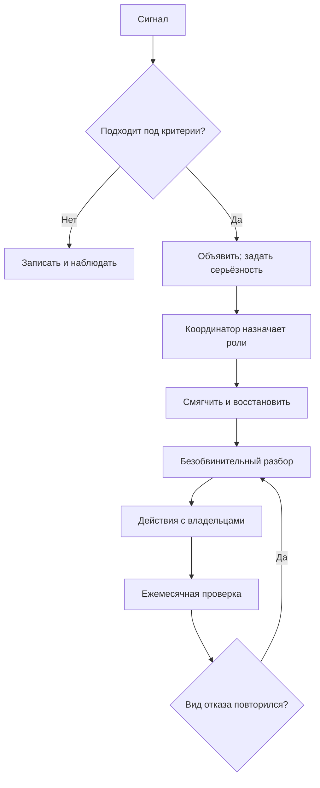
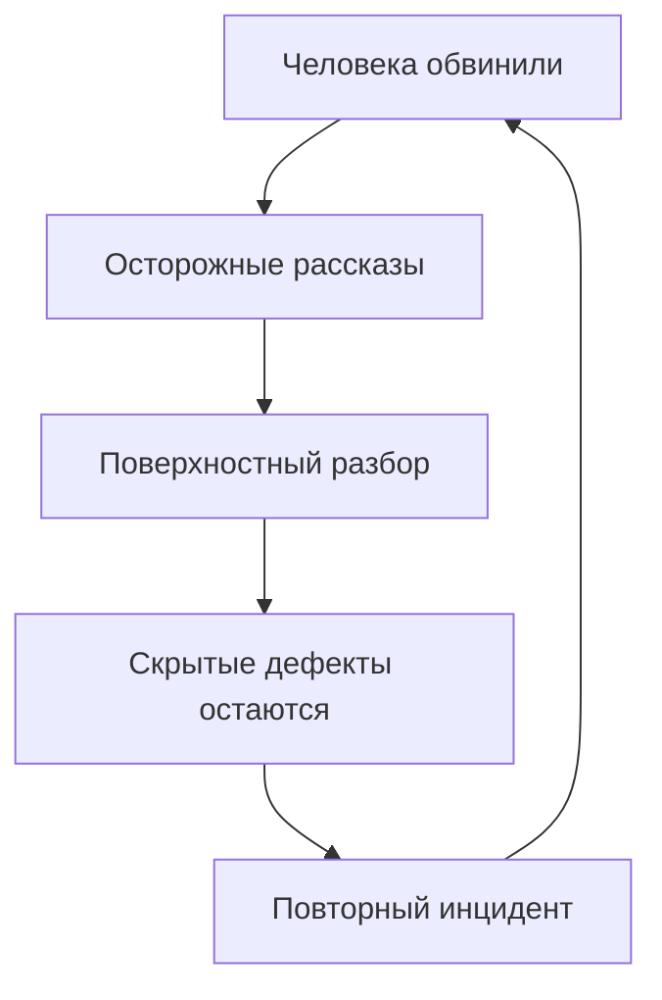
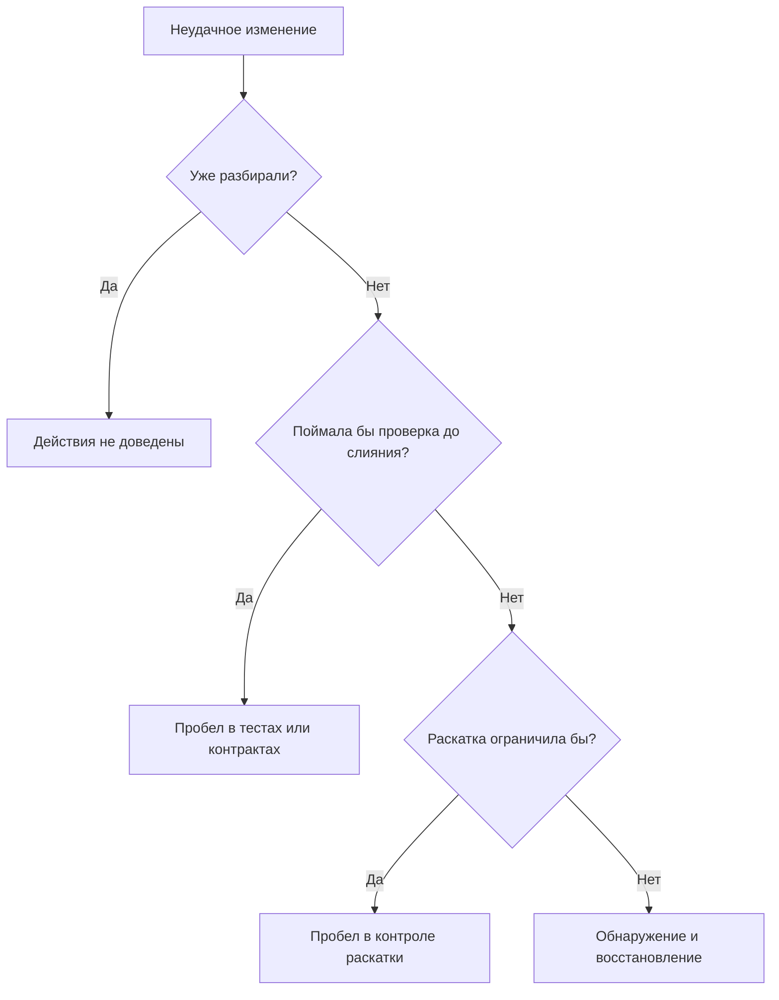

# Глава 25 — Инциденты, постмортемы и анализ неудачных изменений { #chapter-25-incidents-postmortems-and-change-failure-analysis }

Организации различаются не тем, бывают ли у них инциденты, а тем, что инцидент после себя оставляет.
Либо устранённую слабость и инженеров, которые честно рассказывают о своих ошибках, либо незакрытый
список действий и команду, которая научилась молчать. Исход определяют три системы, о них
и пойдёт речь: реагирование на инциденты (роли, серьёзность, коммуникация), безобвинительный
[разбор инцидента](../../glossary.md#blameless-review) (его ещё называют постмортемом; на нём
организация и учится) и анализ неудачных изменений (где сбой можно было остановить дешевле всего).
Сквозной пример — вымышленная компания [Northstar Technologies](../../case-studies/northstar/index.md).
SLO и операционную готовность разбирает глава 24, CI/CD — глава 23, лидерство в кризисе — глава 57.
Глава 27 по данным об инцидентах диагностирует падение качества, а эта глава строит систему, которая
такие данные порождает и действует по ним.

## Почему это важно { #why-this-matters }

Задача руководителя в команде — сделать так, чтобы давление инцидентов рождало обучение, а не страх.

В масштабе организации инциденты становятся потоком данных, и если данные несогласованны, сравнивать
их нельзя.
В Northstar, нашем сквозном примере, за базовый квартал случилось 30 инцидентов Sev1 и Sev2, и каждый
оценивали и разбирали по-своему. (Sev1 и Sev2 — две высшие степени
[серьёзности](../../glossary.md#severity-sev1-sev2-sev3); Sev3 — уровень ниже, в итоговую цифру он не
входит.) Серьёзность назначал дежурный инженер, не имея письменного определения. Из
96 корректирующих действий, записанных за два квартала, закрыли 31 (32%), и ни у одного владелец не
стоял выше инженера, который это действие записал. Одиннадцать из 30 инцидентов (37%) повторяли уже
известный вид отказа, и на эти 11 ушло чуть больше половины всего времени восстановления за квартал
(4 920 из 9 558 минут). Иначе говоря, большую часть сил на восстановление Northstar тратила на сбои, с
которыми уже сталкивалась.

Высшее руководство спрашивает: «Насколько мы уязвимы? Становимся ли мы лучше? Можно ли верить цифрам?»
Ответить не сможет система инцидентов, в которой метки серьёзности сдвигаются под давлением, разборы
называют виноватых, а действия так и не закрываются.

## Цели главы { #learning-objectives }

Прочитав эту главу, вы сможете:

- Организовать реагирование на инциденты с разделёнными ролями и определениями серьёзности,
  устойчивыми к занижению.
- Во время инцидента держать в курсе клиентов, сотрудников клиентских служб и руководство в заранее
  согласованном ритме.
- Вести безобвинительный разбор, который ищет сопутствующие факторы, а не одну первопричину, и
  объяснять, почему это не отказ от ответственности.
- Выстроить отслеживание последующих действий так, чтобы петля замыкалась, и проверять его по
  повторным инцидентам.
- Классифицировать неудачные изменения по точке предотвращения, взвешивать их не только по числу, но и
  по стоимости и выбирать вмешательство с наибольшим рычагом.

## Ментальная модель { #the-mental-model }

> **Ментальная модель:** за инцидент платят дважды: первый раз простоем, второй раз разбором. Второй
> платёж что-то покупает, только если люди говорят правду, а действия доводят до конца.

В основе главы две идеи. Первая: **инциденты порождает система, а сообщают о них люди**. Richard
Cook в коротком трактате о сложных системах утверждает, что явный отказ возникает, когда сходятся
несколько мелких неисправностей. В сложных системах всегда есть скрытые дефекты, а взгляд задним числом
делает ранние сигналы очевиднее, чем они были ([Cook, 1998](../../references/bibliography.md#cook1998complex)).
Если так, то люди, оказавшиеся ближе всего к сбою, — его лучшие свидетели. Организация, которая
наказывает свидетелей, теряет доказательства.

Вторая: **обучение — это петля, которая может разорваться в любом месте**. Большинство организаций
вкладываются в обнаружение и реагирование и забрасывают всё, что идёт после разбора.

Важнее всего обратная стрелка: повторный инцидент означает, что не сработал прежний разбор или то, что
должно было за ним последовать.

## Подробный разбор { #deep-conceptual-explanation }

### Роли: координация отдельно от исправления { #roles-separate-coordinating-from-fixing }

Типичная картина: инженер, лучше всех знающий систему, пытается одновременно диагностировать
проблему, менять систему, отвечать руководству и держать в курсе службу работы с клиентами. Глава
Google об управлении инцидентами описывает другой порядок, принятый в компании. **Координатор
инцидента (incident commander)** держит общую картину и распределяет работу. Руководитель **операций**
(operations) возглавляет группу — единственную, кому разрешено менять систему. Роль **коммуникации** отвечает
за регулярные обновления. Роль **планирования** заводит баги, организует передачу дел и записывает
изменения, которые потом придётся откатить. Ещё глава советует передавать командование явно, вести
общий живой документ инцидента и объявлять инцидент рано, например если нужна вторая команда, клиенты
видят последствия или проблему не удаётся решить примерно за час
([Stribblehill, Managing Incidents](../../references/bibliography.md#google2017managing)).
Это **задокументированная практика** одной организации, а не доказательство результата. Логика такая:
один человек не может одновременно отлаживать и координировать. Роль планирования книга называет
**секретарём** (scribe): запись — та часть работы, которую чаще всего пропускают.

Поэтому на инциденте Sev1 [координатор инцидента](../../glossary.md#incident-commander) не занимается
отладкой. Координатора берут из графика обученных людей, а не выбирают только по старшинству. Объявить
инцидент рано — дёшево. В Northstar медианное время обнаружения составляло 6 минут, когда инцидент
ловил мониторинг, и 108 минут, когда о нём сообщал клиент. Критерии, которые ждут уверенности, только
увеличивают этот разрыв.

### Первые минуты { #the-first-minutes }

Первые действия координатора во многом определяют, сколько продлится инцидент. Порядок на первые
двадцать минут (**рекомендация книги**):

1. **Объявите инцидент и задайте серьёзность.** Если сомневаетесь, берите уровень выше: понизить его
   потом дёшево.
2. **Объявите вслух, что командуете вы.** «Координатор — я». Назначьте по именам, кто отвечает за операции и
   кто за коммуникацию. Если вы сами отлаживали, передайте клавиатуру другому.
3. **Сначала смягчите последствия, потом диагностируйте.** Спросите, что недавно менялось, а затем
   откатите изменение, выключите флаг или переключитесь на резерв. Сначала восстановите сервис; причина
   подождёт до разбора.
4. **Задайте ритм.** Ответственный за коммуникацию публикует первое обновление, называет время следующего и
   дальше выдерживает график.
5. **Защитите тех, кто чинит.** Руководство и служба работы с клиентами получают обновления от
   ответственного за коммуникацию, а не расспрашивают инженеров. Вопрос, кто внёс изменение, ждёт
   разбора.

### Определения серьёзности, устойчивые к занижению { #severity-definitions-that-resist-reclassification }

Во время инцидента серьёзность задаёт уровень реагирования, а после него становится показателем. Как
только за показателем начинают следить, у того, кто его назначает (обычно это человек из той самой
команды, которую по нему будут оценивать), появляется соблазн его занизить. В Northstar на это
ушло несколько недель. На неделе 7 четыре инцидента подряд получили Sev3, и среди них двухчасовая
задержка платежей у девяти клиентов. Так продолжалось, пока директор не переоценил эти инциденты.

Данные Northstar показывают, что бывает без определений. INC-409 (дубли счетов после релиза) получил
Sev1, а INC-427 (кредит-ноты применены дважды, ручное исправление данных, около 18 часов на
восстановление) — Sev2. При этом оба показали клиентам неверные финансовые записи. INC-425 (истёкший
сертификат на эндпоинте процессора карт, 70 минут) получил Sev1, а INC-401 (неверное округление итогов
мультивалютных счетов, почти пять часов) — Sev2. Сравнивать такие оценки между собой невозможно.

У определений, устойчивых к занижению, четыре свойства (рекомендация книги):

1. **Наблюдаемые последствия для клиентов**, а не причина или трудозатраты. «Путь оплаты недоступен
   хотя бы одному клиенту» можно проверить за минуты, «серьёзный баг» — нельзя.
2. **Отдельный класс для неверных данных**, а не только для недоступности. Для бизнеса order-to-cash
   («от заказа до оплаты») неверный счёт часто хуже медленной страницы.
3. **Асимметрия.** Повысить серьёзность может любой; понизить её во время инцидента — только
   координатор инцидента, с записанной причиной. Если сомневаетесь, берите уровень выше.
4. **Аудит.** На разборе итоговую оценку сверяют с определением, а кто-то вне команды каждую неделю
   проверяет выборку.

### Коммуникация во время инцидента { #communicating-during-an-incident }

**Тем, кто чинит**, нужны текущее состояние, гипотеза и распределение задач; для них и существует живой
документ. **Сотрудникам, работающим с клиентами, и руководству** нужно знать, каковы последствия, что
делается, что пока неизвестно и когда будет следующее обновление. Сиюминутная гипотеза им ни к чему:
объяснение, которое потом пришлось забрать назад, обходится потерей доверия. Sofia Alvarez, VP
Northstar по работе с клиентами, во время инцидентов хочет знать честный статус. На Sev1 ей нужен фиксированный ритм (скажем, каждые 30 минут, даже если новостей нет)
и список затронутых клиентов из 40 крупнейших, чтобы её команда позвонила им раньше, чем позвонят они.
**Клиентам** нужно знать, что поставщик в курсе, что они могут и чего не могут делать и когда будет
следующее сообщение.

Главное здесь — два правила (рекомендация книги). Первое: уведомление клиентов об инциденте Sev1
уходит в фиксированный срок после объявления, по заготовленному шаблону, не дожидаясь причины.
Второе: никакую причину не называют публично, пока её не подтвердит разбор. В Northstar клиенты
первыми обнаружили 14 из 30 инцидентов, так что в этих случаях любое сообщение опаздывало: клиент уже
всё знал. Регулярные обновления для руководства стоит писать в том же формате, что и для службы работы
с клиентами, чтобы ни у кого не было своей версии правды. Коммуникацию в кризисе разбирает глава 57.

### Безобвинительный разбор и его критики { #blameless-review-and-its-critics }

Глава Google о постмортемах (так там называют разбор инцидента) описывает безобвинительный разбор как
поиск сопутствующих причин без обвинения отдельного человека или команды. Ещё она советует определить
условия обязательного разбора заранее, до всяких инцидентов: простой, заметный пользователям, потеря
данных, сбой мониторинга
([Lunney and Lueder, Postmortem Culture](../../references/bibliography.md#google2017postmortem)).

Довод, на который ссылается большинство практиков, сформулировал John Allspaw в эссе 2012 года
([Allspaw, 2012](../../references/bibliography.md#allspaw2012blameless)). Это довод об информации.
Инженеру, который ждёт выговора, есть все причины умолчать о том, что он видел, чего ожидал и что
предполагал. А без этих подробностей сбой, скорее всего, повторится. Allspaw заимствует из
исследований безопасности две идеи. Первая — «вторая история»: в ней человеческая ошибка считается
следствием слабостей системы, а не её причиной. Вторая — предупреждение: ретроспективное искажение
(hindsight bias) и привычка объяснять исходы людьми, а не обстоятельствами, затуманивают разборы, и с
ними нужно сознательно бороться.

Обычное возражение: безобвинительность превращается в безответственность. Allspaw отвечает, что
ответственности с инженеров никто не снимает: от них ждут, что они помогут сделать организацию
безопаснее. Книга уточняет, в чём эта ответственность: в **правдивости на разборе** и в **доведении
действий до конца**. Отвечают здесь за систему, а не за то, что оказались ближе всего к сбою. Границу запишите заранее и держите узкой: саботаж, нечестность на разборе или
повторный отказ соблюдать согласованную практику безопасности — дело руководства. Если же провести
границу после инцидента вокруг конкретного человека, она будет выглядеть как то же обвинение, только
обходным путём.

### Почему «первопричина» вводит в заблуждение { #why-root-cause-misleads }

Cook утверждает, что у отказов сложных систем несколько причин и ни одной из них по отдельности
недостаточно. Поиск единственной причины отражает скорее социальную потребность найти виноватого, чем
техническое понимание. Меры, нацеленные на последний шаг перед отказом, редко предотвращают следующую
аварию ([Cook, 1998](../../references/bibliography.md#cook1998complex)). Это **мнение
эксперта** из науки о безопасности, написанное в основном на материале здравоохранения, а не
эмпирический результат о разработке ПО. Из мира разработки есть доклад Courtney Nash 2022 года о VOID —
открытой базе публичных отчётов об инцидентах в ПО. В аннотации доклада сказано, что анализ первопричин
может снижать готовность людей признавать ошибки, а среднее время восстановления (mean time to repair,
MTTR) может оказаться ненадёжной метрикой ([Nash, 2022](../../references/bibliography.md#nash2022void)).
Это **отраслевое исследование**.

Привычка к единственной причине даёт одно понятное действие, но анализ при этом останавливается на
первом удовлетворительном ответе — обычно на человеке или на шаге. Поступайте иначе:

- Запишите **триггер** как факт. Триггер INC-430 — опечатка в значении лимита запросов; смягчать формулировку
  незачем.
- Запишите **сопутствующие факторы**: почему значение, заниженное в десять раз, смогло попасть в
  развёртывание без проверки диапазона и почему его ничто не сравнило с предыдущим.
  [Шаблон разбора инцидента](../../templates/incident-review.md) просит перечислить факторы в коде,
  пайплайне, процессе, мониторинге, владении, документации и укомплектованности. В его примере по
  INC-427 факторов четыре (нет проверки порядка, неизвестна длительность миграции на продакшн-объёмах,
  нет алерта на инвариант ledger, пачка примерно из 170 изменений), а разбор с единственной причиной
  назвал бы один.

### Что известно о безобвинительных разборах { #the-evidence-on-blameless-review }

Данные подтверждают **механизм** (страх подавляет сообщения о проблемах), но пока не **результат**
(инцидентов меньше или они короче). Ни одно рецензируемое исследование не измеряет влияние
безобвинительного разбора на исходы инцидентов в разработке ПО, и вопрос спорный. Те исследования,
что есть в разработке ПО, качественные. Sillito и Kutomi проанализировали 30 инцидентов по интервью и опубликованным
постмортемам ([Sillito and Kutomi, 2020](../../references/bibliography.md#sillito2020failures)).
Интервью в национальном центре космических исследований показали, что обучение на сбоях там
неформальное, а там, где структурированного процесса не было, сбои повторялись
([Anandayuvaraj et al., 2026](../../references/bibliography.md#anandayuvaraj2026learning)). Ни одна из
этих работ не сравнивает безобвинительные разборы с обвинительными.

Данные, которые можно перенести на нашу область, есть по **справедливой культуре** (just culture) в
здравоохранении. Она отделяет честную ошибку (за неё не наказывают) от безрассудного поведения (за него наказывают).
Интегративный обзор 2023 года назвал данные о её внедрении скудными и в основном теоретическими
([Murray et al., 2023](../../references/bibliography.md#murray2023just)). Систематический обзор 2022 года
показал, что внимание к безопасности, а не к вине отдельного человека, повышает доверие к системе
сообщений об ошибках ([van Marum et al., 2022](../../references/bibliography.md#vanmarum2022barriers)).
Edmondson в исследовании 51 команды одной производственной компании связала
[психологическую безопасность](../../glossary.md#psychological-safety) (общее убеждение, что в команде
безопасно идти на межличностный риск; её разбирает глава 11) с обучающим поведением, а обучающее
поведение — с результативностью ([Edmondson, 1999](../../references/bibliography.md#edmondson1999psychological)).

**Рекомендация книги:** безобвинительность по отношению к людям, строгость в правдивости и доведении
действий до конца, честное признание того, что польза для результатов не доказана, и локальное измерение:
повторные инциденты, закрытие действий и то, становятся ли разборы со временем подробнее или короче.

Петля упрощённо передаёт цикл, который описывает Allspaw: один обвинительный разбор портит все
последующие.

### Последующие действия и повторные инциденты { #follow-up-actions-and-recurrence }

То, что в Northstar закрывали только 32% действий, объясняется устройством процесса. Во-первых,
межкомандными действиями (проверка в пайплайне, стандарт мониторинга) владели инженеры, которые не
распоряжаются ресурсами. Во-вторых, действия вне плана команды проигрывали запланированной работе.
В-третьих, разборы порождали слишком много мелких действий; шаблон ограничивает их пятью, и каждое
привязано к сопутствующему фактору. В-четвёртых, никто не проверял повторы. Когда разбирали INC-427,
проверка на повтор показала: ещё разбор INC-406 (миграция индекса ledger заблокировала таблицу)
рекомендовал проверки миграций, но это действие так и не запланировали.

Показателей здесь два: закрытие действий и [повторные инциденты](../../glossary.md#recurrence)
(инцидент повторяет вид отказа, который уже разбирали). И оба подгоняют предсказуемо. Доля закрытых растёт, когда
действия тривиальны или их тихо закрывают как «не будем делать». Доля повторов падает, когда виды
отказов описывают так узко, что они перестают совпадать. Поэтому смотрите на них парой: закрытие самых
важных действий, повторы по широким категориям и ежемесячная выборка закрытий «не будем делать».
Отказаться от действия можно. Отказаться молча — нельзя.

### Классификация неудачных изменений: где находится точка предотвращения { #classifying-change-failures-to-find-the-prevention-point }

DORA определяет [долю неудачных изменений (change failure rate)](../../glossary.md#change-failure-rate)
(сама DORA называет её «change fail rate») как долю развёртываний, которые требуют немедленного
вмешательства ([DORA, metrics guide](../../references/bibliography.md#dora-metrics-guide)). Эта доля
говорит, как часто изменения ломаются, но не говорит, где вмешиваться. Чтобы это понять, классифицируйте каждый
сбой по **[точке предотвращения](../../glossary.md#prevention-point)**: самому раннему шагу, на котором
разумная и доступная по цене мера контроля остановила бы сбой или ограничила его. У подхода есть
исследовательский предшественник — ортогональная классификация дефектов (Orthogonal Defect Classification), разработанная в
IBM. Дефекты в ней классифицируют по смыслу, чтобы распределение по классам давало обратную связь о
процессе, пока он идёт ([Chillarege et al., 1992](../../references/bibliography.md#chillarege1992orthogonal)).

Первым этот вопрос стоит не случайно. Если вид отказа уже разбирали, проблема в доведении действий, и
новые тесты не исправят процесс, из-за которого прежнее действие заглохло. Честной классификацию делают
три правила (рекомендация книги): классифицировать по разбору, а не по заголовку тикета; раз в квартал
давать двум людям независимо классифицировать выборку и обсуждать расхождения; взвешивать каждую
категорию не только по числу, но и по стоимости (время восстановления, число затронутых клиентов).
Глава 19 классифицирует пропущенные дефекты по точке обнаружения; точка предотвращения — та же идея,
применённая к инцидентам.

## Пример из инженерной организации { #engineering-organization-example }

!!! info "Northstar: что уже известно"
    Неделя 3 первого года директора. Директор вместе с Kwame Mensah (staff-инженер, инфраструктура и
    надёжность) классифицировал инциденты базового квартала и теперь публикует определения серьёзности. На
    неделе 4 директор резервирует 12 FTE (полных ставок инженеров) под профилактическую работу. См.
    [хронологию](../../case-studies/northstar/timeline.md). Впервые читаете о Northstar? Прочитайте
    [«Год вкратце»](../../case-studies/northstar/year-in-brief.md) и
    [действующих лиц](../../case-studies/northstar/cast.md).

Эта классификация — **иллюстрация**. Каждый из 19 инцидентов Northstar, вызванных изменениями, она
относит к точке предотвращения по однострочным описаниям из `incidents-last-quarter.csv`, пользуясь
остальными вопросами диаграммы. Для первого вопроса нужна история разборов, а от неё в файле есть
только флаг повтора, поэтому повторы вынесены в отдельный столбец. Некоторые строки вполне можно отнести иначе.

| Точка предотвращения | Число | Минуты восстановления | Обнаружено клиентами | Повторы |
|---|---|---|---|---|
| Тесты логики и регрессионные тесты | 7 | 3,085 | 6 | 5 |
| Безопасность миграций | 4 | 1,970 | 1 | 3 |
| Проверки контрактов | 3 | 775 | 3 | 1 |
| Защита конфигурации | 3 | 113 | 0 | 0 |
| Нагрузочный тест или канареечный релиз | 1 | 160 | 0 | 0 |
| Тестирование изменений пайплайна | 1 | 120 | 0 | 0 |
| **Итого** | **19** | **6,223** | **10** | **9** |

??? note "19 инцидентов по точкам предотвращения"
    - **Тесты логики и регрессионные тесты.** INC-401: неверное округление итогов счетов для
      мультивалютных заказов. INC-403: отправка заказов не работала для устаревших прайс-листов. INC-409:
      дубли счетов из-за перезапущенной пакетной задачи. INC-411: импорт каталога отклонял валидные
      единицы измерения. INC-417: платежи проводились не в тот учётный период. INC-421: массовая загрузка
      теряла строки после 500-й. INC-422: в PDF-счетах для одного региона не было разбивки налогов.
    - **Безопасность миграций.** INC-406: миграция индекса ledger заблокировала таблицу в рабочее время.
      INC-419: миграция правил ценообразования выполнилась раньше кода, который на неё рассчитывал.
      INC-424: долгая миграция превысила допустимое отставание репликации; реплики отдавали устаревшие
      балансы. INC-427: кредит-ноты применились дважды после релиза.
    - **Проверки контрактов.** INC-405: mobile-bff развернули против старого контракта pricing-svc.
      INC-412: переименовали переменную в шаблоне письма; подтверждения уходили пустыми. INC-418: формат
      подписи вебхуков изменили без версионирования.
    - **Защита конфигурации.** INC-404: время жизни токена изменили в продакшн-конфигурации. INC-410:
      флаг включили для всех тенантов вместо одного. INC-430: из-за опечатки лимит запросов снизился в
      десять раз.
    - **Нагрузочный тест или канареечный релиз.** INC-415: регрессия по памяти; поды перезапускались
      под нагрузкой.
    - **Тестирование изменений пайплайна.** INC-416: изменение скрипта развёртывания сломало откат для
      четырёх сервисов.

Четыре наблюдения меняют картину, которую рисуют одни только числа. **Защита конфигурации**
предотвратила бы три дешёвых инцидента (113 минут, все пойманы мониторингом): заняться ею стоит, но не
в первую очередь. **Безопасность миграций** — самая дорогая категория в расчёте на инцидент, почти 500 минут на
каждый; три из четырёх пришлись на ledger и выставление счетов в Billing, и три (INC-406, INC-424,
INC-427) были повторами. **Сбои контрактов** все до одного обнаружили клиенты: ни один алерт не поймал ни
пустые письма, ни отклонённые вебхуки. Наконец, **все семь сбоев из-за пробелов в тестах логики** ушли
с релизным поездом [Core](../../glossary.md#core) (Java-монолита), и шесть из них нашли клиенты. Тесты
предотвратили бы часть из них; более мелкие релизы ускорили бы диагностику остальных (аргумент о размере
пачки приводит глава 23).

Сильнее всего меняет прочтение последний столбец. Девять из 11 повторных инцидентов были вызваны
изменениями, в том числе 5 из 7 «пробелов в тестах». Значит, многое из того, что выглядит как нехватка
тестов, может оказаться недоведёнными действиями. Медиана времени восстановления у повторных
инцидентов — 290 минут, у сбоев, случившихся впервые, — 160. Поэтому деньги первого месяца стоит
вложить в доведение уже существующих действий по миграциям и релизному поезду, а за новую профилактику
браться потом.

## Как принимать решение { #decision-framework }

Сколько процесса требует событие, показывает таблица (пороги — рекомендация книги для организации
размером с Northstar). Путь tier 1 проходит через компонент [tier 1](../../glossary.md#tier-1); в
Northstar это пути заказа и оплаты.

| Ситуация | Роли | Коммуникация с клиентами | Разбор | Владелец действий |
|---|---|---|---|---|
| Sev1 или неверные финансовые данные, видимые клиентам | Координатор, операции, коммуникация, секретарь | Фиксированный срок первого уведомления; фиксированный ритм | Полный, в течение пяти рабочих дней, нейтральный ведущий | Руководитель; директор, если действие межкомандное |
| Sev2 на пути tier 1 | Координатор и операции; коммуникация, если клиентам сообщают | Если затронуты клиенты | Полный | Руководитель |
| Sev2 в других местах | Один человек может совмещать несколько ролей | Обычно нет | Короткий письменный разбор | Команда |
| Почти-инцидент (near miss) с высоким потенциалом ущерба | Нет | Нет | Короткий, если вид отказа новый или повторный | Команда |
| Повтор уже разобранного вида отказа | По серьёзности | По серьёзности | Начать с прежних действий | На уровень выше прежнего владельца |

**Кто ведёт разбор?** Нейтральному ведущему из другой команды рассказывают откровеннее, и он разносит
знания по организации; руководитель команды-владельца знает систему и отвечает за доведение действий.
Разделите роли: посторонний ведёт встречу, руководитель владеет документом и действиями. **Что
разбирать?** Определите условия заранее и включите в них повторные инциденты и почти-инциденты с высоким
потенциалом ущерба, независимо от серьёзности.

## Компромиссы { #trade-offs }

**Раннее объявление против шума.** Низкие пороги сокращают время мобилизации, но заставляют вызывать
людей на события, которые оказываются мелкими. Ложная тревога стоит часа; запоздалое объявление на пути
оплаты стоит сервисных кредитов. На путях tier 1 лучше ошибиться в сторону объявления.

**Строгие определения против суждения.** Письменные критерии делают оценки сравнимыми, но неверно
классифицируют необычные события. Позвольте координатору ставить оценку выше определения, но никогда не
ниже, и только с указанием причины.

**Прозрачность против откровенности.** Если разборы публикуют дословно, их начинают писать для публики.
Оставляйте разбор внутренним, а для внешних читателей пишите отдельное резюме.

**Централизованное отслеживание против владения.** Общий список действий делает закрытие видимым, но
может создать ощущение, что действия — чужая работа. Отслеживайте централизованно, а планируйте локально:
каждое действие должно стоять в плане команды-владельца.

## Типичные провалы { #failure-modes }

**Дрейф серьёзности.** Число Sev1 и Sev2 падает, а число инцидентов, обнаруженных клиентами, и сумма
кредитов не меняются. Что делать: асимметричные определения, еженедельный аудит, парные показатели.

**Ставка на героев.** Основную нагрузку несут несколько инженеров (в команде Billing в Northstar
большую часть вызовов принимают три человека), и они выгорают. Как заметить: одни и те же имена в
большинстве хронологий. Что делать: график координаторов, ранбуки (runbooks), подключение новых
инженеров к реагированию в паре с опытными.

**Ритуальный разбор.** Шаблоны заполняют, но ничего не меняется. Как заметить: закрыто меньше половины
действий, а доля повторов не снижается. Что делать: ограничение числа действий, руководители в роли
владельцев, ежемесячный разбор действий, проверки на повтор.

**Обвинение другими средствами.** Слово «виноват» никто не произносит, но «человеческая ошибка»
появляется в причинах, или первый вопрос CEO — «кто?». Как заметить: разборы становятся короче, а
желающих их вести всё меньше. Что делать: чек-лист ведущего в
[шаблоне разбора инцидента](../../templates/incident-review.md) и заранее проведённый разговор с
руководством.

**Туннельное зрение на первопричине.** Одну причину устраняют, а условие, которое приведёт к следующему
инциденту через другой триггер, остаётся. Как заметить: повторные инциденты с разными триггерами. Что
делать: требовать сопутствующих факторов помимо изменения-триггера, включая то, из-за чего инцидент
затянулся.

**Инфляция действий.** Десять действий на разбор создают видимость серьёзности и хоронят важные.
Как заметить: число действий растёт, а доля закрытых — нет. Что делать: жёсткий предел и привязка
каждого действия к фактору.

## Применение в крупной организации { #enterprise-application }

В организации из 50–150 инженеров системе инцидентов нужно несколько общих стандартов и ясное
распределение владения.

**Директор владеет** определениями серьёзности, условиями обязательного разбора, графиком координаторов
и их обучением, ежемесячным межкомандным разбором действий и письменной границей между безобвинительным
разбором и управлением результативностью. **Руководители разработки (engineering managers, EM)**
владеют разборами и действиями по своим компонентам и включают эти действия в план команды. Если
руководителя спросят, почему действие сорвалось, ответ должен звучать как компромисс, а не как сюрприз.
**Staff-инженеры** владеют сквозными сопутствующими факторами (безопасность миграций, контрактное
тестирование, защита конфигурации) и естественно подходят на роль ведущих разборов вне своей области.
**Служба работы с клиентами** владеет списком клиентов и звонками крупнейшим из них, опираясь на
обновления ответственного за коммуникацию.

Основную ценность дают три стандарта: одно определение серьёзности, один шаблон разбора и один трекер
действий со ссылками на повторные инциденты. Команды могут их расширять, но не заменять. В Northstar
система инцидентов стыкуется с системой управления на еженедельном операционном разборе (директор,
руководители, staff-инженеры, старшие по дежурствам). За 30 минут там проходят инциденты прошлой
недели, аудит серьёзности, действия с наступившим сроком и повторы, если они были.

## Взгляд CTO { #cto-perspective }

На уровне высшего руководства меняются три вещи.

**Инциденты становятся вопросом раскрытия информации.** Договоры, регулируемые клиенты и обязательства
по безопасности определяют, что нужно сообщить, кому и как быстро. CTO стоит заранее решить, кто
утверждает заявления для клиентов.

**CTO задаёт тон первого вопроса.** Когда Sev1 бьёт по крупнейшему клиенту, уже через неделю каждый
инженер будет судить о системе инцидентов по первому вопросу CEO. CTO, который заранее подготовил
руководство («мы расскажем, что произошло, что позволила система и что мы меняем; виноватого мы называть
не будем»), защищает информацию, которая нужна компании.

**Показатели должны выдерживать проверку.** Сообщайте число Sev1, доступность и кредиты вместе с их
определениями и парными показателями и будьте готовы показать переоценку, которая ухудшила цифры.
Квартал, в котором инцидентов стало меньше, а кредитов больше, быстро подрывает доверие совета директоров.

И будьте честны насчёт доказательств. Фразу «это сохраняет нужную нам информацию, и мы
измеряем, работают ли разборы» можно защитить перед скептически настроенным членом совета директоров.
Фразу «исследования доказывают, что безобвинительные разборы работают» — нельзя.

## Практический плейбук { #practical-playbook }

1. Напишите определения серьёзности через наблюдаемые последствия для клиентов, с отдельным классом для
   неверных финансовых или клиентских данных. Повысить серьёзность может любой, понизить — только
   координатор инцидента, с указанием причины.
2. Заранее запишите критерии объявления инцидента и условия обязательного разбора, включая любой повтор.
3. Обучите 8–15 человек для графика координаторов; каждый проводит учебный инцидент до первой
   реальной смены.
4. Подготовьте шаблоны сообщений для клиентов, службы работы с клиентами и руководства, с фиксированным
   сроком первого уведомления и фиксированным ритмом для Sev1.
5. Примите один шаблон разбора (начните с [шаблона разбора инцидента](../../templates/incident-review.md)):
   сопутствующие факторы, проверка на повтор, не больше пяти действий.
6. Разберите накопившиеся действия. Оставьте немногие, по повторяющимся или дорогим видам отказов,
   и назначьте каждому владельца-руководителя и срок; остальные явно закройте и объясните авторам почему.
7. Пересматривайте открытые действия каждый месяц. Если сорвалось действие по повторяющемуся виду
   отказа, в тот же день вводите временную меру или явно решайте принять риск.
8. Каждый квартал классифицируйте неудачные изменения по точке предотвращения: взвешивайте их по
   стоимости и проверяйте классификацию вдвоём.
9. Отчитывайтесь парными показателями: серьёзность вместе с долей инцидентов, обнаруженных клиентами;
   закрытие вместе с повторами; время восстановления — медианой и 90-м процентилем.
10. Запишите узкую границу между безобвинительным разбором и управлением результативностью и обсудите её
    с руководством.

## Кейс { #case-study }

Этот кейс — **вымысел**. Он прослеживает систему инцидентов Northstar от
[исходного уровня](../../case-studies/northstar/baseline-data.md) до конца первого квартала директора и
подробно рассказывает о Sev1 на неделе 9, на который ссылаются другие главы.

На неделе 3 директор опубликовал определения серьёзности, написанные вместе с Kwame Mensah и Sofia
Alvarez. К Sev1 отнесли недоступность пути заказа или оплаты хотя бы для одного клиента и любую неверную
финансовую запись, видимую клиентам. Применительно к базовому кварталу новые определения перевели
INC-401 и INC-427 в Sev1, а три инцидента оказались пограничными: INC-414 (отсутствующая налоговая
ставка), INC-422 (счета без разбивки налогов) и INC-424 (устаревшие балансы на репликах). Формулировку
ещё предстояло уточнить, чтобы она решала такие случаи. Директор опубликовал переоценку, которая ухудшила
цифры: инцидентов Sev1 стало девять вместо семи при прежнем итоге в 30. Возражавшим руководителям
директор ответил: если приукрасить исходный уровень, ни одному последующему улучшению не поверят.

На неделях 4 и 5 двенадцать человек (шесть руководителей, три staff-инженера и три senior-инженера)
прошли обучение на координаторов инцидентов. Marcus Oyelaran (руководитель Billing) попросил не
включать его в список; директор оставил его, но взамен освободил от двух ревью дорожной карты.

Из 96 записанных действий 65 оставались открытыми. Директор и staff-инженеры сохранили 14, слив в них
9 дублей, а 42 явно закрыли, и каждый автор получил объяснение в одну строку. У каждого сохранённого
действия появился владелец-руководитель. Среди них было действие по INC-427: проверка в пайплайне,
которая блокирует код, зависящий от незавершённой миграции. Владельцем вместе с Billing стала Li Na
Zhou (staff-инженер, данные и интеграции), срок — неделя 7.

Действие сорвалось: проверку нужно было встроить в пайплайн Jenkins, который в это время меняла рабочая
группа по релизам. На разборе действий на неделе 8 согласились на новый срок, но временной меры не ввели.

На неделе 9 INC-427 повторился: Sev1 в Billing. Кредит-ноты применились дважды, потому что миграция
ledger и зависящий от неё код ушли в одном еженедельном поезде. Откатить поезд не удалось: миграция уже
изменила схему, которую читала предыдущая версия, поэтому сервис восстановили исправлением вперёд.
Helena Marsh (CEO) позвонила директору и спросила, кто внёс изменение. Директор в ответ описал механизм: два
изменения, которые должны были идти по порядку, ушли вместе, а проверка, обещанная после INC-427,
сорвалась. Инженер, причастный к инциденту, участвовал в разборе как свидетель, а не обвиняемый. Первым сопутствующим фактором в нём значилось
следующее: организация знала этот вид отказа со времён INC-406, разбирала его дважды и позволила
действию сорваться, ничем его не заменив. Временную меру (ни один релиз не может содержать миграцию
ledger вместе с кодом, который от неё зависит) согласовали за день. Проверка в пайплайне появилась на
неделе 11.

К Дню 90 повторами оказались 5 из 21 инцидента квартала (24% против 37%). Из 14 сохранённых действий и
23 новых, появившихся по итогам разборов квартала, закрыли 26 (70%). Обе цифры опираются на малое число
событий, поэтому их подали как обнадёживающие, но не окончательные. Урок, который вынесли из
квартала: если сорвалось действие по повторяющемуся виду отказа, временная мера нужна в тот же день.

## Упражнения { #exercises }

Разборы упражнений — на странице [решений к главе 25](../../solutions/ch25-solutions.md). Ссылки на
данные об инцидентах — на [странице исходного уровня Northstar](../../case-studies/northstar/baseline-data.md).

### Базовый уровень { #foundational }

**F1.** Используя `incidents-last-quarter.csv` и определения серьёзности из кейса (Sev1: путь заказа
или оплаты недоступен хотя бы одному клиенту или любая неверная финансовая запись видна клиентам),
переоцените INC-401, INC-409, INC-414, INC-422, INC-424, INC-425 и INC-427. Для каждого спорного случая
укажите, какая информация вам нужна, и предложите формулировку, которая решила бы его, не обесценив
Sev1.

**F2.** Черновик разбора INC-430 гласит: «Первопричина: инженер опечатался в значении лимита запросов и
не перепроверил его перед развёртыванием. Действие: напомнить всем инженерам перепроверять значения
конфигурации». Перепишите разделы о причине и действиях так, как рекомендует эта глава.
Покажите, где в черновике проявляется ретроспективное искажение и какие вопросы должен был задать
ведущий.

**F3.** Не заглядывая в классификацию главы, классифицируйте по точкам предотвращения девять инцидентов
Northstar, связанных с релизным поездом (`trigger` равен `monolith-release`), а затем сравните. Для
каждого расхождения скажите, какая информация из разбора помогла бы его разрешить и меняет ли оно выбор
вмешательства с наибольшим рычагом.

### Прикладное лидерство { #applied-leadership }

**A1.** Вторник, 10:40. После релиза Core платежи проводятся не в тот учётный период, и вы —
координатор инцидента. Marcus Oyelaran подключился и начал отлаживать; CEO написал в канале инцидента
«кто это выкатил?»; Sofia Alvarez хочет обновлений каждые десять минут по трём названным клиентам.
Опишите по порядку свои первые двадцать минут и что вы скажете каждому из троих.

**A2.** После разбора накопившихся действий Elena Sokolova (руководитель Payments and Integrations)
указывает, что 6 из 42 закрытых действий пришли из разборов её команды, и теперь её инженеры
спрашивают, есть ли вообще смысл записывать действия. В списке сохранённых
преобладают действия Billing. Подготовьте ответ ей и её инженерам и решите, менять ли итоги разбора.

**A3.** Руководитель просит вынести официальное предупреждение инженеру, который второй раз за полгода
выпустил миграцию ledger и зависящий от неё код в одном релизе. Инженер говорит, что в чек-листе релиза
ни слова не было о порядке миграций, а действие по первому инциденту так и не выполнили. Решите, что вы
сделаете, где здесь проходит граница безобвинительного разбора и как вы объясните это руководителю и
команде.

### Решения на уровне руководства { #executive-decision-making }

**X1.** Один из двух крупнейших клиентов Northstar, продление контракта с которым под вопросом,
переживает Sev1 и требует за 48 часов прислать письменный анализ первопричин, где названы
первопричина и ответственный человек. Договор требует отчёт об инциденте в течение пяти рабочих дней и не определяет
его содержание. Как CTO решите, что и когда вы отправите и как защитите и продление, и внутренний разбор.
Набросайте структуру документа для клиента.

**X2.** Victor Lindqvist (CTO) предлагает привязать 20% премии каждого руководителя разработки к двум
числам: закрытию действий выше 80% и нулю повторных инцидентов. Helena Marsh поддерживает это как знак
серьёзного отношения. Решите, поддержать ли предложение, изменить или выступить против. Предскажите,
как будут подгонять каждое число, и предложите альтернативу, которая сохраняет ответственность
руководства за доведение действий до конца.

## Вопросы для размышления { #reflection-questions }

1. Когда изменение вызывает инцидент, как скоро называют имя того, кто его внёс, и кто это делает?
2. Какие оценки серьёзности за прошлый квартал изменились бы, если бы их переоценил посторонний по
   письменному определению? Кто бы возражал?
3. Какая доля действий по инцидентам полугодовой давности закрыта и как бы вы это выяснили?
4. Провела ли ваша организация границу между безобвинительным разбором и управлением результативностью?
   До конкретного инцидента или после?
5. Кто из клиентов первым узнал о вашем последнем серьёзном инциденте и как?

## Главное { #key-takeaways }

- Разделяйте роли: координатор координирует и не отлаживает; систему меняет одна группа; говорит один
  голос.
- Определяйте серьёзность через наблюдаемые последствия для клиентов, включайте неверные данные,
  делайте определения асимметричными и проверяйте их аудитом.
- Сообщайте новости в фиксированном ритме по заготовленным шаблонам; не называйте причин в публичных
  сообщениях, пока их не подтвердит разбор.
- Записывайте триггер как факт, а сопутствующие факторы — как анализ; единственная первопричина
  слишком рано обрывает поиск.
- Будьте безобвинительны к людям, строги к правдивости и доведению действий до конца и честно
  признавайте, что доказательства пользы безобвинительных разборов для результатов скудны.
- Ограничивайте число действий, назначайте межкомандным действиям владельца-руководителя, пересматривайте
  их ежемесячно и закрывайте явно.
- Считайте каждый повторный инцидент провалом прежнего разбора и первым делом проверяйте, доведены ли
  действия.
- Классифицируйте неудачные изменения по точке предотвращения и взвешивайте категории не только по
  числу, но и по стоимости.

## Источники и что почитать { #references-and-further-reading }

- [Stribblehill, Managing Incidents](../../references/bibliography.md#google2017managing): глава 14
  бесплатной книги *Site Reliability Engineering* ([Beyer et al., 2016](../../references/bibliography.md#beyer2016sre));
  роли в инциденте, объявление, передача командования и живой документ.
- [Lunney and Lueder, Postmortem Culture](../../references/bibliography.md#google2017postmortem):
  безобвинительные постмортемы и условия обязательного разбора.
- [Allspaw, 2012](../../references/bibliography.md#allspaw2012blameless): эссе, которое принесло
  безобвинительные постмортемы и справедливую культуру в эксплуатацию ПО.
- [Cook, 1998](../../references/bibliography.md#cook1998complex): короткий трактат о множественности
  причин, скрытых дефектах и ретроспективном искажении.
- [Nash, 2022](../../references/bibliography.md#nash2022void): что публичные отчёты об инцидентах
  говорят об MTTR и анализе первопричин.
- [Sillito and Kutomi, 2020](../../references/bibliography.md#sillito2020failures) и
  [Anandayuvaraj et al., 2026](../../references/bibliography.md#anandayuvaraj2026learning): качественные
  исследования реагирования на инциденты и обучения на сбоях.
- [Murray et al., 2023](../../references/bibliography.md#murray2023just) и
  [van Marum et al., 2022](../../references/bibliography.md#vanmarum2022barriers): обзоры из
  здравоохранения, которые показывают, как мало доказательств пользы справедливой культуры для
  результатов.
- [Edmondson, 1999](../../references/bibliography.md#edmondson1999psychological): психологическая
  безопасность.
- [Chillarege et al., 1992](../../references/bibliography.md#chillarege1992orthogonal): классификация
  дефектов ради обратной связи о процессе.
- [DORA metrics guide](../../references/bibliography.md#dora-metrics-guide): актуальное определение доли
  неудачных изменений.
