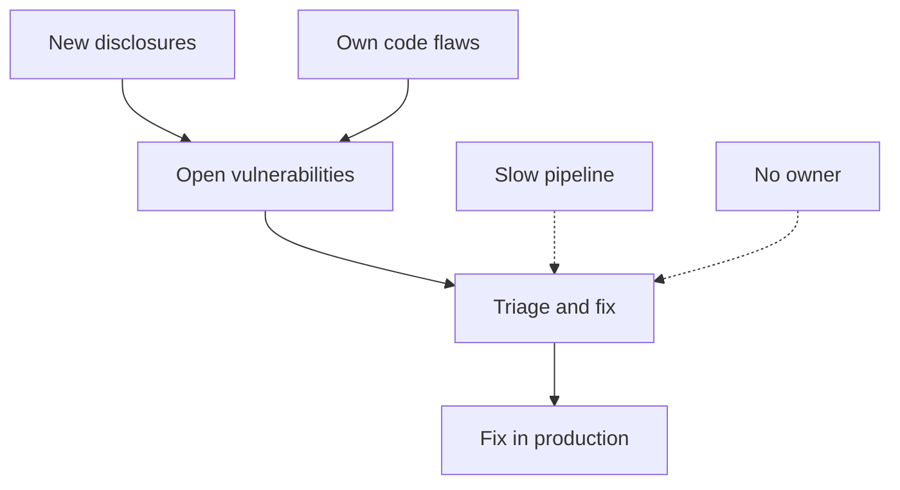
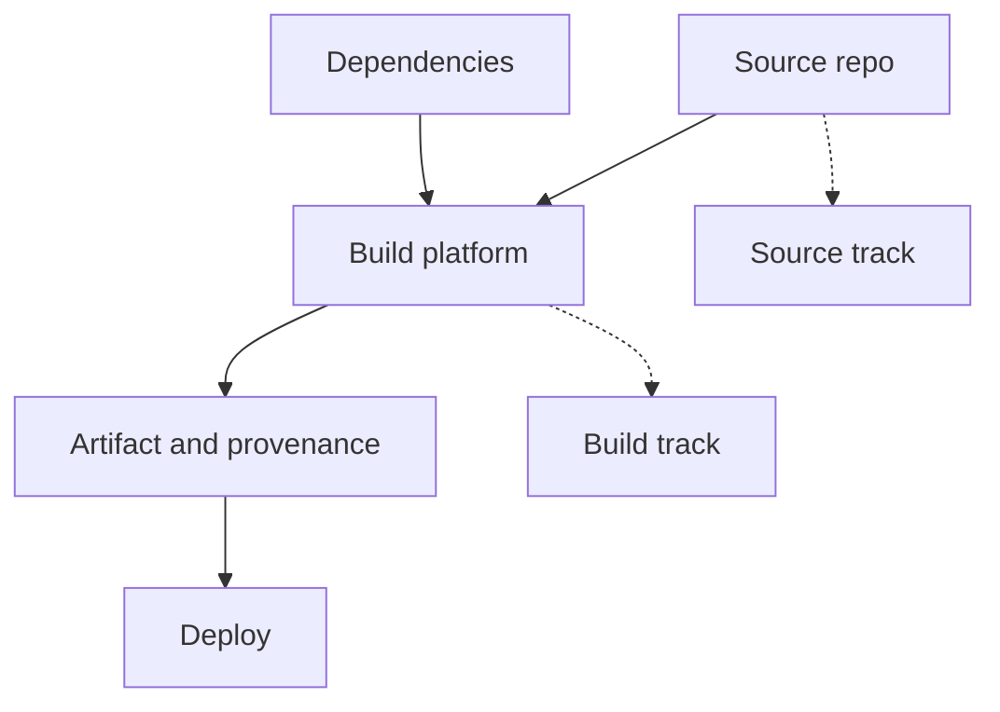
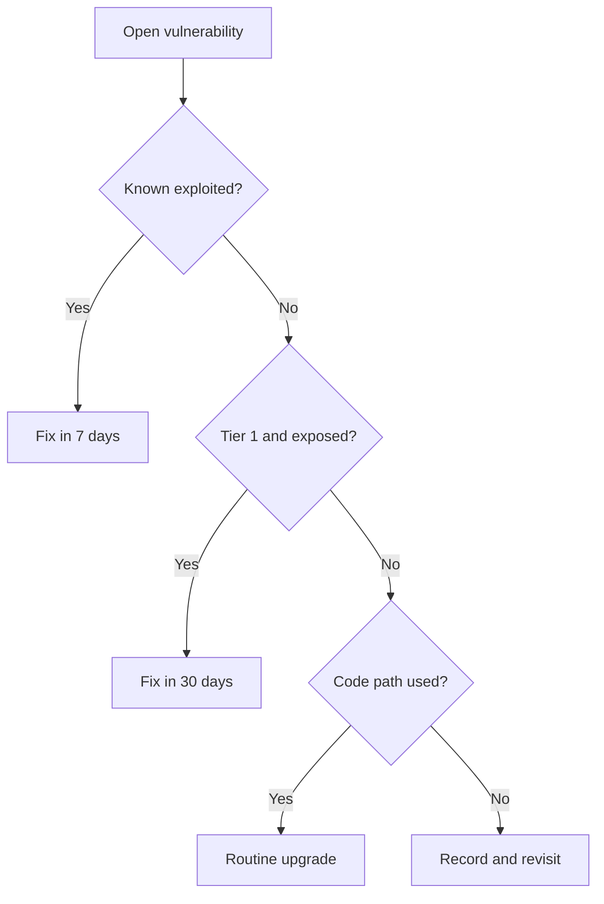

# Chapter 26 — Security and Software Supply-Chain Quality

This chapter treats security the way the rest of Part V treats reliability: as a quality attribute of
the software and of the system that produces it, with owners, a capacity budget, and measures that
resist gaming. It is written for the engineering leader who is accountable for whether the
organization knows what it runs, how it got there, and who answers for it, without being a security
specialist. The running example is Northstar Technologies, the fictional company in the
[case study](../../case-studies/northstar/index.md). Chapter 23 owns the pipeline itself, Chapter 25
owns incident response, and Chapter 53 owns enterprise security strategy and regulation.

## Why This Matters

At team level, security problems look like engineering problems: an outdated library, a credential in
a configuration file, an endpoint without rate limiting. Once noticed, most are cheap to fix.

At organization level, the difficulty is that nobody can say, with evidence, which components carry
which risks. When a widely used library announces a critical vulnerability, "are we affected, where,
and when will it be fixed?" takes days to answer without an inventory and hours with one. That
difference is a property of the engineering system, not of the security team.

Northstar shows the shape. None of its 30 Sev1 and Sev2 incidents last quarter was a breach, yet three
were security mechanisms failing as availability incidents. (Sev1 and Sev2 are the two highest
[severity](../../glossary.md#severity-sev1-sev2-sev3) ratings: an order or payment path down or a
wrong financial record for Sev1, narrower failures for Sev2.) INC-404 dropped mobile sessions when
someone changed the token lifetime in auth-svc's production configuration. INC-418 broke customer
integrations when the webhook signature format changed without versioning. INC-425, a Sev1, stopped
card payments when the certificate for the card processor endpoint expired. Tokens, signatures, and
certificates are security controls, and at Northstar they suffer the same weak ownership and change
discipline as everything else.

At executive scale, security arrives as a commercial question: questionnaires, requests for software
bills of materials, secure development clauses in contracts. A director with an inventory, a
remediation record, and a pipeline that produces evidence answers in days. One without them answers by
hand, every time, and is exposed when the answer is wrong.

## Learning Objectives

After this chapter you will be able to:

- Treat security as a quality attribute with named owners, an explicit share of capacity, and
  measures of exposure rather than activity.
- Map engineering practice to the NIST Cybersecurity Framework (CSF) 2.0 and the Secure Software
  Development Framework (SSDF) as a gap analysis that produces a funded plan, not a checklist.
- Assess supply-chain integrity with the Build and Source tracks of SLSA (Supply-chain Levels for
  Software Artifacts) and raise it one level at a time, starting with tier 1 components.
- Design a vulnerability remediation policy with service levels, prioritization inputs, and a visible
  exception process.
- Choose between security champions, a central application security function, or a mix, for your
  organization's size and maturity.

## The Mental Model

> **Mental model:** Security is produced by the same delivery system as every other quality. You
> cannot secure what you cannot list, trace, or assign: inventory, provenance, and ownership come
> before any control.

Three questions organize the chapter. **What are we running?** Components, dependencies, secrets,
certificates, and tiers. **How did it get there?** The path from reviewed source through a build to the
running artifact. **Who answers for it?** A named team that fixes, rotates, and accepts residual risk
explicitly. Security without ownership becomes a queue of findings in someone else's tool.

It helps to think in stocks and flows
([Chapter 3](../01-foundations/03-managerial-leverage-and-systems-thinking.md) introduces them). Known,
unfixed vulnerabilities are a stock. Disclosures in
dependencies and flaws in your own code flow in; fixes that reach production flow out.

The dotted arrows are the point. The drain is rarely limited by security knowledge. It is limited by
unowned components, slow pipelines, and large upgrades deferred until they become emergencies, which
is why a quality transformation and a security program usually need the same first moves.

## Deep Conceptual Explanation

### Security as a quality attribute

Treating security as a quality attribute means giving it an owner, a budget, and a measure.

The **owner** is the team that owns the component. A central team can find problems and set policy;
only the owning team can change the code and will be there for the next upgrade. The Well-Architected
Framework of Amazon Web Services (AWS), which is vendor guidance, places security as one of six pillars beside
reliability and cost, and describes its reviews as conversations about design rather than audits
([AWS, Well-Architected Framework](../../references/bibliography.md#aws-well-architected)). The
framing transfers: security is a property of the design, reviewed with its owners.

The **budget** is capacity. Upgrades, rotation, and remediation compete with features. This book
recommends funding routine security work from the standing
[prevention allocation](../../glossary.md#prevention-allocation), the capacity reserved per team for
work that removes sources of incidents. Give it a visible earmark, rather than making it a separate
initiative that can be cut alone.

The **measure** describes exposure, not activity; the measurement section below explains why.

### Frameworks as maps, not checklists

**The [CSF](../../glossary.md#nist-csf) 2.0**, from NIST (the US National Institute of Standards and
Technology), organizes cybersecurity outcomes under six functions: Govern, Identify, Protect, Detect,
Respond, and Recover. Govern sits at the center because it informs the others. The document states that its outcomes are
not a checklist of actions. It proposes a Current Profile (outcomes achieved
today), a Target Profile (outcomes chosen as priorities), and a gap analysis that yields a prioritized
action plan ([NIST, 2024](../../references/bibliography.md#nist2024csf)). Treat it as a **standard**:
shared vocabulary and a sensible process, not evidence that any control reduces risk.

**The [SSDF](../../glossary.md#ssdf)** (NIST SP 800-218) describes high-level secure development
practices to be integrated into whatever life cycle an organization already uses. It aims to reduce
vulnerabilities in released software, limit the impact of the rest, and address root causes
([Souppaya, Scarfone, and Dodson, 2022](../../references/bibliography.md#nist2022ssdf)). Its four
practice groups are Prepare the Organization, Protect the Software, Produce Well-Secured Software, and
Respond to Vulnerabilities ([NIST, SSDF project](../../references/bibliography.md#nist-ssdf-project)).

The difference between using these frameworks and performing them is the direction of reasoning.
**Checklist theater** starts from the framework: every row gets an answer written to look complete,
and nothing in engineering changes. **Gap analysis** starts from the system. Which outcomes matter for
[tier 1](../../glossary.md#tier-1) paths (at Northstar, the order and payment paths)? Which do we
achieve today with evidence? Which three gaps would reduce the most exposure this quarter? The CSF's
own profile process describes the second; the failure lies in how organizations use it. A short
mapping, which is this book's and not NIST's, lets a leader answer framework questions from systems
that already exist:

| Engineering practice | CSF 2.0 function | SSDF group |
|---|---|---|
| Component, dependency, and certificate inventory | Identify | Prepare the Organization |
| Ownership and risk acceptance rules | Govern | Prepare the Organization |
| Protected branches, reviewed changes, auditable pipelines | Protect | Protect the Software |
| Secrets management and rotation | Protect | Protect the Software |
| Threat modeling, dependency choice | Protect | Produce Well-Secured Software |
| Alerts on expiry and authentication failures | Detect | Respond to Vulnerabilities |
| Remediation service levels and exceptions | Respond | Respond to Vulnerabilities |

### Supply-chain integrity with SLSA

The software supply chain is everything between a developer's change and the running artifact. The
leader's question is whether
the organization could prove, for any running artifact, which reviewed source and which build produced
it.

That proof is **provenance**: a signed record of which source revision and which build produced an
artifact. [SLSA](../../glossary.md#slsa) gives the question levels on two tracks
([SLSA, v1.2](../../references/bibliography.md#slsa-spec)). Older articles describe a single ladder of
levels 1 to 4; that structure was replaced.

| Track | Level | What it guarantees |
|---|---|---|
| Build | L0 | Nothing |
| Build | L1 | Provenance shows how the package was built |
| Build | L2 | Signed provenance from a hosted build platform |
| Build | L3 | A hardened platform isolates builds and keeps signing secrets away from user-defined steps |
| Source | L1 | The source is version controlled |
| Source | L2 | History and provenance are retained |
| Source | L3 | Technical controls are enforced on protected branches |
| Source | L4 | Every change has two-party review |

Two features make SLSA useful to leaders. Levels attach to artifacts, so tier 1 and tier 3 can have
different targets. And the lower levels are mostly a side effect of a decent pipeline. A component
built by hosted CI that emits provenance is near Build L1. One built on a shared host by a script is at
L0 and may not even show which revision it came from. The fastest supply-chain gain is often
pipeline consolidation.

### Software bills of materials

A software bill of materials ([SBOM](../../glossary.md#sbom)) is a machine-readable list of a
product's components and their relationships. The 2021 minimum elements from NTIA (the US National
Telecommunications and Information Administration) cover three areas. Data fields identify each
component, its supplier, version, and dependencies. Automation support means standard formats (SPDX and
CycloneDX are the two common ones). And practices set frequency, depth, and distribution
([NTIA, 2021](../../references/bibliography.md#ntia2021sbom)). The US Cybersecurity and Infrastructure
Security Agency (CISA) has since drafted an update
([CISA, 2025](../../references/bibliography.md#cisa2025sbom-draft)).

The SBOM's main value is internal. Generated at build time for every artifact, it answers "are we
affected?" in minutes. Assembled by hand for a customer, it is wrong by the next release.

### Dependencies and remediation

Most code in a modern service is someone else's, including transitive dependencies nobody chose.
Decan, Mens, and Constantinou studied nearly 400 npm security reports over six years, asking when
vulnerabilities were found and fixed and how far they reached dependent packages given those
packages' version constraints ([Decan, Mens, and Constantinou, 2018](../../references/bibliography.md#decan2018impact)).
The lesson is a mechanism, not a number: an upstream fix protects you only when your constraints and
upgrade habits let it in.

Severity words come from the Common Vulnerability Scoring System (CVSS), the public standard that gives
each disclosed vulnerability a **base score** from 0 to 10. Critical means 9.0 or above, high 7.0 to
8.9. The base score describes the flaw in general, not your exposure to it.

A remediation policy has four parts:

1. **Service levels by severity.** This book's suggested starting point: known-exploited, or critical
   on internet-facing tier 1, 7 days; other critical, 30 days; high, 90 days; medium and low through
   routine upgrades.
2. **Prioritization beyond scores.** CISA states that organizations should use its
   [Known Exploited Vulnerabilities](../../glossary.md#known-exploited-vulnerability-kev) (KEV) catalog as an input to vulnerability prioritization
   ([CISA, KEV catalog](../../references/bibliography.md#cisa-kev)). Exploitation, exposure, and
   whether the vulnerable code is reachable matter more than the base score.
3. **Visible exceptions.** When a fix cannot meet its service level, the owning manager records the
   risk, a compensating control, and an expiry. An organization with no exceptions is hiding them.
4. **Routine upgrades.** Teams that upgrade in small steps remediate most issues as a by-product. Teams
   that upgrade yearly face a major migration with every critical disclosure.

### Secrets and certificates

Credentials and keys leak through ordinary habits. Meli, McNiece, and Reaves found secret leakage
affecting over 100,000 public GitHub repositories, with thousands of new secrets leaked daily
([Meli, McNiece, and Reaves, 2019](../../references/bibliography.md#meli2019git)). That is a
**research finding** about public repositories; private ones are read by every engineer and tool with
access, so this book does not treat them as safe.

Three properties matter more than tool choice: secrets live in a secrets manager and are injected at
runtime; every secret and certificate has an owner and an expiry alert; and rotation is rehearsed, so
rotating a leaked key takes minutes. INC-425 was not an attack. It was an expiry date nobody owned.

### Threat modeling at team level

The Threat Modeling Manifesto, written in 2020 by practitioners including Adam Shostack, frames threat
modeling around four questions: what are we working on, what can go wrong, what are we going to do
about it, and did we do a good enough job. Its values prefer fixing design issues over checkbox
compliance, and continuous refinement over a single delivery
([Braiterman et al., 2020](../../references/bibliography.md#threatmodeling-manifesto2020)). That is
**practitioner consensus**, not outcome evidence.

At team level it works as a short conversation attached to design changes that cross a trust
boundary: a new integration, an authentication change, a new flow of payment data. INC-418 shows what
one question ("what breaks for verifiers if the signature format changes?") would have surfaced.

### Finding flaws in your own code

Dependency scanning finds other people's flaws. Your own code needs different checks, and each finds
a different class of flaw, so the question is which mix, not which tool.

| Method | Finds | Misses | Cost and cadence |
|---|---|---|---|
| Threat modeling (above) | Design flaws: a missing authorization step, an unprotected trust boundary | Implementation bugs | A short conversation per trust-boundary change |
| Secure code review | Access-control and logic flaws in the diff | Anything outside the diff | Reviewer time; a checklist for auth-sensitive changes |
| Static analysis (SAST) | Known flaw classes such as SQL injection, in source, on every build | Most access-control, cryptography, and configuration flaws | Cheap per run; false positives cost triage time |
| Dynamic testing (DAST) | Flaws visible from outside a running application, such as cross-site scripting and insecure server settings | Paths the scanner cannot reach; business logic | Scheduled runs against a staging copy |
| Penetration test | Chained attacks and business-logic abuse by a skilled person | Everything changed after the test | A priced engagement at one point in time |
| Disclosure program or bug bounty | What outsiders find in production | Whatever they do not look at | Triage time; bounties add payouts |

OWASP, the open application security community, describes static analysis as reliable on well-known
flaw classes but able to find only a relatively small share of application flaws, with many false
positives and frequent misses on authentication, access control, and configuration
([OWASP, Source Code Analysis Tools](../../references/bibliography.md#owasp-sast-tools)). Dynamic scanners test the running
application from outside instead ([OWASP, Vulnerability Scanning Tools](../../references/bibliography.md#owasp-dast-tools)).
Both are **practitioner consensus**, not measured comparisons. The flaw that matters most in a
multi-tenant product is one customer reading another's data by changing an ID in a request, and only
review, design questions, and human testing reliably find it.

**Disclosure before bounties.** Give outside researchers a way to reach you: a published policy with
scope, a promise not to pursue good-faith testers, and a contact such as a `security.txt` file. OWASP's
guidance calls that contact the most important step, and says bug bounties suit only organizations
that already have a mature disclosure process. Bounties bring cost, many low-quality reports, and a
need for skilled triage ([OWASP, Vulnerability Disclosure](../../references/bibliography.md#owasp-vuln-disclosure)).

A sequence for 50 to 150 engineers (this book's recommendation): a disclosure contact in week one;
static analysis in the pipeline, blocking only new high-confidence findings; threat modeling on
trust-boundary changes; scheduled dynamic scans of tier 1 web paths; a penetration test of tier 1
before the next big customer review; a bounty last, if ever.

### Champions and central teams

The choice is between **security champions** (engineers in product teams with a part-time security
role) and a **central application security team** that sets policy, runs tools, and reviews high-risk
designs. The research is thin but pointed: a champion is a channel, not a program. A case study of five teams in a large e-commerce
company found that adoption of secure practices varied widely after champions were appointed.
Champions felt unsupported by security experts and management, and the authors concluded that
appointing champions is not enough without organizational commitment
([Gutfleisch et al., 2023](../../references/bibliography.md#gutfleisch2023champions)). A survey of 73
champions at a Norwegian software company found voluntary and assigned champions differed in
motivation and tasks, with problems in onboarding and training
([Nguyen-Duc et al., 2023](../../references/bibliography.md#nguyenduc2023champions)). Both are
single-organization **research findings**.

### Measuring security without vanity counts

Vulnerabilities found, scans run, training completion, and findings closed all measure activity and
are easy to inflate. Chapter 18 owns metric gaming in general; the security twist is that the people
who classify findings are often the people measured on them. Prefer exposure and coverage, paired:

| Measure | How it is gamed | Pair with |
|---|---|---|
| Open criticals past service level, by age | Downgrades; "not affected" without analysis | Sample audit of those decisions |
| Disclosure to fix in production (median, 90th percentile) | Moving hard cases to exceptions | Exception count and age |
| Tier 1 share with scanning, SBOM, auditable pipeline | Scans nobody reads | Share of findings with an owner's decision |
| Secrets and certificates with owner and expiry alert | Inventory omits hard cases | Expiry and leaked-credential incidents |

Counts rise when scanning becomes honest, so an early fall more likely means narrow scanning than good
security. And no peer-reviewed outcome evidence shows that SBOMs, SLSA
levels, or remediation service levels reduce breach rates. These measures show shrinking
exposure and faster answers; they cannot prove an attack was prevented.

## Engineering Organization Example

!!! info "Northstar so far"
    Week 2 of the director's first year. The baseline quarter had 30 Sev1 and Sev2 incidents and
    $410,000 in service credits, and the director is classifying them. Northstar has no chief
    information security officer; security is a two-person function inside corporate IT. See the
    [timeline](../../case-studies/northstar/timeline.md). New to Northstar? Read [the year in
    brief](../../case-studies/northstar/year-in-brief.md) and the [cast](../../case-studies/northstar/cast.md).

The following is **fictional**. The security facts come from the extended baseline (Security section
of the [baseline data](../../case-studies/northstar/baseline-data.md)); the capacity estimates are
illustrative.

In week 2, the director asks Kwame Mensah (staff engineer, infrastructure and reliability) to run one open-source dependency scanner across all 24
components, and Joon Park, Northstar's IT security lead, to share what the security function knows:

| Fact | Value |
|---|---|
| Components with dependency scanning in their pipeline | 8 of 24 (six GitLab CI services, two frontends) |
| Tier 1 components with scanning | 6 of 15 |
| Open criticals in dependencies (one-off scan) | 11, of which 3 in the KEV catalog |
| Open highs | 58 |
| Oldest open critical | disclosed 19 months ago, in a Core XML library |
| Live credentials in git history | 9 (3 production) among 26 credential-like strings |
| Script services with production secrets in a plain file on the build host | 4 |
| Certificates and keys found after INC-425 | 34; 7 with no owner; none with expiry alerting |
| Security function | 2 people in IT, outside engineering |

The director converts this into capacity:

| Work | Engineer-days |
|---|---|
| Nine criticals at about 4 days each | 36 |
| Two criticals in Core (the Java monolith) that need a framework upgrade | 30 |
| Rotate secrets; move four services to a secrets manager | 25 |
| Scanning in the Jenkins builds; weekly scan for script-deployed services | 15 |
| Certificate inventory with alerting | 10 |
| **Total** | **116, about 1.8 FTE over a 65-working-day quarter** |

FTE means full-time equivalent engineers. The director earmarks 2 FTE of the 12 FTE prevention
allocation agreed in week 4, spread across owning teams. The 58 highs follow under the 90-day service
level.

The estimates are rough on purpose. Once inventoried, remediation is a quantity that can be planned
inside a quality program rather than competing with it.

## Decision Framework

The first decision is what to fix first. Severity alone is the wrong sort order.

The thresholds are this book's recommendation; the order of questions (exploitation, then exposure and
tier, then reachability) is what transfers.

The second decision is how to organize:

| Situation | Model |
|---|---|
| Under about 30 engineers, no security staff | Director-owned policy, one part-time security lead, external testing |
| 50 to 150 engineers, weak ownership | Small central function plus champions with protected time |
| 50 to 150 engineers, strong pipelines | Controls built into the standard pipeline, champions, central design review for high risk |
| Regulated or high-value target | Dedicated application security (AppSec) team with review authority, plus champions |

The third is SLSA targets by tier. A reasonable default: tier 1 to Build L2 and Source L3 within a
year, tier 2 to Build L1, tier 3 to whatever the standard pipeline gives. Source L4 suits code where
one compromised account would be catastrophic, such as authentication and payments.

## Trade-offs

**Gates against flow.** A blocking scanner gate stops vulnerable code shipping, and also fails builds
for findings the team cannot fix today, which teaches suppression. Block only on new criticals the
change introduces; manage existing exposure through service levels.

**Centralization against ownership.** A central team that fixes other teams' vulnerabilities is fast
for a quarter and a dependency forever. One that only files tickets builds resentment. The middle: the
central team owns policy, tooling, and hard cases, and pairs on each team's first fixes.

**Coverage against depth.** Shallow scanning everywhere finds known dependency issues; deep review of
critical paths finds design flaws. Early, coverage wins, because without an inventory you do not know
where depth is needed.

**Remediation speed against stability.** Rushing a framework upgrade to meet a 7-day target can cause
the outage the vulnerability never would. A compensating control with a recorded exception is often
safer, and the exception process makes that choice visible.

## Failure Modes

**Checklist theater.** A framework spreadsheet answered "yes" or "partial" for an audit. Signal: no
engineering plan changed. Countermeasure: every gap analysis ends in at most five funded, owned
actions.

**The scanner graveyard.** Findings accumulate in a dashboard nobody opens. Signal: open count grows
and median age rises. Countermeasure: route findings to owning teams' queues; measure age.

**Severity laundering.** Under targets, findings are downgraded or marked "not affected" without
analysis. Signal: not-affected share rises when targets arrive. Countermeasure: monthly sample audit
from outside the team.

**Champions without time.** Named at an all-hands, given a channel, no capacity. Signal: attendance
falls; design reviews do not cite them. Countermeasure: protected time and a central counterpart.

**The orphaned control.** A certificate, key, or token setting belongs to nobody and fails as an
availability incident. Signal: incidents involving expiry, auth configuration, or signatures.
Countermeasure: owner and expiry alert for every secret and certificate.

**The heroic upgrade.** Yearly upgrade campaigns turn every critical into an emergency migration.
Signal: remediation times are bimodal. Countermeasure: continuous small upgrades.

## Enterprise Application

In an organization of 50 to 150 engineers, put security into the management system that already runs
quality rather than building a parallel one.

**The director owns** the remediation policy, exception rules, capacity earmark, organizational model,
and ownership decisions for orphaned components, where unfixed vulnerabilities and unowned
certificates collect.

**Engineering managers own** their components' exposure: criticals past service level, exceptions and
expiries, rotation, and threat-modeling conversations for trust-boundary changes. They report it in the
monthly quality review, not a separate security meeting.

**Staff engineers own** the cross-cutting patterns: secrets management, provenance and SBOM generation
in the standard pipeline, upgrade tooling.

**The security function**, wherever it reports, owns policy content, tooling, penetration testing,
security incident response, and the audit of human classifications.

**Champions**, one per team, get protected time (this book suggests about 10 percent) and a monthly
session with the security function. Add three lines to the
[scorecard](../../templates/engineering-quality-scorecard.md): tier 1 coverage, criticals past service
level with exception count, and secrets and certificates with owner and alerting.

## CTO Perspective

Chapter 53 owns enterprise security strategy, regulation, and board-level risk. This section notes
only how the engineering view shifts on the way up.

**From exposure to assurance.** A director manages exposure. A chief technology officer (CTO) must also provide evidence that
customers, auditors, and the board can rely on. The same systems serve both if they produce evidence
as a side effect; assurance assembled by hand does not scale.

**From practices to minimums.** With several directors, the CTO sets tiering and a few enforced
minimums (for example, every tier 1 artifact has provenance and an SBOM, and every production secret
lives in the secrets manager) and leaves the path to each director.

**From incidents to contracts.** SBOM requests and secure development attestations become sales and
legal matters. How much evidence pipeline to fund ahead of demand is a commercial bet.

**Risk acceptance at the right level.** A director can accept a 60-day exception on a tier 2 service.
Leaving a tier 1 payment component without provenance for a year belongs higher.

## Practical Playbook

A 90-day plan that runs inside a quality program.

**Days 1–15: inventory.**

1. Scan every component's dependencies, including those outside any pipeline. Record criticals, KEV
   listings, and age.
2. Scan git history for credentials; rotate anything live immediately.
3. Inventory certificates and secrets with owner and expiry.
4. Record the SLSA Build and Source level each component actually meets.

**Days 15–30: decide.**

5. Publish service levels, prioritization rules, and the exception process.
6. Assign owners to every component holding secrets or certificates, orphans first.
7. Earmark security capacity inside the prevention allocation and tell product the cost.
8. Write a one-page CSF Current and Target Profile for tier 1, ending in at most five funded actions.

**Days 30–90: reduce exposure and make it routine.**

9. Fix KEV-listed and tier 1 criticals, using compensating controls with exceptions where a fix is
   risky.
10. Add scanning and SBOM generation to every existing pipeline; schedule scans elsewhere.
11. Move production secrets into a secrets manager; add expiry alerts.
12. Name champions with protected time; start threat modeling on in-flight trust-boundary designs.
13. Route findings to teams' queues, audit not-affected decisions monthly, and report to the CTO in
    exposure terms.

## Case Study

This case is **fictional**. It continues the Northstar story from the
[baseline](../../case-studies/northstar/baseline-data.md).

In week 3, Joon Park forwarded a questionnaire from one of the two customers whose renewals depend on
the [renewal commitments](../../glossary.md#renewal-commitments) (the two features promised for the
largest renewals), asking for an
SBOM, evidence of secure development practices with reference to the SSDF, and Northstar's time to fix
critical vulnerabilities. Honest answers on week 2 data were "no", "partly, undocumented", and
"unknown; the oldest open critical is 19 months old". The director treated the questionnaire as a
forcing function, not the goal. Three moments were harder than the plan.

**auth-svc.** The orphaned, script-deployed token service held one of the KEV-listed criticals and was
behind INC-404. Nobody would deploy a library upgrade through a script without rollback. The director
assigned auth-svc formally to Platform Operations with Kwame Mensah as technical lead, restricted the
vulnerable endpoint at the load balancer within five days, and recorded an exception until the
migration to a real pipeline, still under way at day 90.

**The webhook keys.** Versioning the signature format after INC-418 revealed that webhook signing keys
had never been rotated, and one was among the live production credentials in git history. Payments and
Integrations ran a dual-key rotation with every customer integration. It took three weeks, not three
days. Afterward the team of Elena Sokolova (Payments and Integrations manager) asked to own webhooks formally, with time to migrate it off
scripts.

**Severity pressure.** In week 8, open criticals had fallen from 11 to 4. Joon Park's sample audit
found two of the seven closures were "not affected" decisions with no analysis. Both were reopened;
one proved unreachable, the other was fixed in week 10.

| Measure | Baseline | Day 90 |
|---|---|---|
| Components with dependency scanning | 8 of 24 | 20 in pipeline; 4 by weekly scan |
| Open criticals | 11 | 3, all with recorded exceptions |
| KEV-listed open | 3 | 1 (auth-svc, restricted at the load balancer) |
| Live credentials in git history | 9 | 0 |
| Script services with secrets in plain files | 4 | 2 |
| Certificates with owner and expiry alerting | none alerted | 34 of 34 |
| Tier 1 artifacts with an SBOM per build | 0 | 6 of 15 |

The director's reply to the customer said what was true: an inventory existed, remediation had a
policy and a record, SBOMs covered part of the product with a date for the rest, and the gaps were
named. The customer asked for a quarterly update. Whether Northstar became harder to attack, nobody can
say; no breach occurred before or after, and an absent event is weak evidence. What changed measurably
was the time to answer "are we affected?" and the number of security controls without an owner.

## Exercises

Solutions are in [chapter 26 solutions](../../solutions/ch26-solutions.md). Northstar data is on the
[baseline page](../../case-studies/northstar/baseline-data.md); this chapter's security facts are in
the Engineering Organization Example.

### Foundational

**F1.** Northstar's INC-404 (token lifetime changed in production configuration), INC-418 (webhook
signature format changed without versioning), and INC-425 (expired card processor certificate) were
all recorded as availability incidents, not security incidents. For each, identify the security
control involved, the ownership or change-management gap that let it fail, and one measure that would
have shown the risk before the incident.

**F2.** A security vendor proposes a quarterly board report for Northstar with these measures: total
vulnerabilities found, scans run, percentage of engineers who completed security training, and number
of findings closed. For each, explain how it could improve while exposure gets worse, and propose a
replacement or a paired measure.

**F3.** Using `components.csv`, estimate the SLSA Build and Source level that each of Northstar's four
CI groups (Jenkins, GitLab CI, GitHub Actions, shell scripts) most plausibly meets today, state your
assumptions, and say which single change would raise the most tier 1 components by one Build level.

### Applied Leadership

**A1.** The Billing team of Marcus Oyelaran (Billing manager) owns two Core criticals that need a framework upgrade estimated
at 30 engineer-days. He argues that the vulnerable paths are internal-only, that his team already
carries the largest prevention allocation, and that the upgrade risks another ledger incident. Decide
what you approve (fix, exception, or compensating control), what evidence you need first, and how you
record the decision.

**A2.** Design Northstar's security champion role: who is eligible, how champions are chosen, how much
time they get, what they do in their team, how they connect to Joon Park's two-person function, and how
you will know after two quarters whether the role is working rather than nominal.

**A3.** The renewal customer's questionnaire (see the Case Study) asks Northstar to "confirm alignment with NIST SSDF".
Draft the structure of the response you would send in week 6, given the program's day-30 state. Decide
what you will claim, what you will describe as in progress, and what you will decline to claim.

### Executive Decision-Making

**X1.** The chief financial officer (CFO) proposes buying a commercial application security platform for $180,000 a year, most
of the remaining discretionary tooling budget, arguing it would "solve the questionnaire problem". The
alternative is to spend the quarter on pipeline consolidation and SBOM generation with existing tools.
As director, recommend one in a memo to the CTO, with what you give up and what would change your mind.

**X2.** After reading about a supply-chain attack at another company, a board member asks Victor
Lindqvist (CTO) to commit that "all Northstar software will be SLSA Level 4 by year end". Write the CTO's
response in the meeting (no more than 150 words) and a follow-up note proposing what the board should
track instead.

## Reflection Questions

1. If a critical vulnerability were announced tomorrow in a library you probably use, how long would it
   take to list every affected component, and who would do it?
2. Which security controls in your systems (certificates, keys, token settings) have no owning team?
3. Who decides that a vulnerability is "not affected", and has anyone ever checked one of those
   decisions?
4. Which of your security numbers would rise if scanning became honest, and how would leadership react?
5. How much of your last questionnaire answer came from a system rather than from someone's memory?

## Key Takeaways

- Treat security as a quality attribute: an owning team, a capacity earmark, and measures of exposure.
- Inventory, provenance, and ownership come before controls.
- Use CSF 2.0 and the SSDF for gap analysis that ends in a few funded actions, not for checklists.
- Raise supply-chain integrity one SLSA level at a time, by tier; one real pipeline delivers most early
  gains.
- Generate SBOMs per build; a hand-assembled SBOM is wrong by the next release.
- Prioritize by exploitation, exposure, and reachability, with service levels and visible exceptions.
- Give every secret and certificate an owner and an expiry alert; security controls fail as
  availability incidents long before they fail as breaches.
- Champions need time and a central counterpart; appointing them is not a program.
- Audit "not affected" decisions, because that is where security metrics are gamed.

## References and Further Reading

- [NIST, 2024](../../references/bibliography.md#nist2024csf). CSF 2.0: functions, profiles, and the
  statement that the Core is not a checklist.
- [Souppaya, Scarfone, and Dodson, 2022](../../references/bibliography.md#nist2022ssdf),
  [NIST, SSDF project](../../references/bibliography.md#nist-ssdf-project), and
  [NIST, 2025](../../references/bibliography.md#nist2025ssdf-draft). The SSDF (version 1.1), its
  practice groups, and the version 1.2 revision, released as an initial public draft in December 2025.
- [SLSA, v1.2](../../references/bibliography.md#slsa-spec). Build and Source tracks.
- [NTIA, 2021](../../references/bibliography.md#ntia2021sbom) and
  [CISA, 2025](../../references/bibliography.md#cisa2025sbom-draft). SBOM minimum elements, and
  CISA's updated minimum elements, a draft for comment published in August 2025.
- [CISA, KEV catalog](../../references/bibliography.md#cisa-kev). Exploitation evidence for
  prioritization.
- [Braiterman et al., 2020](../../references/bibliography.md#threatmodeling-manifesto2020). Threat
  modeling's four questions and values.
- [Decan, Mens, and Constantinou, 2018](../../references/bibliography.md#decan2018impact) and
  [Meli, McNiece, and Reaves, 2019](../../references/bibliography.md#meli2019git). Vulnerability
  propagation in dependencies; secret leakage at scale.
- [OWASP, Source Code Analysis Tools](../../references/bibliography.md#owasp-sast-tools),
  [Vulnerability Scanning Tools](../../references/bibliography.md#owasp-dast-tools), and
  [Vulnerability Disclosure](../../references/bibliography.md#owasp-vuln-disclosure). What static and dynamic testing find, and
  how to receive outside reports.
- [Gutfleisch et al., 2023](../../references/bibliography.md#gutfleisch2023champions) and
  [Nguyen-Duc et al., 2023](../../references/bibliography.md#nguyenduc2023champions). Two studies of
  security champions; read before designing a program.
- [AWS, Well-Architected Framework](../../references/bibliography.md#aws-well-architected). Security
  as one pillar among six, reviewed through conversation.
