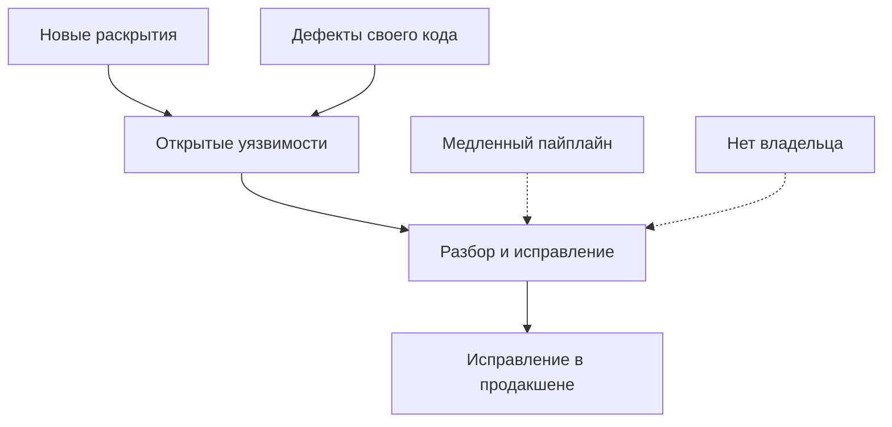
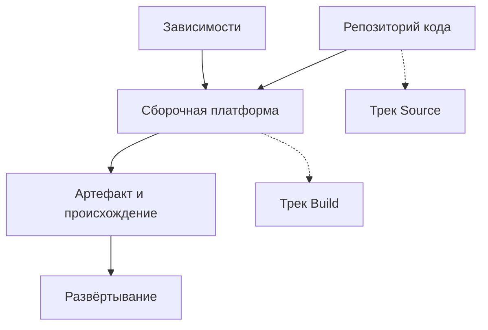
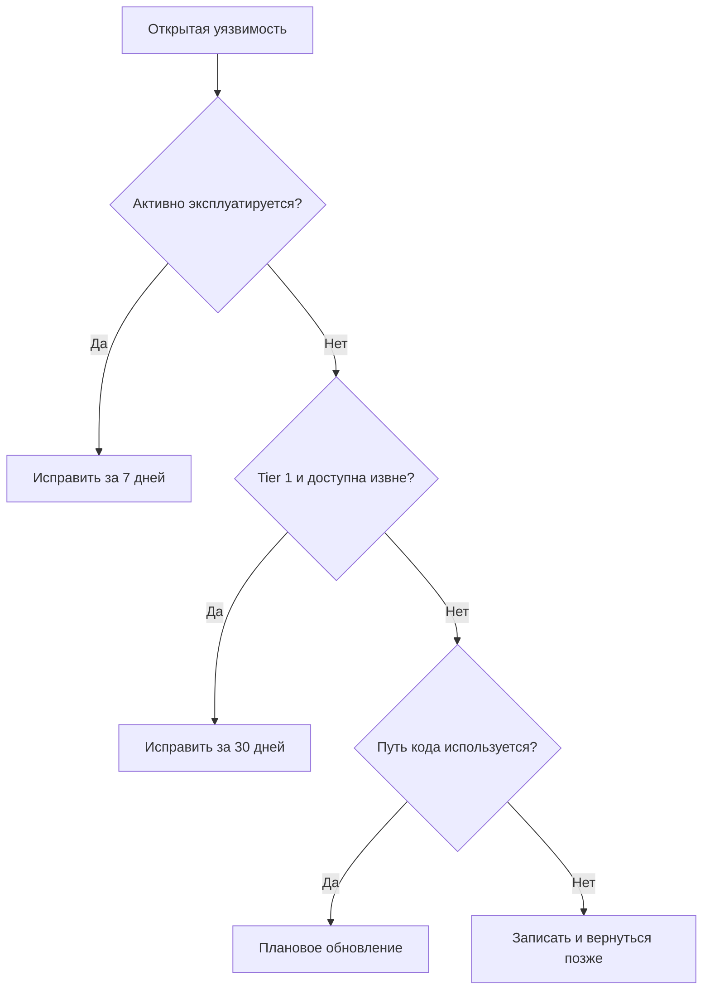

# Глава 26 — Безопасность и качество цепочки поставки ПО { #chapter-26-security-and-software-supply-chain-quality }

Эта глава рассматривает безопасность так же, как остальные главы части V рассматривают надёжность:
как атрибут качества самого ПО и системы, которая его производит. У этого атрибута есть свои владельцы,
бюджет ресурсов и показатели, которые трудно подогнать. Глава написана для руководителя разработки.
Специалистом по безопасности он быть не обязан, но с него спрашивают, знает ли организация, что у неё
работает, как это туда попало и кто за это отвечает. Сквозной пример — Northstar Technologies,
вымышленная компания из [кейса](../../case-studies/northstar/index.md). Сам пайплайн разбирает глава 23, реагирование на
инциденты — глава 25, а стратегию безопасности на уровне компании и регулирование — глава 53.

## Почему это важно { #why-this-matters }

В команде проблемы безопасности выглядят как инженерные: устаревшая библиотека, учётные данные в
конфигурационном файле, эндпоинт без ограничения частоты запросов. Большинство из них, если
заметить, исправляется дёшево.

В масштабе организации трудность в другом: никто не может, опираясь на данные, сказать, какой
компонент несёт какие риски. Когда в широко используемой библиотеке объявляют критическую уязвимость, на вопрос
«затронуты ли мы, где и когда это исправят?» без инвентаризации отвечают днями, а с ней — часами. Эта
разница — свойство инженерной системы, а не службы безопасности.

Northstar хорошо показывает, как это выглядит. Ни один из 30 инцидентов Sev1 и Sev2 прошлого квартала
не был взломом, но в трёх отказали механизмы защиты, и выглядели эти отказы как инциденты доступности. (Sev1 и
Sev2 — две высшие степени [серьёзности](../../glossary.md#severity-sev1-sev2-sev3): недоступный путь
заказа или оплаты либо неверная финансовая запись для Sev1, более узкие отказы для Sev2.) В INC-404
мобильные сессии обрывались, потому что кто-то изменил время жизни токена в продакшн-конфигурации
auth-svc. В INC-418 сломались интеграции клиентов, когда формат подписи вебхуков изменили без
версионирования. INC-425, инцидент Sev1, остановил оплату картами: истёк сертификат эндпоинта процессора
карт. Токены, подписи и сертификаты — механизмы защиты, и в Northstar с владением и дисциплиной
изменений у них так же плохо, как у всего остального.

До высшего руководства безопасность доходит в виде коммерческих вопросов: опросники, запросы перечней
компонентов ПО, пункты о безопасной разработке в договорах. Директору, у которого есть инвентаризация,
журнал устранения уязвимостей и пайплайн, производящий доказательства, на ответ хватает нескольких
дней. Без всего этого директор каждый раз отвечает вручную и оказывается уязвим, если ответ неверен.

## Цели главы { #learning-objectives }

Прочитав эту главу, вы сможете:

- Относиться к безопасности как к атрибуту качества с названными владельцами, явной долей ресурса и
  показателями уязвимости системы, а не активности.
- Сопоставлять инженерную практику с NIST Cybersecurity Framework (CSF) 2.0 и Secure Software
  Development Framework (SSDF) в виде анализа разрывов, который заканчивается профинансированным планом,
  а не чек-листом.
- Оценивать целостность цепочки поставки по трекам Build и Source стандарта SLSA (Supply-chain Levels
  for Software Artifacts) и повышать её по одному уровню за раз, начиная с компонентов tier 1.
- Проектировать политику устранения уязвимостей со сроками, входными данными для приоритизации и
  видимым порядком исключений.
- Выбирать между чемпионами по безопасности, централизованной службой безопасности приложений и их
  сочетанием с учётом размера и зрелости вашей организации.

## Ментальная модель { #the-mental-model }

> **Ментальная модель:** безопасность производит та же система поставки, что и любое другое качество.
> Нельзя защитить то, что нельзя перечислить, проследить или за кем-то закрепить: инвентаризация,
> происхождение и владение идут раньше любых мер защиты.

Глава построена вокруг трёх вопросов. **Что у нас работает?** Компоненты, зависимости, секреты, сертификаты и
уровни критичности. **Как это туда попало?** Путь от проверенного исходного кода через сборку к
работающему артефакту. **Кто за это отвечает?** Названная команда, которая исправляет, ротирует и явно
принимает остаточный риск. Безопасность без владельца превращается в очередь находок в чужом
инструменте.

Здесь помогает мыслить запасами и потоками (их вводит
[глава 3](../01-foundations/03-managerial-leverage-and-systems-thinking.md)). Известные неисправленные
уязвимости — это запас. Втекают в него раскрытия уязвимостей в зависимостях и дефекты в вашем
собственном коде; вытекают исправления, дошедшие до продакшена.

Суть — в пунктирных стрелках. Поток исправлений редко упирается в знания о безопасности. Он упирается
в компоненты без владельцев, медленные пайплайны и крупные обновления, которые откладывают, пока они не станут
авральными. Поэтому трансформации качества и программе безопасности обычно нужны одни и те же первые
шаги.

## Подробный разбор { #deep-conceptual-explanation }

### Безопасность как атрибут качества { #security-as-a-quality-attribute }

Относиться к безопасности как к атрибуту качества — значит дать ей владельца, бюджет и показатель.

**Владелец** — команда, которой принадлежит компонент. Центральная команда может находить проблемы и
задавать политику, но менять код может только команда-владелец, и только она будет рядом при следующем
обновлении. Well-Architected Framework — руководство вендора, Amazon Web Services (AWS). Оно ставит
безопасность в ряд шести опор, рядом с надёжностью и стоимостью, а свои ревью описывает как разговоры о
дизайне, а не как аудит ([AWS, Well-Architected Framework](../../references/bibliography.md#aws-well-architected)).
Такой взгляд переносится и на другие организации: безопасность — свойство дизайна, и обсуждают её
вместе с его владельцами.

**Бюджет** — это ресурс команд: обновления, ротация и устранение уязвимостей конкурируют с функциями. Книга
рекомендует финансировать регулярную работу по безопасности из постоянного
[выделения на профилактику](../../glossary.md#prevention-allocation), то есть ресурса, который
резервируется в каждой команде под работу, устраняющую источники инцидентов. Выделите под безопасность
видимую целевую долю, а не заводите отдельную инициативу, которую легко урезать отдельно от остального.

**Показатель** описывает уязвимость системы, а не активность; почему — объясняет раздел об измерениях
ниже.

### Фреймворки как карты, а не чек-листы { #frameworks-as-maps-not-checklists }

**[CSF](../../glossary.md#nist-csf) 2.0** от NIST (Национального института стандартов и технологий
США) организует результаты в области кибербезопасности по шести функциям: Govern, Identify, Protect,
Detect, Respond и Recover (управлять, выявлять, защищать, обнаруживать, реагировать, восстанавливать).
Govern стоит в центре, потому что направляет остальные. В документе сказано, что результаты CSF — не
чек-лист действий. CSF предлагает текущий профиль (Current Profile, результаты, достигнутые сегодня),
целевой профиль (Target Profile, результаты, выбранные как приоритеты) и анализ разрывов, из которого
получается приоритизированный план действий ([NIST, 2024](../../references/bibliography.md#nist2024csf)).
Считайте его **стандартом**: общим словарём и разумным процессом, а не доказательством того, что
какая-либо мера снижает риск.

**[SSDF](../../glossary.md#ssdf)** (NIST SP 800-218) описывает высокоуровневые практики безопасной
разработки, которые встраиваются в любой жизненный цикл, уже принятый в организации. Его цель — меньше
уязвимостей в выпущенном ПО, меньший ущерб от оставшихся и устранение первопричин
([Souppaya, Scarfone, and Dodson, 2022](../../references/bibliography.md#nist2022ssdf)). Практики
объединены в четыре группы: Prepare the Organization (подготовить организацию), Protect the Software (защитить ПО),
Produce Well-Secured Software (производить хорошо защищённое ПО) и Respond to Vulnerabilities
(реагировать на уязвимости) ([NIST, SSDF project](../../references/bibliography.md#nist-ssdf-project)).

Применять эти фреймворки по делу или разыгрывать их для вида — разница в том, откуда начинается
рассуждение. **Театр чек-листов**
начинается с фреймворка: на каждую строку пишут ответ, который выглядит полным, а в разработке ничего не
меняется. **Анализ разрывов** начинается с системы. Какие результаты важны для путей
[tier 1](../../glossary.md#tier-1) (в Northstar это пути заказа и оплаты)? Каких из них мы достигаем
сегодня и можем это доказать? Какие три разрыва сильнее всего сократят уязвимость в этом квартале?
Процесс профилей в самом CSF описывает второй подход, так что провал — в том, как его применяют
организации. Короткое сопоставление ниже (его составила книга, а не NIST) позволяет руководителю отвечать на вопросы по
фреймворку, опираясь на уже существующие системы:

| Инженерная практика | Функция CSF 2.0 | Группа SSDF |
|---|---|---|
| Инвентаризация компонентов, зависимостей и сертификатов | Identify | Подготовить организацию |
| Правила владения и принятия рисков | Govern | Подготовить организацию |
| Защищённые ветки, проверенные изменения, пайплайны с журналом аудита | Protect | Защитить ПО |
| Управление секретами и их ротация | Protect | Защитить ПО |
| Моделирование угроз, выбор зависимостей | Protect | Производить хорошо защищённое ПО |
| Алерты об истечении сроков и сбоях аутентификации | Detect | Реагировать на уязвимости |
| Сроки устранения и исключения | Respond | Реагировать на уязвимости |

### Целостность цепочки поставки и SLSA { #supply-chain-integrity-with-slsa }

Цепочка поставки ПО — это всё, что лежит между изменением разработчика и работающим артефактом.
Руководителя интересует одно: может ли организация для любого работающего артефакта доказать, из
какого проверенного исходного кода и какой сборкой он получен.

Такое доказательство называется **происхождением** (provenance): это подписанная запись о том, какая
ревизия исходного кода и какая сборка породили артефакт. [SLSA](../../glossary.md#slsa) задаёт для
этого вопроса уровни на двух треках ([SLSA, v1.2](../../references/bibliography.md#slsa-spec)). В
старых статьях описана единая лестница уровней 1–4, но от этой структуры отказались.

| Трек | Уровень | Что гарантирует |
|---|---|---|
| Build | L0 | Ничего |
| Build | L1 | Сведения о происхождении показывают, как собран пакет |
| Build | L2 | Подписанные сведения о происхождении от размещённой сборочной платформы |
| Build | L3 | Защищённая платформа изолирует сборки и не даёт пользовательским шагам доступа к секретам подписи |
| Source | L1 | Исходный код находится под контролем версий |
| Source | L2 | История и сведения о происхождении сохраняются |
| Source | L3 | На защищённых ветках действуют технические меры контроля |
| Source | L4 | Каждое изменение проверяют два человека |

Две особенности делают SLSA полезной для руководителей. Первая: уровни относятся к артефактам,
поэтому у tier 1 и tier 3 могут быть разные цели. Вторая: нижние уровни — в основном побочный эффект
приличного пайплайна. Компонент, который собирает размещённая CI-система, выпускающая сведения о
происхождении, близок к Build L1. А компонент, собранный скриптом на общем хосте, находится на L0: по
нему может быть даже не видно, из какой ревизии он получен. Быстрее всего цепочку поставки часто улучшает консолидация пайплайнов.

### Перечни компонентов ПО { #software-bills-of-materials }

Перечень компонентов ПО (software bill of materials, [SBOM](../../glossary.md#sbom)) — это
машиночитаемый список компонентов продукта и связей между ними. Минимальные элементы, которые в 2021
году определило NTIA (Национальное управление по телекоммуникациям и информации США), охватывают три
области. Первая — поля данных: они идентифицируют каждый компонент, его поставщика, версию и
зависимости. Вторая — поддержка автоматизации, то есть стандартные форматы (два распространённых —
SPDX и CycloneDX). Третья — практики: они задают частоту, глубину и способ распространения ([NTIA, 2021](../../references/bibliography.md#ntia2021sbom)).
С тех пор Агентство по кибербезопасности и защите инфраструктуры США (CISA) подготовило проект
обновления ([CISA, 2025](../../references/bibliography.md#cisa2025sbom-draft)).

Главная ценность SBOM — внутренняя. Если его генерируют при сборке для каждого артефакта, он за минуты
отвечает на вопрос «затронуты ли мы?». А SBOM, собранный вручную для клиента, к следующему релизу уже
неверен.

### Зависимости и устранение уязвимостей { #dependencies-and-remediation }

Большую часть кода современного сервиса написали другие люди, и сюда входят транзитивные зависимости,
которые никто не выбирал. Decan, Mens и Constantinou изучили почти 400 отчётов о безопасности npm за
шесть лет. Они выясняли, когда уязвимости находили и исправляли и насколько далеко те распространялись по
зависимым пакетам с учётом ограничений на версии в этих пакетах
([Decan, Mens, and Constantinou, 2018](../../references/bibliography.md#decan2018impact)). Урок здесь —
механизм, а не число: исправление выше по цепочке защищает вас, только если его пропускают ваши
ограничения на версии и привычки к обновлению.

Названия уровней серьёзности берут из Common Vulnerability Scoring System (CVSS). Этот открытый
стандарт присваивает каждой раскрытой уязвимости **базовую оценку** от 0 до 10. Критическая — это 9,0 и выше,
высокая — от 7,0 до 8,9. Базовая оценка описывает дефект в целом, а не то, насколько он угрожает именно
вам.

У политики устранения уязвимостей четыре части:

1. **Сроки по серьёзности.** Отправная точка, которую предлагает книга: активно эксплуатируемые или
   критические в компонентах tier 1, доступных из интернета, — 7 дней; прочие критические — 30 дней;
   высокие — 90 дней; средние и низкие — в ходе регулярных обновлений.
2. **Приоритизация не только по оценкам.** CISA указывает, что при приоритизации уязвимостей
   организациям следует опираться на её каталог
   [Known Exploited Vulnerabilities](../../glossary.md#known-exploited-vulnerability-kev) (KEV, активно
   эксплуатируемые уязвимости)
   ([CISA, KEV catalog](../../references/bibliography.md#cisa-kev)). Эксплуатация, доступность извне и
   то, достижим ли уязвимый код, важнее базовой оценки.
3. **Видимые исключения.** Если исправление не укладывается в срок, руководитель команды-владельца
   записывает риск, компенсирующую меру и дату истечения исключения. Организация, у которой нет
   исключений, их прячет.
4. **Регулярные обновления.** Команды, которые обновляются мелкими шагами, устраняют большинство проблем
   попутно. Команды, которые обновляются раз в год, при каждом раскрытии критической уязвимости
   сталкиваются с крупной миграцией.

### Секреты и сертификаты { #secrets-and-certificates }

Учётные данные и ключи утекают из-за обычных привычек. Meli, McNiece и Reaves обнаружили утечки
секретов более чем в 100 000 публичных репозиториев GitHub, причём ежедневно утекали тысячи новых
секретов ([Meli, McNiece, and Reaves, 2019](../../references/bibliography.md#meli2019git)). Это
**научный результат** о публичных репозиториях. Приватные читают все инженеры и инструменты, у которых
есть доступ, поэтому книга не считает их безопасными.

Три свойства важнее выбора инструмента. Первое: секреты хранятся в менеджере секретов и подставляются
во время выполнения. Второе: у каждого секрета и сертификата есть владелец и алерт об истечении срока.
Третье: ротацию репетируют, поэтому заменить утёкший ключ удаётся за минуты. INC-425 не был атакой:
это была дата истечения, за которую никто не отвечал.

### Моделирование угроз в команде { #threat-modeling-at-team-level }

Манифест моделирования угроз (Threat Modeling Manifesto) написала в 2020 году группа практиков, среди
них Adam Shostack. Он строит моделирование угроз вокруг четырёх вопросов: над чем мы работаем, что может
пойти не так, что мы с этим сделаем и достаточно ли хорошо мы справились. Среди его ценностей —
исправление проблем дизайна важнее соблюдения для галочки, а постоянное уточнение важнее разовой
поставки ([Braiterman et al., 2020](../../references/bibliography.md#threatmodeling-manifesto2020)).
Это **консенсус практиков**, а не доказательство результата.

На уровне команды это короткий разговор при изменениях дизайна, которые пересекают границу доверия:
новая интеграция, изменение аутентификации, новый поток платёжных данных. На INC-418 видно, что мог бы
выявить всего один вопрос: «что сломается у тех, кто проверяет подпись, если формат подписи изменится?»

### Как находить дефекты в собственном коде { #finding-flaws-in-your-own-code }

Сканирование зависимостей находит чужие дефекты. Для собственного кода нужны другие проверки. Каждая
находит свой класс дефектов, поэтому вопрос не в том, какой инструмент выбрать, а в том, какое нужно
сочетание.

| Метод | Что находит | Что пропускает | Стоимость и периодичность |
|---|---|---|---|
| Моделирование угроз (см. выше) | Дефекты дизайна: пропущенная проверка авторизации, незащищённая граница доверия | Ошибки реализации | Короткий разговор на каждое изменение границы доверия |
| Ревью кода на безопасность | Дефекты контроля доступа и логики в диффе | Всё, что за пределами диффа | Время ревьюера; чек-лист для изменений, затрагивающих аутентификацию |
| Статический анализ (SAST) | Известные классы дефектов, например SQL-инъекции, в исходном коде, при каждой сборке | Большинство дефектов контроля доступа, криптографии и конфигурации | Дёшево за прогон; ложные срабатывания стоят времени на разбор |
| Динамическое тестирование (DAST) | Дефекты, видимые снаружи работающего приложения, например межсайтовый скриптинг и небезопасные настройки сервера | Пути, до которых сканер не дотягивается; бизнес-логика | Плановые прогоны против копии на стейджинге |
| Пентест | Цепочки атак и злоупотребления бизнес-логикой, которые находит квалифицированный специалист | Всё, что изменилось после теста | Платный проект в один момент времени |
| Программа раскрытия уязвимостей или bug bounty | То, что посторонние находят в продакшене | То, на что они не смотрят | Время на разбор; bug bounty добавляет выплаты |

OWASP, открытое сообщество специалистов по безопасности приложений, описывает статический анализ как
надёжный для хорошо известных классов дефектов. Но находит он лишь сравнительно небольшую долю дефектов
приложения, даёт много ложных срабатываний и часто пропускает проблемы аутентификации, контроля доступа и
конфигурации ([OWASP, Source Code Analysis Tools](../../references/bibliography.md#owasp-sast-tools)).
Динамические сканеры, напротив, проверяют работающее приложение снаружи
([OWASP, Vulnerability Scanning Tools](../../references/bibliography.md#owasp-dast-tools)). Оба
источника — **консенсус практиков**, а не измеренные сравнения. В мультитенантном продукте самый
важный дефект — возможность для одного клиента прочитать данные другого, поменяв идентификатор в
запросе. Надёжно его находят
только ревью, вопросы о дизайне и тестирование людьми.

**Сначала раскрытие, потом вознаграждения.** Дайте внешним исследователям способ связаться с вами:
опубликованную политику с указанием охвата, обещание не преследовать тех, кто тестирует добросовестно, и
контакт, например файл `security.txt`. Руководство OWASP называет такой контакт самым важным шагом и
говорит, что программы bug bounty подходят только организациям, у которых уже есть зрелый процесс
раскрытия. Bug bounty означает расходы, много некачественных отчётов и необходимость квалифицированного
разбора ([OWASP, Vulnerability Disclosure](../../references/bibliography.md#owasp-vuln-disclosure)).

Порядок для организации из 50–150 инженеров (рекомендация книги): контакт для раскрытия — в первую же
неделю; статический анализ в пайплайне, блокирующий только новые находки с высокой
достоверностью; моделирование угроз при изменениях границ доверия; плановое динамическое сканирование
веб-путей tier 1; пентест tier 1 перед следующей крупной проверкой со стороны клиента; bug bounty —
последним, если вообще понадобится.

### Чемпионы и центральные команды { #champions-and-central-teams }

Выбирать приходится между **чемпионами по безопасности** (security champions: инженерами продуктовых
команд, которые часть времени занимаются безопасностью) и **центральной командой безопасности
приложений**, которая задаёт политику, ведёт инструменты и проверяет дизайн с высоким риском.
Исследований мало, но вывод из них определённый: чемпион — это канал, а не программа. Исследование пяти
команд крупной компании электронной коммерции (кейс-стади) показало, что после назначения чемпионов команды внедряли
безопасные практики очень по-разному. Чемпионы не чувствовали поддержки ни от экспертов по
безопасности, ни от руководства, и авторы пришли к выводу, что одного назначения чемпионов без
приверженности организации недостаточно
([Gutfleisch et al., 2023](../../references/bibliography.md#gutfleisch2023champions)). Опрос 73
чемпионов в норвежской компании-разработчике ПО показал, что добровольные и назначенные чемпионы
различаются мотивацией и задачами, а с их онбордингом и обучением есть проблемы
([Nguyen-Duc et al., 2023](../../references/bibliography.md#nguyenduc2023champions)). Это
**научные результаты**, но каждый получен в одной организации.

### Как измерять безопасность без показателей напоказ { #measuring-security-without-vanity-counts }

Число найденных уязвимостей, проведённых сканирований, доля прошедших обучение и число закрытых находок
измеряют активность, и раздуть их легко. Подгонку метрик в целом разбирает глава 18; особенность
безопасности в том, что находки часто классифицируют те же люди, которых по ним оценивают. Предпочитайте
показатели уязвимости и покрытия и смотрите на них парами:

| Показатель | Как его подгоняют | В паре с |
|---|---|---|
| Открытые критические уязвимости с истёкшим сроком, по возрасту | Понижение серьёзности; «не затронуты» без анализа | Аудит выборки таких решений |
| От раскрытия до исправления в продакшене (медиана, 90-й процентиль) | Перевод трудных случаев в исключения | Число и возраст исключений |
| Доля tier 1 со сканированием, SBOM, пайплайном с журналом аудита | Сканирования, результаты которых никто не читает | Доля находок, по которым владелец принял решение |
| Секреты и сертификаты с владельцем и алертом об истечении | Трудные случаи не попадают в инвентаризацию | Инциденты с истечением сроков и утечкой учётных данных |

Когда сканирование становится честным, числа растут, поэтому раннее снижение скорее говорит об узком
сканировании, чем о хорошей безопасности. Кроме того, рецензируемых доказательств того, что SBOM,
уровни SLSA или сроки устранения снижают частоту взломов, нет. Эти показатели говорят о том, что
уязвимость системы сокращается, а ответы приходят быстрее; доказать, что атаку удалось предотвратить, они не могут.

## Пример из инженерной организации { #engineering-organization-example }

!!! info "Northstar: что уже известно"
    Неделя 2 первого года директора. В базовом квартале было 30 инцидентов Sev1 и Sev2 и $410 000
    сервисных кредитов; директор классифицирует эти инциденты. Директора по информационной безопасности (CISO) в
    Northstar нет; безопасностью занимается служба из двух человек внутри корпоративного ИТ. См.
    [хронологию](../../case-studies/northstar/timeline.md). Впервые читаете о Northstar? Прочитайте
    [«Год вкратце»](../../case-studies/northstar/year-in-brief.md) и
    [действующих лиц](../../case-studies/northstar/cast.md).

Дальнейшее — **вымысел**. Факты о безопасности взяты из расширенного исходного уровня (раздел
«Безопасность» на [странице исходных данных](../../case-studies/northstar/baseline-data.md)); оценки
ресурсов — иллюстрация.

На неделе 2 директор просит Kwame Mensah (staff-инженер, инфраструктура и надёжность) прогнать один
open-source-сканер зависимостей по всем 24 компонентам, а Joon Park, руководителя ИТ-безопасности
Northstar, — рассказать, что известно службе безопасности:

| Факт | Значение |
|---|---|
| Компоненты со сканированием зависимостей в пайплайне | 8 из 24 (шесть сервисов GitLab CI, два фронтенда) |
| Компоненты tier 1 со сканированием | 6 из 15 |
| Открытые критические уязвимости в зависимостях (разовое сканирование) | 11, из них 3 в каталоге KEV |
| Открытые высокие | 58 |
| Самая старая открытая критическая | раскрыта 19 месяцев назад, в XML-библиотеке Core |
| Действующие учётные данные в истории git | 9 (3 — продакшен) среди 26 строк, похожих на учётные данные |
| Сервисы на скриптах с продакшн-секретами в открытом файле на сборочном хосте | 4 |
| Сертификаты и ключи, найденные после INC-425 | 34; у 7 нет владельца; ни у одного нет алерта об истечении |
| Служба безопасности | 2 человека в ИТ, вне разработки |

Директор переводит это в ресурсы:

| Работа | Инженеро-дни |
|---|---|
| Девять критических, примерно по 4 дня на каждую | 36 |
| Две критические в Core (Java-монолите), требующие обновления фреймворка | 30 |
| Ротация секретов; перевод четырёх сервисов на менеджер секретов | 25 |
| Сканирование в сборках Jenkins; еженедельное сканирование сервисов, развёртываемых скриптами | 15 |
| Инвентаризация сертификатов с алертингом | 10 |
| **Итого** | **116, около 1.8 FTE за квартал из 65 рабочих дней** |

FTE — полные ставки инженеров. Из 12 FTE выделения на профилактику, согласованного на неделе 4,
директор целевым образом отдаёт 2 FTE и распределяет их по командам-владельцам. Для 58 высоких
уязвимостей действует срок в 90 дней.

Оценки нарочно грубые. После инвентаризации устранение уязвимостей превращается в объём работы,
который планируют внутри программы качества, а не в соперника этой программы.

## Как принимать решение { #decision-framework }

Первое решение — что исправлять в первую очередь. Одна лишь серьёзность задаёт неверный порядок.

Пороги — рекомендация книги, а в любую организацию переносится порядок вопросов: сначала эксплуатация, затем доступность извне
и уровень критичности, затем достижимость.

Второе решение — как организовать работу:

| Ситуация | Модель |
|---|---|
| Меньше примерно 30 инженеров, специалистов по безопасности нет | Политика за директором, один ответственный за безопасность на часть ставки, внешнее тестирование |
| 50–150 инженеров, слабое владение | Небольшая центральная служба плюс чемпионы с защищённым временем |
| 50–150 инженеров, сильные пайплайны | Меры контроля встроены в стандартный пайплайн, чемпионы, централизованное ревью дизайна с высоким риском |
| Регулируемая отрасль или ценная цель для атак | Выделенная команда безопасности приложений (AppSec) с правом ревью плюс чемпионы |

Третье — цели SLSA по уровням критичности. Разумный вариант по умолчанию: tier 1 — до Build L2 и Source L3 в
течение года, tier 2 — до Build L1, tier 3 — то, что даёт стандартный пайплайн. Source L4 подходит для
кода, где компрометация одной учётной записи обернётся катастрофой, например для аутентификации и
платежей.

## Компромиссы { #trade-offs }

**Блокировки против потока.** Блокирующая проверка сканером не пускает уязвимый код в релиз, но она же
валит сборки из-за находок, которые команда сегодня исправить не может, и тем приучает подавлять
находки. Блокируйте только новые критические уязвимости, которые вносит само изменение, а с
существующими разбирайтесь через сроки устранения.

**Централизация против владения.** Центральная команда, которая исправляет уязвимости за другие
команды, первый квартал работает быстро, а потом навсегда становится зависимостью. А команда, которая
только заводит тикеты, вызывает раздражение. Разумная середина: центральная команда владеет политикой, инструментами и
трудными случаями и в паре помогает каждой команде с первыми исправлениями.

**Покрытие против глубины.** Поверхностное сканирование везде находит известные проблемы зависимостей;
глубокое ревью критических путей находит дефекты дизайна. На старте выигрывает покрытие: без
инвентаризации вы не знаете, где нужна глубина.

**Скорость устранения против стабильности.** Если гнать обновление фреймворка ради 7-дневного срока,
можно получить отказ, к которому уязвимость сама никогда бы не привела. Компенсирующая мера с записанным
исключением часто безопаснее, а порядок исключений делает этот выбор видимым.

## Типичные провалы { #failure-modes }

**Театр чек-листов.** Для аудита таблицу по фреймворку заполняют ответами «да» или «частично». Как
заметить: ни один инженерный план не изменился. Что делать: каждый анализ разрывов заканчивается не
более чем пятью профинансированными действиями с владельцами.

**Кладбище находок сканера.** Находки копятся в дашборде, который никто не открывает. Как заметить:
число открытых находок растёт, а их медианный возраст увеличивается. Что делать: направлять находки в
очереди команд-владельцев; измерять возраст.

**Отмывание серьёзности.** Под давлением целей находкам понижают серьёзность или без анализа помечают
их как «не затронуты». Как заметить: доля решений «не затронуты» растёт с появлением целей. Что делать: ежемесячный аудит
выборки силами людей вне команды.

**Чемпионы без времени.** Чемпионов объявляют на общем собрании и дают им канал, но не дают ресурса. Как
заметить: посещаемость падает; на ревью дизайна на них не ссылаются. Что делать: защищённое время и
партнёр в центральной службе.

**Бесхозный механизм защиты.** Сертификат, ключ или настройка токена никому не принадлежит, а когда
отказывает, это выглядит как инцидент доступности. Как заметить: инциденты, связанные с истечением сроков, конфигурацией
аутентификации или подписями. Что делать: владелец и алерт об истечении для каждого секрета и
сертификата.

**Героическое обновление.** Ежегодные кампании по обновлению превращают каждую критическую уязвимость в
аварийную миграцию. Как заметить: распределение сроков устранения бимодально. Что делать: непрерывные
мелкие обновления.

## Применение в крупной организации { #enterprise-application }

В организации из 50–150 инженеров встраивайте безопасность в ту систему управления, которая уже ведёт
качество, а не стройте параллельную.

**Директор владеет** политикой устранения уязвимостей, правилами исключений, целевой долей ресурса,
организационной моделью и решениями о том, кому передать бесхозные компоненты: именно в них копятся
неисправленные уязвимости и сертификаты без владельцев.

**Руководители разработки (engineering managers, EM)** владеют уязвимостью своих компонентов:
критическими уязвимостями с истёкшим сроком, исключениями и сроками их истечения, ротацией и разговорами о
моделировании угроз при изменениях границ доверия. Они докладывают об этом на ежемесячном разборе
качества, а не на отдельной встрече по безопасности.

**Staff-инженеры** владеют сквозными паттернами: управлением секретами, генерацией сведений о
происхождении и SBOM в стандартном пайплайне, инструментами обновления.

**Служба безопасности**, кому бы она ни подчинялась, владеет содержанием политики, инструментами,
пентестами, реагированием на инциденты безопасности и аудитом классификаций, которые делают люди.

**Чемпионы**, по одному на команду, получают защищённое время (книга предлагает около 10%) и
ежемесячную встречу со службой безопасности. Добавьте в
[карту показателей](../../templates/engineering-quality-scorecard.md) три строки: покрытие tier 1;
критические уязвимости с истёкшим сроком вместе с числом исключений; секреты и сертификаты с владельцем
и алертингом.

## Взгляд CTO { #cto-perspective }

Стратегию безопасности на уровне компании, регулирование и риски на уровне совета директоров разбирает
глава 53. Здесь речь только о том, как меняется инженерный взгляд с подъёмом по уровням управления.

**От уязвимости к гарантиям.** Директор управляет уязвимостью системы. Технический директор (CTO)
должен ещё и предоставлять доказательства, на которые могут опереться клиенты, аудиторы и совет
директоров. Одни и те же системы годятся для обеих задач, если производят доказательства попутно;
гарантии, собранные вручную, не масштабируются.

**От практик к минимумам.** Когда директоров несколько, CTO задаёт уровни критичности и несколько
обязательных минимумов (например, у каждого артефакта tier 1 есть сведения о происхождении и SBOM, а
каждый продакшн-секрет хранится в менеджере секретов) а путь к ним каждый директор выбирает сам.

**От инцидентов к договорам.** Запросы SBOM и подтверждения безопасной разработки (attestations)
становятся вопросами продаж и юристов. Сколько вложить в пайплайн доказательств раньше, чем появится
спрос, — коммерческая ставка.

**Принятие риска на нужном уровне.** Директор может принять 60-дневное исключение для сервиса tier 2.
Оставить платёжный компонент tier 1 без сведений о происхождении на год — решение для уровня выше.

## Практический плейбук { #practical-playbook }

План на 90 дней; выполняется он внутри программы качества.

**Дни 1–15: инвентаризация.**

1. Просканируйте зависимости каждого компонента, включая те, что не входят ни в один пайплайн.
   Запишите критические уязвимости, присутствие в KEV и возраст.
2. Проверьте историю git на учётные данные; все действующие немедленно ротируйте.
3. Проведите инвентаризацию сертификатов и секретов с владельцами и сроками истечения.
4. Запишите, каким уровням SLSA Build и Source каждый компонент соответствует на самом деле.

**Дни 15–30: решения.**

5. Опубликуйте сроки устранения, правила приоритизации и порядок исключений.
6. Назначьте владельцев всем компонентам, у которых есть секреты или сертификаты, начиная с
   бесхозных.
7. Выделите целевую долю ресурса на безопасность внутри выделения на профилактику и сообщите продуктовой
   стороне, во что это обходится.
8. Опишите на одной странице текущий и целевой профили CSF для tier 1 и завершите документ не более
   чем пятью профинансированными действиями.

**Дни 30–90: сокращение уязвимости и переход к рутине.**

9. Исправьте критические уязвимости из KEV и в компонентах tier 1; там, где исправление рискованно,
   используйте компенсирующие меры с исключениями.
10. Добавьте сканирование и генерацию SBOM во все существующие пайплайны; в остальных местах
    запланируйте регулярное сканирование.
11. Перенесите продакшн-секреты в менеджер секретов; добавьте алерты об истечении.
12. Назначьте чемпионов с защищённым временем; начните моделировать угрозы для дизайнов, которые уже в
    работе и пересекают границы доверия.
13. Направляйте находки в очереди команд, ежемесячно проверяйте решения «не затронуты» и отчитывайтесь
    перед CTO на языке уязвимости системы.

## Кейс { #case-study }

Этот кейс — **вымысел**. Он продолжает историю Northstar с
[исходного уровня](../../case-studies/northstar/baseline-data.md).

На неделе 3 Joon Park переслал опросник от одного из двух клиентов, чьи продления зависят от
[обязательств по продлению](../../glossary.md#renewal-commitments) (двух функций, обещанных ради
крупнейших продлений). Клиент просил SBOM, доказательства безопасной разработки со ссылкой на SSDF и
данные о том, за какое время Northstar исправляет критические уязвимости. Честные ответы по данным
недели 2 звучали так: «нет», «частично, не задокументировано» и «неизвестно; самой старой открытой
критической уязвимости 19 месяцев». Директор отнёсся к опроснику как к поводу
действовать, а не как к цели. Три момента оказались труднее, чем предполагал план.

**auth-svc.** Бесхозный сервис токенов, развёртываемый скриптом, содержал одну из критических
уязвимостей из KEV и стоял за INC-404. Никто не хотел выкатывать обновление библиотеки через скрипт без
отката. Директор формально передал auth-svc команде Platform Operations, а техническим руководителем
назначил Kwame Mensah. В течение пяти дней директор ограничил доступ к уязвимому эндпоинту на
балансировщике нагрузки и записал исключение, действующее до перехода на настоящий пайплайн. К Дню 90 этот переход всё ещё шёл.

**Ключи вебхуков.** Когда после INC-418 ввели версионирование формата подписи, выяснилось, что ключи
подписи вебхуков ни разу не ротировали, а один из них был среди действующих продакшн-учётных данных в
истории git. Команда Payments and Integrations провела ротацию по схеме с двумя ключами со всеми интеграциями
клиентов.
Это заняло три недели, а не три дня. После этого команда Elena Sokolova (руководитель Payments and
Integrations) попросила формально передать ей вебхуки вместе со временем на то, чтобы увести их со
скриптов.

**Давление на серьёзность.** К неделе 8 число открытых критических уязвимостей снизилось с 11 до 4.
Joon Park провёл аудит выборки и обнаружил, что два из семи закрытий были решениями «не затронуты»
без всякого анализа. Обе уязвимости открыли заново; одна уязвимость оказалась недостижимой, другую исправили на
неделе 10.

| Показатель | Исходный уровень | День 90 |
|---|---|---|
| Компоненты со сканированием зависимостей | 8 из 24 | 20 в пайплайне; 4 еженедельным сканированием |
| Открытые критические | 11 | 3, у всех записаны исключения |
| Открытые из KEV | 3 | 1 (auth-svc, доступ ограничен на балансировщике нагрузки) |
| Действующие учётные данные в истории git | 9 | 0 |
| Сервисы на скриптах с секретами в открытых файлах | 4 | 2 |
| Сертификаты с владельцем и алертом об истечении | ни у одного нет алерта | 34 из 34 |
| Артефакты tier 1 с SBOM для каждой сборки | 0 | 6 из 15 |

Директор ответил клиенту правду: инвентаризация есть, у устранения уязвимостей есть политика и журнал,
SBOM покрывают часть продукта, а для остального назначена дата, и пробелы названы. Клиент попросил
присылать обновления раз в квартал. Стало ли атаковать Northstar труднее, сказать никто не может: взлома
не было ни до, ни после, а отсутствие события — слабое доказательство. Измеримо изменилось другое: время
ответа на вопрос «затронуты ли мы?» и число механизмов защиты без владельца.

## Упражнения { #exercises }

Разборы упражнений — на странице [решений к главе 26](../../solutions/ch26-solutions.md). Данные
Northstar — на [странице исходного уровня](../../case-studies/northstar/baseline-data.md); факты о
безопасности для этой главы приведены в разделе «Пример из инженерной организации».

### Базовый уровень { #foundational }

**F1.** INC-404 (время жизни токена изменили в продакшн-конфигурации), INC-418 (формат подписи вебхуков
изменили без версионирования) и INC-425 (истёк сертификат процессора карт) в Northstar записаны как
инциденты доступности, а не безопасности. Для каждого определите затронутый механизм защиты, пробел во
владении или управлении изменениями, из-за которого он отказал, и один показатель, который выявил бы
риск до инцидента.

**F2.** Вендор средств безопасности предлагает Northstar ежеквартальный отчёт для совета директоров с
такими показателями: общее число найденных уязвимостей, число проведённых сканирований, доля инженеров,
прошедших обучение по безопасности, и число закрытых находок. Для каждого объясните, как он может
улучшаться, пока уязвимость системы растёт, и предложите замену или парный показатель.

**F3.** По `components.csv` оцените, каким уровням SLSA Build и Source, скорее всего, соответствует
сегодня каждая из четырёх CI-групп Northstar (Jenkins, GitLab CI, GitHub Actions, shell-скрипты).
Сформулируйте допущения и скажите, какое одно изменение подняло бы на один уровень Build больше всего
компонентов tier 1.

### Прикладное лидерство { #applied-leadership }

**A1.** Команде Billing, которой руководит Marcus Oyelaran, принадлежат две критические уязвимости в
Core, для устранения которых нужно обновление фреймворка, оценённое в 30 инженеро-дней. Он доказывает,
что уязвимые пути доступны только изнутри, что его команда и так несёт самое большое выделение на
профилактику и что обновление грозит ещё одним инцидентом с ledger. Решите, что вы утвердите
(исправление, исключение или компенсирующую меру), какие доказательства вам нужны сначала и как вы
запишете решение.

**A2.** Спроектируйте роль чемпиона по безопасности в Northstar: кто может им стать, как чемпионов
выбирают, сколько времени им дают, что они делают в своей команде, как они связаны со службой Joon Park
из двух человек и как вы через два квартала поймёте, работает ли роль или существует только на бумаге.

**A3.** Опросник клиента, чьё продление зависит от обязательств (см. «Кейс»), просит Northstar «подтвердить
соответствие NIST SSDF». Набросайте структуру ответа, который вы отправите на неделе 6, с учётом
состояния программы на 30-й день. Решите, что вы заявите, что опишете как работу в процессе и что
откажетесь заявлять.

### Решения на уровне руководства { #executive-decision-making }

**X1.** Финансовый директор (CFO) предлагает купить коммерческую платформу безопасности приложений за
$180 000 в год, то есть большую часть оставшегося свободного бюджета на инструменты, утверждая, что она
«решит проблему опросников». Альтернатива — потратить квартал на консолидацию пайплайнов и генерацию
SBOM существующими инструментами. Как директор, порекомендуйте в записке для CTO один вариант и укажите,
чем вы жертвуете и что заставило бы вас передумать.

**X2.** Прочитав об атаке на цепочку поставки ПО другой компании, член совета директоров просит Victor Lindqvist
(CTO) пообещать, что «всё ПО Northstar к концу года будет на SLSA Level 4». Напишите ответ CTO на
заседании (не больше 150 слов) и последующую записку с предложением, что совету директоров стоит
отслеживать вместо этого.

## Вопросы для размышления { #reflection-questions }

1. Если завтра объявят критическую уязвимость в библиотеке, которую вы, вероятно, используете, сколько
   времени уйдёт на список всех затронутых компонентов и кто будет это делать?
2. У каких механизмов защиты в ваших системах (сертификатов, ключей, настроек токенов) нет
   команды-владельца?
3. Кто решает, что уязвимость «нас не затрагивает», и проверял ли кто-нибудь хоть одно такое решение?
4. Какие из ваших показателей безопасности вырастут, если сканирование станет честным, и как на это
   отреагирует руководство?
5. Какая часть вашего последнего ответа на опросник взята из системы, а не из чьей-то памяти?

## Главное { #key-takeaways }

- Относитесь к безопасности как к атрибуту качества: команда-владелец, целевая доля ресурса и
  показатели уязвимости системы.
- Инвентаризация, происхождение и владение идут раньше мер защиты.
- Используйте CSF 2.0 и SSDF для анализа разрывов, который заканчивается несколькими
  профинансированными действиями, а не для чек-листов.
- Повышайте целостность цепочки поставки по одному уровню SLSA за раз и по уровням критичности; один
  настоящий пайплайн даёт большую часть ранних улучшений.
- Генерируйте SBOM при каждой сборке; SBOM, собранный вручную, к следующему релизу уже неверен.
- Приоритизируйте по эксплуатации, доступности извне и достижимости, со сроками устранения и видимыми
  исключениями.
- Дайте каждому секрету и сертификату владельца и алерт об истечении: механизмы защиты отказывают как
  инциденты доступности задолго до того, как отказывают как взломы.
- Чемпионам нужны время и партнёр в центральной службе; одно лишь назначение чемпионов — ещё не программа.
- Проверяйте решения «не затронуты»: именно там подгоняют метрики безопасности.

## Источники и что почитать { #references-and-further-reading }

- [NIST, 2024](../../references/bibliography.md#nist2024csf): CSF 2.0 — функции, профили и утверждение,
  что Core (ядро CSF) не является чек-листом.
- [Souppaya, Scarfone, and Dodson, 2022](../../references/bibliography.md#nist2022ssdf),
  [NIST, SSDF project](../../references/bibliography.md#nist-ssdf-project) и
  [NIST, 2025](../../references/bibliography.md#nist2025ssdf-draft): SSDF (версия 1.1), его группы
  практик и редакция 1.2, выпущенная как первоначальный публичный проект в декабре 2025 года.
- [SLSA, v1.2](../../references/bibliography.md#slsa-spec): треки Build и Source.
- [NTIA, 2021](../../references/bibliography.md#ntia2021sbom) и
  [CISA, 2025](../../references/bibliography.md#cisa2025sbom-draft): минимальные элементы SBOM и
  обновлённые минимальные элементы CISA — проект для обсуждения, опубликованный в августе 2025 года.
- [CISA, KEV catalog](../../references/bibliography.md#cisa-kev): данные об эксплуатации для
  приоритизации.
- [Braiterman et al., 2020](../../references/bibliography.md#threatmodeling-manifesto2020): четыре
  вопроса и ценности моделирования угроз.
- [Decan, Mens, and Constantinou, 2018](../../references/bibliography.md#decan2018impact) и
  [Meli, McNiece, and Reaves, 2019](../../references/bibliography.md#meli2019git): распространение
  уязвимостей по зависимостям; утечки секретов в больших масштабах.
- [OWASP, Source Code Analysis Tools](../../references/bibliography.md#owasp-sast-tools),
  [Vulnerability Scanning Tools](../../references/bibliography.md#owasp-dast-tools) и
  [Vulnerability Disclosure](../../references/bibliography.md#owasp-vuln-disclosure): что находят
  статическое и динамическое тестирование и как принимать сообщения от внешних исследователей.
- [Gutfleisch et al., 2023](../../references/bibliography.md#gutfleisch2023champions) и
  [Nguyen-Duc et al., 2023](../../references/bibliography.md#nguyenduc2023champions): два исследования
  чемпионов по безопасности; прочитайте их, прежде чем проектировать программу.
- [AWS, Well-Architected Framework](../../references/bibliography.md#aws-well-architected): безопасность
  как одна из шести опор, которую проверяют через разговор.
