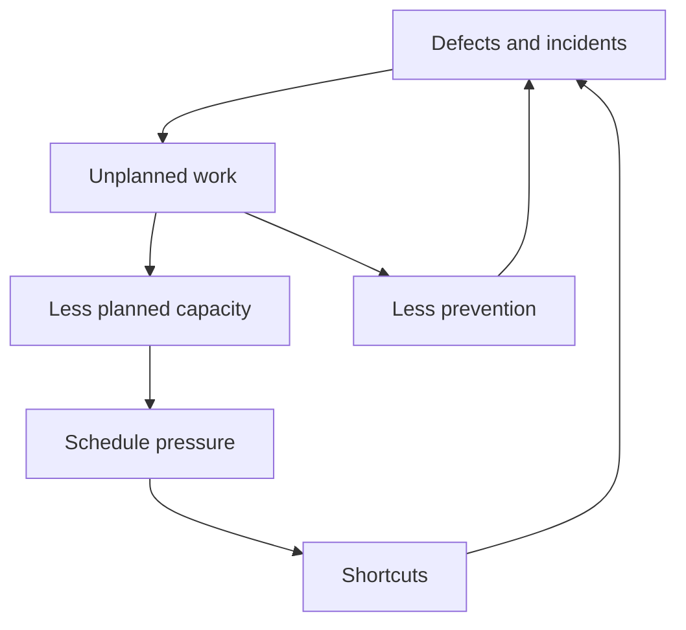
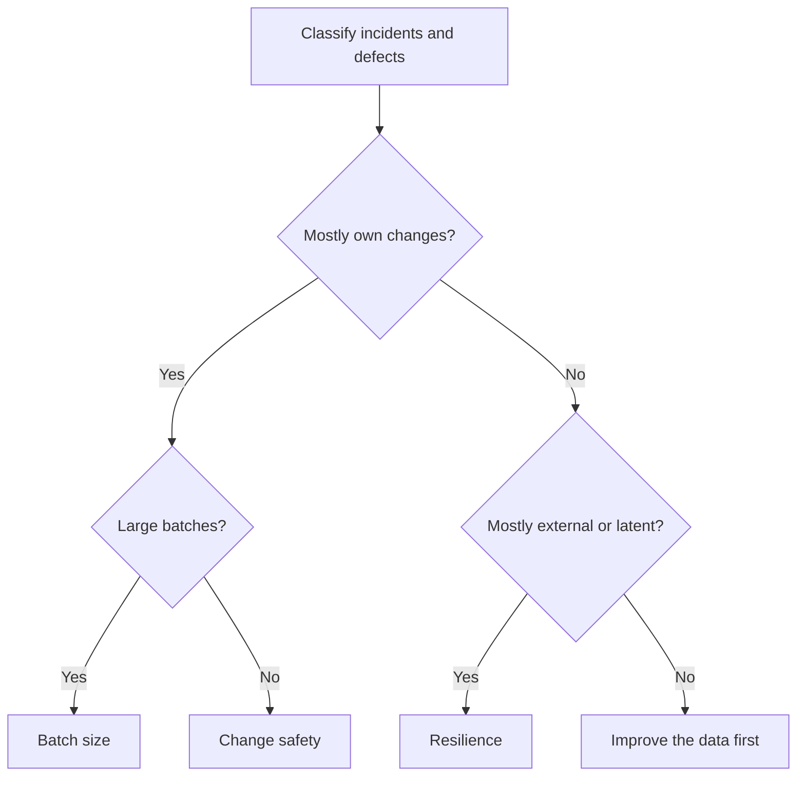

# Chapter 27 — Quality Transformation at Enterprise Scale

This chapter is about a situation most engineering directors inherit at least once: an organization
of dozens of engineers whose software quality has declined until customers, finance, and the
executive team have noticed. It shows how to diagnose the decline as a system, sequence a
transformation that reduces the creation of new defects before spending effort on old ones, design
the scorecard and accountability that run it, and fund the work honestly. The running example is
Northstar Technologies, the fictional company in the [case study](../../case-studies/northstar/index.md).

This is the capstone of Part V. Chapters 19 to 26 own the practices; this chapter links to them and
teaches how to combine them into one program.

## Why This Matters

At the scale of one team, a quality problem is visible and local. The team knows which module is
fragile and which release went wrong, and the manager can shift a sprint toward fixes.

At 50 to 150 engineers, the same decline is spread across teams that each see only part of it. Its
costs land elsewhere: another team's interrupts, a support queue, service credits, a renewal
conversation. Every manager can explain their own part, and nobody owns the whole.

Northstar shows the shape. Last quarter it had 30 Sev1 and Sev2 incidents, and customers found almost
half before any alert fired. (Sev1 and Sev2 are the two highest
[severity](../../glossary.md#severity-sev1-sev2-sev3) ratings: an order or payment path down or a
wrong financial record for Sev1, narrower failures for Sev2.) About a third of engineering capacity went to unplanned work. The
company paid $410,000 in service credits, and two customers worth $9M in annual recurring revenue
named reliability as their reason for hesitating to renew.

At executive scale the questions are revenue at risk, time to recovery, cost, and the effect on
roadmap commitments. A transformation plan has to answer all four in numbers. Plans rarely fail for
lack of known practices; they fail on sequencing (working the backlog while inflow continues),
measurement (targets met by reclassification), accountability (quality owned by a QA group instead
of the teams that change the code), and funding (assuming the work is free).

## Learning Objectives

After this chapter you will be able to:

- Diagnose a quality decline as a system of reinforcing loops, and locate the constraint that
  produces most of the damage, using incident and defect data your organization already has.
- Sequence a 90-day transformation that reduces defect inflow before it drains the defect stock,
  and explain the sequence to peers who want the backlog fixed first.
- Design a transformation scorecard with paired measures and tie it to management accountability
  without turning it into a blame instrument.
- Fund quality work with an explicit capacity model, show its effect on feature throughput quarter
  by quarter, and negotiate the trade-off with product and finance in numbers.
- Recognize the common failure patterns of quality programs early enough to correct them.

## The Mental Model

> **Mental model:** Quality is a stock that changes through flows. Shut off the inflow before you
> drain the stock, and work on the constraint before anything else.

This applies three tools that [Chapter 3](../01-foundations/03-managerial-leverage-and-systems-thinking.md)
teaches: stocks and flows, reinforcing loops, and constraints. Here they are applied to quality.

The **stocks** are known defects, unowned components, and fragile code
([Meadows, 2008](../../references/bibliography.md#meadows2008thinking)). Every change that ships a
defect adds to the stock; fixing work drains it. If inflow exceeds the drain, heroic draining only
slows the rise.

The **reinforcing loop** makes a decline accelerate, because its output feeds its cause:

Shortcuts here means skipped tests, bigger batches, and deferred fixes. Prevention means tests,
alerts, and clear ownership. Both loops run in either direction: a team caught in them gets worse
each quarter without anyone deciding to lower standards, and a team that breaks them gets better,
because recovered capacity goes into further prevention.

The **constraint** ([Goldratt and Cox, 1984](../../references/bibliography.md#goldratt1984goal)) in
a quality decline is the mechanism through which most of the damage enters; at Northstar, the Core
release train. Better tests in a well-behaved service may be good engineering, but will not move
the incident count.

## Deep Conceptual Explanation

### Outcome, lever, and investment

Chapter 19 separates external quality (what customers experience), internal quality (how safely
the system can be changed), and delivery quality (how reliably intent becomes working change). They
move on different timescales. Manage external quality as the **outcome**: it is what the mandate is
about, and it is slow and noisy. Use delivery quality as the **lever**: change failure rate and
recovery time respond within weeks. Treat internal quality as an **investment** with a longer
payback (Chapter 21 prices it). Programs that start with refactoring tend to spend two quarters
without a visible result and lose their mandate.

### Inflow before stock

Take a **hypothetical** backlog of 600 defects, with teams closing about 200 a quarter, roughly
matching inflow. The tempting response is a campaign: ten engineers for a quarter on old defects. It
drains the stock, leaves the inflow untouched, and adds schedule pressure, one of the inflow's causes.
A plausible result: the backlog drops to 450, then climbs back over two quarters.

The alternative is to classify where the inflow comes from and close the largest openings first.
Chapter 19 classifies Northstar's [escaped defects](../../glossary.md#escaped-defect) (customer-reported
bugs confirmed as defects) by the earliest point a reasonable check would have caught them. About half
sit at unit and contract level. By trigger, 19 of 30 incidents came from Northstar's own changes, 9 of
those through the release train of [Core](../../glossary.md#core), the Java monolith.

The classification also shows inflow that is not a testing problem: misunderstood requirements are
fixed by how product and engineering collaborate, and third-party failures (6 of 30 incidents) by
resilience and detection. Work the backlog down after inflow falls, by customer impact, not age. A
stock that has stopped growing can be drained by normal capacity; a growing one cannot.

### Finding the constraint

A few mechanisms usually produce most of the damage. Find them with data, because every team has an
opinion and the opinions conflict. Four sources are usually enough, and most organizations have them:

1. **Incidents**, classified by trigger, detection (who noticed first), and recurrence.
2. **Escaped defects**, classified by earliest practical detection point.
3. **Pipeline data**: lead time, deployment frequency, release failure rate, pipeline duration, and
   how often the main branch is broken.
4. **Ownership inventory**: every deployable component, its owning team, alerts, runbook, on-call.

At Northstar the four converge. The Core monolith ships every two weeks after a three-day manual
regression pass; median lead time is 19 days, and 31 percent of releases are followed by a hotfix,
rollback, or incident. Nine of 30 incidents came through it, with a median restore of almost five
hours against about three overall. The release train is the constraint.

The reason is batch size. A two-week Core release carries about 170 changes from four teams. When
it fails, nobody knows which change caused it, and rollback removes everybody's work. Because
releases are risky, the manual pass grows, which makes releases rarer and larger: the response to
risk increases the risk. *Continuous Delivery* argues for the opposite move, small automated
batches ([Humble and Farley, 2010](../../references/bibliography.md#humble2010continuous)); Chapter
23 covers the [pipeline mechanics](23-code-review-ci-cd-and-release-engineering.md#a-trustworthy-pipeline-and-a-healthy-main-branch).

Two other mechanisms amplify every failure without being the main source. **Detection** is weak:
customers found 14 of 30 incidents, and those took far longer to detect than the ones monitoring
caught (Chapter 24 gives the figures). **Ownership** has gaps: 8 of 24 components have disputed, shared, or no
owner, and 8 have nobody on call.

### The speed objection

The common objection is that the program will slow delivery. For a quarter it usually does, and the
capacity model below says by how much. The industry research of DORA (DevOps Research and
Assessment), summarized in *Accelerate*
([Forsgren, Humble, and Kim, 2018](../../references/bibliography.md#forsgren2018accelerate)) and its
current guide ([DORA, metrics guide](../../references/bibliography.md#dora-metrics-guide)), reports
that speed and stability tend to move together. The data are survey-based and correlational, so this
is not a law (Chapter 18 covers the metrics). Refuse "quality or speed" as a framing; ask which
practice costs speed, how much, for how long, and what it buys.

### Scorecard design rules

A scorecard used for decisions will be optimized, an idea usually credited to Donald Campbell
([Campbell, 1979](../../references/bibliography.md#campbell1979assessing)). Quality metrics are especially exposed because the people measured also produce
the data: on-call assigns severity, support decides what counts as a defect. Four design rules:

- **Pair measures** so that gaming one moves the other. Change failure rate with deployment
  frequency: a team that stops deploying to protect its failure rate is visible. Incident count with
  customer-detected share: reclassifying incidents downward still leaves customers finding problems.
- **Prefer measures computed from systems** (pipeline logs, alert timestamps) over measures that
  depend on human classification, and audit the classification ones, severity above all
  (Chapter 25 covers [severity definitions that resist reclassification](25-incidents-postmortems-and-change-failure-analysis.md#severity-definitions-that-resist-reclassification)).
- **Separate learning measures from judging measures**. The scorecard in the monthly quality review
  is for learning and decisions; individual performance is not judged on it.
- **Look at distributions, not only averages**. Median time to restore can improve while the worst
  incidents get worse.

For a transformation, add two more: publish a quarter of baseline before setting targets, and judge
early progress on measures built from many events (releases, pipeline runs) over those built from
few (incidents).

### Accountability design

Transformations stall when quality is owned by someone other than the people who change the code.
Attach accountability to the **system and the
follow-through**: a manager answers for whether their components have owners, alerts, and runbooks,
whether follow-up actions close, and whether change failure rate trends down. The engineer whose
change triggered an incident is the best witness to how the system allowed it, not its culprit.
Chapter 25 owns [blameless review](25-incidents-postmortems-and-change-failure-analysis.md#blameless-review-and-its-critics);
the transformation depends on it holding under executive pressure.

### Changing roles without losing the people

Most quality programs change someone's job, usually the testers whose manual pass is being
automated. Handled badly, the change loses their knowledge and tells every engineer what happens when
work is automated. Five moves (this book's recommendation) keep both the people and the knowledge:

1. **Announce early, with the destination.** Uncertainty costs more than the news. Once the decision
   is made, say where each person is going and when, even if details are open. Say plainly what is
   not happening, if it is true that nobody loses a job.
2. **Offer a role, not a reassignment.** Each person gets a team, a manager, and a written mandate
   that says what they own and what they stop doing (Chapter 19 sets out the embedded quality
   engineer's mandate).
3. **Fund the retraining.** Learning automation and test design takes time out of the quarter. Count
   it inside the prevention allocation, and pair each person with developers on real work.
4. **Let people choose the transition work.** Keeping a shrinking part of the old work and starting
   automation at once both help the program.
5. **Define the path for anyone who declines.** Agree it one to one: a time-limited stay on the
   remaining manual work, a move to another function, or a supported exit with notice. Nobody should
   learn their option from the org chart.

At Northstar, constraint 5 of the case required any plan to say what the seven QA engineers would do
next. The plan moved each into a product team as a quality engineer reporting to that team's
manager: two to Orders, two to Billing, two to Customer Experience, and one to Payments and
Integrations. The director delayed the announcement until week 10, after two QA engineers had asked
whether they were being automated out of a job. That delay is the part not to copy. The transition
work was chosen, not assigned: two chose to run the roughly 600-case weekly regression subset, all
seven triaged the manual suite with the teams, and five also automated cases.

### Funding the work

Prevention competes with features for the same engineers, and a plan that pretends otherwise is
abandoned at the first roadmap slip. The honest model has three parts:

1. **Unplanned work**, a cost already being paid: 34 percent of Northstar's capacity.
2. **Prevention**, an investment with a lag: capacity now, returned later. At Northstar it is one
   allocation; security, debt, standards, and testing work are paid out of it, not on top of it.
3. **Feature capacity**: what remains.

Prevention starts before unplanned work falls, so feature capacity dips first. If prevention works,
unplanned work later falls by more than prevention costs. The director negotiates the depth of the
dip with product and finance.

## Engineering Organization Example

!!! info "Northstar so far"
    Weeks 1 to 4 of the director's first year; this chapter then follows the whole first quarter. The
    baseline quarter had 30 Sev1 and Sev2 incidents, 99.62 percent availability against a 99.9 percent
    commitment, $410,000 in service credits, and 34 percent of capacity on unplanned work. See the
    [timeline](../../case-studies/northstar/timeline.md).

The following model is **illustrative**. The figures for the first quarter come from Northstar's
baseline; the later quarters are the director's projection, and every assumption is stated.

Assumptions:

- 80 engineers. Capacity is measured in full-time-equivalent engineers ([FTE](../../glossary.md#fte)).
- Unplanned work starts at 34 percent of capacity (27.2 FTE).
- The director proposes a prevention allocation of 12 FTE in quarters 1 and 2, falling to 8 FTE in
  quarter 3 and 6 FTE in quarter 4 as the work moves from building capabilities to maintaining them.
- The projected decline in unplanned work assumes the release-train change and detection work
  remove about a third of change-induced incidents by the end of quarter 2, with defect inflow
  falling in step. The projection is a planning assumption, not a forecast with known accuracy, and
  it is revisited every month.

| Quarter | Unplanned work | Prevention | Feature capacity | Change from baseline |
|---|---|---|---|---|
| Baseline | 34% = 27.2 FTE | 0 | 52.8 FTE | — |
| Q1 | 33% = 26.4 FTE | 12 FTE | 41.6 FTE | −21% |
| Q2 | 28% = 22.4 FTE | 12 FTE | 45.6 FTE | −14% |
| Q3 | 22% = 17.6 FTE | 8 FTE | 54.4 FTE | +3% |
| Q4 | 18% = 14.4 FTE | 6 FTE | 59.6 FTE | +13% |

First, the dip is real: in quarter 1, product teams have about a fifth less feature capacity. A
plan that does not tell the Chief Product Officer this in month one will tell it in month three,
after commitments slip, and it will read as a failure rather than a decision.

Second, the plan pays back within the year only if the unplanned-work assumption holds. If unplanned
work falls only to 26 percent by quarter 4, feature capacity is 53.2 FTE, roughly baseline. Present
that pessimistic case alongside the planned one.

Third, the money is not small. At Northstar's average fully loaded cost of $185,000 per engineer,
the 38 FTE-quarters of prevention in the plan (one FTE for one quarter each) cost about $1.76M. Against that: service credits
running at $1.64M a year, $9M of revenue in at-risk renewals, and, if the plan works, about 13 FTE of
unplanned work removed by quarter 4, worth about $2.4M a year in recovered capacity. This is the
shape of the business case in Chapter 52, and of Project 8.

Allocation need not be uniform. It should follow where the inflow comes from and where commitments
sit; the case shows Northstar's split by team.

## Decision Framework

The first decision is which mechanism to attack first. Use the diagnostic data, not intuition:

| Constraint | Typical interventions |
|---|---|
| Batch size | Shrink releases, automate the path to production, separate deploy from release (Chapter 23) |
| Change safety | Contract tests at boundaries, migration and configuration checks (Chapter 22), progressive rollout |
| Resilience | Timeouts and fallbacks, capacity testing, SLOs for dependencies (Chapter 24) |
| Improve the data first | One quarter of disciplined classification before choosing |

Two checks run alongside any constraint, because they are cheap and amplify everything else. If
customers detect more than about a quarter of incidents, put user-facing alerts on
[tier 1](../../glossary.md#tier-1) paths (at Northstar, the order and payment paths). If
orphaned components appear in incidents, assign tier 1 owners now; ownership is a precondition, not
a project.

The second decision is the **shape of the program**:

| Shape | Works when | Fails when |
|---|---|---|
| Feature freeze | Imminent contractual or regulatory crisis; short, with a defined exit | Used as the strategy; inflow returns after |
| Quality sprint | Clearing a bounded backlog after inflow is fixed | Inflow unchanged; becomes a ritual |
| Tiger team | Specialized cross-team work, such as pipeline consolidation | Never hands back; becomes a dependency |
| Standing allocation | Decline caused by many teams' changes | Share unprotected in planning, or spent elsewhere |
| Team-owned targets | Teams have the capability and need focus | Teams lack capability; targets produce gaming |

Northstar combines a standing allocation sized per team, a release working group for the
cross-team train change, and team targets from quarter 2, once the scorecard has an honest baseline.

The third decision is **what to stop**, because a program that only adds work is crowded out: most of
the manual regression pass, duplicated status meetings, and roadmap items whose business case has
lapsed.

## Trade-offs

**Speed of improvement against feature delivery.** A larger allocation shortens the decline and
deepens the dip. With $9M of renewals at stake, Northstar can justify a deep dip; where quality is an
irritant rather than a threat, 8 percent and a slower curve may be right.

**Central capability against team ownership.** A central group consolidates four CI systems faster
than six teams coordinating, and risks becoming the place where quality lives. Mitigate with
explicit hand-back: a receiving team, a date, and a check that the team can operate it alone.

**Standards and gates against flow.** Each manual gate adds waiting time and batch size, as the
Northstar train shows. Prefer automated checks and progressive rollout to human approval for routine
changes (Chapter 23 reviews the
[evidence on change approval](23-code-review-ci-cd-and-release-engineering.md#change-approval-and-pipeline-outcomes)).

**Transparency against gaming.** Broad publication of team scorecards adds accountability and
pressure to optimize. A middle course: team scorecards visible to managers and staff engineers,
organization-level aggregates reported upward.

**People in changing roles.** Northstar's seven QA engineers know real customer workflows better
than anyone in engineering. Moving them into product teams costs a transition period and retraining,
and keeps that knowledge; automating around them is cheaper this quarter and loses it.

## Failure Modes

**The quality sprint.** A fix-it fortnight closes many tickets; the inflow is unchanged and the
backlog returns. Signal: the main metric is tickets closed. Countermeasure: make inflow (new defects,
change failure rate) the primary outcome.

**Metric theater.** Incident counts fall, customer escalations do not; more incidents are rated
Sev3, the level below the headline count. Signal: the severity distribution shifts while customer-detected share and credits do not.
Countermeasure: impact-based severity definitions, a weekly audit of sampled severity decisions,
paired measures.

**Practice mandates instead of inflow targets.** After a bad release, an executive requires sign-off
for every Core change, or teams are told to reach 80 percent line coverage. Batches grow, or tests
run code without asserting behavior. Signal: lead time or coverage rises while change failure rate
and escaped defects do not fall. Countermeasure: give every gate an expiry date and measure its
effect on batch size; tie test investment to where defects escape (Chapter 22,
[what coverage measures](22-testing-strategy-and-test-architecture.md#what-coverage-measures)).

**The action-item graveyard.** Reviews produce actions, a third close, failure modes recur:
Northstar's 32 percent closure and 37 percent recurrence. Countermeasure: fewer, manager-owned
actions reviewed monthly (Chapter 25,
[follow-up actions and recurrence](25-incidents-postmortems-and-change-failure-analysis.md#follow-up-actions-and-recurrence)).

**The silent dip.** Prevention is funded by quietly taking feature capacity; product finds out when
dates slip and stops trusting engineering. Countermeasure: present the capacity model before the
quarter and get the trade agreed in writing.

**The blame relapse.** A Sev1 hits the largest customer and the CEO asks who did it. If the answer
names a person, engineers learn the blameless language was decorative, and the next reviews get
shorter and vaguer. Countermeasure: prepare the executive team in advance, and answer with what the
system allowed and what is changing.

## Enterprise Application

At 50 to 150 engineers, the director cannot run the transformation through personal attention; it
has to run through the management system.

**The director owns** the diagnosis, the constraint, the capacity model and its negotiation, the
scorecard design and its cadence, and the organizational changes: owners for orphaned components,
the QA role change, any team boundary changes (Chapter 33 covers team design).

**Engineering managers own** their team's scorecard outcomes, incident actions, the operational
readiness of their components, and the use of their prevention allocation, which they explain in
the monthly review.

**Staff engineers own** the technical direction of cross-cutting work. At Northstar the three had no
defined mandate; the transformation gives them one. Kwame Mensah leads release and detection work,
Ines Carvalho Core module boundaries and contract tests, Li Na Zhou migration and configuration
safety.

The cadence, in its simplest workable form (Chapter 37 places it in the management operating
system):

| Cadence | Who | Purpose | Length |
|---|---|---|---|
| Weekly operational review | Director, managers, staff engineers, on-call leads | Last week's incidents, follow-ups due, scorecard movements worth discussing | 30 minutes |
| Monthly quality review | Director with each manager, staff engineers attending | One team's scorecard in depth: what changed, why, what the allocation bought | 45 minutes per team |
| Quarterly reset | Director, managers, CTO, CPO | Capacity model update, allocation for the next quarter, constraint re-check | half a day |

The quality review inspects the system the manager runs. Andrew Grove's argument that a manager's
output is the output of the organization under their influence
([Grove, 1983](../../references/bibliography.md#grove1983high)) applies: a manager whose team's change
failure rate is falling has produced something. The [engineering quality scorecard template](../../templates/engineering-quality-scorecard.md)
shows a filled-in version for Northstar.

## CTO Perspective

At CTO level, a quality transformation is one of several investments competing for the same
capital, and quality has to be expressed in business terms.

**Quality as risk.** Report reliability to the board as exposure: contractual availability against
commitment, service credits, revenue in accounts where reliability is a stated concern, and the
trend. Incident counts are supporting detail.

**Portfolio and tiering.** Running an internal tool at lower reliability than the payment path is
good management when deliberate. The CTO sets the tiering policy and a few enforced minimums, and
leaves the how to directors. At Northstar the minimums are the four
[tier 1 operational minimums](../../glossary.md#tier-1-operational-minimums), plus an auditable
pipeline tracked as a separate standard (Chapter 20).

**Time horizon.** The CTO also asks whether Core should keep its shape and whether the decline will
recur in the next growth phase (Chapter 51).

**Credibility.** A CTO who promises a board "zero Sev1 incidents" has made a promise no organization
keeps, and has invited reclassification. Commit to rates and trends with stated confidence.

## Practical Playbook

A 90-day plan for an organization of 50 to 150 engineers. The
[90-day quality plan template](../../templates/ninety-day-quality-plan.md) turns it into a
working document.

**Days 1–15: diagnose.**

1. Classify the last two quarters of incidents by trigger, detection, and recurrence, yourself or
   with one staff engineer, so that you understand the data.
2. Classify a sample of at least 100 escaped defects by earliest practical detection point.
3. Measure each component's pipeline: lead time, deployment frequency, change failure rate,
   duration, main-branch red time.
4. Build the ownership inventory: every component, its owner, tier, alerts, runbook, on-call.
5. Ask each manager, staff engineer, the head of support, and the product leads what causes the
   problems; compare their beliefs to the data.

**Days 15–30: decide and agree.**

6. Name the constraint and the two parallel workstreams (usually detection and ownership).
7. Assign owners to unowned tier 1 components by decision, not consensus; record an exemption with
   a review date for disputed cases.
8. Write severity definitions based on customer impact.
9. Agree the capacity model, planned and pessimistic, with the CTO and head of product.
10. Publish the scorecard baseline to managers. No targets yet.

**Days 30–60: reduce inflow.**

11. Start the constraint work. At Northstar: automate the highest-value regression cases, move Core
    to weekly releases, separate deploy from release with flags.
12. Put user-facing alerts on every tier 1 path; track customer-detected share weekly.
13. Cut open incident actions to a short manager-owned list; drop the rest explicitly.

**Days 60–90: consolidate.**

14. Review the scorecard trend against baseline, with honest uncertainty.
15. Set next quarter's team targets from the baseline, with paired measures.
16. Start draining the defects with the highest customer impact.
17. Report to the CTO: what changed, what did not, the updated model, the next constraint.

## Case Study

This case is **fictional**. It continues the Northstar story from the
[baseline](../../case-studies/northstar/baseline-data.md); the full record of the quarter is
[the director's first year](../../case-studies/northstar/first-quarter.md).

In week 2, the new director spent two afternoons with Kwame Mensah (staff engineer, infrastructure and
reliability) classifying incidents. Two things
surprised the managers when they saw the result. Nine of thirty incidents came through the Core
release train, and its incidents took longest to restore. And 11 of the 30 were recurrences of
failure modes the organization had already reviewed, including a bulk-upload failure (INC-421) that
matched an incident two quarters earlier almost exactly.

The managers' explanations had been different. Marcus Oyelaran (Billing) believed his team's
incidents came from unclear requirements. The data showed seven of his team's eight incidents were
triggered by Core releases or migrations. Tom Becker (Platform Operations) believed the problem was
too little manual testing; the data showed that the three-day manual pass had not caught any of the
nine train-triggered incidents.

The director put the capacity model to Victor Lindqvist (CTO) and Amara Okafor (CPO) in week 4. Amara accepted
the quarter 1 dip on two conditions: the two renewal commitments kept their dates, and she saw the
model updated monthly. The director sized the 12 FTE prevention allocation per team: Billing at 25
percent, Orders and Payments and Integrations at 10 percent (because of the renewal commitments),
and the others at 15 percent. A release working group led by Kwame, with owners from the teams, took
the release-train work. Also in week 4, core/customer went to Orders and core/scheduler to Billing.

Three things went wrong.

In week 7, the weekly review noticed four consecutive incidents rated Sev3, one of them a two-hour
payment delay for nine customers. The severity definitions were being read creatively under
scorecard pressure. The director re-rated it in the review, explained why, and added severity audit
to the weekly meeting.

In week 9, a Sev1 in Billing, the repeat of INC-427 in which credit notes were applied twice, brought
a call from the CEO asking who had made the change. The director answered with the mechanism, and the
engineer involved led the review ([Chapter 25](25-incidents-postmortems-and-change-failure-analysis.md#case-study) tells it in full).

And the QA transition caused anxiety, because the plan described under "Changing roles without
losing the people" was announced only in week 10.

At day 90, the numbers were these:

| Measure | Baseline quarter | Transformation quarter |
|---|---|---|
| Sev1 and Sev2 incidents | 30 | 21 |
| of which via Core releases | 9 | 4 |
| Customer-detected share | 47% | 29% |
| Core releases | 2 per month | 11 in the quarter (weekly from week 5) |
| Core change failure rate | 31% | 22% |
| Unplanned work | 34% | 31% |
| Renewal commitments on track | — | both |

The director's report to the CTO called the direction encouraging and the evidence not yet
conclusive. Incidents are rare, and a count of 30 can move by several between quarters with no
change in the underlying rate, so the fall to 21 was consistent with improvement without proving it.
The stronger evidence was in the mechanisms: Core change failure rate and customer-detected share
had both moved, and both rest on many more events. The report proposed keeping the allocation
through quarter 2 and setting team targets from the new baseline.

## Exercises

Solutions are in [chapter 27 solutions](../../solutions/ch27-solutions.md). Data files are linked
from the [Northstar baseline page](../../case-studies/northstar/baseline-data.md).

### Foundational

**F1.** Using `incidents-last-quarter.csv`, classify Northstar's 30 incidents by trigger, detection
source, and recurrence. Then answer: which single intervention, if it fully worked, would address the
largest share of the quarter's incidents? A colleague argues that the answer is to extend the manual
regression pass from three days to five. Use the data to respond.

**F2.** A team proposes this quality scorecard: test line coverage, number of bugs closed per sprint,
incident count, number of releases, and number of postmortems written. For each measure, describe
specifically how a team under pressure could improve the number without improving quality, and
propose a replacement or a paired measure that resists that behavior.

**F3.** In the quarter after a transformation starts, Sev1 and Sev2 incidents fall from 30 to 24. The
CTO asks whether the program is working. Explain what this one number can and cannot tell you, and
list the other evidence you would want before answering. Be specific about which measures in the
Northstar baseline are based on many events and which on few.

### Applied Leadership

**A1.** Marcus Oyelaran, the Billing manager, objects to his team's 25 percent prevention allocation.
He says the team is already behind on two roadmap items, morale is low, and spending a quarter of
capacity on "process work" will make it worse. Prepare for the conversation: what you need to learn
from him first, what data you bring, what you are willing to change, and what you are not.

**A2.** Design the transition for Northstar's seven QA engineers as the manual regression pass is
automated over two quarters. Your design must keep their product knowledge in the organization,
give each person a credible role, say what happens to anyone who does not want the new role, and
specify how you will announce it and when.

**A3.** Write the one-page memo to Amara Okafor (CPO) proposing the quarter 1 capacity model. State
the trade, the numbers, the pessimistic case, what product gets in return, and what you are asking
her to decide. Assume she is skeptical because a previous quality initiative cost a quarter and
produced nothing she could see.

### Executive Decision-Making

**X1.** At a board meeting, a board member says that the company should commit to "zero Sev1
incidents next year" and asks the CTO to accept it as a goal. You are the CTO. Respond in the
meeting (in no more than 150 words), and then write the follow-up note proposing what the board
should track instead, with a rationale.

**X2.** Northstar's engineering leadership must choose one of two investments for the next two
quarters, within a $250,000 discretionary tooling budget plus existing headcount. Option A: buy a
commercial observability platform ($240,000 per year) and roll it out to all tier 1 services. Option
B: assign four engineers for two quarters to consolidate the four CI systems onto one, using existing
licenses. Using the baseline data, recommend one, explain what you give up, and say what evidence
would make you change your mind by the end of the first quarter.

## Reflection Questions

1. Which quality measure in your organization would you be most reluctant to see published? What
   does that reluctance tell you about how it is currently produced or used?
2. Where in your organization does the response to risk increase the risk, as the Northstar release
   train does? Who would object if you removed that response, and why?
3. How do engineers in your organization learn that a change they made caused a customer problem?
   How long does it take, and through whom does the information travel?
4. If your largest customer suffered a Sev1 tomorrow, what would your executive team ask first, and
   would your answer protect the engineers' willingness to report the next one honestly?
5. What would you stop doing to fund prevention work, and who would notice?

## Key Takeaways

- Diagnose quality decline as a system: stocks (defects, unowned components) changed by flows
  (changes that ship defects, fixing work), with reinforcing loops through unplanned work.
- Reduce inflow before draining the stock. A backlog campaign without inflow reduction refills.
- Find the constraint with data you already have: incidents by trigger, detection, and recurrence;
  defects by detection point; pipeline measures; ownership inventory.
- Large, infrequent releases are a common constraint: the response to their risk makes them larger.
- Pair scorecard measures, prefer system-generated data, and audit human classifications.
- Attach accountability to the system and the follow-through, not to the person who made the change.
- Fund prevention explicitly with a single capacity model, show the dip and the payback, and agree
  the trade with product before the quarter starts.
- Treat a fall in incident counts over one quarter as encouraging, not conclusive. Mechanism measures
  based on many events are better early evidence.

## References and Further Reading

- [Meadows, 2008](../../references/bibliography.md#meadows2008thinking). *Thinking in Systems*.
  Stocks, flows, and feedback loops; this chapter's diagnostic vocabulary.
- [Goldratt and Cox, 1984](../../references/bibliography.md#goldratt1984goal). *The Goal*. A novel
  that teaches constraint thinking.
- [Kim, Behr, and Spafford, 2013](../../references/bibliography.md#kim2013phoenix). *The Phoenix
  Project*. The same ideas in an IT organization in decline; useful for explaining unplanned work to
  non-engineers.
- [Humble and Farley, 2010](../../references/bibliography.md#humble2010continuous). *Continuous
  Delivery*. The case for small batches and an automated pipeline.
- [Forsgren, Humble, and Kim, 2018](../../references/bibliography.md#forsgren2018accelerate) and the
  [DORA metrics guide](../../references/bibliography.md#dora-metrics-guide). The DORA research and
  its current metric definitions; Chapter 18 discusses both.
- [Campbell, 1979](../../references/bibliography.md#campbell1979assessing). The source usually
  credited for the problem of indicators that become targets.
- [Grove, 1983](../../references/bibliography.md#grove1983high). *High Output Management*. A
  manager's output as the output of the organization they influence.
- [Google SRE, Embracing Risk](../../references/bibliography.md#google2017embracing), in the free
  [*Site Reliability Engineering*](../../references/bibliography.md#beyer2016sre) book: why 100
  percent reliability is rarely the right target, for the board conversation in X1.
