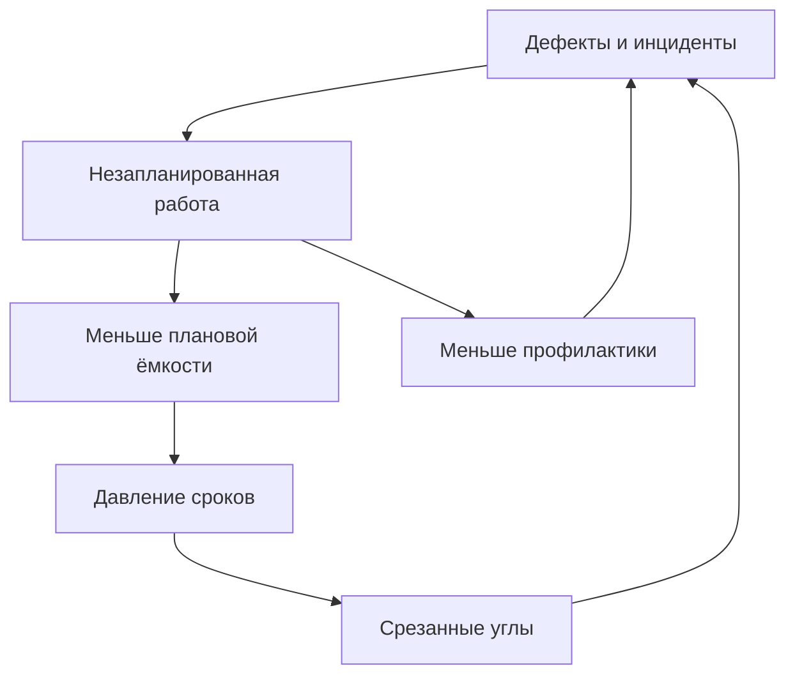
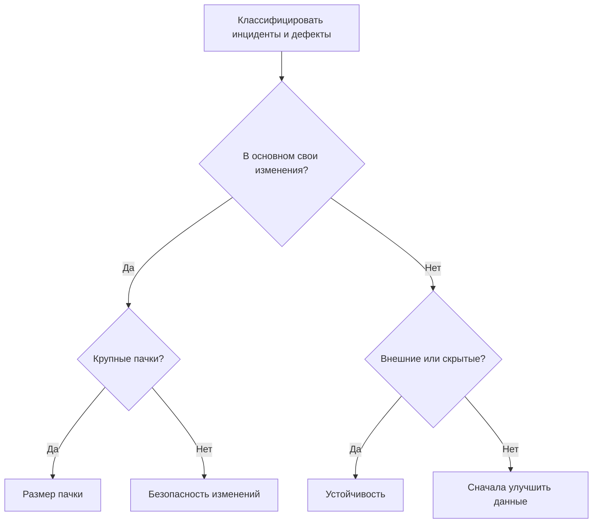

# Глава 27 — Трансформация качества в масштабе крупной организации { #chapter-27-quality-transformation-at-enterprise-scale }

Почти каждому директору по разработке хотя бы раз достаётся такая ситуация: в организации из
нескольких десятков инженеров качество ПО упало настолько, что это заметили клиенты, финансы и высшее
руководство. Из главы вы узнаете, как диагностировать спад как систему и как выстроить трансформацию:
сначала сократить появление новых дефектов и только потом тратить силы на старые. Отдельно разобраны
карта показателей и подотчётность, на которых держится программа, и честное финансирование. Сквозной
пример — Northstar Technologies, вымышленная компания из [кейса](../../case-studies/northstar/index.md).

Глава завершает часть V. Отдельные практики разобраны в главах 19–26; эта глава опирается на них и
показывает, как собрать их в одну программу.

## Почему это важно { #why-this-matters }

В одной команде проблема качества видна и локальна. Команда знает, какой модуль хрупкий и какой
релиз не удался, а руководитель может повернуть спринт к исправлениям.

Когда инженеров 50–150, тот же спад размазан по командам, и каждая видит лишь свой кусок. Издержки
оседают в других местах: в прерываниях соседней команды, в очереди поддержки, в сервисных кредитах, в
разговоре о продлении контракта. Каждый руководитель может объяснить свою часть, но у целого нет
владельца.

Как это выглядит, видно на примере Northstar. В прошлом квартале у компании было 30 инцидентов Sev1
и Sev2, и почти половину из них клиенты обнаружили раньше, чем сработал хоть один алерт. (Sev1 и
Sev2 — две высшие степени [серьёзности](../../glossary.md#severity-sev1-sev2-sev3): Sev1 — это
недоступный путь заказа или оплаты либо неверная финансовая запись, Sev2 — более узкие отказы.) Около
трети ресурса разработки ушло на незапланированную работу. Компания выплатила $410 000 сервисных
кредитов (компенсаций по SLA), а два клиента, приносящие $9 млн годовой регулярной выручки, назвали
надёжность причиной своих сомнений в продлении.

Высшее руководство спросит о четырёх вещах: какая выручка под угрозой, когда ситуация выправится,
сколько это стоит и что будет с обязательствами по дорожной карте. План трансформации должен ответить
на все четыре вопроса в цифрах. Проваливаются планы редко из-за того, что авторы не знают нужных
практик. Ломаются они на другом: на последовательности (разбирают бэклог, пока приток продолжается), на
измерении (цели выполняют за счёт переклассификации), на подотчётности (качеством владеет группа QA, а
не команды, которые меняют код) и на финансировании (считают, что работа ничего не стоит).

## Цели главы { #learning-objectives }

Прочитав эту главу, вы сможете:

- Диагностировать спад качества как систему усиливающих петель и по уже имеющимся у организации
  данным об инцидентах и дефектах находить ограничение, через которое приходит основной ущерб.
- Выстроить 90-дневную трансформацию, которая сокращает приток дефектов раньше, чем вычерпывает их
  запас, и объяснить такой порядок коллегам, которые хотят начать с бэклога.
- Спроектировать карту показателей (scorecard) трансформации с парными метриками и связать её с
  подотчётностью руководителей так, чтобы она не стала инструментом поиска виноватых.
- Финансировать работу над качеством через явную модель ресурсов, показывать поквартально, как она
  влияет на выпуск функций, и договариваться об этом компромиссе с продуктом и финансами на языке цифр.
- Распознавать типичные провалы программ качества так рано, чтобы ещё успеть их исправить.

## Ментальная модель { #the-mental-model }

> **Ментальная модель:** качество — это запас, и меняют его потоки. Перекройте приток, прежде чем
> вычерпывать запас, и в первую очередь работайте с ограничением.

Модель берёт три инструмента из [главы 3](../01-foundations/03-managerial-leverage-and-systems-thinking.md):
запасы и потоки, усиливающие петли и ограничения. Здесь они применены к качеству.

**Запасы** — это известные дефекты, компоненты без владельца и хрупкий код
([Meadows, 2008](../../references/bibliography.md#meadows2008thinking)). Каждое изменение, с которым
в продакшен уходит дефект, пополняет запас; работа по исправлению его уменьшает. Если приток больше,
чем удаётся вычерпать, героические усилия лишь замедляют рост.

**Усиливающая петля** ускоряет спад, потому что её результат питает её же причину:

Срезанные углы — это пропущенные тесты, крупные пачки изменений и отложенные исправления; профилактика
— это тесты, алерты и ясное владение. Обе петли работают в любую сторону. Попавшая в них команда с
каждым кварталом работает хуже. Разорвавшая их — лучше: высвободившийся ресурс идёт на новую
профилактику.

**Ограничение** ([Goldratt and Cox, 1984](../../references/bibliography.md#goldratt1984goal)) при
спаде качества — это механизм, через который приходит основная часть ущерба; в Northstar это
релизный поезд (release train) Core. Улучшить тесты в сервисе, который и так работает исправно, —
возможно, хорошая инженерия, но число инцидентов от этого не сдвинется.

## Подробный разбор { #deep-conceptual-explanation }

### Результат, рычаг и инвестиция { #outcome-lever-and-investment }

Глава 19 различает внешнее качество (то, что видят клиенты), внутреннее качество (насколько безопасно
систему можно менять) и качество поставки (насколько надёжно замысел превращается в работающее
изменение). Они меняются в разном темпе. Внешним качеством управляйте как **результатом**: ради него
выдан мандат, а меняется оно медленно и с шумом. Качество поставки используйте как **рычаг**: доля
неудачных изменений (change failure rate) и время восстановления откликаются за недели. Внутреннее
качество считайте **инвестицией** с более долгой окупаемостью (в деньгах его оценивает глава 21).
Программа, которая начинает с рефакторинга, обычно два квартала не может показать видимого результата
и теряет мандат.

### Сначала приток, потом запас { #inflow-before-stock }

Возьмём **гипотетический** бэклог из 600 дефектов: команды закрывают около 200 за квартал, и это
примерно равно притоку. Соблазнительный ответ — кампания: на квартал посадить десять инженеров за
старые дефекты. Кампания уменьшает запас, но не трогает приток и к тому же усиливает давление сроков,
а оно — одна из причин притока. Правдоподобный итог: бэклог падает до 450, а за следующие два квартала
возвращается к прежнему уровню.

Альтернатива — разобраться, откуда берётся приток, и сначала закрыть самые большие бреши. В главе 19
[пропущенные дефекты](../../glossary.md#escaped-defect) Northstar (ошибки, о которых сообщили клиенты
и которые подтвердились как дефекты) разложены по самой ранней точке, где их поймала бы разумная
проверка. Примерно половина приходится на уровень модульных и контрактных тестов. Если смотреть на
триггеры, 19 из 30 инцидентов вызвали собственные изменения Northstar, и 9 из них прошли через
релизный поезд [Core](../../glossary.md#core) — монолита на Java.

Классификация вскрывает и приток, вовсе не связанный с тестированием. Неправильно понятые требования
лечат сотрудничеством продукта и разработки, а сбои третьих сторон (6 из 30 инцидентов) —
устойчивостью и обнаружением. За бэклог беритесь, когда приток уже упал, и разбирайте его по влиянию
на клиентов, а не по возрасту. Запас, который перестал расти, можно вычерпать обычными силами;
растущий — нельзя.

### Как найти ограничение { #finding-the-constraint }

Основной ущерб обычно создают несколько механизмов. Ищите их по данным: своё мнение есть у каждой
команды, и эти мнения противоречат друг другу. Обычно хватает четырёх источников, и они есть у
большинства организаций:

1. **Инциденты**, классифицированные по триггеру, по обнаружению (кто заметил первым) и по
   повторяемости.
2. **Пропущенные дефекты**, классифицированные по самой ранней практически возможной точке
   обнаружения.
3. **Данные пайплайна**: lead time (время выполнения), частота развёртываний, доля неудачных
   релизов, длительность пайплайна и то, как часто сломана основная ветка.
4. **Инвентаризация владения**: каждый развёртываемый компонент, команда-владелец, алерты, ранбук
   (runbook), дежурство.

В Northstar все четыре источника указывают в одну точку. Монолит Core выходит раз в две недели после
трёхдневного ручного регрессионного прогона. Медианный lead time — 19 дней, и за 31% релизов следует
хотфикс, откат или инцидент. Через Core прошли девять из 30 инцидентов, и восстанавливали их в медиане
почти пять часов против примерно трёх по всем инцидентам. Ограничение — релизный поезд.

Причина в размере пачки. Двухнедельный релиз Core везёт около 170 изменений от четырёх команд. Когда
он ломается, никто не знает, какое изменение виновато, а откат убирает работу всех. Релизы
рискованны, поэтому ручной прогон разрастается, а из-за этого релизы выходят реже и становятся
крупнее. Ответ на риск увеличивает риск. Авторы *Continuous Delivery* предлагают обратный ход —
небольшие автоматизированные пачки ([Humble and Farley, 2010](../../references/bibliography.md#humble2010continuous)).
Механику пайплайна разбирает [глава 23](23-code-review-ci-cd-and-release-engineering.md#a-trustworthy-pipeline-and-a-healthy-main-branch).

Ещё два механизма усиливают любой сбой, хотя основной ущерб создают не они. Первый — слабое
**обнаружение**: клиенты нашли 14 из 30 инцидентов, и на их обнаружение уходило гораздо больше
времени, чем на пойманные мониторингом (цифры приводит глава 24). Второй — пробелы во **владении**: у 8
из 24 компонентов владелец спорный, общий или его нет вовсе, а у 8 нет дежурных.

### Возражение о скорости { #the-speed-objection }

Обычно возражают, что программа замедлит поставку. На один квартал — как правило, да. Но по данным
отраслевого исследования DORA (DevOps Research and Assessment), изложенного в *Accelerate*
([Forsgren, Humble, and Kim, 2018](../../references/bibliography.md#forsgren2018accelerate)) и в
актуальном руководстве ([DORA, metrics guide](../../references/bibliography.md#dora-metrics-guide)),
скорость и стабильность обычно меняются вместе. Данные получены из опросов и носят корреляционный
характер, так что это не закон (метрики разбирает глава 18). Не соглашайтесь на выбор «качество или
скорость». Спрашивайте иначе: какая практика стоит скорости, сколько именно, как долго и что она даёт
взамен.

### Правила проектирования карты показателей { #scorecard-design-rules }

Карту показателей, по которой принимают решения, начнут оптимизировать. Эту мысль обычно приписывают
Donald Campbell ([Campbell, 1979](../../references/bibliography.md#campbell1979assessing)). Метрики
качества особенно уязвимы, потому что данные производят те же люди, которых измеряют: серьёзность
назначает дежурный, а что считать дефектом, решает поддержка. Четыре правила проектирования:

- **Объединяйте метрики в пары**, чтобы подгонка (gaming) одной сдвигала другую. Долю неудачных
  изменений ставьте рядом с частотой развёртываний: команда, которая перестала развёртывать, чтобы
  сберечь долю неудач, сразу заметна. Число инцидентов ставьте рядом с долей инцидентов, обнаруженных
  клиентами: инциденты можно переклассифицировать вниз, но клиенты всё равно будут находить проблемы.
- **Предпочитайте метрики, которые вычисляются по данным систем** (логи пайплайна, время срабатывания
  алертов), а не те, что зависят от классификации людьми. Метрики, основанные на классификации,
  проверяйте, и прежде всего серьёзность (как написать [определения серьёзности, устойчивые к переклассификации](25-incidents-postmortems-and-change-failure-analysis.md#severity-definitions-that-resist-reclassification),
  разбирает глава 25).
- **Разделяйте метрики для обучения и метрики для оценки**. Карта показателей на ежемесячном обзоре
  качества нужна для обучения и решений; индивидуальную результативность по ней не оценивают.
- **Смотрите на распределения, а не только на средние**. Медианное время восстановления может
  улучшаться, а худшие инциденты тем временем становятся тяжелее.

Для трансформации добавьте ещё два правила. Первое: прежде чем ставить цели, опубликуйте квартал
исходных данных. Второе: о раннем прогрессе судите по метрикам, построенным на множестве событий
(релизы, запуски пайплайна), а не на немногих (инциденты).

### Как устроить подотчётность { #accountability-design }

Трансформация буксует, когда качеством владеет кто-то другой, а не те, кто меняет код. Привязывайте
подотчётность к **системе и доведению дел до конца**. Руководитель отвечает за то, есть ли у его
компонентов владельцы, алерты и ранбуки, закрываются ли последующие действия и снижается ли доля
неудачных изменений. Инженер, чьё изменение вызвало инцидент, — не виновник, а лучший свидетель того,
как система это допустила. Подробно безобвинительный разбор (blameless review) описывает
[глава 25](25-incidents-postmortems-and-change-failure-analysis.md#blameless-review-and-its-critics),
и от того, выдержит ли он давление руководства, зависит вся трансформация.

### Как изменить роли и не потерять людей { #changing-roles-without-losing-the-people }

Большинство программ качества меняет чью-то работу — обычно работу тестировщиков, чей ручной прогон
автоматизируют. Если сделать это плохо, организация потеряет их знания, а каждый инженер увидит, что
бывает с людьми, когда их работу автоматизируют. Пять шагов (рекомендация книги) сохраняют и людей,
и знания:

1. **Объявите рано и сразу скажите, к чему идёт дело.** Неопределённость обходится дороже самой
   новости. Как только решение принято, скажите, куда переходит каждый человек и когда, даже если
   детали ещё не ясны. Если работу действительно никто не потеряет, так прямо и скажите: назовите то,
   чего не произойдёт.
2. **Предложите роль, а не перевод.** Каждый получает команду, руководителя и письменный мандат: чем
   он владеет и что перестаёт делать (мандат встроенного инженера по качеству описан в главе 19).
3. **Профинансируйте переобучение.** Чтобы освоить автоматизацию и проектирование тестов, нужно
   время, и найти его надо внутри квартала. Учитывайте это время в выделении на профилактику, а
   каждого ставьте в пару с разработчиками на реальных задачах.
4. **Дайте людям выбрать работу на переходный период.** Программе пригодятся и те, кто сохранит за
   собой сокращающуюся часть старой работы, и те, кто сразу возьмётся за автоматизацию.
5. **Определите путь для тех, кто откажется.** Договоритесь о нём один на один: оставшаяся ручная
   работа на ограниченный срок, переход в другую функцию или уход с поддержкой и заблаговременным
   предупреждением. Никто не должен узнавать о своём варианте из оргструктуры.

В Northstar одно из [пяти неизменных условий](../../glossary.md#the-five-constraints) плана директора
гласит: любой план, который меняет работу QA-инженеров, должен говорить, чем они займутся дальше. По
плану каждый из них перешёл инженером по качеству в продуктовую команду и подчиняется её
руководителю: двое — в Orders, двое — в Billing, двое — в Customer Experience, один — в Payments and
Integrations. Директор отложил объявление до недели 10, и к тому времени двое QA-инженеров уже
спросили, не лишатся ли они работы из-за автоматизации. Эту задержку не повторяйте. Работу на переходный
период выбирали, а не назначали: двое решили вести еженедельный регрессионный поднабор примерно из
600 тест-кейсов, все семеро вместе с командами разобрали ручной набор тестов, а пятеро ещё и
автоматизировали тест-кейсы.

### Как финансировать работу { #funding-the-work }

Профилактика конкурирует с функциями за одних и тех же инженеров, а план, который делает вид, что это
не так, бросят при первом же сдвиге дорожной карты. Честная модель состоит из трёх частей:

1. **Незапланированная работа** — издержки, которые уже оплачиваются: 34% ресурса Northstar.
2. **Профилактика** — инвестиция с запаздыванием: ресурс сейчас, отдача потом. В Northstar это единое
   выделение: работу по безопасности, долгу, стандартам и тестированию оплачивают из него, а не сверх
   него.
3. **Ресурс на функции** — то, что остаётся.

Профилактика начинается раньше, чем падает незапланированная работа, поэтому ресурс на функции
сначала проседает. Если профилактика действует, позже незапланированная работа сокращается сильнее,
чем стоит сама профилактика.

## Пример из инженерной организации { #engineering-organization-example }

!!! info "Northstar: что уже известно"
    Недели 1–4 первого года директора; дальше глава прослеживает весь первый квартал. В базовом
    квартале было 30 инцидентов Sev1 и Sev2, доступность 99,62% при обязательстве 99,9%,
    $410 000 сервисных кредитов и 34% ресурса на незапланированной работе. См.
    [хронологию](../../case-studies/northstar/timeline.md). Впервые читаете о Northstar? Прочитайте
    [«Год вкратце»](../../case-studies/northstar/year-in-brief.md) и
    [действующих лиц](../../case-studies/northstar/cast.md).

Эта модель — **иллюстрация**. Цифры первого квартала взяты из исходного уровня Northstar, а
следующие кварталы — прогноз директора; все допущения названы.

Допущения:

- 80 инженеров. Ресурс измеряется в инженерах на полной ставке ([FTE](../../glossary.md#fte)).
- Незапланированная работа в начале занимает 34% ресурса (27,2 FTE).
- Директор предлагает выделение на профилактику в 12 FTE в кварталах 1 и 2, затем 8 FTE в
  квартале 3 и 6 FTE в квартале 4: работа переходит от создания возможностей к их поддержанию.
- Снижение незапланированной работы спрогнозировано так: к концу квартала 2 перестройка релизного
  поезда и работа над обнаружением уберут около трети инцидентов, вызванных изменениями, и вместе с
  ними упадёт приток дефектов. Это плановое допущение, а не прогноз с известной точностью; его
  пересматривают каждый месяц.

| Квартал | Незапланированная работа | Профилактика | Ресурс на функции | Изменение к базовому |
|---|---|---|---|---|
| Базовый | 34% = 27.2 FTE | 0 | 52.8 FTE | — |
| Q1 | 33% = 26.4 FTE | 12 FTE | 41.6 FTE | −21% |
| Q2 | 28% = 22.4 FTE | 12 FTE | 45.6 FTE | −14% |
| Q3 | 22% = 17.6 FTE | 8 FTE | 54.4 FTE | +3% |
| Q4 | 18% = 14.4 FTE | 6 FTE | 59.6 FTE | +13% |

Из модели следуют три вывода. Во-первых, просадка реальна: в квартале 1 у продуктовых команд
примерно на пятую часть меньше ресурса на функции. Если план не скажет об этом директору по продукту
(CPO) в первый месяц, сказать придётся в третий, когда обязательства уже сорвутся. Тогда просадку
прочитают как провал, а не как решение.

Во-вторых, план окупается в пределах года, только если сбудется допущение о незапланированной работе.
Если к кварталу 4 она упадёт лишь до 26%, ресурс на функции составит 53,2 FTE — примерно исходный
уровень. Покажите этот пессимистичный сценарий рядом с плановым.

В-третьих, речь о немалых деньгах:

| Статья | Сумма |
|---|---|
| Профилактика: 38 FTE-кварталов по $46,250 | около $1.76M |
| Сервисные кредиты при годовом темпе базового квартала | $1.64M в год |
| Выручка по продлениям под угрозой | $9M в год |
| Высвобожденный ресурс, если план сработает (около 13 FTE к кварталу 4) | около $2.4M в год |

Затраты посчитаны по плановой ставке $185 000 за инженеро-год ($46 250 за FTE-квартал). В
пессимистичном сценарии высвобожденный ресурс примерно вдвое меньше, около $1,2 млн в год. Так
выглядит бизнес-кейс, о котором идёт речь в главе 52 и в проекте 8.

Выделение не обязательно делить поровну: оно должно следовать за источниками притока и за
обязательствами. Как Northstar разбила его по командам, показано в кейсе.

## Как принимать решение { #decision-framework }

Первое решение — с какого механизма начать. Опирайтесь на диагностические данные, а не на интуицию:

| Ограничение | Типичные меры |
|---|---|
| Размер пачки | Уменьшить релизы, автоматизировать путь в продакшен, отделить развёртывание от релиза (глава 23) |
| Безопасность изменений | Контрактные тесты на границах, проверки миграций и конфигурации (глава 22), прогрессивная раскатка |
| Устойчивость | Тайм-ауты и резервные варианты, тестирование ёмкости, SLO для зависимостей (глава 24) |
| Сначала улучшить данные | Квартал дисциплинированной классификации, прежде чем выбирать |

Какое бы ограничение вы ни выбрали, параллельно проведите две проверки: они дёшевы и усиливают всё
остальное. Если клиенты обнаруживают больше примерно четверти инцидентов, поставьте алерты,
отражающие опыт пользователей, на пути [tier 1](../../glossary.md#tier-1) (в Northstar это пути
заказа и оплаты). Если в инцидентах фигурируют компоненты без владельца, назначьте владельцев
компонентам tier 1 сразу: владение — предварительное условие, а не проект.

Второе решение — **форма программы**:

| Форма | Работает, когда | Не работает, когда |
|---|---|---|
| Заморозка функций | Надвигается договорной или регуляторный кризис; коротко, с определённым выходом | Её делают стратегией; после неё приток возвращается |
| Спринт качества | Нужно разобрать ограниченный бэклог после того, как приток устранён | Приток не изменился; спринт превращается в ритуал |
| Ударная группа (tiger team) | Специализированная межкомандная работа, например объединение пайплайнов | Работу так и не передают обратно; группа становится зависимостью |
| Постоянное выделение | Спад вызван изменениями многих команд | Долю не защищают при планировании или тратят на другое |
| Цели во владении команд | У команд есть нужные умения, им нужен фокус | Умений не хватает; цели порождают подгонку |

Northstar сочетает три формы: постоянное выделение, рассчитанное для каждой команды; рабочую группу по
релизам, которая перестраивает поезд силами нескольких команд; командные цели с квартала 2, когда у
карты показателей появится честный исходный уровень.

Третье решение — **что прекратить**: программу, которая только добавляет работу, вытеснят. Кандидаты —
большая часть ручного регрессионного прогона, дублирующие статус-встречи и пункты дорожной карты с
устаревшим бизнес-кейсом.

## Компромиссы { #trade-offs }

**Скорость улучшения или выпуск функций.** Чем больше выделение, тем короче спад и тем глубже
просадка. Когда на кону продления на $9 млн, Northstar может оправдать глубокую просадку. Там, где
качество раздражает, но ничем не грозит, правильнее может оказаться выделение в 8% и более пологая
кривая.

**Центральная функция или владение команд.** Центральная группа объединит четыре CI-системы быстрее,
чем шесть команд, договаривающихся между собой, но рискует стать местом, где «живёт» качество.
Снизить риск помогает явная передача работы обратно: с командой-получателем, датой и проверкой того,
что команда сможет эксплуатировать результат сама.

**Стандарты и контрольные точки или поток.** Каждая ручная контрольная точка добавляет ожидание и
увеличивает пачку — поезд Northstar это и показывает. Для рутинных изменений предпочитайте
автоматические проверки и прогрессивную раскатку, а не одобрение человеком (глава 23 разбирает
[данные об одобрении изменений](23-code-review-ci-cd-and-release-engineering.md#change-approval-and-pipeline-outcomes)).

**Прозрачность или подгонка.** Если широко публиковать командные карты показателей, подотчётности
становится больше, но растёт и давление оптимизировать цифры. Средний путь: командные карты видят
руководители и staff-инженеры, а наверх уходят агрегаты по организации.

## Типичные провалы { #failure-modes }

**Спринт качества.** За две недели исправлений закрывают много тикетов, но приток не меняется, и
бэклог возвращается. Как заметить: главная метрика — число закрытых тикетов. Что делать: считать
основным результатом приток (новые дефекты, доля неудачных изменений).

**Театр метрик.** Число инцидентов падает, а эскалации клиентов — нет; всё больше инцидентов получают
Sev3 — уровень, который в главную цифру уже не попадает. Как заметить: распределение серьёзности
сдвигается, а доля инцидентов, обнаруженных клиентами, и кредиты не меняются. Что делать: определять
серьёзность по влиянию на клиентов, каждую неделю проверять выборку решений о серьёзности, держать
метрики в парах.

**Предписания практик вместо целей по притоку.** После неудачного релиза кто-то из высшего
руководства требует утверждать каждое изменение Core, или командам велят добиться 80% покрытия строк.
В итоге растут пачки либо появляются тесты, которые выполняют код, не проверяя поведения. Как
заметить: lead time или покрытие растут, а доля неудачных изменений и пропущенные дефекты не
снижаются. Что делать: дать каждой контрольной точке срок действия и измерять её влияние на размер
пачки; вкладываться в тесты там, где дефекты просачиваются (глава 22, [что измеряет покрытие](22-testing-strategy-and-test-architecture.md#what-coverage-measures)).

**Кладбище действий.** Разборы порождают действия, закрывается из них треть, и сбои повторяются: в
Northstar закрывают 32% действий, а 37% инцидентов — повторные. Что делать: назначать меньше
действий, каждому — владельца-руководителя, пересматривать их ежемесячно (глава 25,
[последующие действия и повторные инциденты](25-incidents-postmortems-and-change-failure-analysis.md#follow-up-actions-and-recurrence)).

**Тихая просадка.** Профилактику финансируют, потихоньку забирая ресурс у функций; продукт узнаёт
об этом, когда срываются сроки, и перестаёт доверять разработке. Что делать: показать модель
ресурсов до начала квартала и письменно согласовать компромисс.

**Рецидив поиска виноватых.** Sev1 бьёт по крупнейшему клиенту, и CEO спрашивает, кто это сделал.
Если в ответе звучит имя, инженеры понимают, что безобвинительный язык был лишь украшением, и
следующие разборы становятся короче и расплывчатее. Что делать: заранее подготовить высшее
руководство, а в ответе говорить о том, что допустила система и что в ней меняют.

## Применение в крупной организации { #enterprise-application }

Когда инженеров 50–150, директор уже не может вести трансформацию на одном личном внимании: она
должна идти через систему управления.

**Директор владеет** диагнозом, ограничением, моделью ресурсов и переговорами о ней, устройством
карты показателей и её ритмом, а также организационными изменениями: назначением владельцев
компонентам, у которых их нет, сменой роли QA, любыми изменениями границ команд (проектирование
команд разбирает глава 33).

**Руководители разработки владеют** результатами по карте показателей своей команды, действиями по
инцидентам, операционной готовностью своих компонентов и тем, как расходуется их выделение на
профилактику; об этом они отчитываются на ежемесячном обзоре.

**Staff-инженеры владеют** техническим направлением сквозной работы. У трёх staff-инженеров Northstar
чёткого мандата не было; трансформация его даёт. Kwame Mensah ведёт работу над релизами и
обнаружением, Ines Carvalho — над границами модулей Core и контрактными тестами, Li Na Zhou — над
безопасностью миграций и конфигурации.

Ритм в самой простой работающей форме (какое место он занимает в операционной системе управления,
объясняет глава 37):

| Ритм | Кто | Зачем | Длительность |
|---|---|---|---|
| Еженедельный операционный разбор | Директор, руководители, staff-инженеры, ведущие дежурные | Инциденты прошлой недели, последующие действия к сроку, заметные сдвиги карты показателей | 30 минут |
| Ежемесячный обзор качества | Директор с каждым руководителем, staff-инженеры присутствуют | Карта показателей одной команды в глубину: что изменилось, почему, что дало выделение | 45 минут на команду |
| Квартальная перезагрузка | Директор, руководители, CTO, CPO | Обновление модели ресурсов, выделение на следующий квартал, повторная проверка ограничения | полдня |

Обзор качества проверяет систему, которой управляет руководитель. Здесь работает довод Andrew Grove:
результат руководителя — это результат организации, на которую он влияет
([Grove, 1983](../../references/bibliography.md#grove1983high)). Если у команды руководителя падает
доля неудачных изменений, значит, он что-то произвёл. Заполненный пример для Northstar есть в
[шаблоне карты показателей инженерного качества](../../templates/engineering-quality-scorecard.md).

## Взгляд CTO { #cto-perspective }

Для CTO трансформация качества — одна из нескольких инвестиций, конкурирующих за один и тот же
капитал, поэтому говорить о качестве приходится на языке бизнеса.

**Качество как риск.** Докладывайте совету директоров о надёжности как о подверженности риску:
доступность в сравнении с договорным обязательством, сервисные кредиты, выручка клиентов, которые
прямо назвали надёжность своей проблемой, и тренд. Число инцидентов — вспомогательная деталь.

**Портфель и уровни критичности.** Если внутренний инструмент намеренно держат на более низком
уровне надёжности, чем путь оплаты, это хорошее управление. CTO задаёт политику уровней критичности
(tiering) и несколько обязательных минимумов, а как их достичь, оставляет решать директорам. В
Northstar это четыре [операционных минимума tier 1](../../glossary.md#tier-1-operational-minimums)
плюс аудируемый пайплайн; его отслеживают как отдельный стандарт (глава 20).

**Горизонт времени.** CTO спрашивает ещё и о другом: должен ли Core сохранить нынешнюю форму и не
повторится ли спад на следующем этапе роста (глава 51).

**Доверие.** CTO, который обещает совету директоров «ноль инцидентов Sev1», даёт обещание, которого
не выполняет ни одна организация, и сам подталкивает к переклассификации. Берите обязательства по
уровням и трендам и называйте степень уверенности.

## Практический плейбук { #practical-playbook }

План на 90 дней для организации из 50–150 инженеров.
[Шаблон 90-дневного плана качества](../../templates/ninety-day-quality-plan.md) превращает его в
рабочий документ.

**Дни 1–15: диагноз.**

1. Сами или вместе с одним staff-инженером классифицируйте инциденты за последние два квартала по
   триггеру, обнаружению и повторяемости: так вы будете понимать данные.
2. Классифицируйте выборку не меньше чем из 100 пропущенных дефектов по самой ранней практически
   возможной точке обнаружения.
3. Измерьте пайплайн каждого компонента: lead time, частоту развёртываний, долю неудачных изменений,
   длительность, время, когда основная ветка красная.
4. Проведите инвентаризацию владения: каждый компонент, его владелец, уровень критичности, алерты,
   ранбук, дежурство.
5. Спросите каждого руководителя, каждого staff-инженера, руководителя поддержки и продуктовых лидов,
   в чём, по их мнению, причина проблем, и сравните ответы с данными.

**Дни 15–30: решение и договорённость.**

6. Назовите ограничение и два параллельных направления работы (обычно обнаружение и владение).
7. Назначьте владельцев компонентам tier 1, у которых их нет. Решайте сами, а не ищите консенсуса;
   для спорных случаев запишите исключение с датой пересмотра.
8. Напишите определения серьёзности, исходя из влияния на клиентов.
9. Согласуйте модель ресурсов, плановую и пессимистичную, с CTO и руководителем продукта.
10. Опубликуйте для руководителей исходный уровень карты показателей. Целей пока не ставьте.

**Дни 30–60: сокращение притока.**

11. Начните работу над ограничением. В Northstar это значило автоматизировать самые ценные
    регрессионные тест-кейсы, перевести Core на еженедельные релизы и с помощью фича-флагов отделить
    развёртывание от релиза.
12. Поставьте алерты, отражающие опыт пользователей, на каждый путь tier 1; еженедельно отслеживайте
    долю инцидентов, обнаруженных клиентами.
13. Сократите открытые действия по инцидентам до короткого списка с руководителями-владельцами;
    остальные явно снимите.

**Дни 60–90: закрепление.**

14. Сравните тренд карты показателей с исходным уровнем и честно назовите неопределённость.
15. Поставьте командам цели на следующий квартал, отталкиваясь от исходного уровня, и дайте каждой
    цели парную метрику.
16. Начните вычерпывать дефекты с наибольшим влиянием на клиентов.
17. Доложите CTO, что изменилось, а что осталось прежним; покажите обновлённую модель и следующее
    ограничение.

## Кейс { #case-study }

Этот кейс — **вымысел**. Он продолжает историю Northstar от
[исходного уровня](../../case-studies/northstar/baseline-data.md); полная запись квартала —
[хроника года 1](../../case-studies/northstar/first-quarter.md).

На неделе 2 новый директор вместе с Kwame Mensah (staff-инженер, инфраструктура и надёжность)
провёл за классификацией инцидентов два раза по полдня. Результат удивил руководителей дважды.
Во-первых, девять из тридцати инцидентов пришли через релизный поезд Core, и как раз их
восстанавливали дольше всего. Во-вторых, 11 из 30 повторяли сбои, которые организация уже разбирала.
Среди них был отказ массовой загрузки (INC-421) — почти точная копия инцидента двумя кварталами
раньше.

Сами руководители объясняли проблемы иначе. Marcus Oyelaran (руководитель Billing) винил неясные
требования, хотя семь из восьми инцидентов его команды вызвали релизы Core или миграции. Tom Becker
(руководитель Platform Operations) винил нехватку ручного тестирования, хотя трёхдневный прогон не
поймал ни одного из девяти инцидентов, вызванных поездом.

На неделе 4 директор представил модель ресурсов Victor Lindqvist (CTO) и Amara Okafor (CPO). Amara
приняла просадку квартала 1 на двух условиях: два [обязательства по продлению](../../glossary.md#renewal-commitments)
(функция массового заказа и интеграция с бухгалтерской системой) сохраняют свои сроки, а модель
обновляется у неё на глазах каждый месяц. Директор распределил выделение на профилактику в 12 FTE по
командам: Billing — 25%; Orders и Payments and Integrations, которые владеют обязательствами по
продлению, — по 10%; остальные — по 15%. Релизным поездом занялась рабочая группа по релизам во главе
с Kwame, в неё вошли владельцы от команд.

Три вещи пошли не по плану.

На неделе 7 четыре инцидента подряд получили Sev3. Среди них была двухчасовая задержка платежей у
девяти клиентов. На разборе директор пересмотрел серьёзность этого инцидента и добавил аудит
серьёзности в еженедельную встречу.

На неделе 9 в Billing случился Sev1, повтор INC-427 (тогда кредит-ноты применились дважды), и CEO
позвонил с вопросом, кто внёс изменение. Директор в ответ описал механизм сбоя, а разбор вёл сам
причастный инженер (полностью эта история рассказана в [главе 25](25-incidents-postmortems-and-change-failure-analysis.md#case-study)).

Наконец, переход QA вызвал тревогу: план, описанный в разделе «Как изменить роли и не потерять
людей», объявили только на неделе 10.

На День 90 цифры были такими:

| Показатель | Базовый квартал | Квартал трансформации |
|---|---|---|
| Инциденты Sev1 и Sev2 | 30 | 21 |
| из них через релизы Core | 9 | 4 |
| Доля, обнаруженная клиентами | 47% | 29% |
| Релизы Core | 2 в месяц | 11 за квартал (еженедельно с недели 5) |
| Доля неудачных изменений Core | 31% | 22% |
| Незапланированная работа | 34% | 31% |
| Обязательства по продлению идут по плану | — | оба |

В отчёте для CTO директор назвал направление обнадёживающим, а доказательства — пока не
окончательными. Число 30 от квартала к кварталу может случайно сдвинуться на несколько единиц, поэтому
падение до 21 согласуется с улучшением, но не доказывает его. Убедительнее выглядели метрики
механизмов: за ними стоит гораздо больше событий. Отчёт предлагал сохранить выделение на весь
квартал 2. Урок: сначала устраните ограничение и о раннем прогрессе судите не по числу инцидентов, а
по метрикам механизмов.

## Упражнения { #exercises }

Разборы упражнений — на странице [решений к главе 27](../../solutions/ch27-solutions.md). Ссылки на
файлы данных — на [странице исходного уровня Northstar](../../case-studies/northstar/baseline-data.md).

### Базовый уровень { #foundational }

**F1.** По файлу `incidents-last-quarter.csv` классифицируйте 30 инцидентов Northstar по триггеру,
источнику обнаружения и повторяемости. Затем ответьте: какая единственная мера при полном успехе
закрыла бы наибольшую долю инцидентов квартала? Коллега утверждает, что ручной регрессионный прогон
нужно удлинить с трёх дней до пяти. Ответьте ему, опираясь на данные.

**F2.** Команда предлагает такую карту показателей качества: покрытие строк тестами, число закрытых
за спринт багов, число инцидентов, число релизов и число написанных постмортемов. Для каждой метрики
конкретно опишите, как команда под давлением могла бы улучшить цифру, не улучшив качества, и
предложите замену или парную метрику, устойчивую к такому поведению.

**F3.** В квартале после начала трансформации число инцидентов Sev1 и Sev2 падает с 30 до 24. CTO
спрашивает, работает ли программа. Объясните, что это одно число может сказать и чего не может, и
перечислите, какие ещё доказательства вы хотели бы увидеть, прежде чем отвечать. Укажите конкретно,
какие метрики исходного уровня Northstar построены на множестве событий, а какие — на немногих.

### Прикладное лидерство { #applied-leadership }

**A1.** Marcus Oyelaran, руководитель Billing, возражает против выделения 25% ресурса его команды на
профилактику. Он говорит, что команда и так отстаёт по двум пунктам дорожной карты, боевой дух низкий,
а если потратить четверть ресурса на «процессную работу», станет хуже. Подготовьтесь к разговору:
что сначала нужно узнать у него, какие данные вы принесёте, что вы готовы изменить, а что нет.

**A2.** Ручной регрессионный прогон Northstar автоматизируют в течение двух кварталов. Спроектируйте
переход для семи QA-инженеров на это время. Ваш проект должен сохранить их знание продукта в
организации, дать каждому правдоподобную роль, сказать, что будет с теми, кто не хочет новой роли, и
определить, как и когда вы об этом объявите.

**A3.** Напишите одностраничную записку для Amara Okafor (CPO) с предложением модели ресурсов на
квартал 1. Назовите компромисс, цифры и пессимистичный сценарий; скажите, что продукт получит взамен
и какое решение вы просите её принять. Исходите из того, что она настроена скептически: прошлая
инициатива по качеству стоила квартал и не дала ничего, что она могла бы увидеть.

### Решения на уровне руководства { #executive-decision-making }

**X1.** На заседании совета директоров один из его членов предлагает компании пообещать «ноль
инцидентов Sev1 в следующем году» и просит CTO принять это как цель. Вы — CTO. Ответьте прямо на
заседании (не больше 150 слов), а затем напишите записку по итогам: предложите, что совету стоит
отслеживать вместо этого, и обоснуйте предложение.

**X2.** Инженерное руководство Northstar должно выбрать одну из двух инвестиций на следующие два
квартала, уложившись в дискреционный бюджет на инструменты в $250 000 и в существующий штат. Вариант
A: купить коммерческую платформу наблюдаемости ($240 000 в год) и развернуть её на всех сервисах
tier 1. Вариант B: выделить четырёх инженеров на два квартала, чтобы объединить четыре CI-системы в
одну на существующих лицензиях. Опираясь на данные исходного уровня, порекомендуйте один вариант,
объясните, от чего вы отказываетесь, и скажите, какие доказательства к концу первого квартала
заставили бы вас передумать.

## Вопросы для размышления { #reflection-questions }

1. Какую метрику качества в вашей организации вам меньше всего хотелось бы публиковать? Что это
   нежелание говорит о том, как её сейчас получают или используют?
2. Где в вашей организации ответ на риск увеличивает риск, как это делает релизный поезд Northstar?
   Кто стал бы возражать, если бы вы этот ответ убрали, и почему?
3. Как инженеры в вашей организации узнают, что их изменение вызвало проблему у клиента? Сколько
   времени это занимает и через кого проходит информация?
4. Если бы завтра у вашего крупнейшего клиента случился Sev1, о чём ваше высшее руководство спросило
   бы первым делом? И сохранил бы ваш ответ готовность инженеров честно сообщить о следующем сбое?
5. Что бы вы перестали делать, чтобы профинансировать профилактическую работу, и кто бы это заметил?

## Главное { #key-takeaways }

- Диагностируйте спад качества как систему: запасы (дефекты, компоненты без владельца) меняются
  потоками (изменениями, которые приносят дефекты, и работой по исправлению), а усиливающие петли
  замыкаются через незапланированную работу.
- Сокращайте приток, прежде чем вычерпывать запас. Кампания по бэклогу без сокращения притока
  заканчивается тем, что бэклог наполняется снова.
- Ищите ограничение по данным, которые у вас уже есть: инциденты по триггеру, обнаружению и
  повторяемости; дефекты по точке обнаружения; метрики пайплайна; инвентаризация владения.
- Крупные редкие релизы — частое ограничение: ответ на их риск делает их ещё крупнее.
- Объединяйте метрики карты показателей в пары, предпочитайте данные, которые порождают системы, а
  классификацию, сделанную людьми, проверяйте.
- Привязывайте подотчётность к системе и доведению дел до конца, а не к человеку, который внёс
  изменение.
- Финансируйте профилактику явно, через единую модель ресурсов; покажите просадку и окупаемость и
  согласуйте компромисс с продуктом до начала квартала.
- Падение числа инцидентов за один квартал — обнадёживающий, но не окончательный знак. Метрики
  механизмов, построенные на множестве событий, — лучшее раннее доказательство.

## Источники и что почитать { #references-and-further-reading }

- [Meadows, 2008](../../references/bibliography.md#meadows2008thinking). *Thinking in Systems*.
  Запасы, потоки и петли обратной связи; диагностический словарь этой главы.
- [Goldratt and Cox, 1984](../../references/bibliography.md#goldratt1984goal). *The Goal*. Роман,
  который учит мыслить ограничениями.
- [Kim, Behr, and Spafford, 2013](../../references/bibliography.md#kim2013phoenix). *The Phoenix
  Project*. Те же идеи на примере ИТ-организации в упадке; помогает объяснить незапланированную
  работу тем, кто не занимается разработкой.
- [Humble and Farley, 2010](../../references/bibliography.md#humble2010continuous). *Continuous
  Delivery*. Аргументы в пользу небольших пачек и автоматизированного пайплайна.
- [Forsgren, Humble, and Kim, 2018](../../references/bibliography.md#forsgren2018accelerate) и
  [DORA metrics guide](../../references/bibliography.md#dora-metrics-guide). Исследования DORA и
  актуальные определения её метрик; обе работы обсуждаются в главе 18.
- [Campbell, 1979](../../references/bibliography.md#campbell1979assessing). Источник, который обычно
  называют, когда говорят о показателях, превратившихся в цели.
- [Grove, 1983](../../references/bibliography.md#grove1983high). *High Output Management*. Результат
  руководителя как результат организации, на которую он влияет.
- [Google SRE, Embracing Risk](../../references/bibliography.md#google2017embracing), глава из
  бесплатной книги [*Site Reliability Engineering*](../../references/bibliography.md#beyer2016sre):
  почему 100% надёжности редко бывает правильной целью; пригодится для разговора с советом
  директоров в X1.
