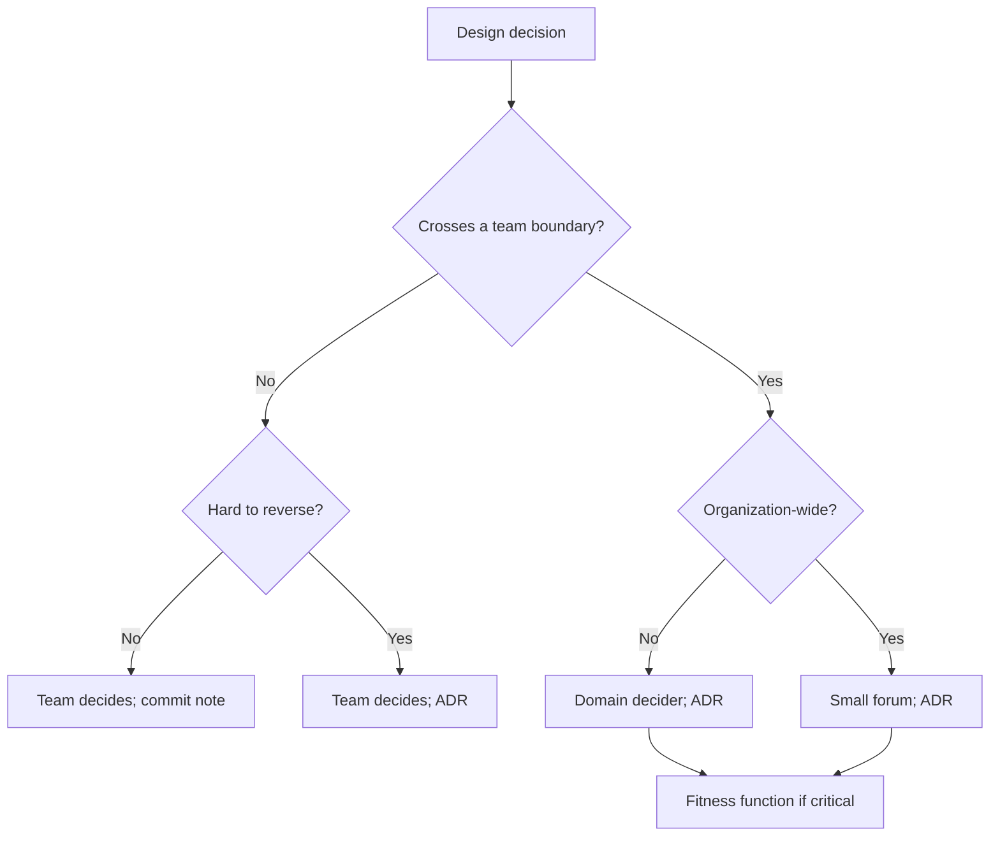
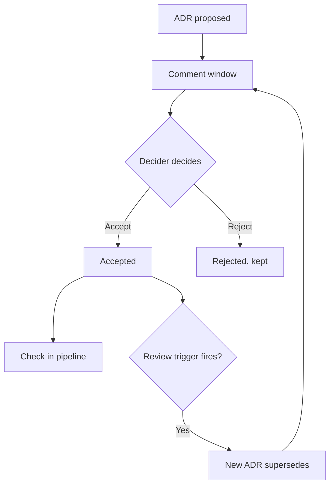
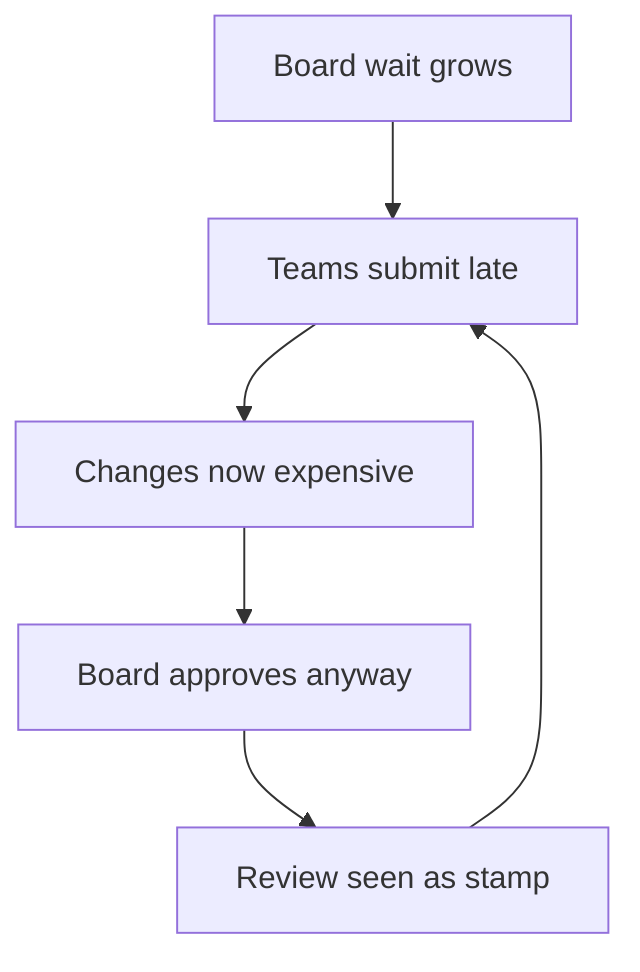

# Chapter 28 — Architecture Decision-Making and Governance

!!! warning "Awaiting human review"
    This chapter has passed the book's automated validation and an editorial self-review, but not yet
    the human review in which each cited claim is checked against its source. Treat it as a reviewed
    draft. Corrections are welcome; see the repository's CONTRIBUTING file.

Every engineering organization makes architecture decisions. The question is who makes them and
whether anyone can later find out why. This chapter covers assigning architectural decision rights
among managers, staff engineers, and teams; recording decisions so they outlive their authors;
reviewing designs without building a queue; and turning the most important decisions into automated
checks. Chapter 13 owns decision methods in general and Chapter 20 owns standards governance; this
chapter applies both to architecture and takes a position on a dispute the book left open: who decides
architecture. The running example is the fictional
[Northstar Technologies](../../case-studies/northstar/index.md).

## Why This Matters

At team scale, architecture decisions are cheap to make and expensive to lose. A team chooses a
schema in an afternoon; two years later a new engineer cannot tell whether the choice was deliberate,
and works around it or removes it, losing whatever the authors knew.

At organization scale, the expensive decisions sit between teams (interfaces, data ownership, shared
infrastructure) and often have no clear decider, so whoever ships first, escalates, or is on call
decides.

At executive scale, architecture governance is a speed question disguised as a quality question. A
review board added to stop bad designs often yields slower teams and the same designs, built around
the board; no governance yields fast teams and a system nobody can change. The work is to put the
right amount of control on each decision, and no more.

## Learning Objectives

After this chapter you will be able to:

- Classify architecture decisions by reach and reversibility, and route each class to one named
  decider.
- Assign architectural decision rights among teams, staff engineers, managers, and executives, and
  state the conditions under which that split should change.
- Write architecture decision records a successor can use, and keep the log alive.
- Design review that gives fast feedback without becoming a gate.
- Recognize when an architecture review board has become a queue or a rubber stamp, and redesign it.
- Convert critical decisions into fitness functions the pipeline checks.

## The Mental Model

> **Mental model:** An architecture decision is a bet that other people will build on. Govern it in
> proportion to how many people will build on it and how hard it is to undo, and give it one decider.

Two ideas organize the chapter. First, **architecture is a set of decisions, not a set of diagrams**.
Jansen and Bosch argued that architectures erode partly because the decisions behind them stay
implicit, and proposed treating an architecture as a composition of explicit design decisions ([Jansen and Bosch, 2005](../../references/bibliography.md#jansen2005architecture)).
Governing architecture therefore means governing decisions: who makes them, how they are recorded,
and how they are kept true.

Second, **control should follow reach and reversibility**. A decision inside one team that can be
undone in a week needs a commit message; one that three teams will build on for years needs a named
decider, written consultation, a record, and perhaps an automated check. Most governance failures
apply one level of control to every decision.

The diagram routes decisions to deciders, not meetings; only organization-wide decisions reach a
forum, and even there one person signs.

## Deep Conceptual Explanation

### What makes a decision architectural

The ADR community site defines an architectural decision as a justified design choice addressing an
architecturally significant requirement, one with a measurable effect on a system's architecture and
quality ([adr.github.io](../../references/bibliography.md#adr-github-io)). A working test for
"significant" (**this book's recommendation**): reversing the decision would require changes by more
than one team, a data migration, or a coordinated release. A library choice inside a service usually
fails it; the format of an event other teams consume passes it.

### Who decides architecture (disputed claim D7)

The book recorded this as an open dispute. Each position has a real argument.

- **Managers decide**, because they own outcomes, staffing, and dates. The weakness: the manager is
  rarely the person with the best technical information, and every design becomes an escalation.
- **Technical leaders decide** (staff engineers, architects, tech leads), because they hold the
  technical information. Larson describes setting technical direction as core staff engineer work,
  with feedback loops of months and years
  ([Larson, What do Staff engineers actually do?](../../references/bibliography.md#larson-staffeng-actually-do)),
  and names the architect as one of four staff archetypes
  ([Larson, Staff archetypes](../../references/bibliography.md#larson-staff-archetypes)). The weakness:
  authority without accountability for consequences produces an ivory tower.
- **Teams decide within guardrails**, because they live with the result. The weakness: guardrails do
  not settle cross-team questions, and two teams with equal rights on an interface deadlock or decide
  by who ships first.

The most useful theory is economic. Aghion and Tirole separate **formal authority**, the right to
decide, from **real authority**, effective control, and argue that real authority follows
information: a superior who lacks the information, is overloaded, or faces urgent decisions ends up
ratifying what the informed subordinate proposes. Giving the informed party more real authority raises
their initiative and costs the superior control
([Aghion and Tirole, 1997](../../references/bibliography.md#aghion1997formal)). This is economic
theory (**expert opinion (economic theory)** in this book's labels), read at abstract level, not a study of software teams. It fits a familiar pattern: the
manager formally approves the design, the senior engineer actually decides it. Larson's caution that people overestimate how much formal
authority helps them points the same way
([Larson, Where do Staff-plus engineers fit](../../references/bibliography.md#larson-staffeng-reporting)).

**This book's position.** Split the right by what the decision is mainly about, and give each decision
one decider.

| Decision is mainly about | Decider | Consulted | Agreement right |
|---|---|---|---|
| Design inside one team's components | The owning team (its technical lead, if any) | Readers from dependent teams | None |
| An interface or data contract between teams | A technical leader with a written mandate for the domain, or the providing team's technical lead | Every consuming team, in writing | Affected managers, on capacity and dates only |
| Organization-wide direction (platforms, data stores, build systems) | A small forum of technical leaders, one named signer | All managers | Director or CTO, on cost and risk |
| A trade-off of date, money, or risk appetite | Director or CTO | Technical leaders, in writing | None |

The conditions matter as much as the table. A technical leader holds the right only with a written
mandate for the domain, time to do the work, and accountability for consequences (a review trigger
they must act on, involvement when the decision fails in production). Otherwise the manager decides by
default and should say so. In small organizations the manager may be the best technical leader; the
split still says which hat they wear. When technical leaders disagree, or a
technical question turns into one of risk appetite ("ship the shortcut and accept the debt?"), the
decision moves to whoever owns that trade-off. No study compares these arrangements in software
organizations; the position rests on the authority model, practitioner sources, and this book's
reasoning.

Two corollaries. A cross-team proposer should not be the only approver. And a
manager's agreement right covers capacity and dates, not design: a capacity objection used to block a
disliked design is a technical veto the manager does not hold.

### Architecture decision records

Nygard's short records (context, decision, status, consequences, kept numbered in the repository,
superseded rather than deleted) exist so that successors need not accept or reverse old decisions
blindly ([Nygard, 2011](../../references/bibliography.md#nygard2011adr)). Chapter 13 covers the format
and the fields a successor needs; this section covers running a decision log.

Thoughtworks' Technology Radar placed lightweight ADRs in Adopt from November 2017 to May 2018,
recommending source control over a wiki
([Thoughtworks, Lightweight ADRs](../../references/bibliography.md#thoughtworks-radar-lightweight-adr));
that is **practitioner consensus**, not evidence of effect. Mining open source GitHub repositories,
Buchgeher and colleagues found ADR adoption low though growing, about half the repositories with ADRs
holding only one to five records, and systematic use associated with recording as a team activity
over time ([Buchgeher et al., 2023](../../references/bibliography.md#buchgeher2023adr)). This
**research finding** (abstract level, open source only, no outcome measure) still carries a lesson:
ADRs usually fail not through a bad template but through a log that stops.

What keeps a log alive (**this book's recommendation**):

1. **A trigger, not a guideline.** "A merge request that changes a cross-team interface links an ADR"
   is something a reviewer can check.
2. **One decider per record**, named, with the date. Without one, the record is a meeting summary.
3. **Status that moves**: proposed, accepted, superseded, rejected. Rejected records stop the same idea
   being relitigated every year.
4. **A review trigger**, such as "reopen if a third team consumes this".
5. **A short comment window**: three to five working days, after which the decider decides.

The loop through the review trigger separates a decision log from an archive: accepted decisions are
reopened under stated conditions, by a new record, never by silent drift.

### Lightweight design review

ADRs record decisions; design documents work them out. Ubl describes Google's design docs as informal,
written before coding, centered on trade-offs and alternatives, and reviewed in stages from comments
by a team list up to a formal meeting; he warns that formal review can slow development and says to
skip the doc when the solution is obvious
([Ubl, 2020](../../references/bibliography.md#ubl2020designdocs)). *Software Engineering at Google*
treats the design doc as one documentation type, kept in source control with owners
([Manshreck, Documentation](../../references/bibliography.md#manshreck2020documentation)). Both are
**documented practice** from one very large company.

The transferable principle: review should be **feedback from readers, not approval by a gate**.

| Feature | Feedback review | Approval gate |
|---|---|---|
| Who acts on comments | Author and named decider | Reviewers, who must be satisfied |
| If reviewers are silent | Decision proceeds after the window | Proposal waits |
| When review happens | Before building, while change is cheap | Often after building |

Gates are right for a few decisions: organization-wide and hard to reverse, or with regulatory or
security consequences. Elsewhere a comment window and a named decider give most of the benefit at a
fraction of the wait.

### When an architecture board becomes a queue

Chapter 20 shows how a council whose capacity is below its arrival rate becomes an unbounded queue
that teams route around
([Chapter 20](../05-engineering-quality/20-engineering-standards-and-their-governance.md)).
Architecture boards share that arithmetic and add three failures of their own.

**Late review.** Because the board is slow, teams submit after they have started building. The board
then reviews work that is expensive to change, and approving a flawed design becomes cheaper than
sending it back. Its power to change designs falls as its workload rises.

**Knowledge concentration.** A board of the five most senior engineers sees every significant design,
so only those five learn to make such decisions.

**Approval with conditions.** A board that cannot say no without blocking a team says yes with
conditions ("add a circuit breaker"). Nobody checks them, so the record says the risk was controlled
and the system says otherwise.

Signals: median time to decision, the share of submissions already in build, conditions verified,
and cross-team designs that never reached the board. A working board sees designs early, sometimes
says no, and has a shrinking agenda.

### Fitness functions: decisions the pipeline remembers

A record says what was decided; it does not stop the next change from undoing it. *Building
Evolutionary Architectures* popularized the **architectural fitness function**, an automated check of
an architectural characteristic run continuously as the system changes
([Ford, Parsons, and Kua, 2017](../../references/bibliography.md#ford2017building); idea level).
Thoughtworks' Radar listed it in Trial in 2017 and 2018, noting that such checks can be built from
existing unit tests, metrics, and monitors
([Thoughtworks, Architectural fitness function](../../references/bibliography.md#thoughtworks-radar-fitness-function)).

The pairing (**this book's recommendation**): when an accepted ADR has a consequence a future change
could silently undo, the ADR names a check, owned by the decider. "No service outside Billing reads
ledger tables" becomes a database grant check that fails the pipeline; "the export stays backward
compatible" becomes contract tests each consumer contributes. Most ADRs need no check. The few that do
are where governance moves from meetings into code.

Conway argued that organizations produce designs copying their communication structures
([Conway, 1968](../../references/bibliography.md#conway1968committees)), so a cross-team interface is
also an agreement between teams. When two teams cannot agree on one, check whether they disagree about
the design or about who owns the data; the second is an ownership decision (Chapter 33 owns the
structural side).

## Engineering Organization Example

The figures are **illustrative**: an invented organization of 120 engineers in 14 teams, not
Northstar. Its architecture review board meets weekly for two hours and reviews four proposals per
meeting, 30 minutes each. Its rule: every "significant" design goes to the board.

The director counted one quarter's design decisions (13 weeks), classifying them with the routing
diagram above.

| Class | Decisions per quarter | Went to the board | Per week |
|---|---|---|---|
| Inside one team, reversible | 120 | 0 | |
| Inside one team, hard to reverse | 50 | 50 | 3.8 |
| Cross-team interface or data | 30 | 30 | 2.3 |
| Organization-wide | 10 | 10 | 0.8 |
| **Total** | **210** | **90** | **6.9** |

Arrivals of about 6.9 a week against a capacity of 4 grow the backlog by about 2.9 a week, to about
38 after a quarter (2.9 × 13). A proposal arriving in week 13 waits about nine and a half weeks (38 ÷
4). Long before that, teams submit late or not at all. The redesign routes each class to a decider:

- **Inside one team, hard to reverse (50):** the team decides and writes an ADR; a staff engineer is a
  named reader with a three-working-day comment window. Board load: zero.
- **Cross-team (30):** a domain decider (four staff engineers with written mandates) decides within ten
  working days, after a five-day comment window. Load: about 7.5 decisions per staff engineer per
  quarter, roughly one every two weeks each.
- **Organization-wide (10):** the board, now a forum of technical leaders with one named signer. Load:
  10 of a capacity of 52 a quarter (4 × 13), about 19 percent.

Check: 50 + 30 + 10 = 90; 30 ÷ 4 = 7.5; 10 ÷ 52 ≈ 0.19.

Spare board capacity goes to sampling team ADRs after the fact and turning recurring questions into
standards. The transition cost: four staff
engineers accept decision rights and the accountability with them, and managers lose the board as a
shield against unpopular designs. How it is gamed: teams classify hard decisions as reversible to skip
ADRs; the sampled review catches this within a quarter, if someone reads the sample.

## Decision Framework

Use the routing diagram to classify, then this table to choose the process. Thresholds are **this
book's recommendation** for an organization of 50 to 150 engineers.

| Decision class | Decider | Review form | Record | Check |
|---|---|---|---|---|
| Inside a team, reversible | Engineer or team | Normal code review | Commit message or ticket | None |
| Inside a team, hard to reverse | Team's technical lead | 3-day comment window, outside reader | ADR in the repository | If silently undoable |
| Cross-team interface or data | Domain technical leader | All consumers in writing, 5 days; decision in 10 working days | ADR with the provider, linked from consumers | Contract test or access check |
| Organization-wide | Named signer in a small forum | Design doc, early review | ADR in a shared log | Fitness function if measurable |
| Date, money, or risk trade-off | Director or CTO | Options paper with technical views | ADR stating the trade-off | Dated review trigger |

For a borderline case, ask: would reversal need another team's work, will an unconsulted consumer
depend on it, could a later change break it unnoticed? Any yes moves it one row down.

## Trade-offs

**Speed against coherence.** Team decisions are fast; forums are consistent. The routing table spends
coherence where reversal is expensive. A weak platform may justify more central decisions for a while.

**Central expertise against distributed judgment.** A board of the most senior engineers decides well
and trains nobody. Domain deciders spread the learning and make more early mistakes; sampled review of
team ADRs is the compromise.

**Records against overhead.** An ADR costs an hour or two; a trigger tied to cross-team interfaces
keeps the log small.

**Automated checks against flexibility.** A fitness function makes a decision hard to violate and
hard to revisit. Every check needs an owner who can change it through a superseding ADR.

**Technical authority against managerial accountability.** When staff engineers decide interfaces, a
manager may carry the delivery cost of a design they did not choose. The agreement right on capacity
and dates is the price, and it must stay narrow.

## Failure Modes

**The ivory tower.** Deciders never carry the consequences. Signal: teams speak of "what architecture
wants". Countermeasure: deciders own the check and the review trigger, and join the incident review
when their decision contributes.

**Decision by incident.** Changes made during outages go unrecorded. Signal: the system differs from
every diagram. Countermeasure: incident reviews ask whether an architectural decision was made, and
open an ADR if so.

**The executive overrule.** A senior leader settles a design dispute in a hallway, without a record.
Each such overrule teaches technical leaders that their formal right is not real, the loss of
initiative the authority model predicts. Signal: proposals get cleared with the executive first.
Countermeasure: overrule through a superseding ADR that states the trade-off.

**The ADR graveyard.** Five entries, then nothing. Signal: the newest record is months old while
cross-team changes continue. Countermeasure: a code review trigger and a quarterly count of
cross-team changes without a linked ADR.

**Proposer as approver.** One person writes and approves a cross-team design. Signal: consumers learn
of decisions when their builds break. Countermeasure: a decider other than the sole author, or a
comment window the record shows was used.

**The rubber-stamp board.** Late submissions and unverified conditions, as above. Signal: no
rejections in a quarter.

## Enterprise Application

In an organization of 50 to 150 engineers, architecture governance needs four pieces, owned clearly.

**The director owns the decision-rights map**: domains, the technical leader for each, what managers'
agreement rights cover, and how disagreements escalate. One page, recorded as an ADR, reviewed when a
domain decider leaves.

**Staff engineers own domains** under written mandates: the interfaces and data contracts, a decision
service level (ten working days is a reasonable default), and the fitness functions protecting
accepted decisions. Chapter 29 (Staff and Principal Engineers) covers scoping those roles.

**Teams own their decision logs** in their repositories, linked to the cross-team records that
constrain them.

**A small forum decides organization-wide questions**: three to five technical leaders, a named signer
per decision, a published agenda. It also samples team ADRs monthly and converts repeated questions
into standards (Chapter 20's ladder).

The transition takes a quarter and brings, at first, more "who decides?" questions. Managers see
informal technical authority narrowed; staff engineers find a mandate brings accountability. The
first overrule tests whether the map is real.

## CTO Perspective

At executive level, architecture governance becomes three questions.

**Which decisions does the CTO keep?** Few: costly platform choices, risk-appetite trade-offs, and
disputes between domain deciders. Everything else stays below, including interesting technical
arguments.

**How does the CTO overrule?** Sometimes the CTO must. Overrule visibly, in a superseding record that
states the decision, the reason, and what the technical leaders advised. A visible overrule preserves
the right below; a hallway overrule hollows it out.

**How does the CTO know governance works?** Not by counting ADRs. Better measures: cross-team
decision time (median and slowest), the share of cross-team interface changes with a linked record,
and incidents whose reviews name an unrecorded or violated decision. Each is gamed (records written
after the fact, checks loosened to stop failing), so pair the counts with a quarterly read of a
sample.

## Practical Playbook

1. Sample twenty of last quarter's cross-team changes: who decided, how, and where is it written?
   The answers are your current governance.
2. Write the decision-rights map: domains, a technical decider for each, managers' agreement rights
   (capacity and dates only), and the escalation path. Record it as the first ADR.
3. Give each domain decider a written mandate, time in their plan, and a decision service level.
4. Put an ADR template in every repository, starting from Nygard's fields plus decider, options
   rejected, assumptions, and review trigger.
5. Add a code review trigger: a change to a cross-team interface links an accepted or proposed ADR.
6. Set comment windows: three working days inside a team, five across teams. Silence means proceed.
7. Measure any review board for a month (wait, share already in build, conditions verified), then
   narrow it to organization-wide decisions.
8. For each accepted ADR whose consequence can be silently undone, name a check and its owner.
9. Require every executive overrule to take the form of a superseding record.
10. Review the log quarterly: fired review triggers, cross-team changes without records, and a
    sample of team ADRs.

## Case Study

This case is **fictional**; facts not in the [Northstar canon](../../case-studies/northstar/index.md)
are recorded as additions for this chapter. It describes how architecture was decided before the
director arrived, then sets a quarter 2 decision for the reader, continuing
[Chapter 16](../04-execution/16-flow-lead-time-dependencies-and-unplanned-work.md). The outcome is
deliberately not fixed.

**How Northstar decided architecture.** The canon records a 2019 standards page by a principal
architect who left in 2021, staff engineers with no mandate, Ines Carvalho consulted on most Core
changes without owning decisions, and, in Billing, technical direction decided during incidents
([baseline data](../../case-studies/northstar/baseline-data.md)). This chapter's additions fill in the
rest. The principal architect had chaired a monthly architecture review that approved service
extractions; it stopped when they left. At the director's arrival no repository held a decision record
or design document. Decisions were made by whichever team built first, in chat threads, during
incidents, or, when a dispute reached him, by Victor Lindqvist in conversation, unrecorded. INC-418
shows the cost: the webhook signature format changed without versioning and customer integrations
rejected events. Nobody had decided that the format was a contract.

The additions also record that the older erp-sync connectors and Data and Analytics' warehouse
pipelines read 12 core/ledger tables directly through the read replicas. Every ledger migration
changes an interface nobody wrote down, and INC-424 (replicas serving stale balances after a
migration) showed the replicas themselves can lag.

**The decision at the start of quarter 2.** From the canon: Payments and Integrations is building the
new erp-sync connector for the accounting-system renewal commitment, due at the end of week 19.
Billing has reserved capacity in weeks 14 to 16 for the posted-invoice export the reconciliation
reads (the additions put it at two engineers for three weeks, six engineer-weeks). Most of the nine
dependency links between the two teams were ledger fields, and Li Na Zhou, staff engineer for data,
migration, and configuration standards, was asked to propose a ledger-export contract with contract
tests.

In week 14 Li Na Zhou opened ADR-0001, Northstar's first decision record, status Proposed. Its options, with
estimates the additions record:

| Option | What it means | Billing effort | Payments effort | Ready by week 19? | Main risk |
|---|---|---|---|---|---|
| A. Read the tables | The new connector reads posted invoices from the replicas, like the old ones | 1 engineer-week (review) | 3 | Yes | Every ledger migration can break three consumers silently |
| B. Versioned export contract | Billing publishes a documented, versioned posted-invoice export; consumers add contract tests; direct reads end for new work | 5 engineer-weeks | 2, plus contract tests | Yes, with about one week of slack | Billing owns a new interface with no technical lead |
| C. Ledger posting events | Billing emits an event per posting; consumers build their own views | about 16 engineer-weeks, including Platform Operations | 4 | No; earliest about week 24 | New infrastructure on the renewal's critical path |

Check: option B's 5 Billing engineer-weeks fit inside the 6 reserved; option C's 16 do not, and the
remaining 10 would have to come from Billing or Platform Operations after week 16.

Li Na Zhou recommended B for the new connector, the warehouse pipelines moving to the export in
quarter 3, and C deferred under a review trigger (a third consumer, or posting volume above an agreed
threshold), plus a fitness function: a weekly check that no new database grant gives a non-Billing
service read access to ledger tables.

Two facts complicate it. In week 14 Victor Lindqvist told Elena Sokolova in passing to "read the
tables now and clean it up later", to protect week 19. And nobody knows who decides. Li Na Zhou holds
the domain but wrote the proposal; Billing provides the interface but has no technical lead, and
Marcus Oyelaran's capacity is the constraint; Elena Sokolova's team carries the date. The director
owns a decision-rights map that does not yet exist.

The core/permissions owner stays open (Chapter 13). The reader's decisions are who decides ADR-0001,
by when, how Victor Lindqvist's remark is handled, and what the record must say.

## Exercises

Solutions are in [chapter 28 solutions](../../solutions/ch28-solutions.md). Northstar data is on the
[baseline page](../../case-studies/northstar/baseline-data.md) and in the
[first quarter](../../case-studies/northstar/first-quarter.md) record.

### Foundational

**F1.** Classify these six Northstar decisions with the routing diagram, naming the decider and
record for each: renaming a variable in an email template in notification-svc; changing the
webhook signature format (INC-418); adding an index to a ledger table; choosing a JSON library inside
erp-sync; consolidating the four build systems into one; and adding a field to the posted-invoice
export. For each borderline case, state what fact would move it.

**F2.** Rewrite ADR-0001 from the case study as a complete record of no more than two pages, using
Nygard's fields plus decider, options rejected, assumptions, review trigger, and any fitness function.
Leave the decision itself as Proposed, but write the consequences section for option B honestly,
including what Billing takes on and what the warehouse pipelines lose.

**F3.** An architecture board reports that it approved 41 of 43 proposals last quarter, 30 with
conditions, at a median of 19 working days to decision. List the further data you would ask for before
concluding anything, what each would tell you, and which result would convince you the board works.

### Applied Leadership

**A1.** You are the director at Northstar in week 14. Decide who is the decider for ADR-0001 and what
agreement rights Marcus Oyelaran and Elena Sokolova hold. Justify the choice against the chapter's
conditions for technical decision rights, address the fact that Li Na Zhou wrote the proposal, and
set a date by which the decision is made.

**A2.** Victor Lindqvist's remark to Elena Sokolova ("read the tables now and clean it up later") is
now known to the whole Payments and Integrations team, and two engineers have started on option A.
Plan your conversation with Victor and what you tell the team, so that the decision is made properly
without making Victor's view invisible or overruling him in a hallway yourself.

**A3.** Suppose ADR-0001 was accepted with option B. Six months later Billing's engineers say the
export contract slows every ledger change, and one proposes letting the warehouse read the tables
again "just for month-end reporting". Decide how the request is handled, who decides, and what the
record shows either way.

### Executive Decision-Making

**X1.** Victor Lindqvist proposes a weekly Architecture Review Board, chaired by himself, that every
cross-team design must pass before building starts, citing the webhook incident and the ledger
replicas. As director, decide whether to support, modify, or oppose it. Estimate the board's load from
Northstar's dependency data, and propose what you would put in its place or alongside it.

**X2.** A year from now the decision log holds 60 records. The CEO asks whether architecture
governance has been worth the staff engineers' time, given flat headcount. Decide what evidence you
would assemble, what you would refuse to claim, and what you would stop doing if the evidence were
weak.

## Reflection Questions

1. Name the last cross-team architecture decision in your organization. Who decided it, and could a
   new engineer find out why?
2. Where does formal authority over architecture sit in your organization, and where does real
   authority sit? What would happen if they were made to match?
3. When did a senior leader last overrule a technical decision, and how did the people who had
   proposed it find out?
4. If your architecture review disappeared tomorrow, which decisions would get worse, and which would
   simply get faster?
5. Which of your accepted architecture decisions could be silently undone by a single merge request?

## Key Takeaways

- Govern architecture as a set of decisions; scale control to reach and reversibility.
- Give every architecture decision one named decider; send only organization-wide decisions to a
  forum.
- Technical leaders decide cross-team technical questions when they have a written mandate, time, and
  accountability; managers hold agreement rights on capacity and dates only.
- Send date, money, and risk-appetite trade-offs to their owner, and make overrules visible as
  superseding records.
- Keep ADRs in the repository, triggered by code review, each with a review trigger; without a trigger
  the log dies.
- Prefer feedback review with a comment window to approval gates.
- Late submissions, unverified conditions, and no rejections mean a board has become a queue or a stamp.
- Turn decisions a future change could silently undo into fitness functions owned by the decider.

## References and Further Reading

- [Nygard, 2011](../../references/bibliography.md#nygard2011adr). The original decision record.
- [adr.github.io](../../references/bibliography.md#adr-github-io). Definitions and templates.
- [Thoughtworks, Lightweight ADRs](../../references/bibliography.md#thoughtworks-radar-lightweight-adr).
  Records in source control.
- [Buchgeher et al., 2023](../../references/bibliography.md#buchgeher2023adr). How ADRs are used,
  and abandoned, in open source.
- [Jansen and Bosch, 2005](../../references/bibliography.md#jansen2005architecture). Architecture as
  explicit decisions.
- [Aghion and Tirole, 1997](../../references/bibliography.md#aghion1997formal). Formal and real
  authority.
- [Ubl, 2020](../../references/bibliography.md#ubl2020designdocs) and
  [Manshreck, Documentation](../../references/bibliography.md#manshreck2020documentation). Design docs
  and staged review.
- [Ford, Parsons, and Kua, 2017](../../references/bibliography.md#ford2017building) and
  [Thoughtworks, Architectural fitness function](../../references/bibliography.md#thoughtworks-radar-fitness-function).
  Architectural characteristics as automated checks.
- [Larson, Staff archetypes](../../references/bibliography.md#larson-staff-archetypes),
  [What do Staff engineers actually do?](../../references/bibliography.md#larson-staffeng-actually-do),
  [Where do Staff-plus engineers fit](../../references/bibliography.md#larson-staffeng-reporting).
  Staff engineers and technical direction.
- [Conway, 1968](../../references/bibliography.md#conway1968committees). Interfaces mirror
  communication.
