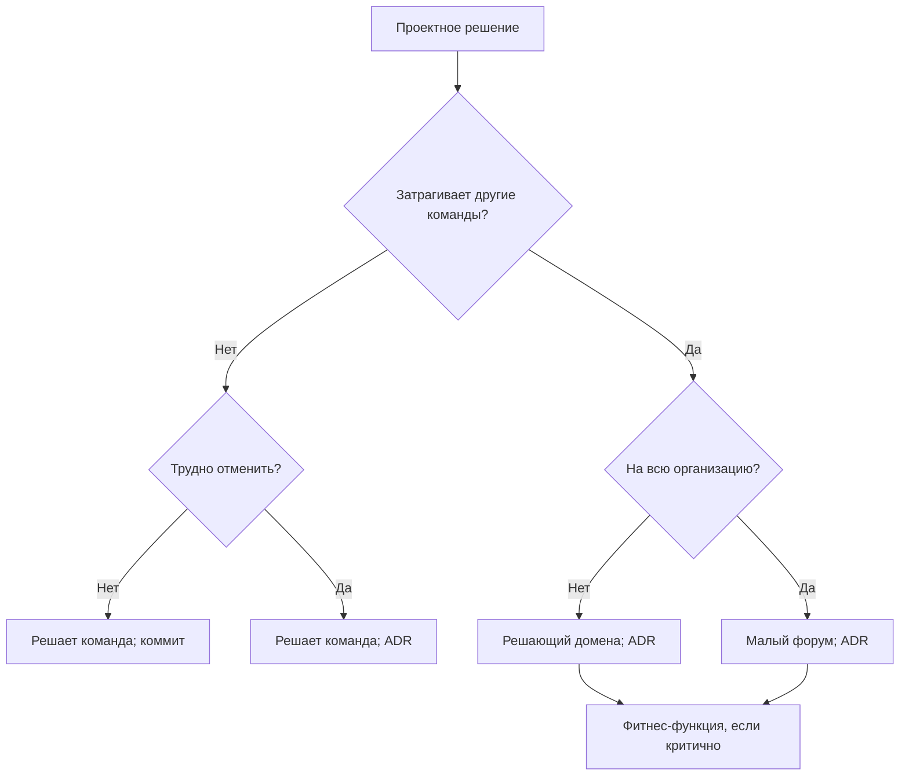
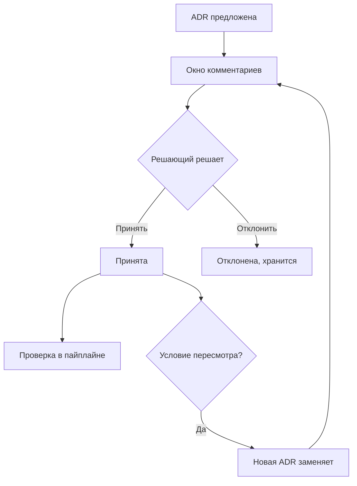
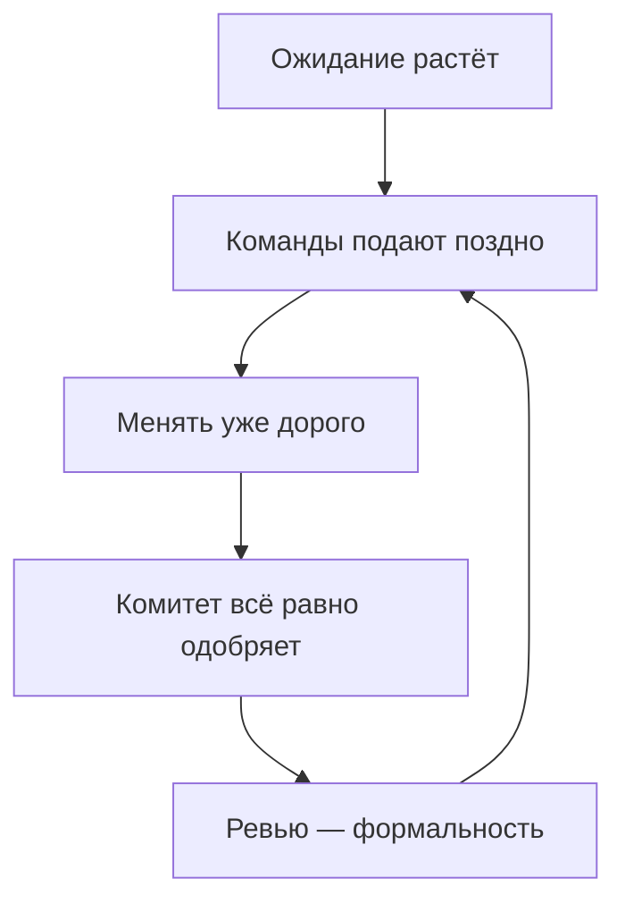

# Глава 28 — Архитектурные решения и управление архитектурой { #chapter-28-architecture-decision-making-and-governance }

Архитектурные решения принимает каждая инженерная организация. Вопрос в том, кто их принимает и
сможет ли кто-нибудь потом выяснить, почему. В главе разобраны четыре вещи: как распределить
архитектурные [права на решения](../../glossary.md#decision-rights) (кто что вправе решать) между
руководителями, staff-инженерами и командами; как записывать решения, чтобы они пережили своих
авторов; как проводить ревью дизайна, не создавая очереди; как превратить самые важные решения в
автоматические проверки. Способы принятия решений в целом разбирает глава 13, управление
стандартами — глава 20. Здесь подходы обеих глав применены к архитектуре, и по спорному вопросу о том,
кто решает архитектуру, книга занимает определённую позицию. Сквозной пример — вымышленная компания
[Northstar Technologies](../../case-studies/northstar/index.md).

## Почему это важно { #why-this-matters }

В команде архитектурные решения дёшево принять и дорого потерять. Команда выбирает схему данных за
полдня, а через два года новый инженер не может понять, был ли этот выбор намеренным. Он обходит этот
выбор или убирает его — и теряет всё, что знали авторы.

В масштабе организации дорогие решения лежат на стыках команд (интерфейсы, владение данными, общая
инфраструктура), и понятного решающего у них часто нет. Тогда решает тот, кто первым выпустил
изменение, эскалировал вопрос или оказался на дежурстве.

Для высшего руководства управление архитектурой — вопрос скорости, который выглядит как вопрос
качества. Комитет по ревью, созданный, чтобы останавливать плохие дизайны, часто приводит к тому, что
команды работают медленнее, а дизайны остаются прежними, только строят их в обход комитета. Без
управления команды быстры, но систему никто не может изменить. Задача — дать каждому решению ровно
столько контроля, сколько нужно, и не больше.

## Цели главы { #learning-objectives }

Прочитав эту главу, вы сможете:

- Классифицировать архитектурные решения по охвату и обратимости и направлять каждый класс одному
  названному решающему.
- Распределять архитектурные права на решения между командами, staff-инженерами, руководителями и
  высшим руководством и называть условия, при которых это распределение должно меняться.
- Писать записи архитектурных решений, которыми сможет воспользоваться преемник, и не давать журналу
  решений заглохнуть.
- Проектировать ревью, которое даёт быструю обратную связь и не становится контрольной точкой.
- Распознавать, когда комитет по архитектурному ревью (architecture review board) превратился в
  очередь или стал утверждать не глядя, и перестраивать его.
- Превращать критичные решения в фитнес-функции, которые проверяет пайплайн.

## Ментальная модель { #the-mental-model }

> **Ментальная модель:** архитектурное решение — это ставка, и на ней будут строить другие люди.
> Управляйте им соразмерно тому, сколько людей будет на нём строить и насколько трудно его отменить,
> и дайте ему одного решающего.

Глава держится на двух идеях. Первая: **архитектура — это набор решений, а не набор диаграмм**. По
мнению Jansen и Bosch, архитектура разрушается отчасти потому, что решения, на которых она стоит,
остаются неявными. Они предложили рассматривать архитектуру как композицию явных проектных решений
([Jansen and Bosch, 2005](../../references/bibliography.md#jansen2005architecture)). Значит,
управлять архитектурой — это управлять решениями: кто их принимает, как их записывают и как следят
за их соблюдением.

Вторая: **контроль должен следовать за охватом и обратимостью**. Если решение не выходит за пределы
одной команды и отменить его можно за неделю, хватит сообщения коммита. Если на нём три команды будут
строить годами, нужны названный решающий, письменная консультация, запись и, возможно,
автоматическая проверка. Большинство провалов управления случается оттого, что ко всем решениям
применяют один и тот же уровень контроля.

Схема направляет решения к решающим, а не на встречи. До форума доходят только решения на уровне
всей организации, и даже там подписывает один человек.

## Подробный разбор { #deep-conceptual-explanation }

### Что делает решение архитектурным { #what-makes-a-decision-architectural }

Архитектурное решение — это проектный выбор, который измеримо влияет на архитектуру и качество
системы. Так его определяет сообщество, сложившееся вокруг
[записи архитектурного решения (architecture decision record, ADR)](../../glossary.md#architecture-decision-record-adr)
— короткой письменной записи об одном решении
([adr.github.io](../../references/bibliography.md#adr-github-io)). Рабочий тест на «значимость»
(**рекомендация книги**): решение значимо, если для его отмены понадобятся изменения в нескольких
командах, миграция данных или согласованный релиз. Выбор библиотеки внутри сервиса этот тест обычно
не проходит, а формат события, которое потребляют другие команды, проходит.

### Кто решает архитектуру { #who-decides-architecture }

Практики здесь расходятся, и за каждой позицией стоит реальный довод.

- **Решают руководители**, потому что они отвечают за результаты, людей и сроки. Слабость: у
  руководителя редко бывает самая полная техническая информация, а каждый дизайн превращается в
  эскалацию.
- **Решают технические лидеры** (staff-инженеры, архитекторы, техлиды), потому что у них есть
  техническая информация. По Larson, задавать техническое направление — основная работа
  staff-инженера, причём петли обратной связи здесь длятся месяцы и годы
  ([Larson, What do Staff engineers actually do?](../../references/bibliography.md#larson-staffeng-actually-do));
  архитектора он называет одним из четырёх архетипов staff-инженера
  ([Larson, Staff archetypes](../../references/bibliography.md#larson-staff-archetypes)). Слабость:
  власть без ответственности за последствия порождает башню из слоновой кости.
- **Решают команды в пределах ограничителей**, потому что им жить с результатом. Слабость:
  ограничители не решают межкомандных вопросов, а две команды с равными правами на интерфейс либо
  заходят в тупик, либо решают по принципу «кто первым выпустил».

Самая полезная теория здесь экономическая: реальная власть следует за информацией. Aghion и Tirole
разделяют **формальную власть**, то есть право решать, и **реальную власть**, то есть фактический
контроль. Если руководителю не хватает информации, если он перегружен или должен решать срочно, он в
итоге утверждает то, что предлагает информированный подчинённый. Если дать информированной стороне
больше реальной власти, у неё растёт инициатива, а руководитель теряет контроль
([Aghion and Tirole, 1997](../../references/bibliography.md#aghion1997formal)). Это **мнение эксперта
(экономическая теория)**, а не исследование команд разработки. Но она согласуется со знакомой
картиной: формально дизайн утверждает руководитель, а фактически решает senior-инженер. В ту же
сторону указывает и предостережение Larson: люди переоценивают, насколько им помогает формальная
власть ([Larson, Where do Staff-plus engineers fit](../../references/bibliography.md#larson-staffeng-reporting)).

**Позиция книги.** Распределяйте право решать по тому, чему в основном посвящено решение, и давайте
каждому решению одного решающего. **Право согласия** в таблице уже, чем право решать: без согласия
его обладателя решение не вступает в силу, но возражать он может только по названным основаниям
(например, по ресурсу и срокам).

| Чему в основном посвящено решение | Решающий | С кем консультируются | Право согласия |
|---|---|---|---|
| Дизайн внутри компонентов одной команды | Команда-владелец (её техлид, если он есть) | Читатели из зависимых команд | Нет |
| Интерфейс или контракт данных между командами | Технический лидер с письменным мандатом на домен или техлид команды-поставщика | Каждая команда-потребитель, письменно | Затронутые руководители, только по ресурсу и срокам |
| Направление для всей организации (платформы, хранилища данных, системы сборки) | Малый форум технических лидеров, один названный подписант | Все руководители | Директор или CTO, по стоимости и риску |
| Компромисс между сроком, деньгами или риск-аппетитом | Директор или CTO | Технические лидеры, письменно | Нет |

Условия важны не меньше таблицы. Технический лидер получает право решать, только если у него есть три
вещи: письменный мандат на домен, время на эту работу и ответственность за последствия.
Ответственность здесь — это условие пересмотра, на которое он обязан реагировать, и участие в
разборе, если решение подвело в продакшене. Без этих условий по умолчанию решает руководитель, и ему
стоит сказать об этом прямо. В небольших организациях лучшим техническим лидером может быть сам
руководитель, но и тогда распределение показывает, в какой роли он выступает. Бывает, что технические
лидеры не согласны друг с другом или технический вопрос превращается в вопрос риск-аппетита
(«выпустить со срезанным углом и принять долг?»). Тогда решение переходит к тому, кто владеет этим
компромиссом. Исследований, которые сравнивали бы такие схемы в организациях разработки, нет; позиция
опирается на модель власти, источники практиков и рассуждения книги.

Из этого следуют два вывода. Первый: автор межкомандного предложения не должен быть единственным,
кто его утверждает. Второй: право согласия руководителя касается ресурса и сроков, а не дизайна. Если
возражением по ресурсу блокируют неугодный дизайн, это техническое вето, а его у руководителя нет.

### Записи архитектурных решений { #architecture-decision-records }

Nygard описал короткие записи: контекст, решение, статус, последствия. Их хранят в репозитории под
номерами; устаревшие не удаляют, а заменяют. Смысл в том, чтобы преемникам не приходилось принимать
или отменять старые решения вслепую
([Nygard, 2011](../../references/bibliography.md#nygard2011adr)). Формат и поля, нужные преемнику,
разбирает глава 13; этот раздел — о том, как вести журнал решений.

ADR обычно проваливаются не из-за плохого шаблона, а из-за того, что журнал перестают вести.
Technology Radar от Thoughtworks держал лёгкие ADR в кольце Adopt с ноября 2017 по май 2018 года и
рекомендовал хранить их в системе контроля версий, а не в вики
([Thoughtworks, Lightweight ADRs](../../references/bibliography.md#thoughtworks-radar-lightweight-adr)).
Это **консенсус практиков**, а не доказательство эффекта. Buchgeher с коллегами проанализировали
открытые репозитории на GitHub. Согласно аннотации, ADR используют редко, хотя и всё чаще. Примерно в
половине репозиториев с ADR всего от одной до пяти записей. А систематическое использование связано с
тем, что записи ведёт команда, причём долго
([Buchgeher et al., 2023](../../references/bibliography.md#buchgeher2023adr)). Этот **научный
результат** относится только к open source и не измеряет никаких результатов работы.

Что не даёт журналу заглохнуть (**рекомендация книги**):

1. **Триггер, а не рекомендация.** Правило «мерж-реквест, который меняет межкомандный интерфейс,
   ссылается на ADR» ревьюер может проверить.
2. **Один решающий на запись**, с именем и датой. Без него запись — просто протокол встречи.
3. **Статус, который меняется**: предложена, принята, заменена, отклонена. Отклонённые записи не дают
   каждый год заново спорить об одной и той же идее.
4. **Условие пересмотра**, например «вернуться к вопросу, если появится третья команда-потребитель».
5. **Короткое окно для комментариев**: три–пять рабочих дней, после чего решающий принимает решение.

Петля через условие пересмотра отличает журнал решений от архива: к принятым решениям возвращаются
при названных условиях и через новую запись, а не дают им незаметно размываться.

### Лёгкое ревью дизайна { #lightweight-design-review }

ADR фиксируют решения, а дизайн-документы помогают их выработать. Ubl описывает дизайн-документы
Google как неформальные тексты: их пишут до кода, а в центре у них компромиссы и альтернативы.
Ревьюируют их поэтапно, от комментариев в рассылке команды до формальной встречи. Ubl предупреждает,
что формальное ревью может замедлить разработку, и советует обходиться без документа, когда решение
очевидно ([Ubl, 2020](../../references/bibliography.md#ubl2020designdocs)). В *Software Engineering
at Google* дизайн-документ рассматривается как один из видов документации: он хранится в системе
контроля версий, и у него есть владельцы
([Manshreck, Documentation](../../references/bibliography.md#manshreck2020documentation)). Оба
источника — **задокументированная практика** одной очень крупной компании.

Принцип, который переносится на другие организации: ревью должно быть **обратной связью от
читателей, а не одобрением на контрольной точке**.

| Признак | Ревью как обратная связь | Контрольная точка с одобрением |
|---|---|---|
| Кто реагирует на комментарии | Автор и названный решающий | Ревьюеры, которых нужно удовлетворить |
| Если ревьюеры молчат | После окна решение идёт дальше | Предложение ждёт |
| Когда проходит ревью | До начала разработки, пока изменить дёшево | Часто после разработки |

Контрольные точки уместны для немногих решений: тех, что касаются всей организации и трудно обратимы,
и тех, у которых есть последствия для регулирования или безопасности. В остальных случаях окно для
комментариев и названный решающий дают большую часть пользы при малой доле ожидания.

### Когда архитектурный комитет превращается в очередь { #when-an-architecture-board-becomes-a-queue }

Глава 20 показывает: если вопросы поступают быстрее, чем комитет успевает их разбирать, он
превращается в бесконечную очередь, и команды начинают её обходить
([глава 20](../05-engineering-quality/20-engineering-standards-and-their-governance.md)). У
архитектурных комитетов та же арифметика и три собственных провала.

**Позднее ревью.** Комитет медленный, поэтому команды приносят дизайн, когда уже начали строить.
Комитету достаётся работа, которую дорого менять, и одобрить дизайн с изъяном оказывается дешевле, чем
вернуть его. Чем больше у комитета работы, тем меньше у него реальной возможности менять дизайны.

**Концентрация знаний.** Комитет из пяти самых опытных инженеров видит все значимые дизайны, поэтому
принимать такие решения учатся только эти пятеро.

**Одобрение с условиями.** Если комитет не может сказать «нет», не заблокировав команду, он говорит
«да» с условиями, например «добавьте автоматический выключатель (circuit breaker)» — защиту, которая
прекращает вызовы отказавшей зависимости. Условия никто не проверяет, и в итоге запись утверждает,
что риск под контролем, а система говорит обратное.

На что смотреть: медианное время до решения, доля заявок, по которым разработка уже идёт, доля
проверенных условий и межкомандные дизайны, которые так и не дошли до комитета. Работающий комитет
видит дизайны рано, иногда говорит «нет», и повестка у него сокращается.

### Фитнес-функции: решения, которые помнит пайплайн { #fitness-functions-decisions-the-pipeline-remembers }

Запись говорит, что было решено, но не мешает следующему изменению отменить решение. Книга *Building
Evolutionary Architectures* популяризировала **архитектурную фитнес-функцию (fitness function)** —
автоматическую проверку архитектурной характеристики, которую непрерывно выполняют по мере того, как
система меняется ([Ford, Parsons, and Kua, 2017](../../references/bibliography.md#ford2017building)).
Radar от Thoughtworks помещал её в кольцо Trial в 2017 и 2018 годах и отмечал, что такие проверки
можно собрать из существующих модульных тестов, метрик и мониторов
([Thoughtworks, Architectural fitness function](../../references/bibliography.md#thoughtworks-radar-fitness-function)).

Связь между записью и проверкой (**рекомендация книги**) такая: если у принятой ADR есть последствие,
которое будущее изменение может незаметно отменить, ADR называет проверку, а владеет ею решающий.
Правило «ни один сервис вне Billing не читает таблицы ledger» становится проверкой прав доступа к базе
данных, которая роняет пайплайн. Правило «экспорт остаётся обратно совместимым» становится
[контрактными тестами](../../glossary.md#contract-test) (автоматическими проверками того, что
поставщик по-прежнему возвращает то, на что рассчитывает каждый потребитель), и пишет их каждый
потребитель. Большинству ADR проверка не нужна. Но там, где она нужна, управление переходит из встреч
в код.

Межкомандный интерфейс — это ещё и договорённость между командами. Conway утверждал, что организации
создают дизайны, копирующие их структуры коммуникации
([Conway, 1968](../../references/bibliography.md#conway1968committees);
[закон Конвея](../../glossary.md#conways-law-and-the-reverse-conway-maneuver) подробно разобран в
главе 33). Если две команды не могут договориться об интерфейсе, проверьте, о чём они спорят: о
дизайне или о том, кто владеет данными. Во втором случае нужно решение о владении (структурную
сторону разбирает глава 33).

## Пример из инженерной организации { #engineering-organization-example }

Цифры здесь — **иллюстрация**: вымышленная организация из 120 инженеров в 14 командах, не Northstar.
Её комитет по архитектурному ревью собирается раз в неделю на два часа и рассматривает за встречу
четыре предложения, по 30 минут на каждое. Правило такое: каждый «значимый» дизайн проходит через
комитет.

Директор подсчитал проектные решения за один квартал (13 недель) и разложил их по классам схемы
маршрутизации, приведённой выше.

| Класс | Решений за квартал | Ушло в комитет | В неделю |
|---|---|---|---|
| Внутри одной команды, обратимые | 120 | 0 | |
| Внутри одной команды, трудно обратимые | 50 | 50 | 3.8 |
| Межкомандный интерфейс или данные | 30 | 30 | 2.3 |
| На всю организацию | 10 | 10 | 0.8 |
| **Всего** | **210** | **90** | **6.9** |

Комитет перегружен почти наполовину: в неделю приходит около 6,9 предложения при пропускной
способности 4.

| Показатель очереди | Значение |
|---|---|
| Рост очереди в неделю | 6.9 − 4 = 2.9 |
| Очередь через квартал | 2.9 × 13 ≈ 38 |
| Ожидание для предложения, поступившего на неделе 13 | 38 ÷ 4 ≈ 9.5 недели |

Но задолго до этого команды начинают приносить дизайны поздно или перестают приносить вовсе. Новая
схема направляет каждый класс к своему решающему:

- **Внутри одной команды, трудно обратимые (50):** решает команда и пишет ADR; staff-инженер —
  назначенный читатель с окном для комментариев в три рабочих дня. Нагрузка на комитет: ноль.
- **Межкомандные (30):** решение принимает решающий домена (четыре staff-инженера с письменными
  мандатами) в течение десяти рабочих дней после пятидневного окна для комментариев. Нагрузка: около
  7,5 решения на staff-инженера за квартал, то есть примерно одно решение раз в две недели на
  каждого.
- **На всю организацию (10):** комитет, который теперь становится форумом технических лидеров с одним
  названным подписантом. Нагрузка: 10 при квартальной пропускной способности 52 (4 × 13), около 19%.

Высвободившееся время комитет тратит на выборочную проверку командных ADR задним числом и на то,
чтобы превращать повторяющиеся вопросы в стандарты. Стоимость перехода: четыре staff-инженера
получают права на решения, а с ними и ответственность, руководители же теряют комитет как щит от
непопулярных дизайнов. Как схему подгоняют: команды объявляют трудные решения обратимыми, чтобы не
писать ADR. Выборочная проверка выявит это за квартал, если выборку действительно кто-то читает.

## Как принимать решение { #decision-framework }

Классифицируйте решение по схеме маршрутизации, а процесс выбирайте по этой таблице. Пороги —
**рекомендация книги** для организации из 50–150 инженеров.

| Класс решения | Решающий | Форма ревью | Запись | Проверка |
|---|---|---|---|---|
| Внутри команды, обратимое | Инженер или команда | Обычное код-ревью | Сообщение коммита или тикет | Нет |
| Внутри команды, трудно обратимое | Техлид команды | Окно для комментариев 3 дня, читатель извне | ADR в репозитории | Если решение можно незаметно отменить |
| Межкомандный интерфейс или данные | Технический лидер домена | Все потребители письменно, 5 дней; решение за 10 рабочих дней | ADR у поставщика, ссылки от потребителей | Контрактный тест или проверка доступа |
| На всю организацию | Названный подписант в малом форуме | Дизайн-документ, раннее ревью | ADR в общем журнале | Фитнес-функция, если измеримо |
| Компромисс срока, денег или риска | Директор или CTO | Записка с вариантами и техническими мнениями | ADR, где назван компромисс | Условие пересмотра с датой |

В пограничном случае задайте три вопроса. Потребует ли отмена работы другой команды? Будет ли от
решения зависеть потребитель, с которым не советовались? Может ли более позднее изменение незаметно
его сломать? Любое «да» сдвигает решение на строку вниз.

## Компромиссы { #trade-offs }

**Скорость или согласованность.** Команды решают быстро, форумы — согласованно. Таблица
маршрутизации вкладывает усилия в согласованность там, где отмена дорога. Если платформа слаба, на
какое-то время может быть оправдано больше централизованных решений.

**Централизованная экспертиза или распределённое суждение.** Комитет из самых опытных инженеров
решает хорошо, но никого не учит. Решающие доменов распространяют опыт, но поначалу чаще ошибаются;
компромиссный вариант — выборочная проверка командных ADR.

**Записи или накладные расходы.** Одна ADR — это час-два работы, а триггер, привязанный к
межкомандным интерфейсам, не даёт журналу разрастись.

**Автоматические проверки или гибкость.** Фитнес-функция мешает нарушить решение, но и пересмотреть
его тоже. У каждой проверки должен быть владелец, который может изменить её через новую ADR,
заменяющую прежнюю.

**Техническая власть или подотчётность руководителя.** Когда интерфейсы решают staff-инженеры,
руководителю может достаться стоимость поставки дизайна, который выбирал не он. Право согласия по
ресурсу и срокам — плата за это, и оно должно оставаться узким.

## Типичные провалы { #failure-modes }

**Башня из слоновой кости.** Решающие никогда не отвечают за последствия. Как заметить: команды
говорят о том, «чего хочет архитектура». Что делать: пусть решающие владеют проверкой и условием
пересмотра и участвуют в разборе инцидента, если их решение к нему причастно.

**Решения в ходе инцидентов.** Изменения, сделанные во время сбоев, никто не записывает. Как
заметить: система не совпадает ни с одной диаграммой. Что делать: на разборах инцидентов спрашивать,
было ли принято архитектурное решение, и если да, открывать ADR.

**Отмена решения сверху.** Кто-то из высшего руководства разрешает спор о дизайне в коридоре, без
записи. Каждая такая отмена показывает техническим лидерам, что их формальное право ненастоящее, и
они теряют инициативу — ровно как предсказывает модель власти. Как заметить: предложения сначала
согласуют с этим руководителем. Что делать: отменять решение через новую ADR, которая заменяет
прежнюю и называет компромисс.

**Кладбище ADR.** Пять записей, а потом ничего. Как заметить: самой свежей записи несколько месяцев,
хотя межкомандные изменения продолжаются. Что делать: триггер в код-ревью и ежеквартальный подсчёт
межкомандных изменений без ссылки на ADR.

**Автор предложения сам его утверждает.** Один человек пишет и утверждает межкомандный дизайн. Как
заметить: потребители узнают о решениях, когда у них ломаются сборки. Что делать: назначить
решающего, который не единственный автор, или открыть окно для комментариев так, чтобы в записи было
видно, как им воспользовались.

**Комитет, утверждающий не глядя.** Поздние заявки и непроверенные условия, как описано выше. Как
заметить: за квартал ни одного отказа.

## Применение в крупной организации { #enterprise-application }

В организации из 50–150 инженеров управлению архитектурой нужны четыре элемента, и у каждого должен
быть понятный владелец.

**Директор владеет картой прав на решения**: домены, технический лидер каждого домена, что покрывают
права согласия руководителей и как эскалируются разногласия. Это одна страница: её оформляют как ADR
и пересматривают, когда уходит решающий какого-либо домена.

**Staff-инженеры владеют доменами** по письменным мандатам: интерфейсами и контрактами данных,
уровнем сервиса для решений (decision service level; разумное значение по умолчанию — десять рабочих
дней) и фитнес-функциями, которые защищают принятые решения. Как очерчивать эти роли, разбирает
глава 29 (staff- и principal-инженеры).

**Команды владеют журналами решений** в собственных репозиториях; в журналах есть ссылки на
межкомандные записи, которые ограничивают команду.

**Малый форум решает вопросы на уровне всей организации**: три–пять технических лидеров, названный
подписант для каждого решения, опубликованная повестка. Кроме того, раз в месяц форум выборочно
проверяет командные ADR и превращает повторяющиеся вопросы в стандарты (лестница из главы 20).

Переход занимает квартал, и поначалу вопросов «а кто решает?» становится больше. Руководители
замечают, что их неформальная техническая власть сузилась; staff-инженеры обнаруживают, что вместе с
мандатом приходит ответственность. Настоящая ли карта, покажет первая отмена решения сверху.

## Взгляд CTO { #cto-perspective }

На уровне высшего руководства управление архитектурой сводится к трём вопросам.

**Какие решения CTO оставляет за собой?** Немногие: дорогие решения о платформах, компромиссы
риск-аппетита и споры между решающими доменов. Всё остальное, включая интересные технические споры,
решают ниже.

**Как CTO отменяет решения?** Иногда без этого не обойтись. Отменяйте открыто, через новую запись,
которая заменяет прежнюю и называет решение, причину и то, что советовали технические лидеры.
Открытая отмена сохраняет права тех, кто ниже; отмена в коридоре превращает их в пустую формальность.

**Как CTO узнаёт, что управление работает?** Не по числу ADR. Метрики получше: время межкомандных
решений (медиана и самые медленные), доля изменений межкомандных интерфейсов со ссылкой на запись и
инциденты, в разборах которых названо незаписанное или нарушенное решение. Каждую из них подгоняют
(записи пишут задним числом, проверки ослабляют, чтобы они перестали падать), поэтому дополняйте
подсчёты ежеквартальным чтением выборки.

## Практический плейбук { #practical-playbook }

1. Возьмите выборку из двадцати межкомандных изменений прошлого квартала: кто решал, как и где это
   записано? Ответы и есть ваше нынешнее управление архитектурой.
2. Напишите карту прав на решения: домены, технический решающий для каждого, права согласия
   руководителей (только ресурс и сроки) и путь эскалации. Оформите её как первую ADR.
3. Дайте каждому решающему домена письменный мандат, время в его плане и уровень сервиса для решений.
4. Положите шаблон ADR в каждый репозиторий: поля Nygard плюс решающий, отклонённые варианты,
   допущения и условие пересмотра. В [шаблоне записи архитектурного решения](../../templates/architecture-decision-record.md)
   есть эти поля и разобранный пример Northstar.
5. Добавьте триггер в код-ревью: изменение межкомандного интерфейса ссылается на принятую или
   предложенную ADR.
6. Задайте окна для комментариев: три рабочих дня внутри команды, пять между командами. Молчание
   означает «продолжайте».
7. Если у вас есть комитет по ревью, месяц измеряйте его работу (ожидание, доля заявок, по которым уже
   идёт разработка, доля проверенных условий), а затем сузьте его до решений на уровне всей
   организации.
8. Для каждой принятой ADR, последствие которой можно незаметно отменить, назовите проверку и её
   владельца.
9. Требуйте, чтобы любая отмена решения высшим руководством оформлялась как новая запись, заменяющая
   прежнюю.
10. Раз в квартал пересматривайте журнал: сработавшие условия пересмотра, межкомандные изменения без
    записей и выборку командных ADR.

### Как восстановить решения, которые никто не записал { #recovering-decisions-that-were-never-written-down }

Записывайте только те старые решения, которые до сих пор ограничивают сегодняшнюю работу
(**рекомендация книги**). Когда организация заводит журнал решений, у неё за плечами уже годы
незаписанных решений. Восстановить их все — проект, который никто не доводит до конца. Не записать ни
одного — значит оставить невидимыми как раз те решения, о которых спорят больше всего.

Отбирайте кандидатов по четырём сигналам: решение постоянно всплывает на ревью дизайна; оно вызвало
инцидент или повлияло на него; это интерфейс с несколькими потребителями; о нём спрашивают новые
инженеры в первый месяц. Обычно десяти–пятнадцати записей за квартал хватает, чтобы покрыть главное.

Каждое такое решение оформляйте как **восстановленную запись**. От новой ADR она отличается тремя
вещами:

- **Статус** — «Accepted (recovered)» (принята, восстановлена) с датой, на которую решение заведомо
  действовало, а не с датой принятия, которую никто не помнит.
- **Контекст** отделяет известное (код, коммиты, тикеты, люди, которые тогда были рядом) от
  выведенного. Обоснование, которого никто не может подтвердить, отмечают так: «причина не
  записана».
- **Условие пересмотра** обязательно, потому что восстановленное решение никогда не сопоставляли с
  сегодняшними условиями. Часто честное последствие звучит так: «вернуться к вопросу в следующем
  квартале».

Ограничьте работу по времени: около двух часов на запись, причём большая их часть уходит на один
разговор с тем, кто был рядом, когда решение принималось. Типичный пример: два задания по отчётности
напрямую читают таблицы базы данных другой команды. Восстановленная запись констатировала бы, что
этот подход никто не выбирал намеренно, перечислила бы зависящие от него задания, отметила бы, что
причина не записана, и задала бы условие вроде «следующая миграция схемы этих таблиц».

## Кейс { #case-study }

!!! info "Northstar: что уже известно"
    Неделя 14, начало квартала 2 первого года директора. После изменений во владении, в оценке серьёзности и
    перехода на еженедельные релизы число инцидентов [Sev1 и Sev2](../../glossary.md#severity-sev1-sev2-sev3)
    (два самых серьёзных уровня) в квартале 1 упало с 30 до 21. Оба обязательства по продлению идут
    по плану: интеграцию с бухгалтерской системой нужно сдать на неделе 19. См.
    [хронологию](../../case-studies/northstar/timeline.md). Впервые читаете о Northstar? Прочитайте
    [«Год вкратце»](../../case-studies/northstar/year-in-brief.md) и
    [действующих лиц](../../case-studies/northstar/cast.md).

Этот кейс — **вымысел**. Он описывает, как в [Northstar](../../case-studies/northstar/index.md)
решали вопросы архитектуры до прихода директора, а затем, продолжая
[главу 16](../04-execution/16-flow-lead-time-dependencies-and-unplanned-work.md), ставит перед
читателем выбор в квартале 2. Исход намеренно оставлен открытым.

**Как в Northstar решали архитектуру.** Официально — никто. У трёх staff-инженеров не было мандата.
С Ines Carvalho (staff-инженер, домен Core) советовались по большинству изменений Core, монолита на
Java, но решала не она. В Billing техническое направление складывалось во время инцидентов
([исходные данные](../../case-studies/northstar/baseline-data.md)). Когда пришёл директор, ни в одном
репозитории не было ни записей решений, ни дизайн-документов.

Решала та команда, которая первой начинала строить, либо решение
складывалось в чатах или во время инцидентов. Если спор доходил до Victor Lindqvist (CTO), он
разрешал его в разговоре, без записи. Чего это стоило,
показывает [INC-418](../../glossary.md#inc-numbers): формат подписи вебхуков изменили без
версионирования, и интеграции клиентов стали отклонять события. Никто никогда и не решал, что этот
формат — контракт.

Тот же пробел виден в ledger. Старые коннекторы erp-sync и пайплайны хранилища данных команды Data
and Analytics читают 12 таблиц core/ledger напрямую через реплики для чтения. Каждая миграция ledger
меняет интерфейс, который никто не описал. А INC-424 (после миграции клиентам отдавались устаревшие
остатки) показал, что и сами реплики могут отставать.

**Выбор в начале квартала 2.** Команда Payments and Integrations под руководством Elena Sokolova
строит новый коннектор erp-sync для обязательства по продлению, связанного с бухгалтерской системой;
срок — конец недели 19. Команда Billing (руководитель Marcus Oyelaran) зарезервировала двух
инженеров на недели 14–16 (шесть инженеро-недель) под экспорт проведённых счетов, из которого берёт
данные сверка. В базовом квартале две команды нуждались друг в друге девять раз (девять связей
зависимости: задач объёмом от недели, которым нужна была другая команда), в основном из-за полей
ledger. Предложить контракт экспорта ledger с контрактными тестами попросили Li Na Zhou —
staff-инженера, которая отвечает за стандарты данных, миграций и конфигурации.

На неделе 14 Li Na Zhou открыла [ADR-0001](../../glossary.md#adr-0001) — первую в Northstar запись
решения — со статусом Proposed (предложена). Варианты в ней такие:

| Вариант | Что это значит | Затраты Billing | Затраты Payments | Готово к неделе 19? | Главный риск |
|---|---|---|---|---|---|
| A. Читать таблицы | Новый коннектор, как и старые, читает проведённые счета из реплик | 1 инженеро-неделя (ревью) | 3 | Да | Каждая миграция ledger может незаметно сломать трёх потребителей |
| B. Версионированный контракт экспорта | Billing публикует документированный версионированный экспорт проведённых счетов; потребители добавляют контрактные тесты; в новой работе прямое чтение прекращается | 5 инженеро-недель | 2 плюс контрактные тесты | Да, с запасом около одной недели | Billing владеет новым интерфейсом, а техлида у неё нет |
| C. События проводок ledger | Billing публикует событие на каждую проводку; потребители строят собственные представления | около 16 инженеро-недель, включая Platform Operations | 4 | Нет; самое раннее около недели 24 | Новая инфраструктура на критическом пути продления |

Затраты указаны в инженеро-неделях. Вариант B укладывается в 6 инженеро-недель, зарезервированных
Billing; для варианта C после недели 16 понадобилось бы ещё 10 от Billing или Platform Operations.

Li Na Zhou рекомендовала для нового коннектора вариант B, а пайплайны хранилища данных — перевести на
экспорт в квартале 3. Вариант C откладывается; условие пересмотра — третий потребитель или объём
проводок выше согласованного порога. Решение охраняет фитнес-функция: еженедельная проверка того, что
ни одно новое право доступа к базе данных не даёт сервису вне Billing читать таблицы ledger.

Всё осложняют два факта. Первый: на неделе 14 Victor Lindqvist мимоходом сказал Elena Sokolova
«сейчас читать таблицы, а прибраться потом», чтобы не сорвать неделю 19. Второй: никто не знает, кто
решает. Li Na Zhou отвечает за домен, но сама написала предложение. Billing предоставляет интерфейс,
но техлида в команде нет, а узкое место — ресурс команды Marcus Oyelaran. За срок отвечает команда
Elena Sokolova. Директор владеет картой прав на решения, которой пока не существует.

Читателю предстоит решить, кто и к какому сроку принимает решение по ADR-0001, как поступить с
замечанием Victor Lindqvist и что должно быть сказано в записи.

## Упражнения { #exercises }

Разборы упражнений — на странице [решений к главе 28](../../solutions/ch28-solutions.md). Данные
Northstar — на [странице исходного уровня](../../case-studies/northstar/baseline-data.md) и в
[хронике года 1](../../case-studies/northstar/first-quarter.md).

### Базовый уровень { #foundational }

**F1.** Классифицируйте по схеме маршрутизации шесть решений Northstar и для каждого назовите
решающего и вид записи: переименование переменной в шаблоне письма в notification-svc; изменение
формата подписи вебхуков (INC-418); добавление индекса в таблицу ledger; выбор JSON-библиотеки
внутри erp-sync; объединение четырёх систем сборки в одну; добавление поля в экспорт проведённых
счетов. Для каждого пограничного случая укажите, какой факт сдвинул бы его в другой класс.

**F2.** Перепишите ADR-0001 из кейса как полную запись объёмом не больше двух страниц: поля Nygard
плюс решающий, отклонённые варианты, допущения, условие пересмотра и фитнес-функция, если она нужна.
Само решение оставьте в статусе Proposed, но честно напишите раздел последствий для варианта B: что
берёт на себя Billing и что теряют пайплайны хранилища данных.

**F3.** Комитет по архитектурному ревью сообщает, что за прошлый квартал одобрил 41 предложение из
43, причём 30 — с условиями, а медианное время до решения составило 19 рабочих дней. Перечислите,
какие ещё данные вы запросили бы, прежде чем делать выводы, что скажет вам каждый из них и какой
результат убедил бы вас, что комитет работает.

### Прикладное лидерство { #applied-leadership }

**A1.** Вы — директор Northstar на неделе 14. Решите, кто будет решающим по ADR-0001 и какие права
согласия есть у Marcus Oyelaran и Elena Sokolova. Обоснуйте выбор, опираясь на условия технических
прав на решения из этой главы, учтите, что предложение написала Li Na Zhou, и назначьте дату, к
которой решение будет принято.

**A2.** Замечание, которое Victor Lindqvist бросил Elena Sokolova («сейчас читать таблицы, а
прибраться потом»), теперь известно всей команде Payments and Integrations, и два инженера уже начали
работу по варианту A. Спланируйте разговор с Victor и то, что скажете команде. Нужно, чтобы решение
было принято как положено, мнение Victor не потерялось из виду, а вы сами не переиграли его в
коридоре.

**A3.** Допустим, по ADR-0001 выбрали вариант B. Через полгода инженеры Billing говорят, что
контракт экспорта замедляет каждое изменение ledger, и один из них предлагает снова разрешить
хранилищу данных читать таблицы, «только для отчётности на конец месяца». Решите, как поступить с
этим запросом, кто решает и что в любом случае покажет запись.

### Решения на уровне руководства { #executive-decision-making }

**X1.** Victor Lindqvist предлагает еженедельный Architecture Review Board (комитет по
архитектурному ревью) под своим председательством: каждый межкомандный дизайн должен проходить через
него до начала разработки. В обоснование он приводит инцидент с вебхуками и реплики ledger. Как и
комитет из примера в этой главе, он мог бы рассматривать четыре предложения за встречу. В базовом
квартале зафиксирована 61 межкомандная задача объёмом от недели и 86 связей зависимости между
командами. Вы — директор: решите, поддержать этот комитет, изменить его или выступить против.
Оцените его нагрузку по этим цифрам и предложите, что поставить вместо него или рядом с ним.

**X2.** Через год в журнале решений 60 записей. CEO спрашивает, стоило ли управление архитектурой
времени staff-инженеров при том, что численность не росла. Решите, какие доказательства вы соберёте,
чего утверждать не станете и что прекратите делать, если доказательства окажутся слабыми.

## Вопросы для размышления { #reflection-questions }

1. Назовите последнее межкомандное архитектурное решение в вашей организации. Кто его принял? Смог
   бы новый инженер выяснить почему?
2. У кого в вашей организации формальная власть над архитектурой, а у кого реальная? Что произошло
   бы, если бы их совместили?
3. Когда кто-то из высшего руководства в последний раз отменял техническое решение? Как об этом
   узнали те, кто его предлагал?
4. Если бы завтра ваше архитектурное ревью исчезло, какие решения стали бы хуже, а какие просто
   быстрее?
5. Какие из ваших принятых архитектурных решений можно незаметно отменить одним мерж-реквестом?

## Главное { #key-takeaways }

- Управляйте архитектурой как набором решений; соразмеряйте контроль с охватом и обратимостью.
- У каждого архитектурного решения должен быть один названный решающий; на форум отправляйте только
  решения на уровне всей организации.
- Технические лидеры решают межкомандные технические вопросы, когда у них есть письменный мандат,
  время и ответственность; у руководителей — право согласия только по ресурсу и срокам.
- Компромиссы срока, денег и риск-аппетита отправляйте их владельцу, а отмены решений делайте
  видимыми, оформляя их как новые записи, заменяющие прежние.
- Храните ADR в репозитории, заводите их по триггеру из код-ревью и давайте каждой условие
  пересмотра; без триггера журнал умирает.
- Предпочитайте контрольным точкам с одобрением ревью как обратную связь, с окном для комментариев.
- Поздние заявки, непроверенные условия и отсутствие отказов означают, что комитет превратился в
  очередь или стал утверждать не глядя.
- Решения, которые будущее изменение может незаметно отменить, превращайте в фитнес-функции, которыми
  владеет решающий.

## Источники и что почитать { #references-and-further-reading }

- [Nygard, 2011](../../references/bibliography.md#nygard2011adr). Первоначальное описание записей решений.
- [adr.github.io](../../references/bibliography.md#adr-github-io). Определения и шаблоны.
- [Thoughtworks, Lightweight ADRs](../../references/bibliography.md#thoughtworks-radar-lightweight-adr).
  Записи в системе контроля версий.
- [Buchgeher et al., 2023](../../references/bibliography.md#buchgeher2023adr). Как ADR используют и
  забрасывают в open source.
- [Jansen and Bosch, 2005](../../references/bibliography.md#jansen2005architecture). Архитектура как
  явные решения.
- [Aghion and Tirole, 1997](../../references/bibliography.md#aghion1997formal). Формальная и
  реальная власть.
- [Ubl, 2020](../../references/bibliography.md#ubl2020designdocs) и
  [Manshreck, Documentation](../../references/bibliography.md#manshreck2020documentation).
  Дизайн-документы и поэтапное ревью.
- [Ford, Parsons, and Kua, 2017](../../references/bibliography.md#ford2017building) и
  [Thoughtworks, Architectural fitness function](../../references/bibliography.md#thoughtworks-radar-fitness-function).
  Архитектурные характеристики как автоматические проверки.
- [Larson, Staff archetypes](../../references/bibliography.md#larson-staff-archetypes),
  [What do Staff engineers actually do?](../../references/bibliography.md#larson-staffeng-actually-do),
  [Where do Staff-plus engineers fit](../../references/bibliography.md#larson-staffeng-reporting).
  Staff-инженеры и техническое направление.
- [Conway, 1968](../../references/bibliography.md#conway1968committees). Интерфейсы отражают
  коммуникацию.
