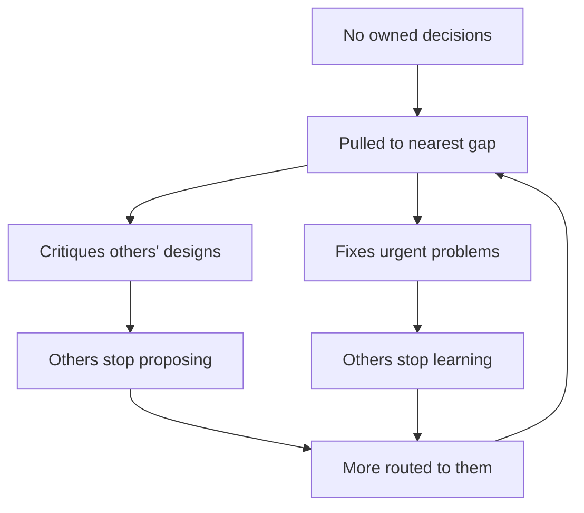
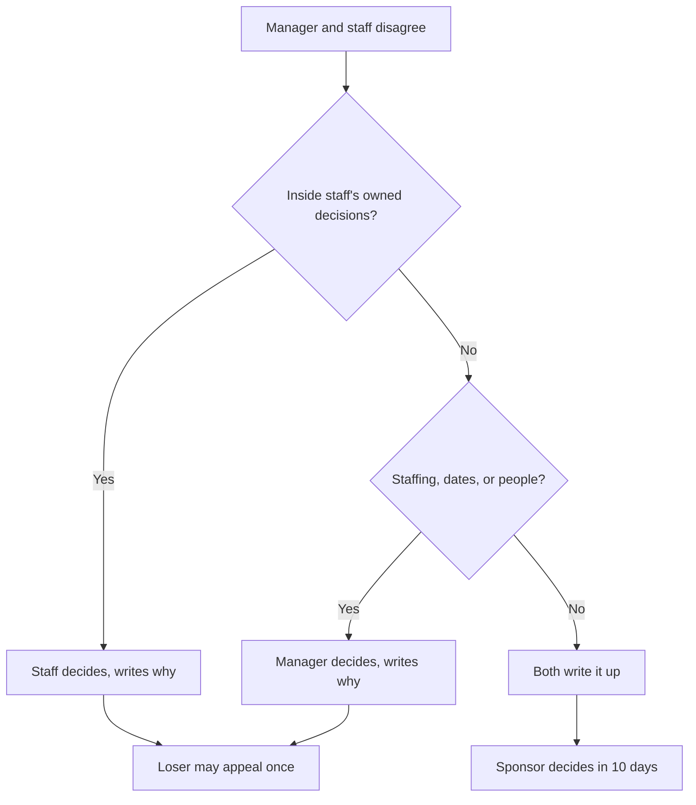

# Chapter 29 — Staff and Principal Engineers

A staff engineer is a bet: that one person's technical judgment, applied across teams they do not
manage, will be worth more than the same salary spent on another pair of hands. The bet pays only when
the role has a scope, a sponsor, and decisions it owns. Without them, strong engineers drift into one of
two shapes: the roaming critic, who comments on everything and owns nothing, or the overloaded hero, who
fixes everything and teaches nobody. This chapter covers designing, partnering with, and measuring
staff-plus roles. The running example is the
fictional [Northstar Technologies](../../case-studies/northstar/index.md) and its three staff engineers.
Chapter 4 has the level map and the choice between tracks
([the staff-plus track](../01-foundations/04-the-leadership-ladder.md#the-staff-plus-track-in-parallel));
Chapter 8 owns ladders and promotion; Chapter 28 (Architecture Decision-Making and Governance) owns the
assignment of architectural decision rights and decision records.

## Why This Matters

At team scale, a staff engineer changes what a team can attempt: a ledger migration or a shared-module
boundary change becomes feasible when someone with deep context helps design it. Used badly, the same
person teaches the team to stop thinking: if every design goes to them, nobody else learns to design.

At organization scale, staff engineers are the main way technical direction crosses team boundaries
without going through a manager. A shared module nobody owns, a migration discipline, a pipeline every
team uses: either someone with standing owns them or they are fixed one incident at a time. At
Northstar's baseline, three staff engineers spent about a fifth of their time on unplanned work and
owned no decisions.

At executive scale, the question is cost and risk. Staff engineers are expensive and their output is
hard to see. An executive who cannot say what each is accountable for is paying for advice nobody
commissioned, and is exposed when one leaves with knowledge never written down.

## Learning Objectives

After this chapter you will be able to:

- Identify the staff-plus archetypes in your organization and choose the one each role should be.
- Write a staff-plus scope with a domain, a sponsor, owned decisions, and outcomes, so the role has
  both leverage and accountability.
- Partner with a staff engineer as their manager, including how disagreements are raised and settled.
- Detect the roaming critic and the overloaded hero early, and redesign the role rather than blame the
  person.
- Decide when principal or distinguished roles are justified.
- Measure staff impact through adopted decisions and changed capability, and predict how each measure
  is gamed.

## The Mental Model

> **Mental model:** A staff engineer's leverage is the number of good decisions made by other people
> because of them. A scope that does not say which decisions they own, and which they only inform,
> produces either a critic or a hero.

Two ideas organize the chapter. First, **leverage comes from owned decisions, not from expertise**.
Expertise without a decision to own gets spent on questions, reviews, and incidents, each helping one
person once. A boundary rule or standard, with the hard cases decided against it, helps every team in
the domain.

Second, **the two failure cases share a cause**. A strong engineer with no scope fills whatever gap is
nearest. If the nearest gap is other people's designs, they become a critic; if it is outages and
urgent fixes, they become a hero. Both feel productive. Both shrink the capability around them.

The loop is reinforcing. The way out is not effort but structure: decisions to own, and the rest routed
to people who consult them and decide.

## Deep Conceptual Explanation

### What the evidence covers, and what it does not

This chapter found no peer-reviewed study of staff or principal roles and their effect on outcomes.
The research that exists is adjacent. A meta-analysis of 42 samples found shared leadership (leadership
exercised by team members, not only the formal leader) positively related to team effectiveness, more
for attitudes and team processes than for performance, and more when work was complex
([Wang, Waldman, and Zhang, 2014](../../references/bibliography.md#wang2014shared)). An interview study
of thirteen agile leaders in ten software companies concluded that leadership there is shared
dynamically, a property of the team rather than a role
([Gren and Ralph, 2022](../../references/bibliography.md#gren2022agile)). Both support only a weak
claim (**research finding**, correlational or qualitative): technical leadership without management
authority is common and can go with better teams. On the hero case, an automated estimate put about 65
percent of 133 popular open-source projects at a
[truck factor](../../glossary.md#single-point-of-knowledge-failure) of two or fewer developers. The
truck factor is how many people could leave before a project stalls (Chapter 12 teaches it)
([Avelino et al., 2016](../../references/bibliography.md#avelino2016truck)). The projects are open
source, not companies.

Everything else here is **expert opinion** or **this book's recommendation**, drawn mainly from Will
Larson's *Staff Engineer*, largely free online ([Larson, 2021](../../references/bibliography.md#larson2021staff)),
and Tanya Reilly's *The Staff Engineer's Path* ([Reilly, 2022](../../references/bibliography.md#reilly2022staff)).

### Archetypes

Larson describes four staff archetypes: the **tech lead**, who guides the approach and execution of one
or a few teams; the **architect**, who owns direction and quality across a critical area; the
**solver**, who goes deep on hard problems, one after another, wherever they arise; and the **right
hand**, who extends an executive's attention and authority across the organization. He notes that most
companies emphasize one or two, and that the right hand appears mainly in very large organizations
([Larson, Staff archetypes](../../references/bibliography.md#larson-staff-archetypes)).

The archetypes are useful because each implies a different scope, sponsor, and failure:

| Archetype | Scope | Natural sponsor | Typical failure |
|---|---|---|---|
| Tech lead | One or a few teams' technical work | Those teams' manager | Writes the hard parts alone; team does not grow |
| Architect | A critical domain across teams | Director or CTO | Direction detached from delivery; decrees nobody adopts |
| Solver | A stream of hard problems | Whoever sets priorities | Hero: pulled to every fire, finishes nothing durable |
| Right hand | An executive's agenda | That executive | Authority without accountability; resented as a proxy |

Reilly organizes staff work into big-picture thinking, project execution, and leveling up others, and
calls the staff engineer a force multiplier
([Reilly, 2022](../../references/bibliography.md#reilly2022staff)). Larson's list
(direction, mentorship, engineering perspective, exploration, glue, less coding) is in Chapter 4. Both
agree on the point that matters here: the output is other people's decisions and capability.

### Scoping for leverage and accountability

A scope that works has five parts (**this book's recommendation**):

1. **Domain.** A named technical area: a set of modules, a cross-cutting concern, a platform. Not "Core"
   or "quality", which are too large to own, and not a single project, which ends.
2. **Sponsor.** The person whose authority the staff engineer borrows and who answers for the role. Larson
   argues that a staff engineer's authority is loaned by the organization and depends on staying aligned
   with the sponsor, usually their manager
   ([Larson, Staying aligned with authority](../../references/bibliography.md#larson-staffeng-authority)).
3. **Owned decisions.** The decisions the staff engineer makes, and the ones they are only consulted on.
   Chapter 28 assigns decision rights and names the conditions (written mandate, time, accountability
   for consequences); the scope records this person's share.
4. **Outcomes.** Two or three, for two quarters, stated as changes in the domain ("every
   [tier 1](../../glossary.md#tier-1) data migration rehearsed before release", where tier 1 means the
   most business-critical components), not as activities ("advise on migrations").
5. **What stops.** The work the staff engineer no longer does: unscheduled questions, incidents outside
   their domain, reviews that others can do. A scope without a stop list adds load to the old load.

**Reporting line.** Larson suggests the reporting line follow the archetype
([Larson, Where do Staff-plus engineers fit?](../../references/bibliography.md#larson-staffeng-reporting));
Chapter 4 applies this to Northstar.

**Choosing what to work on.** Larson warns against "snacking" (easy, low-impact work), "preening"
(visible, low-impact work), and "chasing ghosts" (imposing past experience on a different present), and
puts existential problems first, then neglected areas, growing others, and work only you can do
([Larson, Work on what matters](../../references/bibliography.md#larson-staffeng-what-matters)). A
manager can use the list to review a staff engineer's quarter.

### Partnering, including disagreement

Chapter 10 gives the general split for managing engineers more expert than you: the expert owns
technical judgment within a mandate, the manager owns priorities and decision rights, both own the
record ([managing engineers more expert than you](../02-people-management/10-motivation-retention-and-senior-engineers.md#managing-engineers-more-expert-than-you)).
Two additions matter for staff engineers.

**No surprises, in both directions.** Larson advises staff engineers never to surprise their manager
and to feed the manager context from across the organization
([Larson, Staying aligned with authority](../../references/bibliography.md#larson-staffeng-authority)).
The manager's half is to share priority changes before they reach the teams.

**Disagree on the merits, early, in writing.** A meta-analysis of 116 studies found stable negative
links between relationship conflict and group outcomes but no strong negative association between task
conflict and performance
([de Wit, Greer, and Jehn, 2012](../../references/bibliography.md#dewit2012paradox)). Status conflict,
disputes over relative standing, hurt group performance and undermined information sharing more than
other conflict types did
([Bendersky and Hays, 2012](../../references/bibliography.md#bendersky2012status)). The design
implication (**this book's recommendation**): keep manager and staff disagreements about the problem,
and remove the status question by deciding in advance who decides what.

The appeal goes, in writing, to the sponsor (usually the director). One written appeal keeps the
losing argument on record without making every decision a negotiation.
Routine appeals mean the scope is wrong.

### The roaming critic

**What it looks like.** Review comments that reject without reasons, opinions on every design channel,
no design document of their own in two quarters. Engineers route around the person or stop proposing.

**Why it happens.** Critique is the only lever available to someone with judgment and no owned
decisions. Wiseman's well-known distinction between leaders who multiply the intelligence of the people
around them and those who diminish it applies to senior engineers
([Wiseman, 2010](../../references/bibliography.md#wiseman2010multipliers)): the critic is usually
right and still diminishes.

**What changes it.** Give the person decisions they own outright; require review comments to state the
reason and the condition for agreement; outside the owned decisions, the proposer decides after
consulting. Keep feedback on the task and its effects: in a meta-analysis more than a third of feedback
interventions decreased performance, and the authors' theory holds that effectiveness drops as feedback
draws attention to the self ([Kluger and DeNisi, 1996](../../references/bibliography.md#kluger1996effects)).
Directives and pressured evaluation also undermine motivation, while choice supports it
([Ryan and Deci, 2000](../../references/bibliography.md#ryan2000self)). Chapter 6 owns difficult feedback.

### The overloaded hero

**What it looks like.** The person is in every major incident, answers every question within minutes,
and carries a backlog of half-finished durable work. Their calendar has no two-hour block. The
organization praises them.

**Why it happens.** Fixing gives fast feedback; staff work's feedback loops run for weeks to years
([Larson, What do Staff engineers actually do?](../../references/bibliography.md#larson-staffeng-actually-do)).
The organization rewards the visible fix and never sees the runbook that was not written. Reilly makes
the related point that coordinating and unblocking work is technical leadership that often goes
unrecognized at promotion, and should be tracked and shared deliberately
([Reilly, Being Glue](../../references/bibliography.md#reilly-being-glue)).

**What changes it.** Cap the unscheduled time (office hours, a rotation), name the people who take the
incidents and questions the hero used to take, and judge the hero by how many problems no longer reach
them.

### Principal and distinguished levels

Above staff, most ladders add principal and sometimes distinguished engineer. The content differs by
company; this book's synthesis, consistent with Chapter 4's level table:

| Level | Scope | Horizon | Typical sponsor |
|---|---|---|---|
| Staff | A domain or problem across teams | One to four quarters | Director |
| Principal | A company-critical domain, or several staff domains | One to three years | VP Engineering or CTO |
| Distinguished | Company-wide technical direction | Several years | CTO or CEO |

Two cautions. A principal role is justified by a problem of that size, not by tenure; a company with one
product and eighty engineers rarely has a domain a well-sponsored staff engineer cannot hold. And the
higher the level, the stronger the pull toward architecture by decree; principal engineers stay
credible through design and incident reviews of real work, and some code.

### Measuring staff impact

Staff impact is measured by what changed in the domain and in other people, over two quarters or more
(**this book's recommendation**). Every measure is gamed, so use them in pairs:

| Measure | What it shows | How it is gamed | Pair it with |
|---|---|---|---|
| Owned decisions made on time | The role is deciding | Deciding easy cases fast, deferring hard ones | Count of escalated or reopened decisions |
| Decisions others make against the staff engineer's rules | Leverage through standards | Rules so loose they bind nothing | Spot review of three decisions a quarter |
| Unscheduled hours per week | Hero load shrinking | Questions moved to private chat | Who now answers them, and how well |
| Designs proposed by others in the domain | Critic pattern receding | Proposals invited and then overridden | Share accepted, and reasons given on rejections |

Domain outcomes (incidents, lead time) matter most but are slow and shared with teams. Promotion
evidence is Chapter 8's topic.

## Engineering Organization Example

!!! info "Northstar so far"
    Week 13, day 90 of the director's first year. [Sev1 and
    Sev2](../../glossary.md#severity-sev1-sev2-sev3) incidents (the two most serious levels) fell from 30
    to 21 in quarter 1 after ownership, severity, and weekly release changes, and both renewal
    commitments are on track. See the [timeline](../../case-studies/northstar/timeline.md). New to
    Northstar? Read [the year in brief](../../case-studies/northstar/year-in-brief.md) and the
    [cast](../../case-studies/northstar/cast.md).

This example is a diagnosis of Northstar, the book's fictional company, using the chapter's tools. Its
figures are **illustrative** and consistent with the
[baseline](../../case-studies/northstar/baseline-data.md) and the
[year 1 record](../../case-studies/northstar/first-quarter.md). In weeks 12 and 13 the director sampled
the calendars and chat logs of the three staff engineers: Ines Carvalho (Core domain), Kwame Mensah
(infrastructure and reliability), and Li Na Zhou (data and integration). Average hours per week:

| Work | Ines Carvalho | Kwame Mensah | Li Na Zhou |
|---|---|---|---|
| Mandated program work | 21 (contract tests and boundaries 11, permissions extraction planning 10) | 23 (release working group 14, pipeline work 9) | 18 (ledger-export contract 10, migration and configuration follow-up 8) |
| Standards decisions | 3 | 4 | 4 |
| Reviews and sponsoring | 6 | 3 | 6 |
| Unscheduled questions and incident pulls | 8 | 7 | 9 |
| Other | 2 | 3 | 3 |
| Total | 40 | 40 | 40 |

Unscheduled work is 24 of 120 hours, 20 percent: the same share as the staff engineers' unplanned load
at baseline. The first quarter's mandates added program work but removed nothing. Ines's eight hours
of unscheduled questions about Core, Northstar's monolith, are unchanged from the baseline figure.

**What the hours are worth.** The unscheduled hours cost about $111,000 a year, and each answer helps
one person once. Two written boundary rules for core/customer, each removing a quarter of Ines's
questions, would give her back about four hours a week.

*Cost basis: 24 hours a week is 0.6 of an engineer at the average [fully loaded
cost](../../glossary.md#fully-loaded-cost) of $185,000 (salary plus benefits, taxes, and equipment), a
floor for staff engineers.*

**Design reviews.** The team most affected by Ines's domain has stopped proposing designs: the critic
pattern. In weeks 7 to 12, 14 Core design proposals reached Ines, and she rejected 8, 5 of them with no
stated reason. Orders owns core/customer, the module her extraction works in, yet sent only 2 of the
14.

The sample shows both failure cases: Ines a critic in reviews and a hero for questions, Li Na the hero
for integrations, Kwame still pulled into incidents. None has a scope that outlasts the quality program.

## Decision Framework

Choose the archetype for each staff role from the problem, then check the scope against five tests.

| Problem shape | Archetype | Sponsor | Reporting line |
|---|---|---|---|
| One or two teams need technical direction they cannot supply | Tech lead | Team manager | That manager |
| A shared domain decays because nobody owns its direction | Architect | Director | Director |
| Recurring hard problems with no common thread | Solver, with a capped queue | Director | Director |
| An executive's agenda spans many teams and needs technical judgment | Right hand | That executive | That executive |

| Test | Passes when |
|---|---|
| Owned decisions | At least one class of decision is the staff engineer's alone, in writing |
| Outcomes | Two or three outcomes for two quarters, each observable without asking the staff engineer |
| Stop list | Named work the staff engineer no longer does, with who does it instead |
| Overlap | No outcome overlaps another staff engineer's or a manager's without a stated split |
| Disagreement rule | Managers in the domain know what the staff engineer decides and how to appeal |

A scope failing two tests is the mandate-less role retitled (**this book's recommendation**).

## Trade-offs

**Owned decisions against team autonomy.** Every decision a staff engineer owns is one a team does not.
Owning a boundary rule speeds up teams that touch the boundary and slows the team that wanted an
exception. Keep owned decisions few and cross-cutting.

**Architect against solver.** An architect scope produces durable direction slowly; a solver clears
today's hard problem. Organizations under incident pressure, as Northstar was, need some solver time.
Make it a capped, scheduled share rather than the default.

**Reporting to the director against reporting to a manager.** Reporting to the director gives access
and authority; at Northstar it also gives the director nine direct reports. Reporting to a team manager
ties the staff engineer to one team's priorities, which suits a tech lead and starves an architect.

**Coding against leading.** Staff engineers who stop coding lose touch with the system; those who code
heavily become a team's best engineer again. A small, real share on the domain's hardest change is the
usual answer.

**Recognizing glue work against diluting the level.** Counting coordination corrects a real bias
(Reilly); counting only coordination produces staff engineers whose judgment nobody adopts.

**Transition cost.** Rescoping takes several conversations per staff engineer and a quarter in which
teams lose the instant answer before they gain the written rule.

## Failure Modes

**The roaming critic.** Rejections without reasons, proposals drying up. Detect early by counting
design proposals by team and the share of rejections with a stated reason; a team whose proposals fall
to near zero has given up, not improved.

**The overloaded hero.** Every incident, every question, no finished durable work. Detect with a two-week
calendar sample: unscheduled hours above about a fifth of the week, and no two-hour blocks, are early
signals (**this book's recommendation**).

**The scope that is a project.** "Lead the permissions extraction" ends when the extraction ships, and
the staff engineer is scopeless again. Detect by asking what the staff engineer owns the week after the
project finishes.

**The shadow manager.** A staff engineer who assigns work and sets priorities in a manager's team
without agreement. Detect when engineers name the staff engineer as the person who decides their week.

**Title as retention.** A title given to keep someone, with no scope: retention solved for a quarter, a
roaming critic created for years. Chapter 10 owns retention and the hostage dynamic.

**The invisible staff engineer.** Detect when the sponsor cannot name one decision the staff engineer
made last quarter.

## Enterprise Application

In an organization of 50 to 150 engineers, three to eight staff engineers is a common range; Northstar's
ratio is one per about 27. Three practices make the role work at that size (**this book's
recommendation**).

**A published one-page scope per staff engineer, reviewed twice a year**, so every manager in the
domain can read what the staff engineer decides, and scopes that have become projects are caught.

**A staff group with a shared cadence.** The staff engineers meet the director every two weeks on open
cross-domain decisions and overlaps. It is not a review board teams queue for (Chapter 28).

**A visible stop list.** When a staff engineer stops answering a class of question, managers say who
answers now. Otherwise the questions return within a month.

At this size there is usually no principal engineer. The first principal role appears when a domain
spans several staff scopes and several years, and a VP or CTO can sponsor it.

## CTO Perspective

At executive scale the staff-plus track is a portfolio. The CTO asks three questions. Are the company's
most important technical risks each covered by a named staff-plus scope? Is each staff-plus person
accountable for outcomes, or advising on request? And would the organization survive the departure of
any one of them, given that their knowledge is concentrated by design?

The CTO also sets parity between the tracks (Chapters 4 and 8) and decides whether principal and
distinguished roles exist. And because staff authority is borrowed through the sponsor, the CTO is the
sponsor of last resort: a hallway override of a principal engineer's decision shrinks every staff
engineer's authority. The executive's discipline is to disagree through the same written path the
managers use.

A staff engineer costs more than a senior engineer; the return shows in decisions others make well and
risks that stop recurring, over two quarters or more. An executive who wants a faster signal will get
activity counts.

## Practical Playbook

1. Sample each staff engineer's time for two weeks, including unscheduled questions and incidents.
2. Name the archetype each one's work looks like, and the one the organization needs.
3. Draft a one-page scope: domain, sponsor, owned decisions, two or three outcomes, and a stop list
   naming who takes each stopped item.
4. Review it with the staff engineer, then with each manager in the domain; resolve overlaps in writing.
5. Publish the scopes and the disagreement rule.
6. Replace unscheduled questions with office hours or a rotation.
7. Agree a pair of measures per outcome, with how each is gamed.
8. Hold a staff review every two weeks; meet each staff engineer one-on-one on the domain, not status.
9. Review each scope at two quarters: renew, rescope, or end. For a critic or hero pattern, change the
   structure first, then give specific feedback on effects.

## Case Study

This case is **fictional** and is set at the start of quarter 2 (week 14). Its outcomes are open:
they are decisions the reader faces.

**Where things stand.** In quarter 1 each staff engineer received a program mandate and a standards
domain with a ten-working-day decision rule. In quarter 2 Ines leads the funded permissions
extraction. The time sample above shows the mandates added work without removing any.

**Decision 1: standing scopes.** The director drafts scopes that outlast the quality program:

| | Kwame Mensah | Ines Carvalho | Li Na Zhou |
|---|---|---|---|
| Archetype target | Architect for delivery and reliability | Architect for Core | Architect for data integrity, with a capped solver share for integrations |
| Domain | Pipelines and operational readiness of tier 1 | Core module boundaries and shared modules | Migrations, configuration, and integration contracts |
| Owned decisions | Operational and pipeline standards; release policy | Core code standard; module boundary rules | Data, migration, and configuration standards; contract versioning rules |
| Stop list | Incident pulls outside his shifts as [incident commander](../../glossary.md#incident-commander) (the person who leads the response) | Unscheduled Core questions | First-come integration questions |
| Sponsor | Director | Director | Director |

Open choices for the reader: whether Li Na decides ADR-0001, the open record on how integrations read
ledger data (Chapter 28); whether a fourth scope is needed for the frontends, which no staff engineer
covers; and whether all three keep reporting to the director (nine direct reports).

**Decision 2: coaching Ines out of the critic pattern.** Chapter 10 plans the conversation that raises
Ines's review behavior with her. This chapter takes up what follows: suppose Ines has
agreed to try a change. The director's draft coaching plan:

- **Structure first.** Ines owns the core/customer boundary rules outright. For other Core designs, the
  proposer decides after consulting her, and her rejections state a reason and the condition under
  which she would agree.
- **Office hours.** Two fixed one-hour slots a week replace unscheduled questions, against the
  baseline's eight hours.
- **Practice.** Ines co-reviews one Orders design every two weeks with Rafael Duarte, a senior engineer in
  Orders who shares
  core/order-capture review ownership, and writes the boundary rationale in the decision record.
- **Measures, with gaming named.** Core design proposals by team, with the share accepted; rejections
  with a stated reason, with the director reading three a month against boilerplate; unscheduled hours,
  with the teams asked whether questions moved to private chat.
- **Checkpoints.** Week 20 and week 26. The plan does not say what happens if the numbers do not move;
  that is part of the reader's decision.

The tension is real: Ines's judgment on Core is the organization's best, she leads the extraction, and
recruiters contact her monthly. Treating the critic pattern as structural is this chapter's
recommendation; it does not guarantee that she accepts it or that Orders starts proposing again.

## Exercises

Solutions are in [chapter 29 solutions](../../solutions/ch29-solutions.md).

### Foundational

**F1.** Using Larson's four archetypes, classify each of Northstar's three staff engineers at baseline,
during the first quarter, and in the director's draft standing scopes. For each, say what evidence in
the time sample supports your classification, and where the archetype the organization needs differs
from the one the person's week shows.

**F2.** A staff engineer at another company tells you: "I review every design in our area, I'm in every
major incident, and my manager says I'm the most valuable engineer we have. But I haven't shipped a
design of my own in a year." Diagnose which failure case or cases this is, name the structure that
produces it, and list the first three changes you would make to the role.

**F3.** For Li Na Zhou's draft scope (migrations, configuration, and integration contracts), propose
three measures of her impact for the next two quarters. For each, state what it shows, how it could be
gamed, and the measure you would pair with it. Explain why "number of questions answered" is not one of
them.

### Applied Leadership

**A1.** In week 16, Priya Raman (Orders manager) tells you that Ines Carvalho has blocked an Orders change to the
core/customer interface needed for bulk ordering, due in week 26, because it conflicts with her
extraction plan. Ines says the change would have to be undone within a quarter. Using the disagreement
rule in this chapter, decide who decides, what each must write, and what you do if both appeal to you.

**A2.** It is week 20, the first checkpoint of Ines's coaching plan. Core design proposals from Orders
went from zero to one; rejections with a stated reason went from 3 of 8 to 5 of 6; Ines's unscheduled
hours fell to about five a week, and two Billing engineers say they now message her privately. Assess
the progress, decide what to change in the plan, and write what you say to Ines.

**A3.** At the end of quarter 2, Kwame Mensah asks to be promoted to principal engineer. He cites the
release working group, the weekly Core release, and the fall in unrelated (flaky) pipeline failures
from 9 to 4 percent. Northstar has had no principal role since its principal architect left in 2021. Decide what you answer, what a principal
role at Northstar would need to exist, and how you keep him engaged either way.

### Executive Decision-Making

**X1.** Victor Lindqvist (CTO) proposes using the next backfill to hire an external principal architect to
"own architecture" above the three staff engineers, arguing that the board expects one. Headcount is
flat at 80 engineers. Advise Victor: whether to do it, what the role would own that the staff engineers
do not, what it would cost Northstar beyond salary, and what you would do instead.

**X2.** Rajiv Menon (CFO) asks why Northstar pays three staff engineers near the Staff band midpoint of
$195,000 instead of using the same money for more Senior Engineers. Prepare your answer for the
budget review: the evidence you would show after two quarters of standing scopes, what you would admit
you cannot yet show, and which result would lead you to change the staff roles.

## Reflection Questions

1. Can each staff engineer in your organization name one decision they own outright? Can their manager
   name the same one?
2. Which of your strongest engineers is praised for being in every incident, and what has not been
   built because of it?
3. When a staff engineer and a manager disagree in your organization, who decides, and does everyone
   give the same answer?
4. Whose proposals have stopped arriving, and who were they being sent to?
5. Is your principal or distinguished level justified by a problem of that size, or by the tenure of
   the people in it?

## Key Takeaways

- Staff leverage is the number of good decisions other people make because of the staff engineer.
- Give every staff role a domain, a sponsor, owned decisions, two or three outcomes, and a stop list.
- The roaming critic and the overloaded hero have one cause, judgment without owned decisions; fix
  the structure before the person.
- Decide in advance who decides what, so disagreements stay about the problem rather than standing.
- Pick the archetype from the problem; make solver time a capped share, not the default.
- Create principal roles for problems of that scope, not for tenure.
- Measure staff impact over two quarters in pairs of measures, and name how each is gamed.
- Admit the evidence base: research supports shared technical leadership in general, not any specific
  staff role design.

## References and Further Reading

- [Larson, 2021](../../references/bibliography.md#larson2021staff). *Staff Engineer*: the main
  practitioner account of the staff-plus track, mostly free at staffeng.com. Pages used here: [Staff archetypes](../../references/bibliography.md#larson-staff-archetypes),
  [What do Staff engineers actually do?](../../references/bibliography.md#larson-staffeng-actually-do),
  [Where do Staff-plus engineers fit?](../../references/bibliography.md#larson-staffeng-reporting),
  [Staying aligned with authority](../../references/bibliography.md#larson-staffeng-authority), and
  [Work on what matters](../../references/bibliography.md#larson-staffeng-what-matters).
- [Reilly, 2022](../../references/bibliography.md#reilly2022staff). *The Staff Engineer's Path*: big
  picture, execution, and leveling up others; and [Being Glue](../../references/bibliography.md#reilly-being-glue),
  on recognizing coordination work.
- [Wiseman, 2010](../../references/bibliography.md#wiseman2010multipliers). *Multipliers*: leaders who
  amplify or diminish others' thinking.
- [Wang, Waldman, and Zhang, 2014](../../references/bibliography.md#wang2014shared) and
  [Gren and Ralph, 2022](../../references/bibliography.md#gren2022agile). Shared leadership: a
  meta-analysis and an interview study of agile software teams.
- [Avelino et al., 2016](../../references/bibliography.md#avelino2016truck). Knowledge concentration
  (truck factors) in open source.
- [de Wit, Greer, and Jehn, 2012](../../references/bibliography.md#dewit2012paradox),
  [Bendersky and Hays, 2012](../../references/bibliography.md#bendersky2012status),
  [Kluger and DeNisi, 1996](../../references/bibliography.md#kluger1996effects), and
  [Ryan and Deci, 2000](../../references/bibliography.md#ryan2000self). Conflict, feedback, and
  motivation research behind the partnership and coaching advice.
