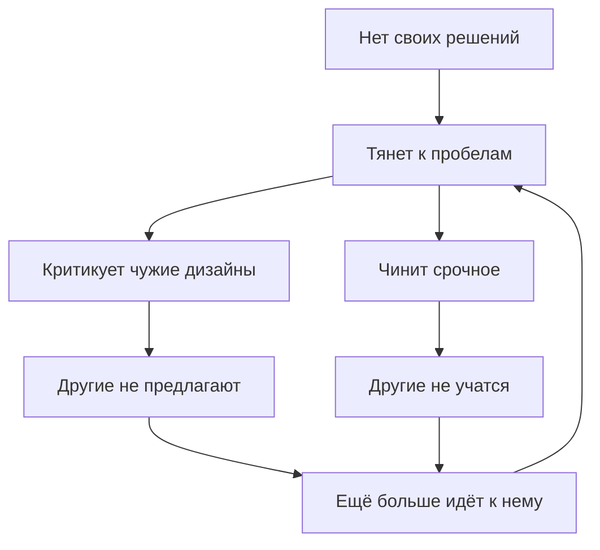
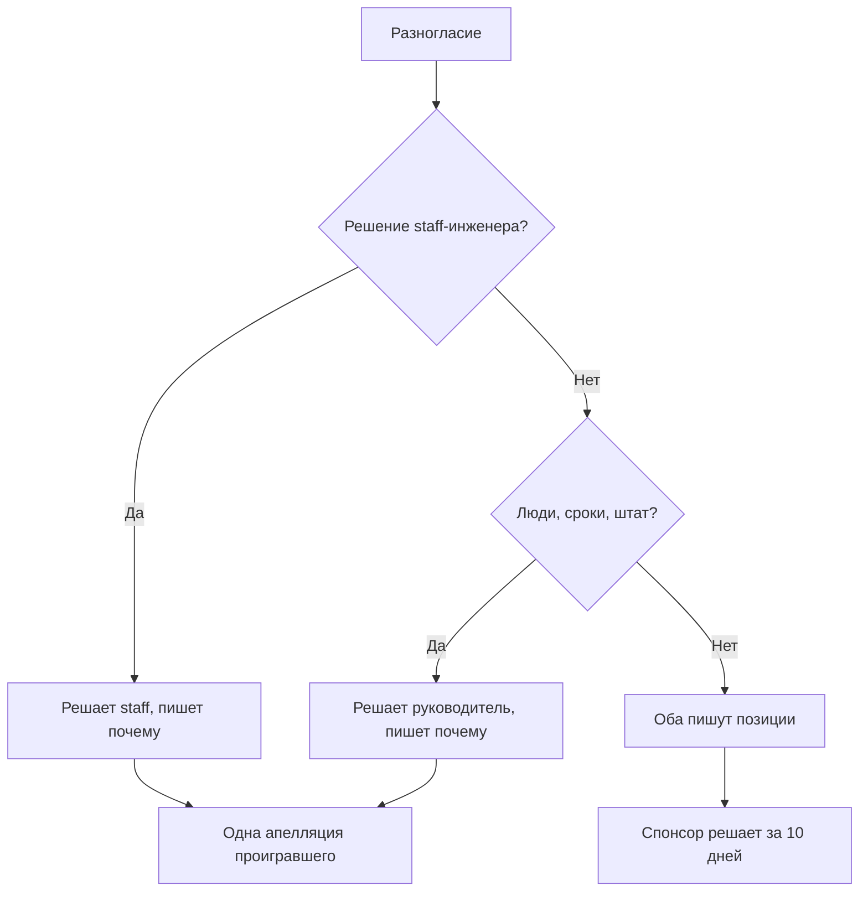

# Глава 29 — Staff- и principal-инженеры { #chapter-29-staff-and-principal-engineers }

Staff-инженер — это ставка. Организация рассчитывает, что техническое суждение одного человека в
командах, которыми он не руководит, принесёт больше, чем та же зарплата, потраченная на ещё одну пару
рук. Ставка окупается, только если у роли есть область ответственности, спонсор и
решения, которые принадлежат ей. Без этого сильные инженеры сползают в одну из двух ролей. Блуждающий
критик комментирует всё и ничем не владеет. Перегруженный герой чинит всё и никого не учит. Эта глава
о том, как проектировать роли staff-plus, как работать с такими инженерами в паре и как измерять их
вклад. Сквозной пример — вымышленная компания
[Northstar Technologies](../../case-studies/northstar/index.md) и три её staff-инженера. Карта уровней
и выбор между треками — в главе 4
([трек staff-plus](../01-foundations/04-the-leadership-ladder.md#the-staff-plus-track-in-parallel)),
карьерные лестницы и повышения — в главе 8, архитектурные права на решения и записи решений — в
главе 28 (архитектурные решения и управление архитектурой).

## Почему это важно { #why-this-matters }

Staff-инженер меняет круг задач, за которые может взяться команда. Миграция ledger или перенос
границы общего модуля становятся посильными, когда в проектировании помогает человек с глубоким
контекстом. Но если опираться на него неправильно, тот же человек отучает команду думать: когда каждый
дизайн проходит через него, проектировать больше никто не учится.

Для организации staff-инженеры — главный способ провести техническое направление через границы команд,
минуя руководителей. Общий модуль без владельца, дисциплина миграций, пайплайн, которым пользуются все
команды: либо ими владеет человек с признанным статусом, либо их чинят по одному инциденту за раз. В
базовом квартале Northstar три staff-инженера тратили около пятой части времени на незапланированную
работу и не владели ни одним решением.

Для высшего руководства это вопрос стоимости и риска. Staff-инженеры стоят дорого, а результат их работы
трудно увидеть. Если руководитель не может сказать, за что отвечает каждый из них, он платит за советы, которых
никто не заказывал. И он уязвим: уходя, такой инженер уносит знания, которые так и не записали.

## Цели главы { #learning-objectives }

Прочитав эту главу, вы сможете:

- Распознавать архетипы staff-plus в своей организации и выбирать, каким должен быть каждый из них.
- Описывать область ответственности staff-plus-инженера (домен, спонсор, собственные решения,
  результаты) так, чтобы у роли были и рычаг, и подотчётность.
- Работать в паре со staff-инженером как его руководитель, в том числе договариваться, как поднимать и
  разрешать разногласия.
- Рано замечать блуждающего критика и перегруженного героя и перестраивать роль, а не обвинять человека.
- Решать, когда оправданы роли principal или distinguished.
- Измерять вклад staff-инженеров по принятым решениям и изменившимся возможностям людей, заранее
  предсказывая, как подгоняют каждую метрику.

## Ментальная модель { #the-mental-model }

> **Ментальная модель:** рычаг staff-инженера — это число хороших решений, которые другие люди приняли
> благодаря ему. Если в описании области ответственности не сказано, какие решения принадлежат ему, а
> по каким с ним только советуются, получится либо критик, либо герой.

На двух идеях держится вся глава. Первая: **рычаг дают собственные решения, а не экспертиза**.
Экспертиза без решения, которым можно владеть, уходит на вопросы, ревью и инциденты, и каждый раз
помогает одному человеку один раз. А правило о границе или стандарт с разобранными трудными случаями
помогает каждой команде в домене.

Вторая: **у двух провалов общая причина**. Сильный инженер без области ответственности заполняет
ближайший пробел. Если ближайший пробел — чужие дизайны, он становится критиком, если сбои и срочные
исправления — героем. В обоих случаях работа выглядит продуктивной, но в обоих случаях возможности
окружающих сужаются.

Это усиливающая петля. Вырваться из неё помогает не старание, а структура: нужны решения, которыми он
владеет, а всё остальное должно уходить к людям, которые советуются с ним и решают сами.

## Подробный разбор { #deep-conceptual-explanation }

### Что покрывают доказательства, а что нет { #what-the-evidence-covers-and-what-it-does-not }

Рецензируемых исследований о ролях staff и principal и их влиянии на результаты эта глава не нашла.
Существующие работы касаются смежных вопросов. Метаанализ 42 выборок показал, что распределённое
лидерство (shared leadership: лидерство, которое берут на себя члены команды, а не только формальный
руководитель) положительно связано с эффективностью команды. Связь сильнее с установками и командными
процессами, чем с результативностью, и сильнее при сложной работе
([Wang, Waldman, and Zhang, 2014](../../references/bibliography.md#wang2014shared)). Проведя
интервью с тринадцатью agile-лидерами из десяти компаний-разработчиков, авторы другой работы пришли к
выводу, что лидерство там распределяется динамически и это свойство команды, а не чья-то роль
([Gren and Ralph, 2022](../../references/bibliography.md#gren2022agile)). Обе работы поддерживают лишь
слабое утверждение (**научный результат**, корреляционный или качественный): техническое лидерство без
управленческих полномочий встречается часто и может сопутствовать более сильным командам.

Что касается героя, по автоматической оценке примерно у 65% из 133 популярных open-source-проектов
[truck factor](../../glossary.md#single-point-of-knowledge-failure) (он же bus factor) равен двум
разработчикам или меньше ([Avelino et al., 2016](../../references/bibliography.md#avelino2016truck)).
Truck factor показывает, сколько людей должно уйти, чтобы проект встал (подробно — в главе 12). Речь
при этом об open-source-проектах, а не о компаниях.

Всё остальное в главе — **мнение эксперта** или **рекомендация книги**. Главные источники — книга Will
Larson *Staff Engineer*, большая часть которой доступна бесплатно
([Larson, 2021](../../references/bibliography.md#larson2021staff)), и *The Staff Engineer's Path* Tanya
Reilly ([Reilly, 2022](../../references/bibliography.md#reilly2022staff)).

### Архетипы { #archetypes }

Larson описывает четыре архетипа staff-инженера. **Техлид** направляет подход и исполнение в одной или
нескольких командах. **Архитектор** отвечает за направление и качество в критичной области. **Решатель**
(solver) берётся за трудные задачи одну за другой, где бы они ни возникали, и глубоко в них погружается. **Правая рука**
(right hand) расширяет внимание и полномочия руководителя высшего уровня на всю организацию. Larson
отмечает, что большинство компаний делает упор на один-два архетипа, а правая рука встречается в
основном в очень крупных организациях
([Larson, Staff archetypes](../../references/bibliography.md#larson-staff-archetypes)).

Архетипы полезны тем, что у каждого своя область ответственности, свой спонсор и свой типичный провал:

| Архетип | Область ответственности | Естественный спонсор | Типичный провал |
|---|---|---|---|
| Техлид | Техническая работа одной или нескольких команд | Руководитель этих команд | Сам пишет трудные части; команда не растёт |
| Архитектор | Критичный домен, охватывающий несколько команд | Директор или CTO | Направление оторвано от поставки; указы, которые никто не принимает |
| Решатель | Поток трудных задач | Тот, кто задаёт приоритеты | Герой: его тянет на каждый пожар, ничего долговечного он не доводит до конца |
| Правая рука | Повестка руководителя высшего уровня | Этот руководитель | Власть без ответственности; его недолюбливают как чужого представителя |

Reilly делит работу staff-инженера на три части: мышление на уровне общей картины, исполнение проектов
и рост других. Самого staff-инженера она называет множителем силы (force multiplier)
([Reilly, 2022](../../references/bibliography.md#reilly2022staff)). Список Larson (техническое
направление, менторство, инженерный взгляд, исследование, связующая работа, меньше программирования)
приведён в главе 4. В главном для этой главы оба сходятся: результат staff-инженера — это решения и
возможности других людей.

### Область ответственности: рычаг и подотчётность { #scoping-for-leverage-and-accountability }

Работающая область ответственности состоит из пяти частей (**рекомендация книги**):

1. **Домен.** Названная техническая область: набор модулей, сквозная задача, платформа. Не «Core» и не
   «качество»: они слишком велики, чтобы ими владеть. И не отдельный проект: проект заканчивается.
2. **Спонсор.** Человек, чьи полномочия staff-инженер берёт взаймы и кто отвечает за эту роль. Larson
   утверждает, что полномочия staff-инженеру одалживает организация и держатся они на согласованности
   со спонсором, обычно с руководителем самого инженера
   ([Larson, Staying aligned with authority](../../references/bibliography.md#larson-staffeng-authority)).
3. **Собственные решения.** Решения, которые принимает сам staff-инженер, и те, по которым с ним только
   советуются. Глава 28 распределяет права на решения и называет условия (письменный мандат, время,
   ответственность за последствия); описание области ответственности фиксирует долю этого человека.
4. **Результаты.** Два или три на два квартала, сформулированные как изменения в домене («каждую
   миграцию данных [tier 1](../../glossary.md#tier-1) репетируют до релиза»; tier 1 — самые критичные
   для бизнеса компоненты), а не как деятельность («консультировать по миграциям»).
5. **Что прекращается.** Работа, которую staff-инженер больше не делает: внеплановые вопросы, инциденты
   вне его домена, ревью, которые могут провести другие. Без такого стоп-листа новая область
   ответственности просто ложится поверх старой нагрузки.

**Линия подчинения.** Larson предлагает выбирать линию подчинения по архетипу
([Larson, Where do Staff-plus engineers fit?](../../references/bibliography.md#larson-staffeng-reporting));
как это выглядит в Northstar, показано в главе 4.

**Выбор, над чем работать.** Larson предостерегает от «перекусов» (snacking: лёгкая работа с малым
эффектом), «самолюбования» (preening: заметная работа с малым эффектом) и «погони за призраками»
(chasing ghosts: перенос прошлого опыта на непохожее настоящее). На первое место он ставит
экзистенциальные проблемы, затем заброшенные области, рост других и работу, которую можете сделать
только вы ([Larson, Work on what matters](../../references/bibliography.md#larson-staffeng-what-matters)).
По этому списку руководитель может разобрать квартал staff-инженера.

### Работа в паре, в том числе разногласия { #partnering-including-disagreement }

Глава 10 предлагает общее разделение для случая, когда инженер разбирается в предмете лучше
руководителя: эксперт владеет техническим суждением в пределах мандата, руководитель — приоритетами и
правами на решения, а запись принадлежит обоим
([как управлять инженерами, которые знают больше вас](../02-people-management/10-motivation-retention-and-senior-engineers.md#managing-engineers-more-expert-than-you)).
Для staff-инженеров важны два дополнения.

**Никаких сюрпризов, в обе стороны.** Larson советует staff-инженерам никогда не устраивать
руководителю сюрпризов и приносить ему контекст со всей организации
([Larson, Staying aligned with authority](../../references/bibliography.md#larson-staffeng-authority)).
Руководитель, в свою очередь, сообщает о смене приоритетов раньше, чем она дойдёт до команд.

**Спорьте по существу, рано и письменно.** Метаанализ 116 исследований выявил устойчивую отрицательную
связь между конфликтами отношений и результатами групп, а сильной отрицательной связи между
конфликтами по задаче и результативностью не нашёл
([de Wit, Greer, and Jehn, 2012](../../references/bibliography.md#dewit2012paradox)). Статусные
конфликты, то есть споры об относительном положении, вредили результативности группы и обмену
информацией сильнее, чем конфликты других типов
([Bendersky and Hays, 2012](../../references/bibliography.md#bendersky2012status)). Вывод для
устройства роли (**рекомендация книги**): пусть разногласия руководителя и staff-инженера касаются
проблемы, а вопрос статуса снимите заранее, договорившись, кто что решает.

Апелляцию подают спонсору (обычно директору) письменно. Одна письменная апелляция сохраняет довод
проигравшей стороны в записи, но не превращает каждое решение в переговоры. Если апелляции стали
обычным делом, значит, область ответственности очерчена неверно.

### Блуждающий критик { #the-roaming-critic }

**Как это выглядит.** На ревью человек отказывает без объяснения причин, его мнение звучит в каждом
канале, где обсуждают дизайн, а собственного дизайн-документа у него нет уже два квартала. Инженеры обходят этого человека
стороной или перестают что-либо предлагать.

**Почему так происходит.** У человека с суждением, но без собственных решений, остаётся единственный
рычаг — критика. Известное различие Wiseman между лидерами, которые умножают интеллект окружающих, и
теми, кто его подавляет, применимо и к опытным инженерам
([Wiseman, 2010](../../references/bibliography.md#wiseman2010multipliers)): критик обычно прав, но
всё равно подавляет.

**Что помогает.** Дайте человеку решения, которые полностью принадлежат ему. Потребуйте, чтобы в
замечаниях на ревью были причина и условие, при котором он согласится. За пределами собственных решений
решает автор предложения, посоветовавшись с ним. Обратная связь должна касаться задачи и её
последствий. В метаанализе больше трети вмешательств с обратной связью снижали результативность, а по
теории его авторов обратная связь теряет эффективность, когда переключает внимание на личность
([Kluger and DeNisi, 1996](../../references/bibliography.md#kluger1996effects)). Указания и
оценка под давлением тоже подрывают мотивацию, а возможность выбора её поддерживает
([Ryan and Deci, 2000](../../references/bibliography.md#ryan2000self)). Как давать трудную
обратную связь, подробно разобрано в главе 6.

### Перегруженный герой { #the-overloaded-hero }

**Как это выглядит.** Человек участвует в каждом крупном инциденте, отвечает на любой вопрос за
несколько минут и тащит за собой бэклог недоделанной долговечной работы. В его календаре нет ни одного
свободного двухчасового блока. Организация его хвалит.

**Почему так происходит.** Исправление даёт быструю обратную связь, а петли обратной связи в работе
staff-инженера длятся от недель до лет
([Larson, What do Staff engineers actually do?](../../references/bibliography.md#larson-staffeng-actually-do)).
Организация вознаграждает заметное исправление и никогда не видит ранбук, который так и не написали.
Reilly высказывает близкую мысль: координация и разблокирование работы — это техническое лидерство,
которое при повышениях часто не замечают, поэтому его нужно намеренно учитывать и делать видимым
([Reilly, Being Glue](../../references/bibliography.md#reilly-being-glue)).

**Что помогает.** Ограничьте внеплановое время (часы консультаций, ротация), назовите людей, которые
теперь берут инциденты и вопросы, раньше достававшиеся герою, и оценивайте героя по тому, сколько
проблем до него больше не доходит.

### Уровни principal и distinguished { #principal-and-distinguished-levels }

Выше staff в большинстве карьерных лестниц есть principal-инженер, а иногда и distinguished-инженер.
В разных компаниях эти уровни значат разное. Ниже — синтез книги, согласованный с таблицей
уровней из главы 4:

| Уровень | Область ответственности | Горизонт | Типичный спонсор |
|---|---|---|---|
| Staff-инженер | Домен или проблема, охватывающие несколько команд | От одного до четырёх кварталов | Директор |
| Principal-инженер | Критичный для компании домен или несколько доменов staff-уровня | Один–три года | VP Engineering или CTO |
| Distinguished-инженер | Техническое направление всей компании | Несколько лет | CTO или CEO |

Здесь два предостережения. Первое: роль principal оправдывает проблема соответствующего масштаба, а
не стаж. В компании с одним продуктом и восемьюдесятью инженерами редко найдётся домен, который не по
силам staff-инженеру с хорошим спонсором. Второе: чем выше уровень, тем сильнее тянет управлять
архитектурой с помощью указов. Доверие principal-инженеры сохраняют, когда участвуют в ревью дизайна и
разборах инцидентов на реальной работе и продолжают понемногу писать код.

### Как измерять вклад staff-инженера { #measuring-staff-impact }

Вклад staff-инженера измеряют по тому, что изменилось в домене и в других людях за два квартала или
дольше (**рекомендация книги**). Каждую метрику подгоняют, поэтому используйте их парами:

| Метрика | Что показывает | Как её подгоняют | С чем в паре |
|---|---|---|---|
| Собственные решения, принятые в срок | Роль принимает решения | Лёгкие случаи решают быстро, трудные откладывают | Число эскалированных или пересмотренных решений |
| Решения, которые другие принимают по правилам staff-инженера | Рычаг через стандарты | Правила настолько размыты, что ни к чему не обязывают | Выборочная проверка трёх решений за квартал |
| Внеплановые часы в неделю | Нагрузка героя снижается | Вопросы уходят в личные сообщения | Кто теперь на них отвечает и насколько хорошо |
| Дизайны, которые предлагают другие в домене | Паттерн критика отступает | Предложения приглашают, а затем отменяют | Доля принятых и причины отказов |

Важнее всего результаты в домене (инциденты, lead time), но они проявляются медленно, и заслугу за
них staff-инженер делит с командами. Какие свидетельства нужны для повышения, разбирает глава 8.

## Пример из инженерной организации { #engineering-organization-example }

!!! info "Northstar: что уже известно"
    Неделя 13, день 90 первого года директора. После изменений во владении, в оценке серьёзности и
    перехода на еженедельные релизы число инцидентов [Sev1 и Sev2](../../glossary.md#severity-sev1-sev2-sev3) (два
    самых серьёзных уровня) в квартале 1 упало с 30 до 21. Оба обязательства по продлению идут по
    плану. См. [хронологию](../../case-studies/northstar/timeline.md). Впервые читаете о Northstar?
    Прочитайте [«Год вкратце»](../../case-studies/northstar/year-in-brief.md) и
    [действующих лиц](../../case-studies/northstar/cast.md).

В этом примере инструменты главы применены к Northstar, вымышленной компании книги, для диагностики.
Цифры в нём — **иллюстрация**, согласованная с
[исходными данными](../../case-studies/northstar/baseline-data.md) и
[хроникой года 1](../../case-studies/northstar/first-quarter.md). На неделях 12 и 13 директор сделал
выборку из календарей и чатов трёх staff-инженеров: Ines Carvalho (домен Core), Kwame Mensah
(инфраструктура и надёжность) и Li Na Zhou (данные и интеграции). Среднее число часов в неделю:

| Работа | Ines Carvalho | Kwame Mensah | Li Na Zhou |
|---|---|---|---|
| Работа по программе в рамках мандата | 21 (контрактные тесты и границы 11, планирование выделения permissions 10) | 23 (рабочая группа по релизам 14, работа над пайплайном 9) | 18 (контракт экспорта ledger 10, доработки по миграциям и конфигурации 8) |
| Решения по стандартам | 3 | 4 | 4 |
| Ревью и спонсорство | 6 | 3 | 6 |
| Внеплановые вопросы и выдёргивание на инциденты | 8 | 7 | 9 |
| Прочее | 2 | 3 | 3 |
| Всего | 40 | 40 | 40 |

Внеплановая работа занимает 24 часа из 120, то есть 20%: столько же, сколько незапланированная
нагрузка staff-инженеров занимала в базовом квартале. Мандаты первого квартала добавили работу по
программе, но ничего не убрали. Внеплановые вопросы к Ines о Core, монолите Northstar, по-прежнему
отнимают восемь часов, как и в базовом квартале.

**Сколько стоят эти часы.** Внеплановые часы обходятся примерно в $111 000 в год, и каждый ответ
помогает одному человеку один раз. Если каждое из двух письменных правил о границах core/customer снимет
четверть вопросов к Ines, вместе они вернут ей около четырёх часов в неделю.

*Как рассчитано: 24 часа в неделю — это 0,6 инженера при средней
[полной стоимости сотрудника](../../glossary.md#fully-loaded-cost) $185 000 (зарплата плюс льготы,
налоги и оборудование). Для staff-инженеров это нижняя граница.*

**Ревью дизайна.** Команда, которую домен Ines затрагивает сильнее всех, перестала предлагать дизайны:
это паттерн критика. С недели 7 по неделю 12 к Ines пришло 14 предложений по дизайну Core, и она
отклонила 8 из них, 5 — без объяснения причин. Команда Orders владеет модулем core/customer, внутри
которого Ines ведёт выделение, но прислала только 2 из 14.

Выборка показывает оба провала. Ines на ревью — критик, а для вопросов — герой; Li Na — герой для
интеграций; Kwame всё ещё выдёргивают на инциденты. Ни у кого из них нет области ответственности,
которая переживёт программу качества.

## Как принимать решение { #decision-framework }

Для каждой роли staff-инженера выберите архетип по форме проблемы, а затем проверьте область
ответственности пятью тестами.

| Форма проблемы | Архетип | Спонсор | Линия подчинения |
|---|---|---|---|
| Одной-двум командам нужно техническое направление, которое они не могут дать себе сами | Техлид | Руководитель команды | Этот руководитель |
| Общий домен деградирует, потому что его направлением никто не владеет | Архитектор | Директор | Директор |
| Повторяющиеся трудные задачи без общей темы | Решатель с ограниченной очередью | Директор | Директор |
| Повестка руководителя высшего уровня охватывает много команд и требует технического суждения | Правая рука | Этот руководитель | Этот руководитель |

| Тест | Пройден, если |
|---|---|
| Собственные решения | Хотя бы один класс решений письменно закреплён только за staff-инженером |
| Результаты | Два-три результата на два квартала, каждый можно наблюдать, не спрашивая самого staff-инженера |
| Стоп-лист | Названа работа, которую staff-инженер больше не делает, и кто делает её вместо него |
| Пересечения | Ни один результат не пересекается с результатами другого staff-инженера или руководителя без явного разделения |
| Правило разногласий | Руководители в домене знают, что решает staff-инженер и как подать апелляцию |

Если область ответственности не проходит два теста, это всё та же роль без мандата, только под новым
названием (**рекомендация книги**).

## Компромиссы { #trade-offs }

**Собственные решения или автономия команд.** Каждое решение, которым владеет staff-инженер, отнято у
какой-то команды. Правило о границе ускоряет команды, работающие у этой границы, и замедляет ту, которой
нужно было исключение. Поэтому собственных решений должно быть немного, и только сквозные.

**Архитектор или решатель.** Архитектор медленно создаёт долговечное направление; решатель снимает
сегодняшнюю трудную задачу. Организациям под давлением инцидентов, какой была Northstar, нужно немного
времени решателя. Сделайте его ограниченной и запланированной долей, а не режимом по умолчанию.

**Подчинение директору или руководителю команды.** Подчинение директору даёт доступ и полномочия, но в
Northstar из-за него у директора девять прямых подчинённых. Подчинение руководителю команды привязывает
staff-инженера к приоритетам одной команды: техлиду это подходит, а архитектора лишает пространства.

**Программирование или лидерство.** Кто перестаёт писать код, теряет связь с системой; кто
программирует много, снова превращается в лучшего инженера одной команды. Обычный ответ —
небольшая, но настоящая доля работы над самым трудным изменением в домене.

**Признание связующей работы или размывание уровня.** Учёт координации исправляет реальный перекос
(Reilly). Но если учитывать только координацию, получатся staff-инженеры, чьи суждения никто не
принимает.

**Стоимость перехода.** Пересмотр областей ответственности — это несколько разговоров с каждым
staff-инженером и квартал, когда команды уже лишились мгновенных ответов, а письменных правил ещё не
получили.

## Типичные провалы { #failure-modes }

**Блуждающий критик.** Отказы без причин, предложения иссякают. Рано заметить его помогает подсчёт
предложений по дизайну в разбивке по командам и доли отказов с указанной причиной. Если предложения
команды упали почти до нуля, она не стала лучше, а сдалась.

**Перегруженный герой.** Участие в каждом инциденте, ответ на каждый вопрос — и ни одной законченной
долговечной работы. Заметить помогает двухнедельная выборка из календаря. Ранние сигналы — внеплановые
часы, превышающие примерно пятую часть недели, и отсутствие двухчасовых блоков (**рекомендация
книги**).

**Область ответственности, которая на деле проект.** Область «вести выделение permissions» исчезает,
как только выделение выпущено, и staff-инженер снова остаётся без области ответственности. Проверка
простая: спросите, чем staff-инженер будет владеть через неделю после окончания проекта.

**Теневой руководитель.** Staff-инженер раздаёт задачи и расставляет приоритеты в команде руководителя
без согласования с ним. Признак: инженеры говорят, что решать, чем им заниматься на
неделе, — дело staff-инженера.

**Должность ради удержания.** Человеку дают должность, чтобы удержать его, а области ответственности не
дают. Проблема удержания решена на квартал, а блуждающий критик получен на годы. Удержание и динамику заложника
разбирает глава 10.

**Невидимый staff-инженер.** Признак: спонсор не может назвать ни одного решения, которое
staff-инженер принял в прошлом квартале.

## Применение в крупной организации { #enterprise-application }

В организации из 50–150 инженеров обычно от трёх до восьми staff-инженеров; в Northstar один
staff-инженер приходится примерно на 27 инженеров. При таком размере роль работает благодаря трём
практикам (**рекомендация книги**).

**Опубликованное одностраничное описание области ответственности каждого staff-инженера, которое
пересматривают дважды в год.** Так каждый руководитель в домене может прочитать, что решает
staff-инженер, а области ответственности, превратившиеся в проекты, вовремя замечают.

**Группа staff-инженеров с общим ритмом.** Раз в две недели staff-инженеры встречаются с директором,
чтобы обсудить открытые междоменные решения и пересечения. Это не комитет по ревью, к которому команды
стоят в очереди (глава 28).

**Видимый стоп-лист.** Когда staff-инженер перестаёт отвечать на какой-то класс вопросов, руководители
сообщают, кто отвечает теперь. Иначе вопросы вернутся в течение месяца.

При таком размере principal-инженера обычно нет. Первая роль principal появляется, когда находится
домен шире нескольких областей ответственности staff-уровня, с горизонтом в несколько лет, и VP или
CTO может стать спонсором этой роли.

## Взгляд CTO { #cto-perspective }

Для высшего руководства трек staff-plus — это портфель. CTO задаёт три вопроса. Покрыт ли каждый
из важнейших технических рисков компании названной областью ответственности staff-plus? Отвечает ли
каждый staff-plus-инженер за результаты или даёт советы по запросу? И переживёт ли организация уход
любого из них, ведь знания намеренно сосредоточены именно у них?

Кроме того, CTO задаёт паритет треков (главы 4 и 8) и решает, существуют ли роли principal и
distinguished. А поскольку полномочия staff-инженера взяты взаймы через спонсора, CTO — спонсор
последней инстанции. Если CTO отменяет решение principal-инженера в коридорном разговоре, он урезает
полномочия каждого staff-инженера. Поэтому от руководителя высшего уровня требуется дисциплина: спорить
тем же письменным путём, которым пользуются остальные руководители.

Staff-инженер стоит дороже senior-инженера. Отдача видна в хороших решениях, которые принимают другие, и
в рисках, которые перестают повторяться, а проявляется она за два квартала или дольше. Кому нужен
сигнал побыстрее, тот получит подсчёт активности.

## Практический плейбук { #practical-playbook }

1. Две недели собирайте выборку времени каждого staff-инженера, включая внеплановые вопросы и
   инциденты.
2. Назовите архетип, на который похожа работа каждого, и архетип, который нужен организации.
3. Набросайте описание области ответственности на одну страницу: домен, спонсор, собственные решения,
   два-три результата и стоп-лист, где для каждого прекращённого пункта назван тот, кто его берёт.
4. Обсудите его со staff-инженером, затем с каждым руководителем в домене; пересечения разрешите
   письменно.
5. Опубликуйте области ответственности и правило разногласий.
6. Замените внеплановые вопросы часами консультаций или ротацией.
7. Договоритесь о паре метрик для каждого результата и о том, как подгоняют каждую.
8. Раз в две недели проводите встречу группы staff-инженеров; встречи один на один с каждым
   staff-инженером посвящайте домену, а не отчёту о статусе.
9. Через два квартала пересмотрите каждую область ответственности: продлите, переопределите или
   закройте. При паттерне критика или героя сначала меняйте структуру, а затем давайте конкретную
   обратную связь о последствиях.

## Кейс { #case-study }

Этот кейс — **вымысел**, его действие происходит в начале квартала 2 (неделя 14). Исход не задан: решения
предстоит принять читателю.

**Что сейчас.** В квартале 1 каждый staff-инженер получил мандат на программу и область
стандартов, где решение принимается за десять рабочих дней. В квартале 2 Ines ведёт профинансированное
выделение permissions. Выборка времени выше показывает, что мандаты добавили работу и ничего не убрали.

**Решение 1: постоянные области ответственности.** Директор набрасывает области ответственности,
которые переживут программу качества:

| | Kwame Mensah | Ines Carvalho | Li Na Zhou |
|---|---|---|---|
| Целевой архетип | Архитектор поставки и надёжности | Архитектор Core | Архитектор целостности данных с ограниченной долей решателя для интеграций |
| Домен | Пайплайны и операционная готовность tier 1 | Границы модулей Core и общие модули | Миграции, конфигурация и контракты интеграций |
| Собственные решения | Стандарты эксплуатации и пайплайнов; политика релизов | Стандарт кода Core; правила границ модулей | Стандарты данных, миграций и конфигурации; правила версионирования контрактов |
| Стоп-лист | Выдёргивание на инциденты вне его смен [координатором инцидента](../../glossary.md#incident-commander) (incident commander; тот, кто руководит реагированием) | Внеплановые вопросы о Core | Вопросы по интеграциям в порядке поступления |
| Спонсор | Директор | Директор | Директор |

Открытые вопросы для читателя. Принимает ли Li Na решение по ADR-0001 — открытой записи о том, как
интеграции читают данные ledger (глава 28)? Нужна ли четвёртая область ответственности для фронтендов, которые не
покрывает ни один staff-инженер? И должны ли все трое по-прежнему подчиняться директору (девять прямых
подчинённых)?

**Решение 2: коучинг, который выведет Ines из паттерна критика.** В главе 10 директор готовит
разговор с Ines о её поведении на ревью. Эта глава разбирает, что дальше: допустим, Ines
согласилась попробовать измениться. Черновик плана коучинга у
директора такой:

- **Сначала структура.** Ines полностью владеет правилами границ core/customer. По остальным дизайнам
  Core решает автор предложения, посоветовавшись с ней, а в её отказах указаны причина и условие, при
  котором она согласится.
- **Часы консультаций.** Два фиксированных часовых слота в неделю заменяют внеплановые вопросы, на
  которые в базовом квартале уходило восемь часов.
- **Практика.** Раз в две недели Ines разбирает один дизайн Orders с Rafael Duarte, senior-инженером
  Orders, одним из тех, кто отвечает за ревью core/order-capture, и фиксирует обоснование границ в
  записи решения.
- **Метрики, и как их подгоняют.** Предложения по дизайну Core в разбивке по командам вместе с долей
  принятых; отказы с указанной причиной (каждый месяц директор читает три из них, проверяя, не отписки
  ли это); внеплановые часы (у команд спрашивают, не ушли ли вопросы в личные сообщения).
- **Контрольные точки.** Неделя 20 и неделя 26. Что будет, если цифры не сдвинутся, план не
  говорит: это часть решения читателя.

Напряжение здесь настоящее. Суждения Ines о Core — лучшие в организации, она ведёт выделение, и
рекрутеры пишут ей каждый месяц. Глава рекомендует считать паттерн критика структурной проблемой, но
эта рекомендация не гарантирует, что Ines примет такой взгляд или что Orders снова начнёт присылать
предложения.

## Упражнения { #exercises }

Разборы упражнений — на странице [решений к главе 29](../../solutions/ch29-solutions.md).

### Базовый уровень { #foundational }

**F1.** Отнесите каждого из трёх staff-инженеров Northstar к одному из четырёх архетипов Larson: в
базовом квартале, в первом квартале и по черновикам постоянных областей ответственности, которые
подготовил директор. Для каждого укажите, какие данные выборки времени подтверждают вашу классификацию
и где архетип, нужный организации, расходится с тем, который виден по неделе этого человека.

**F2.** Staff-инженер из другой компании рассказывает вам: «Я смотрю каждый дизайн в нашей области,
участвую в каждом крупном инциденте, и мой руководитель говорит, что я самый ценный инженер у нас. Но
собственного дизайна я не выпускал уже год». Определите, о каком провале (или провалах) идёт речь, назовите
структуру, которая их порождает, и перечислите первые три изменения роли, которые вы бы сделали.

**F3.** Для черновика области ответственности Li Na Zhou (миграции, конфигурация и контракты
интеграций) предложите три метрики её вклада на следующие два квартала. Для каждой укажите, что она
показывает, как её можно подогнать и какую метрику вы поставили бы с ней в пару. Объясните, почему
«число отвеченных вопросов» среди них нет.

### Прикладное лидерство { #applied-leadership }

**A1.** На неделе 16 Priya Raman (руководитель Orders) сообщает вам, что Ines Carvalho заблокировала
изменение Orders в интерфейсе core/customer. Изменение нужно для массового заказа к неделе 26, но
противоречит плану выделения, который ведёт Ines. По словам Ines, изменение придётся отменить в течение
квартала. Пользуясь правилом разногласий из этой главы, решите, кто принимает решение, что должен
написать каждый и что вы сделаете, если оба обратятся к вам с апелляцией.

**A2.** Неделя 20, первая контрольная точка плана коучинга Ines. Предложений по дизайну Core от Orders
стало одно вместо нуля; доля отказов с указанной причиной выросла с 3 из 8 до 5 из 6; внеплановые часы
Ines сократились примерно до пяти в неделю, а два инженера Billing говорят, что теперь пишут ей в
личные сообщения. Оцените прогресс, решите, что изменить в плане, и напишите, что вы скажете Ines.

**A3.** В конце квартала 2 Kwame Mensah просит повысить его до principal-инженера. Он ссылается на
рабочую группу по релизам, еженедельный релиз Core и снижение доли посторонних (нестабильных) падений
пайплайна с 9 до 4%. Роли principal в Northstar нет с тех пор, как в 2021 году ушёл ведущий архитектор.
Решите, что вы ответите, что потребуется, чтобы роль principal в Northstar появилась, и как сохранить
вовлечённость Kwame при любом исходе.

### Решения на уровне руководства { #executive-decision-making }

**X1.** Victor Lindqvist (CTO) предлагает использовать ближайший найм на замену, чтобы взять со стороны
ведущего архитектора (principal architect), который будет «владеть архитектурой» над тремя
staff-инженерами: по его словам, совет директоров ожидает, что такая должность есть. Численность не
растёт: 80 инженеров. Дайте Victor совет: стоит ли это делать, чем будет владеть эта роль такого, чем
не владеют staff-инженеры, во что она обойдётся Northstar помимо зарплаты и что вы сделали бы вместо
этого.

**X2.** Rajiv Menon (CFO) спрашивает, почему Northstar платит трём staff-инженерам около середины
вилки уровня Staff, $195 000, вместо того чтобы потратить те же деньги на дополнительных инженеров
уровня Senior. Подготовьте ответ для обсуждения бюджета: какие доказательства вы покажете после двух
кварталов работы постоянных областей ответственности, что, как вы признаете, пока показать нельзя, и
какой результат заставит вас изменить роли staff-инженеров.

## Вопросы для размышления { #reflection-questions }

1. Может ли каждый staff-инженер в вашей организации назвать одно решение, которое полностью
   принадлежит ему? Назовёт ли его руководитель то же самое?
2. Кого из ваших сильнейших инженеров хвалят за то, что он участвует в каждом инциденте, и что из-за
   этого так и не построено?
3. Когда staff-инженер и руководитель в вашей организации расходятся во мнениях, кто решает? И все ли
   ответят на этот вопрос одинаково?
4. Чьи предложения перестали поступать и кому их раньше присылали?
5. Чем оправдан ваш уровень principal или distinguished: проблемой соответствующего масштаба или стажем
   людей, которые его занимают?

## Главное { #key-takeaways }

- Рычаг staff-инженера — это число хороших решений, которые другие люди принимают благодаря ему.
- Дайте каждой роли staff-инженера домен, спонсора, собственные решения, два-три результата и
  стоп-лист.
- У блуждающего критика и перегруженного героя одна причина: суждение без собственных решений. Чините
  структуру, а не человека.
- Заранее договоритесь, кто что решает, чтобы разногласия касались проблемы, а не статуса.
- Выбирайте архетип по проблеме; время решателя делайте ограниченной долей, а не режимом по умолчанию.
- Создавайте роли principal под проблемы соответствующего масштаба, а не за стаж.
- Измеряйте вклад staff-инженеров за два квартала парами метрик и называйте, как подгоняют каждую.
- Признавайте пределы доказательной базы: исследования поддерживают распределённое техническое
  лидерство в целом, а не какое-то конкретное устройство роли staff-инженера.

## Источники и что почитать { #references-and-further-reading }

- [Larson, 2021](../../references/bibliography.md#larson2021staff). *Staff Engineer*: главное описание
  трека staff-plus от практика, большая часть бесплатно доступна на staffeng.com. Использованные здесь
  страницы: [Staff archetypes](../../references/bibliography.md#larson-staff-archetypes),
  [What do Staff engineers actually do?](../../references/bibliography.md#larson-staffeng-actually-do),
  [Where do Staff-plus engineers fit?](../../references/bibliography.md#larson-staffeng-reporting),
  [Staying aligned with authority](../../references/bibliography.md#larson-staffeng-authority) и
  [Work on what matters](../../references/bibliography.md#larson-staffeng-what-matters).
- [Reilly, 2022](../../references/bibliography.md#reilly2022staff). *The Staff Engineer's Path*: общая
  картина, исполнение и рост других; а также
  [Being Glue](../../references/bibliography.md#reilly-being-glue) о признании координационной работы.
- [Wiseman, 2010](../../references/bibliography.md#wiseman2010multipliers). *Multipliers*: лидеры,
  которые усиливают или подавляют мышление других.
- [Wang, Waldman, and Zhang, 2014](../../references/bibliography.md#wang2014shared) и
  [Gren and Ralph, 2022](../../references/bibliography.md#gren2022agile). Распределённое лидерство:
  метаанализ и интервью с agile-командами разработчиков.
- [Avelino et al., 2016](../../references/bibliography.md#avelino2016truck). Концентрация знаний
  (truck factor) в open source.
- [de Wit, Greer, and Jehn, 2012](../../references/bibliography.md#dewit2012paradox),
  [Bendersky and Hays, 2012](../../references/bibliography.md#bendersky2012status),
  [Kluger and DeNisi, 1996](../../references/bibliography.md#kluger1996effects) и
  [Ryan and Deci, 2000](../../references/bibliography.md#ryan2000self). Исследования конфликтов,
  обратной связи и мотивации, на которых основаны советы о работе в паре и коучинге.
