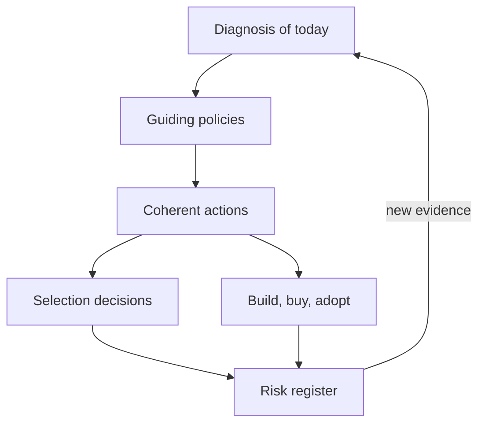
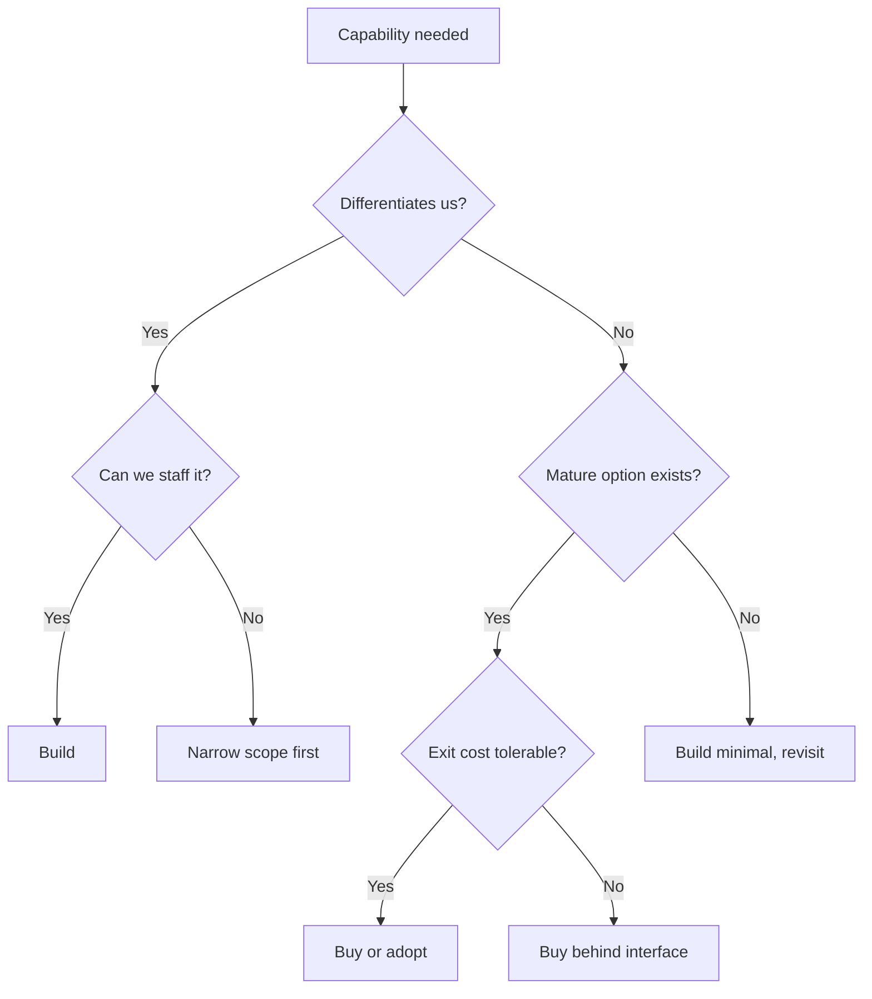

# Chapter 30 — Technical Strategy, Technology Selection, and Build versus Buy

Every engineering organization has a technical strategy. Most never write it down, so it lives in
what gets approved, what gets bought, and what is left to rot. This chapter makes that strategy
explicit at director and staff-engineer level: a diagnosis, a few guiding policies, and actions that
follow. Two recurring decisions test it: which technologies to adopt, and whether to build, buy, or
adopt open source. A technology risk register for end-of-life, concentration, and skills risk keeps it
honest.
The running example is the fictional [Northstar Technologies](../../case-studies/northstar/index.md).
Chapter 51 owns enterprise technology strategy and the three-year roadmap, Chapter 45 owns engineering
economics in depth, and [Chapter 26](../05-engineering-quality/26-security-and-software-supply-chain-quality.md)
owns supply-chain security.

## Why This Matters

At team scale, technology choices look local. A team adds a queue, a datastore, or a library because
it solves this quarter's problem. Each choice is reasonable. The sum is an estate that nobody chose:
four build systems, three ways to store configuration, a library nobody has updated in years.

At organization scale, the cost of that sum arrives as operational load and fragility. Every technology
needs monitoring, upgrades, security patches, and people who understand its failure modes. At Northstar,
four CI systems (continuous integration: build and test on every change) cost about 1.5
[FTE](../../glossary.md#fte) (full-time equivalent engineers) a year to run. The oldest open critical
vulnerability sat in a Core XML library for 19 months because nobody was responsible for watching it. These are strategy
failures, not team failures: no policy said what to converge on or who watches what ages.

At executive scale, technology choices become commitments that outlive the people who made them.
A vendor contract, a framework, or a homegrown engine sets cost and risk for years. Leaders are judged
on whether the estate they hand over is understood, supportable, and cheaper to change than the one
they inherited.

## Learning Objectives

After this chapter you will be able to:

- Write a technical strategy with a diagnosis, guiding policies, and coherent actions, and test it for
  the signs of bad strategy.
- Evaluate build, buy, and adopt-open-source options using three-year total cost of ownership and
  strategic differentiation, including exit cost.
- Run a technology selection process that limits novelty and records why a technology was chosen.
- Build and maintain a technology risk register covering end-of-life, concentration, and skills risk,
  with owners and triggers.

## The Mental Model

> **Mental model:** A technical strategy is a diagnosis plus the few rules that make hundreds of later
> technology decisions consistent. Selection, build-versus-buy, and the risk register are where the
> strategy is applied, and where you find out whether it was right.

The structure comes from Richard Rumelt's idea of a strategy "kernel": a **diagnosis** of the
challenge, a **guiding policy** for dealing with it, and **coherent actions** that carry the policy
out. Rumelt is equally known for naming bad strategy: goals presented as strategy, fluffy language, and
failure to face the actual problem ([Rumelt, 2011](../../references/bibliography.md#rumelt2011good)).
Will Larson applies the kernel to engineering. He argues that coherent actions are the most important
part, that guiding policies should be applicable, enforced, and create leverage, and that many written
strategies fail because they describe an ideal future instead of diagnosing today
([Larson, 2023](../../references/bibliography.md#larson2023engstrategy)). Both are **expert opinion**.

The loop matters more than the boxes. A strategy written once and filed is a document. A strategy whose
diagnosis is revised when the risk register or a selection decision exposes something new is a
management tool. Larson suggests reviewing impact about two months after publishing; this book
recommends a quarterly re-read of the diagnosis against the register.

## Deep Conceptual Explanation

### Writing the strategy

**Diagnosis.** A good diagnosis names the few things that make the situation hard, with evidence. "Our
platform is legacy" is not a diagnosis. "63 percent of our serious incidents are triggered by our own
changes, and four teams change three modules nobody owns" is. The diagnosis should be uncomfortable
for someone; if everyone agrees immediately, it is probably too vague to act on.

**Guiding policies.** A policy is a rule that removes a class of decisions. Larson suggests that
policies answer three questions: how resources are allocated, which rules all teams follow, and how
decisions are made ([Larson, 2023](../../references/bibliography.md#larson2023engstrategy)). A policy
without a cost is suspect. "We value reliability" costs nothing; "no new datastore for a tier 1
component without retiring one" costs teams options they would like to have.

**Coherent actions.** Actions are funded, owned, and dated, and they reinforce each other. Larson sorts
them into enforcements (how the policy is applied), escalations (how exceptions are decided), and
transitions (how the organization gets from today's state to the policy's). A strategy with policies
but no transitions tells every team that its current system violates the rules and gives no path out.

**Director versus staff level.** A director's strategy covers shared technology: runtimes, build and
deploy, data stores, external dependencies, ownership. Staff engineers often work bottom-up; Larson
advises them to write several design documents and extract what they share, because documented
precedent builds consensus a directive does not. The best director strategies cite those precedents.

### Build, buy, or adopt

Three options exist for almost any capability: build it, buy it (a commercial product or service), or
adopt open source (and operate it yourself). Many real choices are hybrids, such as buying content or
data while building the engine around it.

Two questions decide most cases (**this book's recommendation**, a synthesis of common practice):

1. **Does the capability differentiate us?** Differentiating capabilities are those customers choose
   you for, or where your way of doing it is the product. Build those. Commodity capabilities
   (authentication, observability, tax rates, email delivery) rarely repay building, because a vendor
   spreads the cost across many customers and tracks external change for you.
2. **What is the three-year total cost of ownership, including exit?** Total cost of ownership (TCO)
   is every cost of a choice over its life: licenses or subscriptions, the engineering time to build
   and integrate, the ongoing time to operate and upgrade, and the cost to leave. Building looks cheap
   because the first version is cheap; the cost is in years two and three. Buying looks expensive
   because the subscription is visible; the hidden costs are integration, vendor management, and exit.

Exit cost deserves its own line: when you buy, put the vendor behind an interface you own, and know
how you would get your data out. A survey of 114 participants about cloud migration concluded that
lock-in risk grows as resources move to the cloud, and proposed contract terms and standard formats
and APIs as mitigations ([Opara-Martins et al., 2016](../../references/bibliography.md#opara-martins2016lockin);
**research finding**, survey-based, as the abstract reports it).

Adopting open source shifts cost rather than removing it. You pay no license, but you inherit upgrade
work and the project's health, including everything the project depends on. In a study of more than
4,600 GitHub projects, 81.5 percent kept outdated dependencies, and developers were unlikely to respond
to security advisories ([Kula et al., 2018](../../references/bibliography.md#kula2018developers);
**research finding** in open-source projects; on how vulnerabilities spread through dependencies, see
[Decan et al., 2018](../../references/bibliography.md#decan2018impact)). Before adopting, check whether
the project is maintained and how it handles security. The
[OpenSSF Scorecard](../../references/bibliography.md#openssf-scorecard) automates such checks; a good
score is a hygiene signal, not proof that a project is safe or will stay maintained.

### Technology selection

Most selection failures are failures of restraint, not of evaluation. Dan McKinley's essay "Choose
Boring Technology" argues that a company has only a few "innovation tokens" to spend on unproven
technology, that "boring" means a technology whose failure modes are well understood, and that each
addition carries operational and cognitive cost that outlasts its convenience
([McKinley, 2015](../../references/bibliography.md#mckinley2015boring); **expert opinion**, widely
shared among practitioners). His practical advice: ask whether existing tools can solve the problem,
write down why they cannot, discuss additions openly, and commit to migrating off whatever the new
technology replaces.

Two instruments make restraint routine:

- **A technology radar.** Thoughtworks publishes a twice-yearly radar that places technologies in rings
  (Adopt, Trial, Assess, and an outer ring now called Caution) and encourages organizations to build
  their own ([Thoughtworks, Radar FAQ](../../references/bibliography.md#thoughtworks-radar-faq)). An
  internal radar turns the guiding policy into a list: what teams may use without asking, what needs a
  trial with an owner, and what is being retired.
- **Characteristics, not features.** Richards and Ford are known for the argument that architecture is
  about trade-offs among quality characteristics (availability, operability, security, and so on)
  rather than features ([Richards and Ford, 2020](../../references/bibliography.md#richards2020fundamentals)).
  Evaluate candidates against the two or three characteristics your diagnosis says matter.
  The AWS Well-Architected Framework offers six pillars as a checklist of characteristics and describes
  its review as a conversation about decisions, not an audit
  ([AWS, Well-Architected](../../references/bibliography.md#aws-well-architected); **standard**,
  vendor guidance).

Record each decision (Chapter 28 covers decision records and decision rights), naming the policy it
applies and the exit path.

### Running an evaluation

When a candidate does reach Trial, or a purchase is on the table, run the evaluation as a short,
bounded experiment (**this book's recommendation**).

1. **Write the criteria before seeing the candidates.** Two or three characteristics from the
   diagnosis, plus exit cost and staffing. Weight them. Criteria written after a demo describe the
   demo.
2. **Test the hard case, not the happy path.** A proof of concept of two to four weeks uses your
   data, your failure modes, and your integration points. "Faster on the prototype" is not evidence;
   "kept the order path under 2 seconds with the vendor down" is.
3. **Score in a small table.** One row per candidate, including "do nothing" and "extend what we
   have". If the weights decide the winner, say so and get the weights agreed first.
4. **Check the vendor, not only the product.** For a purchase: financial viability and customer base,
   contract length and renewal terms, the availability commitment and what it pays when broken, data
   export format and notice period on exit, and the security review your customers will ask about.
5. **Name the exit before signing.** The interface you own, how data leaves, and a rough switching
   cost. If nobody can describe the exit, the exit cost is not tolerable.

The output is a decision record with the score table attached. A losing candidate stays recorded,
so the same evaluation is not rerun next year.

### The technology risk register

A technology risk register lists the ways the estate can fail you that are not bugs. It differs from
the debt register in [Chapter 21](../05-engineering-quality/21-technical-debt.md), which prices recurring
interest on shortcuts already taken. The risk register tracks **exposure to events**, many outside your
control. Three kinds matter most:

- **End-of-life (EOL).** A runtime, framework, library, or product stops receiving fixes. Dates are
  usually published, but sometimes as minimums: the Eclipse Adoptium roadmap gives each long-term-support
  Java release an end-of-availability date stated as "at least" a given month
  ([Adoptium](../../references/bibliography.md#adoptium-support)). Treat a
  date as a horizon, and start migration while there is still time to test it.
- **Concentration.** One vendor, one route, one instance, or one controller whose failure stops a
  critical path. Concentration is not always wrong; the register makes it a choice.
- **Skills.** Knowledge held by one or two people. In open source, about 65 percent of 133 popular
  projects had a [truck factor](../../glossary.md#single-point-of-knowledge-failure) of two or less:
  losing two developers would leave them in serious trouble
  ([Avelino et al., 2016](../../references/bibliography.md#avelino2016truck); **research finding**).
  [Chapter 12](../03-high-performing-teams/12-team-charters-working-agreements-and-knowledge-sharing.md)
  teaches how to reduce single points of knowledge; the register records where they threaten technology.

Each entry needs an owner, a trigger or horizon, a response (mitigate, transfer, accept, or exit), and a
review date. The research on outdated dependencies is the argument for the register: left alone, most
codebases do not keep up, and most teams do not know what they are exposed to.

## Engineering Organization Example

!!! info "Northstar so far"
    Week 14, the start of quarter 2 of the director's first year. [Sev1 and
    Sev2](../../glossary.md#severity-sev1-sev2-sev3) incidents (the two most serious levels) fell from 30
    to 21 in quarter 1 after ownership, severity, and weekly release changes. Both renewal commitments
    are on track (weeks 19 and 26). See the [timeline](../../case-studies/northstar/timeline.md). New
    to Northstar? Read [the year in brief](../../case-studies/northstar/year-in-brief.md) and the
    [cast](../../case-studies/northstar/cast.md).

This example applies the chapter to Northstar, the book's fictional company. Its facts come from the
[baseline data](../../case-studies/northstar/baseline-data.md) and
[the year 1 record](../../case-studies/northstar/first-quarter.md); the strategy draft and all
scores are **illustrative**. In week 14 the director drafts a one-page technical strategy with the three
staff engineers: Ines Carvalho (Core domain), Kwame Mensah (infrastructure and reliability), and Li Na
Zhou (data and integration).

**Diagnosis.** Three findings, each with evidence. First, change is unsafe: 19 of 30 baseline Sev1 and
Sev2 incidents (63 percent) were triggered by Northstar's own changes, shipped through four different
build systems.
Second, the estate ages unwatched: the oldest critical vulnerability was 19 months old, and nobody owned
runtime or framework versions. Third, knowledge is concentrated: shell-script deploys for four services,
the Jenkins controller, and ledger currency and rounding each depend on one person.

**Guiding policies.**

1. *Converge before adding.* No new runtime, datastore, or build system for a
   [tier 1](../../glossary.md#tier-1) component (one on the order or payment path) without a
   retirement plan for one already in use. (Cost: teams lose the freedom to pick tools.)
2. *Own the order-to-cash logic; buy what changes for reasons outside Northstar.* Pricing, invoicing, and
   ledger rules are built in-house. Content that external parties change (tax rates, partner
   formats) is bought or adopted when a mature option exists.
3. *Every tier 1 component runs on supported versions and has two people who can change it.*

**Coherent actions.** A technology risk register reviewed monthly by the director and staff engineers
(enforcement). Exceptions to policy 1 decided by the director within 10 working days, because an
exception is a risk trade-off (escalation). A supported-version plan for Core and a second responder
for each one-person system (transitions). CI consolidation is decided separately
([Chapter 32](32-platform-engineering-developer-experience-and-modernization.md)).

The first register scores likelihood times impact, each on a three-point scale. Likelihood 3 means
the trigger is expected within two quarters or is already happening; impact 3 means a tier 1 path or
financial correctness is at stake.

| ID | Item | Kind | Score | Response |
|---|---|---|---|---|
| TR-01 | Core framework past community support | EOL | 9 | Scope migration; patch meanwhile |
| TR-02 | Single Jenkins controller, about 60 plugins | Concentration, skills | 9 | Configuration as code; second responder |
| TR-03 | Core Java runtime, free updates for at least 12 more months | EOL | 6 | Plan with TR-01 |
| TR-04 | Core XML library, unmaintained upstream | EOL, security | 6 | Replace (exit) |
| TR-05 | Configuration server, single instance, two versions behind | EOL, concentration | 6 | Upgrade with a standby |
| TR-06 | Shell-script deploys known by one engineer | Skills | 6 | Migrate (Chapter 32 roadmap) |
| TR-07 | Ledger currency and rounding, one person | Skills | 6 | Pairing plan |
| TR-08 | One partner bank route, no fallback | Concentration | 6 | Evaluate a second route |
| TR-09 | tax-svc rate tables kept by hand by one engineer | Skills, correctness | 6 | Build or buy (Case Study) |

Owners: Ines Carvalho for TR-01, TR-03, and TR-04; Tom Becker (Platform Operations manager) for TR-02
and TR-06; Kwame Mensah for TR-05; Marcus Oyelaran (Billing manager) for TR-07 and TR-09; Elena
Sokolova (Payments and Integrations manager) for TR-08. Behind the rows: TR-02's controller, built by
Bram Verhoeven (senior infrastructure engineer), caused [INC-428](../../glossary.md#inc-numbers), in
which all Jenkins deploys failed until a restart. TR-04's library held the oldest critical
vulnerability. TR-08's route caused INC-413 (a partner bank outage left payments queued), and TR-09's
tables caused INC-414 (a new jurisdiction's rate missing its effective date).

The point of the register is its owners and responses, not its scores. Three-point scales cluster,
and seven of nine items score 6. The two 9s both sit in the build and runtime layer every team
depends on, which confirms the diagnosis.

The work is not small. The director's illustrative estimate for TR-01 is 120 to 180 engineer-days,
and TR-02's mitigation about 20. This chapter prices engineer time at **Finance's day rate** of $800
per engineer-day ($185,000 ÷ about 230 working days), so TR-01 costs about $96,000 to $144,000. Per
day it is higher than the book's planning rate of $3,558 per engineer-week, because Finance counts only
working days. Both items compete for capacity with the
[prevention allocation](../../glossary.md#prevention-allocation), the capacity reserved per team for
removing the sources of incidents. That is why they belong in the strategy rather than in a backlog.

## Decision Framework

The build, buy, or adopt decision follows two questions and one check:

"Can we staff it?" means two people who can change it, not one. "Exit cost tolerable?" means you can
name the interface, the data export, and the rough cost of switching.

For technology selection, place each candidate on the internal radar:

| Situation | Ring | Required |
|---|---|---|
| Already used widely, failure modes known | Adopt | Nothing beyond normal review |
| Solves a problem existing tools cannot, with a written reason | Trial | Owner, time box, success criteria, retirement plan for what it replaces |
| Interesting, no current problem | Assess | Reading or a spike (a short throwaway experiment) outside production |
| Being retired or known to hurt | Caution | Exception from the director for new use |

For the risk register, the response depends on whether you can act before the trigger:

| Horizon to trigger | Response |
|---|---|
| Longer than the migration takes, plus a quarter | Schedule the migration; review quarterly |
| Shorter than the migration | Buy extended support or add a compensating control, and escalate |
| Unknown (concentration, skills) | Reduce exposure now: second person, standby, or second vendor |

## Trade-offs

**Standardization against fit.** Converging on few technologies lowers operational load but forces
some teams into a worse tool. McKinley's argument is that the company-wide cost usually exceeds the
local gain; the trade-off is real for genuinely different workloads, which is what the Trial ring is for.

**Build control against buy speed.** Building keeps control of roadmap, data, and behavior; buying
moves faster and transfers tracking of external change. The cost of buying is dependency on a vendor's
priorities, pricing, and availability. On a tier 1 path, the vendor's availability becomes part of
yours.

**Open source cost against license cost.** Adopting open source swaps a license fee for upgrade work and
exposure to the project's health. A well-maintained project with a large community is often safer than
a small vendor; an abandoned library is worse than either.

**Register completeness against attention.** A register with 80 items is a list nobody reads. Keep the
tier 1 items and anything that could stop a release or a renewal; review the rest annually.

## Failure Modes

**The vision document.** A strategy that describes a target architecture with no diagnosis and no
transitions. Signal: teams cannot say which current decision it changes. Countermeasure: require each
policy to name a decision it would have changed last quarter.

**Goals as strategy.** "Become cloud-native" or "modernize the stack" presented as strategy. Rumelt's
test applies: a goal is not a plan for overcoming an obstacle. Signal: no trade-offs, no one objects.

**Resume-driven selection.** A technology chosen because engineers want experience with it. Signal: the
written reason describes the technology, not the problem. Countermeasure: the Trial ring's retirement
plan and owner.

**Build bias.** Engineers underestimate years two and three and overestimate differentiation. Signal:
the build estimate covers the first version only. Countermeasure: three-year TCO with operating time.

**Buy and forget.** A purchased product with no owner, no exit path, and no review of the contract
before renewal. Signal: nobody can say how to export the data. Countermeasure: an owner and an interface.

**The scoring game.** Register owners rate items low to avoid work, or high to get funding. Signal: all
scores move together, or no score changes for two quarters. Countermeasure: the staff engineers
challenge scores in the monthly review, and the horizon (a date) is recorded, not just the score.

**The orphaned register.** Kept for an audit, reviewed by nobody. Signal: review dates in the past.

## Enterprise Application

In an organization of 50 to 150 engineers, the director's technical strategy covers the shared layers
(runtimes, build and deploy, data stores, vendors on tier 1 paths) and leaves component design to
teams. One to two pages is enough; longer strategies are not read.

Staff engineers carry most of the work. At Northstar the natural split follows the standard owners
from Chapter 20: Ines Carvalho for Core runtime and framework, Kwame Mensah for build, deploy, and
configuration infrastructure, Li Na Zhou for data and integration vendors. The director owns the
policies, the escalations, and the budget conversation.

The radar can be a single page updated quarterly. The risk register should be reviewed monthly in an
existing meeting (the operating cadence of Chapter 37), not a new one. Build-versus-buy decisions above
the discretionary tooling budget go to the CFO with the three-year TCO; below it, the director decides
with the owning manager, and the decision record is public.

The transition cost is mostly attention: perhaps two hours a month of each staff engineer for the
register, and the friction teams feel when policy 1 blocks a tool they wanted.

## CTO Perspective

A CTO sees the same instruments at portfolio scale. The questions change from "which library" to
"which vendors could hurt us, and what is our exposure if one fails or raises prices", and from "this
team's runtime" to "how much of our engineering capacity goes to keeping the estate current".
Chapter 51 covers the enterprise strategy and three-year roadmap that set the context for a director's
technical strategy.

Three things the CTO should ask of a director's strategy. Does the diagnosis match the incident and cost
data? Do the policies trade something away? Is the risk register current, and which items need money or
a contract decision above the director's authority? Vendor concentration and end-of-life items on
revenue paths belong in the CTO's own risk reporting to the CEO and board, alongside security.

## Practical Playbook

1. Collect evidence for the diagnosis: incidents by trigger, components by owner and runtime version,
   vendors on tier 1 paths, and people who are sole experts.
2. Write a diagnosis of three findings or fewer, each with a number. Workshop it one-on-one with the staff
   engineers and two managers before writing policies.
3. Write two to four guiding policies. For each, name its cost and one decision from last quarter it
   would have changed.
4. List coherent actions as enforcements, escalations, and transitions, each with an owner and a date.
5. Publish an internal radar with the four rings. Seed it from what is already in production.
6. Build the risk register: every tier 1 component's runtime and framework EOL horizon, every single
   vendor or instance on a tier 1 path, every one-person system. Assign owners.
7. For each build-versus-buy decision, write a one-page comparison with three-year TCO, differentiation,
   exit cost, and staffing.
8. Review the register monthly and the strategy quarterly. Change the diagnosis when the evidence changes.

## Case Study

This case is **fictional**; the costs, quotes, and staffing are **illustrative**.

In week 14, Marcus Oyelaran (Billing manager) brings register item TR-09 to the director. tax-svc, a
tier 1 Billing service with no runbook and partial alerting, calculates sales tax on orders and
invoices. In the baseline quarter, INC-414 happened because the tax rate table lacked the effective
date for a new jurisdiction. A customer found it; restoring took 450 minutes.

One Billing engineer updates the 2,300-row rate tables monthly by hand. Rate upkeep and tax tickets
take about 0.6 FTE a year. Open-source libraries calculate tax but none maintains rate content, so
adopting one would leave the hard part unsolved.

Three options over three years:

| Option | Upfront | Annual | Three-year TCO |
|---|---|---|---|
| A. Build out the tables and tooling | $96,000 | $92,500 | $373,500 |
| B. Buy a tax engine (API) | $64,000 | $177,750 | $597,250 |
| C. Keep tax-svc, buy rate content | $56,000 | $91,250 | $329,750 |

Upfront is engineer-days at Finance's day rate (A 120, B 80, C 70 days). Annual is subscription plus
engineer time at $185,000 an FTE-year: A 0.5 FTE, rates still researched in-house; B $150,000 plus 0.15
FTE; C $45,000 plus 0.25 FTE. TCO is upfront plus three years of annual cost.

The table leaves out four things the director has to weigh.

- **Differentiation.** Tax calculation is not why distributors buy Northstar, but wrong tax on an invoice
  is a wrong financial record, which Northstar classifies as a Sev1.
- **Skills.** Option A keeps rate research with one person; B and C transfer it to a vendor.
- **Concentration and the order path.** B puts a vendor API on the order path. The order path's
  proposed [SLO](../../glossary.md#sli-slo-and-sla) (service level objective, an internal reliability
  target) is 99 percent of submissions within 2 seconds. It needs cached rates as a fallback, which is extra build work
  not in the table, and a contract with availability at least as strict as Northstar's own 99.9 percent.
- **Budget and capacity.** B's subscription alone would use 60 percent of the $250,000 discretionary
  tooling budget, which every other tooling request competes for. All three
  options take Billing engineer-days in quarter 2, when Billing has reserved weeks 14 to 16 for the
  ledger export behind the accounting integration (due week 19).

Policy 2 of the strategy points toward buying the content, which favors B or C. Which of the two, when,
and with what exit path is the decision the reader faces in the exercises. The outcome is open.

## Exercises

Worked solutions are in the [chapter 30 solutions](../../solutions/ch30-solutions.md).

### Foundational

**F1.** A colleague's draft technical strategy reads: "Our vision is a modern, cloud-native platform.
We will embrace microservices, improve developer experience, and invest in observability. Success means
faster delivery and fewer incidents." Using the diagnosis, guiding policy, and coherent action
structure, identify what is missing, and rewrite the first paragraph as a diagnosis using Northstar's
baseline data.

**F2.** Recompute the three-year TCO of the three tax-svc options in the case study. Then extend the
horizon to five years, assuming the subscriptions rise 5 percent a year and the in-house rate research
grows from 0.5 to 0.6 FTE in option A from year 3. State which option is cheapest at three and at five
years, and which assumption changes the ranking most.

**F3.** Northstar's register has seven of nine items scored 6. Propose a scoring change, or a different
way of ordering the register, that would help the monthly review decide where to spend the next 20
engineer-days. Say how your change could be gamed.

### Applied Leadership

**A1.** In week 16 a Customer Experience engineer proposes adopting a new graph database for a mobile
recommendations feature, citing a prototype that was faster than the existing relational store. Under
Northstar's draft policy 1, decide what you say, which radar ring the database goes in, and what the
team would need to show to move it to Trial.

**A2.** Choose between options B and C for tax-svc and write the one-page decision record: the policy
it applies, the exit path, the fallback on the order path, who owns the vendor relationship, and what
evidence after two quarters would make you reverse it. Account for Billing's quarter 2 commitments.

**A3.** Tom Becker (Platform Operations manager) says the Jenkins controller item (TR-02) should not be on the register because "the
CI consolidation decision will make it irrelevant". Bram Verhoeven, who built the controller, spends 45 percent of his time on
Jenkins interrupts. Decide whether TR-02 stays, what mitigation you fund now, and how you keep the
register from becoming a substitute for the consolidation decision.

### Executive Decision-Making

**X1.** Ines Carvalho estimates the Core framework migration (TR-01) at 120 to 180 engineer-days and asks
to start in quarter 3. She is already leading the permissions extraction, and
[constraint 3](../../glossary.md#the-five-constraints) rules out a funded Core rewrite. Victor Lindqvist
(CTO) asks whether to buy extended commercial support for the old framework line
instead (illustrative quote: $60,000 a year). Recommend a course for the next four quarters, with the
trigger that would change it.

**X2.** The vendor behind option B offers a 30 percent discount for a three-year commitment if Northstar
signs this quarter. Rajiv Menon (CFO) likes the discount. Elena Sokolova warns about adding another
external dependency to the order path after INC-413 (the partner bank outage) and INC-425 (an expired
certificate on the card processor endpoint). As CTO, decide whether to accept, and state what
contract terms, technical safeguards, and approval route the decision needs.

## Reflection Questions

- Which technology in your organization was chosen without anyone writing down why, and what would its
  removal cost today?
- If your current strategy disappeared, which decision next month would be made differently? If none,
  what is the strategy for?
- What capability do you build in-house that a customer would never notice if you bought it?
- Who in your organization would notice first that a runtime or a vendor contract is about to expire?
- Which of your guiding policies has a cost that someone has actually paid?

## Key Takeaways

- A technical strategy is a diagnosis, a few guiding policies, and coherent actions; without the
  diagnosis it is a vision, and without actions it is a wish.
- Each guiding policy should remove a class of decisions and cost someone something.
- Build what differentiates you and what you can staff with two people; buy or adopt content that
  changes for reasons outside your control.
- Compare options on three-year total cost of ownership, including operating time and exit cost, not
  on the first version or the first invoice.
- Adopting open source swaps license cost for upgrade work and project-health risk; check maintenance
  before adopting.
- Limit novelty: a radar with Adopt, Trial, Assess, and Caution rings turns the policy into a list.
- Keep a technology risk register for end-of-life, concentration, and skills risk, with owners,
  horizons, and responses, reviewed monthly.
- Revise the diagnosis when the register or a selection decision shows that the evidence has changed.

## References and Further Reading

- [Rumelt, 2011](../../references/bibliography.md#rumelt2011good), *Good Strategy Bad Strategy*. The
  kernel of diagnosis, guiding policy, and coherent action, and the signs of bad strategy.
- [Larson, 2023](../../references/bibliography.md#larson2023engstrategy), "Writing an engineering
  strategy." Applies the kernel to engineering, with structure for policies and actions.
- [McKinley, 2015](../../references/bibliography.md#mckinley2015boring), "Choose Boring Technology."
  Innovation tokens and the long-term cost of adding technology.
- [Thoughtworks, Radar FAQ](../../references/bibliography.md#thoughtworks-radar-faq). Rings and
  quadrants for a technology radar, and building your own.
- [Richards and Ford, 2020](../../references/bibliography.md#richards2020fundamentals), *Fundamentals of
  Software Architecture*. Evaluating choices as trade-offs among architecture characteristics.
- [AWS, Well-Architected](../../references/bibliography.md#aws-well-architected). Six pillars as a
  checklist for evaluating a design or a vendor.
- [Opara-Martins et al., 2016](../../references/bibliography.md#opara-martins2016lockin). Survey-based
  analysis of vendor lock-in and proposed mitigations.
- [Kula et al., 2018](../../references/bibliography.md#kula2018developers). Evidence that open-source
  projects keep outdated dependencies and often miss security advisories.
- [Decan et al., 2018](../../references/bibliography.md#decan2018impact). How vulnerabilities propagate
  through a package dependency network.
- [Avelino et al., 2016](../../references/bibliography.md#avelino2016truck). Truck factors in open-source
  projects, for the skills side of the register.
- [Adoptium](../../references/bibliography.md#adoptium-support). An example of published end-of-life
  horizons stated as minimums.
- [OpenSSF Scorecard](../../references/bibliography.md#openssf-scorecard). Automated health and security
  checks for open-source projects before adoption.
