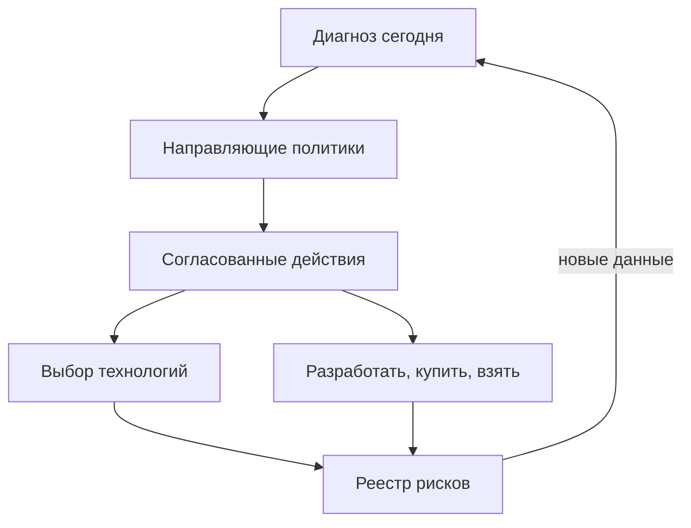
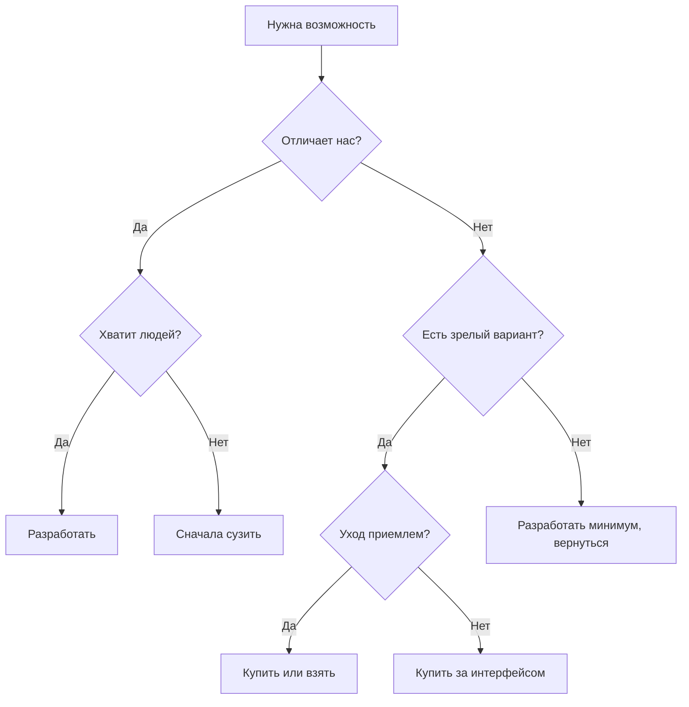

# Глава 30 — Техническая стратегия, выбор технологий и «разработать или купить» { #chapter-30-technical-strategy-technology-selection-and-build-versus-buy }

Техническая стратегия есть у каждой инженерной организации. Большинство организаций её так и не
записывает, и тогда стратегия живёт в том, что одобряют, что покупают и что оставляют гнить. Эта глава
показывает, как сделать её явной на уровне директора и staff-инженера: диагноз, несколько направляющих политик и
вытекающие из них действия. Проверяют стратегию два регулярных решения: какие технологии внедрять и что
делать с возможностью — разработать самим, купить или взять open source. Честной её держит реестр
технологических рисков, связанных с окончанием поддержки, концентрацией и навыками. Сквозной пример — вымышленная
компания [Northstar Technologies](../../case-studies/northstar/index.md). Корпоративную
технологическую стратегию и трёхлетнюю дорожную карту разбирает глава 51, экономику разработки
подробно — глава 45, а безопасность цепочки поставки —
[глава 26](../05-engineering-quality/26-security-and-software-supply-chain-quality.md).

## Почему это важно { #why-this-matters }

В команде выбор технологий кажется локальным. Команда добавляет очередь, хранилище данных или
библиотеку, потому что это решает задачу текущего квартала. Каждый такой выбор разумен. А в сумме
получается технологический ландшафт, который никто не выбирал: четыре системы сборки, три способа
хранить конфигурацию, библиотека, которую никто не обновлял годами.

Организация расплачивается за эту сумму операционной нагрузкой и хрупкостью. Каждой технологии
нужны мониторинг, обновления, патчи безопасности и люди, которые понимают, как она отказывает. В
Northstar четыре системы CI (непрерывная интеграция: сборка и тесты на каждое изменение) обходились
примерно в 1,5 [FTE](../../glossary.md#fte) (полной ставки инженера) в год на эксплуатацию.
Самая старая открытая критическая уязвимость 19 месяцев сидела в XML-библиотеке Core, потому что
отслеживать её не входило ни в чьи обязанности. Это провалы стратегии, а не команд: ни одна политика
не говорила, к каким технологиям сводить ландшафт и кто следит за тем, что устаревает.

Для высшего руководства выбор технологий превращается в обязательства, которые переживают тех, кто их
принял. Контракт с вендором, фреймворк или самописный движок на годы вперёд определяют стоимость и риск.
Руководителей оценивают по тому, понятен ли ландшафт, который они передают преемнику, можно ли его
поддерживать и дешевле ли его менять, чем тот, что они получили сами.

## Цели главы { #learning-objectives }

Прочитав эту главу, вы сможете:

- Писать техническую стратегию с диагнозом, направляющими политиками и согласованными действиями и
  проверять её на признаки плохой стратегии.
- Оценивать варианты «разработать», «купить» и «взять open source» по совокупной стоимости владения
  за три года и по стратегической дифференциации, включая стоимость ухода.
- Выбирать технологии так, чтобы ограничивать новизну и записывать причины выбора.
- Составлять и вести реестр технологических рисков (окончание поддержки, концентрация, навыки) с
  владельцами и триггерами.

## Ментальная модель { #the-mental-model }

> **Ментальная модель:** техническая стратегия — это диагноз плюс несколько правил, благодаря которым
> сотни последующих технологических решений согласуются между собой. Выбор технологий, «разработать
> или купить» и реестр рисков — это места, где стратегию применяют и где выясняется, была ли она
> верной.

Структура взята из идеи «ядра» стратегии (kernel) Richard Rumelt: **диагноз** проблемы,
**направляющая политика** (guiding policy), которая говорит, как с ней справляться, и **согласованные
действия** (coherent actions), которые эту политику воплощают. Не меньше Rumelt известен тем, что дал
имена признакам плохой стратегии: цели, выданные за стратегию, пустые слова и нежелание взглянуть на
настоящую проблему ([Rumelt, 2011](../../references/bibliography.md#rumelt2011good)). Will Larson
переносит ядро на разработку и утверждает три вещи. Самая важная часть — согласованные действия.
Направляющие политики должны быть применимыми, соблюдаемыми и давать рычаг. А многие письменные
стратегии проваливаются, потому что описывают идеальное будущее вместо диагноза сегодняшнего дня
([Larson, 2023](../../references/bibliography.md#larson2023engstrategy)). Оба источника — **мнение
эксперта**.

Петля важнее прямоугольников. Стратегия, которую однажды написали и убрали в папку, — просто
документ. Если же диагноз пересматривают всякий раз, когда реестр рисков или решение о выборе
технологии вскрывает что-то новое, стратегия становится инструментом управления. Larson предлагает
оценить эффект стратегии примерно через два месяца после публикации; книга рекомендует раз в квартал перечитывать диагноз, сверяя его с
реестром.

## Подробный разбор { #deep-conceptual-explanation }

### Как написать стратегию { #writing-the-strategy }

**Диагноз.** Хороший диагноз называет несколько вещей, которые делают ситуацию трудной, и подкрепляет
их данными. «Наша платформа — legacy» — не диагноз. «63% наших серьёзных инцидентов запускают наши же
изменения, и четыре команды меняют три модуля, у которых нет владельца» — диагноз. Кому-то он должен
быть неприятен; если с ним все сразу согласны, он, скорее всего, слишком размыт, чтобы по нему
действовать.

**Направляющие политики.** Политика — это правило, которое снимает целый класс решений. Larson
предлагает, чтобы политики отвечали на три вопроса: как распределяются ресурсы, каким правилам следуют
все команды и как принимаются решения
([Larson, 2023](../../references/bibliography.md#larson2023engstrategy)). Политика, которая ничего не
стоит, должна настораживать. «Мы ценим надёжность» не стоит ничего; «никакого нового хранилища данных для
компонента tier 1 без вывода из эксплуатации одного из существующих» лишает команды вариантов, которые
им хотелось бы иметь.

**Согласованные действия.** У действий есть финансирование, владелец и срок, и они усиливают друг
друга. Larson делит их на механизмы соблюдения (как политику применяют), эскалации (как решают
исключения) и переходы (как организация попадает из сегодняшнего состояния в то, которого требует
политика). Стратегия с политиками, но без переходов говорит каждой команде, что её нынешняя система
нарушает правила, но не показывает, как из этого выбраться.

**Уровень директора и уровень staff-инженера.** Стратегия директора охватывает общие технологии:
среды выполнения, сборку и развёртывание, хранилища данных, внешние зависимости, владение.
Staff-инженеры часто работают снизу вверх. Larson советует им написать несколько дизайн-документов и
обобщить то, что в них повторяется: записанные прецеденты создают консенсус, которого не добиться
указанием. Лучшие стратегии директоров ссылаются на эти прецеденты.

### Разработать, купить или взять open source { #build-buy-or-adopt }

Почти для любой возможности есть три варианта: разработать её, купить (коммерческий продукт или
сервис) или взять open source (и эксплуатировать самостоятельно). На практике многие решения
гибридные: например, контент или данные покупают, а движок вокруг них разрабатывают сами.

Большинство случаев решают два вопроса (**рекомендация книги**, обобщение распространённой практики):

1. **Отличает ли нас эта возможность от других?** Дифференцирующие возможности — это те, за которые
   клиенты выбирают вас, или те, где ваш способ работы и есть продукт. Их разрабатывайте сами. Типовые
   возможности (аутентификация, наблюдаемость, налоговые ставки, доставка почты) редко окупают
   разработку: вендор распределяет стоимость между многими клиентами и сам отслеживает внешние
   изменения.
2. **Какова совокупная стоимость владения за три года, включая уход?** Совокупная стоимость владения
   (total cost of ownership, TCO) — это все затраты на вариант за время его жизни: лицензии или
   подписки, инженерное время на разработку и интеграцию, постоянное время на эксплуатацию и
   обновления и стоимость ухода. Разработка кажется дешёвой, потому что дёшева первая версия, а затраты
   приходятся на второй и третий годы. Покупка кажется дорогой, потому что подписка на виду, а скрытые
   затраты — интеграция, работа с вендором и уход.

Стоимость ухода заслуживает отдельной строки. Покупая, прячьте вендора за интерфейсом, которым владеете
сами, и заранее знайте, как заберёте свои данные. Опросив 114 участников о переходе в облако, авторы
пришли к выводу, что риск привязки к вендору растёт по мере переноса ресурсов в облако. Как меры
защиты они предложили условия контрактов, стандартные форматы и API
([Opara-Martins et al., 2016](../../references/bibliography.md#opara-martins2016lockin);
**научный результат**, основанный на опросе, в изложении аннотации).

Open source не убирает затраты, а перекладывает их. За лицензию вы не платите, зато наследуете работу по
обновлениям и зависимость от здоровья проекта и всего, от чего он сам зависит. В исследовании более
4 600 проектов на GitHub 81,5% проектов держали устаревшие зависимости, а разработчики редко
реагировали на рекомендации по безопасности
([Kula et al., 2018](../../references/bibliography.md#kula2018developers); **научный результат** для
open-source-проектов; о том, как уязвимости распространяются по зависимостям, см.
[Decan et al., 2018](../../references/bibliography.md#decan2018impact)). Прежде чем брать проект,
проверьте, поддерживается ли он и как в нём обращаются с безопасностью.
[OpenSSF Scorecard](../../references/bibliography.md#openssf-scorecard) автоматизирует такие проверки.
Хорошая оценка — признак гигиены, а не доказательство того, что проект безопасен или и дальше будет
поддерживаться.

### Выбор технологий { #technology-selection }

Выбор технологий чаще проваливается из-за недостатка сдержанности, чем из-за ошибок оценки. В эссе «Choose Boring
Technology» («Выбирайте скучные технологии») Dan McKinley утверждает три вещи. У компании есть лишь
несколько «жетонов на инновации» (innovation tokens), которые можно потратить на непроверенные
технологии. «Скучная» технология — та, чьи способы отказа хорошо изучены. А каждая добавленная технология
приносит операционную и когнитивную нагрузку, которая длится дольше, чем выгода от неё
([McKinley, 2015](../../references/bibliography.md#mckinley2015boring); **мнение эксперта**, широко
разделяемое практиками). Его практический совет: спросите, могут ли существующие инструменты решить
задачу, запишите, почему не могут, обсуждайте каждое добавление открыто и берите на себя обязательство
перевести на новую технологию всё, что она заменяет.

Сдержанность становится рутиной благодаря двум инструментам:

- **Технологический радар.** Thoughtworks дважды в год публикует радар, который раскладывает технологии
  по кольцам (Adopt, Trial, Assess и внешнее кольцо, которое теперь называется Caution), и призывает
  организации строить собственные радары
  ([Thoughtworks, Radar FAQ](../../references/bibliography.md#thoughtworks-radar-faq)). Внутренний
  радар превращает направляющую политику в список: чем команды могут пользоваться, ни у кого не
  спрашивая, что требует пробы с владельцем и что выводится из эксплуатации.
- **Характеристики, а не функции.** Richards и Ford известны тезисом о том, что архитектура — это
  компромиссы между характеристиками качества (доступность, удобство эксплуатации, безопасность и
  так далее), а не функции
  ([Richards and Ford, 2020](../../references/bibliography.md#richards2020fundamentals)). Оценивайте
  кандидатов по двум-трём характеристикам, важность которых следует из вашего диагноза. AWS
  Well-Architected Framework предлагает шесть опор (pillars) как чек-лист характеристик и описывает
  своё ревью как разговор о решениях, а не аудит
  ([AWS, Well-Architected](../../references/bibliography.md#aws-well-architected); **стандарт**,
  рекомендации вендора).

Каждое решение записывайте, указывая политику, которую оно применяет, и путь ухода (записи решений и
права на решения разбирает глава 28).

### Как провести оценку { #running-an-evaluation }

Когда кандидат всё-таки доходит до Trial или речь заходит о покупке, проводите оценку как короткий
эксперимент с чёткими рамками (**рекомендация книги**).

1. **Запишите критерии до того, как увидите кандидатов.** Две-три характеристики из диагноза плюс
   стоимость ухода и укомплектованность людьми. Задайте им веса. Критерии, записанные после демо,
   просто описывают демо.
2. **Проверяйте трудный случай, а не успешный сценарий.** Проверку концепции (proof of concept)
   на две–четыре недели проводите на своих данных, своих способах отказа и своих точках интеграции. «Быстрее на
   прототипе» — не доказательство; «удержали путь заказа в пределах 2 секунд при отключённом вендоре» —
   доказательство.
3. **Сведите оценки в небольшую таблицу.** По строке на кандидата, включая «ничего не делать» и
   «расширить то, что есть». Если победителя определяют веса, скажите об этом прямо и сначала
   согласуйте веса.
4. **Проверяйте вендора, а не только продукт.** При покупке: финансовая устойчивость и клиентская база,
   срок контракта и условия продления, обязательство по доступности и компенсация при его нарушении,
   формат экспорта данных и срок уведомления при уходе, а также проверка безопасности, о которой
   спросят ваши клиенты.
5. **Назовите путь ухода до подписания.** Интерфейс, которым владеете вы, способ забрать данные и
   примерная стоимость переключения. Если путь ухода никто не может описать, стоимость ухода
   неприемлема.

Результат — запись решения с приложенной таблицей оценок. Проигравший кандидат остаётся в записи,
поэтому ту же оценку не придётся повторять через год.

### Реестр технологических рисков { #the-technology-risk-register }

Реестр технологических рисков перечисляет, чем технологический ландшафт может подвести вас,
помимо багов. Он отличается от реестра долга из [главы 21](../05-engineering-quality/21-technical-debt.md),
который оценивает регулярные проценты за уже срезанные углы. Реестр рисков отслеживает
**подверженность событиям**, многие из которых вам неподвластны. Важнее всего три вида:

- **Окончание поддержки (end-of-life, EOL).** Среда выполнения, фреймворк, библиотека или продукт
  перестаёт получать исправления. Даты обычно публикуют, но иногда лишь как нижнюю границу: в дорожной карте
  Eclipse Adoptium для каждого релиза Java с долгосрочной поддержкой дата окончания доступности
  указана как «не раньше» определённого месяца
  ([Adoptium](../../references/bibliography.md#adoptium-support)). Считайте дату горизонтом и
  начинайте миграцию, пока ещё есть время её протестировать.
- **Концентрация.** Один вендор, один маршрут, один экземпляр или один контроллер, отказ которого
  останавливает критический путь. Концентрация не всегда ошибка; реестр делает её осознанным выбором.
- **Навыки.** Знания, которые есть у одного-двух людей. В open source примерно у 65% из 133 популярных
  проектов [truck factor](../../glossary.md#single-point-of-knowledge-failure) (он же bus factor) был
  равен двум или меньше: потеря двух разработчиков поставила бы их в очень трудное положение
  ([Avelino et al., 2016](../../references/bibliography.md#avelino2016truck); **научный результат**).
  Как сокращать единые точки отказа по знаниям, разбирает
  [глава 12](../03-high-performing-teams/12-team-charters-working-agreements-and-knowledge-sharing.md);
  реестр фиксирует, где они угрожают технологиям.

У каждой записи должны быть владелец, триггер или горизонт, ответ (снизить, передать, принять или уйти)
и дата пересмотра. Довод в пользу реестра дают как раз исследования устаревших зависимостей: если ничего
не делать, большинство кодовых баз отстаёт, а большинство команд не знает, каким рискам подвержено.

## Пример из инженерной организации { #engineering-organization-example }

!!! info "Northstar: что уже известно"
    Неделя 14, начало квартала 2 первого года директора. После изменений во владении, в оценке серьёзности
    и перехода на еженедельные релизы число инцидентов [Sev1 и Sev2](../../glossary.md#severity-sev1-sev2-sev3)
    (два самых серьёзных уровня) в квартале 1 упало с 30 до 21. Оба обязательства по продлению идут по
    плану (недели 19 и 26). См. [хронологию](../../case-studies/northstar/timeline.md). Впервые
    читаете о Northstar? Прочитайте [«Год вкратце»](../../case-studies/northstar/year-in-brief.md) и
    [действующих лиц](../../case-studies/northstar/cast.md).

В этом примере глава применена к Northstar, вымышленной компании книги. Факты взяты из
[исходных данных](../../case-studies/northstar/baseline-data.md) и
[хроники года 1](../../case-studies/northstar/first-quarter.md); черновик стратегии и все оценки —
**иллюстрация**. На неделе 14 директор вместе с тремя staff-инженерами набрасывает техническую
стратегию на одну страницу. Это Ines Carvalho (домен Core), Kwame Mensah (инфраструктура и
надёжность) и Li Na Zhou (данные и интеграции).

**Диагноз.** Три вывода, у каждого есть данные. Первый: изменения небезопасны. Из 30 инцидентов
Sev1 и Sev2 базового квартала 19 (63%) запустили собственные изменения Northstar, выпущенные через
четыре разные системы сборки. Второй: ландшафт стареет без присмотра. Самой старой критической уязвимости было
19 месяцев, а версиями сред выполнения и фреймворков никто не владел. Третий: знания сосредоточены у
отдельных людей. Развёртывание четырёх сервисов shell-скриптами, контроллер Jenkins, валюты и
округление в ledger — каждый из этих участков держится на одном человеке.

**Направляющие политики.**

1. *Сначала сократить, потом добавлять.* Никакой новой среды выполнения, хранилища данных или системы
   сборки для компонента [tier 1](../../glossary.md#tier-1) (компонента на пути заказа или оплаты) без
   плана вывода из эксплуатации одного из уже используемых. (Цена: команды теряют свободу выбирать
   инструменты.)
2. *Владеть логикой order-to-cash; покупать то, что меняется по причинам вне Northstar.* Правила
   ценообразования, выставления счетов и ledger разрабатывают внутри компании. Контент, который
   меняют внешние стороны (налоговые ставки, форматы партнёров), покупают или берут готовым, когда есть
   зрелый вариант.
3. *Каждый компонент tier 1 работает на поддерживаемых версиях, и менять его могут два человека.*

**Согласованные действия.** Реестр технологических рисков, который директор и staff-инженеры
ежемесячно пересматривают (механизм соблюдения). Об исключениях из политики 1 директор решает в течение
10 рабочих дней, потому что исключение — это компромисс по риску (эскалация). План перехода Core на
поддерживаемые версии и второй ответственный для каждой системы, завязанной на одного человека
(переходы). Консолидацию CI решают отдельно
([глава 32](32-platform-engineering-developer-experience-and-modernization.md)).

В первом реестре риск оценивают как произведение вероятности на последствия, и то и другое — по
трёхбалльной шкале. Вероятность 3 означает, что триггер ожидается в течение двух кварталов или уже происходит;
последствия 3 означают, что под угрозой путь tier 1 или корректность финансовых данных.

| ID | Пункт | Вид | Оценка | Ответ |
|---|---|---|---|---|
| TR-01 | Фреймворк Core вышел из поддержки сообщества | EOL | 9 | Оценить объём миграции; пока ставить патчи |
| TR-02 | Единственный контроллер Jenkins, около 60 плагинов | Концентрация, навыки | 9 | Конфигурация как код; второй ответственный |
| TR-03 | Среда выполнения Java для Core, бесплатные обновления ещё минимум 12 месяцев | EOL | 6 | Планировать вместе с TR-01 |
| TR-04 | XML-библиотека Core, апстрим не поддерживается | EOL, безопасность | 6 | Заменить (уход) |
| TR-05 | Сервер конфигурации, один экземпляр, отстаёт на две версии | EOL, концентрация | 6 | Обновить и добавить резервный экземпляр |
| TR-06 | Развёртывание shell-скриптами, которое знает один инженер | Навыки | 6 | Мигрировать (дорожная карта главы 32) |
| TR-07 | Валюты и округление в ledger, один человек | Навыки | 6 | План работы в паре |
| TR-08 | Один маршрут через банк-партнёр, без резерва | Концентрация | 6 | Оценить второй маршрут |
| TR-09 | Таблицы ставок tax-svc вручную ведёт один инженер | Навыки, корректность | 6 | Разработать или купить (кейс) |

Владельцы: Ines Carvalho — TR-01, TR-03 и TR-04; Tom Becker (руководитель Platform Operations) — TR-02
и TR-06; Kwame Mensah — TR-05; Marcus Oyelaran (руководитель Billing) — TR-07 и TR-09; Elena Sokolova
(руководитель Payments and Integrations) — TR-08. За строками стоят конкретные события. Контроллер из
TR-02, который построил Bram Verhoeven (senior-инженер инфраструктуры), вызвал
[INC-428](../../glossary.md#inc-numbers): все развёртывания через Jenkins падали, пока контроллер не
перезапустили. В библиотеке из TR-04 сидела самая старая критическая уязвимость. Маршрут из TR-08
вызвал INC-413 (из-за сбоя банка-партнёра платежи застряли в очереди), а таблицы из TR-09 — INC-414
(у ставки для новой юрисдикции не было даты вступления в силу).

Смысл реестра — в его владельцах и ответах, а не в оценках. Оценки по трёхбалльной шкале сбиваются в
кучу: семь пунктов из девяти получили 6. Оба пункта с оценкой 9 находятся в слое сборки и среды
выполнения, от которого зависит каждая команда, и это подтверждает диагноз.

Работа немаленькая. Иллюстративная оценка директора для TR-01 — от 120 до 180 инженеро-дней, а
смягчение TR-02 — около 20. Эта глава оценивает инженерное время по **дневной ставке финансов** —
$800 за инженеро-день ($185 000 ÷ примерно 230 рабочих дней), так что TR-01 стоит примерно от $96 000
до $144 000. Эта ставка выше плановой ставки книги ($3 558 за инженеро-неделю) в пересчёте на день, потому
что финансы считают только рабочие дни. Оба пункта конкурируют за ресурс с
[выделением на профилактику](../../glossary.md#prevention-allocation), то есть с ресурсом, который
каждая команда резервирует на устранение источников инцидентов. Поэтому им место в стратегии, а не в
бэклоге.

## Как принимать решение { #decision-framework }

Решение «разработать, купить или взять open source» определяют два вопроса и одна проверка:

«Хватит людей?» означает, что менять возможность могут два человека, а не один. «Уход приемлем?»
означает, что вы можете назвать интерфейс, способ экспорта данных и примерную стоимость переключения.

При выборе технологий помещайте каждого кандидата на внутренний радар:

| Ситуация | Кольцо | Что требуется |
|---|---|---|
| Уже широко используется, способы отказа известны | Adopt | Ничего сверх обычного ревью |
| Решает задачу, которую не решают существующие инструменты, и причина записана | Trial | Владелец, ограничение по времени, критерии успеха, план вывода того, что технология заменяет |
| Интересно, но текущей задачи нет | Assess | Чтение или спайк (spike; короткий одноразовый эксперимент) вне продакшена |
| Выводится из эксплуатации или заведомо доставляет проблемы | Caution | Исключение от директора для нового использования |

В реестре рисков ответ зависит от того, успеваете ли вы действовать до триггера:

| Горизонт до триггера | Ответ |
|---|---|
| Дольше, чем займёт миграция, плюс квартал | Запланировать миграцию; пересматривать раз в квартал |
| Короче, чем займёт миграция | Купить расширенную поддержку или добавить компенсирующую меру и эскалировать |
| Неизвестен (концентрация, навыки) | Снизить подверженность сейчас: второй человек, резервный экземпляр или второй вендор |

## Компромиссы { #trade-offs }

**Стандартизация или соответствие задаче.** Чем меньше технологий, тем ниже операционная
нагрузка, но некоторым командам приходится работать менее подходящим инструментом. McKinley утверждает, что
затраты для всей компании обычно превышают локальный выигрыш. Для действительно непохожих нагрузок
компромисс реален, и как раз для них существует кольцо Trial.

**Контроль при разработке или скорость при покупке.** Разработка сохраняет контроль над дорожной
картой, данными и поведением; покупка быстрее и перекладывает отслеживание внешних изменений на
вендора. Плата за покупку — зависимость от приоритетов, цен и доступности вендора. На пути tier 1
доступность вендора становится частью вашей.

**Затраты на open source или на лицензию.** Open source заменяет плату за лицензию работой по
обновлениям и зависимостью от здоровья проекта. Хорошо поддерживаемый проект с большим сообществом
часто безопаснее мелкого вендора, а заброшенная библиотека хуже и того и другого.

**Полнота реестра или внимание.** Реестр из 80 пунктов — это список, который никто не читает. Оставьте
пункты tier 1 и всё, что может остановить релиз или продление; остальное пересматривайте раз в год.

## Типичные провалы { #failure-modes }

**Документ о видении.** Стратегия описывает целевую архитектуру без диагноза и без переходов. Как
заметить: команды не могут сказать, какое из нынешних решений она меняет. Что делать: требовать, чтобы
каждая политика называла решение, которое она изменила бы в прошлом квартале.

**Цели вместо стратегии.** «Стать cloud-native» или «модернизировать стек» выдают за стратегию. Здесь
применим тест Rumelt: цель — ещё не план того, как преодолеть препятствие. Как заметить: нет компромиссов,
никто не возражает.

**Выбор ради резюме.** Технологию выбирают, потому что инженеры хотят получить с ней опыт. Как
заметить: записанная причина описывает технологию, а не проблему. Что делать: план вывода и владелец,
которых требует кольцо Trial.

**Перекос в сторону разработки.** Инженеры недооценивают второй и третий годы и переоценивают
дифференциацию. Как заметить: оценка разработки покрывает только первую версию. Что делать: TCO за три
года с учётом времени на эксплуатацию.

**Купить и забыть.** У купленного продукта нет владельца, нет пути ухода, и контракт никто не
пересматривает перед продлением. Как заметить: никто не может сказать, как выгрузить данные. Что
делать: владелец и интерфейс.

**Игра в оценки.** Владельцы пунктов реестра занижают оценки, чтобы избежать работы, или завышают,
чтобы получить финансирование. Как заметить: все оценки меняются одновременно или ни одна не меняется
два квартала. Что делать: staff-инженеры оспаривают оценки на ежемесячном пересмотре, а в реестре
записывают не только оценку, но и горизонт (дату).

**Бесхозный реестр.** Его ведут ради аудита, но никто не пересматривает. Как заметить: даты пересмотра
уже прошли.

## Применение в крупной организации { #enterprise-application }

В организации из 50–150 инженеров техническая стратегия директора охватывает общие слои (среды
выполнения, сборку и развёртывание, хранилища данных, вендоров на путях tier 1), а дизайн компонентов
оставляет командам. Одной-двух страниц достаточно: стратегии длиннее не читают.

Основная часть работы ложится на staff-инженеров. В Northstar её естественно разделить так же, как
распределено владение стандартами в главе 20: Ines Carvalho — среда выполнения и фреймворк Core, Kwame Mensah —
инфраструктура сборки, развёртывания и конфигурации, Li Na Zhou — вендоры данных и интеграций.
За директором остаются политики, эскалации и разговор о бюджете.

Радар может быть одной страницей, которую обновляют раз в квартал. Реестр рисков стоит пересматривать
ежемесячно на уже существующей встрече (в операционном ритме из главы 37), а не заводить новую.
Решения «разработать или купить», которые дороже свободного бюджета на инструменты, уходят к CFO вместе
с TCO за три года. Более дешёвые принимает директор вместе с руководителем команды-владельца, а запись
решения открыта для всех.

Стоимость перехода измеряется в основном вниманием: примерно два часа в месяц от каждого
staff-инженера на реестр плюс трение, которое чувствуют команды, когда политика 1 не даёт взять
желанный инструмент.

## Взгляд CTO { #cto-perspective }

CTO видит те же инструменты в масштабе портфеля. Вопрос «какая библиотека» сменяется вопросом «какие
вендоры могут нам навредить и насколько мы уязвимы, если один из них откажет или поднимет цены», а
вопрос «среда выполнения этой команды» — вопросом «какая доля нашего инженерного ресурса уходит на то,
чтобы ландшафт не устаревал». Корпоративную стратегию и трёхлетнюю дорожную карту, которые задают
контекст для технической стратегии директора, разбирает глава 51.

О стратегии директора CTO стоит задать три вопроса. Совпадает ли диагноз с данными об инцидентах и
затратах? Отказываются ли политики хоть от чего-нибудь? Актуален ли реестр рисков и каким пунктам нужны
деньги или решение по контракту, которое выходит за пределы полномочий директора? Концентрация на
отдельных вендорах и окончание поддержки на путях, приносящих выручку, входят наряду с безопасностью
в отчётность о рисках, которую CTO сам готовит для CEO и совета директоров.

## Практический плейбук { #practical-playbook }

1. Соберите данные для диагноза: инциденты по триггерам, компоненты по владельцам и версиям среды
   выполнения, вендоры на путях tier 1 и люди, которые единственными в чём-то разбираются.
2. Напишите диагноз не больше чем из трёх выводов, у каждого — число. Прежде чем писать политики,
   обсудите его один на один со staff-инженерами и двумя руководителями.
3. Напишите две–четыре направляющие политики. Для каждой назовите её цену и одно решение прошлого
   квартала, которое она изменила бы.
4. Перечислите согласованные действия, разделив их на механизмы соблюдения, эскалации и переходы, у
   каждого — владелец и срок.
5. Опубликуйте внутренний радар с четырьмя кольцами. Заполните его для начала тем, что уже работает в
   продакшене.
6. Составьте реестр рисков: горизонт окончания поддержки среды выполнения и фреймворка для каждого
   компонента tier 1, каждый единственный вендор или экземпляр на пути tier 1, каждая система,
   завязанная на одного человека. Назначьте владельцев.
7. Для каждого решения «разработать или купить» напишите сравнение на одну страницу: TCO за три года,
   дифференциация, стоимость ухода и люди.
8. Пересматривайте реестр ежемесячно, а стратегию — ежеквартально. Меняйте диагноз, когда меняются
   данные.

## Кейс { #case-study }

Этот кейс — **вымысел**; затраты, коммерческие предложения и численность — **иллюстрация**.

На неделе 14 Marcus Oyelaran (руководитель Billing) приносит директору пункт реестра TR-09. Речь о
tax-svc: этот сервис Billing уровня tier 1 рассчитывает налог с продаж для заказов и счетов, но у него
нет ранбука (runbook), а алертинг неполный. В базовом квартале произошёл INC-414: в таблице налоговых ставок не было
даты вступления в силу для новой юрисдикции. Сбой обнаружил клиент; восстановление заняло 450 минут.

Один инженер Billing ежемесячно вручную обновляет таблицы ставок на 2 300 строк. Поддержка ставок и
налоговые тикеты занимают около 0,6 FTE в год. Open-source-библиотеки умеют рассчитывать налог, но ни
одна не обновляет сами ставки, так что трудная часть осталась бы нерешённой.

Три варианта на три года:

| Вариант | Разовые затраты | Ежегодные затраты | TCO за три года |
|---|---|---|---|
| A. Доработать таблицы и инструменты самим | $96,000 | $92,500 | $373,500 |
| B. Купить налоговый движок (API) | $64,000 | $177,750 | $597,250 |
| C. Оставить tax-svc, покупать данные о ставках | $56,000 | $91,250 | $329,750 |

Разовые затраты — инженеро-дни по дневной ставке финансов (A — 120, B — 80, C — 70 дней). Ежегодные
затраты — подписка плюс инженерное время по $185 000 за FTE-год: A — 0,5 FTE, ставки по-прежнему
исследуют внутри компании; B — $150 000 плюс 0,15 FTE; C — $45 000 плюс 0,25 FTE. TCO — разовые
затраты плюс ежегодные затраты за три года.

Четыре вещи, которые директору придётся взвесить, в таблицу не попали.

- **Дифференциация.** Дистрибьюторы покупают Northstar не за расчёт налога, но неверный налог в счёте —
  это неверная финансовая запись, а такие случаи Northstar классифицирует как Sev1.
- **Навыки.** В варианте A исследование ставок остаётся за одним человеком; в B и C оно переходит к
  вендору.
- **Концентрация и путь заказа.** Вариант B ставит API вендора на путь заказа. Предложенный для пути
  заказа [SLO](../../glossary.md#sli-slo-and-sla) (service level objective, внутренний целевой уровень
  надёжности) — 99% отправок в пределах 2 секунд. Чтобы его выдержать, нужны кэшированные ставки на
  случай отказа (дополнительная разработка, которой нет в таблице) и контракт с доступностью не ниже
  собственных 99,9% Northstar.
- **Бюджет и ресурс.** Одна только подписка в варианте B заняла бы 60% свободного бюджета на
  инструменты в $250 000, за который конкурируют все остальные запросы на инструменты. Все три варианта
  требуют инженеро-дней Billing в квартале 2, когда команда Billing зарезервировала недели 14–16 под экспорт
  ledger для интеграции с бухгалтерской системой (срок — неделя 19).

Политика 2 стратегии указывает на покупку данных, а значит, на B или C. Какой из двух вариантов
выбрать, когда и с каким путём ухода, предстоит решить читателю в упражнениях. Исход
не задан.

## Упражнения { #exercises }

Разборы упражнений — на странице [решений к главе 30](../../solutions/ch30-solutions.md).

### Базовый уровень { #foundational }

**F1.** Черновик технической стратегии коллеги звучит так: «Наше видение — современная cloud-native
платформа. Мы перейдём на микросервисы, улучшим опыт разработчиков и вложимся в наблюдаемость. Успех —
это более быстрая поставка и меньше инцидентов». Опираясь на структуру «диагноз, направляющая политика,
согласованные действия», определите, чего здесь не хватает, и перепишите первый абзац как диагноз,
используя исходные данные Northstar.

**F2.** Пересчитайте TCO за три года для трёх вариантов tax-svc из кейса. Затем расширьте горизонт до
пяти лет, считая, что подписки дорожают на 5% в год, а в варианте A внутреннее исследование ставок
с третьего года растёт с 0,5 до 0,6 FTE. Укажите, какой вариант дешевле всего на горизонте трёх и пяти
лет и какое допущение сильнее всего меняет их порядок.

**F3.** В реестре Northstar семь пунктов из девяти оценены в 6. Предложите изменение шкалы или другой
способ упорядочить реестр, чтобы на ежемесячном пересмотре было проще решить, куда потратить
следующие 20 инженеро-дней. Скажите, как ваше изменение можно подогнать.

### Прикладное лидерство { #applied-leadership }

**A1.** На неделе 16 инженер Customer Experience предлагает взять новую графовую базу данных для
функции мобильных рекомендаций и ссылается на прототип, который оказался быстрее существующего
реляционного хранилища. Исходя из черновика политики 1 Northstar, решите, что вы ответите, в какое
кольцо радара попадает эта база и что команде нужно показать, чтобы перевести её в Trial.

**A2.** Выберите между вариантами B и C для tax-svc и напишите запись решения на одну страницу:
политика, которую оно применяет, путь ухода, резерв на пути заказа, кто владеет отношениями с вендором
и какие данные через два квартала заставили бы вас отменить решение. Учтите обязательства Billing
в квартале 2.

**A3.** Tom Becker (руководитель Platform Operations) считает, что пункту о контроллере Jenkins (TR-02)
не место в реестре, потому что «решение о консолидации CI сделает его неактуальным». Bram Verhoeven,
который построил этот контроллер, тратит 45% своего времени на прерывания из-за Jenkins. Решите,
остаётся ли TR-02 в реестре, какое смягчение вы финансируете уже сейчас и как не дать реестру
подменить собой решение о консолидации.

### Решения на уровне руководства { #executive-decision-making }

**X1.** Ines Carvalho оценивает миграцию фреймворка Core (TR-01) в 120–180 инженеро-дней и просит
начать в квартале 3. Она уже ведёт выделение permissions, а
[ограничение 3](../../glossary.md#the-five-constraints) исключает профинансированное переписывание
Core. Victor Lindqvist (CTO) спрашивает, не купить ли вместо этого расширенную коммерческую поддержку
старой линейки фреймворка (иллюстративное коммерческое предложение: $60 000 в год). Порекомендуйте
план на следующие четыре квартала и назовите триггер, который бы его изменил.

**X2.** Вендор, стоящий за вариантом B, предлагает скидку 30% за трёхлетнее обязательство, если
Northstar подпишет контракт в этом квартале. Rajiv Menon (CFO) скидка нравится. Elena Sokolova
предостерегает от ещё одной внешней зависимости на пути заказа после INC-413 (сбой банка-партнёра) и
INC-425 (истёкший сертификат на эндпоинте карточного процессора). В роли CTO решите, принимать ли
предложение, и укажите, какие условия контракта, технические меры защиты и порядок утверждения нужны
для этого решения.

## Вопросы для размышления { #reflection-questions }

- Какую технологию в вашей организации выбрали, не записав почему, и во что обошёлся бы отказ от
  неё сегодня?
- Если бы ваша нынешняя стратегия исчезла, какое решение в следующем месяце приняли бы иначе? Если
  никакое, то зачем нужна стратегия?
- Какую возможность вы разрабатываете сами, хотя клиент никогда бы не заметил, если бы вы её купили?
- Кто в вашей организации первым заметит, что поддержка среды выполнения или контракт с вендором
  вот-вот истекает?
- У какой из ваших направляющих политик есть цена, которую кто-то действительно заплатил?

## Главное { #key-takeaways }

- Техническая стратегия — это диагноз, несколько направляющих политик и согласованные действия. Без
  диагноза это видение, без действий — пожелание.
- Каждая направляющая политика должна снимать класс решений и чего-то кому-то стоить.
- Разрабатывайте сами то, что отличает вас от других и на что у вас хватит двух человек; покупайте или
  берите готовым контент, который меняется по причинам вне вашего контроля.
- Сравнивайте варианты по совокупной стоимости владения за три года, включая время на эксплуатацию и
  стоимость ухода, а не по первой версии или первому счёту.
- Open source заменяет затраты на лицензию работой по обновлениям и риском, связанным со здоровьем
  проекта; прежде чем брать проект, проверьте, поддерживается ли он.
- Ограничивайте новизну: радар с кольцами Adopt, Trial, Assess и Caution превращает политику в список.
- Ведите реестр технологических рисков по окончанию поддержки, концентрации и навыкам, с владельцами,
  горизонтами и ответами, и пересматривайте его ежемесячно.
- Пересматривайте диагноз, когда реестр или решение о выборе технологии показывает, что данные
  изменились.

## Источники и что почитать { #references-and-further-reading }

- [Rumelt, 2011](../../references/bibliography.md#rumelt2011good), *Good Strategy Bad Strategy*. Ядро
  из диагноза, направляющей политики и согласованных действий, а также признаки плохой стратегии.
- [Larson, 2023](../../references/bibliography.md#larson2023engstrategy), «Writing an engineering
  strategy». Применение ядра к разработке, со структурой для политик и действий.
- [McKinley, 2015](../../references/bibliography.md#mckinley2015boring), «Choose Boring Technology».
  Жетоны на инновации и долгосрочная цена добавления технологий.
- [Thoughtworks, Radar FAQ](../../references/bibliography.md#thoughtworks-radar-faq). Кольца и
  квадранты технологического радара и как построить собственный.
- [Richards and Ford, 2020](../../references/bibliography.md#richards2020fundamentals), *Fundamentals of
  Software Architecture*. Оценка решений как компромиссов между архитектурными характеристиками.
- [AWS, Well-Architected](../../references/bibliography.md#aws-well-architected). Шесть опор как
  чек-лист для оценки дизайна или вендора.
- [Opara-Martins et al., 2016](../../references/bibliography.md#opara-martins2016lockin). Основанный на
  опросе анализ привязки к вендору и предлагаемых мер.
- [Kula et al., 2018](../../references/bibliography.md#kula2018developers). Данные о том, что
  open-source-проекты держат устаревшие зависимости и часто пропускают рекомендации по безопасности.
- [Decan et al., 2018](../../references/bibliography.md#decan2018impact). Как уязвимости
  распространяются по сети зависимостей пакетов.
- [Avelino et al., 2016](../../references/bibliography.md#avelino2016truck). Truck factor в
  open-source-проектах, для той части реестра, что касается навыков.
- [Adoptium](../../references/bibliography.md#adoptium-support). Пример опубликованных горизонтов
  окончания поддержки, указанных как минимальные.
- [OpenSSF Scorecard](../../references/bibliography.md#openssf-scorecard). Автоматические проверки
  здоровья и безопасности open-source-проектов перед тем, как их брать.
