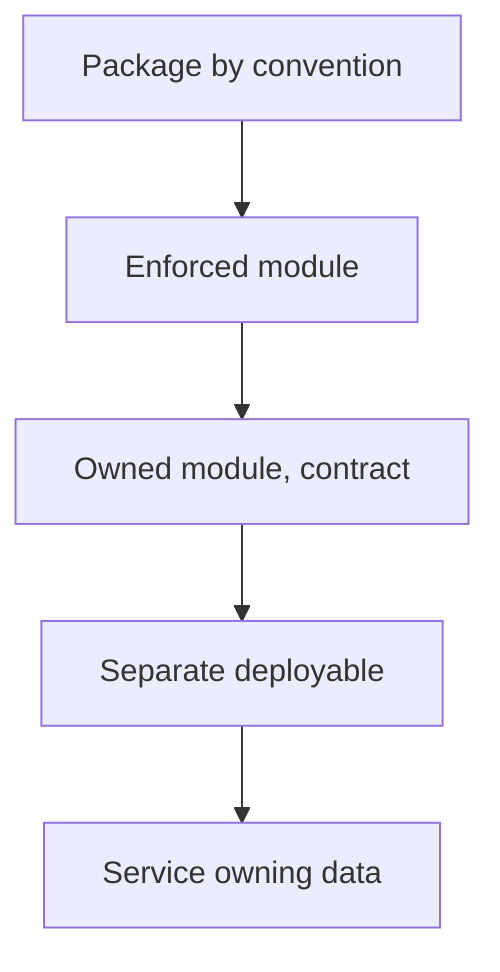
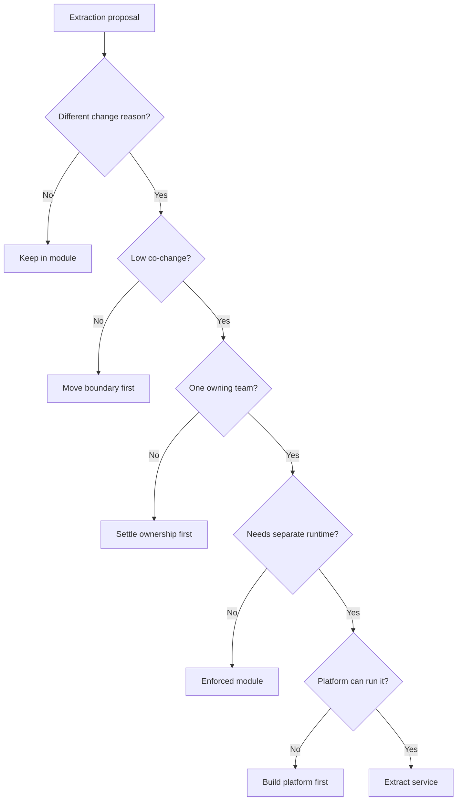
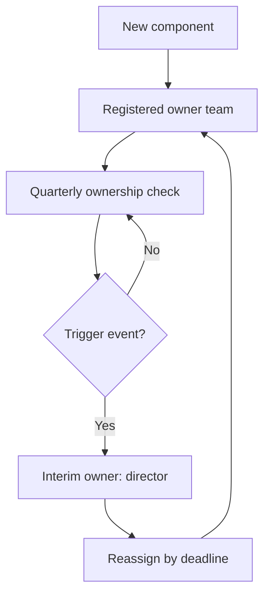

# Chapter 31 — Service Boundaries: Microservices, Modular Monoliths, and Ownership

"Should we move to microservices?" is usually the wrong question. The useful questions are smaller:
where should a boundary go, how strong should it be, and which team answers for what sits behind
it. This chapter treats the microservices and modular-monolith positions fairly, reads boundaries
from change history and team structure, and sets out an ownership model with no orphaned
components. The running example is the fictional
[Northstar Technologies](../../case-studies/northstar/index.md): a Java monolith called
[Core](../../glossary.md#core) with eight modules, fourteen services, and three components still
disputed or orphaned. Chapter 33 covers Conway's law and team types, Chapter 32 platform engineering
and legacy modernization, and Chapter 24 operational readiness.

## Why This Matters

At team scale, a boundary decides what a team can change without asking anyone. A team whose
everyday changes need another team's review, release, or data migration has a planning problem
that no sprint ritual will fix.

At organization scale, boundaries and ownership decide where incidents land and who answers them.
At baseline, 8 of Northstar's 24 components were disputed, shared, or orphaned, and 8 had nobody on
call ([baseline data](../../case-studies/northstar/baseline-data.md)). One orphan, auth-svc, is
[tier 1](../../glossary.md#tier-1): on the order or payment path, with the strictest obligations.
Components lose owners quietly, and the loss shows up later as an incident nobody is paged for.

At executive scale, architecture style becomes a multi-year bet with a narrative attached. Proposals
to "move to microservices" or "go back to the monolith" arrive with confident claims and thin
evidence. The leader's job is to turn them into questions about change, teams, and operational
capability that the organization's own data can answer.

## Learning Objectives

After this chapter you will be able to:

- Present the microservices and modular-monolith positions fairly, name the conditions that favor
  each, and state how strong the evidence is.
- Separate the module, deployment, data, and ownership boundaries bundled in the word "service,"
  and choose the weakest one that solves the problem.
- Draw boundaries from change history (co-change analysis) and team structure, and say what that
  data cannot show.
- Establish an ownership model with exactly one owning team per component and a deadline for
  resolving orphans and disputes.
- Turn an extraction or consolidation proposal into a decision with criteria, costs, and a revisit
  date.

## The Mental Model

> **Mental model:** A boundary earns its cost when the things on either side change for different
> reasons, at different times, by different teams. Choose the weakest boundary that achieves that,
> and give everything behind it one owner.

Two ideas organize the chapter. First, **boundaries are about change, not size**. David Parnas
argued in 1972 that how well a system is divided into modules depends on the criteria used to
divide it ([Parnas, 1972](../../references/bibliography.md#parnas1972criteria)); the criterion his
paper is known for is that each module should hide a design decision likely to change. "Small" is
not a criterion: a small service that changes whenever its neighbor does has the costs of a boundary
and none of the benefits.

Second, **boundaries come in strengths, and each step up costs more**. Much of a service boundary's
value (a stable interface, one owner) is available at lower steps. The last two steps buy independent
deployment, scaling, and fault isolation, paid for in network calls, consistency work, and operations.

| Step | What it adds | What it costs |
|---|---|---|
| Enforced module | Build fails on undeclared cross-module calls | A dependency rule set and its upkeep |
| Owned module with a contract | One owning team, owner review, a tested interface | Review load on the owner; [contract tests](../../glossary.md#contract-test) (automated checks that the interface still gives each consumer what it relies on) |
| Separate deployable | Own release cadence and rollback | Pipeline, versioning, compatibility |
| Service owning its data | Independent scaling, fault isolation | Network failures, no shared transactions, data migration, on-call |

## Deep Conceptual Explanation

### Four decisions hidden in one word

"Make it a service" bundles four decisions: the **module boundary** (which code may call which), the
**deployment boundary** (what ships and rolls back together), the **data boundary** (who may write
which tables), and the **ownership boundary** (which team is paged and reviews changes). Each can be
decided separately. A modular monolith has strong module and ownership boundaries and one
deployment; a "distributed monolith" has many deployments and no real module boundaries, because
services share a database or must be released together. A migration that moves only the
deployment boundary leaves the expensive problems where they were.

### The case for microservices

James Lewis and Martin Fowler's 2014 essay describes the style as an application built from small,
independently deployable services organized around business capabilities, with characteristics
that include decentralized data management, design for failure, and "products not projects": the
team that builds a service keeps running it
([Lewis and Fowler, 2014](../../references/bibliography.md#lewis2014microservices)). That is a
practitioner description, not evidence. Its strongest argument is organizational: a team owning a
capability end to end, data included, can change and release it alone.

Studies of why organizations migrate agree on motives: maintainability and scalability. Finding the
right service cut is the major challenge, and most companies rewrote rather than split existing code
([Fritzsch et al., 2019](../../references/bibliography.md#fritzsch2019migration);
[Taibi et al., 2017](../../references/bibliography.md#taibi2017processes)). In one company, technical
debt spiked when services were built, then grew more slowly than in the monolith
([Lenarduzzi et al., 2020](../../references/bibliography.md#lenarduzzi2020migrating)). Mature teams
named shared infrastructure built early as a main success factor
([Wang et al., 2021](../../references/bibliography.md#wang2021promises)). These are **research
findings** within narrow samples: organizations that chose to migrate, reporting their own results.

### The case for the modular monolith

Fowler's "Monolith First" reports his observation that almost all successful microservice stories
he knew began with a monolith that was later broken up, while systems built as microservices from
scratch often ran into trouble. His reasons: early on, speed of feedback matters most, and good
boundaries are hard to find up front and harder to move across services than within one codebase
([Fowler, 2015](../../references/bibliography.md#fowler2015monolithfirst)). He says the evidence is
sparse, links a dissenting view, and warns that many monoliths are too entangled to split cleanly.
This is **expert opinion**, honestly labeled by its author.

The most cited recent example shows why claims must be read at source. In 2023 a Prime Video engineer
described moving one service, a tool monitoring the quality of live streams, from serverless
components into a single process on containers. The first design hit a hard scaling limit at about 5
percent of the expected load; after the move the team reported infrastructure costs down by over 90
percent. The post concludes that the choice between microservices and a monolith has to be made case
by case ([Kolny, 2023](../../references/bibliography.md#kolny2023primevideo)). This is **documented
practice**, self-reported, about one
service whose components exchanged large volumes of data per second of video. It shows that a
network boundary in a data-heavy inner loop can be expensive, not that a company abandoned
microservices, as it was widely retold.

### What the evidence supports

No controlled comparison of the two styles across organizations was found. The studies above sample
organizations that migrated and report motives, challenges, and self-assessed benefits. Research
on whether system structure mirrors organizational structure, the "mirroring hypothesis," is covered
in Chapter 33. The defensible position (**this book's recommendation**) is that the choice follows
from change patterns, team structure, and operational capability. Where the platform cannot yet
give every service a pipeline, monitoring, and an on-call rotation, an organization of under about
100 engineers is usually better served by a well-modularized monolith with a few services extracted
for clear reasons than by many services.

### Drawing boundaries from change patterns

Version history records which parts of a system change together, and that **logical coupling**
reveals structure that code analysis misses
([Gall et al., 1998](../../references/bibliography.md#gall1998logical);
[Zimmermann et al., 2005](../../references/bibliography.md#zimmermann2005mining)). These **research
findings** show that history carries real coupling signal, not that any given threshold marks a good
boundary.

A practical co-change analysis counts, for each pair of modules, the merged changes that touched
both in a period. This book expresses that as a **coupling share**: co-changes divided by the
changes of the less-changed module. A share of 60 percent means most changes to the smaller module
also needed the other. The analysis has three blind spots. It misses **runtime and data coupling**:
modules that share tables can break each other without ever changing together. It reflects **the
old organization**: changes cluster around whoever held the work. And it is **noisy**: mass renames
and dependency upgrades touch everything and must be excluded.

### Drawing boundaries from team structure

Systems tend to copy the communication structures of the organizations that build them
([Conway's law](../../glossary.md#conways-law-and-the-reverse-conway-maneuver), taught in Chapter 33;
[Conway, 1968](../../references/bibliography.md#conway1968committees)). For boundary work, one
consequence matters: a boundary inside one team is
cheap, because one conversation settles any change; a boundary between teams needs an interface and
a contract. Matthew Skelton and Manuel Pais argue for sizing
software responsibilities to what one team can hold in mind
([Skelton and Pais, 2019](../../references/bibliography.md#skelton2019team)).

Overlaying co-change on ownership gives four cases:

| | One owning team | Different owning teams |
|---|---|---|
| **High co-change** | Fine; keep together | Problem: move the boundary or the ownership |
| **Low co-change** | Fine; could be separate modules | Good boundary; a service only if there are other reasons |

### Drawing boundaries from the business domain

Change history shows the past; the business domain suggests the future. Domain-driven design is a
widely used practitioner approach. It draws a boundary (a **bounded context**) where the meaning of a
business term changes. "Order" in sales means what a customer asked for; in billing it means what
can be invoiced; in fulfillment it means what ships. One model stretched across all three is the
entity service failure described below. A common way to find the seams is a workshop: domain experts
and engineers lay out the business events in order ("order placed", "invoice posted", "payment
received") and mark where vocabulary, owner, or timing changes.

Use the two methods together (**this book's recommendation**). Domain seams propose boundaries;
co-change data tests them. A seam the domain suggests but history crosses every week is not yet a
boundary: the code has not been shaped that way, and moving it is a project. A cluster history shows
but the domain cannot name is often an accident of who held the work.

### Ownership without orphans

An owner is a team, not a person. Owning a component means being paged for it, reviewing other
teams' changes to it, keeping its dependencies current, holding its roadmap and readiness, and
deciding when to retire it. Orphans appear by predictable routes, and Northstar's inventory shows
them: an author leaves (auth-svc), authors move teams (search-svc), or a component is assigned by
default to a team that is never paged for it (webhooks at baseline).

Shared ownership is the commonest orphan in disguise: "shared by four teams" means every team changes
the code and none answers for it. Contribution can be shared; ownership cannot. The workable pattern
is one owner with open contribution: any team may change the module, and the owner reviews, sets its
interface, and carries its pager.

### Splitting a shared database safely

Take tables away from shared access in small reversible steps, and move the physical database last
(**this book's recommendation**, following common practitioner practice). A module boundary is only
as strong as its data boundary. While several modules read and write the same tables, an owner cannot
change its schema without breaking someone it never heard of.

| Step | What happens | Done when |
|---|---|---|
| 1. Inventory | List who reads and writes each table, from grants, query logs, and a code search. Give every table one owning module | Each table has one owner and a list of outside users |
| 2. Freeze | No new outside access: a build check fails on new direct reads, and new grants need the owner | The outside-user list only shrinks |
| 3. Move readers | The owner publishes a read interface (a database view, an export, or an API) it versions; readers move one at a time | No outside query touches the raw tables |
| 4. Move writers | Outside writes go through the owner's code. Transactions that span two modules become one owner-side operation, or two steps reconciled afterward (a saga, with an undo step for each) | Only the owner writes |
| 5. Separate | The tables move to their own schema with their own credentials, and later to a separate database only if the runtime needs it | Old grants revoked on a date |

Step 4 is the hard one. A transaction across two modules guarantees that both changes happen or
neither does. Splitting it means designing for the case where one half succeeds, with a reconciliation
check that finds mismatches. An "outbox" helps: the owner writes the change and a pending message in
one local transaction, and a relay sends the message afterward, so no change is lost between the two
steps. Avoid a long period in which two codebases write the same data ("dual
writes"): keep one writer and copy to the other side, with a cutover date.

A worked sample: a billing module's invoice tables are read by two reporting jobs and written by an
order module during checkout. Steps 1 to 3 (an inventory, a build check, and a versioned invoice view)
take days and remove both readers. Step 4 replaces the order module's insert with a call to a billing
operation; that change needs tests on both sides and a release with a rollback plan. The data never
leaves the shared database, yet the boundary is now real.

## Engineering Organization Example

!!! info "Northstar so far"
    Week 14, the start of quarter 2 of the director's first year. [Sev1 and
    Sev2](../../glossary.md#severity-sev1-sev2-sev3) incidents (the two most serious levels) fell from 30
    to 21 in quarter 1. Core now releases weekly, and in week 4 four unowned components got owners. See
    the [timeline](../../case-studies/northstar/timeline.md). New to Northstar? Read [the year in
    brief](../../case-studies/northstar/year-in-brief.md) and the [cast](../../case-studies/northstar/cast.md).

This example is a co-change analysis of Northstar's Core. Its figures are **illustrative**. In the
baseline quarter about 1,100 merge requests were merged into Core, about 85 a week. Ines Carvalho,
the staff engineer for the Core code standard, counted the requests that changed each module,
excluding 14 mass changes. Requests often touched several modules or only shared code, so the counts
do not sum to the total. One module stands out: core/permissions, a tier 1 Core module changed by four
teams, has had no owner since baseline.

| Module | Owner (after week 4) | Merge requests | From teams other than the owner |
|---|---|---|---|
| core/order-capture | Orders | 250 | 52 (21%) |
| core/pricing-rules | Orders | 110 | 7 (6%) |
| core/catalog | Orders | 80 | 5 (6%) |
| core/invoicing | Billing | 230 | 38 (17%) |
| core/ledger | Billing | 170 | 12 (7%) |
| core/scheduler | Billing | 45 | 19 (42%): Orders 11, Payments 6, Data 2 |
| core/customer | Orders | 33 | 18 (55%): Billing 8, Customer Experience 6, Payments 4 |
| core/permissions | undecided | 38 | Orders 17, Customer Experience 9, Billing 8, Payments 4 |

The headline: **two clusters already match two teams.** Orders' modules change together, and so do
Billing's, which is the cheap case. The co-change pairs that show it, and the exceptions:

| Pair | Co-changes | Coupling share | Same owner? |
|---|---|---|---|
| customer and permissions | 22 | 67% (of 33) | No (permissions has none) |
| scheduler and invoicing | 27 | 60% (of 45) | Yes, Billing |
| order-capture and pricing-rules | 58 | 53% (of 110) | Yes, Orders |
| invoicing and ledger | 70 | 41% (of 170) | Yes, Billing |
| customer and order-capture | 12 | 36% (of 33) | Yes, Orders |
| catalog and pricing-rules | 27 | 34% (of 80) | Yes, Orders |
| order-capture and invoicing | 38 | 17% (of 230) | No |
| ledger and order-capture | 5 | 3% (of 170) | No |

Read against the four cases, the table says four things.

1. **Two clusters already match two teams.** Splitting order-capture from pricing-rules into services
   would turn about 58 single changes a quarter into coordinated pairs.
2. **The week 4 ownership assignments fit the history.** scheduler changes with invoicing 60 percent of
   the time, and went to Billing. customer changes with order-capture more than with any other owned
   module, and went to Orders.
3. **customer and permissions behave like one unit split in two.** The funded permissions extraction
   should cut this coupling by moving permission logic out of customer. Whoever owns permissions will
   review changes from four teams, mostly arriving with customer changes; Platform Operations, one
   candidate owner, made none of the 38.
4. **The Orders and Billing seam is wide in absolute terms.** order-capture and invoicing changed
   together 38 times, about three a week, each needing both teams. The share is low only because
   invoicing changes often. ledger and order-capture changed together only 5 times, yet incidents
   between the two teams travel through data and runtime calls the table cannot show: Core's modules
   share one database schema, and no module owns its tables by rule.

Three cross-team changes a week argue for owner review and a tested contract on the seam
([Chapter 22](../05-engineering-quality/22-testing-strategy-and-test-architecture.md)), not for a
network boundary that would turn each into coordinated releases.

## Decision Framework

Conditions that favor each style (**this book's recommendation**, drawn from the sources above):

| Condition | Favors a service | Favors a module in the monolith |
|---|---|---|
| Change pattern | Changes for different reasons and at a different rate from its neighbors | High co-change with neighbors |
| Ownership | One team owns it and almost all its changes | Several teams change it, or ownership is unsettled |
| Runtime needs | Different scaling, availability, or security isolation | Same profile as the rest |
| Data | Can own its tables; few cross-boundary transactions | Shares tables or needs transactions across the boundary |
| Interaction volume | Coarse, infrequent calls | Chatty, data-heavy calls in a tight loop |
| Platform | Every service gets a pipeline, monitoring, on-call, and readiness checks | Each new deployable adds manual operations |
| Release constraint | The monolith's release cadence blocks this team | The monolith releases often and safely |

A decision path for any single extraction proposal:

The path also works in reverse: services that always change together, share one owner, and
exchange data in a tight loop are candidates to merge, close to what the Prime Video team did with
one service's components. Many proposals stop at "move boundary first" or "settle ownership first,"
both work inside the monolith.

## Trade-offs

**Independent deployment against coordination cost.** A service lets one team release alone, and
every change crossing its interface now needs versioning and backward compatibility. Worth it when
crossings are rare; ruinous when they are weekly.

**Fault isolation against new failure modes.** A crashed service need not take the monolith down;
in exchange come timeouts, retries, partial failures, and eventual consistency (data on two sides
agrees only after a delay), each needing design and monitoring.

**Team autonomy against shared infrastructure.** Services free teams to choose tools; Wang and
colleagues' mature teams credited shared infrastructure built early. Northstar's four build systems
are autonomy without a platform (Chapter 32).

**Strict ownership against flexibility.** One owner makes accountability clear and can create
queues; open contribution with owner review keeps both, at the cost of the owner's review load.

**Transition cost.** Every extraction has a period in which old and new paths run together, data is
synchronized, and two teams' attention is split. At Northstar,
[constraint 3](../../glossary.md#the-five-constraints) (no funded rewrite of Core) rules out the
rewrites most of Fritzsch and colleagues' respondents chose.

## Failure Modes

**The distributed monolith.** Services that share a database or must be released in a fixed order.
Signal: release notes listing services that "must go together." Countermeasure: data ownership
first, then consumer contracts.

**Extraction by fashion.** A service extracted because "we are moving to microservices." Signal: the
proposal has no co-change data and no named owner. Countermeasure: the decision path, before funding.

**The orphan factory.** Services created by projects and left behind when the project ends. Signal:
components whose last change author is no longer in the owning team; nominal owners never paged.
Countermeasure: registration at creation and a quarterly ownership check.

**Ownership on paper.** A component listed under a team that never changes it, never reviews
changes, and is not on its rotation. Signal: the nominal owner made under 10 percent of last
quarter's changes and holds no runbook. Countermeasure: the ownership test in the Playbook.

**The entity service.** Boundaries drawn around data nouns ("customer service," "order service")
rather than capabilities, so every business change touches several services. Signal: high co-change
across services. Countermeasure: redraw around the change pattern.

**Co-change worship.** Treating last year's history as the design. Signal: nobody asks what will
change next year. Countermeasure: use history as evidence, then ask Parnas's question about which
design decisions are likely to change.

## Enterprise Application

In an organization of 50 to 150 engineers, the director typically owns three things here.

**The component registry.** One list of every deployable and major module, with owning team, tier,
on-call rotation, and readiness. Northstar's `components.csv` is such a list; its value was showing
the gaps. It is updated when a component is created, when a team changes, and quarterly.

**The ownership rules.** Every component has exactly one owning team. A component without one is
held by the director's office as an interim owner, which must name an incident lead and a reassignment
date. Disputes are decided by the director within a fixed period, with the decision recorded
(Chapter 13 covers decision records).

**The boundary decision process.** Extractions and consolidations go through the decision path,
with co-change data, a named owner, and a readiness plan
([Chapter 24](../05-engineering-quality/24-reliability-slos-and-operational-readiness.md)). Staff
engineers own the analysis; managers own the staffing; the director decides.

Watch deployables per team: at Northstar the median team runs two or three, plus its Core modules.
Each new service is a permanent claim on one team's operational attention.

Trigger events are an author leaving, a team change or reorganization, a failed ownership test,
or a dispute. The loop's weak point is the interim step; without a deadline, "interim" becomes the
permanent state, as core/permissions shows.

## CTO Perspective

At executive level, architecture style becomes a story told to the board and to acquirers; the
CTO's job is to keep it honest.

**Refuse the binary.** "Microservices" and "monolith" are not strategies. A strategy says which
capabilities need independent change or scaling and what the platform must provide before more
services are added. A CTO who can answer "why is this a service?" for each service, and "why is this
not?" for the largest modules, has a defensible architecture.

**Price boundaries in operations.** Every service adds a pipeline, alerts, an on-call surface, and
dependency upkeep. At Northstar's $185,000 fully loaded cost per engineer, a service needing a tenth
of an engineer to run costs about $18,500 a year before cloud costs. The tenth is an assumption to
replace with your own; the point is that the cost recurs.

**Read evidence at source.** Board members will have seen the Prime Video headline. Saying what the
post actually reports, and whether it applies, is worth more than either slogan.

**Tie ownership to accountability.** A CTO should be able to say at any time how many components
lack a clear owner, and why; that is where incidents go unanswered.

## Practical Playbook

1. Build the component registry: every deployable and major module, with owning team, tier,
   on-call rotation, runbook, and the teams that changed it last quarter.
2. Apply the ownership test: does the owner carry the pager, review changes, hold the runbook, and
   keep dependencies current? Record every failure.
3. Give every unowned component an interim owner (the director's office) with an incident lead and
   a reassignment date within one quarter.
4. Decide disputes by a deadline, record the decision, and answer the losing team's concerns in
   writing.
5. Run a module-level co-change analysis over one or two quarters, excluding mass changes by a
   written rule.
6. Overlay it on ownership; act first on high co-change across owners.
7. Strengthen boundaries one step at a time: enforced module dependencies, owner review, then
   contract tests on cross-team seams.
8. Send every extraction or consolidation proposal through the decision path with co-change data,
   a named owner, a readiness plan, and a transition cost.
9. Re-run the co-change analysis after any boundary change to confirm the coupling fell.
10. Report quarterly: unowned components, overdue disputes, and deployables per team.

## Case Study

This case is **fictional** and sets a decision at the start of quarter 2 (week 14). Its outcome is
open.

**Ownership at the start of quarter 2.** The baseline listed eight components as disputed, shared, or
orphaned. In week 4 core/customer went to Orders, core/scheduler to Billing, auth-svc to Platform
Operations, and webhooks to Payments and Integrations. notification-svc moves to Orders, and to tier
2, from quarter 2. Three remain:

| Component | Tier | State | What is recorded |
|---|---|---|---|
| core/permissions | 1 | Owner undecided | Covered by an exemption (a recorded, time-limited waiver) with an interim incident lead |
| search-svc | 2 | Disputed | Nominal owner Orders; its authors now sit in Data and Analytics |
| document-store | 2 | Orphaned | One open critical vulnerability; callers in Billing and Orders |

Priya Raman (Orders manager) would accept core/permissions after week 26. The team of Tom Becker
(Platform Operations manager) cannot support Core's Java. document-store, deployed by the shared shell script, has two callers:
invoice-render (Billing), which stores rendered invoices, and core/order-capture (Orders), for order
attachments.

**Ines Carvalho's draft boundary proposal.** At the start of quarter 2 Ines Carvalho drafted, from the
co-change analysis above, a proposal for which Core modules to keep and which to consider extracting.
Constraint 3 (no funded Core rewrite) and the two renewal dates (weeks 19 and 26) bound it.

| Module | Draft proposal | Reason given |
|---|---|---|
| order-capture, pricing-rules, catalog | Keep in Core, Orders | 53 and 34 percent coupling within the cluster; one owner |
| invoicing, ledger, scheduler | Keep in Core, Billing | 41 and 60 percent coupling within the cluster; one owner |
| customer and permissions | Keep in Core; carry out the funded permissions extraction inside Core; re-measure coupling at the end of quarter 2 | 67 percent coupling; ownership of permissions open |
| order-capture and invoicing seam | Owner review and a contract test on the seam | 38 cross-team co-changes a quarter |
| All eight | Enforce module dependencies in the Core build (new undeclared cross-module calls fail the build) | Turns convention into a checked boundary |
| catalog | Named as the only plausible future extraction; no case today | One owner, tier 2, low cross-team change; no different runtime need recorded |

The proposal extracts nothing in quarter 2. Ines makes three points. Core now releases weekly, which
removed the strongest reason teams gave for wanting out. Most coupling sits inside single-owner
clusters. And the problems the data shows are ownership and module problems that a service would carry
with it. Rafael Duarte, a senior engineer in Orders, argues for extracting order-capture: Orders makes
about 25 of Core's roughly 85 weekly merges and still waits for the shared weekly
[release train](../../glossary.md#release-train). Marcus Oyelaran
(Billing manager) wants no Core boundary work before the accounting integration ships in week 19.

The director must decide in quarter 2 whether to adopt, modify, or reject the proposal, what would
trigger a revisit, and how the three ownership gaps close. The exercises take this up; the outcome
is not fixed.

## Exercises

Solutions are in [chapter 31 solutions](../../solutions/ch31-solutions.md). Data files are linked from
the [Northstar baseline page](../../case-studies/northstar/baseline-data.md).

### Foundational

**F1.** Using the chapter's co-change table, recompute the coupling for customer and permissions,
order-capture and invoicing, and ledger and order-capture with a different definition: co-changes
divided by the average of the two modules' change counts. Compare the rankings under both
definitions, explain which definition suits which question, and say what neither shows about the
Orders and Billing incidents.

**F2.** A colleague's slide reads: "Even Amazon is abandoning microservices: Prime Video cut costs 90
percent by going back to a monolith." Rewrite it in two or three accurate sentences using only what
the original post reports. State what the case is and is not evidence for, and whether it bears on
Northstar's Core.

**F3.** Apply the chapter's ownership test (pager, review, runbook, dependencies) to six Northstar
components using `components.csv` and the ownership changes after week 4 listed in the case study: core/customer, core/scheduler,
notification-svc, export-svc, search-svc, and document-store. For each, say which parts of the test
it fails on the data available and what information you would need to complete the assessment.

**F4.** In a monolith, a customer module owns the customer tables. Three other modules read them
directly, one of them inside the nightly invoice run, and a fourth module writes a "last order date"
column during checkout, in the same transaction as the order. Plan the split with the chapter's five
steps: what you do first, which step is riskiest and why, what check tells you each step is done, and
what you would not do yet.

### Applied Leadership

**A1.** Tom Becker (Platform Operations manager) proposes extracting core/permissions from Core into a new service beside auth-svc,
owned by Platform Operations, arguing that a separate service would let his infrastructure engineers
own it without learning Core's Java code. Using the co-change data, the decision path, and the record
of who changes the module, evaluate the proposal. Say what you would ask Tom to bring back, and
how your answer affects the still-open ownership decision without making it.

**A2.** document-store has no owner. Marcus Oyelaran refuses it because Billing is carrying the
accounting integration due in week 19 and its on-call load is the organization's heaviest; Priya
Raman points out that most traffic comes from invoice-render. Lay out at least three options
(assign, merge into a caller, retire, or another), choose one, and write the message to both managers
that explains the choice and its transition cost.

**A3.** Rafael Duarte proposes extracting core/order-capture as a service in quarter 3 so Orders can
release without the Core train. Core now releases weekly and its
[change failure rate](../../glossary.md#change-failure-rate) fell from 31 to 22 percent in the first
quarter. Evaluate the proposal against the decision framework, estimate the
coordination cost on the order-capture and invoicing seam, and decide what you tell Rafael, including
what evidence would change your answer.

### Executive Decision-Making

**X1.** A board member who read about the Prime Video case asks Victor Lindqvist whether Northstar
should fold its fourteen services into Core to save money; another, a former CTO, asks why Northstar
has not "finished moving to microservices." Prepare Victor's one-page answer: Northstar's position
on boundaries, the evidence behind it, what it costs, and what would change it.

**X2.** Decide on Ines Carvalho's draft boundary proposal at the start of quarter 2: adopt, modify,
or reject it. Address Rafael Duarte's and Marcus Oyelaran's objections, the renewal dates, constraint
3, the measures and thresholds that would trigger a revisit, and the deadline by which search-svc and
document-store must have owners. State what you will report to Victor Lindqvist at the end of the
quarter.

## Reflection Questions

1. Which of your services would you not extract if deciding today, and what would folding one back
   cost?
2. Which component is owned on paper by a team that has not changed it in a year? Who would be paged
   if it failed tonight?
3. When did your organization last measure which modules change together, rather than assume it?
4. Is your strongest reason for a service a technical need, or a wish to avoid another team's
   release process? Would fixing the release process remove the reason?
5. Which architectural headline have you repeated without reading the source?

## Key Takeaways

- Draw boundaries around what changes for different reasons and at different rates, not around
  size or data nouns.
- Separate module, deployment, data, and ownership boundaries; choose the weakest boundary that
  solves the problem.
- The evidence on microservices against modular monoliths is qualitative and drawn from
  organizations that migrated; let your own change history, teams, and platform decide.
- Co-change analysis shows what changes together; it does not show runtime or data coupling, and it
  reflects the old organization.
- High co-change across owners is the case to fix first, usually by moving ownership or a module
  boundary, not by adding a network call.
- Every component has exactly one owning team that carries its pager; contribution can be shared,
  ownership cannot.
- Unowned components go to an interim owner with a deadline; an interim with no deadline becomes
  permanent.
- Price each service in recurring operations, not only in build cost.

## References and Further Reading

- [Lewis and Fowler, 2014](../../references/bibliography.md#lewis2014microservices). The essay that
  named the microservice style.
- [Fowler, 2015](../../references/bibliography.md#fowler2015monolithfirst). Monolith first, with its
  author's caveats.
- [Kolny, 2023](../../references/bibliography.md#kolny2023primevideo). The Prime Video post; read it
  before citing the headline.
- [Parnas, 1972](../../references/bibliography.md#parnas1972criteria). Choosing decomposition criteria.
- [Gall et al., 1998](../../references/bibliography.md#gall1998logical) and
  [Zimmermann et al., 2005](../../references/bibliography.md#zimmermann2005mining). The research basis
  for co-change analysis.
- [Fritzsch et al., 2019](../../references/bibliography.md#fritzsch2019migration),
  [Taibi et al., 2017](../../references/bibliography.md#taibi2017processes),
  [Wang et al., 2021](../../references/bibliography.md#wang2021promises), and
  [Lenarduzzi et al., 2020](../../references/bibliography.md#lenarduzzi2020migrating). Why
  organizations migrate and what they report afterwards.
- [Conway, 1968](../../references/bibliography.md#conway1968committees) and
  [Skelton and Pais, 2019](../../references/bibliography.md#skelton2019team). Organization and
  architecture; developed in Chapter 33.
