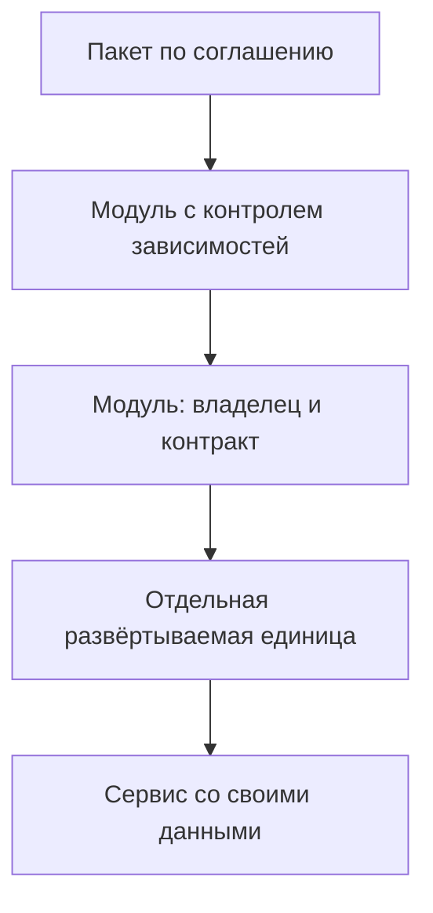
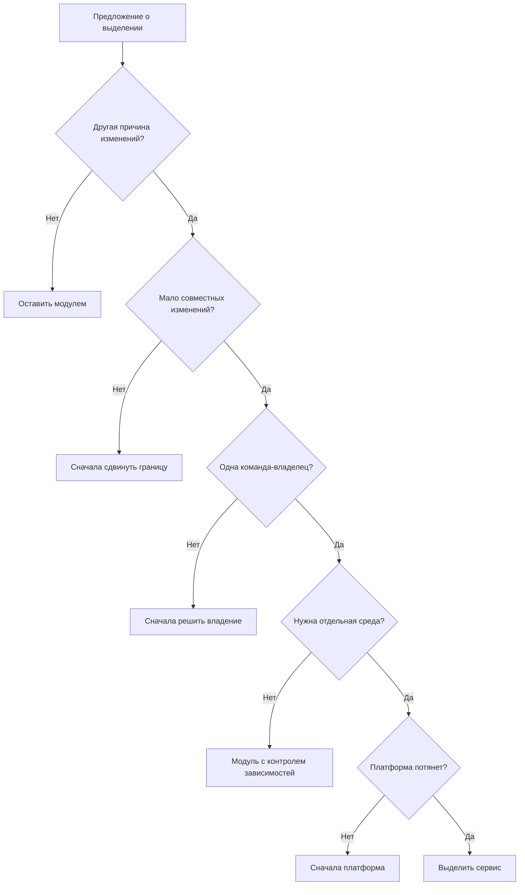
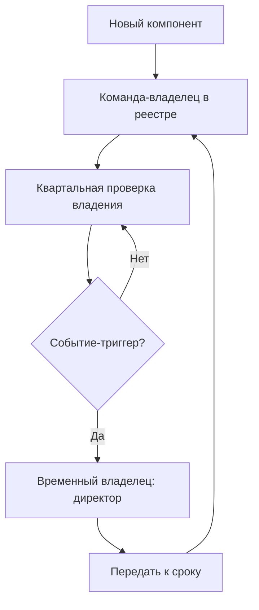

# Глава 31 — Границы сервисов: микросервисы, модульные монолиты и владение { #chapter-31-service-boundaries-microservices-modular-monoliths-and-ownership }

«Не перейти ли нам на микросервисы?» — как правило, вопрос поставлен неверно. Полезные вопросы мельче: где
провести границу, насколько прочной её сделать и какая команда отвечает за то, что за ней находится. Глава
честно излагает позиции сторонников микросервисов и модульного монолита, показывает, как находить
границы по истории изменений и структуре команд, и предлагает модель владения, при которой бесхозных
компонентов не остаётся. Сквозной пример — вымышленная компания
[Northstar Technologies](../../case-studies/northstar/index.md): Java-монолит
[Core](../../glossary.md#core) из восьми модулей, четырнадцать сервисов и три компонента со спорным владением
или вовсе без владельца. Закон Конвея и типы команд
разбирает глава 33, платформенную инженерию и модернизацию legacy — глава 32, операционную готовность —
глава 24.

## Почему это важно { #why-this-matters }

Для команды граница определяет, что она может менять, ни у кого не спрашивая. Если повседневные
изменения команды требуют чужого ревью, чужого релиза или чужой миграции данных, у неё проблема с
планированием, и никакие спринтерские ритуалы её не решат.

Для организации границы и владение определяют, куда попадают инциденты и кто на них отвечает. В
исходном состоянии 8 из 24 компонентов Northstar были спорными, общими или бесхозными, и по 8 никто не
дежурил ([исходные данные](../../case-studies/northstar/baseline-data.md)). Один из бесхозных, auth-svc,
относится к [tier 1](../../glossary.md#tier-1): он стоит на пути заказа или оплаты, и требования к нему
самые строгие. Компоненты теряют владельцев незаметно, а потеря проявляется позже — инцидентом, по
которому некого вызвать.

Для высшего руководства архитектурный стиль — многолетняя ставка, к которой всегда прилагается готовая
история.
Предложения «перейти на микросервисы» или «вернуться к монолиту» приходят с уверенными заявлениями и
скудными доказательствами. Задача руководителя — превратить их в вопросы об изменениях, командах и
операционных возможностях, то есть в такие, на которые отвечают данные самой организации.

## Цели главы { #learning-objectives }

Прочитав эту главу, вы сможете:

- Честно изложить позиции сторонников микросервисов и модульного монолита, назвать условия в пользу
  каждой и сказать, насколько сильны доказательства.
- Различать четыре границы, слитые в слове «сервис» (модуля, развёртывания, данных и владения), и
  выбирать самую слабую из них, которая решает задачу.
- Проводить границы по истории изменений (анализ совместных изменений) и структуре команд и понимать,
  чего эти данные показать не могут.
- Выстроить модель владения, в которой у каждого компонента ровно одна команда-владелец, а для
  бесхозных и спорных компонентов назначен срок решения.
- Превращать предложение о выделении или объединении сервисов в решение с критериями, затратами и датой
  пересмотра.

## Ментальная модель { #the-mental-model }

> **Ментальная модель:** граница окупается, когда то, что лежит по разные её стороны, меняется по разным
> причинам, в разное время и разными командами. Выберите самую слабую границу, которая этого достигает,
> и дайте всему, что за ней, одного владельца.

Главу организуют две идеи. Первая: **границы определяются изменениями, а не размером**. David Parnas в
1972 году утверждал, что качество разбиения системы на модули зависит от критериев, по которым её
разбивают ([Parnas, 1972](../../references/bibliography.md#parnas1972criteria)). Статья известна
предложенным в ней критерием: каждый модуль должен скрывать проектное решение, которое, скорее всего, изменится.
«Маленький» — не критерий. Маленький сервис, который меняется всякий раз, когда меняется сосед, несёт
все издержки границы и не даёт ни одного её преимущества.

Вторая: **границы бывают разной прочности, и каждая следующая ступень дороже**. Большую часть ценности
границы сервиса (стабильный интерфейс, один владелец) можно получить на нижних ступенях. Две верхние
ступени дают независимое развёртывание, масштабирование и изоляцию отказов, но платить за это
приходится сетевыми вызовами, работой над согласованностью данных и эксплуатацией.

| Ступень | Что добавляет | Чего стоит |
|---|---|---|
| Модуль с контролем зависимостей | Сборка падает на необъявленных вызовах между модулями | Набор правил зависимостей и его поддержка |
| Модуль с владельцем и контрактом | Одна команда-владелец, ревью владельца, протестированный интерфейс | Нагрузка ревью на владельца; [контрактные тесты](../../glossary.md#contract-test) (автоматические проверки того, что интерфейс по-прежнему даёт каждому потребителю то, на что тот рассчитывает) |
| Отдельная развёртываемая единица | Собственный ритм релизов и откат | Пайплайн, версионирование, совместимость |
| Сервис, владеющий своими данными | Независимое масштабирование, изоляция отказов | Сетевые сбои, нет общих транзакций, миграция данных, дежурства |

## Подробный разбор { #deep-conceptual-explanation }

### Четыре решения в одном слове { #four-decisions-hidden-in-one-word }

«Сделать сервисом» — это сразу четыре решения: **граница модуля** (какой код может вызывать какой),
**граница развёртывания** (что выпускается и откатывается вместе), **граница данных** (кто может писать
в какие таблицы) и **граница владения** (какую команду вызывают при сбое и кто проверяет изменения).
Каждое из них можно принять отдельно. У модульного монолита сильные границы модулей и владения и одно
развёртывание. У «распределённого монолита» развёртываний много, а настоящих границ модулей нет: сервисы
делят одну базу данных или их приходится выпускать вместе. Если миграция
сдвигает только границу развёртывания, дорогие проблемы остаются на прежнем месте.

### Аргументы в пользу микросервисов { #the-case-for-microservices }

James Lewis и Martin Fowler в эссе 2014 года описывают этот стиль как приложение из небольших,
независимо развёртываемых сервисов, организованных вокруг бизнес-возможностей. Среди черт стиля —
децентрализованное управление данными, проектирование с расчётом на отказы и принцип «продукты, а не
проекты»: команда, которая построила сервис, продолжает его эксплуатировать
([Lewis and Fowler, 2014](../../references/bibliography.md#lewis2014microservices)). Это описание
практиков, а не доказательство. Самый сильный довод эссе — организационный: команда, которая владеет
возможностью целиком, вместе с данными, может менять и выпускать её в одиночку.

Исследования того, зачем организации переходят на микросервисы, называют одни и те же мотивы:
сопровождаемость и масштабируемость. Главная трудность — правильно нарезать систему на сервисы, и
большинство компаний предпочитали переписать код, а не разделить существующий
([Fritzsch et al., 2019](../../references/bibliography.md#fritzsch2019migration);
[Taibi et al., 2017](../../references/bibliography.md#taibi2017processes)). В одной компании технический
долг резко вырос, пока строили сервисы, а затем рос медленнее, чем в монолите
([Lenarduzzi et al., 2020](../../references/bibliography.md#lenarduzzi2020migrating)). Среди главных факторов успеха зрелые команды
называли общую инфраструктуру, построенную заранее
([Wang et al., 2021](../../references/bibliography.md#wang2021promises)). Это **научные результаты** на
узких выборках: организации, которые сами решили мигрировать, сообщают о собственных итогах.

### Аргументы в пользу модульного монолита { #the-case-for-the-modular-monolith }

В эссе «Monolith First» Fowler делится наблюдением: почти все известные ему успешные истории
микросервисов начинались с монолита, который потом разбили, а системы, с нуля построенные как
микросервисы, часто попадали в беду. Его доводы: на раннем этапе важнее всего скорость обратной связи, а
хорошие границы трудно найти заранее, и переносить их между сервисами труднее, чем внутри одной кодовой
базы ([Fowler, 2015](../../references/bibliography.md#fowler2015monolithfirst)). Он признаёт, что
доказательств мало, ссылается на противоположное мнение и предупреждает, что многие монолиты слишком
запутаны, чтобы их можно было чисто разделить. Это **мнение эксперта**, и автор сам честно его так
называет.

Самый цитируемый свежий пример показывает, почему заявления нужно читать в первоисточнике. В 2023 году
инженер Prime Video описал, как один сервис — инструмент, который следит за качеством прямых
трансляций, — перевели с бессерверных компонентов на единый процесс в контейнерах. Первоначальный дизайн
упирался в жёсткий предел масштабирования примерно на 5% ожидаемой нагрузки; после перехода команда
сообщила, что затраты на инфраструктуру снизились более чем на 90%. Вывод поста: выбирать между
микросервисами и монолитом нужно в каждом случае отдельно
([Kolny, 2023](../../references/bibliography.md#kolny2023primevideo)). Это **задокументированная
практика** со слов самой команды, и касается она одного сервиса, компоненты которого обменивались
большими объёмами данных на каждую секунду видео. Пример показывает, что сетевая граница во внутреннем
цикле с интенсивным обменом данными может обходиться дорого. Он не показывает, что компания отказалась
от микросервисов, хотя именно так его повсюду пересказывали.

### Что подтверждают доказательства { #what-the-evidence-supports }

Контролируемого сравнения двух стилей на множестве организаций найти не удалось. Исследования выше
изучают организации, которые уже мигрировали, и описывают мотивы, трудности и выгоды со слов самих
участников. Исследования того, повторяет ли структура системы структуру организации («гипотеза
зеркалирования», mirroring hypothesis), разобраны в главе 33. Защитимая позиция (**рекомендация
книги**): выбор следует из характера изменений, структуры команд и операционных возможностей. Пока
платформа не может дать каждому сервису пайплайн, мониторинг и график дежурств, организации меньше чем
примерно на 100 инженеров обычно лучше подходит не множество сервисов, а хорошо разбитый на модули
монолит с несколькими сервисами, выделенными по ясным причинам.

### Границы по характеру изменений { #drawing-boundaries-from-change-patterns }

История версий фиксирует, какие части системы меняются вместе, и эта **логическая связанность**
(logical coupling) выявляет структуру, которую упускает анализ кода
([Gall et al., 1998](../../references/bibliography.md#gall1998logical);
[Zimmermann et al., 2005](../../references/bibliography.md#zimmermann2005mining)). Эти **научные
результаты** показывают, что в истории есть реальный сигнал о связанности, но не доказывают, что какой-то порог указывает на
хорошую границу.

На практике анализ совместных изменений сводится к подсчёту: для каждой пары модулей берут влитые за
период изменения, которые затронули оба модуля. Книга выражает результат через **долю связанности** (coupling share): число
совместных изменений, делённое на число изменений того модуля, который менялся реже. Доля 60% означает,
что большинство изменений меньшего модуля потребовали правок и в другом. У анализа три слепых пятна.
Он не видит **связанности во время выполнения и через данные**: модули, которые делят таблицы, могут
ломать друг друга, ни разу не изменившись вместе. Он отражает **прежнюю организацию**: изменения
группируются вокруг тех, кто вёл работу. И он **зашумлён**: массовые переименования и обновления
зависимостей затрагивают всё подряд, и их нужно исключать.

### Границы по структуре команд { #drawing-boundaries-from-team-structure }

Системы склонны копировать коммуникационные структуры организаций, которые их строят
([закон Конвея](../../glossary.md#conways-law-and-the-reverse-conway-maneuver), подробно в главе 33;
[Conway, 1968](../../references/bibliography.md#conway1968committees)). Для работы с границами важно
одно следствие. Граница внутри одной команды дешёва: любое изменение согласуют в одном
разговоре. Граница между командами требует интерфейса и контракта. Matthew Skelton и Manuel Pais
предлагают нарезать зоны ответственности в ПО по размеру того, что одна команда способна удержать в
голове ([Skelton and Pais, 2019](../../references/bibliography.md#skelton2019team)).

Если наложить совместные изменения на владение, получатся четыре случая:

| | Одна команда-владелец | Разные команды-владельцы |
|---|---|---|
| **Много совместных изменений** | Нормально; держать вместе | Проблема: сдвинуть границу или владение |
| **Мало совместных изменений** | Нормально; можно разнести по модулям | Хорошая граница; сервис — только если есть другие причины |

### Границы по предметной области { #drawing-boundaries-from-the-business-domain }

История изменений показывает прошлое, а предметная область подсказывает будущее.
Предметно-ориентированное проектирование (domain-driven design) — широко распространённый подход
практиков. Он проводит границу (**ограниченный контекст**, bounded context) там, где меняется смысл
бизнес-термина. «Заказ» в продажах — то, что попросил клиент; в биллинге — то, что можно выставить в
счёте; в исполнении заказов — то, что отгружают. Одна модель, растянутая на все три области, — это провал
«сервиса-сущности», описанный ниже. Распространённый способ найти швы — воркшоп: эксперты предметной
области и инженеры выкладывают бизнес-события по порядку («заказ оформлен», «счёт проведён», «платёж
получен») и отмечают, где меняются словарь, владелец или время.

Используйте оба метода вместе (**рекомендация книги**). Швы предметной области предлагают границы, а
данные о совместных изменениях их проверяют. Если предметная область подсказывает шов, а история пересекает его каждую неделю, это ещё не граница:
код так не устроен, и перестроить его под этот шов — отдельный проект. А кластер, который виден в истории, но
не имеет имени в предметной области, часто лишь случайный след того, кто вёл работу.

### Владение без бесхозных компонентов { #ownership-without-orphans }

Владелец — команда, а не человек. Владеть компонентом значит получать вызовы по его сбоям, проверять
изменения, которые вносят в него другие команды, поддерживать его зависимости в актуальном состоянии,
вести его дорожную карту и готовность и решать, когда вывести его из эксплуатации. Компоненты остаются без хозяина предсказуемыми путями, и
инвентаризация Northstar их показывает: автор уходит (auth-svc),
авторы переходят в другие команды (search-svc) или компонент по умолчанию закрепляют за командой,
которую по нему никогда не вызывают (webhooks в исходном состоянии).

Общее владение — самая частая замаскированная бесхозность: «общий для четырёх команд» означает, что все
четыре меняют код и ни одна за него не отвечает. Вклад может быть общим, владение — нет. Рабочая схема —
один владелец при открытом участии: любая команда может менять модуль, а владелец проверяет изменения,
определяет интерфейс и носит пейджер.

### Как безопасно разделить общую базу данных { #splitting-a-shared-database-safely }

Выводите таблицы из общего доступа небольшими обратимыми шагами, а физическую базу данных переносите
последней (**рекомендация книги**, вслед за распространённой практикой). Граница модуля прочна ровно
настолько, насколько прочна граница его данных. Пока несколько модулей читают и пишут одни и те же
таблицы, владелец не может изменить схему, не сломав кого-то, о ком даже не слышал.

| Шаг | Что происходит | Готово, когда |
|---|---|---|
| 1. Инвентаризация | Составьте список тех, кто читает и пишет каждую таблицу, по выданным правам доступа, журналам запросов и поиску по коду. Закрепите каждую таблицу за одним модулем-владельцем | У каждой таблицы один владелец и список внешних пользователей |
| 2. Заморозка | Никакого нового внешнего доступа: проверка в сборке падает на новых прямых чтениях, а новые права выдаются только через владельца | Список внешних пользователей только сокращается |
| 3. Перевод читателей | Владелец публикует интерфейс чтения (представление в базе данных, экспорт или API) и версионирует его; читателей переводят по одному | Ни один внешний запрос не обращается к исходным таблицам |
| 4. Перевод писателей | Внешние записи идут через код владельца. Транзакции, охватывающие два модуля, становятся одной операцией на стороне владельца или двумя шагами со сверкой после них (сага, с шагом отмены для каждого) | Пишет только владелец |
| 5. Разделение | Таблицы переезжают в собственную схему со своими учётными данными, а позже в отдельную базу данных — только если этого требует среда выполнения | Старые права отозваны в назначенную дату |

Шаг 4 — самый трудный. Транзакция, охватывающая два модуля, гарантирует, что произойдут либо оба
изменения, либо ни одного. Разделить её — значит проектировать на случай, когда одна половина прошла
успешно, а другая нет, и завести проверку сверки, которая находит расхождения. Здесь помогает «outbox»
(исходящая очередь): владелец записывает изменение и ожидающее отправки сообщение в одной локальной
транзакции, а ретранслятор отправляет сообщение позже, так что между двумя шагами ни одно изменение не
теряется. Избегайте долгого периода, когда в одни и те же данные пишут две кодовые базы («двойная
запись», dual writes): оставьте одного писателя, копируйте данные на другую сторону и назначьте дату
переключения.

Учебный пример. Таблицы счетов модуля биллинга читают два задания отчётности, а модуль заказов пишет в
них при оформлении заказа. Шаги 1–3 (инвентаризация, проверка в сборке и версионированное представление
счетов) занимают дни и убирают обоих читателей. Шаг 4 заменяет вставку из модуля заказов вызовом
операции биллинга; для этого нужны тесты с обеих сторон и релиз с планом отката. Данные так и не
покидают общую базу, но граница теперь настоящая.

## Пример из инженерной организации { #engineering-organization-example }

!!! info "Northstar: что уже известно"
    Неделя 14, начало квартала 2 первого года директора. В квартале 1 число инцидентов [Sev1 и
    Sev2](../../glossary.md#severity-sev1-sev2-sev3) (два самых серьёзных уровня) упало с 30 до 21. Core теперь выпускается еженедельно, а на неделе 4 у четырёх бесхозных компонентов появились
    владельцы. См. [хронологию](../../case-studies/northstar/timeline.md). Впервые читаете о Northstar?
    Прочитайте [«Год вкратце»](../../case-studies/northstar/year-in-brief.md) и [действующих
    лиц](../../case-studies/northstar/cast.md).

Этот пример — анализ совместных изменений в Core компании Northstar. Его цифры — **иллюстрация**. В
базовом квартале в Core влили около 1 100 мерж-реквестов, примерно 85 в неделю. Ines Carvalho, staff-инженер,
отвечающая за стандарт кода Core, посчитала, сколько запросов меняли каждый модуль; 14 массовых
изменений она исключила. Запросы часто затрагивали несколько модулей или только общий код,
поэтому сумма по модулям не равна общему числу. Выделяется один модуль: core/permissions. Это модуль
Core уровня tier 1, его меняют четыре команды, и с базового квартала у него нет владельца.

| Модуль | Владелец (после недели 4) | Мерж-реквесты | От команд, кроме владельца |
|---|---|---|---|
| core/order-capture | Orders | 250 | 52 (21%) |
| core/pricing-rules | Orders | 110 | 7 (6%) |
| core/catalog | Orders | 80 | 5 (6%) |
| core/invoicing | Billing | 230 | 38 (17%) |
| core/ledger | Billing | 170 | 12 (7%) |
| core/scheduler | Billing | 45 | 19 (42%): Orders 11, Payments 6, Data 2 |
| core/customer | Orders | 33 | 18 (55%): Billing 8, Customer Experience 6, Payments 4 |
| core/permissions | не определён | 38 | Orders 17, Customer Experience 9, Billing 8, Payments 4 |

Главное: **два кластера уже совпадают с двумя командами.** Модули Orders меняются вместе, модули Billing
тоже, и это дешёвый случай. Ниже — пары совместных изменений, которые это
показывают, и исключения из правила:

| Пара | Совместные изменения | Доля связанности | Один владелец? |
|---|---|---|---|
| customer и permissions | 22 | 67% (из 33) | Нет (у permissions владельца нет) |
| scheduler и invoicing | 27 | 60% (из 45) | Да, Billing |
| order-capture и pricing-rules | 58 | 53% (из 110) | Да, Orders |
| invoicing и ledger | 70 | 41% (из 170) | Да, Billing |
| customer и order-capture | 12 | 36% (из 33) | Да, Orders |
| catalog и pricing-rules | 27 | 34% (из 80) | Да, Orders |
| order-capture и invoicing | 38 | 17% (из 230) | Нет |
| ledger и order-capture | 5 | 3% (из 170) | Нет |

Если прочитать таблицу через четыре случая, из неё следуют четыре вывода.

1. **Два кластера уже совпадают с двумя командами.** Если разделить order-capture и pricing-rules на
   сервисы, около 58 одиночных изменений в квартал превратятся в согласованные пары.
2. **Назначения владельцев на неделе 4 согласуются с историей.** scheduler меняется вместе с invoicing в
   60% случаев и отошёл к Billing. customer меняется вместе с order-capture чаще, чем с любым другим
   модулем, у которого есть владелец, и отошёл к Orders.
3. **customer и permissions ведут себя как одно целое, разрезанное надвое.** Профинансированное
   выделение permissions должно ослабить эту связанность: логику прав вынесут из customer. Тому, кто
   будет владеть permissions, придётся проверять изменения от четырёх команд, и большинство из них будут
   приходить вместе с изменениями customer. Platform Operations, один из кандидатов во владельцы, не
   внесла ни одного из 38 изменений.
4. **Шов между Orders и Billing широк в абсолютных числах.** order-capture и invoicing менялись вместе
   38 раз, примерно три раза в неделю, и каждый раз требовалось участие обеих команд. Доля низкая лишь потому,
   что invoicing меняется часто. ledger и order-capture менялись вместе всего 5 раз, но инциденты между
   двумя командами распространяются через данные и вызовы во время выполнения, которых таблица не
   видит: модули Core делят одну схему базы данных, и ни один модуль по правилам не владеет своими
   таблицами.

Три межкомандных изменения в неделю — довод в пользу ревью владельца и протестированного контракта на
шве ([глава 22](../05-engineering-quality/22-testing-strategy-and-test-architecture.md)), а не сетевой
границы, которая превратила бы каждое такое изменение в согласованные релизы.

## Как принимать решение { #decision-framework }

Условия в пользу каждого стиля (**рекомендация книги** на основе источников выше):

| Условие | В пользу сервиса | В пользу модуля в монолите |
|---|---|---|
| Характер изменений | Меняется по другим причинам и с другой частотой, чем соседи | Много совместных изменений с соседями |
| Владение | Им владеет одна команда, и она вносит почти все изменения | Его меняют несколько команд, или владение не решено |
| Требования среды выполнения | Другие требования к масштабированию, доступности или изоляции по безопасности | Тот же профиль, что у остальных |
| Данные | Может владеть своими таблицами; мало транзакций через границу | Делит таблицы или требует транзакций через границу |
| Объём взаимодействия | Крупные, редкие вызовы | Частые, нагруженные данными вызовы в плотном цикле |
| Платформа | Каждый сервис получает пайплайн, мониторинг, дежурства и проверки готовности | Каждая новая развёртываемая единица добавляет ручную эксплуатацию |
| Ограничения релизов | Ритм релизов монолита блокирует эту команду | Монолит выпускается часто и безопасно |

Путь решения для любого отдельного предложения о выделении:

Путь работает и в обратную сторону. Сервисы, которые всегда меняются вместе, принадлежат одному
владельцу и обмениваются данными в плотном цикле, — кандидаты на объединение; примерно это команда
Prime Video и сделала с компонентами одного сервиса. Многие предложения останавливаются на шагах
«сначала сдвинуть границу» или «сначала решить владение», и оба шага выполняются внутри монолита.

## Компромиссы { #trade-offs }

**Независимое развёртывание против стоимости координации.** Сервис позволяет одной команде выпускаться
самостоятельно, но каждое изменение, пересекающее его интерфейс, теперь требует версионирования и
обратной совместимости. Это оправдано, когда такие пересечения редки, и разорительно, когда они
случаются каждую неделю.

**Изоляция отказов против новых видов отказов.** Упавший сервис не обязательно роняет монолит, но
взамен появляются тайм-ауты, повторные попытки, частичные отказы и согласованность в конечном счёте
(eventual consistency: данные по обе стороны сходятся только с задержкой). Всё это нужно проектировать и
мониторить.

**Автономия команд против общей инфраструктуры.** Сервисы дают командам свободу выбирать инструменты,
но зрелые команды из исследования Wang и коллег объясняли успех как раз общей инфраструктурой,
построенной заранее. Четыре системы сборки Northstar — это автономия без платформы (глава 32).

**Строгое владение против гибкости.** Один владелец делает ответственность ясной, но может создавать
очереди. Открытое участие с ревью владельца сохраняет и то и другое, а платит за это владелец нагрузкой
на ревью.

**Стоимость перехода.** У каждого выделения есть период, когда старый и новый пути работают параллельно,
данные синхронизируются, а внимание обеих команд разрывается между ними. В Northstar
[ограничение 3](../../glossary.md#the-five-constraints) (никакого профинансированного переписывания
Core) исключает путь, который выбирало большинство респондентов Fritzsch и коллег.

## Типичные провалы { #failure-modes }

**Распределённый монолит.** Сервисы делят базу данных или должны выпускаться в фиксированном порядке.
Как заметить: в примечаниях к релизу перечислены сервисы, которые «должны выходить вместе». Что делать:
сначала владение данными, затем контракты потребителей.

**Выделение по моде.** Сервис выделили, потому что «мы переходим на микросервисы». Как заметить: в
предложении нет данных о совместных изменениях и не назван владелец. Что делать: прогнать предложение по
пути решения до того, как его финансировать.

**Фабрика бесхозных компонентов.** Проекты создают сервисы, а закончившись, бросают их. Как заметить: автор последнего изменения компонента больше не работает в команде-владельце;
номинальных владельцев никогда не вызывают. Что делать: регистрация при создании и ежеквартальная
проверка владения.

**Владение на бумаге.** Компонент числится за командой, которая никогда его не меняет, не проверяет
изменения в нём и не включает его в свой график дежурств. Как заметить: номинальный владелец внёс меньше
10% изменений за прошлый квартал, и ранбука (runbook) у него нет. Что делать: тест владения из
плейбука.

**Сервис-сущность.** Границы проведены вокруг существительных из модели данных («сервис клиентов»,
«сервис заказов»), а не вокруг возможностей, поэтому каждое бизнес-изменение затрагивает несколько
сервисов. Как заметить: много совместных изменений между сервисами. Что делать: перерисовать границы по
характеру изменений.

**Культ совместных изменений.** Прошлогоднюю историю принимают за проект системы. Как заметить: никто не
спрашивает, что изменится в следующем году. Что делать: использовать историю как свидетельство, а затем задать
вопрос, который ставил Parnas: какие проектные решения, скорее всего, изменятся?

## Применение в крупной организации { #enterprise-application }

В организации на 50–150 инженеров директор обычно отвечает здесь за три вещи.

**Реестр компонентов.** Единый список всех развёртываемых единиц и крупных модулей с командой-владельцем,
уровнем критичности, графиком дежурств и готовностью. `components.csv` в Northstar — такой список; его
ценность была в том, что он показал пробелы. Его обновляют при создании компонента, при изменениях в
командах и раз в квартал.

**Правила владения.** У каждого компонента ровно одна команда-владелец. Компонент без владельца временно
переходит к офису директора, а тот обязан назначить руководителя по инциденту и дату передачи. Споры
директор решает в фиксированный срок и записывает решение (о записи решений — глава 13).

**Процесс решений о границах.** Выделения и объединения проходят путь решения с данными о совместных
изменениях, названным владельцем и планом готовности
([глава 24](../05-engineering-quality/24-reliability-slos-and-operational-readiness.md)). Анализ ведут
staff-инженеры, людей выделяют руководители разработки, решает директор.

Следите за числом развёртываемых единиц на команду: в Northstar медианная команда эксплуатирует две-три
единицы, не считая своих модулей Core. Каждый новый сервис навсегда забирает часть операционного
внимания одной из команд.

События-триггеры — уход автора, смена команды или реорганизация, проваленный тест владения или спор.
Слабое место петли — временный шаг: без срока «временное» становится постоянным, и
core/permissions тому пример.

## Взгляд CTO { #cto-perspective }

На уровне высшего руководства архитектурный стиль становится историей, которую рассказывают совету
директоров и потенциальным покупателям компании. Задача CTO — следить, чтобы эта история оставалась
честной.

**Откажитесь от бинарного выбора.** «Микросервисы» и «монолит» — не стратегии. Стратегия говорит, каким
возможностям нужно независимое изменение или масштабирование и что должна дать платформа, прежде чем
добавлять новые сервисы. Если CTO может ответить на вопрос «почему это сервис?» для каждого сервиса и
«почему это не сервис?» для крупнейших модулей, его архитектуру можно защитить.

**Оценивайте границы в стоимости эксплуатации.** Каждый сервис добавляет пайплайн, алерты, зону
дежурства и поддержку зависимостей. При полной стоимости сотрудника в Northstar $185 000 сервис, на
эксплуатацию которого уходит десятая доля инженера, стоит около $18 500 в год, не считая облачных
затрат. Десятая доля — допущение, замените его своим; суть в том, что эти затраты повторяются каждый
год.

**Читайте первоисточники.** Члены совета директоров наверняка видели заголовок о Prime Video. Объяснить,
о чём на самом деле сообщает пост и применим ли он к вам, полезнее любого из двух лозунгов.

**Свяжите владение с подотчётностью.** CTO должен в любой момент суметь назвать, у скольких компонентов нет
ясного владельца и почему: именно там инциденты остаются без ответа.

## Практический плейбук { #practical-playbook }

1. Постройте реестр компонентов: все развёртываемые единицы и крупные модули с командой-владельцем,
   уровнем критичности, графиком дежурств, ранбуком и командами, которые меняли их в прошлом квартале.
2. Примените тест владения: носит ли владелец пейджер, проверяет ли изменения, ведёт ли ранбук,
   поддерживает ли зависимости в актуальном состоянии? Записывайте каждый провал.
3. Назначьте каждому компоненту без владельца временного владельца (офис директора) с руководителем по
   инциденту и датой передачи не позже чем через квартал.
4. Решайте споры к сроку, записывайте решение и письменно отвечайте на опасения проигравшей команды.
5. Проведите анализ совместных изменений на уровне модулей за один-два квартала, исключая массовые
   изменения по записанному правилу.
6. Наложите результаты на карту владения; в первую очередь займитесь парами с большим числом совместных изменений
   между разными владельцами.
7. Укрепляйте границы по одной ступени: проверка зависимостей модулей в сборке, ревью владельца, затем
   контрактные тесты на межкомандных швах.
8. Пропускайте каждое предложение о выделении или объединении через путь решения с данными о совместных
   изменениях, названным владельцем, планом готовности и стоимостью перехода.
9. После любого изменения границ повторите анализ совместных изменений и убедитесь, что связанность
   снизилась.
10. Ежеквартально отчитывайтесь: компоненты без владельца, просроченные споры и число развёртываемых
    единиц на команду.

## Кейс { #case-study }

Этот кейс — **вымысел**. Решение в нём приходится принимать в начале квартала 2 (неделя 14), и исход
открыт.

**Владение в начале квартала 2.** В исходных данных восемь компонентов значились спорными, общими или
бесхозными. На неделе 4 core/customer отошёл к Orders, core/scheduler — к Billing, auth-svc — к
Platform Operations, а webhooks — к Payments and Integrations. notification-svc с квартала 2 переходит к
Orders и на уровень tier 2. Нерешёнными остались три:

| Компонент | Tier | Состояние | Что записано |
|---|---|---|---|
| core/permissions | 1 | Владелец не определён | Действует исключение (записанное и ограниченное по сроку разрешение отступить от правил) с временным руководителем по инциденту |
| search-svc | 2 | Спорный | Номинальный владелец Orders; авторы компонента теперь работают в Data and Analytics |
| document-store | 2 | Бесхозный | Одна открытая критическая уязвимость; вызывающие — в Billing и Orders |

Priya Raman (руководитель Orders) готова принять core/permissions после недели 26. Команда Tom Becker
(руководитель Platform Operations) не может поддерживать Java-код Core. document-store, который
развёртывают общим shell-скриптом, вызывают двое: invoice-render (Billing) хранит в нём сформированные
счета, а core/order-capture (Orders) — вложения к заказам.

**Черновик предложения Ines Carvalho по границам.** В начале квартала 2 Ines Carvalho на основе
приведённого выше анализа совместных изменений набросала предложение: какие модули Core оставить, а
какие рассмотреть для выделения. Рамки задают ограничение 3 (никакого профинансированного переписывания
Core) и две даты продления (недели 19 и 26).

| Модуль | Черновик предложения | Обоснование |
|---|---|---|
| order-capture, pricing-rules, catalog | Оставить в Core, у Orders | 53 и 34 процента связанности внутри кластера; один владелец |
| invoicing, ledger, scheduler | Оставить в Core, у Billing | 41 и 60 процентов связанности внутри кластера; один владелец |
| customer и permissions | Оставить в Core; выполнить профинансированное выделение permissions внутри Core; заново измерить связанность в конце квартала 2 | 67 процентов связанности; владение permissions не решено |
| Шов order-capture и invoicing | Ревью владельца и контрактный тест на шве | 38 межкомандных совместных изменений в квартал |
| Все восемь | Контроль зависимостей модулей в сборке Core (новые необъявленные вызовы между модулями роняют сборку) | Превращает соглашение в проверяемую границу |
| catalog | Назван единственным правдоподобным кандидатом на выделение в будущем; сегодня оснований нет | Один владелец, tier 2, мало межкомандных изменений; особых требований к среде выполнения не записано |

Предложение ничего не выделяет в квартале 2. Ines приводит три довода. Core теперь выпускается
еженедельно, и это сняло самую сильную причину, по которой команды хотели из него уйти. Большая часть
связанности сосредоточена внутри кластеров с одним владельцем. Наконец, данные показывают проблемы владения и модулей, а сервис унёс бы
их с собой. Rafael Duarte, senior-инженер в Orders,
выступает за выделение order-capture: Orders делает около 25 из примерно 85 еженедельных слияний в Core и
всё равно ждёт общего еженедельного [релизного поезда (release train)](../../glossary.md#release-train).
Marcus Oyelaran (руководитель Billing) не хочет никакой работы над границами Core, пока на неделе 19 не
выйдет интеграция с бухгалтерской системой.

В квартале 2 директору предстоит решить три вопроса: принять предложение, изменить или отклонить его;
что станет поводом для пересмотра; как закрыть три пробела во владении. Это разбирают упражнения; исход не
предрешён.

## Упражнения { #exercises }

Разборы упражнений — на странице [решений к главе 31](../../solutions/ch31-solutions.md). Файлы данных
доступны по ссылкам со [страницы исходных данных Northstar](../../case-studies/northstar/baseline-data.md).

### Базовый уровень { #foundational }

**F1.** По таблице совместных изменений из главы пересчитайте связанность для пар customer и permissions,
order-capture и invoicing, ledger и order-capture по другому определению: число совместных изменений,
делённое на среднее из чисел изменений двух модулей. Сравните ранжирование при обоих определениях,
объясните, какое определение подходит для какого вопроса, и скажите, чего ни одно из них не показывает
об инцидентах между Orders и Billing.

**F2.** На слайде коллеги написано: «Даже Amazon отказывается от микросервисов: Prime Video сократил
затраты на 90%, вернувшись к монолиту». Перепишите это в двух-трёх точных предложениях, опираясь только
на то, о чём сообщает исходный пост. Скажите, свидетельством чего этот случай является, а чего нет, и
имеет ли он отношение к Core в Northstar.

**F3.** Примените тест владения из главы (пейджер, ревью, ранбук, зависимости) к шести компонентам
Northstar, используя `components.csv` и изменения во владении после недели 4, перечисленные в кейсе:
core/customer, core/scheduler, notification-svc, export-svc, search-svc и document-store. Для каждого
компонента скажите, какие части теста он проваливает по имеющимся данным и какая информация нужна, чтобы
завершить оценку.

**F4.** В монолите модуль клиентов владеет таблицами клиентов. Три других модуля читают их напрямую,
причём один — внутри ночного прогона выставления счетов, а четвёртый модуль при оформлении заказа пишет
колонку «дата последнего заказа» в той же транзакции, что и сам заказ. Спланируйте разделение по пяти
шагам из главы: что вы сделаете сначала, какой шаг самый рискованный и почему, какая проверка скажет,
что шаг завершён, и чего вы пока делать не стали бы.

### Прикладное лидерство { #applied-leadership }

**A1.** Tom Becker (руководитель Platform Operations) предлагает выделить core/permissions из Core в
новый сервис рядом с auth-svc, которым владела бы Platform Operations. Его довод: отдельный сервис
позволил бы его инженерам инфраструктуры владеть им, не изучая Java-код Core. Оцените предложение,
опираясь на данные о совместных изменениях, путь решения и сведения о том, кто меняет модуль. Скажите,
что вы попросили бы Tom подготовить к следующему разговору и как ваш ответ влияет на всё ещё открытое
решение о владении, не предрешая его.

**A2.** У document-store нет владельца. Marcus Oyelaran отказывается его брать: Billing ведёт интеграцию
с бухгалтерской системой со сроком на неделе 19, а нагрузка дежурств у Billing самая тяжёлая в организации. Priya
Raman указывает, что большая часть трафика идёт от invoice-render. Изложите не меньше трёх вариантов
(назначить владельца, влить в одного из вызывающих, вывести из эксплуатации или что-то ещё), выберите
один и напишите обоим руководителям сообщение, которое объясняет выбор и стоимость перехода.

**A3.** Rafael Duarte предлагает в квартале 3 выделить core/order-capture в сервис, чтобы Orders могла
выпускаться без поезда Core. Core теперь выпускается еженедельно, а его
[доля неудачных изменений (change failure rate)](../../glossary.md#change-failure-rate) за первый квартал
снизилась с 31 до 22%. Оцените предложение по схеме принятия решения из главы, оцените стоимость
координации на шве order-capture и invoicing и решите, что вы скажете Rafael, в том числе какие данные
изменили бы ваш ответ.

### Решения на уровне руководства { #executive-decision-making }

**X1.** Член совета директоров, прочитавший о случае Prime Video, спрашивает Victor Lindqvist, не стоит
ли Northstar ради экономии влить свои четырнадцать сервисов в Core. Другой член совета, бывший CTO,
спрашивает, почему Northstar до сих пор «не закончила переход на микросервисы». Подготовьте одностраничный
ответ Victor: позиция Northstar по границам, доказательства, на которых она основана, чего она стоит и
что могло бы её изменить.

**X2.** Примите решение по черновику предложения Ines Carvalho по границам в начале квартала 2:
принять, изменить или отклонить. Ответьте на возражения Rafael Duarte и Marcus Oyelaran, учтите даты
продления, ограничение 3, показатели и пороги, при которых решение будет пересмотрено, и срок, к
которому у search-svc и document-store должны появиться владельцы. Скажите, о чём вы отчитаетесь перед
Victor Lindqvist в конце квартала.

## Вопросы для размышления { #reflection-questions }

1. Какие из ваших сервисов вы не стали бы выделять, если бы решали сегодня, и во что обошлось бы влить
   один из них обратно?
2. Какой компонент на бумаге принадлежит команде, которая не меняла его уже год? Кого вызовут, если он
   упадёт сегодня ночью?
3. Когда ваша организация в последний раз измеряла, какие модули меняются вместе, а не просто
   предполагала это?
4. Ваш самый сильный довод в пользу сервиса — техническая потребность или желание уйти от релизного
   процесса другой команды? Исчез бы этот довод, если бы релизный процесс исправили?
5. Какой архитектурный заголовок вы повторяли, не прочитав первоисточник?

## Главное { #key-takeaways }

- Проводите границы вокруг того, что меняется по разным причинам и с разной частотой, а не по размеру и
  не по существительным из модели данных.
- Разделяйте границы модуля, развёртывания, данных и владения; выбирайте самую слабую границу, которая
  решает задачу.
- Доказательства в споре о микросервисах и модульных монолитах качественные, и получены они на
  организациях, которые уже мигрировали. Пусть решают ваша собственная история изменений, ваши команды и ваша
  платформа.
- Анализ совместных изменений показывает, что меняется вместе. Связанности во время выполнения и через
  данные он не видит и отражает прежнюю организацию.
- Много совместных изменений между разными владельцами — случай, который нужно исправлять первым, обычно
  сдвигом владения или границы модуля, а не добавлением сетевого вызова.
- У каждого компонента ровно одна команда-владелец, и она носит его пейджер; вклад может быть общим,
  владение — нет.
- Компоненты без владельца переходят к временному владельцу со сроком; временное без срока становится
  постоянным.
- Оценивайте каждый сервис в регулярных затратах на эксплуатацию, а не только в стоимости разработки.

## Источники и что почитать { #references-and-further-reading }

- [Lewis and Fowler, 2014](../../references/bibliography.md#lewis2014microservices). Эссе, которое дало
  имя микросервисному стилю.
- [Fowler, 2015](../../references/bibliography.md#fowler2015monolithfirst). «Сначала монолит» — с
  оговорками самого автора.
- [Kolny, 2023](../../references/bibliography.md#kolny2023primevideo). Пост о Prime Video; прочитайте
  его, прежде чем цитировать заголовок.
- [Parnas, 1972](../../references/bibliography.md#parnas1972criteria). Как выбирать критерии
  декомпозиции.
- [Gall et al., 1998](../../references/bibliography.md#gall1998logical) и
  [Zimmermann et al., 2005](../../references/bibliography.md#zimmermann2005mining). Научная основа
  анализа совместных изменений.
- [Fritzsch et al., 2019](../../references/bibliography.md#fritzsch2019migration),
  [Taibi et al., 2017](../../references/bibliography.md#taibi2017processes),
  [Wang et al., 2021](../../references/bibliography.md#wang2021promises) и
  [Lenarduzzi et al., 2020](../../references/bibliography.md#lenarduzzi2020migrating). Зачем организации
  мигрируют и что сообщают потом.
- [Conway, 1968](../../references/bibliography.md#conway1968committees) и
  [Skelton and Pais, 2019](../../references/bibliography.md#skelton2019team). Организация и архитектура;
  подробнее в главе 33.
