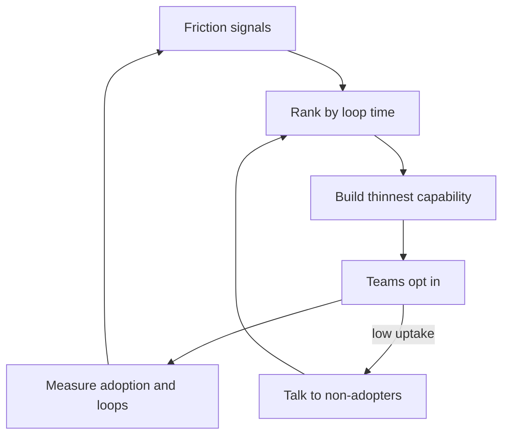
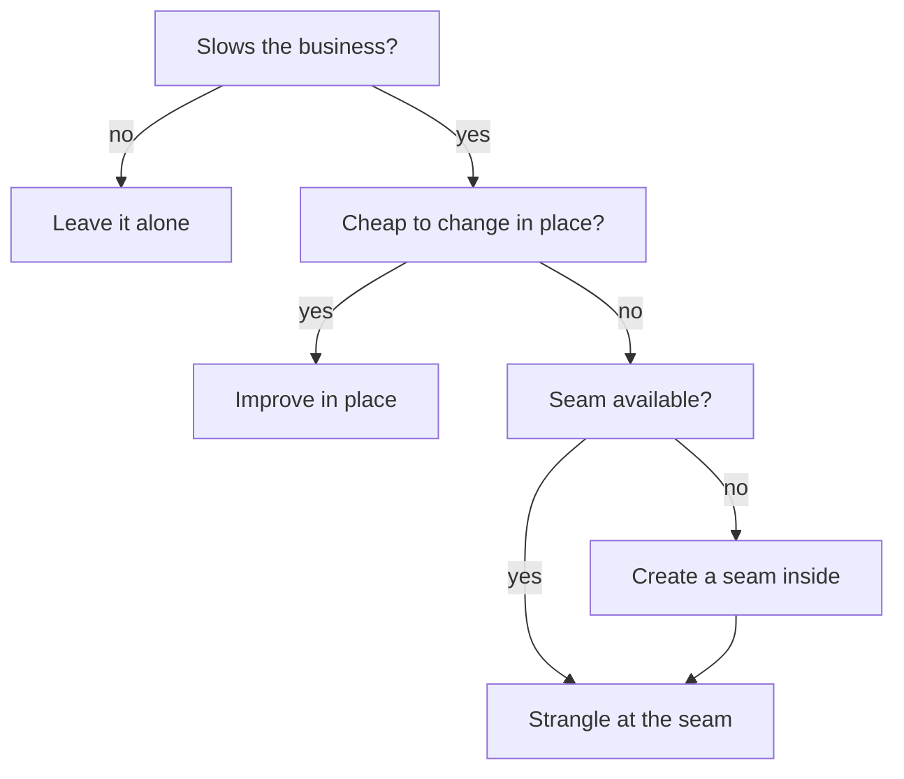

# Chapter 32 — Platform Engineering, Developer Experience, and Legacy Modernization

Past a few teams, every engineering organization has shared machinery: build systems, test
environments, deployment paths, and an old system at the center that everyone changes and nobody
fully understands. This chapter covers how to tell whether a platform team is working, how to choose
developer-experience improvements by the feedback loops and mental burden they remove, and how to
modernize a legacy system without a rewrite. The running
example is the fictional [Northstar Technologies](../../case-studies/northstar/index.md), where
Platform Operations has just lost its QA half. Chapter 18 owns developer-experience measurement,
Chapter 23 CI/CD mechanics, Chapter 21 debt economics, and Chapter 31 service boundaries; this chapter
uses them without re-teaching them.

## Why This Matters

At team scale, shared tooling decides how long an engineer waits between making a change and
learning whether it works. A 74-minute pipeline or a six-day wait for a test environment is paid on
every change, by every team, every week. Small reductions there compound more than most feature work.

At organization scale, a platform team is a monopoly supplier: product teams cannot buy their build
system elsewhere, so the usual signal of a failing supplier (customers leave) is missing. Without a
substitute signal, a platform team can be busy and useless, or useful and unable to show it.

At executive scale, the legacy system is usually the largest technical asset and the largest source
of drag, and it attracts recurring proposals to replace it outright. Northstar's
[Core](../../glossary.md#core) is 1.4 million lines of Java, eleven years old, and the company has
decided not to fund a rewrite ([constraint 3](../../glossary.md#the-five-constraints) of the case).
That decision holds only if leaders can show Core getting cheaper to change each quarter.

## Learning Objectives

After this chapter you will be able to:

- Run a platform as an internal product, with voluntary adoption and shortened feedback loops as its
  measures of success instead of mandated usage.
- Build a feedback-loop inventory and use loop latency, frequency, and cognitive load to rank
  developer-experience investments.
- Design platform adoption metrics that resist the obvious ways they are gamed.
- Plan an incremental modernization of a legacy system, sequenced around business commitments, with
  explicit transitional costs.
- Make the case against a rewrite, and state the conditions under which a rewrite would be right.

## The Mental Model

> **Mental model:** A platform is a product whose customers cannot easily leave, so measure it as if
> they could. A legacy system is a product nobody can stop selling, so modernize it the way it is run:
> one reversible, value-returning step at a time.

Two ideas organize the chapter.

First, **adoption is the market signal a platform lacks**. If teams could keep the old path and
choose the platform anyway, it is cheaper for them. If they use it because they were told to, nobody
learns whether it is any good. The rule this book recommends: mandate outcomes, not tools. For example,
every [tier 1](../../glossary.md#tier-1) service (the most business-critical tier) deploys through an
auditable pipeline with automated rollback. Then let the platform win by being the cheapest way to meet the outcome.

Second, **modernization is a stream, not a project**. A rewrite pays nothing until the end.
Incremental replacement pays something at each step, teaches the team about the old system, and can
stop at any point with value kept. Its costs are transitional code and the risk of stalling halfway,
with two systems where there was one.

In this platform product cycle, low uptake is treated as user research, not resistance to overrule.

## Deep Conceptual Explanation

### What a platform is, and what makes it a product

Evan Bottcher describes a digital platform as a foundation of self-service APIs, tools, services,
knowledge, and support, arranged as a compelling internal product that lets delivery teams ship with
less coordination. He argues it cannot succeed on mandate alone, because internal infrastructure
teams hold a monopoly; teams should choose it because it is easier than building their own
([Bottcher, 2018](../../references/bibliography.md#bottcher2018platforms); expert opinion). The CNCF
platforms white paper, a community document, agrees: design and evolve platforms like products, with
users involved early, and do not rely on top-down mandates. It adds that a platform can be as thin as
a page of links to standard procedures
([CNCF TAG App Delivery, n.d.](../../references/bibliography.md#cncf-platforms-whitepaper);
practitioner consensus).

*Team Topologies* is known for the idea that a platform team exists to reduce the
[cognitive load](../../glossary.md#cognitive-load) of the teams delivering to customers, and that the
best platform is the thinnest one that does that
([Skelton and Pais, 2019](../../references/bibliography.md#skelton2019team)). Chapter 33 teaches
cognitive load as a design tool. Here it means only what a team must know and hold in mind, beyond its
own domain, to get a change into production safely.

| Property | Product-run platform | Infrastructure queue |
|---|---|---|
| Unit of work | A capability users invoke themselves | A ticket a platform engineer fulfils |
| Success signal | Teams choose it; their loops get shorter | Tickets closed; tool uptime |
| Roadmap source | Observed friction in users' workflows | Loudest requester, plus the team's own interests |

### What the evidence says about platforms

The best available evidence is industry research, and it is mixed in an instructive way. In DORA's
2024 survey, respondents using an internal developer platform reported 8 percent higher individual
productivity and 10 percent higher team performance, and organizational performance was 6 percent
higher. Throughput was 8 percent lower and change stability (how rarely changes fail in production) 14 percent
lower among platform users,
which the authors call surprising and explain only with hypotheses: more handoffs, platforms letting
bad changes through, or troubled organizations being the ones that build platforms
([DORA, 2024](../../references/bibliography.md#dora2024accelerate), pp. 49–54; industry research).

Where developers could complete tasks without involving an enabling team (developer independence),
productivity was about 5 percent higher. Respondents required to use the platform exclusively for the
whole application lifecycle reported 6 percent lower throughput, and not collecting user feedback had
a negative effect ([DORA, 2024](../../references/bibliography.md#dora2024accelerate), pp. 51–53).
DORA's capability page lists matching pitfalls: no user research, rigid central standards, operating
as a ticket queue, launching too late, and a one-size-fits-all "golden cage"
([DORA platform engineering capability](../../references/bibliography.md#dora-cap-platform-engineering)).

The data are cross-sectional and self-reported and the effects modest. They support two narrow
claims, neither controlled: self-service and user feedback go with better outcomes, and compelled
exclusive use with lower throughput. The stability finding is a warning: a platform that makes
deploying easier without making changes safer can raise the failure rate.

### Developer experience: choose by feedback loop and cognitive load

Chapter 18 owns the DevEx framework, which treats developer experience as the friction developers meet
in daily work, measured by combining their feedback with system data
([Noda et al., 2023](../../references/bibliography.md#noda2023devex)); its three dimensions are
feedback loops, cognitive load, and flow state
([DX, n.d.](../../references/bibliography.md#dx-devex-report)). See
[Chapter 18](../04-execution/18-measuring-engineering-productivity.md) for survey design. This chapter
uses two of those dimensions as a selection rule.

A **feedback loop** is the time from an engineer's action to the information that says whether it
worked. A loop short enough to wait on keeps the engineer in the task; one long enough to force a task
switch adds switching cost and makes batching rational, and bigger batches raise risk per change. The
selection rule this book recommends:

1. List the loops the platform owns or could own, with median latency and frequency.
2. Prefer loops that are frequent and long enough to force a context switch.
3. Then weigh **cognitive load removed**: how many systems, conventions, or people a team must know to
   complete the path, before and after.
4. Discount anything still needing a ticket. A capability that needs a platform engineer to act is a
   faster queue, not self-service.

DORA's capability page reports that its 2025 data identified clear feedback on the outcome of a
developer's own tasks as the platform capability most associated with a positive user experience
([DORA platform engineering capability](../../references/bibliography.md#dora-cap-platform-engineering);
industry research, as DORA summarizes it), which fits the rule.

### Adoption metrics, and how they are gamed

The CNCF white paper groups platform measures into user satisfaction (active users, retention,
surveys), organizational efficiency (time to fulfil a request, time for a new service to reach
production), and delivery outcomes such as the DORA metrics
([CNCF TAG App Delivery, n.d.](../../references/bibliography.md#cncf-platforms-whitepaper)). Every
adoption number can be gamed:

| Measure | What it tells you | How it is gamed |
|---|---|---|
| Share of services on the platform | Reach | Count services already there; migrate by decree |
| Requests completed without a ticket | Self-service reality | Reclassify tickets as "consultations"; a form that files a ticket |
| Repeat use by the same team | Whether first use was worth repeating | One team's automation inflates counts |
| Loop latency | The outcome the platform exists for | Measure only the platform's part of the loop |
| Survey on ease of shipping | Perceived friction by team | Survey only adopters |

The defense is Chapter 18's: pair each adoption measure with an outcome it cannot move alone, report
the denominator and baseline, and publish who is not adopting and why.

### Legacy modernization without a rewrite

Martin Fowler's strangler fig pattern, named after a vine that grows around a host tree, is the
standard reference for incremental replacement: build new behavior alongside the legacy system and
move responsibility across piece by piece. Fowler argues that replacement plans fail because they take
long and users cannot wait, that existing behavior is hard to specify and partly unwanted, and that
small steps carry less risk, return value earlier, and teach the team about the old system. He insists
on **transitional architecture**, code that lets old and new coexist and is removed later, which
people resist as waste, and warns that legacy systems rarely have clean seams
([Fowler, 2024](../../references/bibliography.md#fowler2024stranglerfig); expert opinion).

Joel Spolsky's 2000 essay argues, from Netscape's rewrite and similar cases, that messy-looking code
often encodes years of fixes for real problems, that a rewrite discards them, and that the company
ships an aging product meanwhile ([Spolsky, 2000](../../references/bibliography.md#spolsky2000never);
expert opinion, argued from a handful of cases).

The empirical literature is thin. Khadka and colleagues interviewed 26 practitioners and surveyed 198;
the abstract reports that practitioners value their legacy systems highly and that modernization
challenges are business and organizational as well as technical
([Khadka et al., 2014](../../references/bibliography.md#khadka2014legacy); research finding). So a
purely technical modernization plan is incomplete. This book found no controlled or
large-sample evidence comparing rewrites with incremental replacement; the preference here rests on
expert opinion and reasoning.

Two ideas keep incremental modernization honest. Fowler cautions that many monoliths are too
entangled to split cleanly ([Fowler, 2015](../../references/bibliography.md#fowler2015monolithfirst)),
so first steps are often inside the monolith: creating seams, not services. And automated checks that
guard an architectural property on every build (the fitness functions associated with
[Ford et al., 2017](../../references/bibliography.md#ford2017building)) act as a ratchet so
the old shape does not grow back.

The diagram omits "rewrite" on purpose. A full rewrite becomes reasonable when the component is small
and its behavior can be pinned down by tests, when its runtime is dying, or when the domain has changed
so much that preserving behavior is not the goal. For a large, central, revenue-carrying system they
rarely do.

## Engineering Organization Example

!!! info "Northstar so far"
    Week 14, the start of quarter 2 of the director's first year. [Sev1 and
    Sev2](../../glossary.md#severity-sev1-sev2-sev3) incidents (the two most serious levels) fell from 30
    to 21 in quarter 1. In week 10 the seven QA engineers left Platform Operations for product teams,
    leaving it five infrastructure engineers. See the [timeline](../../case-studies/northstar/timeline.md).

This example ranks the work Platform Operations could take on at the start of quarter 2 at Northstar,
the book's fictional company. The figures come from Northstar's record; the environment request
frequency is an **illustrative** assumption.

| Loop | Latency | Frequency | Owner |
|---|---|---|---|
| Core pipeline on merge | 74 minutes (shared-database tests 38 of them) | about 1,000 runs a month | Platform Operations |
| Rerun after an unrelated failure | another 74 minutes | 4 percent of runs at day 90, about 40 a month | Platform Operations |
| First review on a Core merge request | 21 working hours (median) | about 85 a week | Product teams |
| Test environment request | about 6 days (median, baseline) | about 25 a month (assumed) | Platform Operations |

All four force a context switch. Reading them with the selection rule:

- **Environment requests** are the longest loop the platform owns: about 150 request-days of waiting a
  month. They block testing, which pushes teams toward bigger batches, and self-service removes a
  ticket, which is what DORA's developer-independence finding points at. They rank first.
- **The Core pipeline** runs about 1,000 times a month. Its largest stage is the shared-database tests,
  which [Chapter 22](../05-engineering-quality/22-testing-strategy-and-test-architecture.md) proposes to
  make hermetic: each test run gets its own isolated database instead of sharing one. The platform's
  lever is disposable test databases, the same capability as self-service environments: a second use
  of the first investment.
- **Review wait** belongs to the product teams and Chapter 23; listing it stops the platform claiming it.

Cognitive load makes the case for CI consolidation. From
[`components.csv`](../../case-studies/northstar/data/components.csv), Northstar has 17 deployable units:
Core and four services on Jenkins, six services on GitLab CI, two frontends on GitHub Actions, and four
services on shell scripts. Once notification-svc moves to Orders in quarter 2, the build systems each
team must know are: Orders 2, Billing 1, Payments and Integrations 2, Customer Experience 2, Data and
Analytics 2, and Platform Operations all 4.

The run-cost case is weaker, and leaders should say so. Four CI systems cost about 1.5
[FTE](../../glossary.md#fte) (full-time equivalent engineers) a year, and one would cost about 0.5. The
saving is about $185,000 a year against about $370,000 of work (two engineer-years): a two-year
payback, meaning the saving takes two years to repay the cost. The case rests on what run cost does not
price: the auditable pipeline with automated rollback that tier 1 services need, comparable delivery
data, lower cognitive load, and less dependence on one person.

## Decision Framework

Use the first table to rank platform candidates and the second to choose a modernization move.

| Question about a platform candidate | Favors building | Favors not building |
|---|---|---|
| How long and frequent is the loop it shortens? | Frequent, forces a switch | Rare, or already short |
| How many teams run through it? | Most | One (help that team instead) |
| Can users finish the task without a ticket afterward? | Yes | No: a faster queue |
| Does a standard require the outcome? | Yes: cheapest way to comply | No standard, little demand |
| Can it be assembled thinly? | Thin layer over existing tools | Large custom build |
| Will someone adopt it in the first month? | A named team asked for it | Nobody asked |

| Legacy component | Move | Measure |
|---|---|---|
| Rarely changes, rarely fails | Leave alone; keep patched | Vulnerability backlog, change rate |
| Changes often, can be made cheap to change in place | Improve in place: tests, pipeline, flags, ownership | Lead time and failure rate of its changes |
| Changes often, has or can get a seam, business reason to separate | Strangle one slice at a time | Behavior moved; transitional code still alive |
| Small and specifiable by tests, or on a dying runtime | Rewrite is a candidate; time-box it | Parity tests passing; date old path deleted |

This book's rule of thumb: approve no modernization step without the date its transitional code is
removed and the measure that says it worked.

## Trade-offs

**Voluntary adoption versus speed.** Opt-in reveals whether the platform is good but keeps old paths
running longer. A firm deadline reaches one system sooner but hides quality, and DORA's exclusive-use
finding suggests compelled use can cost throughput. The usual compromise: a mandated outcome, a long
deadline, and a platform that is plainly the cheaper way to comply.

**Thin versus complete.** A thin layer over existing tools is cheap and easy to abandon; a complete
platform hides more complexity but becomes its own legacy system. Platform teams drift toward
completeness because building is more interesting than adoption work.

**Self-service versus control.** Each self-service capability removes a human check. That is the point,
and it may explain DORA's stability decrease. Put guardrails in the path (policy checks, automated
rollback) rather than reinstating the approval.

**Transitional cost versus risk.** Strangling Core means months of routing code or compatibility
layers, with their own failure modes. A rewrite avoids them on paper and concentrates all risk at
cutover.

**Interrupt protection versus investment.** Engineers on rotation are not building the self-service
that would reduce future interrupts.

## Failure Modes

**Ticket-ops with a portal.** A form that files a ticket for a platform engineer. Detect it by counting
requests that still need a human after the "self-service" launch.

**Adoption by decree.** A deadline before the platform is good, then grudging migrations and
workarounds. Detect it by asking non-adopters why and tracking shadow tooling.

**Four becomes five.** A consolidation that stalls, leaving the new system plus remnants of the old
ones. Detect it by tracking units left on each old system monthly, against a switch-off date.

**The strangler that never strangles.** A few slices move, priorities change, both systems run
indefinitely. Detect it by tracking transitional code and the behavior still served by the old path.

**Rewrite by stealth.** A "new service" that quietly reimplements much of the legacy system with no
parity tests or cutover plan. Detect it by asking what will be deleted from the old system, and when.

**Vanity adoption.** A figure that includes units already on the target or counts registrations rather
than repeat use. Detect it by demanding baseline and denominator.

**The golden cage.** One path for every team, including those it fits badly. Detect it through
exemption requests and survey results broken down by team.

## Enterprise Application

In an organization of 50 to 150 engineers, a platform team usually exists already under another name:
infrastructure, DevOps, tools, release engineering. The task is to change what it is accountable for.

First, **give it users, not requesters.** Name the product teams as customers, derive the roadmap from
their friction, and review it with them quarterly, starting, as the CNCF paper recommends, with common
capabilities and a small group of engaged teams.

Second, **protect its capacity.** Its unplanned share is high because other teams' failures arrive
there. [Chapter 16](../04-execution/16-flow-lead-time-dependencies-and-unplanned-work.md)'s rotation and
single intake create planned capacity; the platform roadmap spends it.

Third, **connect it to standards and debt.**
[Chapter 20](../05-engineering-quality/20-engineering-standards-and-their-governance.md) says standards
should be tool-checked where possible, and the platform is where those checks run. Large items such as
CI consolidation belong in the debt register and are funded as projects.

Modernization here is a coordination plan as much as a technical one: who owns each seam, who moves
which slice, and who pays for the transitional code.

### Sizing and funding a platform team

Size a platform team from the work it removes, not from a ratio (**this book's recommendation**). No
study gives a right share of engineers for platform work, and published ratios describe other
companies' estates. Three numbers give a defensible size:

- **Work already being done.** Shared tooling is usually run by someone today, badly and invisibly. At
  Northstar, four CI systems take about 1.5 FTE a year. That is capacity the organization already pays
  for, and the first source of platform staff.
- **Interrupt load.** Engineers on rotation answer requests; they do not build. Count them separately.
  Platform Operations' five engineers with two on rotation leave three builders.
- **The roadmap's next two quarters.** Engineer-weeks for the capabilities users asked for, with
  estimates, as in this chapter's case.

Grow the team only when adoption and the removed load are measured. A platform that asks for more
people before any team uses it unforced is asking to be funded as a queue.

Funding has three common models:

| Model | How it works | Strength | Risk |
|---|---|---|---|
| Central funding | The platform is a line in engineering's budget | Teams adopt freely; no billing overhead | Nobody sees what each team consumes |
| Showback | Central funding, plus a quarterly report of usage and cost per team | Cost visible without discouraging use | Reports nobody reads |
| Chargeback | Teams pay from their own budgets per use | Demand becomes a price signal | Teams avoid the platform and rebuild locally, defeating adoption |

For an organization of 50 to 150 engineers, central funding with showback usually fits. Reserve
chargeback for costs that grow with consumption, such as cloud spend, where a price changes behavior
the platform wants changed.

## CTO Perspective

At executive scale, platform work and modernization are investment lines competing with features for
the same engineers. The CTO's job is to make both legible to people who will never read a pipeline.

For the platform, report a few outcomes quarterly: loops shortened, requests no longer received,
adoption with its denominator, and toolchain run cost. Adoption alone invites "so what"; satisfaction
alone invites "at what cost".

For modernization, the CTO answers the rewrite question repeatedly: from new executives, frustrated
engineers, and boards who see a competitor launch on a newer stack. The defensible answer is a plan
with visible quarterly progress, a statement of what would make a rewrite right, and evidence that the
old system is getting cheaper to change. Without the last, "no rewrite" sounds like inertia.

Buying matters more at this level. A commercial portal or managed CI service passes the same test as
internal work, or fails it: will teams use it unforced, and which loop does it shorten?

## Practical Playbook

1. **Inventory the loops:** median latency, frequency, owner, and whether a ticket is involved. Use
   existing data before surveys.
2. **Count cognitive load:** the systems and people each team must know to ship, checked by the teams.
3. **Rank by the selection rule.** Frequent, switch-forcing loops first; cognitive load second.
4. **Write a product roadmap.** Each item names its users, the loop it shortens, adoption and outcome
   measures, and the first team that agreed to try it.
5. **Mandate outcomes, not tools.** Keep old paths until the platform is the cheaper way to comply.
6. **Report adoption honestly:** baseline, denominator, repeat use, non-adopters with reasons.
7. **Map the legacy system** by change rate, failures, and teams touching each module.
8. **Choose one seam and one slice,** with a removal date for transitional code and an automated check.
9. **Sequence around commitments.** Leave what a dated customer commitment depends on until after.
10. **Review quarterly with executives:** loops shortened, systems retired, transitional code removed.

## Case Study

This case is **fictional**. Platform Operations' composition, the interrupt rotation, the
deployment-event store, Bram Verhoeven's situation, and Core's constraints come from the
[baseline](../../case-studies/northstar/baseline-data.md) and
[first quarter](../../case-studies/northstar/first-quarter.md) pages; the roadmap draft and its
estimates are **illustrative**. The case is set in week 14, the first week of quarter 2; the decisions
are the reader's.

**The team.** Since the QA engineers moved into product teams in week 10, Platform Operations is its
manager, Tom Becker, and five infrastructure engineers, three in Minneapolis and two remote. Two rotate weekly as the
interrupt role behind a single intake. Bram Verhoeven, who built Core's Jenkins pipeline and once
proposed consolidating the build systems, is one of the five; Tom's proposed expectations agreement for
him ([Chapter 9](../02-people-management/09-performance-management-and-underperformance.md)) awaits the
director's decision. The team's baseline share of [unplanned work](../../glossary.md#unplanned-work) was 46 percent, the
highest anywhere.

**The draft roadmap.** Tom Becker and Kwame Mensah, the staff engineer who owns the pipeline
standards, bring the
director a roadmap. Three engineers off rotation for 13 weeks give 39 engineer-weeks; they assume about
a quarter is lost to toolchain breakage, leave, and meetings, leaving about 29.

| Item | Changes | Estimate, quarter 2 |
|---|---|---|
| Finish self-service test environments, with disposable test databases | Environment wait, about 6 days at baseline | about 8 engineer-weeks remaining |
| Deployment-event store (Chapter 18) | Retires the monthly hand join of four CI systems' logs | about 6 engineer-weeks, from the [prevention allocation](../../glossary.md#prevention-allocation) (capacity reserved for removing the sources of incidents) |
| CI consolidation phase 1: pipeline template with automated rollback, then the four shell-script services | Removes the script path; auth-svc gets the automated rollback every tier 1 service needs | about 12 engineer-weeks (template 4, scripts 8, the debt register's estimate) |
| **Total** | | **about 26 of 29** |

The draft proposes GitLab CI as the target, since six services already use it and licenses exist.
Later quarters would move the four Jenkins services, the two frontends, and Core last. The whole
consolidation is about two engineer-years, about 92 engineer-weeks at 46 working weeks a year, leaving
about 80 after phase 1: more than two further quarters of all Platform Operations' planned capacity.
The draft therefore assumes product teams migrate their own services from the template, with Platform
Operations pairing on each team's first migration.

**Commitments respected.** The erp-sync pipeline (accounting integration, due week 19) is untouched
until then; Core's Jenkins pipeline, which bulk ordering (due week 26) ships through, does not move
before quarter 3. No team migrates until the template has run one service in production for a month.

**Adoption measures.** Tom's first draft reported "pipeline adoption: 6 of 17 units (35 percent)".
Kwame objected that the six GitLab CI services predate the project, so the figure measured the choice of
target. The revised set:

| Measure | Baseline | Paired outcome |
|---|---|---|
| Units migrated to the template since week 14 (of the 11 not on GitLab CI) | 0 | Change failure rate of migrated units |
| Environment requests completed without a ticket | none | Median environment wait; other teams' requests (20 percent of Platform Operations' capacity at baseline) |
| Product teams using self-service environments two months running | 0 of 5 | Feedback-loop and cognitive-load items in Chapter 18's survey, first run in quarter 2 |
| Build systems each team must know | 1 to 2 per product team; 4 for Platform Operations | Toolchain run cost, about 1.5 FTE a year |

**Core under constraint 3 (no funded rewrite).** The draft's last page, written with Ines Carvalho, proposes no rewrite.
Quarter 2 modernization is three things: the funded permissions extraction from core/customer that Ines
leads, treated as the first strangler slice with a removal date for its transitional code; disposable
test databases, which unblock Chapter 22's move to isolated test databases; and a build check that fails
Core if new code outside core/permissions reads its tables directly. In the baseline quarter four teams
made 38 merge requests to core/permissions; success is how many changes still need to touch it after the
extraction. core/permissions still has no owner. The core/customer redesign (about three engineer-years)
stays unfunded; the draft proposes slicing it once the permissions seam has held.

**Complications.** Consolidation is the project Bram proposed before the director arrived; a leading
role could restore his belief that planned work matters, or reward the gap Tom's agreement is meant to
close. Tom says 26 of 29 engineer-weeks leaves little slack, and Customer Experience asks why its
frontends are not first.

The reader decides: whether to approve the roadmap and target as drafted, whether to require migration
by a date or rely on adoption, how to report progress to Victor Lindqvist (CTO), and how the consolidation
should and should not interact with Bram's agreement.

## Exercises

Solutions are in [chapter 32 solutions](../../solutions/ch32-solutions.md). Northstar data is on the
[baseline page](../../case-studies/northstar/baseline-data.md).

### Foundational

**F1.** Platform Operations' intake shows, in one month: test environments (about 25), access to
production logs (about 15), pipeline variable changes on GitLab CI (about 12), help debugging a failed
Jenkins build (about 20), and new service scaffolding (2). Decide which should become self-service
first and which should not at all, and why.

**F2.** At the end of quarter 3, Tom Becker reports pipeline adoption up from 35 to 65 percent of
deployable units. Using the 17 units in the component inventory, explain what the number could and
could not mean, how it could rise without the platform improving, and which two measures you would
require beside it.

**F3.** A Billing engineer proposes rewriting invoice-render, a tier 2 service with no runbook and no
alerts, from scratch in another language over six weeks, because "nobody understands it". Using the
modernization table, decide whether this is a reasonable rewrite, a stealth rewrite, or a case for
improving in place, and say what you would ask for before agreeing.

### Applied Leadership

**A1.** In week 20, Tom Becker asks the director to announce that every team must be on the new
pipeline template by the end of quarter 4, because "voluntary adoption will take forever and we cannot
run four systems for two more years". Write the director's response: what you would mandate, what you
would not, and what you would offer Tom instead of the announcement.

**A2.** Data and Analytics declines to migrate export-svc (tier 3, shell scripts) in quarter 2: 12
percent of its capacity goes to other teams' requests and the service rarely changes. The script path cannot be
retired while export-svc uses it. Decide what to do, weighing the team's reasons, the cost of keeping
the script path, and how other teams will read the decision.

**A3.** After bulk ordering ships in week 26, Priya Raman (Orders manager) proposes that Orders spend 30 percent of its
capacity for two quarters "re-platforming" core/order-capture as a new service, because it has the most
incidents. Evaluate the proposal against constraint 3 and this chapter's framework, and state the
conditions under which you would approve a version of it.

### Executive Decision-Making

**X1.** As CTO, you receive a proposal to buy a commercial developer portal at $180,000 a year. Tom
Becker supports it: a service catalog, scaffolding, and a home for the deployment-event store's
dashboards. The discretionary tooling budget is $250,000 for the year. Decide whether to buy, defer, or
decline, and state the adoption evidence you would require before renewing.

**X2.** Two years from now, a competitor has launched on a modern cloud-native stack, a board member
asks whether Core should finally be replaced, and Helena Marsh (CEO) wants your position in writing. Prepare
it: what you say about a rewrite, what modernization evidence you show, and what would change your mind.

## Reflection Questions

1. Which of your shared tools would teams stop using tomorrow if allowed? What does that say about how
   you measure the team that runs them?
2. When did your organization last finish a migration, in the sense of switching the old system off?
   What made that one finish?
3. Which feedback loop in your organization is long enough to force a context switch, frequent enough
   to matter, and owned by nobody?
4. If you argue against a rewrite, what would you have to see to change your mind? Have you said so?
5. Where does your platform roadmap come from: users' friction, the loudest requester, or the team's
   own interests?

## Key Takeaways

- Run a platform as a product whose customers could leave; adoption is its market signal.
- Mandate outcomes through standards, not tools.
- Rank developer-experience work by loop latency and frequency, then cognitive load removed; a
  capability that still needs a ticket is a faster queue.
- Pair every adoption figure with its baseline, denominator, and an outcome it cannot move alone.
- Platform evidence is industry research with mixed signs; compelled exclusive use goes with lower
  throughput.
- Modernize one reversible slice at a time, budgeting for transitional code and its removal.
- Every migration needs a switch-off date, or four systems become five.
- The case against a rewrite rests on opinion and reasoning; state what would change it.

## References and Further Reading

- [Bottcher, 2018](../../references/bibliography.md#bottcher2018platforms). The platform as a
  compelling internal product.
- [CNCF TAG App Delivery, n.d.](../../references/bibliography.md#cncf-platforms-whitepaper). Platform
  attributes and measures.
- [DORA, 2024](../../references/bibliography.md#dora2024accelerate). Platform chapter, pp. 47–55.
- [DORA platform engineering capability](../../references/bibliography.md#dora-cap-platform-engineering).
  Pitfalls for platform teams.
- [Skelton and Pais, 2019](../../references/bibliography.md#skelton2019team). Platform-team vocabulary.
- [Noda et al., 2023](../../references/bibliography.md#noda2023devex) and
  [DX, n.d.](../../references/bibliography.md#dx-devex-report). The DevEx framework.
- [Fowler, 2024](../../references/bibliography.md#fowler2024stranglerfig). The strangler fig pattern.
- [Spolsky, 2000](../../references/bibliography.md#spolsky2000never). Against rewrites; opinion.
- [Khadka et al., 2014](../../references/bibliography.md#khadka2014legacy). Practitioners on legacy
  modernization.
- [Fowler, 2015](../../references/bibliography.md#fowler2015monolithfirst) and
  [Ford et al., 2017](../../references/bibliography.md#ford2017building). Entangled monoliths;
  fitness functions.
