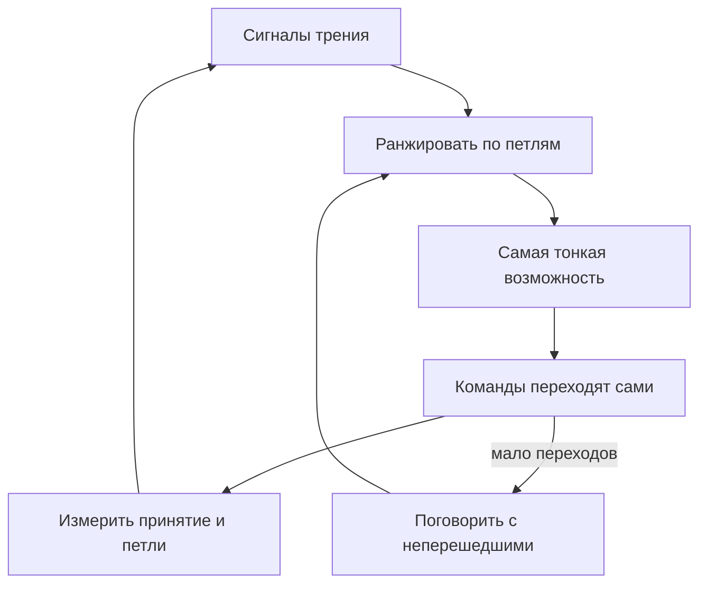
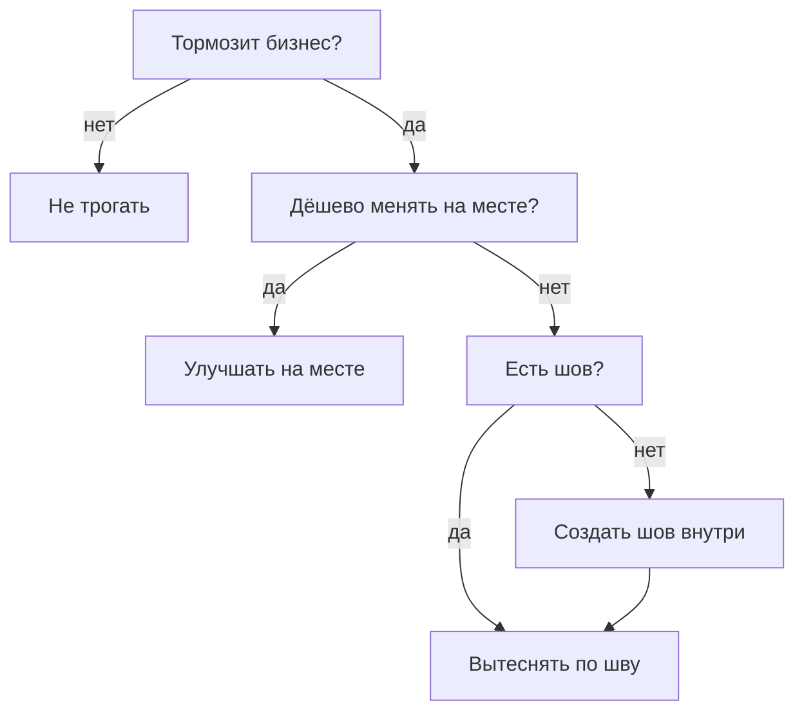

# Глава 32 — Платформенная инженерия, опыт разработчиков и модернизация legacy { #chapter-32-platform-engineering-developer-experience-and-legacy-modernization }

Когда команд больше нескольких, у любой инженерной организации появляется общее хозяйство: системы
сборки, тестовые окружения, пути развёртывания и старая система в центре, которую меняют все и до конца
не понимает никто. Эта глава о том, как понять, работает ли платформенная команда, как выбирать улучшения опыта разработчиков (по тому, какие петли обратной связи они сокращают и какую
умственную нагрузку снимают) и как модернизировать унаследованную систему (legacy) без переписывания. Сквозной пример —
вымышленная компания [Northstar Technologies](../../case-studies/northstar/index.md): на неделе 10 семь
QA-инженеров Platform Operations перешли в продуктовые команды, и в Platform Operations остались пять
инженеров инфраструктуры. Измерение опыта разработчиков подробно разбирает глава 18, механику CI/CD
(непрерывной интеграции и поставки) — глава 23, экономику долга — глава 21, границы сервисов —
глава 31. Здесь мы опираемся на них, не пересказывая.

## Почему это важно { #why-this-matters }

Для команды общий инструментарий определяет, сколько инженер ждёт между изменением и ответом на вопрос,
работает ли оно. За 74-минутный пайплайн или шестидневное ожидание тестового окружения платят при каждом изменении, в
каждой команде, каждую неделю. Даже небольшое сокращение здесь в сумме даёт больше, чем большая часть
работы над функциями.

Для организации платформенная команда — поставщик-монополист: продуктовые команды не могут купить
систему сборки на стороне, поэтому обычного сигнала о плохом поставщике (клиенты уходят) нет. Если ничем его не заменить, платформенная команда может оказаться занятой, но бесполезной, или
полезной, но неспособной это показать.

Для высшего руководства унаследованная система обычно и самый крупный технический актив, и главный тормоз, а вокруг неё снова и снова возникают предложения заменить её целиком.
[Core](../../glossary.md#core) в Northstar — одиннадцатилетний код на Java объёмом 1,4 млн строк, и компания решила не финансировать переписывание ([ограничение 3](../../glossary.md#the-five-constraints)
кейса). Решение устоит, только если руководители смогут
показать, что менять Core с каждым кварталом становится дешевле.

## Цели главы { #learning-objectives }

Прочитав эту главу, вы сможете:

- Вести платформу как внутренний продукт, измеряя успех добровольным принятием и сокращением петель
  обратной связи, а не обязательным использованием.
- Составить инвентаризацию петель обратной связи и ранжировать инвестиции в опыт разработчиков по
  задержке петли, её частоте и когнитивной нагрузке.
- Проектировать метрики принятия платформы, устойчивые к очевидным способам их подгонки.
- Планировать поэтапную модернизацию унаследованной системы вокруг обязательств перед бизнесом, явно
  называя стоимость переходного периода.
- Аргументировать против переписывания и называть условия, при которых переписывание было бы
  правильным.

## Ментальная модель { #the-mental-model }

> **Ментальная модель:** платформа — это продукт, клиенты которого не могут легко уйти, поэтому
> измеряйте её так, будто могут. Унаследованная система — это продукт, который никто не может перестать
> продавать, поэтому модернизируйте её так же, как эксплуатируете: по одному обратимому шагу, каждый из
> которых что-то возвращает.

Главу организуют две идеи.

Первая: **принятие (adoption) — это рыночный сигнал, которого у платформы нет**. Если команды могли
остаться на старом пути и всё равно выбрали платформу, значит, для них она дешевле. Если они пользуются
ею, потому что им велели, никто не узнает, хороша ли она. Книга рекомендует правило:
предписывайте результаты, а не инструменты. Например, каждый сервис уровня [tier 1](../../glossary.md#tier-1)
(самый критичный для бизнеса уровень) развёртывается через пайплайн с журналом аудита и автоматическим
откатом. А дальше пусть платформа побеждает, оставаясь самым дешёвым способом достичь этого результата.

Вторая: **модернизация — это поток, а не проект**. Переписывание ничего не даёт до самого конца.
Поэтапная замена что-то возвращает на каждом шаге, учит команду устройству старой системы и может
остановиться в любой момент, сохранив полученную ценность. Её цена — переходный код и риск застрять на
полпути, получив две системы там, где была одна.

В таком продуктовом цикле слабое принятие — повод для исследования пользователей, а не сопротивление,
которое нужно сломить.

## Подробный разбор { #deep-conceptual-explanation }

### Что такое платформа и что делает её продуктом { #what-a-platform-is-and-what-makes-it-a-product }

Evan Bottcher описывает цифровую платформу как основу для самообслуживания: API, инструменты, сервисы,
знания и поддержку, устроенные как привлекательный внутренний продукт. Такая платформа позволяет
командам поставки выпускать изменения с меньшей координацией. По его словам, на одних предписаниях
платформа успеха не добьётся: внутренние инфраструктурные команды — монополисты. Команды должны выбирать
платформу потому, что это проще, чем строить своё
([Bottcher, 2018](../../references/bibliography.md#bottcher2018platforms); мнение эксперта). С ним
согласен документ сообщества — white paper о платформах от CNCF (Cloud Native Computing Foundation):
проектируйте и развивайте платформы как продукты, рано вовлекайте пользователей и не полагайтесь на
предписания сверху. Документ добавляет, что платформа может быть совсем тонкой, вплоть до страницы со
ссылками на стандартные процедуры
([CNCF TAG App Delivery, n.d.](../../references/bibliography.md#cncf-platforms-whitepaper); консенсус
практиков).

*Team Topologies* известна идеей, что платформенная команда существует, чтобы снижать
[когнитивную нагрузку](../../glossary.md#cognitive-load) команд, которые поставляют ценность клиентам, и
что лучшая платформа — самая тонкая из тех, что с этим справляются
([Skelton and Pais, 2019](../../references/bibliography.md#skelton2019team)). Как инструмент
проектирования когнитивную нагрузку разбирает глава 33. Здесь под ней понимается только то, что команда
должна знать и держать в голове сверх своей предметной области, чтобы безопасно довести изменение до
продакшена.

| Свойство | Платформа, которую ведут как продукт | Инфраструктурная очередь |
|---|---|---|
| Единица работы | Возможность, которую пользователи вызывают сами | Тикет, который выполняет инженер платформы |
| Сигнал успеха | Команды её выбирают; их петли короче | Закрытые тикеты; аптайм инструментов |
| Источник дорожной карты | Трение, замеченное в работе пользователей | Самый громкий заказчик плюс собственные интересы команды |

### Что говорят доказательства о платформах { #what-the-evidence-says-about-platforms }

Доказательства подтверждают два узких утверждения: самообслуживание и обратная связь от пользователей
сопутствуют лучшим результатам, а принудительное исключительное использование сопутствует более низкой
пропускной способности. Есть и предупреждение: платформа, которая упрощает развёртывание, но не делает
изменения безопаснее, может повысить долю отказов.

Источник — опрос [DORA](../../glossary.md#dora-metrics) (DevOps Research and Assessment) 2024 года. Это
**отраслевое исследование**: одномоментное (cross-sectional), на самоотчётных данных, с умеренными
эффектами ([DORA, 2024](../../references/bibliography.md#dora2024accelerate), с. 49–54).

| Сравниваемые группы | Показатель | Направление и размер |
|---|---|---|
| Пользователи платформы и остальные | Индивидуальная продуктивность | 8 процентов выше |
| Пользователи платформы и остальные | Стабильность изменений (насколько редко изменения дают сбой) | 14 процентов ниже |
| Независимость разработчиков: задачи, выполненные без команды содействия | Продуктивность | Примерно на 5 процентов выше |
| Платформа обязательна для всего | Пропускная способность | 6 процентов ниже |

Авторы называют падение стабильности неожиданным и предлагают только гипотезы: передач работы становится больше; платформы пропускают плохие изменения; или
платформы строят как раз организации, у которых уже есть проблемы. На странице
возможностей DORA перечислены соответствующие ловушки: нет исследования пользователей, жёсткие
централизованные стандарты, работа в режиме очереди тикетов, слишком поздний запуск и единая для всех
«золотая клетка»
([DORA platform engineering capability](../../references/bibliography.md#dora-cap-platform-engineering)).

### Опыт разработчиков: выбирать по петлям обратной связи и когнитивной нагрузке { #developer-experience-choose-by-feedback-loop-and-cognitive-load }

Фреймворк DevEx подробно разбирает глава 18. Он рассматривает опыт разработчиков как трение, с которым
они сталкиваются в повседневной работе, и измеряет его, сочетая их отзывы с данными систем
([Noda et al., 2023](../../references/bibliography.md#noda2023devex)). Три его измерения — петли
обратной связи, когнитивная нагрузка и состояние потока
([DX, n.d.](../../references/bibliography.md#dx-devex-report)). Как проектировать опросы, описано в
[главе 18](../04-execution/18-measuring-engineering-productivity.md). Здесь два из трёх
измерений служат правилом выбора.

**Петля обратной связи** — время от действия инженера до информации о том, сработало ли оно. Если петля
достаточно коротка, чтобы её дождаться, инженер остаётся в задаче. Если же она так длинна, что приходится переключаться на другую задачу, к ожиданию добавляется цена
переключения, а укрупнять пачки изменений становится рационально. Чем крупнее пачка, тем выше риск
каждого изменения. Книга рекомендует такое правило выбора:

1. Перечислите петли, которыми платформа владеет или могла бы владеть, с медианной задержкой и частотой.
2. Предпочитайте частые петли, достаточно длинные, чтобы вынуждать переключение контекста.
3. Затем взвесьте, **сколько когнитивной нагрузки снимается**: сколько систем, соглашений или людей
   команда должна знать, чтобы пройти путь, до и после.
4. Делайте скидку на всё, что по-прежнему требует тикета. Возможность, для которой нужно действие
   инженера платформы, — это более быстрая очередь, а не самообслуживание.

На странице возможностей DORA сказано, что по данным 2025 года сильнее всего с положительным опытом
пользователей связана одна возможность платформы: ясная обратная связь о результате собственных задач
разработчика
([DORA platform engineering capability](../../references/bibliography.md#dora-cap-platform-engineering);
отраслевое исследование в изложении DORA). Это согласуется с правилом.

### Метрики принятия и как их подгоняют { #adoption-metrics-and-how-they-are-gamed }

White paper CNCF делит метрики платформы на три группы: удовлетворённость пользователей (активные
пользователи, удержание, опросы), организационная эффективность (время выполнения запроса, время, за
которое новый сервис попадает в продакшен) и результаты поставки, например метрики DORA
([CNCF TAG App Delivery, n.d.](../../references/bibliography.md#cncf-platforms-whitepaper)). Любое число
о принятии можно подогнать:

| Показатель | Что он говорит | Как его подгоняют |
|---|---|---|
| Доля сервисов на платформе | Охват | Засчитывают сервисы, которые уже там были; переводят указом |
| Запросы, выполненные без тикета | Насколько самообслуживание реально | Переименовывают тикеты в «консультации»; форма, которая сама заводит тикет |
| Повторное использование той же командой | Стоило ли первое использование повторения | Автоматизация одной команды раздувает счёт |
| Задержка петли | Результат, ради которого платформа существует | Измеряют только участок петли, относящийся к платформе |
| Опрос о простоте выпуска изменений | Ощущаемое трение по командам | Опрашивают только перешедших |

Защита та же, что в главе 18: ставьте каждой метрике принятия в пару результат, который она не может
сдвинуть сама, показывайте знаменатель и исходный уровень и публикуйте, кто не переходит на платформу и
почему.

### Модернизация legacy без переписывания { #legacy-modernization-without-a-rewrite }

Стандартная отсылка для поэтапной замены — паттерн «фикус-душитель» (strangler fig) Martin Fowler,
названный в честь лианы, которая обвивает дерево-хозяина. Новое поведение строят рядом с унаследованной
системой и переносят на него ответственность по частям. Доводы Fowler таковы: планы замены
проваливаются, потому что занимают много времени, а пользователи не могут ждать; существующее поведение
трудно описать, и отчасти оно никому не нужно; мелкие шаги несут меньше риска, раньше возвращают
ценность и учат команду устройству старой системы. Он настаивает на **переходной архитектуре**, хотя
люди сопротивляются ей как пустой трате сил. Это код, который позволяет старому и новому сосуществовать,
а потом удаляется. Ещё Fowler предупреждает, что чистых швов в унаследованных системах почти не бывает
([Fowler, 2024](../../references/bibliography.md#fowler2024stranglerfig); мнение
эксперта).

Joel Spolsky в эссе 2000 года на примере переписывания Netscape и похожих случаев утверждает: код,
который выглядит запутанным, часто хранит годы исправлений реальных проблем, переписывание их
выбрасывает, а компания тем временем выпускает стареющий продукт
([Spolsky, 2000](../../references/bibliography.md#spolsky2000never); мнение эксперта, построенное на
нескольких случаях).

Эмпирической литературы мало. Khadka и коллеги провели интервью с 26 практиками и опросили 198. Согласно
аннотации, практики высоко ценят свои унаследованные системы, а трудности модернизации лежат не только
в технической, но и в деловой и организационной плоскости
([Khadka et al., 2014](../../references/bibliography.md#khadka2014legacy); научный результат). Значит,
чисто технический план модернизации неполон. Книга не нашла контролируемых исследований или данных на
больших выборках, которые сравнивали бы переписывание с поэтапной заменой; предпочтение здесь опирается
на мнение экспертов и рассуждение.

Две идеи помогают поэтапной модернизации оставаться честной. Первая: Fowler предупреждает, что многие монолиты
слишком запутаны, чтобы их чисто разделить
([Fowler, 2015](../../references/bibliography.md#fowler2015monolithfirst)), поэтому первые шаги часто
делаются внутри монолита: создают швы, а не сервисы. Вторая:
автоматические проверки, которые на каждой сборке охраняют архитектурное свойство (фитнес-функции,
fitness functions; идею связывают с [Ford et al., 2017](../../references/bibliography.md#ford2017building)),
работают как храповик: старая форма не отрастает обратно.

### Один срез по схеме душителя, шаг за шагом { #one-strangler-slice-step-by-step }

Срез закончен, только когда старый путь отключён. Возьмём вынос проверок прав из модуля клиентов внутри
монолита, как в кейсе Northstar ниже:

1. **Поставьте впереди фасад.** Все вызывающие обращаются к одному интерфейсу («может ли этот
   пользователь это сделать?») вместо того, чтобы читать таблицы прав или вызывать код модуля клиентов.
   Поначалу фасад просто вызывает старый код. Фасад и есть переходная архитектура.
2. **Постройте за ним новую реализацию** с одной командой-владельцем и собственными таблицами или
   модулем. Где старая и новая модели расходятся, тонкий слой трансляции не даёт терминам старой модели
   просочиться в новый код.
3. **Запустите обе и сравнивайте.** Какое-то время фасад вызывает обе реализации, возвращает ответ
   старой и записывает каждое расхождение. Эти проверки паритета (parity checks) и становятся
   спецификацией, которой у старого кода никогда не было. Исправьте каждое расхождение или запишите,
   почему старое поведение было неверным.
4. **Переводите вызывающих группами** за флагом, который может вернуть их обратно.
5. **Отключите старый путь в назначенный день**: удалите старый код, отзовите прямой доступ к таблицам и
   добавьте в сборку проверку, которая падает на любом новом прямом чтении. Затем решите, остаётся ли
   фасад интерфейсом модуля или его убирают.

Обычный провал — остановиться после шага 4: оба пути живы, а журнал расхождений никто не читает.

«Переписывания» на диаграмме нет намеренно. Полное переписывание становится разумным, когда компонент
мал и его поведение можно зафиксировать тестами, когда его среда выполнения отмирает или когда
предметная область изменилась так сильно, что сохранять поведение уже не нужно. Для большой,
центральной системы, которая приносит выручку, эти условия выполняются редко.

## Пример из инженерной организации { #engineering-organization-example }

!!! info "Northstar: что уже известно"
    Неделя 14, начало квартала 2 первого года директора. В квартале 1 число инцидентов [Sev1 и
    Sev2](../../glossary.md#severity-sev1-sev2-sev3) (два самых серьёзных уровня) упало с 30 до 21. На неделе 10 семь QA-инженеров ушли из Platform Operations в продуктовые команды, и в Platform
    Operations осталось пять инженеров инфраструктуры. См. [хронологию](../../case-studies/northstar/timeline.md).
    Впервые читаете о Northstar? Прочитайте [«Год вкратце»](../../case-studies/northstar/year-in-brief.md)
    и [действующих лиц](../../case-studies/northstar/cast.md).

Ниже ранжирована работа, которую в начале квартала 2 могла бы взять на себя Platform Operations в
Northstar, вымышленной компании книги. Цифры взяты из хроники Northstar; частота запросов окружений —
допущение для **иллюстрации**.

| Петля | Задержка | Частота | Владелец |
|---|---|---|---|
| Пайплайн Core при слиянии | 74 минуты (из них 38 — тесты на общей базе данных) | около 1,000 запусков в месяц | Platform Operations |
| Перезапуск после постороннего падения | ещё 74 минуты | 4 процента запусков ко Дню 90, около 40 в месяц | Platform Operations |
| Первое ревью мерж-реквеста в Core | 21 рабочий час (медиана) | около 85 в неделю | Продуктовые команды |
| Запрос тестового окружения | около 6 дней (медиана, исходный уровень) | около 25 в месяц (допущение) | Platform Operations |

Все четыре петли вынуждают переключать контекст. Прочитаем их по правилу выбора:

- **Запросы окружений** — самая длинная петля из тех, которыми владеет платформа: около 150 дней
  ожидания по запросам в месяц. Они блокируют тестирование и тем подталкивают команды к более крупным
  пачкам. Самообслуживание убирает тикет, и как раз на это указывает вывод DORA о независимости
  разработчиков. Поэтому запросы окружений — на первом месте.
- **Пайплайн Core** запускается около 1 000 раз в месяц. Его самая долгая стадия — тесты на общей базе
  данных, которые [глава 22](../05-engineering-quality/22-testing-strategy-and-test-architecture.md)
  предлагает сделать герметичными: каждый прогон тестов получает собственную изолированную базу данных,
  а не делит одну на всех. Рычаг платформы здесь — одноразовые тестовые базы данных. Это та же возможность, что и
  самообслуживание окружений, то есть второе применение первой инвестиции.
- **Ожидание ревью** — забота продуктовых команд и тема главы 23. Оно стоит в списке, чтобы платформа
  не считала его своим.

Довод в пользу консолидации CI даёт когнитивная нагрузка. По данным
[`components.csv`](../../case-studies/northstar/data/components.csv), у Northstar 17
[развёртываемых единиц](../../glossary.md#deployable-unit) (того, что выпускается отдельно; Core
считается за одну; всего 24 компонента): Core и четыре сервиса на Jenkins, шесть сервисов на GitLab CI,
два фронтенда на GitHub Actions и четыре сервиса на shell-скриптах. Когда в квартале 2 notification-svc
перейдёт к Orders, число систем сборки, которые должна знать каждая команда, будет таким: Orders — 2,
Billing — 1, Payments and Integrations — 2, Customer Experience — 2, Data and Analytics — 2, а Platform
Operations — все 4.

Довод от стоимости эксплуатации слабее, и руководителям стоит это признать. Четыре системы CI обходятся
примерно в 1,5 [FTE](../../glossary.md#fte) (полной ставки инженера) в год, одна обходилась бы примерно в
0,5. Экономия — около $185 000 в год, а работа стоит примерно $370 000 (два инженеро-года): срок
окупаемости — два года, то есть за два года экономия возвращает затраты. Довод держится на том, чего
стоимость эксплуатации не учитывает: пайплайн с журналом аудита и автоматическим откатом, который нужен
сервисам tier 1, сопоставимые данные о поставке, более низкая когнитивная нагрузка и меньшая зависимость
от одного человека.

## Как принимать решение { #decision-framework }

По первой таблице ранжируйте кандидатов в возможности платформы, по второй выбирайте шаг модернизации.

| Вопрос о кандидате в платформу | В пользу разработки | Против разработки |
|---|---|---|
| Насколько длинна и часта петля, которую он сокращает? | Частая, вынуждает переключение | Редкая или уже короткая |
| Сколько команд через неё проходит? | Большинство | Одна (лучше помочь этой команде) |
| Смогут ли пользователи потом выполнять задачу без тикета? | Да | Нет: это более быстрая очередь |
| Требует ли этого результата стандарт? | Да: самый дешёвый способ соответствовать | Стандарта нет, спрос мал |
| Можно ли собрать тонкий вариант? | Тонкий слой поверх существующих инструментов | Большая собственная разработка |
| Возьмёт ли её кто-то в первый месяц? | Её попросила конкретная команда | Никто не просил |

| Унаследованный компонент | Шаг | Показатель |
|---|---|---|
| Меняется редко, отказывает редко | Не трогать; ставить патчи | Бэклог уязвимостей, частота изменений |
| Меняется часто, менять его на месте можно сделать дешёвым | Улучшать на месте: тесты, пайплайн, флаги, владение | Lead time и доля отказов его изменений |
| Меняется часто, шов есть или его можно создать, есть деловая причина отделить | Вытеснять по одному срезу | Перенесённое поведение; ещё живой переходный код |
| Мал и описывается тестами или стоит на отмирающей среде выполнения | Переписывание — кандидат; ограничьте его по времени | Проходящие тесты паритета; дата удаления старого пути |

Эмпирическое правило книги: не одобряйте ни одного шага модернизации без даты удаления его переходного
кода и показателя, который скажет, что шаг сработал.

## Компромиссы { #trade-offs }

**Добровольное принятие против скорости.** Переход по желанию показывает, хороша ли платформа, но дольше
держит в работе старые пути. Жёсткий срок быстрее приводит к одной системе, но скрывает качество, а вывод
DORA об исключительном использовании говорит, что принуждение может стоить пропускной способности.
Обычный компромисс: обязательный результат, длинный срок и платформа как явно самый дешёвый способ
этого результата добиться.

**Тонкая платформа против полной.** Тонкий слой поверх существующих инструментов дёшев, и от него легко
отказаться; полная платформа прячет больше сложности, но сама становится унаследованной системой.
Платформенные команды тянутся к полноте: строить интереснее, чем добиваться принятия.

**Самообслуживание против контроля.** Каждая возможность самообслуживания убирает проверку человеком. В
этом и смысл, и, возможно, именно этим объясняется снижение стабильности у DORA. Встраивайте
ограничители в сам путь (проверки политик, автоматический откат), а не возвращайте согласование.

**Стоимость перехода против риска.** Вытеснение Core означает месяцы кода маршрутизации или слоёв
совместимости с их собственными видами отказов. Переписывание избегает их на бумаге, но сосредоточивает
весь риск в момент переключения.

**Защита от прерываний против инвестиций.** Инженеры на ротации не строят самообслуживание, которое
сократило бы прерывания в будущем.

## Типичные провалы { #failure-modes }

**Тикеты под вывеской портала.** Форма, которая заводит тикет для инженера платформы. Как заметить:
посчитайте запросы, которым после запуска «самообслуживания» всё ещё нужен человек.

**Принятие указом.** Срок назначен раньше, чем платформа стала хорошей, а дальше — вынужденные миграции и
обходные пути. Как заметить: спрашивайте неперешедших о причинах и отслеживайте теневые инструменты.

**Из четырёх стало пять.** Консолидация застревает, и остаются новая система плюс остатки старых. Как
заметить: каждый месяц отслеживайте, сколько единиц осталось на каждой старой системе, относительно
даты отключения.

**Душитель, который никого не душит.** Несколько срезов переехали, приоритеты сменились, обе системы
работают бессрочно. Как заметить: отслеживайте переходный код и поведение, которое всё ещё обслуживает
старый путь.

**Скрытое переписывание.** «Новый сервис», который потихоньку заново реализует большую часть
унаследованной системы без тестов паритета и плана переключения. Как заметить: спросите, что и когда
будет удалено из старой системы.

**Принятие напоказ.** Цифра включает единицы, которые уже были на целевой системе, или считает
регистрации, а не повторное использование. Как заметить: требуйте исходный уровень и знаменатель.

**Золотая клетка.** Один путь для всех команд, включая те, кому он плохо подходит. Как заметить: по
запросам на исключения и по результатам опросов в разбивке по командам.

## Применение в крупной организации { #enterprise-application }

В организации на 50–150 инженеров платформенная команда обычно уже существует под другим названием:
инфраструктура, DevOps, инструменты, релиз-инжиниринг. Задача — изменить то, за что она отвечает.

Во-первых, **дайте ей пользователей, а не заказчиков.** Назовите продуктовые команды её клиентами,
выводите дорожную карту из их трения и ежеквартально пересматривайте её вместе с ними. Начинать, как
советует документ CNCF, стоит с общих возможностей и небольшой группы вовлечённых команд.

Во-вторых, **защитите её ресурс.** Доля незапланированной работы у неё высока, потому что к ней
стекаются сбои других команд. Ротация и единый вход из
[главы 16](../04-execution/16-flow-lead-time-dependencies-and-unplanned-work.md) создают
запланированный ресурс, а дорожная карта платформы его расходует.

В-третьих, **свяжите её со стандартами и долгом.**
Согласно [главе 20](../05-engineering-quality/20-engineering-standards-and-their-governance.md),
стандарты по возможности должны проверяться инструментами, а эти проверки работают как раз на
платформе. Крупные пункты вроде консолидации CI относятся к реестру долга и финансируются как проекты.

Модернизация здесь — такой же план координации, как и технический план: кто владеет каждым швом, кто
переносит какой срез и кто платит за переходный код.

### Размер и финансирование платформенной команды { #sizing-and-funding-a-platform-team }

Определяйте размер платформенной команды по работе, которую она снимает, а не по пропорции
(**рекомендация книги**). Ни одно исследование не называет правильную долю инженеров для платформенной
работы, а опубликованные пропорции описывают технологические ландшафты других компаний. Обоснованный
размер дают три числа:

- **Работа, которую уже кто-то делает.** Общий инструментарий обычно уже кто-то поддерживает, плохо и
  незаметно. В Northstar четыре системы CI забирают около 1,5 FTE в год. Организация уже платит за этот
  ресурс, и он — первый источник людей для платформы.
- **Нагрузка прерываниями.** Инженеры на ротации отвечают на запросы, а не строят. Считайте их отдельно.
  У пятерых инженеров Platform Operations двое на ротации, значит, строят трое.
- **Дорожная карта на два следующих квартала.** Инженеро-недели на возможности, о которых просили
  пользователи, с оценками, как в кейсе этой главы.

Увеличивайте команду, только когда принятие и снятая нагрузка измерены. Платформа, которая просит больше
людей до того, как хоть одна команда пользуется ею без принуждения, просит финансировать её как очередь.

Есть три распространённые модели финансирования:

| Модель | Как устроена | Сильная сторона | Риск |
|---|---|---|---|
| Централизованное финансирование | Платформа — строка в бюджете разработки | Команды свободно переходят; нет накладных расходов на расчёты | Никто не видит, сколько потребляет каждая команда |
| Showback (показ затрат) | Централизованное финансирование плюс квартальный отчёт об использовании и затратах по командам | Затраты видны, а использование не сдерживается | Отчёты, которые никто не читает |
| Chargeback (внутренние списания) | Команды платят из своих бюджетов за каждое использование | Спрос превращается в ценовой сигнал | Команды избегают платформы и строят своё у себя, что подрывает принятие |

Организации на 50–150 инженеров обычно подходит централизованное финансирование с showback. Оставьте
chargeback для затрат, которые растут с потреблением, например для облачных расходов: там цена меняет
поведение именно так, как этого хочет платформа.

## Взгляд CTO { #cto-perspective }

На уровне высшего руководства платформенная работа и модернизация — инвестиционные статьи, которые
конкурируют с функциями за тех же инженеров. Задача CTO — сделать и то и другое понятным людям, которые
никогда не заглянут в пайплайн.

По платформе ежеквартально отчитывайтесь несколькими результатами: какие петли сократились, какие
запросы больше не поступают, принятие вместе со знаменателем и стоимость эксплуатации инструментария.
Покажете одно лишь принятие — услышите «и что?»; одну лишь удовлетворённость — «какой
ценой?».

По модернизации CTO снова и снова отвечает на вопрос о переписывании: его задают новые руководители,
раздражённые инженеры и советы директоров, которые видят, как конкурент запускается на более новом
стеке. Защитимый ответ — план с видимым ежеквартальным прогрессом, формулировка того, что сделало бы
переписывание правильным, и свидетельства того, что старую систему становится дешевле менять. Без
последнего «никакого переписывания» звучит как инерция.

На этом уровне весомее становится и вопрос покупки. Коммерческий портал или управляемый сервис CI
проходит ту же проверку, что и внутренняя разработка, или не проходит её: будут ли команды пользоваться им без
принуждения и какую петлю он сокращает?

## Практический плейбук { #practical-playbook }

1. **Проведите инвентаризацию петель:** медианная задержка, частота, владелец и участвует ли тикет.
   Используйте существующие данные, прежде чем проводить опросы.
2. **Посчитайте когнитивную нагрузку:** системы и люди, которых каждая команда должна знать, чтобы
   выпустить изменение; пусть команды это проверят.
3. **Ранжируйте по правилу выбора.** Сначала частые петли, вынуждающие переключение, затем когнитивная
   нагрузка.
4. **Напишите продуктовую дорожную карту.** Каждый пункт называет своих пользователей, петлю, которую
   сокращает, показатели принятия и результата и первую команду, согласившуюся попробовать.
5. **Предписывайте результаты, а не инструменты.** Сохраняйте старые пути, пока платформа не станет
   более дешёвым способом соответствовать.
6. **Отчитывайтесь о принятии честно:** исходный уровень, знаменатель, повторное использование,
   неперешедшие и их причины.
7. **Составьте карту унаследованной системы** по частоте изменений, отказам и командам, которые трогают
   каждый модуль.
8. **Выберите один шов и один срез** с датой удаления переходного кода и автоматической проверкой.
9. **Выстраивайте очерёдность вокруг обязательств.** То, от чего зависит обязательство перед
   клиентом с датой, оставьте на потом.
10. **Ежеквартально проводите обзор с руководством:** какие петли сократились, какие системы выведены
    из эксплуатации, сколько переходного кода удалено.

## Кейс { #case-study }

Этот кейс — **вымысел**; черновик дорожной карты и его оценки — **иллюстрация**. Действие происходит
на неделе 14, в первую неделю квартала 2, и решения принимает читатель.

**Команда.** Platform Operations — это её руководитель Tom Becker и пять инженеров инфраструктуры. Двое из
них по недельной ротации исполняют роль дежурного по прерываниям за единым входом. Доля
[незапланированной работы](../../glossary.md#unplanned-work) у команды в базовом квартале составляла
46% — больше, чем у кого-либо ещё. Один из пятерых, Bram Verhoeven, построил Jenkins-пайплайн Core и
когда-то предлагал консолидировать системы сборки.

**Черновик дорожной карты.** Tom Becker и Kwame Mensah (staff-инженер, владелец стандартов
пайплайнов) приносят директору дорожную карту. Трое инженеров вне ротации за 13 недель дают
39 инженеро-недель. Авторы закладывают, что примерно четверть уйдёт на поломки инструментария, отпуска
и встречи; остаётся около 29.

| Пункт | Что меняет | Оценка, квартал 2 |
|---|---|---|
| Завершить самообслуживание тестовых окружений с одноразовыми тестовыми базами данных | Ожидание окружения, около 6 дней в базовом квартале | осталось около 8 инженеро-недель |
| Хранилище событий развёртывания (глава 18) | Избавляет от ежемесячного ручного сведения журналов четырёх систем CI | около 6 инженеро-недель из [выделения на профилактику](../../glossary.md#prevention-allocation) (ресурса, зарезервированного на устранение источников инцидентов) |
| Консолидация CI, фаза 1: шаблон пайплайна с автоматическим откатом, затем четыре сервиса на shell-скриптах | Убирает путь через скрипты; auth-svc получает автоматический откат, который нужен каждому сервису tier 1 | около 12 инженеро-недель (шаблон 4, скрипты 8, оценка из реестра долга) |
| **Итого** | | **около 26 из 29** |

Черновик предлагает целевой системой GitLab CI: шесть сервисов уже на ней, и лицензии есть. В следующих
кварталах переедут четыре сервиса с Jenkins, два фронтенда и последним Core. Вся консолидация — около
двух инженеро-лет, то есть около 92 инженеро-недель при 46 рабочих неделях в году; после фазы 1
останется около 80. Это больше, чем весь запланированный ресурс Platform Operations ещё на два
квартала. Поэтому черновик исходит из того, что продуктовые команды переводят свои сервисы на шаблон
сами, а Platform Operations работает в паре с каждой командой на её первой миграции.

**Обязательства соблюдены.** Пайплайн erp-sync (интеграция с бухгалтерской системой, срок — неделя 19)
до тех пор не трогают. Jenkins-пайплайн Core, через который выйдет массовый заказ (срок — неделя 26), не
переезжает раньше квартала 3. Ни одна команда не мигрирует, пока шаблон месяц не проработает на одном
сервисе в продакшене.

**Показатели принятия.** В первом черновике Tom написал: «принятие пайплайна: 6 из 17 единиц
(35%)». Kwame возразил, что шесть сервисов на GitLab CI были там ещё до проекта, так что цифра измеряла
выбор целевой системы. Исправленный набор:

| Показатель | Исходный уровень | Парный результат |
|---|---|---|
| Единицы, переведённые на шаблон с недели 14 (из 11 не на GitLab CI) | 0 | [Доля неудачных изменений (change failure rate)](../../glossary.md#change-failure-rate) переведённых единиц |
| Запросы окружений, выполненные без тикета | нет | Медианное ожидание окружения; запросы других команд (20 процентов ресурса Platform Operations в базовом квартале) |
| Продуктовые команды, которые пользуются самообслуживанием окружений два месяца подряд | 0 из 5 | Вопросы о петлях обратной связи и когнитивной нагрузке в опросе из главы 18, впервые проведённом в квартале 2 |
| Системы сборки, которые должна знать каждая команда | от 1 до 2 у продуктовой команды; 4 у Platform Operations | Стоимость эксплуатации инструментария, около 1.5 FTE в год |

**Core при ограничении 3 (никакого профинансированного переписывания).** Последняя страница
черновика, написанная вместе с Ines Carvalho, переписывания не предлагает. Модернизация в квартале 2
состоит из трёх вещей. Первая — профинансированное выделение permissions из core/customer, которое ведёт
Ines; его считают первым срезом по схеме душителя с датой удаления переходного кода. Вторая —
одноразовые тестовые базы данных, которые открывают дорогу переходу на изолированные тестовые базы из
главы 22. Третья — проверка в сборке, которая роняет сборку Core, если новый код вне core/permissions
читает таблицы этого модуля напрямую. В базовом квартале четыре команды внесли в core/permissions
38 мерж-реквестов; успех измеряется тем, скольким изменениям после выделения всё ещё придётся его
затрагивать. Редизайн core/customer (около трёх инженеро-лет) остаётся непрофинансированным; черновик
предлагает нарезать его на срезы, когда шов permissions выдержит.

**Осложнения.** Tom говорит, что 26 из 29 инженеро-недель почти не оставляют запаса, а Customer
Experience спрашивает, почему её фронтенды не первые.

Решает читатель: утверждать ли дорожную карту и целевую систему в том виде, в каком их предлагает черновик, требовать ли миграции
к сроку или положиться на добровольное принятие и как отчитываться о прогрессе перед Victor Lindqvist
(CTO).

## Упражнения { #exercises }

Разборы упражнений — на странице [решений к главе 32](../../solutions/ch32-solutions.md). Данные
Northstar — на [странице исходных данных](../../case-studies/northstar/baseline-data.md).

### Базовый уровень { #foundational }

**F1.** Входящие запросы Platform Operations за месяц: тестовые окружения (около 25), доступ к
продакшен-логам (около 15), изменения переменных пайплайна в GitLab CI (около 12), помощь в отладке
упавшей сборки Jenkins (около 20) и заготовки (scaffolding) новых сервисов (2). Решите, что должно стать
самообслуживанием в первую очередь, а что не должно стать им вовсе, и объясните почему.

**F2.** В конце квартала 3 Tom Becker сообщает, что принятие пайплайна выросло с 35 до 65% развёртываемых
единиц. Опираясь на 17 единиц из инвентаризации компонентов, объясните, что это число может и чего не
может означать, как оно могло вырасти без улучшения платформы и какие два показателя вы потребовали бы
показывать рядом с ним.

**F3.** Инженер Billing предлагает за шесть недель переписать с нуля на другом языке invoice-render —
сервис tier 2 без ранбука (runbook) и без алертов, — потому что «его никто не понимает». По таблице
модернизации решите, разумное ли это переписывание, скрытое переписывание или случай для улучшения на
месте, и скажите, что вы попросили бы, прежде чем согласиться.

### Прикладное лидерство { #applied-leadership }

**A1.** На неделе 20 Tom Becker просит директора объявить, что к концу квартала 4 все команды должны
перейти на новый шаблон пайплайна, потому что «добровольное принятие займёт вечность, а держать четыре
системы ещё два года мы не можем». Напишите ответ директора: что вы сделали бы обязательным, чего не
стали бы и что предложили бы Tom вместо объявления.

**A2.** Data and Analytics отказывается переводить export-svc (tier 3, shell-скрипты) в квартале 2:
12% её ресурса уходит на запросы других команд, а сервис меняется редко. Путь через скрипты нельзя
вывести из эксплуатации, пока им пользуется export-svc. Решите, что делать, взвесив доводы команды,
стоимость сохранения пути через скрипты и то, как это решение прочитают другие команды.

**A3.** После выхода массового заказа на неделе 26 Priya Raman (руководитель Orders) предлагает, чтобы
Orders два квартала тратила 30% своего ресурса на «перенос на новую платформу» core/order-capture в виде
нового сервиса, потому что у него больше всего инцидентов. Оцените предложение с учётом ограничения 3 и
схемы из этой главы и назовите условия, при которых вы одобрили бы какой-то его вариант.

### Решения на уровне руководства { #executive-decision-making }

**X1.** Вы CTO, и вам предлагают купить коммерческий портал для разработчиков за $180 000 в год. Tom
Becker поддерживает покупку: каталог сервисов, заготовки и место для дашбордов хранилища событий
развёртывания. Свободный бюджет на инструменты — $250 000 на год. Решите, покупать, отложить или
отказаться, и назовите, какие данные о принятии вы потребуете перед продлением.

**X2.** Прошло два года. Конкурент запустился на современном облачном (cloud-native) стеке, член совета
директоров спрашивает, не пора ли наконец заменить Core, а Helena Marsh (CEO) хочет получить вашу
позицию письменно. Подготовьте её: что вы скажете о переписывании, какие свидетельства модернизации
покажете и что заставило бы вас передумать.

## Вопросы для размышления { #reflection-questions }

1. Какими из ваших общих инструментов команды перестали бы пользоваться завтра, если бы им разрешили?
   Что это говорит о том, как вы измеряете команду, которая их поддерживает?
2. Когда ваша организация в последний раз завершила миграцию в смысле отключения старой системы? Что
   помогло довести её до конца?
3. Какая петля обратной связи в вашей организации достаточно длинна, чтобы вынуждать переключение
   контекста, достаточно часта, чтобы это имело значение, и при этом никому не принадлежит?
4. Если вы выступаете против переписывания, что должны увидеть, чтобы передумать? Вы говорили об этом
   вслух?
5. Откуда берётся дорожная карта вашей платформы: из трения пользователей, от самого громкого заказчика
   или из собственных интересов команды?

## Главное { #key-takeaways }

- Ведите платформу как продукт, клиенты которого могли бы уйти; принятие — её рыночный сигнал.
- Предписывайте результаты через стандарты, а не инструменты.
- Ранжируйте работу над опытом разработчиков по задержке и частоте петель, затем по снятой когнитивной
  нагрузке; возможность, которой всё ещё нужен тикет, — это более быстрая очередь.
- Ставьте каждой цифре принятия в пару исходный уровень, знаменатель и результат, который она не может
  сдвинуть сама.
- Доказательства о платформах — отраслевые исследования с разнонаправленными сигналами; принудительное
  исключительное использование сопутствует более низкой пропускной способности.
- Модернизируйте по одному обратимому срезу, закладывая в бюджет переходный код и его удаление.
- Каждой миграции нужна дата отключения, иначе четыре системы превращаются в пять.
- Довод против переписывания опирается на мнения и рассуждение; скажите, что могло бы его изменить.

## Источники и что почитать { #references-and-further-reading }

- [Bottcher, 2018](../../references/bibliography.md#bottcher2018platforms). Платформа как
  привлекательный внутренний продукт.
- [CNCF TAG App Delivery, n.d.](../../references/bibliography.md#cncf-platforms-whitepaper). Свойства и
  метрики платформ.
- [DORA, 2024](../../references/bibliography.md#dora2024accelerate). Глава о платформах, с. 47–55.
- [DORA platform engineering capability](../../references/bibliography.md#dora-cap-platform-engineering).
  Ловушки для платформенных команд.
- [Skelton and Pais, 2019](../../references/bibliography.md#skelton2019team). Словарь платформенных
  команд.
- [Noda et al., 2023](../../references/bibliography.md#noda2023devex) и
  [DX, n.d.](../../references/bibliography.md#dx-devex-report). Фреймворк DevEx.
- [Fowler, 2024](../../references/bibliography.md#fowler2024stranglerfig). Паттерн «фикус-душитель».
- [Spolsky, 2000](../../references/bibliography.md#spolsky2000never). Против переписывания; мнение.
- [Khadka et al., 2014](../../references/bibliography.md#khadka2014legacy). Практики о модернизации
  legacy.
- [Fowler, 2015](../../references/bibliography.md#fowler2015monolithfirst) и
  [Ford et al., 2017](../../references/bibliography.md#ford2017building). Запутанные монолиты;
  фитнес-функции.
