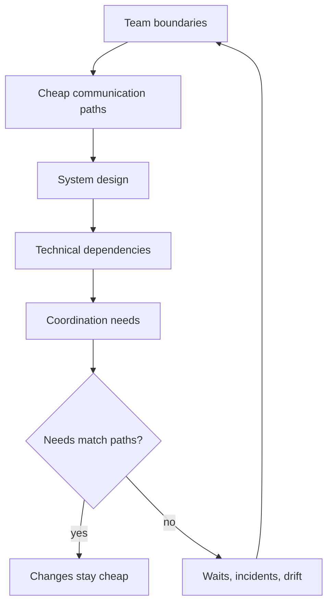
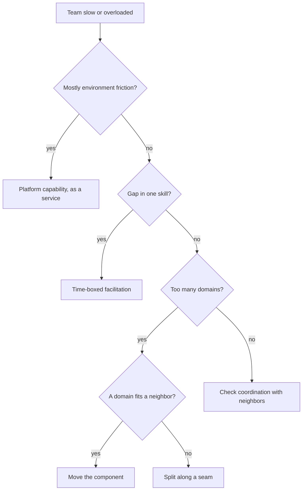
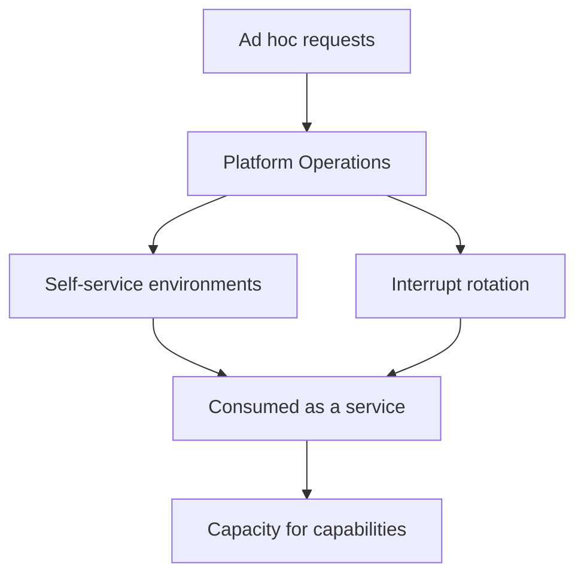

# Chapter 33 — Conway's Law, Team Topologies, and Cognitive Load

Every boundary between teams is also a boundary in the system, whether anyone drew it there on
purpose or not. This chapter covers three tools for drawing those boundaries deliberately. The first is
[Conway's law](../../glossary.md#conways-law-and-the-reverse-conway-maneuver), the observation that
systems copy the communication structure of the organizations that build them. The second is the
[team types and interaction modes](../../glossary.md#team-types-and-interaction-modes) of *Team
Topologies*. The third is team [cognitive load](../../glossary.md#cognitive-load), the total of domains,
systems, and interruptions a team must hold in its head. Each is useful and each is weaker as evidence
than its popularity suggests. The running example is the fictional
[Northstar Technologies](../../case-studies/northstar/index.md). Chapter 31 covers service boundaries,
Chapter 34 spans and dependency mapping, Chapter 35 designs at different scales, and Chapter 36
reorganizations.

## Why This Matters

At team scale, the question is whether a team can understand, change, and operate everything it owns.
A team that owns six domains and seven components, several inherited without runbooks, does not have a
motivation problem. Its structure guarantees shallow knowledge, slow reviews, and incidents in the
parts nobody knows well.

At organization scale, team boundaries decide where coordination is cheap and where it is expensive.
Inside a team, coordination is a stand-up; across teams it is queues and tickets, with waits. When the expensive boundaries fall where the system
is most tightly coupled, every change pays for the mismatch.

At executive scale, the organization chart is an architectural decision. A CTO who reorganizes for
reporting convenience changes which parts of the system get coherent design and which become nobody's.
A CTO who wants a different architecture without changing who talks to whom is usually disappointed.

## Learning Objectives

After this chapter you will be able to:

- Apply Conway's observation in both directions (organization shapes system; system constrains which
  organizations work) and state how strong the evidence for each direction is.
- Use the four team types and three interaction modes as a diagnostic vocabulary, and name where the
  model is thin.
- Estimate a team's cognitive load from observable proxies, and say which kind of load each action
  would remove.
- Size teams from communication cost and ownership scope, without leaning on numbers the evidence
  does not support.
- Choose between moving a component, adding a platform capability, an enabling engagement, and a
  team split, with the transition cost of each.

## The Mental Model

> **Mental model:** Coordination needs come from the system; coordination capacity comes from the
> organization. Where the two match, work is cheap. Where they do not, the system drifts toward the
> organization or the work slows down, and the team in the gap carries the load.

**Congruence, not structure.** The useful question is not "is this the right org chart?" but "do
the people whose code depends on each other have a cheap channel to coordinate?" Conway, the mirroring
research, and the congruence studies describe this one relationship from different sides.

**Load is the budget.** A team's capacity to understand things is limited, and every component,
domain, tool, and interrupt draws on it. A platform removes load from its users, an enabling engagement
turns an unfamiliar skill into a familiar one, and a team boundary decides which domains share a budget.

The loop runs both ways. Reading it from the top gives Conway's original direction: teams produce
designs shaped like their communication. Reading it from the middle gives the reverse: an existing
system creates coordination needs that any organization working on it must meet or pay for.

## Deep Conceptual Explanation

### What Conway argued, and the evidence since

Melvin Conway's 1968 essay argues that organizations which design systems are constrained to produce
designs that copy their communication structures
([Conway, 1968](../../references/bibliography.md#conway1968committees)): two subsystems get a
well-negotiated interface only if their designers talk. Two further points are usually dropped.
Organizing a design team already makes design decisions, because any assignment of people rules some
designs out. And since the right design changes as understanding grows, the organization must stay
flexible. The essay supports this with argument and anecdotes, not data: its label is **expert
opinion**.

Researchers call the idea the **mirroring hypothesis**: organizational ties (communication,
co-location, employment) correspond to the technical dependencies in the work. The forward direction
has direct evidence. MacCormack, Baldwin,
and Rusnak compared matched pairs of products with the same function, one built by a tightly coupled
commercial firm and one by a loosely coupled open source community. In every pair, the loosely coupled
organization's product was significantly more modular, measured by how far a change in one component
could propagate ([MacCormack et al., 2012](../../references/bibliography.md#maccormack2012mirroring)).
That is a **research finding** for the forward direction.

Mirroring is common but not universal, according to Colfer and Baldwin's review of 142 empirical
studies ([Colfer and Baldwin, 2016](../../references/bibliography.md#colfer2016mirroring)). It was
prevalent in industry and firm studies but not universal. In fast-changing industries, **partial
mirroring**, with knowledge boundaries drawn more broadly than operational boundaries, is likely the
better strategy. Firms can deliberately "break the mirror" with modular partitions or relational
contracts, and studies of open collaborative projects, mostly software, did not support the
hypothesis. They also argue that mirroring conserves scarce cognitive resources, which links it to the
rest of this chapter. The practical reading: a team can own a narrow set of components while
understanding its neighbors' interfaces and domain, and in a changing system that is often best.

### Socio-technical congruence: the system-to-organization direction

Work goes faster when coordination matches technical dependencies. Cataldo, Herbsleb, and Carley made
the idea measurable. They derive **coordination requirements** from
technical dependencies and compare them with the coordination that actually happens. When developers'
coordination matched their coordination needs, modification requests (change tickets) were
resolved significantly faster, and logical dependencies (files that change together) mattered far more than call or data
dependencies ([Cataldo et al., 2008](../../references/bibliography.md#cataldo2008congruence)). This
**research finding**, from a single study, gives a leader a test: find which teams' changes touch the same
code, and check whether those teams have a cheap channel. Herbsleb and Mockus found that work spread
across sites took about two and a half times as long as similar colocated work, and that more people
involved meant longer calendar time
([Herbsleb and Mockus, 2003](../../references/bibliography.md#herbsleb2003empirical)). Applying that to
team boundaries within one site is an inference, but the direction is consistent.

### The reverse Conway maneuver, and its evidence gap

If the system copies the organization, design the organization you want the system to copy: the
**reverse Conway maneuver**, which *Team Topologies* is known for promoting
([Skelton and Pais, 2019](../../references/bibliography.md#skelton2019team)). The logic
follows; the evidence does not yet. MacCormack's comparison concerns new products built by different
organizations, not a firm reorganizing around code it already has. An existing system pushes back:
teams aligned to value streams that all run through one shared module still coordinate on that module.
**This book's recommendation**: treat a reorganization as a necessary but slow lever on architecture.
It makes the target design cheaper to reach; someone still has to do the code work.

### Team types and interaction modes as vocabulary

*Team Topologies* proposes four team types and three interaction modes, summarized on the authors'
site ([Team Topologies key concepts](../../references/bibliography.md#teamtopologies-key-concepts)):

| Team type | Purpose |
|---|---|
| Stream-aligned | Aligned to a flow of work, usually from a segment of the business domain |
| Platform | Provides a compelling internal product that speeds up stream-aligned teams |
| Enabling | Helps stream-aligned teams overcome obstacles; detects missing capabilities |
| Complicated subsystem | Owns a part that needs deep specialist expertise |

| Interaction mode | What it is |
|---|---|
| Collaboration | Two teams work closely for a set period to discover something new |
| X-as-a-service | One team provides something; the other consumes it with little contact |
| Facilitation | One team helps and mentors another |

The vocabulary makes implicit choices testable. "Platform Operations is our platform team": does it
provide something other teams consume as a service, or run a ticket queue? "Orders and Billing
collaborate": since when, and until when? Collaboration without an end date is a missing boundary.

Where the model is thin:

- **A taxonomy, not a finding.** This book found no peer-reviewed validation that organizations using
  these types outperform others; the evidence is thin. Label: **practitioner consensus**,
  consistent with the mirroring and congruence research, untested as a package.
- **Most real traffic fits no mode.** Ad hoc requests, standards governance, incident escalation, and
  shared release trains are common, not exceptions.
- **Little about management.** Reporting lines, spans, and careers are outside it (Chapter 34).
- **It assumes a stream can be found.** In a monolith, several streams run through the same modules.
- **Platform as a product needs product skills** that infrastructure teams rarely have (Chapter 32).

### Cognitive load: origin and transfer

Cognitive load theory comes from learning research. Sweller argued that conventional problem solving
consumes so much limited processing capacity that little is left for building the schemas that
distinguish experts from novices, supported by a computational model and experiments
([Sweller, 1988](../../references/bibliography.md#sweller1988cognitive)): a **research finding** about
individual learners. *Team Topologies* borrows it for teams. It separates load intrinsic to the
problem, extraneous load from the environment, and germane load spent on learning, and argues that a
team's responsibilities should fit the load it can carry
([Skelton and Pais, 2019](../../references/bibliography.md#skelton2019team); **expert opinion**).

**Label the transfer.** A learner's working memory is not a team's capacity to own systems. "Team
cognitive load" is an analogy with no validated instrument this book could find. It is still useful because its proxies are observable: domains and components owned, how many
only one or two people can change safely, and time lost to interrupts and toolchain friction.
Developer-experience surveys treat cognitive load as one dimension
([DX, DevEx report](../../references/bibliography.md#dx-devex-report); Chapter 18); use them as one
input. The kinds of load call for different actions:

| Load | Northstar example | What removes it |
|---|---|---|
| Intrinsic: the domain | Pricing rules, ledger posting, multi-currency rounding | Fewer domains per team; a complicated-subsystem team for the hardest |
| Extraneous: the environment | Four build systems, environment requests, script deploys | Platform capabilities consumed as a service |
| Germane: learning | Orders learning core/customer after inheriting it | Time-boxed facilitation |

### Team size

Chapter 4 deferred team sizing here, and the evidence for specific numbers is thin. Conway already
noted that possible communication paths grow roughly with the square of headcount: *n* people form
*n*(*n*−1)/2 pairs, so 8 people have 28 pairs and 16 have 120. Brooks is known for the argument that
adding people adds communication and ramp-up overhead
([Brooks, 1995](../../references/bibliography.md#brooks1995mythical)). Numbers attributed to Dunbar's
research on social group size are often used to cap teams. This book does not use them, because that
research is about social groups, not software teams.

**This book's recommendation**, not a finding: everyone on a team should know its whole scope well
enough to review and be on call for it, and the stand-up should be coordination, not a status
broadcast. That tends to mean five to nine engineers. Keep the **team** (shared goal and board) apart
from the **reporting group** (shared manager): a manager can run two small teams (Chapter 34 owns
spans).

## Engineering Organization Example

!!! info "Northstar so far"
    Week 14, the start of quarter 2 of the director's first year. [Sev1 and
    Sev2](../../glossary.md#severity-sev1-sev2-sev3) incidents (the two most serious levels) fell from 30
    to 21 in quarter 1. In week 4 orphaned components got owners, and in week 10 the seven QA engineers
    joined product teams. See the [timeline](../../case-studies/northstar/timeline.md). New to
    Northstar? Read [the year in brief](../../case-studies/northstar/year-in-brief.md) and the
    [cast](../../case-studies/northstar/cast.md).

This example assesses one team at Northstar, the book's fictional company. In week 14 the director asks
Priya Raman (Orders manager) to assess the cognitive load of Orders: 14 engineers plus, since week 10,
two quality engineers. All figures are **illustrative**.

**Scope.** Orders now owns seven components across six domains: order capture, catalog, pricing (two
components), search, customer data (from week 4), and notifications (from quarter 2). Four are
[tier 1](../../glossary.md#tier-1), the most business-critical tier. Bulk ordering, due in week 26,
occupies 5 Orders engineers. Priya has said she would accept core/permissions, a tier 1 Core module
changed by four teams and unowned since baseline, after week 26.

**Knowledge map.** As Billing did for its ledger (Chapter 12), Priya counts the Orders engineers who
could change each component safely today. Operational columns are from the baseline component file.

| Component | Tier | Engineers who can change it safely | Runbook, alerts at baseline | Sev1 and Sev2, baseline quarter |
|---|---|---|---|---|
| core/order-capture | 1 | 9 | yes, partial | 4 |
| core/pricing-rules | 1 | 4 | no, partial | 1 |
| pricing-svc | 1 | 5 | yes, yes | 0 |
| core/customer | 1 | 2 | no, no | 0 |
| core/catalog | 2 | 3 | no, partial | 1 |
| search-svc | 2 | 0 (its authors are in Data and Analytics) | no, partial | 1 |
| notification-svc | 2 | 3 have committed to it; none has operated it | no, no | 0 under Orders (its incident, INC-412, was Customer Experience's) |
| **Total** | | | | **7** |

**Capacity arithmetic.** Assumptions: a 13-week quarter; unplanned work at Orders' baseline 36
percent (the organization's fell from 34 to 31 percent in quarter 1; Orders' quarter 2 figure is not
known); prevention at the quarter 1 share of 10 percent; quality engineers and Priya not counted.

| Item | Engineer-weeks |
|---|---|
| 14 engineers × 13 weeks | 182 |
| Unplanned work at 36 percent | −65.5 |
| Bulk ordering, 5 engineers × 13 weeks | −65 |
| Prevention at 10 percent of 182 | −18.2 |
| **Left for everything else** | **33.3, about 2.6 engineers** |

Those 2.6 engineers must cover the rest of Orders' roadmap. They must also give core/customer the
[tier 1 operational minimums](../../glossary.md#tier-1-operational-minimums) (owner, runbook, alerts,
on-call), give notification-svc a runbook and alerts, and support the permissions extraction from
core/customer led by Ines Carvalho (staff engineer, Core domain).

**Reading it by kind of load.** Intrinsic load is spread across six domains, with two components at
two or fewer capable engineers. Germane load is high and unfunded: nobody has time to learn
core/customer or notification-svc. Extraneous load is falling (weekly Core releases, fewer flaky tests)
but Jenkins and the release train remain. And 16 people form 120 pairs. The options are in the Case
Study and exercise X1.

## Decision Framework

Start from the symptom, find the kind of load or mismatch behind it, then choose the smallest move
that removes it.

| Signal | Likely cause | Move | Transition cost |
|---|---|---|---|
| Interrupts and environment waits dominate | Extraneous load | Self-service platform capability; publish the team's interface | Platform team builds instead of answers for a quarter |
| One unfamiliar technology or practice | Germane load without support | Facilitation with an exit criterion | The facilitator's time; the team's slower pace while learning |
| Many domains, few people per component | Intrinsic load too broad | Move a component to a team whose domain it fits | Knowledge transfer, an on-call change, a period of shared support |
| Many domains and a natural seam | Team too big for one scope | Split into two stream-aligned teams | A second manager (flat headcount: an engineer's seat), weeks of disruption, a new boundary to coordinate across |
| Two teams' changes keep touching the same code | Congruence gap | Collaboration for a set period with a goal, then a contract or a move | Both teams slower during the period |
| A hard, specialist part slows a stream team | Intrinsic load concentrated | Complicated-subsystem team, only if the specialty is real and lasting | A new interface; specialists drift from customer outcomes |

Two rules apply throughout. Prefer moves that remove load over moves that add people, because the
headcount rarely exists. And do not change a boundary to fix a problem that a missing contract,
runbook, or alert would fix.

## Trade-offs

**Ownership against load.** Giving every component a clear owner (Chapters 20 and 24) is right, and
it raises the receiving team's load. Northstar's week 4 decisions fixed orphaned components by adding
them to teams that were already full. The trade-off is real, and the fix is to fund the learning,
not to leave components orphaned.

**Stream alignment against specialist depth.** Splitting the ledger expertise across stream teams
spreads three experts thinner. Concentrating it in a complicated-subsystem team creates an interface
every billing change must cross. Chapter 12's knowledge spreading is often the better first step.

**Stable teams against changing boundaries.** Conway argued organizations must stay flexible as the
design changes; *Team Topologies* emphasizes keeping teams together. Both are right at different time
scales: move components between stable teams often, and move people between teams rarely.

**Mirroring against breaking the mirror.** Following the mirror (one team per component cluster) is
cheap to coordinate. Breaking it deliberately with strong contracts (Chapter 22's contract tests, a
versioned interface) lets teams share a boundary without sharing a team. It costs interface
discipline.

**Transition cost.** Every boundary change costs weeks: on-call handover, review rights, lost context,
a throughput dip, and anxiety about reporting lines (Chapter 36). If a change is not worth a quarter of
disruption, do not make it mid-commitment.

## Failure Modes

**The org chart redraw.** Teams get *Team Topologies* labels and nothing else changes. Detect it: ask
each "platform" team which capability another team consumes without filing a ticket.

**The reverse Conway fantasy.** A reorganization announced as the way to get a new architecture, with
no funded code work. Detect it: the reorganization plan has no list of modules to split, contracts to
write, or months of engineering attached.

**Load laundering.** Orphaned components are assigned to whichever team can be talked into them, and
the organization reports "100 percent ownership". Detect it: owned components where nobody on the
owning team can change them safely, as with search-svc in Orders.

**The interrupt-sink platform.** A team called platform whose real job is answering everyone's
requests. Detect it: its unplanned share is the highest in the organization and it receives the most
dependency links. A dependency link is one work item of a week or more in which one team needed
another, counted per quarter. At Northstar's baseline, Platform Operations spent 46 percent of its
capacity on unplanned work and received 29 of the 86 links.

**Permanent collaboration.** Two teams "collaborating" for years because nobody decided the boundary.
Detect it: no end date, and a release-channel argument about whose change broke whose code.

**The gamed load survey.** Teams report high load to shed work or win headcount, or low load out of
pride. Detect it: compare survey answers with the objective proxies (components per engineer,
knowledge counts, unplanned share), and never tie the score to headcount directly.

## Enterprise Application

At 50 to 150 engineers, the director should not redesign every team at once. Three practices scale.

First, keep a **team-and-component map**: every component, its owning team, its tier, how many
engineers can change it safely, and its on-call coverage. Northstar's component file is most of this
already; adding the knowledge count turns an ownership list into a load picture.

Second, review **congruence** quarterly. Use the dependency matrix from Chapter 16 and, where
available, co-change data from version control (which teams' merge requests touch the same modules).
For each pair with heavy coupling, ask whether the teams have a defined interaction mode and an end
date for any collaboration. Northstar's core/permissions had 38 merge requests from four teams in the
baseline quarter and no owner: a coupling with no channel.

Third, publish each team's **type and interface** in its charter (Chapter 12): what it provides as a
service, what it facilitates, and which collaborations it is in until when. The point is not the label
but deliberate interactions with visible cost.

At this size a dedicated enabling team is rarely affordable. Staff engineers often fill that role,
which works only if each engagement has a team, a goal, and an exit (Chapter 29 owns staff roles).

## CTO Perspective

At executive scale, team design is architecture strategy carried out through people.

**The organization chart is a long-lived design decision.** A CTO choosing between organizing by
product line, by customer segment, or by platform layer is choosing which future changes will be cheap.
Ask what the next two years of change will cross, and put team boundaries where change rarely crosses.

**Reorganizations are expensive and partial.** The mirroring evidence supports the claim that
organization shapes architecture. It does not promise that a reorganization will reshape an existing
system quickly. Fund the engineering work alongside the reorganization, and expect a year, not a
quarter. Chapter 36 owns the change process.

**Cognitive load is a capacity constraint the budget does not show.** A CFO sees 80 engineers. The CTO
should see how many domains each team carries and where knowledge is one person deep. When asked why 14
engineers cannot take one more product, the honest answer is load, and the knowledge map is the evidence.

## Practical Playbook

1. **List components and domains per team**, with tier, on-call, runbook, and alerts. Use the existing
   ownership inventory if there is one.
2. **Add a knowledge count** to each component: engineers who could change it safely today. Flag every
   tier 1 component with two or fewer.
3. **Classify the load** for each overloaded team as mostly intrinsic, extraneous, or germane, using
   unplanned-work categories and the team's own account.
4. **Label each team's closest type** and write down where the label is untrue. Do not rename teams.
5. **Map interactions** from the dependency matrix; mark each heavy pair as collaboration (with an end
   date), service (with an interface), facilitation (with an exit), or undefined.
6. **Choose the smallest move** per overloaded team using the decision framework; price its transition
   cost in engineer-weeks and calendar weeks.
7. **Sequence around commitments.** Do not move a boundary that a committed delivery depends on
   before that delivery lands, unless the boundary is what is blocking it.
8. **Recheck after a quarter**: knowledge counts, unplanned share, cross-team links, incidents in
   recently moved components.

## Case Study

This case is **fictional** and set at Northstar at the start of quarter 2 (week 14); the outcomes are
open. Platform Operations is five infrastructure engineers under its manager, Tom Becker.

| Team | Closest type | Where the label is untrue |
|---|---|---|
| Orders | Stream-aligned (ordering) | Six domains, seven components |
| Billing | Stream-aligned (invoice to ledger) | The ledger behaves like a complicated subsystem with three experts |
| Payments and Integrations | Stream-aligned | Two streams (payments, customer integrations) |
| Customer Experience | Organized by channel | Depends on Orders more than on any other team; its own structure is undecided |
| Data and Analytics | Mixed | Customer reporting plus other teams' requests (12 percent of its capacity) |
| Platform Operations | Platform in name | Interrupt sink; also runs auth-svc, a tier 1 service on every login path |
| Staff engineers | Enabling, perhaps | Three individuals with decision rights over standards |

**Conway at Northstar.** notification-svc was owned by Customer Experience while most commits came
from Orders and Billing. [INC-412](../../glossary.md#inc-numbers), in which a renamed template variable
sent blank order confirmations, is a congruence gap between the people changing the code and the people
operating it. The quarter 2 move to Orders aligns ownership with the main committers and adds to
Orders' load. search-svc is nominally Orders', written by engineers now in Data and Analytics, with
nobody on call.

**Platform Operations as interrupt sink.** It received 29 of 86 dependency links and spent 46 percent
of its capacity on unplanned work. The quarter 2 interrupt rotation and self-service test environments
are its first platform behavior: something consumed as a service rather than requested. By week 18
other teams' requests fell from 20 to 14 percent of its capacity. Still missing: a list of capabilities
teams consume, a roadmap, and a decision on whether auth-svc belongs with an infrastructure team.

**Staff engineers as enabling.** Kwame Mensah's release working group, which quarantined flaky tests
with owners from each team, is facilitation with a goal. Ines Carvalho's baseline eight hours a week of
unscheduled Core questions were a dependency. The director's working rule: an engagement counts as
enabling only if it names a team, a capability, and a date after which the team no longer needs the
staff engineer (Chapter 29 owns staff roles).

**Orders: the decision.** The assessment above leaves about 2.6 engineers for everything except bulk
ordering and prevention.

| Option | What it removes | Transition cost |
|---|---|---|
| A. Fund learning only | Some germane load | Scarce capacity; keeps six domains |
| B. Move search-svc to Data and Analytics | A zero-knowledge component | Adds load to a team giving 12 percent of its capacity to requests |
| C. Split Orders after week 26 (ordering; pricing and catalog) | Halves domains per team | A second manager under flat headcount (an engineer's seat, not backfilled); a new boundary; weeks of disruption |
| D. Defer core/permissions | Prevents more load | A tier 1 module unowned longer, under its exemption (a recorded, time-limited waiver) |

The director's leaning: no structural move in quarter 2, while bulk ordering is in flight. Defer core/permissions
(D) in any case. Revisit moving search-svc (B) and splitting Orders (C) after bulk ordering ships in
week 26.

Two facts bear on B and C. Data and Analytics' draft charter lists search-svc as disputed, so B needs
that team's agreement, not only a decision. And C needs a seventh manager, which Victor Lindqvist (CTO)
would have to approve. Rafael Duarte, a senior engineer in Orders, has asked about the management
track, so a candidate exists; but a split must be justified by the work, not by a person's career.
Exercise X1 asks you to decide.

## Exercises

Worked solutions: [Chapter 33 solutions](../../solutions/ch33-solutions.md).

### Foundational

**F1.** Using the Case Study's team-type table and the component file, classify each Northstar team and
the staff engineers by the four team types. For each, name one observable fact that supports the
label and one that contradicts it. Then pick the single mismatch you think costs Northstar the most
right now, and say what evidence would convince you that you were wrong.

**F2.** notification-svc was owned by Customer Experience while most of its commits came from Orders
and Billing, and INC-412 sent blank order confirmations after a template variable was renamed. Explain
the incident using Conway's observation and socio-technical congruence. Then predict which problems the
quarter 2 move to Orders will fix and which it will not, given that Billing still commits to it.

**F3.** A manager proposes that no Northstar team may exceed 15 people, citing a well-known number from
research on social group size, and argues that Orders (16 reports) is therefore over the limit while
Billing (15 reports) is fine. Evaluate the argument: what the cited research is about, what the
communication arithmetic says about teams of 8, 15, and 16, and what you would use instead.

### Applied Leadership

**A1.** Run the chapter's cognitive load assessment for Billing at the start of quarter 2. Billing owns
core/invoicing, core/ledger, and tax-svc (all tier 1), invoice-render (tier 2), and since week 4
core/scheduler (tier 2), with 13 engineers and two quality engineers. Its baseline unplanned work was 41
percent. Three ledger engineers handled 126 of Billing's 180 pages in the baseline quarter. The ledger
knowledge map from the baseline page:

| Ledger area | Engineers who can respond alone | Engineers who can change it safely |
|---|---|---|
| Posting and journal rules | 3 | 3 |
| Credit notes and adjustments | 4 | 2 |
| Period close | 2 | 1 |
| Schema migrations | 2 | 2 |
| Currency and rounding | 1 | 1 |

Classify the load, identify the top risk, and choose one move with its transition cost.

**A2.** Platform Operations is five infrastructure engineers, runs a two-person interrupt rotation, and
saw requests from other teams fall from 20 to 14 percent of its capacity by week 18. Tom Becker asks what "being a
platform team" should mean for the next two quarters. Write the interaction mode you would set with
each product team, the first two capabilities to offer as a service, and what you would do about
auth-svc.

**A3.** Ines Carvalho (staff engineer, Core domain) leads the funded permissions extraction from core/customer, which Orders now
owns. Assume she still answers about eight hours a week of unscheduled Core questions, as at baseline. Design her quarter 2
work as one or more enabling engagements: which team, which capability, what exit criterion, and what
happens to the unscheduled questions. Say how you would know in week 20 whether it is working.

### Executive Decision-Making

**X1.** Decide Orders' structure for quarters 2 and 3 among the four options in the Case Study, or a
combination. Bulk ordering is due in week 26 with 5 Orders engineers on it, headcount is flat, and
core/permissions is still unowned. Write the recommendation you would take to Victor Lindqvist (CTO),
including sequencing, transition costs in engineer-weeks, and what you would measure to know it worked.

**X2.** Victor Lindqvist reads about the reverse Conway maneuver and proposes reorganizing all six teams
around four value streams at the start of quarter 3, so that Core, the Java monolith, "breaks apart
along the new lines". [Constraint 3](../../glossary.md#the-five-constraints) means no rewrite of Core is
funded. Assess the proposal against the evidence in this chapter, name what it
would cost, and propose what you would do instead or first. Treat Customer Experience's own structure
as given.

## Reflection Questions

- Which boundary in your organization exists because of a past reporting decision rather than the
  system's structure, and what does it cost each change that crosses it?
- If you listed every component your team owns with the number of people who could change it safely,
  which line would you least like your manager to read?
- Where are you calling something "collaboration" that has no end date?
- Which team in your organization is a platform in name and an interrupt queue in practice?
- What evidence would persuade you that your organization's structure, not its people, is the main
  reason a team is slow?

## Key Takeaways

- Conway's observation holds as a strong tendency: the mirroring and congruence research supports it,
  with real exceptions. Treat it as a tendency to manage, not a law.
- Look for congruence gaps: code that changes together, owned by teams with no cheap channel.
- The reverse Conway maneuver makes a target architecture cheaper to reach; it does not do the code
  work. Fund both.
- Use team types and interaction modes as vocabulary for deliberate choices, and say where each label
  is untrue.
- Team cognitive load is an analogy from learning research; measure it through proxies: domains per
  team, knowledge counts, unplanned share.
- Match the move to the load: platform capabilities for extraneous load, facilitation for germane
  load, moving or splitting for intrinsic load spread too wide.
- An orphaned component assigned to a full team is owned on paper only; fund the learning.
- Size teams so everyone can review and support the whole scope; separate team size from management
  span.
- Price every boundary change in transition cost; sequence it around committed deliveries.

## References and Further Reading

- [Conway, 1968](../../references/bibliography.md#conway1968committees). The original essay; short,
  and an argument rather than a study.
- [MacCormack et al., 2012](../../references/bibliography.md#maccormack2012mirroring). Matched-pair
  test of mirroring in software products.
- [Colfer and Baldwin, 2016](../../references/bibliography.md#colfer2016mirroring). Review of 142
  studies; partial mirroring and breaking the mirror.
- [Cataldo et al., 2008](../../references/bibliography.md#cataldo2008congruence). Socio-technical
  congruence as a measurement.
- [Herbsleb and Mockus, 2003](../../references/bibliography.md#herbsleb2003empirical). The
  calendar-time cost of crossing boundaries.
- [Skelton and Pais, 2019](../../references/bibliography.md#skelton2019team). Team types, interaction
  modes, and team cognitive load as vocabulary.
- [Team Topologies key concepts](../../references/bibliography.md#teamtopologies-key-concepts). The
  authors' own summary.
- [Sweller, 1988](../../references/bibliography.md#sweller1988cognitive). The learning-research origin
  of cognitive load.
- [Brooks, 1995](../../references/bibliography.md#brooks1995mythical). Communication overhead as
  teams grow.
- [DX, DevEx report](../../references/bibliography.md#dx-devex-report). Cognitive load as a
  developer-experience dimension.
