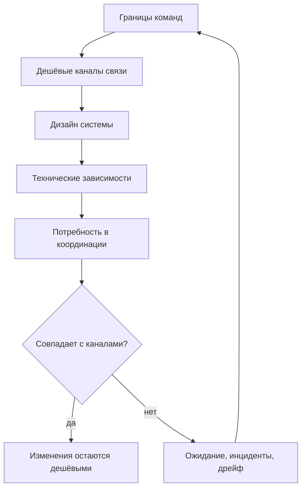
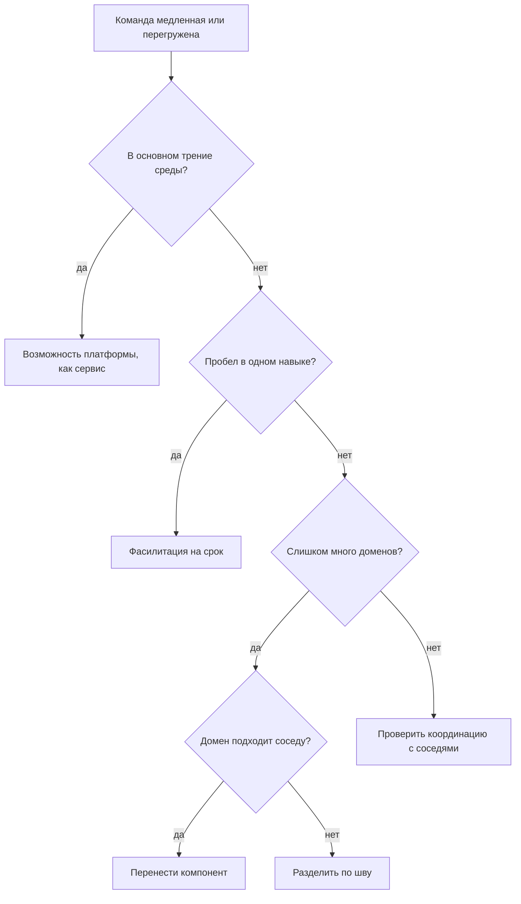
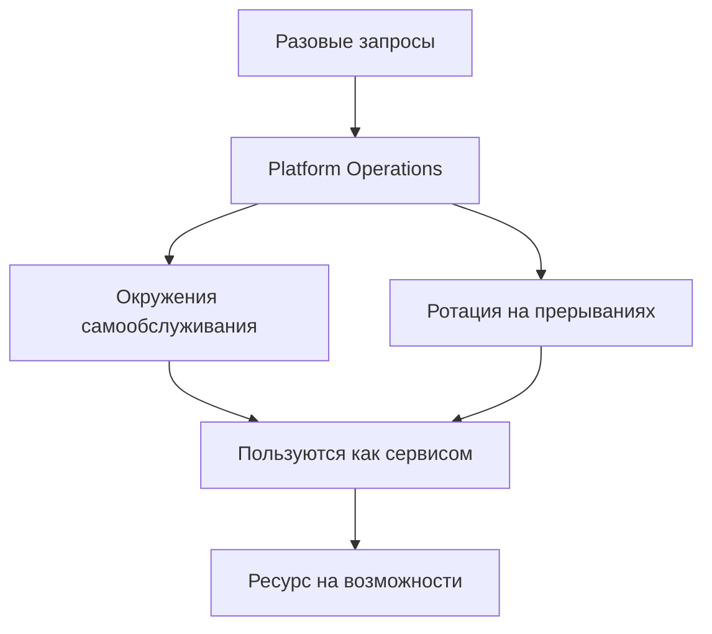

# Глава 33 — Закон Конвея, Team Topologies и когнитивная нагрузка { #chapter-33-conways-law-team-topologies-and-cognitive-load }

Любая граница между командами — это ещё и граница в системе, намеренно её провели или нет. В главе
разобраны три инструмента, которые помогают проводить такие границы осознанно. Первый — [закон
Конвея](../../glossary.md#conways-law-and-the-reverse-conway-maneuver): системы копируют структуру
коммуникации организаций, которые их строят. Второй — [типы команд и режимы
взаимодействия](../../glossary.md#team-types-and-interaction-modes) из книги *Team Topologies*. Третий —
[когнитивная нагрузка](../../glossary.md#cognitive-load) команды, то есть все домены, системы и
прерывания, которые команде приходится держать в голове. Все три полезны, но доказательная база у каждого
слабее, чем можно подумать по его популярности. Сквозной пример — вымышленная компания [Northstar
Technologies](../../case-studies/northstar/index.md). Границы сервисов разбирает глава 31, охват
управления и карту зависимостей — глава 34, проектирование организаций разного масштаба — глава 35,
реорганизации — глава 36.

## Почему это важно { #why-this-matters }

Для отдельной команды вопрос в том, может ли она понимать, менять и эксплуатировать всё, чем владеет.
Если команде принадлежат шесть доменов и семь компонентов, причём несколько достались ей по наследству
без ранбуков (runbook), дело не в мотивации. Сама структура обрекает её на поверхностные знания,
медленные ревью и инциденты в тех частях, которые никто толком не знает.

В масштабе организации границы команд определяют, где координация дешёвая, а где дорогая. Внутри
команды координация — это стендап, между командами — очереди и тикеты с ожиданием. Если дорогие
границы приходятся на места, где система связана теснее всего, за это несовпадение платит каждое
изменение.

Для высшего руководства организационная структура — архитектурное решение. Реорганизуя компанию ради
удобства схемы подчинения, CTO (технический директор) заодно решает, какие части системы получат
целостный дизайн, а какие станут ничьими. А CTO, который хочет другую архитектуру, но не меняет того, кто
с кем общается, обычно остаётся разочарован.

## Цели главы { #learning-objectives }

Прочитав эту главу, вы сможете:

- Применять наблюдение Конвея в обе стороны (организация формирует систему; система ограничивает, какие
  организации могут с ней работать) и называть, насколько сильны доказательства для каждого направления.
- Пользоваться четырьмя типами команд и тремя режимами взаимодействия как диагностическим словарём и
  называть места, где модель слаба.
- Оценивать когнитивную нагрузку команды по наблюдаемым косвенным признакам и называть, какой вид
  нагрузки снимет каждое действие.
- Определять размер команд по стоимости коммуникации и объёму владения, не опираясь на числа, которые не
  подкреплены доказательствами.
- Выбирать между переносом компонента, новой возможностью платформы, работой команды содействия и
  разделением команды, учитывая стоимость перехода для каждого варианта.

## Ментальная модель { #the-mental-model }

> **Ментальная модель:** потребность в координации задаёт система, а возможность координироваться —
> организация. Там, где они совпадают, работа дешёвая. Там, где нет, система постепенно подстраивается
> под организацию или работа замедляется, а нагрузку несёт команда, оказавшаяся в разрыве.

**Важна согласованность, а не структура.** Полезно спрашивать не «правильная ли у нас оргструктура?», а
«есть ли дешёвый канал для координации у людей, чей код зависит друг от друга?». Конвей, исследования
зеркального отражения и исследования согласованности описывают одну и ту же связь с разных сторон.

**Нагрузка — это бюджет.** Команда может держать в понимании лишь ограниченный объём, и этот запас
расходует каждый компонент, домен, инструмент и каждое прерывание. Платформа снимает нагрузку с
пользователей, работа команды содействия превращает незнакомый навык в знакомый, а граница команды
определяет, какие домены делят один бюджет.

Петлю можно читать в обе стороны. Сверху — это исходное направление Конвея: команды создают дизайны,
повторяющие их коммуникацию. С середины — обратное: уже существующая система порождает потребность в
координации, и любой организации, которая над ней работает, придётся эту потребность либо удовлетворить,
либо платить за то, что она не удовлетворена.

## Подробный разбор { #deep-conceptual-explanation }

### Что утверждал Конвей и что показали исследования с тех пор { #what-conway-argued-and-the-evidence-since }

В эссе 1968 года Melvin Conway утверждает, что организации, которые проектируют системы, вынуждены
создавать дизайны, копирующие их структуры коммуникации ([Conway,
1968](../../references/bibliography.md#conway1968committees)): хорошо согласованный интерфейс между двумя
подсистемами получится, только если их проектировщики общаются друг с другом. Ещё два его тезиса обычно
упускают. Во-первых, организуя команду проектировщиков, вы уже принимаете проектные решения, потому что
любое распределение людей исключает какие-то дизайны. Во-вторых, правильный дизайн меняется по мере того,
как растёт понимание задачи, поэтому организация должна оставаться гибкой. Conway подкрепляет это
рассуждениями и примерами из практики, а не данными, так что это **мнение эксперта**.

Исследователи называют эту идею **гипотезой зеркального отражения (mirroring hypothesis)**:
организационные связи (коммуникация, работа в одном месте, общий работодатель) соответствуют техническим
зависимостям в работе. Для прямого направления есть прямые доказательства. MacCormack, Baldwin и Rusnak
сравнили пары продуктов с одинаковой функцией: в каждой паре один продукт создала тесно связанная
коммерческая фирма, другой — слабо связанное open source-сообщество. И в каждой паре продукт слабо
связанной организации оказался значимо модульнее. Модульность измеряли по тому, насколько далеко может
распространиться изменение в одном компоненте ([MacCormack et al.,
2012](../../references/bibliography.md#maccormack2012mirroring)). Для прямого направления это **научный
результат**.

Зеркальное отражение распространено, но не универсально: к такому выводу пришли Colfer и Baldwin в обзоре
142 эмпирических исследований ([Colfer and Baldwin,
2016](../../references/bibliography.md#colfer2016mirroring)). В исследованиях отраслей и фирм оно
преобладало, но встречалось не везде. В быстро меняющихся отраслях лучшей стратегией, вероятно, будет
**частичное отражение**: границы знаний проводят шире, чем операционные границы. Фирмы могут намеренно
«разбить зеркало» с помощью модульного разбиения или договорённостей, основанных на отношениях. А
исследования открытых совместных проектов, в основном программных, гипотезу не подтвердили. Кроме того,
авторы утверждают, что зеркальное отражение экономит дефицитные когнитивные ресурсы, и этим оно связано с
остальной частью главы. Практический вывод: команда может владеть узким набором компонентов и при этом
понимать интерфейсы и предметную область соседей. В меняющейся системе это часто лучший вариант.

### Социотехническая согласованность: от системы к организации { #socio-technical-congruence-the-system-to-organization-direction }

Работа идёт быстрее, когда координация соответствует техническим зависимостям. Cataldo, Herbsleb и Carley
сделали эту идею измеримой. Они выводят **потребности в координации** из технических зависимостей и
сравнивают их с фактической координацией. Когда координация разработчиков соответствовала их
потребностям, запросы на изменение (тикеты на изменения) закрывались значимо быстрее. При этом логические
зависимости (файлы, которые меняются вместе) значили гораздо больше, чем зависимости по вызовам или по
данным ([Cataldo et al., 2008](../../references/bibliography.md#cataldo2008congruence)). Этот **научный
результат** получен в одном исследовании, но он даёт руководителю способ проверки: найдите команды, чьи
изменения затрагивают один и тот же код, и посмотрите, есть ли у них дешёвый канал связи. Herbsleb и
Mockus обнаружили, что работа, распределённая между площадками, занимала примерно в два с половиной раза
больше времени, чем похожая работа в одном месте, причём чем больше людей в ней участвовало, тем дольше
она длилась по календарю ([Herbsleb and Mockus,
2003](../../references/bibliography.md#herbsleb2003empirical)). Перенос этого вывода на границы команд
внутри одной площадки — уже умозаключение, хотя направление то же.

### Обратный манёвр Конвея и пробел в доказательствах { #the-reverse-conway-maneuver-and-its-evidence-gap }

Если система копирует организацию, спроектируйте ту организацию, которую система должна скопировать. Это
**обратный манёвр Конвея**, и именно его продвижением известна *Team Topologies* ([Skelton and Pais,
2019](../../references/bibliography.md#skelton2019team)). Логика стройная, а доказательств пока нет.
MacCormack с соавторами сравнивали новые продукты, созданные разными организациями, а не фирму, которая
перестраивается вокруг уже существующего кода. Существующая система сопротивляется. Если все потоки
создания ценности проходят через один общий модуль, команды, выстроенные по этим потокам, всё равно
координируются на нём. **Рекомендация книги**: считайте реорганизацию необходимым, но медленным рычагом
воздействия на архитектуру. Она удешевляет путь к целевому дизайну, но саму работу с кодом всё равно
кому-то придётся сделать.

### Типы команд и режимы взаимодействия как словарь { #team-types-and-interaction-modes-as-vocabulary }

*Team Topologies* предлагает четыре типа команд и три режима взаимодействия; авторы кратко описывают
их на своём сайте ([Team Topologies key concepts](../../references/bibliography.md#teamtopologies-key-concepts)):

| Тип команды | Назначение |
|---|---|
| Потоковая (stream-aligned) | Выстроена по потоку работы, обычно из одного сегмента предметной области бизнеса |
| Платформенная | Предоставляет привлекательный внутренний продукт, который ускоряет потоковые команды |
| Команда содействия (enabling) | Помогает потоковым командам преодолевать препятствия; выявляет недостающие возможности |
| Команда сложной подсистемы | Владеет частью, которая требует глубокой узкоспециальной экспертизы |

| Режим взаимодействия | Что это |
|---|---|
| Сотрудничество | Две команды тесно работают вместе в течение заданного срока, чтобы найти что-то новое |
| X как сервис | Одна команда что-то предоставляет, другая этим пользуется почти без контактов |
| Фасилитация | Одна команда помогает другой и обучает её |

Этот словарь помогает проверить решения, принятые неявно. «Platform Operations — наша платформенная
команда»: предоставляет ли она что-то, чем другие команды пользуются как сервисом, или разбирает очередь
тикетов? «Orders и Billing сотрудничают»: с какого времени и до какого? Сотрудничество без даты окончания
значит, что границу так и не провели.

Где модель слаба:

- **Это таксономия, а не научный результат.** Рецензируемых исследований, которые подтверждали бы, что
  организации с такими типами команд работают лучше других, книга не нашла; доказательств мало. Метка —
  **консенсус практиков**: модель согласуется с исследованиями зеркального отражения и согласованности,
  но целиком не проверялась.
- **Большая часть реального взаимодействия не подходит ни под один режим.** Разовые запросы, управление
  стандартами, эскалации инцидентов и общие релизные поезда — это повседневность, а не исключения.
- **Об управлении людьми в модели почти ничего нет.** Линии подчинения, охват управления и карьера в неё
  не входят (глава 34).
- **Модель предполагает, что поток можно выделить.** В монолите через одни и те же модули проходит
  несколько потоков.
- **Платформе как продукту нужны продуктовые навыки**, которых у инфраструктурных команд обычно нет
  (глава 32).

### Когнитивная нагрузка: происхождение и перенос { #cognitive-load-origin-and-transfer }

Теория когнитивной нагрузки пришла из исследований обучения. Sweller утверждал, что обычное решение задач
поглощает так много ограниченных ресурсов обработки информации, что на построение схем знаний почти
ничего не остаётся, а именно схемы и отличают экспертов от новичков. Вывод опирался на вычислительную
модель и эксперименты ([Sweller, 1988](../../references/bibliography.md#sweller1988cognitive)); это
**научный результат**, относящийся к отдельным учащимся. *Team Topologies* переносит его на команды. Её
авторы различают три вида нагрузки: внутреннюю (intrinsic), присущую самой задаче; внешнюю (extraneous),
которую создаёт среда; учебную (germane), которая уходит на обучение. Обязанности команды, утверждают
они, должны соответствовать нагрузке, которую она способна нести ([Skelton and Pais,
2019](../../references/bibliography.md#skelton2019team); **мнение эксперта**).

**Обозначьте перенос явно.** Рабочая память учащегося — не то же самое, что способность команды владеть
системами. «Когнитивная нагрузка команды» — аналогия, и проверенного инструмента для её измерения книга
не нашла. Аналогия всё равно полезна, потому что её косвенные признаки можно наблюдать: сколько доменов и
компонентов у команды, сколько из них безопасно могут менять только один или два человека, сколько
времени уходит на прерывания и борьбу с инструментами. В опросах об опыте разработчиков когнитивная
нагрузка — одно из измерений ([DX, DevEx report](../../references/bibliography.md#dx-devex-report);
глава 18); используйте их как один из источников данных. Разные виды нагрузки требуют разных действий:

| Нагрузка | Пример Northstar | Что её снимает |
|---|---|---|
| Внутренняя: предметная область | Правила ценообразования, проводки ledger, округление при нескольких валютах | Меньше доменов на команду; для самых сложных — команда сложной подсистемы |
| Внешняя: среда | Четыре системы сборки, заявки на окружения, развёртывание скриптами | Возможности платформы, которыми пользуются как сервисом |
| Учебная: обучение | Orders осваивает core/customer, получив его во владение | Фасилитация с ограниченным сроком |

### Размер команды { #team-size }

Вопрос о размере команды глава 4 отложила до этой главы. Доказательства в пользу конкретных чисел слабы.
Ещё Конвей заметил, что число возможных каналов коммуникации растёт примерно как квадрат численности: *n*
человек образуют *n*(*n*−1)/2 пар, так что у 8 человек 28 пар, а у 16 — 120. Brooks известен доводом о
том, что новые люди добавляют затраты на коммуникацию и на вхождение в работу ([Brooks,
1995](../../references/bibliography.md#brooks1995mythical)). Чтобы ограничить размер команд, часто
ссылаются на числа, которые приписывают исследованиям Dunbar о размере социальных групп. Книга ими не
пользуется: эти исследования посвящены социальным группам, а не командам разработки.

**Рекомендация книги**, а не научный результат: каждый в команде должен знать всю её область
ответственности достаточно хорошо, чтобы делать ревью и дежурить по ней, а стендап — служить координации,
а не пересказу статусов. Обычно это от пяти до девяти инженеров. Отличайте **команду** (общая цель и
доска задач) от **группы подчинения** (общий руководитель): один руководитель может вести две небольшие
команды (охват управления разбирает глава 34).

## Пример из инженерной организации { #engineering-organization-example }

!!! info "Northstar: что уже известно"
    Неделя 14, начало квартала 2 первого года директора. Число инцидентов
    [Sev1 и Sev2](../../glossary.md#severity-sev1-sev2-sev3) (два самых серьёзных уровня) в
    квартале 1 упало с 30 до 21. На неделе 4 у бесхозных компонентов появились владельцы, а на
    неделе 10 семь QA-инженеров перешли в продуктовые команды. См.
    [хронологию](../../case-studies/northstar/timeline.md). Впервые читаете о Northstar? Прочитайте
    [«Год вкратце»](../../case-studies/northstar/year-in-brief.md) и
    [действующих лиц](../../case-studies/northstar/cast.md).

В этом примере разбирается одна команда Northstar — вымышленной компании этой книги. На неделе 14
директор просит Priya Raman (руководитель Orders) оценить когнитивную нагрузку Orders. В команде
14 инженеров, а с недели 10 ещё и два инженера по качеству. Все цифры — **иллюстрация**.

**Область ответственности.** Сейчас Orders владеет семью компонентами в шести доменах: приём заказов,
каталог, ценообразование (два компонента), поиск, данные клиентов (с недели 4) и уведомления (с
квартала 2). Четыре компонента относятся к [tier 1](../../glossary.md#tier-1), самому критичному для
бизнеса уровню. Массовым заказом, который нужно сдать на неделе 26, заняты 5 инженеров Orders. Priya
Raman сказала, что после недели 26 готова взять core/permissions — модуль Core уровня tier 1: его меняют
четыре команды, а владельца у него нет с базового квартала.

**Карта знаний.** По примеру Billing, которая составила такую карту для ledger (глава 12), Priya Raman
подсчитывает, сколько инженеров Orders могли бы безопасно изменить каждый компонент уже сегодня.
Эксплуатационные столбцы взяты из исходного файла компонентов.

| Компонент | Tier | Инженеров, которые могут безопасно его менять | Ранбук, алерты в базовом квартале | Sev1 и Sev2, базовый квартал |
|---|---|---|---|---|
| core/order-capture | 1 | 9 | да, частично | 4 |
| core/pricing-rules | 1 | 4 | нет, частично | 1 |
| pricing-svc | 1 | 5 | да, да | 0 |
| core/customer | 1 | 2 | нет, нет | 0 |
| core/catalog | 2 | 3 | нет, частично | 1 |
| search-svc | 2 | 0 (его авторы — в Data and Analytics) | нет, частично | 1 |
| notification-svc | 2 | 3 делали в нём коммиты; никто его не эксплуатировал | нет, нет | 0 у Orders (его инцидент, INC-412, пришёлся на Customer Experience) |
| **Всего** | | | | **7** |

**Расчёт ресурса.** Допущения: квартал из 13 недель; незапланированная работа — на исходном уровне
Orders, 36% (в организации в целом за квартал 1 она снизилась с 34 до 31%; данных по Orders за квартал 2
нет); профилактика — 10%, как в квартале 1; инженеры по качеству и сама Priya Raman не учитываются.

| Статья | Инженеро-недели |
|---|---|
| 14 инженеров × 13 недель | 182 |
| Незапланированная работа, 36 процентов | −65.5 |
| Массовый заказ, 5 инженеров × 13 недель | −65 |
| Профилактика, 10 процентов от 182 | −18.2 |
| **Остаётся на всё остальное** | **33.3, около 2.6 инженера** |

На эти 2,6 инженера приходится вся остальная дорожная карта Orders. Кроме того, им нужно обеспечить для
core/customer [операционные минимумы tier 1](../../glossary.md#tier-1-operational-minimums) (владелец,
ранбук, алерты, дежурство), сделать ранбук и алерты для notification-svc и поддержать выделение
permissions из core/customer, которое ведёт Ines Carvalho (staff-инженер, домен Core).

**Разбор по видам нагрузки.** Внутренняя нагрузка рассредоточена по шести доменам, и у двух компонентов
не больше двух инженеров, способных их менять. Учебная нагрузка высока, а ресурса на неё нет: ни у кого
нет времени освоить core/customer или notification-svc. Внешняя нагрузка снижается (еженедельные релизы
Core, меньше нестабильных тестов), но Jenkins и релизный поезд остаются. К тому же 16 человек образуют
120 пар. Варианты разобраны в кейсе и в упражнении X1.

## Как принимать решение { #decision-framework }

Начните с симптома, найдите вид нагрузки или несовпадение, которое за ним стоит, и выберите
наименьший шаг, который его устраняет.

| Сигнал | Вероятная причина | Шаг | Стоимость перехода |
|---|---|---|---|
| Преобладают прерывания и ожидание окружений | Внешняя нагрузка | Возможность платформы в режиме самообслуживания; опубликовать интерфейс команды | Квартал платформенная команда строит, а не отвечает на запросы |
| Одна незнакомая технология или практика | Учебная нагрузка без поддержки | Фасилитация с критерием выхода | Время фасилитатора; команда работает медленнее, пока учится |
| Много доменов, мало людей на компонент | Слишком широкая внутренняя нагрузка | Перенести компонент в команду, к домену которой он подходит | Передача знаний, смена дежурств, период совместной поддержки |
| Много доменов и естественный шов | Команда слишком велика для одной области | Разделить на две потоковые команды | Второй руководитель (без роста численности — за счёт места инженера), недели неразберихи, новая граница, через которую надо координироваться |
| Изменения двух команд постоянно затрагивают один и тот же код | Разрыв согласованности | Сотрудничество на заданный срок с целью, затем контракт или перенос | Обе команды медленнее в этот период |
| Сложная узкоспециальная часть тормозит потоковую команду | Сосредоточенная внутренняя нагрузка | Команда сложной подсистемы, только если специализация реальна и надолго | Новый интерфейс; специалисты отдаляются от результатов для клиентов |

Во всех случаях действуют два правила. Первое: предпочитайте шаги, которые снимают нагрузку, шагам,
которые добавляют людей, — лишней численности почти никогда нет. Второе: не меняйте границу ради
проблемы, которую решил бы недостающий контракт, ранбук или алерт.

## Компромиссы { #trade-offs }

**Владение или нагрузка.** Дать каждому компоненту понятного владельца (главы 20 и 24) правильно, но это
увеличивает нагрузку на команду, которая его получает. На неделе 4 Northstar избавилась от бесхозных
компонентов, раздав их командам, которые и так были загружены. Компромисс реален, но выход —
финансировать обучение, а не оставлять компоненты без владельца.

**Выстраивание по потокам или глубина специализации.** Если распределить экспертизу по ledger между
потоковыми командами, три эксперта окажутся размазаны ещё тоньше. Если сосредоточить её в команде сложной
подсистемы, появится интерфейс, через который придётся проходить каждому изменению в биллинге. Лучшим
первым шагом часто оказывается распространение знаний из главы 12.

**Стабильные команды или меняющиеся границы.** Конвей утверждал, что организация должна оставаться
гибкой по мере того, как меняется дизайн; *Team Topologies* настаивает на том, чтобы команды не
разбивали. Правы обе стороны, только на разных отрезках времени: компоненты между стабильными
командами переносите часто, а людей между командами — редко.

**Следовать зеркалу или разбить его.** Если следовать зеркалу (одна команда на кластер компонентов),
координация обходится дёшево. Если намеренно разбить его сильными контрактами (контрактные тесты из
главы 22, версионированный интерфейс), у команд может быть общая граница, и при этом они останутся
разными командами. Плата за это — дисциплина интерфейсов.

**Стоимость перехода.** Каждое изменение границы обходится в недели: передача дежурств, права на ревью,
потерянный контекст, просадка пропускной способности и тревога из-за линий подчинения (глава 36). Если
изменение не оправдывает квартала неразберихи, не затевайте его посреди работы над обязательством.

## Типичные провалы { #failure-modes }

**Перерисованная оргструктура.** Команды получают ярлыки из *Team Topologies*, и больше ничего не
меняется. Как заметить: спросите каждую «платформенную» команду, какой её возможностью другая команда
пользуется, не заводя тикет.

**Фантазия об обратном манёвре Конвея.** Реорганизацию объявляют способом получить новую архитектуру, но
работу с кодом не финансируют. Как заметить: в плане реорганизации нет ни списка модулей, которые нужно
разделить, ни контрактов, которые нужно написать, ни месяцев инженерной работы.

**Отмывание нагрузки.** Бесхозные компоненты отдают любой команде, которую удалось уговорить, и
организация отчитывается о «100% владения». Как заметить: у компонентов есть владельцы, но никто в
команде-владельце не может безопасно их менять, как search-svc в Orders.

**Платформа — «приёмник прерываний».** Команда называется платформенной, а на деле занята тем, что
отвечает на запросы всех остальных. Как заметить: у неё самая большая в организации доля
незапланированной работы, и на неё приходится больше всего связей зависимости. Связь зависимости — это
задача объёмом от недели, для которой одной команде понадобилась другая; такие связи считают
поквартально. В базовом квартале Northstar команда Platform Operations тратила на незапланированную
работу 46% своего ресурса, и на неё приходилось 29 из 86 связей.

**Вечное сотрудничество.** Две команды годами «сотрудничают», потому что никто не определил границу.
Как заметить: даты окончания нет, а в канале релизов спорят, чьё изменение сломало чей код.

**Подогнанный опрос о нагрузке.** Команды завышают нагрузку, чтобы сбросить работу или получить
численность, либо занижают её из гордости. Как заметить: сравните ответы с объективными косвенными
признаками (компоненты на инженера, число знающих, доля незапланированной работы) и никогда не
привязывайте оценку напрямую к численности.

## Применение в крупной организации { #enterprise-application }

В организации из 50–150 инженеров директору не стоит перепроектировать все команды сразу. Зато хорошо
масштабируются три практики.

Первая — вести **карту команд и компонентов**: каждый компонент, команда-владелец, уровень критичности,
число инженеров, которые могут безопасно его менять, и покрытие дежурствами. Большая часть этого уже есть
в файле компонентов Northstar; добавьте число знающих, и список владения превратится в картину нагрузки.

Вторая — раз в квартал проверять **согласованность**. Используйте матрицу зависимостей из главы 16 и,
если есть, данные о совместных изменениях из системы контроля версий (мерж-реквесты каких команд
затрагивают одни и те же модули). Для каждой сильно связанной пары спросите, определён ли у этих команд
режим взаимодействия и, если сотрудничество идёт, есть ли у него дата окончания. В базовом квартале в
core/permissions было 38 мерж-реквестов от четырёх команд, а владельца не было: связь есть, канала нет.

Третья — публиковать **тип и интерфейс** каждой команды в её хартии (глава 12): что она предоставляет как
сервис, в чём помогает как фасилитатор, в каких сотрудничествах и до какого срока участвует. Смысл не в
ярлыке, а в том, чтобы взаимодействие было осознанным и его стоимость была видна.

При таком размере на отдельную команду содействия денег обычно нет. Эту роль часто берут на себя
staff-инженеры, и это работает, только если у каждой такой работы есть команда, цель и выход (роли
staff-инженеров разбирает глава 29).

## Взгляд CTO { #cto-perspective }

Для высшего руководства проектирование команд — это архитектурная стратегия, которую воплощают через
людей.

**Оргструктура — долгоживущее проектное решение.** Выбирая между организацией по продуктовым линиям, по
сегментам клиентов или по слоям платформы, CTO тем самым решает, какие будущие изменения окажутся
дешёвыми. Спросите, где пройдут изменения ближайших двух лет, и проводите границы команд так, чтобы эти
изменения пересекали их редко.

**Реорганизации дороги и дают лишь частичный эффект.** Исследования зеркального отражения
подтверждают, что организация формирует архитектуру. Но они не обещают, что реорганизация быстро
перестроит существующую систему. Финансируйте инженерную работу вместе с реорганизацией и
рассчитывайте на год, а не на квартал. Процесс изменений разбирает глава 36.

**Когнитивная нагрузка ограничивает ресурс, и в бюджете этого не видно.** CFO (финансовый директор) видит
80 инженеров. CTO должен видеть, сколько доменов несёт каждая команда и где знания держатся на одном
человеке. Когда спрашивают, почему 14 инженеров не могут взять ещё один продукт, честный ответ —
нагрузка, а доказательство — карта знаний.

## Практический плейбук { #practical-playbook }

1. **Перечислите компоненты и домены каждой команды** с указанием уровня критичности, дежурств, ранбука и
   алертов. Если инвентаризация владения уже есть, возьмите её.
2. **Добавьте к каждому компоненту число знающих** — инженеров, которые могли бы безопасно изменить
   его уже сегодня. Отметьте каждый компонент tier 1, у которого их два или меньше.
3. **Классифицируйте нагрузку** каждой перегруженной команды: в основном внутренняя, внешняя или
   учебная. Опирайтесь на категории незапланированной работы и рассказ самой команды.
4. **Отметьте для каждой команды ближайший тип** и запишите, в чём этот ярлык не соответствует
   действительности. Не переименовывайте команды.
5. **Нанесите взаимодействия на карту** по матрице зависимостей; каждую сильно связанную пару
   отметьте как сотрудничество (с датой окончания), сервис (с интерфейсом), фасилитацию (с выходом)
   или неопределённое взаимодействие.
6. **Выберите наименьший шаг** для каждой перегруженной команды по схеме принятия решения; оцените
   стоимость перехода в инженеро-неделях и календарных неделях.
7. **Стройте последовательность шагов вокруг обязательств.** Не двигайте границу, от которой зависит
   обещанная поставка, пока поставка не состоялась, если только именно эта граница её не блокирует.
8. **Через квартал проверьте снова**: число знающих, долю незапланированной работы, межкомандные
   связи, инциденты в недавно перенесённых компонентах.

## Кейс { #case-study }

Этот кейс — **вымысел**. Действие происходит в Northstar в начале квартала 2 (неделя 14); исход
открыт. Platform Operations — это пять инженеров инфраструктуры под руководством Tom Becker.

| Команда | Ближайший тип | В чём ярлык не соответствует действительности |
|---|---|---|
| Orders | Потоковая (заказы) | Шесть доменов, семь компонентов |
| Billing | Потоковая (от счёта до ledger) | Ledger ведёт себя как сложная подсистема с тремя экспертами |
| Payments and Integrations | Потоковая | Два потока (платежи, интеграции с клиентами) |
| Customer Experience | Организована по каналам | Зависит от Orders больше, чем от любой другой команды; её собственная структура не определена |
| Data and Analytics | Смешанный | Отчётность для клиентов плюс запросы других команд (12 процентов её ресурса) |
| Platform Operations | Платформенная по названию | «Приёмник прерываний»; кроме того, отвечает за auth-svc — сервис tier 1 на пути каждого входа в систему |
| Staff-инженеры | Возможно, команда содействия | Три отдельных человека с правами на решения по стандартам |

**Закон Конвея в Northstar.** notification-svc принадлежал Customer Experience, хотя большинство коммитов
в него делали Orders и Billing. [INC-412](../../glossary.md#inc-numbers) (из-за переименованной
переменной шаблона клиенты получали пустые подтверждения заказов) — это разрыв согласованности между
теми, кто менял код, и теми, кто его эксплуатировал. Передача сервиса в Orders в квартале 2 приводит
владение в соответствие с основными авторами коммитов, но добавляет Orders нагрузки. search-svc
номинально принадлежит Orders, но написали его инженеры, которые теперь работают в Data and Analytics, а
дежурного по нему нет.

**Platform Operations как «приёмник прерываний».** На эту команду приходилось 29 из 86 связей
зависимости, и 46% своего ресурса она тратила на незапланированную работу. Ротация на прерываниях и
самообслуживание тестовых окружений в квартале 2 стали первым, в чём она повела себя как платформа: этим
пользуются как сервисом, а не запрашивают. К неделе 18 доля запросов других команд в её ресурсе снизилась
с 20 до 14%. Чего пока нет: списка возможностей, которыми пользуются команды, дорожной карты и ответа на
вопрос, место ли auth-svc в инфраструктурной команде.

**Staff-инженеры как команда содействия.** Рабочая группа по релизам Kwame Mensah отправила нестабильные
тесты в карантин и назначила им владельцев из каждой команды: это фасилитация с целью. А восемь часов в
неделю, которые Ines Carvalho в базовом квартале тратила на внеплановые вопросы по Core, были
зависимостью. Рабочее правило директора: работа считается содействием, только если в ней названы команда,
возможность и дата, после которой команде больше не нужен staff-инженер (роли staff-инженеров разбирает
глава 29).

**Orders: решение.** По оценке выше, на всё, кроме массового заказа и профилактики, остаётся около
2,6 инженера.

| Вариант | Что он снимает | Стоимость перехода |
|---|---|---|
| A. Только финансировать обучение | Часть учебной нагрузки | Ресурса мало; шесть доменов остаются |
| B. Передать search-svc в Data and Analytics | Компонент, о котором никто не знает | Добавляет нагрузку команде, которая отдаёт запросам 12 процентов своего ресурса |
| C. Разделить Orders после недели 26 (заказы; ценообразование и каталог) | Вдвое меньше доменов на команду | Второй руководитель без роста численности (за счёт места инженера, без замены); новая граница; недели неразберихи |
| D. Отложить core/permissions | Не даёт нагрузке вырасти | Модуль tier 1 дольше остаётся без владельца, по исключению (записанному разрешению на ограниченный срок) |

Директор склоняется к такому плану: в квартале 2, пока идёт работа над массовым заказом, структуру не
менять; core/permissions (D) отложить в любом случае; к передаче search-svc (B) и разделению Orders (C)
вернуться после того, как массовый заказ выйдет на неделе 26.

На варианты B и C влияют два факта. В черновике хартии Data and Analytics search-svc значится как
спорный, поэтому для варианта B одного решения мало, нужно согласие этой команды. А для варианта C нужен
седьмой руководитель, и утвердить его должен Victor Lindqvist (CTO). Rafael Duarte, senior-инженер в
Orders, спрашивал о менеджерском треке, так что кандидат есть. Но обосновывать разделение должна работа,
а не чья-то карьера. Выбор предстоит сделать в упражнении X1.

## Упражнения { #exercises }

Разборы упражнений: [решения к главе 33](../../solutions/ch33-solutions.md).

### Базовый уровень { #foundational }

**F1.** По таблице типов команд из кейса и файлу компонентов отнесите каждую команду Northstar и
staff-инженеров к одному из четырёх типов. Для каждой назовите один наблюдаемый факт, который
подтверждает ярлык, и один, который ему противоречит. Затем выберите одно несовпадение, которое, по
вашему мнению, сейчас обходится Northstar дороже всего, и скажите, какие данные убедили бы вас, что вы
ошиблись.

**F2.** notification-svc принадлежал Customer Experience, хотя большинство коммитов в него делали Orders
и Billing. Во время INC-412 после переименования переменной шаблона клиенты получили пустые подтверждения
заказов. Объясните инцидент через наблюдение Конвея и социотехническую согласованность. Затем
предскажите, какие проблемы решит передача сервиса в Orders в квартале 2, а какие нет, учитывая, что
Billing по-прежнему делает в него коммиты.

**F3.** Руководитель предлагает правило: ни одна команда Northstar не должна быть больше 15 человек.
Он ссылается на известное число из исследований размера социальных групп и утверждает, что Orders
(16 подчинённых) поэтому превышает предел, а Billing (15 подчинённых) — в норме. Оцените этот довод:
о чём цитируемые исследования, что говорит арифметика коммуникации о командах из 8, 15 и 16 человек и
чем вы воспользовались бы вместо этого.

### Прикладное лидерство { #applied-leadership }

**A1.** Оцените когнитивную нагрузку Billing на начало квартала 2 по методике этой главы. Billing владеет
core/invoicing, core/ledger и tax-svc (все tier 1), invoice-render (tier 2) и, с недели 4, core/scheduler
(tier 2); в команде 13 инженеров и два инженера по качеству. Незапланированная работа в базовом квартале
составляла 41%. Из 180 вызовов Billing за базовый квартал 126 отработали три инженера ledger. Карта
знаний по ledger со страницы исходных данных:

| Область ledger | Инженеров, которые могут реагировать в одиночку | Инженеров, которые могут безопасно менять |
|---|---|---|
| Правила проводок и журнала | 3 | 3 |
| Кредит-ноты и корректировки | 4 | 2 |
| Закрытие периода | 2 | 1 |
| Миграции схемы | 2 | 2 |
| Валюты и округление | 1 | 1 |

Классифицируйте нагрузку, определите главный риск и выберите один шаг с его стоимостью перехода.

**A2.** В Platform Operations пять инженеров инфраструктуры; команда ведёт ротацию на прерываниях из
двух человек, и к неделе 18 доля запросов других команд в её ресурсе снизилась с 20 до 14%. Tom Becker
спрашивает, что должно означать «быть платформенной командой» в ближайшие два квартала. Запишите, какой
режим взаимодействия вы установили бы с каждой продуктовой командой, какие две возможности первыми
предложили бы как сервис и что сделали бы с auth-svc.

**A3.** Ines Carvalho (staff-инженер, домен Core) ведёт профинансированное выделение permissions из
core/customer, которым теперь владеет Orders. Допустим, она по-прежнему, как в базовом квартале, отвечает
примерно восемь часов в неделю на внеплановые вопросы по Core. Спроектируйте её работу в квартале 2 как
одну или несколько работ команды содействия: какая команда, какая возможность, какой критерий выхода и
что будет с внеплановыми вопросами. Скажите, по каким признакам на неделе 20 вы поймёте, работает ли это.

### Решения на уровне руководства { #executive-decision-making }

**X1.** Выберите структуру Orders на кварталы 2 и 3: один из четырёх вариантов кейса или их комбинацию.
Массовый заказ нужно сдать на неделе 26, им заняты 5 инженеров Orders, численность не растёт, а у
core/permissions по-прежнему нет владельца. Напишите рекомендацию, с которой вы пошли бы к Victor
Lindqvist (CTO): последовательность шагов, стоимость перехода в инженеро-неделях и что вы будете
измерять, чтобы понять, сработало ли решение.

**X2.** Victor Lindqvist прочитал об обратном манёвре Конвея и предлагает в начале квартала 3
перестроить все шесть команд вокруг четырёх потоков создания ценности, чтобы Core, монолит на Java,
«распался по новым линиям». Из-за [ограничения 3](../../glossary.md#the-five-constraints)
переписывание Core не финансируется. Оцените предложение с учётом доказательств из этой главы,
назовите, чего оно будет стоить, и предложите, что вы сделали бы вместо него или в первую очередь.
Структуру самой Customer Experience считайте заданной.

## Вопросы для размышления { #reflection-questions }

- Какая граница в вашей организации существует из-за давнего решения о подчинении, а не из-за
  структуры системы? Во что она обходится каждому изменению, которое через неё проходит?
- Если перечислить все компоненты вашей команды с числом людей, которые могут безопасно их менять,
  какую строку вам меньше всего хотелось бы показать своему руководителю?
- Что у вас называется «сотрудничеством», хотя даты окончания у него нет?
- Какая команда в вашей организации — платформа по названию и очередь прерываний на деле?
- Какие данные убедили бы вас, что команда работает медленно в первую очередь из-за структуры
  организации, а не из-за людей?

## Главное { #key-takeaways }

- Наблюдение Конвея описывает сильную тенденцию: его подтверждают исследования зеркального отражения и
  согласованности, хотя реальные исключения есть. Управляйте этой тенденцией и не принимайте её за закон.
- Ищите разрывы согласованности: код, который меняется вместе, но принадлежит командам без дешёвого
  канала связи.
- Обратный манёвр Конвея удешевляет путь к целевой архитектуре, но работу с кодом за вас не делает.
  Финансируйте и то и другое.
- Пользуйтесь типами команд и режимами взаимодействия как словарём для осознанных решений и отмечайте, в
  чём каждый ярлык расходится с действительностью.
- Когнитивная нагрузка команды — аналогия из исследований обучения; измеряйте её через косвенные
  признаки: домены на команду, число знающих, долю незапланированной работы.
- Подбирайте шаг под вид нагрузки: возможности платформы — против внешней, фасилитация — против
  учебной, перенос или разделение — против слишком широкой внутренней.
- Бесхозный компонент, отданный загруженной команде, принадлежит ей только на бумаге; финансируйте
  обучение.
- Определяйте размер команды так, чтобы каждый мог делать ревью и поддерживать всю её область
  ответственности; отделяйте размер команды от охвата управления.
- Оценивайте каждое изменение границы в стоимости перехода и планируйте его с оглядкой на обещанные
  поставки.

## Источники и что почитать { #references-and-further-reading }

- [Conway, 1968](../../references/bibliography.md#conway1968committees). Исходное эссе: короткое
  рассуждение, а не исследование.
- [MacCormack et al., 2012](../../references/bibliography.md#maccormack2012mirroring). Проверка
  зеркального отражения на парах программных продуктов.
- [Colfer and Baldwin, 2016](../../references/bibliography.md#colfer2016mirroring). Обзор 142
  исследований; частичное отражение и «разбитое зеркало».
- [Cataldo et al., 2008](../../references/bibliography.md#cataldo2008congruence). Социотехническая
  согласованность как измеримая величина.
- [Herbsleb and Mockus, 2003](../../references/bibliography.md#herbsleb2003empirical). Во что
  обходится пересечение границ в календарном времени.
- [Skelton and Pais, 2019](../../references/bibliography.md#skelton2019team). Типы команд, режимы
  взаимодействия и когнитивная нагрузка команды как словарь.
- [Team Topologies key concepts](../../references/bibliography.md#teamtopologies-key-concepts). Краткое
  изложение от самих авторов.
- [Sweller, 1988](../../references/bibliography.md#sweller1988cognitive). Источник понятия когнитивной
  нагрузки в исследованиях обучения.
- [Brooks, 1995](../../references/bibliography.md#brooks1995mythical). Затраты на коммуникацию по мере
  роста команд.
- [DX, DevEx report](../../references/bibliography.md#dx-devex-report). Когнитивная нагрузка как одно
  из измерений опыта разработчиков.
