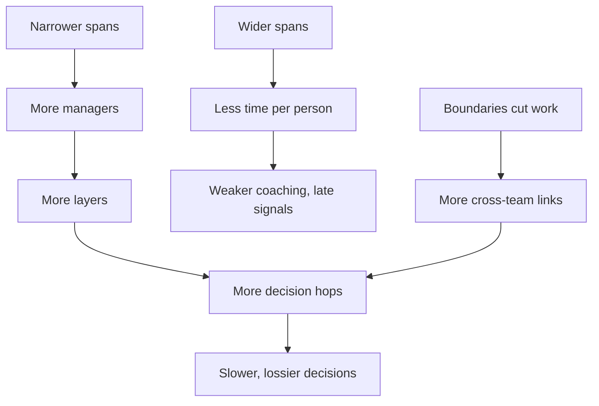
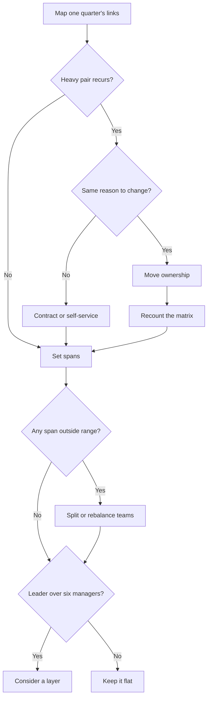
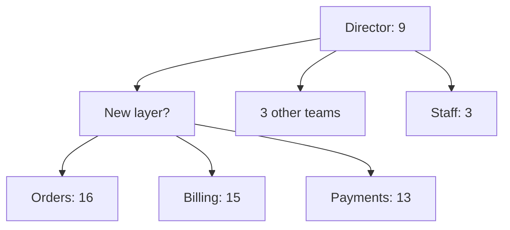

# Chapter 34 — Spans, Layers, and Dependency Mapping

This chapter is about three numbers that shape an engineering organization more than most strategies
do. [Span](../../glossary.md#span-of-control) is how many people report to each manager.
[Layers](../../glossary.md#layer) are the levels of management between an engineer and the person who
can settle a cross-team disagreement. Dependencies measure how often one team's work waits on
another. They are usually set by accident: a team grows, a manager leaves, a reorganization
copies last year's chart. This chapter treats them as one design problem. Chapter 33 owns team types
and cognitive load, Chapter 16 owns the dependency matrix and flow, and Chapter 35 applies all of it
at four company sizes. The running example is Northstar Technologies, the fictional company in the
[case study](../../case-studies/northstar/index.md).

## Why This Matters

At team scale, span decides what a manager can actually do. A manager with six engineers can hold
weekly one-on-ones, read design documents, and notice a struggling engineer in the first month. A
manager with sixteen does triage. Chapter 5 found that when a span forces one-on-ones below every two
weeks, the span is the problem, not the meeting.

At organization scale, layers and boundaries decide how long decisions take and how much is lost on the
way. Every disagreement between two teams travels up to the lowest manager they share. When boundaries
cut through the work, those trips happen weekly. Chapter 16 measured the flow cost at Northstar: work
items with no dependency on another team took a median of 11 days, items with two or more took 41.
Part of that gap is a design choice.

At executive scale, spans and layers are where headcount quietly goes. Under a flat-headcount rule,
every manager or layer added is paid for with an engineering seat.

## Learning Objectives

After this chapter you will be able to:

- Set a manager's span from the nature of the work and the manager's other duties, and defend it
  without appealing to a universal number.
- Count the cost of an added management layer in decision latency and information loss, and compare
  it with the cost of overloaded spans.
- Build and read a dependency map that shows which team boundaries cut through recurring work.
- Redesign boundaries from the map, and test the redesign by recounting the links it would create as
  well as those it removes.
- Present a span, layer, and boundary proposal under a headcount constraint, with its transition cost.

## The Mental Model

> **Mental model:** Spans, layers, and boundaries are one system. Narrow spans buy coaching time and
> pay for it in layers; layers buy coaching capacity and pay for it in decision hops; boundaries decide
> how many decisions need hops at all. Fix the boundaries first, then choose spans, then add layers only
> for what remains.

For a fixed headcount, spans and layers trade against each other: fewer people per manager means more
managers and, past some count, someone to manage them. Boundaries multiply both costs. A boundary that
splits work which changes together turns engineering decisions into cross-team decisions, which travel
up layers. Redrawing the chart for span alone often moves the problem rather than solving it.

## Deep Conceptual Explanation

### Why there is no universal span

The idea that a manager can handle only a few people is old. Graicunas, writing in the 1930s, counted
the possible relationships between a manager and subordinates (with each person, between pairs, and
with groups) and showed that they grow far faster than the number of subordinates; he is known for
suggesting a maximum of about four or five
([Graicunas, 1937](../../references/bibliography.md#graicunas1937relationship)). This is history, not
evidence: the count assumes every possible relationship is active, and it ignores what the
subordinates do.

Modern evidence offers no single right number. Rajan and Wulf, using data from over 300 large US
firms, report that more positions came to report directly to the CEO and fewer levels separated
division heads from the CEO ([Rajan and Wulf, 2006](../../references/bibliography.md#rajan2006flattening)).
That **research finding** is about the top of large companies. It says nothing about how many
engineers a manager should have.

Gallup's survey data concludes that manager talent matters more than span. It comes closest to a span
study of ordinary managers. Its US panel's average span rose from 10.9 to 12.1 between 2024 and 2025,
with a median of about six. Less talented managers lost engagement as team size and their own hands-on
work grew. Two findings matter for engineering. More reports went with lower engagement for remote and
hybrid managers but barely mattered on-site. And managers spending more than the median 40 percent of
their time on individual work showed lower engagement, worse in larger teams
([Harter, 2026](../../references/bibliography.md#harter2026span)). This is **industry research**:
self-reported, correlational, all occupations, not software.

Software-specific evidence on span is thin: this book found no study that measured outcomes. The
practitioner benchmark most engineering leaders quote is Larson's: managers should support six
to eight engineers, and managers of managers four to six managers ([Larson, 2018](../../references/bibliography.md#larson2018sizing)). This is **expert
opinion**, from fast-growing technology companies.

Chapters 1 and 4 used "about eight to ten" reports as this book's threshold. Above it, people work
crowds out the rest of a manager's job. This chapter keeps that as the default for a typical engineering manager and makes it
conditional. **This book's recommendation** is to set a span from five factors:

| Factor | Pushes span down (5–7) | Default (8–10) | Pushes span up (10–12) |
|---|---|---|---|
| Manager's other work | Holds technical direction or codes | Delivery plus people | People only; tech leads own direction |
| Change in the team | New team, reorganization, incidents | Normal | Stable for a year |
| Experience mix | Many new or junior engineers | Mixed | Mostly senior, self-directed |
| Interdependence of the work | Each person on distinct, risky work | Shared backlog | Repetitive, well-defined work |
| Location | Across sites or time zones | Hybrid, one site | Co-located |

Above about twelve, the job changes kind regardless of the factors: the manager stops knowing each
person's work and runs a queue. Below five, there is rarely enough people work to justify a full-time
manager, and the role should be combined with technical leadership deliberately (Chapter 1).

### What a layer costs

A layer is a level of management between the engineer and the person who can decide for the whole
organization. Adding one has two costs that rarely appear in the proposal.

**Decision latency.** A decision that crosses two teams goes up to their lowest common manager and
back. Each hop waits for that manager's next forum (a one-on-one, a staff meeting) and for the time it
takes to brief them. As an **illustrative** model, assume each forum meets weekly:

| Step | Working days |
|---|---|
| Average wait for the next weekly forum | 2.5 |
| Briefing the manager | 1 |
| One hop | 3.5 |
| An escalation that climbs two levels | about 7 |

One more layer adds three or four days to every escalation that crosses it.

**Information loss.** Each summary sent up a level drops detail. Williamson's classic model treats this
as "control loss", compounding as levels are added, and argues that larger organizations show their
leaders a more distorted picture
([Williamson, 1967](../../references/bibliography.md#williamson1967hierarchical)). That is **expert opinion
(economic theory)**, not measurement, and later work disputes its
conclusions about firm size. As an **illustration**: if each level passes on 80 percent of what
matters, two levels pass 64 percent and three about 51.

Against those costs, a layer buys coaching capacity. A director with twelve managers, well above
Larson's four to six, is developing none of them. Both costs are real; ask the layer question with
numbers.

### Boundaries decide how many decisions cross layers

Boundaries that cut through the work's dependencies are a cost to measure (**this book's
recommendation**). The research points that way without giving a size. Systems tend to copy their
organizations' communication structures
([Conway's law](../../glossary.md#conways-law-and-the-reverse-conway-maneuver), taught in Chapter 33;
[Conway, 1968](../../references/bibliography.md#conway1968committees)). Work is resolved faster when
coordination matches technical dependencies
([Cataldo et al., 2008](../../references/bibliography.md#cataldo2008congruence)). Sosa, Eppinger, and
Rowles found the same mismatch outside software, mapping an aircraft engine's design interfaces against
which teams actually talked ([Sosa et al., 2004](../../references/bibliography.md#sosa2004misalignment);
**research finding**). How large the effect is in your organization is unknown until you measure it.

### From dependency map to boundary design

Chapter 16 teaches how to build a dependency matrix. Rows are requesting teams, columns are providing
teams, and each cell counts **dependency links** for one quarter: work items of a week or more in which
the requesting team needed the providing team to do something. Chapter 16 also gives three responses
to a recurring link: remove, loosen, or coordinate. This chapter adds three design steps.

1. **Classify the heaviest links by what changed.** A count of nine says a pair is busy; a list of
   nine says why. Group each link by the component and the reason.
2. **Draft a boundary change and recount.** Reassign each past link to the proposed teams. Links
   inside one team disappear from the matrix; work that the new line splits appears as new links. A
   redesign that removes six links and creates five is not worth a reorganization.
3. **Check spans and layers against the new teams.** A move that cuts links but pushes a manager to
   eighteen reports has traded one problem for another. *Team Topologies* is known for designing teams
   for fast flow with few deliberate interactions
   ([Skelton and Pais, 2019](../../references/bibliography.md#skelton2019team)). But a team that
   absorbs every dependency also absorbs its [cognitive load](../../glossary.md#cognitive-load), the
   mental effort its work demands (Chapter 33).

The recount is the step most redesigns skip. Every boundary cuts something; the question is how often
the work it cuts changes together.

## Engineering Organization Example

!!! info "Northstar so far"
    Week 14, the start of quarter 2 of the director's first year. [Sev1 and
    Sev2](../../glossary.md#severity-sev1-sev2-sev3) incidents (the two most serious levels) fell from 30
    to 21 in quarter 1, and the seven QA engineers joined product teams in week 10. Both renewal
    commitments are on track (weeks 19 and 26). See the [timeline](../../case-studies/northstar/timeline.md).

This example diagnoses Northstar, the book's fictional company, with the chapter's tools. All figures
are **illustrative**, from Northstar's [baseline data](../../case-studies/northstar/baseline-data.md)
and [first quarter](../../case-studies/northstar/first-quarter.md).

**Spans today.** Since week 10, when the seven QA engineers moved into product teams, the six managers'
spans are:

| Manager (team) | Engineers |
|---|---|
| Priya Raman (Orders) | 16 |
| Marcus Oyelaran (Billing) | 15 |
| Elena Sokolova (Payments and Integrations) | 13 |
| Daniel Cho (Customer Experience) | 17 |
| Farah Haddad (Data and Analytics) | 11 |
| Tom Becker (Platform Operations, infrastructure only) | 5 |
| Engineers under the six managers | 77 |

The headcount reconciles as follows. The 77 engineers under managers plus 3 staff engineers make
Northstar's 80 engineers. Add 6 managers and the director, and the organization has 87 seats. The
director has nine direct reports: six managers and three staff engineers.

Apply the five factors. Priya caps her hands-on work at 8 hours a week and is in her first year as a
manager. Her span should sit at the low end, and it is the second highest. Daniel's team spans two
sites, with all six mobile engineers in Bogotá. His span should also be low, and it is the highest.
Tom, at the floor of five, barely has enough people work to fill a manager's job. Farah, at 11, still
acts as her team's data architect and leads engineers in two sites. Elena, at 13, is above twelve. By
these factors every one of the six spans is outside the range this chapter would set: five too large,
one too small.

**What fixing spans would cost.** Bringing every manager to ten or fewer means about eight managers for
77 engineers. Under the flat-headcount rule, a new manager is allowed only if the promoted engineer's
seat is not backfilled. Each extra manager therefore costs one engineering seat. Two new managers move
about $370,000 a year of capacity from building to managing, at Northstar's
[fully loaded cost](../../glossary.md#fully-loaded-cost) of $185,000 per engineer. And every new
manager reports to the director, so the layer question follows directly from the span fix.

**Where the links are.** Chapter 16's matrix counts 86 dependency links in the baseline quarter. The
four heaviest single directions are Orders to Billing (9), Orders to Platform Operations (8), Customer
Experience to Orders (8), and Billing to Platform Operations (7). As a pair, Orders and Billing
exchanged 15 links (9 plus 6), the most of any pair. At the start of quarter 2 the managers classified
those links:

| Link | Count | What the work was |
|---|---|---|
| Orders → Billing | 9 | 6 order-to-invoice mapping changes in core/invoicing; 3 tax-svc |
| Billing → Orders | 6 | 4 order data or status events from order-capture; 2 pricing-rules |
| Customer Experience → Orders | 8 | 6 order API changes for order-entry screens (4 web, 2 mobile); 2 search-svc or pricing-svc |
| Orders → Platform Operations | 8 | 5 test environments; 3 release train or pipeline |
| Billing → Platform Operations | 7 | 4 test environments with ledger data; 3 migration or pipeline |

The 15 links to Platform Operations are requests for environments and pipeline changes. That is a
self-service problem, already addressed by Chapter 16's interrupt rotation and self-service
environments. The other 23 are about where order logic ends and invoicing or screens begin: a boundary
problem. Three candidate moves, recounted on the baseline quarter:

| Candidate move | Links removed | Links created | Net | Span effect |
|---|---|---|---|---|
| M1: web order-entry screens and 2 web engineers move from Customer Experience to Orders | 4 (web order API links) | 0 counted; shared web shell work now crosses | −4 | Orders 18, Customer Experience 15 |
| M2: split Orders into order capture, and catalog and pricing | 0 | 4 (baseline items that touched both) | +4 | Two teams, about 9 and 6 |
| M3: order-to-invoice mapping moves from Billing to Orders | 6 | 2 (mapping changes Billing made for its own reasons) | −4 | None |

M2's count understates its cost. Below the matrix's one-week threshold, about 58 merge requests a
quarter changed both order capture and pricing rules (Chapter 31). Each would cross owners after the
split.

M1 removes links but makes Orders bigger. M2 fixes the span but creates links. Together they net zero
links, fix one span, and reduce another. M3 removes the most links, but it puts invoice correctness
into the team that did not build it. Invoice correctness was the source of the week 9 Sev1, when credit
notes were applied twice and the rollback failed. The obvious alternative to M3 is to loosen the link:
an order-to-invoice contract owned by Billing, with [contract tests](../../glossary.md#contract-test)
on both sides (automated checks that the provider still returns what each consumer relies on). Li Na
Zhou (staff engineer, data and integration) proposed the same pattern for the ledger export in Chapter
16. It removes no links from the count, but removes the waiting from each.

## Decision Framework

Decide in this order: boundaries, then spans, then layers. Each step uses the previous one's output.

For the layer itself, ask four questions:

| Question | Favors a layer | Favors staying flat |
|---|---|---|
| Is the leader above about six to eight managers, several new? | Yes | No, or most are experienced |
| Is there a group of teams with many links inside and few outside? | Yes: the layer resolves those links one level down | No: the layer adds a hop to most links |
| Is there a person ready for the role without leaving a hole? | Yes | No: the layer becomes a messenger |
| Can the organization afford the seat? | Headcount allows it | Every seat comes from engineering |

The matrix answers the second question, the one most often skipped: a layer over teams that mostly
talk to each other shortens their decisions; over teams that talk to outsiders, it lengthens everyone's.

## Trade-offs

**Coaching capacity against decision speed.** Narrow spans give each engineer more of a manager; the
extra layer they eventually require slows every decision that crosses it. A flattening that removes
managers removes coaching along with overhead.

**Removing links against creating them.** Every boundary move cuts some work. The recount makes the
trade visible; without it, the move is judged by the links it removes, which is always flattering.

**Fewer links against cognitive load.** A team that owns everything it depends on has no dependencies
and too much to understand (Chapter 33). A move that pushes a team past what one manager can lead is
not a fix.

**Stability against fit.** Every reorganization costs weeks of reduced output (Chapter 36). A boundary
that is somewhat wrong but stable can beat a better one changed twice a year.

**Promotion from within against capacity.** Under flat headcount, a new manager promoted from a team
gains a leader who knows the work and loses one of the team's strongest engineers. The capacity loss is
immediate; the leadership benefit takes two or more quarters.

## Failure Modes

**The span-only reorg.** Teams are split to bring spans to target along the most convenient line, often
by headcount or by front end and back end. Links between the new halves appear within a month. Detect
it by recounting the matrix one quarter after the change and comparing with the projection.

**The messenger layer.** A manager of managers is added who has no decision rights of their own and
relays questions upward. Decisions take one hop longer and nobody is faster. Detect it by asking the
new layer's teams which decisions now stop there; if the answer is "none", the layer is overhead.

**The silent overload.** A manager at sixteen or seventeen reports is praised for coping. One-on-ones
become status, career conversations stop, and the first sign is a resignation. Detect it with the
measures Chapter 5 uses: one-on-ones held, share that are mainly status, and news raised.

**The dumping-ground team.** Orphaned dependencies land in the team that complained least, often the
platform team. Detect it in the matrix's received column and that team's unplanned share.

## Enterprise Application

At 50 to 150 engineers, three practices make spans, layers, and boundaries governable.

**A span table, reviewed quarterly.** One row per manager: reports, the five factors, and whether the
span is in range. It makes overload visible before an exit interview does.

**A dependency matrix as a standing instrument.** Rebuilt each quarter, dated and owned, with the
heaviest five pairs classified: boundary problem, self-service problem, or acceptable coordination.

**Layer decisions recorded with their reason.** At this size an organization usually adds its first
managers of managers. The record should say which group of teams the layer covers, which decisions it
owns, how many of the group's links are internal, and when to check whether it helped (Chapter 4:
too early inserts a messenger, too late leaves new managers unsupervised).

A director with eight to twelve reports, several of them new, and two or three teams that argue
weekly has an argument for a layer over those teams, not over everyone.

## CTO Perspective

At executive scale, spans and layers become a budget line and a speed limit. A rough count: with spans
of eight at the first level and six above, 500 engineers need about 63 first-line managers and about
11 directors under a few VPs. Each level adds a hop to every decision that crosses its boundary.
Chapter 35 works through the scales.

The CTO's job is to keep layers no higher than the boundaries require, by asking three questions.
Which decisions reach me that belong two levels down, and which boundary sent them? Which spans are
above twelve or below five, and is each deliberate? Do the heaviest links sit inside groups that share
a leader? Flattening is fashionable, but a flatter structure is only faster if boundaries let teams
decide alone; otherwise it moves their arguments up to a busier person.

## Practical Playbook

1. **List every manager's direct reports,** including staff engineers and dotted lines, and who
   carries technical direction or code.
2. **Score each span on the five factors** and set a target range per manager. Flag every span outside
   its range, and every span above twelve regardless.
3. **Build or reuse the dependency matrix** for the last full quarter (Chapter 16), and classify the
   five heaviest directions by component and reason.
4. **Separate boundary problems from self-service problems.** Links that ask another team to do routine
   work (environments, access, pipeline changes) need self-service; links that change another team's
   logic for your reasons need a boundary or contract decision.
5. **Draft two or three boundary moves and recount the matrix** on each. Record links removed, links
   created, and the span effect.
6. **Fix spans with those moves where possible,** splitting along seams the recount supports.
7. **Only then ask the layer questions,** using the matrix to find groups with many links inside.
8. **Price the proposal in seats** and state the cost.
9. **Set a check date.** One quarter after the change, recount the matrix, rerun the span table, and
   compare with the projection.

## Case Study

This case is **fictional**. It is set at Northstar in quarter 2 (weeks 14 to 26), after
[the director's first quarter](../../case-studies/northstar/first-quarter.md). It ends with an option
set, not a decision.

**The situation.** Priya Raman (Orders manager) has 16 reports in her first year as a manager. Daniel
Cho (Customer Experience manager) has 17, and his one-on-ones are under review (Chapter 5). In week 17
Mateo Arango Ríos, the team's informal mobile lead in Bogotá, tells the director he has done a lead's
job for over a year. Orders and Billing exchanged 15 links in the baseline quarter. Their friction has
only ever been handled above both managers. Two incidents show it: [INC-417](../../glossary.md#inc-numbers),
payments posted to the wrong accounting period after a release of
[Core](../../glossary.md#core), Northstar's monolith, started a thread about release
channels; the review of INC-427, credit notes applied twice after a release, opened with blame. The
accounting-system integration is due in week 19 and bulk ordering in week 26. No team can be
reorganized before then without risking a renewal.

**What the director does in quarter 2.** Two things. First, the analysis in this chapter: the span
table, the classification of the heaviest links, and the recount of candidate moves M1 to M3. Second,
the one boundary change cheap enough to make mid-commitment. Billing takes ownership of an
order-to-invoice contract with contract tests on both sides, the alternative to M3. It moves no people
and no manager, and it leaves invoice correctness with the team that answers for it. Everything else
becomes an option set for later.

**The option set.** The director records each candidate with what the recount says:

| Option | What the recount says | Status |
|---|---|---|
| Order-to-invoice contract | Removes waiting, not links, on the heaviest pair | Done in quarter 2 |
| M1: web order-entry screens to Orders | −4 links; Orders grows to 18 | Not pursued: worsens the second-worst span |
| M2: split Orders | +4 links and about 58 cross-owner merge requests a quarter; fixes Orders' span for one seat | Kept as an option; a seam with pricing rules staying in order capture would keep that pair together |
| M3: mapping to Orders | −4 links; moves invoice correctness away from Billing | Rejected in favor of the contract |
| Customer Experience span (17) | The matrix counts the team as one, so web and mobile links are unmeasured | Open; Chapter 14 sets out the options |

**The layer question.** The dependency matrix gives the director a test for a manager of managers.
Orders, Billing, and Payments and Integrations exchanged 27 links among themselves: Orders and Billing
15, Billing and Payments 9, Orders and Payments 3. They exchanged 48 with the other three teams. A
senior manager over the three would settle the Orders and Billing friction one level below the
director. The same layer would add a hop to 48 links. Promoted from within, the role also costs a seat
and puts a peer over peers.

| Option | For | Against |
|---|---|---|
| No layer, director at 9 | No new hop; no seat spent | A first-year manager at 16 and four more managers above range; the director's time is the queue |
| Senior manager over order-to-cash | Disputes settled one level down; 27 links inside | 48 links gain a hop; a seat; a peer promoted over peers |
| Second director, hired | Two directors of about 40 engineers | Breaks flat headcount; little for two directors to do |

The director's question is not which chart looks best. It is which open item a later design must name
a trigger for: Orders' span, especially if core/permissions (an unowned Core module) arrives; the
unmeasured web and mobile links; and the Orders and Billing pair if the contract does not shorten its
waits. Chapter 35 takes this option set into the year-2 design the director drafts in week 44.

## Exercises

Solutions are in [chapter 34 solutions](../../solutions/ch34-solutions.md). Data are on the
[Northstar baseline page](../../case-studies/northstar/baseline-data.md) and in Chapter 16's case
study.

### Foundational

**F1.** Score Northstar's six managers on the five span factors as of week 14, using what the case pages
and this chapter say about each (first year as manager, sites, informal leads, hands-on work, recent
changes). For each, give a target range and say whether the current span is inside it. Identify the one
manager whose span is too small rather than too large, and say what you would do about it.

**F2.** A director proposes to cut decision latency by removing the senior-manager layer from a
120-engineer organization: 14 managers would report directly to her. Using the illustrative latency
and information-loss arithmetic in the chapter, estimate what she gains and what she loses, and state
which facts about the teams' dependencies would change your answer.

**F3.** Recount the links for a fourth candidate move: data export work for month-end reporting moves
from Data and Analytics to Billing. The baseline matrix records 2 links from Data and Analytics to
Billing and 2 from Billing to Data and Analytics; Data and Analytics received 4 links in all. Make and
state your own assumptions about which of these links the move affects. Say whether the move is worth
making on links alone and what else you would want to know.

### Applied Leadership

**A1.** In week 15 Priya Raman hears that the director's analysis includes splitting Orders, and asks
to see the director before anyone else is told. She has sixteen people who trust her, bulk ordering due
in week 26, and no decision has been made. Plan the conversation: what you share, what you ask her, and
what you will not promise.

**A2.** Marcus Oyelaran (Billing manager) objects to the order-to-invoice contract: Billing will end up
writing and maintaining contract tests for Orders' changes, while his team carries 41 percent unplanned
work. Decide how to respond, and whether his objection should change the choice between moving the
mapping and loosening it.

**A3.** Three months after Orders is split into order capture and catalog and pricing (move M2), the
recounted matrix shows the two new teams exchanging 11 links in the quarter, not the 4 projected.
Diagnose the likely causes, say what data you would look at first, and decide whether to reverse,
adjust, or wait.

### Executive Decision-Making

**X1.** You are Victor Lindqvist (CTO) in week 26. Bulk ordering is about to ship. The director brings
this chapter's analysis: every span out of range, the M1 to M3 recount, the contract already in place,
and the three layer options. Rajiv Menon (CFO) reminds you that every promotion to manager is a lost
engineering seat. Decide what to approve now, what to leave for the year-2 design, what triggers would
reopen the Orders split or a layer, and what evidence you require.

**X2.** Helena Marsh (CEO) asks why engineering has "so many managers" after reading that large firms
are flattening. Northstar has 6 managers over 77 engineers, plus 3 staff engineers reporting to the
director. Prepare your answer, including what the flattening evidence does and does not say and what
you would accept as a sign that Northstar has too many managers.

## Reflection Questions

- What is the largest span you have managed or worked under, and what stopped happening at that size
  that you only noticed later?
- When a decision in your organization crosses two teams, how many people must agree, and how long does
  it take? Have you ever measured it?
- If you rebuilt your dependency map today, which team would you expect in the heaviest column, and
  why would you be surprised if it were someone else?
- What would you have to believe for a boundary move that removes no dependency links to be worth
  doing anyway?

## Key Takeaways

- Design boundaries first, spans second, layers last. Each choice limits the next.
- There is no universal span. Start from about eight to ten for an engineering manager and move it
  with the manager's other work, the team's change, its experience, its interdependence, and its sites.
- Spans above twelve change the job into queue management; spans below five rarely justify a
  full-time manager.
- A layer costs a decision hop and some information on every decision that crosses it. It pays off
  only over a group of teams with many links inside and few outside.
- Classify heavy dependency links by component and reason. Routine requests need self-service;
  changes to another team's logic need a boundary or a contract.
- Recount the matrix on every proposed boundary. A move judged only by the links it removes always
  looks good.
- Under a headcount constraint, price every new manager and layer in engineering seats.
- Rebuild the span table and the dependency matrix each quarter, and compare the result with what the
  last redesign promised.

## References and Further Reading

- [Graicunas, 1937](../../references/bibliography.md#graicunas1937relationship). The historical origin
  of span limits; history, not evidence.
- [Rajan and Wulf, 2006](../../references/bibliography.md#rajan2006flattening). Evidence that large
  firms widened spans at the top; a check on overreading "flat".
- [Harter, 2026](../../references/bibliography.md#harter2026span). Gallup's data on span, manager
  talent, hands-on workload, and remote work.
- [Larson, 2018](../../references/bibliography.md#larson2018sizing). Practitioner benchmarks for
  managers and managers of managers.
- [Williamson, 1967](../../references/bibliography.md#williamson1967hierarchical). The classic model of
  control loss across layers.
- [Conway, 1968](../../references/bibliography.md#conway1968committees). Systems copy communication
  structures; developed in Chapter 33.
- [Sosa, Eppinger, and Rowles, 2004](../../references/bibliography.md#sosa2004misalignment). Design
  interfaces against team interactions; the research behind dependency mapping.
- [Cataldo, Herbsleb, and Carley, 2008](../../references/bibliography.md#cataldo2008congruence).
  Faster resolution when coordination matches dependencies.
- [Skelton and Pais, 2019](../../references/bibliography.md#skelton2019team). Team design for flow with
  few deliberate interactions.
