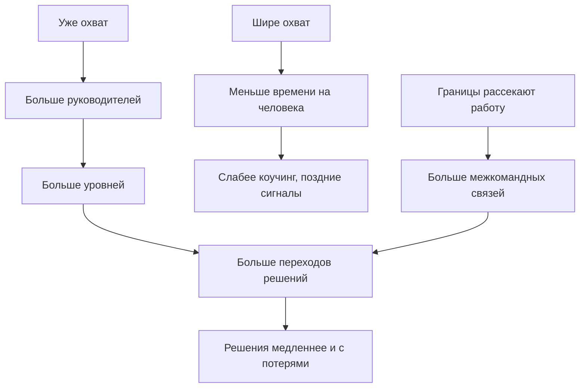
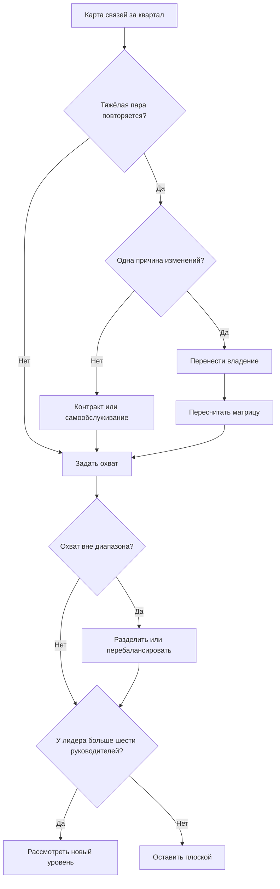
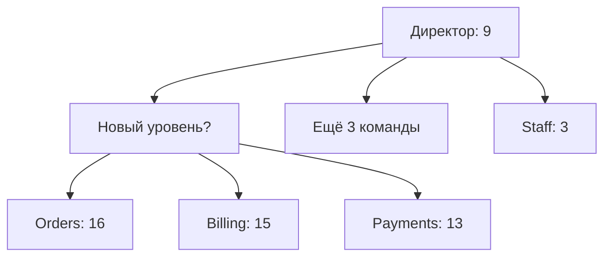

# Глава 34 — Охват управления, уровни иерархии и карта зависимостей { #chapter-34-spans-layers-and-dependency-mapping }

Эта глава о трёх числах, которые формируют инженерную организацию сильнее, чем большинство стратегий.
[Охват управления (span of control)](../../glossary.md#span-of-control) — сколько людей подчиняется
каждому руководителю. [Уровни управления](../../glossary.md#layer) — сколько ступеней менеджмента
отделяет инженера от человека, который может разрешить разногласие между командами. Зависимости
показывают, как часто работа одной команды ждёт другую. Обычно эти числа складываются случайно: команда
растёт, руководитель уходит, реорганизация копирует прошлогоднюю схему. Эта глава рассматривает их как
одну задачу проектирования. Типы команд и когнитивную нагрузку разбирает глава 33, матрицу зависимостей и
поток — глава 16, а глава 35 применяет всё это к компаниям четырёх размеров. Сквозной пример — Northstar
Technologies, вымышленная компания из [кейса](../../case-studies/northstar/index.md).

## Почему это важно { #why-this-matters }

Для отдельной команды охват определяет, что руководитель реально успевает делать. Руководитель с шестью
инженерами успевает еженедельно проводить встречи один на один (1:1), читать дизайн-документы и в первый
же месяц замечать инженера, которому тяжело. Руководитель с шестнадцатью занимается сортировкой срочного.
В главе 5 показано: если из-за охвата 1:1 приходится проводить реже чем раз в две недели, проблема в
охвате, а не во встрече.

В масштабе организации уровни управления и границы команд определяют, сколько времени занимают решения
и сколько информации теряется по пути. Каждое разногласие между двумя командами поднимается до
ближайшего общего руководителя. Если границы рассекают работу, такие подъёмы случаются каждую неделю.
Глава 16 измерила, во что это обходится потоку в Northstar: задачи без зависимости от другой команды
занимали в медиане 11 дней, а задачи с двумя и более зависимостями — 41. Отчасти этот разрыв — следствие
проектного выбора.

Для высшего руководства охват и уровни — то, на что незаметно уходит численность. Если действует правило
«без роста численности», каждый добавленный руководитель или уровень оплачивается местом инженера.

## Цели главы { #learning-objectives }

Прочитав эту главу, вы сможете:

- Задавать охват руководителя, исходя из характера работы и других его обязанностей, и отстаивать его,
  не ссылаясь на универсальное число.
- Оценивать стоимость нового уровня управления в задержке решений и потере информации и сравнивать её
  со стоимостью перегруженного охвата.
- Строить и читать карту зависимостей, которая показывает, какие границы команд рассекают
  повторяющуюся работу.
- Перепроектировать границы по карте и проверять новый вариант, заново подсчитывая не только связи,
  которые он убирает, но и те, которые он создаёт.
- Представлять предложение по охвату, уровням и границам при ограниченной численности — вместе со
  стоимостью перехода.

## Ментальная модель { #the-mental-model }

> **Ментальная модель:** охват, уровни и границы — одна система. Узкий охват даёт время на коучинг, но
> за него платят уровнями; уровни дают ресурс на коучинг, но за них платят переходами решений вверх;
> границы определяют, скольким решениям вообще нужны эти переходы. Сначала исправьте границы, затем
> выберите охват и только для того, что останется, добавляйте уровни.

При фиксированной численности охват и уровни уравновешивают друг друга: чем меньше людей на руководителя,
тем больше руководителей, а с какого-то числа нужен и тот, кто будет руководить ими. Границы умножают обе
стоимости. Если граница разделяет работу, которая меняется вместе, инженерные решения становятся
межкомандными, а такие решения поднимаются по уровням. Если перерисовать схему только ради охвата,
проблема часто не решается, а просто перемещается.

## Подробный разбор { #deep-conceptual-explanation }

### Почему универсального охвата нет { #why-there-is-no-universal-span }

Мысль о том, что руководитель справляется лишь с немногими людьми, не нова. Graicunas в 1930-х годах
подсчитал возможные отношения между руководителем и подчинёнными (с каждым человеком, между парами, с
группами) и показал, что их число растёт гораздо быстрее числа подчинённых. Известен он тем, что
предложил предел примерно в четыре-пять человек ([Graicunas,
1937](../../references/bibliography.md#graicunas1937relationship)). Это история, а не доказательство:
подсчёт предполагает, что все возможные отношения активны, и не учитывает, чем заняты подчинённые.

Современные данные не дают одного правильного числа. Rajan и Wulf на данных более чем 300 крупных
американских фирм показывают, что напрямую CEO (генеральному директору) стало подчиняться больше
должностей, а уровней между руководителями подразделений и CEO стало меньше ([Rajan and Wulf,
2006](../../references/bibliography.md#rajan2006flattening)). Этот **научный результат** относится к
верхушке крупных компаний и ничего не говорит о том, сколько инженеров должно быть у руководителя.

Ближе всего к исследованию охвата у обычных руководителей подходят опросные данные Gallup, и вывод из них
такой: талант руководителя важнее охвата. Для разработки существенны два результата. Первый: в удалённых
и гибридных командах больше подчинённых у руководителя означало меньшую вовлечённость, а в офисе почти не
влияло на неё. Второй: у руководителей, которые тратили на собственную исполнительскую работу больше
медианных 40% времени, вовлечённость была ниже, особенно в больших командах ([Harter,
2026](../../references/bibliography.md#harter2026span)). Это **отраслевое исследование**: самоотчётные
данные, корреляционный анализ, все профессии, а не только разработка ПО.

Данных об охвате именно в разработке мало: книга не нашла ни одного исследования, которое измеряло бы
результаты. Чаще всего руководители разработки ссылаются на ориентир Larson: у руководителя должно быть
от шести до восьми инженеров, а у руководителя руководителей — от четырёх до шести руководителей
([Larson, 2018](../../references/bibliography.md#larson2018sizing)). Это **мнение эксперта**,
основанное на опыте быстрорастущих технологических компаний.

В главах 1 и 4 книга называла порог «примерно восемь–десять» подчинённых: выше него работа с людьми
вытесняет всё остальное, чем занят руководитель. Эта глава оставляет порог значением по умолчанию для
типичного руководителя разработки, но делает его условным. **Рекомендация книги** — задавать охват по
пяти факторам:

| Фактор | Сдвигает охват вниз (5–7) | По умолчанию (8–10) | Сдвигает охват вверх (10–12) |
|---|---|---|---|
| Другая работа руководителя | Задаёт техническое направление или пишет код | Поставка плюс люди | Только люди; направлением владеют техлиды |
| Изменения в команде | Новая команда, реорганизация, инциденты | Обычный режим | Стабильна в течение года |
| Состав по опыту | Много новых или младших инженеров | Смешанный | В основном senior, самостоятельные |
| Взаимозависимость работы | У каждого своя рискованная работа | Общий бэклог | Повторяющаяся, чётко определённая работа |
| Расположение | Несколько площадок или часовых поясов | Гибрид, одна площадка | Все в одном месте |

Примерно после двенадцати работа меняет характер независимо от факторов: руководитель перестаёт знать
работу каждого и начинает разбирать очередь. Если подчинённых меньше пяти, работы с людьми редко хватает,
чтобы оправдать руководителя на полную ставку, и роль стоит осознанно совместить с техническим лидерством
(глава 1).

### Во что обходится уровень управления { #what-a-layer-costs }

Уровень управления — это ступень менеджмента между инженером и человеком, который может принимать решения
за всю организацию. У каждого нового уровня две стоимости, и в предложение они попадают редко.

**Задержка решений.** Решение, которое затрагивает две команды, поднимается до их ближайшего общего
руководителя и спускается обратно. На каждом переходе оно ждёт ближайшей встречи этого руководителя (1:1
или совещания с подчинёнными), а потом ещё нужно время, чтобы ввести его в курс дела. Для **иллюстрации**
возьмём модель, в которой каждая такая встреча проходит раз в неделю:

| Шаг | Рабочие дни |
|---|---|
| Среднее ожидание ближайшей еженедельной встречи | 2.5 |
| Ввести руководителя в курс дела | 1 |
| Один переход | 3.5 |
| Эскалация на два уровня вверх | около 7 |

Каждый дополнительный уровень добавляет три-четыре дня к любой эскалации, которая через него проходит.

**Потеря информации.** При каждой передаче резюме на уровень выше теряются детали. Классическая модель
Williamson описывает это как «потерю контроля» (control loss), которая накапливается с каждым новым
уровнем. Williamson утверждает, что в более крупных организациях руководители видят более искажённую
картину ([Williamson, 1967](../../references/bibliography.md#williamson1967hierarchical)). Это **мнение
эксперта (экономическая теория)**, а не измерение, и более поздние работы оспаривают его выводы о размере
фирмы. **Иллюстрация**: если каждый уровень передаёт дальше 80% важного, то через два уровня доходит 64%,
а через три — около 51%.

Взамен уровень даёт ресурс на коучинг. Директор с двенадцатью руководителями (гораздо больше, чем
четыре–шесть по Larson) не развивает ни одного из них. Обе стоимости реальны, поэтому вопрос об уровне
нужно задавать с цифрами в руках.

### Границы определяют, сколько решений проходит через уровни { #boundaries-decide-how-many-decisions-cross-layers }

Если границы рассекают зависимости в работе, это стоимость, и её нужно измерять (**рекомендация книги**).
Исследования указывают в эту сторону, но размера эффекта не дают. Системы склонны копировать структуры
коммуникации своих организаций ([закон
Конвея](../../glossary.md#conways-law-and-the-reverse-conway-maneuver), подробно в главе 33; [Conway,
1968](../../references/bibliography.md#conway1968committees)). Задачи решаются быстрее, когда координация
соответствует техническим зависимостям ([Cataldo et al.,
2008](../../references/bibliography.md#cataldo2008congruence)). Sosa, Eppinger и Rowles обнаружили такое
же несовпадение за пределами разработки ПО: они сопоставили проектные интерфейсы авиадвигателя с тем,
какие команды фактически общались друг с другом ([Sosa et al.,
2004](../../references/bibliography.md#sosa2004misalignment); **научный результат**). Насколько велик
этот эффект в вашей организации, неизвестно, пока вы его не измерите.

### От карты зависимостей к проектированию границ { #from-dependency-map-to-boundary-design }

Как построить матрицу зависимостей, объясняет глава 16. Строки — запрашивающие команды, столбцы —
предоставляющие, а в каждой ячейке подсчитаны **связи зависимости** за один квартал: задачи объёмом от
недели, для которых запрашивающей команде понадобилось, чтобы предоставляющая что-то сделала. Там же даны
три ответа на повторяющуюся связь: убрать, ослабить или координировать. Эта глава добавляет три шага
проектирования.

1. **Классифицируйте самые тяжёлые связи по тому, что менялось.** Число «девять» говорит, что у пары
   много общих дел, а список из девяти пунктов — почему. Сгруппируйте каждую связь по компоненту и
   причине.
2. **Набросайте изменение границы и пересчитайте.** Переназначьте каждую прошлую связь предлагаемым
   командам. Связи внутри одной команды исчезают из матрицы; работа, которую новая граница разрезает,
   появляется в ней как новые связи. Если перепроектирование убирает шесть связей и создаёт пять,
   реорганизация того не стоит.
3. **Проверьте охват и уровни для новых команд.** Шаг, который сокращает связи, но доводит число
   подчинённых у руководителя до восемнадцати, просто меняет одну проблему на другую. *Team Topologies*
   известна тем, что предлагает проектировать команды ради быстрого потока с немногими осознанными
   взаимодействиями ([Skelton and Pais, 2019](../../references/bibliography.md#skelton2019team)). Но
   команда, вобравшая в себя все зависимости, вбирает и их [когнитивную
   нагрузку](../../glossary.md#cognitive-load), то есть умственное усилие, которого требует её работа
   (глава 33).

Именно пересчёт при перепроектировании чаще всего и пропускают. Любая граница что-то разрезает; вопрос в
том, как часто разрезанная ею работа меняется вместе.

## Пример из инженерной организации { #engineering-organization-example }

!!! info "Northstar: что уже известно"
    Неделя 14, начало квартала 2 первого года директора. Число инцидентов
    [Sev1 и Sev2](../../glossary.md#severity-sev1-sev2-sev3) (два самых серьёзных уровня) в
    квартале 1 упало с 30 до 21, а на неделе 10 семь QA-инженеров перешли в продуктовые команды. Оба
    обязательства по продлению идут по плану (недели 19 и 26). См.
    [хронологию](../../case-studies/northstar/timeline.md). Впервые читаете о Northstar? Прочитайте
    [«Год вкратце»](../../case-studies/northstar/year-in-brief.md) и
    [действующих лиц](../../case-studies/northstar/cast.md).

В этом примере инструменты главы применяются к Northstar, вымышленной компании этой книги. Все цифры —
**иллюстрация** и взяты из [исходных данных](../../case-studies/northstar/baseline-data.md) и [хроники
года 1](../../case-studies/northstar/first-quarter.md).

**Охват сегодня.** С недели 10, когда семь QA-инженеров перешли в продуктовые команды, охват шести
руководителей такой:

| Руководитель (команда) | Инженеров | Самый важный фактор |
|---|---|---|
| Priya Raman (Orders) | 16 | Первый год в роли руководителя; 8 часов в неделю на исполнительскую работу |
| Marcus Oyelaran (Billing) | 15 | Больше всего инцидентов; 41 процент незапланированной работы; три эксперта по ledger |
| Elena Sokolova (Payments and Integrations) | 13 | Опытная, сильные практики; неформальный техлид; две площадки |
| Daniel Cho (Customer Experience) | 17 | Две платформы, две площадки; все шесть мобильных инженеров в Боготе |
| Farah Haddad (Data and Analytics) | 11 | Ещё и архитектор данных команды (45 процентов её времени); две площадки |
| Tom Becker (Platform Operations) | 5 | С недели 10 только инфраструктура |

Всего в Northstar 80 инженеров: 77 под руководителями и 3 staff-инженера. У директора девять прямых
подчинённых: шесть руководителей и три staff-инженера.

По пяти факторам ни один из шести охватов не попадает в диапазон, который задала бы эта глава: пять
слишком велики, один слишком мал. Priya Raman и Daniel Cho по факторам должны быть в нижней части
диапазона, а у них два самых больших охвата. У Elena Sokolova 13 человек — больше двенадцати. У Tom
Becker пятеро, и работы с людьми едва хватает, чтобы заполнить должность руководителя.

**Во что обошлось бы исправление охвата.** Чтобы у каждого руководителя было не больше десяти человек, на
77 инженеров нужно около восьми руководителей. По правилу «без роста численности» нового руководителя
можно назначить, только если место повышенного инженера не заполняют заново. Поэтому два новых
руководителя — это ресурс стоимостью около $370 000 в год, переведённый из разработки в управление, если
исходить из [полной стоимости сотрудника](../../glossary.md#fully-loaded-cost) Northstar в $185 000 на
инженера. А каждый новый руководитель подчиняется директору, поэтому сразу встаёт вопрос об уровне
управления.

**Где связи.** Связь зависимости — это задача объёмом от недели, для которой одной команде понадобилась
другая; такие связи считают поквартально. В исходной матрице Northstar (её строит глава 16) таких
связей 86. По строке видно, что команда просила у других, по столбцу — что другие просили у неё.

| Запрашивающая команда | Orders | Billing | Payments | Customer Exp. | Data | Platform |
|---|---|---|---|---|---|---|
| Orders | – | 9 | 2 | 3 | 1 | 8 |
| Billing | 6 | – | 5 | 1 | 2 | 7 |
| Payments and Integrations | 1 | 4 | – | 1 | 0 | 5 |
| Customer Experience | 8 | 3 | 2 | – | 1 | 6 |
| Data and Analytics | 2 | 2 | 1 | 0 | – | 3 |
| Platform Operations | 1 | 1 | 0 | 1 | 0 | – |

Самый тяжёлый столбец — у Platform Operations (29). Самая загруженная пара — Orders и Billing,
15 связей (9 плюс 6). В начале квартала 2 руководители классифицировали пять самых тяжёлых
направлений:

| Связь | Число | Что это была за работа |
|---|---|---|
| Orders → Billing | 9 | 6 изменений сопоставления заказов и счетов; 3 по tax-svc |
| Billing → Orders | 6 | 4 по данным или событиям статуса заказов; 2 по правилам ценообразования |
| Customer Experience → Orders | 8 | 6 изменений API заказов для экранов оформления заказа (4 веб, 2 мобильные); 2 прочих |
| Orders → Platform Operations | 8 | 5 по тестовым окружениям; 3 по релизам или пайплайну |
| Billing → Platform Operations | 7 | 4 по тестовым окружениям; 3 по миграциям или пайплайну |

Связи с Platform Operations (15) — это запросы окружений и изменений пайплайна, то есть проблема
самообслуживания, и её уже решают. Остальные 23 касаются того, где кончается логика заказов и начинаются
счета или экраны: это проблема границ. Ниже три возможных шага, пересчитанные на данных базового
квартала:

| Возможный шаг | Убрано связей | Создано связей | Влияние на охват |
|---|---|---|---|
| M1: веб-экраны оформления заказа и 2 веб-инженера переходят в Orders | 4 | 0 учтённых | Orders 18, Customer Experience 15 |
| M2: разделить Orders на приём заказов и каталог с ценообразованием | 0 | 4 | Две команды, примерно 9 и 6 |
| M3: сопоставление заказов и счетов переходит из Billing в Orders | 6 | 2 | Нет |

Вывод по каждому шагу:

- **M1** убирает 4 связи, но ухудшает охват в Orders, а работа над общей веб-оболочкой начнёт пересекать
  границу команд, причём в подсчёт она не попадёт.
- **M2** исправляет охват в Orders, но добавляет 4 связи, причём подсчёт занижает его стоимость: около
  58 мерж-реквестов за квартал, каждый ниже порога в одну неделю, меняли одновременно приём заказов и
  правила ценообразования (глава 31). После разделения каждый из них затрагивал бы двух владельцев.
- **M3** убирает больше всего связей, но уводит корректность счетов из команды, которая её построила.
  Именно с корректностью счетов был связан инцидент Sev1 на неделе 9: кредит-ноты применились дважды, а
  откат не сработал.

Альтернатива M3 — ослабить связь: контракт сопоставления заказов и счетов, которым владеет Billing, с
[контрактными тестами](../../glossary.md#contract-test) с обеих сторон (автоматическими проверками
того, что поставщик по-прежнему возвращает то, на что рассчитывает каждый потребитель). Ни одной связи
из подсчёта это не убирает, зато убирает ожидание в каждой из них.

## Как принимать решение { #decision-framework }

Решайте в таком порядке: границы, затем охват, затем уровни. Каждый шаг опирается на результат
предыдущего.

О самом уровне задайте четыре вопроса:

| Вопрос | За новый уровень | За плоскую структуру |
|---|---|---|
| Больше ли у лидера примерно шести–восьми руководителей, и есть ли среди них несколько новых? | Да | Нет, или большинство опытные |
| Есть ли группа команд с множеством связей внутри и немногими снаружи? | Да: уровень разрешает эти связи на ступень ниже | Нет: уровень добавляет переход к большинству связей |
| Есть ли человек, готовый к этой роли, чей уход не оставит дыры? | Да | Нет: уровень превращается в передатчика |
| Может ли организация позволить себе это место? | Численность позволяет | Каждое место забирают у разработки |

Второй вопрос пропускают чаще всего, а ответ на него даёт матрица. Если команды под уровнем в основном
общаются между собой, уровень ускоряет их решения; если с командами за его пределами — замедляет решения
всех.

## Компромиссы { #trade-offs }

**Ресурс на коучинг или скорость решений.** Узкий охват даёт каждому инженеру больше внимания
руководителя, но рано или поздно потребует дополнительного уровня, а тот замедлит каждое решение, которое
через него проходит. Сокращая уровни и убирая руководителей, организация вместе с накладными расходами
убирает и коучинг.

**Убрать связи или создать их.** Любое перемещение границы что-то разрезает. Пересчёт делает этот
компромисс видимым; без него шаг оценивают по связям, которые он убирает, а такая оценка всегда льстит.

**Меньше связей или когнитивная нагрузка.** У команды, которая владеет всем, от чего зависит,
зависимостей нет, зато разбираться ей приходится в слишком многом (глава 33). Шаг, после которого команда
становится больше, чем может вести один руководитель, — это не выход.

**Стабильность или соответствие.** Каждая реорганизация обходится в несколько недель сниженной отдачи
(глава 36). Слегка неправильная, но стабильная граница может оказаться лучше более удачной, которую меняют
дважды в год.

**Повышение изнутри или ресурс.** Если при неизменной численности руководителем назначают человека из
команды, она получает лидера, который знает работу, но теряет одного из сильнейших инженеров. Ресурс
теряется сразу, а польза от руководства проявляется через два квартала или позже.

## Типичные провалы { #failure-modes }

**Реорганизация только ради охвата.** Чтобы довести охват до целевого, команды делят по самой удобной
линии, часто по численности или на фронтенд и бэкенд. Через месяц между новыми половинами появляются
связи. Как заметить: через квартал после изменения пересчитайте матрицу и сравните с прогнозом.

**Уровень-передатчик.** Добавляют руководителя руководителей без собственных прав на решения, и он просто
пересылает вопросы наверх. Решения идут на один переход дольше, а быстрее никто не работает. Как
заметить: спросите команды под новым уровнем, какие решения теперь принимаются на нём; если ответ
«никакие», уровень — это накладные расходы.

**Тихая перегрузка.** Руководителя с шестнадцатью-семнадцатью подчинёнными хвалят за то, что он
справляется. Встречи 1:1 сводятся к статусу, разговоры о карьере прекращаются, и первый признак беды —
заявление об уходе. Как заметить: по показателям из главы 5 — сколько 1:1 проведено, какая доля из них в
основном про статус и сколько новостей на них прозвучало.

**Команда-свалка.** Бесхозные зависимости оседают в команде, которая меньше всех жалуется, часто в
платформенной. Как заметить: по столбцу полученных связей в матрице и по доле незапланированной работы
этой команды.

## Применение в крупной организации { #enterprise-application }

В организации из 50–150 инженеров охватом, уровнями и границами можно управлять с помощью трёх
практик.

**Таблица охвата, которую пересматривают раз в квартал.** Одна строка на руководителя: число
подчинённых, пять факторов и попадает ли охват в диапазон. Таблица показывает перегрузку раньше, чем
это сделает выходное интервью.

**Матрица зависимостей как постоянный инструмент.** Её заново строят каждый квартал, у неё есть дата и
владелец, а пять самых тяжёлых пар классифицированы: проблема границ, проблема самообслуживания или
приемлемая координация.

**Решения об уровнях записываются вместе с причиной.** Именно при таком размере обычно появляются первые
руководители руководителей. В записи должно быть сказано, какую группу команд охватывает уровень, какими
решениями он владеет, какая доля связей группы внутренняя и когда проверить, помог ли он (глава 4:
слишком рано — и появляется передатчик, слишком поздно — и новые руководители остаются без присмотра).

Если у директора восемь–двенадцать подчинённых, среди них несколько новых, а две-три команды спорят
каждую неделю, у него есть довод в пользу уровня над этими командами, а не над всеми.

## Взгляд CTO { #cto-perspective }

Для высшего руководства охват и уровни — это строка бюджета и ограничение скорости. Каждый уровень
добавляет переход к каждому решению, которое пересекает его границу, а при 500 инженерах таких уровней
три или четыре. Число руководителей на каждом масштабе подсчитывает глава 35.

Задача CTO (технического директора) — держать число уровней не больше, чем требуют границы. Для этого он
задаёт три вопроса. Какие решения доходят до меня, хотя должны приниматься двумя уровнями ниже, и какая
граница их ко мне отправила? Какие охваты больше двенадцати или меньше пяти, и осознанно ли это в
каждом случае? Находятся ли самые тяжёлые связи внутри групп с общим лидером? Плоские структуры в моде,
но более плоская структура быстрее только тогда, когда границы позволяют командам решать самостоятельно;
иначе она переносит их споры наверх, к более занятому человеку.

## Практический плейбук { #practical-playbook }

1. **Перечислите прямых подчинённых каждого руководителя**, включая staff-инженеров и пунктирные линии
   подчинения, и отметьте, кто задаёт техническое направление или пишет код.
2. **Оцените каждый охват по пяти факторам** и задайте целевой диапазон для каждого руководителя.
   Отметьте каждый охват вне его диапазона и каждый охват больше двенадцати, независимо от факторов.
3. **Постройте матрицу зависимостей или возьмите готовую** за последний полный квартал (глава 16) и
   классифицируйте пять самых тяжёлых направлений по компоненту и причине.
4. **Отделите проблемы границ от проблем самообслуживания.** Если другую команду просят сделать рутинную
   работу (окружения, доступы, изменения пайплайна), нужно самообслуживание. Если по вашим причинам
   меняется логика другой команды, нужно решение о границе или контракте.
5. **Набросайте два-три варианта перемещения границ и пересчитайте матрицу** для каждого. Запишите,
   сколько связей убрано, сколько создано и как это влияет на охват.
6. **По возможности исправьте охват этими же шагами**, разделяя команды по швам, которые подтверждает
   пересчёт.
7. **Только после этого задайте вопросы об уровнях**, используя матрицу, чтобы найти группы с
   множеством внутренних связей.
8. **Оцените предложение в местах** и назовите стоимость.
9. **Назначьте дату проверки.** Через квартал после изменения пересчитайте матрицу, заново заполните
   таблицу охвата и сравните с прогнозом.

## Кейс { #case-study }

Этот кейс — **вымысел**. Действие происходит в Northstar в квартале 2 (недели 14–26), и заканчивается
он набором вариантов, а не решением.

**Ситуация.** У Priya Raman, которая первый год работает руководителем, 16 подчинённых; у Daniel Cho —
17, и его 1:1 в основном про статус. В базовом квартале Orders и Billing обменялись 15 связями, а трения
между ними всегда разбирали только на уровне выше обоих руководителей: разбор
[INC-427](../../glossary.md#inc-numbers) (после релиза кредит-ноты применились дважды) начался с поиска
виноватых. Интеграцию с бухгалтерской системой нужно сдать на неделе 19, массовый заказ — на неделе 26.
До этого ни одну команду нельзя реорганизовать, не рискуя продлением.

**Что директор делает в квартале 2.** Две вещи. Первая — анализ из этой главы: таблица охвата,
классификация самых тяжёлых связей и пересчёт возможных шагов M1–M3. Вторая — единственное изменение
границы, настолько дешёвое, что его можно сделать посреди работы над обязательствами: Billing берёт на
себя контракт сопоставления заказов и счетов с контрактными тестами с обеих сторон, то есть альтернативу
M3. Этот шаг не перемещает ни людей, ни руководителей и оставляет корректность счетов за командой,
которая за неё отвечает. Всё остальное откладывается в набор вариантов.

**Набор вариантов.** Директор записывает каждый вариант вместе с тем, что показал пересчёт:

| Вариант | Что показал пересчёт | Статус |
|---|---|---|
| Контракт сопоставления заказов и счетов | Убирает ожидание, но не связи, у самой тяжёлой пары | Сделано в квартале 2 |
| M1: веб-экраны оформления заказа в Orders | −4 связи; Orders вырастает до 18 | Не взят в работу: ухудшает второй по величине охват |
| M2: разделить Orders | +4 связи и около 58 мерж-реквестов за квартал через границу владельцев; исправляет охват Orders ценой одного места | Оставлен как вариант; шов, при котором правила ценообразования остаются в приёме заказов, сохранил бы эту пару вместе |
| M3: сопоставление переходит в Orders | −4 связи; уводит корректность счетов из Billing | Отклонено в пользу контракта |
| Охват Customer Experience (17) | Матрица считает команду единой, поэтому веб- и мобильные связи не измерены | Открыт |

**Вопрос об уровне.** Матрица зависимостей позволяет директору проверить, нужен ли руководитель
руководителей. Orders, Billing и Payments and Integrations обменялись между собой 27 связями: Orders и
Billing — 15, Billing и Payments — 9, Orders и Payments — 3. С тремя остальными командами у них было
48 связей. Старший руководитель над этими тремя командами разрешал бы трения между Orders и Billing на
ступень ниже директора. Но тот же уровень добавил бы переход к 48 связям. Если же назначить на эту роль
человека изнутри, это обойдётся в одно место и поставит одного из коллег над остальными.

| Вариант | За | Против |
|---|---|---|
| Без нового уровня, у директора 9 | Нет нового перехода; место не тратится | Руководитель первого года с 16 подчинёнными и ещё четыре руководителя выше диапазона; очередь — это время директора |
| Старший руководитель над order-to-cash | Споры решаются на ступень ниже; 27 связей внутри | 48 связей получают лишний переход; место; коллегу ставят над коллегами |
| Второй директор, нанятый извне | Два директора, примерно по 40 инженеров | Нарушает правило «без роста численности»; двум директорам мало работы |

Директор решает не то, какая схема выглядит лучше всего, а то, для каких открытых пунктов будущий дизайн
должен назвать триггер. Это охват Orders, особенно если команде достанется core/permissions (модуль Core
уровня tier 1: его меняют четыре команды, а владельца у него нет с базового квартала); неизмеренные веб-
и мобильные связи; пара Orders и Billing, если контракт не сократит её ожидание. Глава 35 переносит этот
набор вариантов в дизайн на второй год, который директор готовит на неделе 44.

## Упражнения { #exercises }

Разборы упражнений — на странице [решений к главе 34](../../solutions/ch34-solutions.md). Таблица
охвата и матрица зависимостей приведены в разделе «Пример из инженерной организации» этой главы;
дополнительные данные — на [странице исходного уровня Northstar](../../case-studies/northstar/baseline-data.md).

### Базовый уровень { #foundational }

**F1.** Оцените охват шести руководителей Northstar на неделю 14 по пяти факторам, используя таблицу
охвата из этой главы (первый год в роли руководителя, площадки, неформальные лидеры, исполнительская
работа, недавние изменения). Для каждого задайте целевой диапазон и скажите, попадает ли в него текущий
охват. Найдите руководителя, у которого охват не слишком велик, а слишком мал, и скажите, что вы с этим
сделали бы.

**F2.** Директор предлагает сократить задержку решений, убрав уровень старших руководителей в
организации из 120 инженеров: напрямую ей будут подчиняться 14 руководителей. Опираясь на
иллюстративную арифметику задержки и потери информации из главы, оцените, что она выиграет и что
потеряет, и скажите, какие факты о зависимостях между командами изменили бы ваш ответ.

**F3.** Пересчитайте связи для четвёртого возможного шага: работа по экспорту данных для отчётности на
конец месяца переходит из Data and Analytics в Billing. В исходной матрице записаны 2 связи от Data and
Analytics к Billing и 2 — от Billing к Data and Analytics; всего Data and Analytics получила 4 связи.
Сформулируйте и явно назовите собственные допущения о том, какие из этих связей затронет шаг. Скажите,
стоит ли делать этот шаг, если судить только по связям, и что ещё вы хотели бы знать.

### Прикладное лидерство { #applied-leadership }

**A1.** На неделе 15 Priya Raman узнаёт, что в анализе директора есть разделение Orders, и просит
директора о встрече, пока никому больше ничего не сказали. У неё шестнадцать человек, которые ей
доверяют, массовый заказ нужно сдать на неделе 26, а решение не принято. Спланируйте разговор: чем вы
поделитесь, о чём её спросите и чего не станете обещать.

**A2.** Marcus Oyelaran (руководитель Billing) возражает против контракта сопоставления заказов и счетов:
в итоге Billing придётся писать и поддерживать контрактные тесты под изменения Orders, а у его команды и
так 41% незапланированной работы. Решите, что ему ответить и должно ли его возражение изменить выбор
между переносом сопоставления и ослаблением связи.

**A3.** Через три месяца после того, как Orders разделили на приём заказов и каталог с
ценообразованием (шаг M2), пересчитанная матрица показывает, что две новые команды обменялись за
квартал 11 связями, а не 4, как прогнозировалось. Определите вероятные причины, скажите, на какие
данные вы посмотрите в первую очередь, и решите, откатить изменение, скорректировать его или подождать.

### Решения на уровне руководства { #executive-decision-making }

**X1.** Вы — Victor Lindqvist (CTO) на неделе 26. Массовый заказ вот-вот выйдет. Директор приносит
анализ из этой главы: все охваты вне диапазона, пересчёт M1–M3, уже действующий контракт и три
варианта с уровнем. Rajiv Menon (CFO, финансовый директор) напоминает, что каждое повышение до
руководителя означает потерянное место инженера. Решите, что утвердить сейчас, что оставить для дизайна
на второй год, какие триггеры заново откроют вопрос о разделении Orders или о новом уровне и каких
доказательств вы потребуете.

**X2.** Helena Marsh (CEO) прочитала, что крупные фирмы сокращают уровни иерархии, и спрашивает, почему в
разработке «так много руководителей». В Northstar 6 руководителей на 77 инженеров; кроме того, директору
подчиняются 3 staff-инженера. Подготовьте ответ: что говорят данные о сокращении уровней и чего они не
говорят, а также что вы сочли бы признаком того, что руководителей в Northstar действительно слишком
много.

## Вопросы для размышления { #reflection-questions }

- Какой самый большой охват был у вас как у руководителя или у вашего руководителя? Что при таком
  размере перестало происходить, а вы заметили это только потом?
- Когда решение в вашей организации затрагивает две команды, сколько людей должно согласиться и сколько
  времени это занимает? Вы когда-нибудь это измеряли?
- Если бы вы заново построили карту зависимостей сегодня, какую команду вы ожидали бы увидеть в самом
  тяжёлом столбце и почему удивились бы, окажись там другая?
- Во что вам пришлось бы поверить, чтобы счесть оправданным перемещение границы, которое не убирает ни
  одной связи зависимости?

## Главное { #key-takeaways }

- Проектируйте сначала границы, затем охват и в последнюю очередь уровни. Каждый выбор ограничивает
  следующий.
- Универсального охвата нет. Начинайте примерно с восьми–десяти человек для руководителя разработки и
  сдвигайте это число с учётом другой работы руководителя, изменений в команде, её опыта,
  взаимозависимости работы и площадок.
- При охвате больше двенадцати работа превращается в управление очередью; охват меньше пяти редко
  оправдывает руководителя на полную ставку.
- Уровень управления обходится в лишний переход и часть информации для каждого решения, которое через
  него проходит. Он окупается только над группой команд с множеством связей внутри и немногими снаружи.
- Классифицируйте тяжёлые связи зависимости по компоненту и причине. Рутинным запросам нужно
  самообслуживание; изменениям в логике другой команды — граница или контракт.
- Пересчитывайте матрицу для каждого предложенного изменения границ. Шаг, который оценивают только по
  убранным связям, всегда выглядит хорошо.
- При ограниченной численности оценивайте каждого нового руководителя и каждый уровень в местах
  инженеров.
- Каждый квартал заново составляйте таблицу охвата и матрицу зависимостей и сравнивайте результат с
  тем, что обещало последнее перепроектирование.

## Источники и что почитать { #references-and-further-reading }

- [Graicunas, 1937](../../references/bibliography.md#graicunas1937relationship). Исторические истоки
  пределов охвата; история, а не доказательство.
- [Rajan and Wulf, 2006](../../references/bibliography.md#rajan2006flattening). Данные о том, что
  крупные фирмы расширили охват на верхних уровнях; противоядие от слишком вольного толкования
  «плоской» структуры.
- [Harter, 2026](../../references/bibliography.md#harter2026span). Данные Gallup об охвате, таланте
  руководителя, исполнительской нагрузке и удалённой работе.
- [Larson, 2018](../../references/bibliography.md#larson2018sizing). Ориентиры практика для
  руководителей и руководителей руководителей.
- [Williamson, 1967](../../references/bibliography.md#williamson1967hierarchical). Классическая модель
  потери контроля при прохождении через уровни.
- [Conway, 1968](../../references/bibliography.md#conway1968committees). Системы копируют структуры
  коммуникации; подробно в главе 33.
- [Sosa, Eppinger, and Rowles, 2004](../../references/bibliography.md#sosa2004misalignment). Проектные
  интерфейсы в сравнении с взаимодействием команд; исследование, на котором основана карта зависимостей.
- [Cataldo, Herbsleb, and Carley, 2008](../../references/bibliography.md#cataldo2008congruence).
  Задачи решаются быстрее, когда координация соответствует зависимостям.
- [Skelton and Pais, 2019](../../references/bibliography.md#skelton2019team). Проектирование команд
  ради потока с немногими осознанными взаимодействиями.
