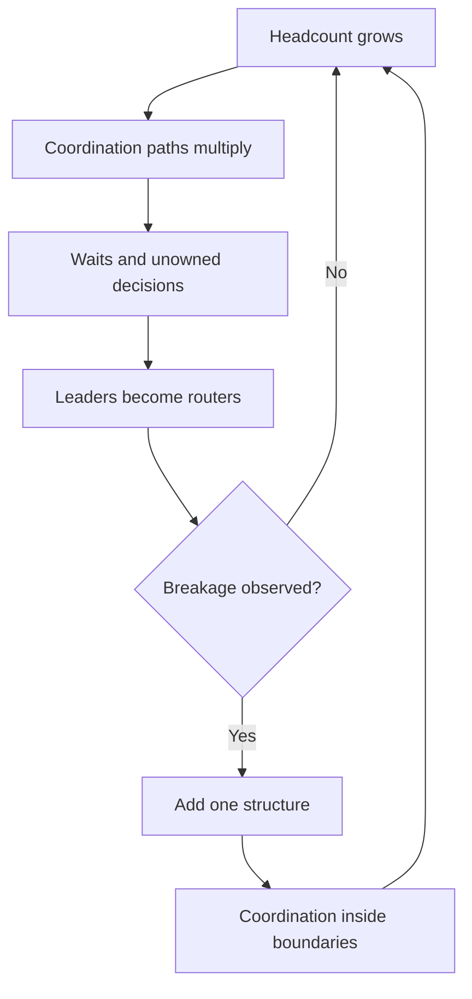
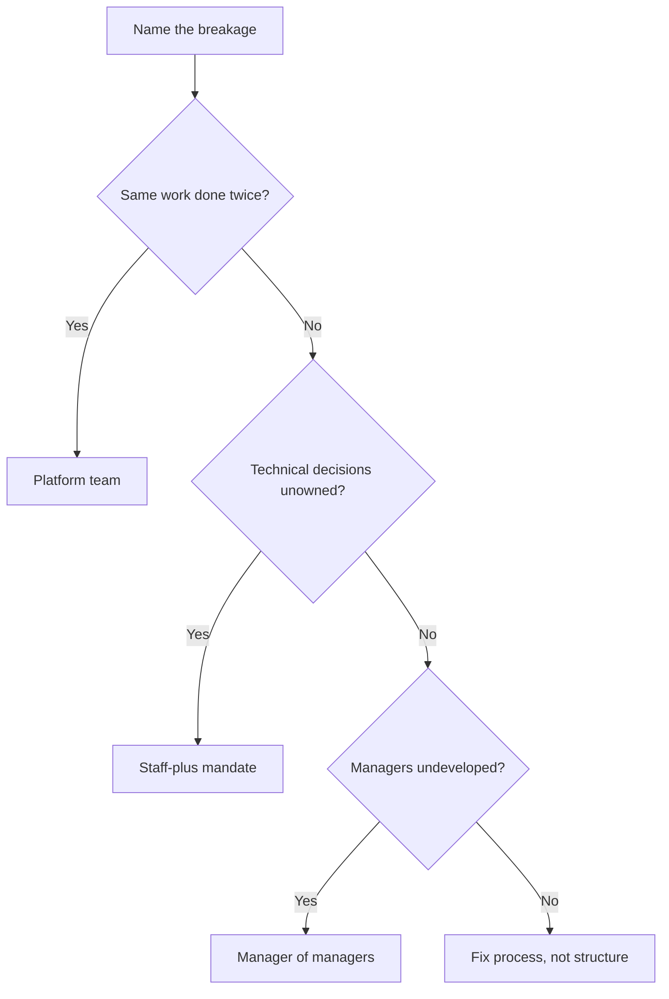

# Chapter 35 — Designing Organizations of 20, 50, 100, and 500 Engineers

This chapter is about producing an organization design: for a given headcount, architecture, and
product portfolio, which teams exist, who leads them, and which roles sit above and beside them. It
describes what tends to break as an organization passes roughly 20, 50, 100, and 500 engineers, which
structures answer each breakage, and the order in which to introduce managers of managers, platform
teams, and staff-plus roles. Chapter 33 owns team types and cognitive load, Chapter 34 spans, layers,
and dependency mapping, and Chapter 36 carrying out a reorganization. The case is a proposed year 2
organization for Northstar Technologies, the fictional company in the
[case study](../../case-studies/northstar/index.md), and the starting point for Project 4.

## Why This Matters

At team scale, structure decides who a person waits for. An engineer whose every change touches two
other teams' code waits for those teams' priorities, and no individual effort removes that wait.

At organization scale, structure is the largest lever a director holds on coordination cost, and the
most expensive to move. Northstar's baseline shows the cost of a structure that grew without design:
items with no cross-team dependency had a median lead time of 11 days, items with one took 24, and
items with two or more took 41 (see the [baseline data](../../case-studies/northstar/baseline-data.md)).
Three Core modules changed by four teams had no owner. Three staff engineers had titles and no mandate.

At executive scale, the question is timing. Structures a 500-person organization needs are overhead
at 50, and structures that work at 50 fail at 500. Added too early, layers and platform groups are
machinery nobody needs; added too late, leaders spend their weeks routing work. Designing ahead of need,
by one or two quarters, is the skill.

## Learning Objectives

After this chapter you will be able to:

- Describe what typically breaks as an organization passes 20, 50, 100, and 500 engineers, and which
  structure answers each breakage.
- Produce an organization design from three inputs (headcount, architecture, product portfolio) plus
  the constraints, and show the arithmetic.
- Sequence the introduction of managers of managers, platform teams, and staff-plus roles by observed
  trigger rather than by headcount.
- Present a design as options with stated costs, and separate the decisions it makes from the inputs it
  depends on.
- Recognize the common design failures early, including the premature layer and the platform team as a
  dumping ground.

## The Mental Model

> **Mental model:** Coordination load grows faster than headcount. Each scale transition is a set of
> specific breakages in how work and decisions move, and each structure is a way to contain coordination
> inside a boundary. Add structure in answer to observed breakage, one step ahead, not to a headcount
> number.

The loop fails in two ways. Without new structure, leaders become the coordination mechanism until
their calendars fill. With structure added by headcount formula, the boundaries may miss where
coordination happens, and the organization pays for both.

The second idea is that a design has three inputs and they must agree. The architecture says which
work is coupled. The product portfolio says which outcomes the business is buying. The headcount says
how many teams the budget allows. A design that fits only one of the three, such as teams by product
line on an architecture where every product line changes the same monolith module, moves the
coordination cost somewhere less visible rather than removing it.

## Deep Conceptual Explanation

### Why coordination grows faster than headcount

The usual argument is arithmetic. If everyone may need to talk to everyone, n people have n(n−1)/2
possible communication paths: 10 people have 45, 20 have 190, 50 have 1,225. Brooks's essays are
widely known for this argument and for the claim that adding people to a late project makes it later
([Brooks, 1995](../../references/bibliography.md#brooks1995mythical)); by a secondary account, Brooks
himself called the law an oversimplification. The formula is an upper bound, not a measurement: real
organizations never use most of the possible paths. Its value is the direction it points. Structure
exists to make most paths unnecessary.

Chapter 33 covers the empirical support for the direction: Conway's observation
([Conway, 1968](../../references/bibliography.md#conway1968committees)) and the congruence studies
behind it. One result belongs here, because it concerns structure at scale:

- **Research finding.** In a study of Windows Vista, Nagappan, Murphy, and Basili defined eight
  organizational measures per binary, among them how many engineers edited it, how many had left, and
  how many organizations contributed more than a tenth of its edits. Together these predicted which
  binaries would fail after release (average precision 0.87, recall 0.84 over 50 random splits),
  better than churn, complexity, coverage, dependency, or pre-release bug models
  ([Nagappan, Murphy, and Basili, 2008](../../references/bibliography.md#nagappan2008organizational)).
  It is one system at one company, and the authors say the result cannot be assumed to generalize.

What the evidence does not give is a number. There is no validated optimal team size, span, or
threshold for adding a layer; widely repeated group-size limits borrowed from anthropology do not come
from studies of software organizations, and this book does not use them (research gap G8). The scale
points 20, 50, 100, and 500 are bands where practitioners commonly report the same breakages, not
thresholds (**practitioner consensus**; the specific answers are **this book's recommendation**).

### What breaks at each transition

The table summarizes the breakages and answers. Each row is a band, and an organization with a
monolith and one product breaks later than one with thirty services and four products.

| Band | What breaks | Structural answer | What not to add yet |
|---|---|---|---|
| About 20 | One leader reviews, decides, and hires; one standup no longer fits; on-call is heroics | Split into two or three teams by product area or system boundary; first managers; written ownership of every component | Managers of managers; a platform team |
| About 50 | Cross-team dependencies dominate lead time; shared build and deploy owned by nobody; one senior engineer becomes the architecture bottleneck | A director over five to eight teams; a small team that owns the shared delivery path; the first staff engineer with a written mandate; a common planning cadence | A second management layer |
| About 100 | The director cannot develop every manager and route every cross-team decision; platform requests queue; technical direction is decided by whoever is in the room | Groups led by managers of managers, aligned to architecture and product; a platform team run as a product; staff-plus roles with mandates per group | Separate functional departments for testing or operations |
| About 500 | Information is lost through layers; groups duplicate platforms; planning becomes a negotiation between fiefdoms | A platform organization with internal products; a technical direction function of principal engineers; portfolio planning across groups; explicit decision rights | Uniform processes imposed on every group |

Two patterns run through the table. Each transition moves a job from a person to a structure: the
founder's reviews become team ownership, the director's routing becomes group boundaries. And the right
answer at one band becomes the problem at the next. The small team that owns the delivery path at 50 is a bottleneck
at 100 unless it learns to run its work as a product with self-service.

Fournier's account of the management path is known for describing how the job changes from managing
engineers to managing managers to running an organization
([Fournier, 2017](../../references/bibliography.md#fournier2017manager)). A design that creates
managers of managers creates people doing that job for the first time; it should say who develops them.

### Three inputs, one design

**Architecture.** List the components and who changes each one. Northstar's
[components file](../../case-studies/northstar/data/components.csv) is the model: owner, ownership
status, tier. Where several teams change one component, either the boundary or the component is wrong.

**Product portfolio.** List the outcomes the business funds and their expected life. A product line
with years of investment ahead deserves a stable team; a one-quarter commitment deserves a project
inside an existing team.

**Headcount and constraints.** Count the people you have, not the people you want, plus locations,
scarce skills, and budget rules. Teams, managers, and leaders must add up to the headcount, every time.

Larson's *An Elegant Puzzle* is known for treating organization design as an engineering problem
([Larson, 2019](../../references/bibliography.md#larson2019elegant)). GitLab's public handbook documents
a written structure rule: a target range for direct reports, the same at every level to avoid an extra
layer, sized for where the organization will be six months ahead
([GitLab, Organizational Structure](../../references/bibliography.md#gitlab2026structure)). That is
one company's practice, not evidence for its range; Chapter 34 owns how to set spans.

### Sequencing managers of managers, platform teams, and staff-plus roles

**Managers of managers** answer a capacity limit on people leadership. The trigger is first-line
managers not being developed or held to account because their leader has more managers than they can
coach, or cross-team decisions waiting for one person. The cost is a layer (Chapter 34 counts it) and,
under flat headcount, an engineering seat.

**Platform teams** answer repeated work: several teams solving the same delivery problem separately,
or queuing for the one person who knows it. Skelton and Pais's *Team
Topologies* is known for the platform team as a team that provides internal services other teams use
by self-service, run like a product ([Skelton and Pais, 2019](../../references/bibliography.md#skelton2019team)).
Chapter 32 covers platform engineering as a product.

**Staff-plus roles** answer cross-team technical decisions with no owner. Chapter 29 owns the
archetypes and the reporting-line choice; the design question here is whether each role has a written
mandate and a place on the chart.
GitLab documents a dual career path that advances technical people where there is no business need
for another management layer ([GitLab, Organizational Structure](../../references/bibliography.md#gitlab2026structure)).

The order of the questions is deliberate (**this book's recommendation**). A platform team and a staff
mandate are cheaper and easier to reverse than a management layer, so check them first. The last
branch matters most: many breakages blamed on structure are planning, decision, or dependency problems
that Chapters 13 and 16 solve without moving anyone.

## Engineering Organization Example

The three organizations below are **illustrative** and fictional, invented to show the arithmetic at
20, 50, and 500 engineers. Northstar, at about 100 people, is the case study.

**Fernwick (20 engineers).** A payroll software startup. All 20 engineers report to the cofounder CTO,
who reviews most designs and is on call for everything. Three product areas (payroll engine, employee
app, integrations) share one board.

| Design | Count |
|---|---|
| Teams | Payroll engine 7, employee app 7, integrations and delivery 6 |
| Leads | Three engineers promoted to manager, one per team (6, 6, and 5 reports), each still a working lead for a year, within Chapter 34's span for a manager who codes |
| CTO direct reports | 3 managers |
| Total | 20 engineers, of whom 3 now manage |

The integrations team also owns build and deploy: a separate platform team of two would be a single
point of failure.

**Brackenridge Freight (50 engineers).** Six teams under a director; shared CI maintained in spare
time by two engineers on different teams; one senior engineer consulted on every cross-team design.

| Change | Arithmetic |
|---|---|
| Six product teams become five, plus a delivery platform team | 50 engineers = 5 teams of 8 to 9 (43) + platform 5 + 2 staff |
| Platform team | 5 engineers; its product is the build and deploy path and test environments, measured by adoption and wait time |
| First staff engineers | The consulted senior engineer, with a written mandate for cross-team design review; a second for reliability |
| Management | Director with 6 managers; no second layer |

Check: 43 + 5 + 2 = 50.

**Halvard Systems (500 engineers).** A multi-product software company. Assumptions, chosen for this
example and not benchmarks: 8 engineers per first-line manager and 6 managers per director.

| Layer | Arithmetic | Count |
|---|---|---|
| Engineers | given | 500 |
| First-line managers | 500 ÷ 8 = 62.5 | about 63 |
| Directors | 63 ÷ 6 = 10.5 | about 11 |
| Vice presidents | four product groups and one platform organization | 5 |
| Principal engineers | one per VP group, plus two in a technical direction function | 7 |

The platform organization holds 70 engineers (14 percent), a choice tied to Halvard's estate of shared
services, not a target. Three management layers (manager, director, VP) sit between an engineer and
the CTO. At this scale the
dominant problem is coordination across groups. A revelatory case study of a Norwegian programme with
12 co-located teams and 175 people found many coordination arenas in use (a Scrum of Scrums, a
"Metascrum" above it, demos, forums, instant messaging), found that the arenas changed over the
programme's life, and noted that extra roles and arenas reduced team autonomy
([Dingsøyr et al., 2018](../../references/bibliography.md#dingsoyr2018exploring)). At 500, that trade is the design's main tension.

## Decision Framework

Start from the symptom; check the cheaper answer first.

| Symptom | Evidence to collect | Cheaper answer first | Structural answer |
|---|---|---|---|
| Lead time grows with dependencies | Dependency matrix (Chapter 16) | Contracts, interface ownership | Redraw team boundaries along coupling |
| Components changed by many teams, owned by none | Changes per component by team | Assign an owner and review rule | Move the component or split it |
| Leader is the routing point | Decisions waiting on one person per week | Decision rights (Chapter 13) | Manager of managers or group lead |
| Same tooling built repeatedly | Duplicate pipelines, environment waits | Shared standard and one owner | Platform team with a product |
| Cross-team technical decisions stall | Open design disputes and their age | Decision record, a named arbiter | Staff-plus role with a mandate |
| Manager overloaded | Reports, one-on-ones held, hiring load | Tech lead within the team | Split the team, new manager |

Three rules govern the choice (**this book's recommendation**). Design for two to four quarters ahead.
Prefer the most reversible structure when evidence is thin. Present any decision someone else owns as
an input with branches.

## Trade-offs

**Stream-aligned capacity against shared capability.** Every engineer moved into a platform team or a
staff role leaves a product team. Under flat headcount the platform team is paid for in roadmap
capacity this year and repays it, if at all, over later years.

**Fewer layers against developed managers.** A flat organization decides faster but its senior leader
cannot coach a dozen managers. Rajan and Wulf found large US firms became flatter, with authority
delegated downward ([Rajan and Wulf, 2006](../../references/bibliography.md#rajan2006flattening));
that describes corporate hierarchies, not engineering teams, and gives no right number.

**Architecture alignment against product alignment.** Teams aligned to components keep ownership sharp
and coordination of features costly. Teams aligned to products do the opposite. A monolith pushes
toward components; a modular system allows products.

**Design for the people you have against the design you need.** Building teams around specific people
avoids painful moves but fixes today's skills into the structure. Design the boundaries first, then
place people, then adjust where a placement would lose someone critical.

**Stability against fit.** Each redesign costs weeks of lost context and new relationships (Chapter
36). A slightly wrong structure that holds for two years may beat a better one changed every two
quarters.

## Failure Modes

**The headcount formula.** Structure added because a number was crossed ("we are 100, so we need
groups"). Signal: the new boundaries cut across the dependency map. Detection: before approving any
design, overlay the dependency links on the proposed boundaries and count how many cross them.

**The premature layer.** Managers of managers over two or three small teams each. Signal: group leads
who run status meetings and relay information. Detection: ask each proposed group lead what they will
decide that nobody decides now.

**The platform dumping ground.** Everything nobody owns is assigned to the platform team, which becomes
an interrupt queue. Signal: Northstar's Platform Operations at baseline, with 46 percent unplanned work
and 29 of 86 dependency links landing on it. Detection: a platform team without a written product
statement and an adoption measure is a dumping ground in waiting.

**The title without a mandate.** Staff titles awarded as promotions with no scope. Signal: Northstar's
three staff engineers at baseline, consulted on everything and owning nothing. Detection: each
staff-plus role has a one-paragraph mandate, a decision scope, and a reporting line chosen for it.

**Functional silos at 50.** Splitting by function (frontend, backend, testing, operations) so that
every feature crosses three teams. Northstar's former QA group inside Platform Operations is the
pattern. Detection: count the teams a typical feature passes through.

**Copying a famous company's model.** Borrowed boundaries without the architecture or product they
were fitted to. Detection: ask which of your three inputs the copied design fits.

## Enterprise Application

In an organization of 50 to 150 engineers, the design question is usually not whether to add structure
but which one first, under a budget that rarely grows as fast as the work. Four practices help.

**Keep a written design.** One versioned page listing teams, missions, components owned, managers,
and staff mandates. Without it, ownership disputes have no reference.

**Rerun the dependency overlay each half-year.** Chapter 34 owns the method; this chapter's use is as a
trigger. Rising links across a boundary mean the boundary is drifting from the architecture.

**Fund the platform from measured waste.** Northstar's four CI systems cost about 1.5 FTE a year
(baseline): measured waste is the cleanest argument for platform capacity under flat headcount.

**Name the next structure in advance.** Agree with the CTO what evidence would trigger the next
change, such as a second management layer, so that it is prepared in the open.

## CTO Perspective

A CTO designs the organization twice: the one that runs today, and the one the plan implies in two
years, which today's hiring, promotion, and architecture decisions prepare or block. Larson's *The Engineering Executive's Primer* is known for treating structure
as one of the engineering executive's core responsibilities, alongside planning and hiring
([Larson, 2024](../../references/bibliography.md#larson2024primer)).

At executive scale, three questions dominate. Is the platform investment proportionate to the shared
estate, and is anyone measuring whether teams adopt it? Do the principal and staff engineers have
decision rights, or only influence? And is the next management layer being prepared, with candidates
developing now, or will it be filled in a hurry from outside?

The CTO also owns the honesty of the evidence. The research on organizational structure and quality
([Nagappan, Murphy, and Basili, 2008](../../references/bibliography.md#nagappan2008organizational))
is strong enough to justify fixing diffuse ownership. Nothing in the literature justifies telling a
board that a reorganization will raise output by a percentage.

## Practical Playbook

To produce an organization design:

1. Write down the constraints: headcount (engineers and managers separately), budget rules, locations,
   and any decisions owned by someone else.
2. List components with the teams that change each one, and the dependency links between teams over
   the last two quarters.
3. List the product outcomes funded for the next four quarters and their expected life.
4. Name the breakages you observe, each with evidence: waits, unowned components, overloaded leaders,
   duplicated tooling, stalled technical decisions.
5. For each breakage, test the cheaper answer first (process, decision rights, ownership).
6. Draft team boundaries along coupling, then check them against the product outcomes.
7. Decide on platform, staff-plus, and management-layer additions using the sequencing questions.
8. Do the arithmetic: every person placed, totals equal to headcount, spans recorded.
9. Write at least two options and a do-nothing baseline, each with its cost in seats, transition
   disruption, and risk.
10. Separate decisions the design makes from inputs it depends on, with a branch for each input.
11. Name the evidence that would show the design is working after two quarters, and the trigger for the
    next change.
12. Hand the chosen option to the reorganization plan (Chapter 36).

## Case Study

This case is **fictional**. It is set at Northstar in quarter 4 of the director's first year, as a
proposal the reader evaluates; its outcome is deliberately not fixed. The starting state comes from
[the first quarter](../../case-studies/northstar/first-quarter.md) page.

**The starting point.** After the QA engineers moved into product teams in week 10, Northstar's 80
engineers sit in these teams: Orders 16, Billing 15, Payments and Integrations 13, Customer Experience
17, Data and Analytics 11, Platform Operations 5 (infrastructure only), and 3 staff engineers. Check:
16 + 15 + 13 + 17 + 11 + 5 + 3 = 80. The director has 9 direct reports: 6 managers and 3 staff
engineers. The whole organization is 87 people and stays flat; promoting an engineer into a new
manager role is allowed only if that engineer's seat is not backfilled.

**The breakages the director names** (fictional framing of canon facts): Customer Experience runs two
products with different release mechanics from one board across two sites, and Chapter 14's health
check found mobile red on 4 of 10 indicators; core/permissions has no owner; search-svc's ownership is
disputed between Orders and Data and Analytics (Chapter 12); and Platform Operations, with five
engineers and a two-person interrupt rotation (Chapter 16), still answers requests as a ticket queue.

**The proposal.** In week 44 (fictional), the director drafts a year 2 organization for Victor
Lindqvist, to take effect at the start of quarter 5 (week 53). The CTO decides.

| Team | Manager | Engineers | Change |
|---|---|---|---|
| Orders | Priya Raman | 16 | takes core/permissions (her stated condition, after week 26, is met); search-svc leaves |
| Billing | Marcus Oyelaran | 15 | none |
| Payments and Integrations | Elena Sokolova | 13 | none |
| Web | Daniel Cho | 11 | 9 web engineers and the 2 quality engineers |
| Mobile | Mateo Arango Ríos | 5 | the Bogotá mobile engineers; Mateo's seat not backfilled |
| Data and Analytics | Farah Haddad | 11 | takes search-svc |
| Developer Platform | Tom Becker | 5 | the infrastructure engineers, run as an internal product |
| Staff engineers | the director | 3 | written architecture mandates |

Check: 16 + 15 + 13 + 11 + 5 + 11 + 5 + 3 = 79 engineers, plus 7 managers (one of them an
engineer-turned-manager) and the director: 87. The director has 10 direct reports (7 managers, 3
staff). Six people change manager (Mateo and the five mobile engineers) and two components change
owner. Mobile gives up one engineer's capacity, a sixth of its engineers, for a manager on its own site.

**Alternatives in the draft.**

| Alternative | Arithmetic | Main cost |
|---|---|---|
| B. Keep Customer Experience whole, two subteams (Chapter 14's option B) | 80 engineers, 6 managers, director 9 reports | Daniel leads across sites; mobile's red indicators may persist |
| C. Also split Orders (Order Capture 9, Catalog and Pricing 6, a manager from Orders) and grow the platform to 8 with one transfer each from Billing, Payments and Integrations, and Data | 78 engineers, 8 managers | About ten more people move; about 58 co-changing pricing-rules and order-capture merge requests a quarter cross a new boundary (Chapter 31), unless pricing-rules stays with Order Capture |
| D. Two managers of managers above the teams | 77 engineers, 9 managers, director 5 reports | A layer between the director and the reliability work; two seats; two leads new to the job |

**The director's reasoning.** The proposal answers the breakages with the fewest moves: one split
where the evidence is strongest (two products, two sites, red health signals) and two ownership
assignments that end recorded disputes. It leaves Orders at 16 with an added module, which is its main
risk; alternative C answers that, at the price of a second split before the first has settled. On D, in
the director's own assessment (fictional), the managers are getting monthly development time and
cross-team decisions are not queuing on the director, so a layer would answer a breakage not yet
observed. The draft names triggers for revisiting C and D: Orders' lead time or on-call load rising
after core/permissions arrives, approved headcount growth, or manager development falling behind.
Developer Platform keeps three builders after the interrupt rotation, so its first product must be
small.

How to carry out the change is Chapter 36's subject. Whether this is the right proposal is the subject
of the exercises and Project 4.

## Exercises

Solutions are in [chapter 35 solutions](../../solutions/ch35-solutions.md). Northstar data is on the
[baseline page](../../case-studies/northstar/baseline-data.md).

### Foundational

**F1.** A 22-engineer startup has one team, one board, and a founder CTO who reviews every pull
request. Deployments wait on average two days for review, and the CTO is the only person who can
approve a schema change. The CTO proposes hiring a VP of Engineering. Name the breakage, the cheaper
answer to test first, and the structure you would add, with arithmetic.

**F2.** Using Northstar's baseline dependency links by pair, count how many of the 86 links would
cross a team boundary under alternative C, treating Order Capture and Catalog and Pricing as two teams.
State what you must assume about how Orders' links split between the two new teams, and what the count
tells you about the design.

**F3.** A colleague cites the n(n−1)/2 formula to argue that teams must never exceed seven people.
Assess the argument using what the chapter says about the formula, the evidence, and the absence of a
validated team size.

### Applied Leadership

**A1.** You are Tom Becker in week 46, reviewing the proposal. Developer Platform keeps its five
engineers, and two remain on the interrupt rotation. Write the platform team's product statement for
year 2, the two measures of adoption you would report, what you would refuse to take on, and whether
you would argue for alternative C's three transfers.

**A2.** Priya Raman objects to alternative C: she built Orders' domain knowledge into one team, and the
split separates pricing rules from order capture, which change together often: 53 percent of
pricing-rules merge requests in the baseline quarter also touched order-capture (Chapter 31), though
only 4 of Orders' work items of a week or more touched both (Chapter 34). Decide whether these facts change the boundary, and what you would ask to see
before deciding.

**A3.** Write the one-paragraph mandates for Ines Carvalho, Kwame Mensah, and Li Na Zhou under the
proposal, choosing an archetype for each and stating their decision scope and reporting line. Explain one
case where the mandate should say "advises" rather than "decides".

### Executive Decision-Making

**X1.** Victor Lindqvist prefers alternative D because "we will be 100 engineers in two years and I don't
want to reorganize twice". Headcount growth is not approved. Prepare the director's response: the cost
of D now, the cost of moving to D later, and the triggers you would commit to.

**X2.** You are CTO of Halvard Systems at 500 engineers. Two product groups have built separate
deployment platforms, and the platform organization's adoption is 40 percent. A VP proposes making
the platform mandatory. Decide what you would do, what evidence you would gather, and how the decision
changes the organization design.

## Reflection Questions

1. Which structure in your organization exists because a headcount number was crossed rather than
   because a breakage was observed?
2. If you overlaid last quarter's dependency links on your current team boundaries, how many would
   cross them?
3. Which of your staff or principal engineers could state their mandate in one sentence, and would
   their manager agree?
4. What would your platform team's users say its product is?
5. Which decision in your next design depends on someone else's choice, and have you said so?
6. What would have to be true for you to recommend no structural change at all?

## Key Takeaways

- Coordination load grows faster than headcount; structure exists to make most communication paths
  unnecessary.
- Add structure in answer to an observed breakage, one or two quarters ahead, not to a headcount
  number. No validated number exists.
- A design has three inputs, architecture, product portfolio, and headcount, and must fit all three.
- Diffuse ownership across an organization is a quality risk, not only a speed risk; give every
  component one owner.
- Check the cheaper structures first: a platform team with a product, then staff-plus mandates, then a
  management layer.
- Do the arithmetic for every option, and show that it adds up to the headcount.
- Separate the decisions a design makes from the inputs it depends on, and show a branch for each.
- Every design names the evidence that will show it worked and the trigger for the next change.

## References and Further Reading

- [Nagappan, Murphy, and Basili, 2008](../../references/bibliography.md#nagappan2008organizational).
  Organizational measures predicting failures in Windows Vista; the strongest evidence here.
- [Dingsøyr et al., 2018](../../references/bibliography.md#dingsoyr2018exploring). Coordination
  across 12 teams and 175 people.
- [Conway, 1968](../../references/bibliography.md#conway1968committees) and
  [Brooks, 1995](../../references/bibliography.md#brooks1995mythical). The classic arguments.
- [Rajan and Wulf, 2006](../../references/bibliography.md#rajan2006flattening). Flattening
  corporate hierarchies.
- [Larson, 2019](../../references/bibliography.md#larson2019elegant) and
  [Larson, 2024](../../references/bibliography.md#larson2024primer). Organization design as an
  engineering and executive problem.
- [Skelton and Pais, 2019](../../references/bibliography.md#skelton2019team). Platform teams and team
  types.
- [Fournier, 2017](../../references/bibliography.md#fournier2017manager). How the management job
  changes by level.
- [GitLab, Organizational Structure](../../references/bibliography.md#gitlab2026structure). A
  documented structure rule and dual career path; summarize, do not copy.
