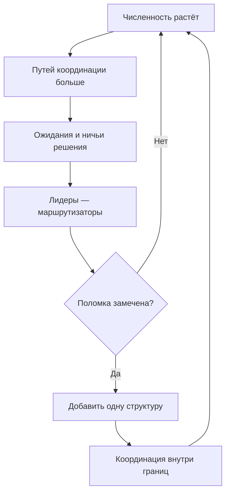
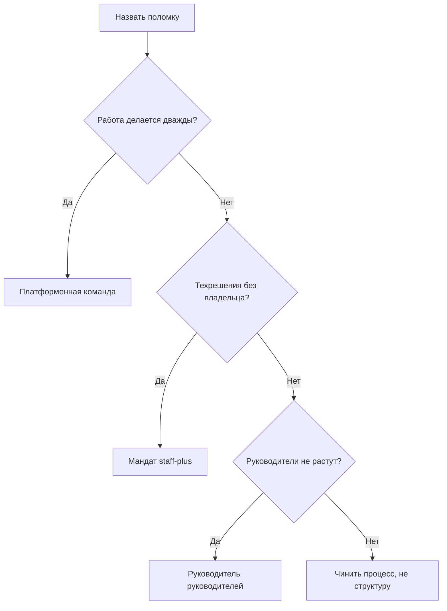

# Глава 35 — Проектирование организаций на 20, 50, 100 и 500 инженеров { #chapter-35-designing-organizations-of-20-50-100-and-500-engineers }

Эта глава о том, как составить проект организации. При заданной численности, архитектуре и продуктовом
портфеле нужно решить, какие будут команды, кто ими руководит и какие роли стоят над ними и рядом с ними.
В главе описано, что обычно ломается, когда организация проходит отметки примерно в 20, 50, 100 и
500 инженеров, какие структуры отвечают на каждую поломку и в каком порядке вводить руководителей
руководителей, платформенные команды и роли [staff-plus](../../glossary.md#staff-plus-engineer)
(senior-инженеров, чья работа — техническое лидерство за пределами собственных задач). Типы команд и
когнитивную нагрузку разбирает глава 33, охват управления, уровни управления и карту зависимостей —
глава 34, а проведение реорганизации — глава 36. Кейс главы — предложение о том, как устроить на второй
год Northstar Technologies, вымышленную компанию из [кейса](../../case-studies/northstar/index.md); с
этого же кейса начинается проект 4.

## Почему это важно { #why-this-matters }

В команде структура определяет, кого человек ждёт. Если каждое изменение инженера затрагивает код двух
других команд, он ждёт, пока его задача попадёт в их приоритеты, и никакие личные усилия этого ожидания
не сократят.

В масштабе организации структура — самый сильный рычаг, которым директор влияет на стоимость координации,
и перестраивать его дороже всего. Исходный уровень Northstar показывает, во что обходится структура,
выросшая без проекта. У задач без зависимостей от других команд медианный
[lead time](../../glossary.md#lead-time) (от запроса до релиза) составлял 11 дней, у задач с одной
зависимостью — 24, а с двумя и более — 41 (см.
[исходные данные](../../case-studies/northstar/baseline-data.md)). У трёх модулей Core, которые меняли
четыре команды, не было владельца. У трёх staff-инженеров были должности, но не было мандата.

Для высшего руководства главное — выбрать момент. Структуры, которые нужны организации из
500 человек, при 50 превращаются в накладные расходы, а те, что работают при 50, при 500 не
выдерживают нагрузки. Если
уровни управления и платформенные группы добавить слишком рано, получится механизм, который никому не
нужен. Если слишком поздно, руководители будут неделями заняты маршрутизацией работы. Мастерство в
том, чтобы проектировать на один-два квартала раньше, чем возникнет потребность.

## Цели главы { #learning-objectives }

Прочитав эту главу, вы сможете:

- Описывать, что обычно ломается, когда организация проходит отметки в 20, 50, 100 и 500 инженеров, и
  какая структура отвечает на каждую поломку.
- Составлять проект организации по трём входным данным (численность, архитектура, продуктовый портфель)
  с учётом ограничений и показывать расчёт.
- Выстраивать порядок появления руководителей руководителей, платформенных команд и ролей staff-plus по
  наблюдаемым триггерам, а не по численности.
- Представлять проект как набор вариантов с указанной стоимостью и отделять решения, которые он
  принимает, от входных данных, от которых он зависит.
- Рано распознавать типичные ошибки проектирования, в том числе преждевременный уровень управления и
  платформенную команду, превращённую в свалку.

## Ментальная модель { #the-mental-model }

> **Ментальная модель:** координационная нагрузка растёт быстрее численности. Каждый переход между
> масштабами — это набор конкретных поломок в том, как движутся работа и решения, а каждая структура —
> способ удержать координацию внутри границы. Добавляйте структуру на шаг раньше, в ответ на замеченную
> поломку, а не потому, что численность достигла какого-то числа.

Цикл может дать сбой двумя способами. Если новую структуру не добавить, механизмом координации становятся
сами руководители — пока их календари не переполнятся. Если структуру добавляют по формуле от
численности, границы могут пройти мимо мест, где координация идёт в действительности, и организация
платит дважды: и за структуру, и за координацию.

Вторая идея: у проекта три входа, и они должны быть согласованы между собой. Архитектура показывает,
какая работа связана. Продуктовый портфель показывает, за какие результаты платит бизнес. Численность
показывает, сколько команд позволяет бюджет. Если проект подходит только к одному из трёх входов, он не
убирает стоимость координации, а переносит её туда, где её хуже видно. Пример — команды по продуктовым
линиям при архитектуре, в которой все линии меняют один и тот же модуль монолита.

## Подробный разбор { #deep-conceptual-explanation }

### Почему координация растёт быстрее численности { #why-coordination-grows-faster-than-headcount }

Обычный довод — арифметический, и прославил его Brooks: у n человек n(n−1)/2 возможных путей
коммуникации; подробно этот расчёт разобран в главе 33
([Brooks, 1995](../../references/bibliography.md#brooks1995mythical)). Формула даёт верхнюю границу, а
не измерение, но направление указывает верно: структура существует, чтобы большинство путей стали
ненужными.

Эмпирические данные, подтверждающие это направление, разбирает глава 33, начиная с
[закона Конвея](../../glossary.md#conways-law-and-the-reverse-conway-maneuver): системы копируют
коммуникационные структуры организаций, которые их строят
([Conway, 1968](../../references/bibliography.md#conway1968committees)). Один результат стоит привести
здесь: он касается структуры крупных организаций.

**Размытое владение предсказывает отказы (научный результат).** Nagappan, Murphy и Basili изучали
Windows Vista. Для каждого компонента они измерили организационные факты: сколько инженеров его
правили, сколько из них ушло из компании и сколько отдельных подразделений внесли большую долю его
правок. Вместе эти показатели предсказывали, какие компоненты откажут после релиза, причём точнее, чем
метрики кода: размер изменений, сложность или тестовое покрытие. Большинство отмеченных компонентов
действительно отказывали, и большинство отказов приходилось на отмеченные компоненты
([Nagappan, Murphy, and Basili, 2008](../../references/bibliography.md#nagappan2008organizational)).
Это одна система в одной компании, и авторы предупреждают, что обобщать результат без проверки нельзя.

Чего данные не дают, так это числа. Проверенного оптимального размера команды, охвата управления или
порога для нового уровня не существует. Популярные пределы размера группы пришли из антропологии, а не из
исследований софтверных организаций, и книга ими не пользуется. Доказательная база здесь слабая. Отметки
20, 50, 100 и 500 — не пороги, а диапазоны, в которых практики обычно сообщают об одних и тех же поломках
(**консенсус практиков**; конкретные ответы — **рекомендация книги**).

### Что ломается на каждом переходе { #what-breaks-at-each-transition }

В таблице собраны поломки и ответы на них. Каждая строка — диапазон, а не точка: организация с монолитом и
одним продуктом ломается позже, чем организация с тридцатью сервисами и четырьмя продуктами.

| Диапазон | Что ломается | Структурный ответ | Чего пока не добавлять |
|---|---|---|---|
| Около 20 | Один лидер проводит ревью, принимает решения и нанимает; один стендап больше не вмещает всех; дежурство держится на героизме | Разделиться на две-три команды по продуктовым областям или границам системы; первые руководители; письменно закреплённое владение каждым компонентом | Руководителей руководителей; платформенную команду |
| Около 50 | Зависимости между командами определяют lead time; общей сборкой и развёртыванием никто не владеет; один senior-инженер становится узким местом архитектуры | Директор над пятью–восемью командами; небольшая команда, которая владеет общим путём поставки; первый staff-инженер с письменным мандатом; общий ритм планирования | Второй уровень управления |
| Около 100 | Директор не успевает развивать каждого руководителя и маршрутизировать каждое межкомандное решение; запросы к платформе стоят в очереди; техническое направление определяет тот, кто оказался в комнате | Группы во главе с руководителями руководителей, выстроенные по архитектуре и продуктам; платформенная команда, которую ведут как продукт; роли staff-plus с мандатами в каждой группе | Отдельные функциональные отделы тестирования или эксплуатации |
| Около 500 | Информация теряется на уровнях; группы дублируют платформы; планирование превращается в торг между удельными княжествами | Платформенная организация с внутренними продуктами; функция технического направления из principal-инженеров; планирование портфеля по всем группам; явные права на решения | Единые процессы, навязанные каждой группе |

Через всю таблицу проходят две закономерности. Во-первых, каждый переход передаёт работу от человека
структуре: ревью основателя становятся владением команд, маршрутизация директора — границами групп.
Во-вторых, правильный ответ на одном диапазоне становится проблемой на следующем. Небольшая команда,
которая при 50 инженерах владеет путём поставки, при 100 превращается в узкое место, если не научится
вести свою работу как продукт с самообслуживанием.

Книга Fournier о пути руководителя известна тем, что показывает, как меняется работа: от управления
инженерами к управлению руководителями, а затем к руководству организацией
([Fournier, 2017](../../references/bibliography.md#fournier2017manager)). Если в проекте появляются
руководители руководителей, значит, появляются люди, которые делают эту работу впервые, и в проекте
должно быть сказано, кто будет их развивать.

### Три входа, один проект { #three-inputs-one-design }

**Архитектура.** Перечислите компоненты и для каждого укажите, кто его меняет. Образец —
[файл компонентов](../../case-studies/northstar/data/components.csv) Northstar: владелец, статус
владения, уровень критичности. Если один компонент меняют несколько команд, неверна либо граница, либо
сам компонент.

**Продуктовый портфель.** Перечислите результаты, которые финансирует бизнес, и их ожидаемый срок
жизни. Продуктовая линия, в которую предстоит вкладываться годами, заслуживает стабильной команды;
обязательство на один квартал — проекта внутри существующей команды. Запишите портфель короткой
таблицей: продукт, ожидаемый срок жизни, направление (рост, удержание или сбор отдачи, harvest) и
механика релизов. Границы сдвигают два факта о портфеле. Первый: продукты с разными клиентами,
механикой релизов или регулированием тянут к отдельным командам даже при общем коде, потому что каждому
нужны свои приоритеты. Второй: продукту, с которого собирают отдачу, место внутри команды, у которой
есть другая, растущая миссия; собственная команда такого продукта либо будет голодать, либо окажется раздутой.

**Площадки и часовые пояса.** Расположение ограничивает выбор границ, и учитывать его в последнюю очередь
нельзя (**рекомендация книги**). Работу, которая меняется вместе, держите на одной площадке или в часовых
поясах с общими рабочими часами: команда, разделённая между площадками, платит за координацию при каждом
изменении (распределённые команды разбирает глава 14). Помогают три правила. У большей части команды
должна совпадать хотя бы половина рабочего дня. Площадке, где работает целая команда, нужен руководитель
на месте или хотя бы тот, кто регулярно приезжает. И избегайте границы, при которой одна площадка всегда
запрашивает, а другая всегда исполняет: так площадка превращается в поставщика. В кейсе ниже Northstar
делит команду именно по этой линии.

**Численность и ограничения.** Исходите из людей, которые у вас есть, а не из тех, кого хотелось бы,
и учтите площадки, дефицитные навыки и бюджетные правила. Команды, руководители и лидеры в сумме
всегда должны давать численность.

Книга Larson *An Elegant Puzzle* известна тем, что рассматривает организационный дизайн как
инженерную задачу ([Larson, 2019](../../references/bibliography.md#larson2019elegant)). В открытом
справочнике GitLab правило охвата рассчитано на организацию такой, какой она будет через полгода
([GitLab, Organizational Structure](../../references/bibliography.md#gitlab2026structure)): это
практика одной компании, а не доказательство. Как задавать охват, разбирает глава 34.

### Порядок появления руководителей руководителей, платформенных команд и ролей staff-plus { #sequencing-managers-of-managers-platform-teams-and-staff-plus-roles }

**Руководители руководителей** отвечают на предел возможностей в управлении людьми. Триггер:
линейных руководителей никто не развивает и не спрашивает с них, потому что у их лидера больше
руководителей, чем он может коучить, или межкомандные решения ждут одного человека. Платить за это
приходится уровнем управления (его цену считает глава 34), а без роста численности ещё и местом
инженера.

**Платформенные команды** отвечают на повторяющуюся работу: несколько команд по отдельности решают одну и
ту же задачу поставки или стоят в очереди к единственному человеку, который в ней разбирается. Книга
Skelton и Pais *Team Topologies* известна своим описанием платформенной команды. Такая команда
предоставляет внутренние сервисы, которыми другие команды пользуются в режиме самообслуживания, и ведёт
свою работу как продукт ([Skelton and Pais, 2019](../../references/bibliography.md#skelton2019team)).
Платформенную инженерию как продукт разбирает глава 32.

**Роли staff-plus** отвечают на межкомандные технические решения, у которых нет владельца. Архетипы и
выбор линии подчинения разбирает глава 29; для проекта организации важно другое: есть ли у каждой роли
письменный мандат и место на схеме. GitLab описывает двойной карьерный путь: технические специалисты
могут расти и там, где бизнесу не нужен ещё один уровень управления
([GitLab, Organizational Structure](../../references/bibliography.md#gitlab2026structure)).

Порядок вопросов выбран намеренно (**рекомендация книги**). Платформенная команда и мандат staff-инженера
дешевле уровня управления, и их легче отменить, поэтому их проверяют первыми. Важнее всего последняя
ветка: многие поломки, которые списывают на структуру, на деле оказываются проблемами планирования,
решений или зависимостей, а такие проблемы главы 13 и 16 решают, никого не перемещая.

## Пример из инженерной организации { #engineering-organization-example }

Четыре организации ниже — **иллюстрация**: они вымышлены, чтобы показать расчёт при 20, 50, 100 и 500
инженерах. Northstar с её 80 инженерами и 87 сотрудниками разобрана в кейсе главы.

**Fernwick (20 инженеров).** Стартап, который делает ПО для расчёта зарплаты. Все 20 инженеров
подчиняются CTO (техническому директору) — сооснователю компании, который проводит ревью
большинства дизайнов и дежурит за всю систему. Три продуктовые области (расчётный движок, приложение для сотрудников, интеграции)
делят одну доску задач.

| Проект | Количество |
|---|---|
| Команды | Расчётный движок 7, приложение для сотрудников 7, интеграции и поставка 6 |
| Руководители | Трое инженеров повышены до руководителей, по одному на команду (6, 6 и 5 подчинённых); каждый ещё год остаётся работающим лидом, в пределах охвата из главы 34 для руководителя, который пишет код |
| Прямые подчинённые CTO | 3 руководителя |
| Итого | 20 инженеров, из них 3 теперь руководят |

Команда интеграций заодно владеет сборкой и развёртыванием: отдельная платформенная команда из двух
человек стала бы единой точкой отказа.

**Brackenridge Freight (50 инженеров).** Шесть команд под директором; общий CI в свободное время
поддерживают два инженера из разных команд; с одним senior-инженером советуются по каждому
межкомандному дизайну.

| Изменение | Расчёт |
|---|---|
| Шесть продуктовых команд становятся пятью, плюс платформенная команда поставки | 50 инженеров = 5 команд по 8–9 (43) + платформа 5 + 2 staff-инженера |
| Платформенная команда | 5 инженеров; её продукт — путь сборки и развёртывания и тестовые окружения, мерило — принятие и время ожидания |
| Первые staff-инженеры | Тот самый senior-инженер, с которым советуются, с письменным мандатом на ревью межкомандных дизайнов; второй — по надёжности |
| Управление | Директор с 6 руководителями; второго уровня нет |

**Ashgrove Logistics (100 инженеров, гипотетическая компания).** Компания делает ПО для грузоперевозок,
у неё две продуктовые линии: инструменты для грузоотправителей и инструменты для перевозчиков, а за
обеими стоит биллинг. В ней 12 команд, все 12 руководителей подчиняются одному директору, и большую часть недели он маршрутизирует межкомандные решения. Руководители говорят, что встреча один на
один (1:1) с директором бывает у них раз в месяц.

Это поломка уровня 100 инженеров: директор не может развивать двенадцать руководителей и маршрутизировать
каждое решение. Проект добавляет один уровень управления и выстраивает его по архитектуре. Допустим,
матрица зависимостей показывает, что около трёх четвертей межкомандных связей лежат внутри одной из двух
продуктовых линий. Именно это допущение оправдывает отдельный уровень для групп (проверка уровня из
главы 34).

| Подразделение | Команды | Инженеры | Руководство |
|---|---|---|---|
| Группа для грузоотправителей | 6 потоковых команд по 8 | 48 | Руководитель группы над 6 руководителями; 1 staff-инженер |
| Группа перевозчиков и биллинга | 5 потоковых команд по 8 | 40 | Руководитель группы над 5 руководителями; 1 staff-инженер |
| Платформенная команда | 1, ведётся как продукт | 8 | Руководитель подчиняется директору |
| Staff-инженеры уровня организации | нет | 2 | Подчиняются директору (архитектура, надёжность) |
| Инженеры | | 100 | |

У директора 5 прямых подчинённых: два руководителя групп, руководитель платформенной команды и два
staff-инженера. Если руководителей групп повышают изнутри без роста численности, каждый из них обходится
в одно место инженера.

Что даёт уровень: споры внутри продуктовой линии останавливаются на ступень ниже директора, а у каждого
руководителя появляется лидер со временем на коучинг. Во что он обходится: лишний переход для той
четверти связей, что пересекают границу между двумя группами, и два человека, впервые управляющих
руководителями. Что он намеренно оставляет за бортом: уровень VP и отдельные отделы тестирования или
эксплуатации. Триггеры для пересмотра: доля межгрупповых связей поднимается выше примерно трети или в
группе становится больше примерно восьми команд.

**Halvard Systems (500 инженеров).** Компания с несколькими программными продуктами. Допущения выбраны
для этого примера, это не бенчмарки: 8 инженеров на линейного руководителя и 6 руководителей на
директора.

| Уровень | Расчёт | Количество |
|---|---|---|
| Инженеры | дано | 500 |
| Линейные руководители | 500 ÷ 8 = 62.5 | около 63 |
| Директора | 63 ÷ 6 = 10.5 | около 11 |
| Вице-президенты | четыре продуктовые группы и одна платформенная организация | 5 |
| Principal-инженеры | по одному на группу VP плюс двое в функции технического направления | 7 |

В платформенной организации 70 инженеров (14%). Эта доля — не целевое значение, а выбор, продиктованный
технологическим ландшафтом общих сервисов Halvard. Между инженером и CTO стоят три уровня управления
(руководитель, директор, VP).

В таком масштабе главная проблема — координация между группами, и любой ответ на неё оплачивается автономией.
Исследование одной программы из 12 команд и 175 человек обнаружило множество координационных встреч и
форумов, набор которых менялся со временем, и показало, что дополнительные роли и форумы снижали
автономию команд ([Dingsøyr et al., 2018](../../references/bibliography.md#dingsoyr2018exploring);
**научный результат**, один случай).

При 500 инженерах появляются три функции, без которых организации поменьше обходятся (что должна
делать каждая — **рекомендация книги**):

- **Техническое направление.** Несколько principal-инженеров владеют решениями уровня всей организации
  (верхняя строка таблицы из главы 28), ведут журнал решений и выборочно проверяют решения групп. Ревью
  каждого дизайна они не проводят.
- **Планирование портфеля.** Ежеквартальный форум VP и руководителей продукта распределяет ресурсы между
  группами, сверяясь с продуктовой таблицей, и решает, что закрыть. Результат форума —
  распределение ресурсов, а не список функций.
- **Платформенная организация.** Несколько внутренних продуктовых команд, у каждой свои пользователи, показатель
  принятия и дорожная карта; запросы ко всем идут через единый вход.

## Как принимать решение { #decision-framework }

Начинайте с симптома и сначала проверяйте более дешёвый ответ.

| Симптом | Какие данные собрать | Сначала более дешёвый ответ | Структурный ответ |
|---|---|---|---|
| Lead time растёт вместе с зависимостями | Матрица зависимостей (глава 16) | Контракты, владение интерфейсами | Перерисовать границы команд по связанности |
| Компоненты меняют многие команды, а не владеет никто | Изменения каждого компонента по командам | Назначить владельца и правило ревью | Перенести компонент или разделить его |
| Через лидера проходит всё | Сколько решений в неделю ждут одного человека | Права на решения (глава 13) | Руководитель руководителей или руководитель группы |
| Одни и те же инструменты строят снова и снова | Дублирующиеся пайплайны, ожидание окружений | Общий стандарт и один владелец | Платформенная команда со своим продуктом |
| Межкомандные технические решения застревают | Открытые споры о дизайне и их возраст | Запись решения, названный арбитр | Роль staff-plus с мандатом |
| Руководитель перегружен | Подчинённые, проведённые 1:1, нагрузка по найму | Техлид внутри команды | Разделить команду, новый руководитель |

При выборе действуют три правила (**рекомендация книги**). Проектируйте на два–четыре квартала вперёд.
Если данных мало, выбирайте самую обратимую структуру. Любое решение, которое принадлежит кому-то
другому, показывайте как входные данные с ветками.

## Компромиссы { #trade-offs }

**Ресурс потоковых команд или общие возможности.** Каждый инженер, переведённый в платформенную команду
или на роль staff-инженера, уходит из продуктовой команды. Без роста численности платформенную команду
оплачивают ресурсом дорожной карты в этом году, а возвращает она вложенное, если вообще возвращает, в
следующие годы.

**Меньше уровней или развитые руководители.** Плоская организация решает быстрее, но её старший лидер не
может коучить дюжину руководителей. Исследования сокращения уровней в корпорациях описывают верхушку
крупных фирм, а не инженерные команды, и правильного числа не дают (глава 34).

**Выравнивание по архитектуре или по продуктам.** Команды, выстроенные по компонентам, сохраняют чёткое
владение, но координировать работу над функциями дорого. С командами, выстроенными по продуктам, всё наоборот.
Монолит подталкивает к компонентам, модульная система позволяет строить команды по продуктам.

**Проект под имеющихся людей или проект, который нужен.** Если строить команды вокруг конкретных людей,
болезненных перемещений удаётся избежать, но сегодняшние навыки закрепляются в структуре. Сначала
спроектируйте границы, потом расставьте людей, а затем скорректируйте там, где расстановка грозит потерей
незаменимого человека.

**Стабильность или соответствие задаче.** Каждая перестройка обходится в недели потерянного контекста и
налаживания новых рабочих отношений (глава 36). Слегка неправильная структура, которая продержится два
года, может оказаться лучше более удачной, которую меняют каждые два квартала.

## Типичные провалы { #failure-modes }

**Формула численности.** Структуру добавляют, потому что пройдена какая-то отметка («нас 100, значит,
нужны группы»). Признак: новые границы рассекают карту зависимостей. Как заметить: прежде чем
утверждать любой проект, наложите связи зависимости на предлагаемые границы и посчитайте, сколько связей
их пересекает.

**Преждевременный уровень.** Руководители руководителей, у каждого из которых две-три небольшие команды.
Признак: руководители групп проводят статус-встречи и пересказывают информацию. Как заметить: спросите
каждого предлагаемого руководителя группы, какие решения он будет принимать из тех, что сейчас не
принимает никто.

**Платформа-свалка.** Всё, чем никто не владеет, отдают платформенной команде, и она превращается в
очередь прерываний. Признак: Platform Operations в Northstar на исходном уровне — 46%
[незапланированной работы](../../glossary.md#unplanned-work), и на неё приходилось 29 из 86 связей
зависимости. (Связь зависимости — это одна задача длительностью от недели, в которой одной команде
понадобилась другая; см. главу 34.) Как заметить: платформенная команда без письменного описания продукта
и показателя принятия — это будущая свалка.

**Должность без мандата.** Звание staff-инженера дают как повышение, без области ответственности.
Признак: три staff-инженера Northstar на исходном уровне, с ними советовались обо всём, но ничем они не
владели. Как заметить: у каждой роли staff-plus должен быть мандат в один абзац, область решений и линия
подчинения, выбранная специально для неё.

**Функциональные колодцы при 50 инженерах.** Деление по функциям (фронтенд, бэкенд, тестирование,
эксплуатация), при котором каждая функция продукта проходит через три команды. Пример этого паттерна —
бывшая QA-группа Northstar внутри Platform Operations. Как заметить: посчитайте, через сколько команд
проходит типичная функция.

**Копирование модели известной компании.** Чужие границы без той архитектуры или того продукта, под
которые их подгоняли. Как заметить: спросите, какому из ваших трёх входов соответствует скопированный
проект.

## Применение в крупной организации { #enterprise-application }

В организации из 50–150 инженеров вопрос проектирования обычно не в том, добавлять ли структуру, а в том,
какую добавить первой, причём бюджет редко растёт так же быстро, как работа. Помогают четыре практики.

**Держите проект в письменном виде.** Одна страница с версиями: команды, их миссии, компоненты во
владении, руководители и мандаты staff-инженеров. Без неё у споров о владении нет точки отсчёта.

**Каждые полгода заново накладывайте зависимости на границы.** Метод разбирает глава 34; в этой главе
наложение служит триггером. Если связей через границу становится больше, граница отходит от
архитектуры.

**Финансируйте платформу из измеренных потерь.** Четыре CI-системы Northstar на исходном уровне
обходились примерно в 1,5 [FTE](../../glossary.md#fte) (полной ставки инженера) в год. Измеренные потери —
самый бесспорный довод за выделение ресурса на платформу, когда численность не растёт.

**Заранее назовите следующую структуру.** Договоритесь с CTO, какие данные запустят следующее
изменение, например второй уровень управления, чтобы его готовили открыто.

## Взгляд CTO { #cto-perspective }

CTO проектирует организацию дважды: ту, что работает сегодня, и ту, которая понадобится по плану через
два года. Сегодняшние решения о найме, повышениях и архитектуре либо готовят вторую, либо закрывают к ней
путь. Книга Larson *The Engineering Executive's Primer* известна тем, что ставит структуру в один ряд с
планированием и наймом как одну из главных обязанностей руководителя разработки высшего уровня
([Larson, 2024](../../references/bibliography.md#larson2024primer)).

На этом уровне главными становятся три вопроса. Соразмерны ли вложения в платформу общему технологическому
ландшафту и измеряет ли кто-нибудь, принимают ли её команды? Есть ли у principal- и staff-инженеров права
на решения или только влияние? И готовится ли следующий уровень управления: развиваются ли кандидаты уже
сейчас или его придётся спешно заполнять людьми со стороны?

CTO отвечает и за честность в обращении с данными. Исследование связи организационной структуры с
качеством ([Nagappan, Murphy, and Basili, 2008](../../references/bibliography.md#nagappan2008organizational))
достаточно сильное, чтобы оправдать борьбу с размытым владением. Но ничто в литературе не позволяет
обещать совету директоров, что реорганизация поднимет выпуск на сколько-то процентов.

## Практический плейбук { #practical-playbook }

Чтобы составить проект организации:

1. Запишите ограничения: численность (инженеры и руководители отдельно), бюджетные правила, площадки и
   все решения, которые принадлежат кому-то другому.
2. Перечислите компоненты вместе с командами, которые меняют каждый из них, и связи зависимости между
   командами за последние два квартала.
3. Перечислите продуктовые результаты, профинансированные на следующие четыре квартала, и их ожидаемый
   срок жизни.
4. Назовите поломки, которые видите, и для каждой приведите данные: ожидания, бесхозные компоненты,
   перегруженные руководители, дублирующиеся инструменты, застрявшие технические решения.
5. Для каждой поломки сначала проверьте более дешёвый ответ (процесс, права на решения, владение).
6. Набросайте границы команд по связанности, а потом сверьте их с продуктовыми результатами.
7. Решите, добавлять ли платформенную команду, роли staff-plus и уровни управления, по вопросам о
   порядке их появления.
8. Сделайте расчёт: каждый человек на своём месте, итоги равны численности, охваты записаны.
9. Подготовьте хотя бы два варианта и базовый вариант «ничего не менять», у каждого — стоимость в местах,
   сбои на время перехода и риск.
10. Отделите решения, которые принимает проект, от входных данных, от которых он зависит, с веткой на
    каждый вход.
11. Назовите данные, которые через два квартала покажут, что проект работает, и триггер для следующего
    изменения.
12. Передайте выбранный вариант в план реорганизации (глава 36).

## Кейс { #case-study }

!!! info "Northstar: что уже известно"
    Неделя 44, квартал 4 (недели 40–52) первого года директора. В квартале 3, последнем измеренном,
    было 14 инцидентов [Sev1 и Sev2](../../glossary.md#severity-sev1-sev2-sev3) против 30 на исходном
    уровне, и оба обязательства по продлению выполнены. Веб и мобильную разработку в Customer Experience
    по-прежнему ведёт один руководитель. У core/permissions, модуля Core уровня tier 1, который меняют
    четыре команды, с исходного уровня нет владельца; его исключение (записанное и ограниченное по сроку
    разрешение отступить от правил) истекло на неделе 39. См.
    [хронологию](../../case-studies/northstar/timeline.md). Впервые читаете о Northstar? Прочитайте
    [«Год вкратце»](../../case-studies/northstar/year-in-brief.md) и
    [список действующих лиц](../../case-studies/northstar/cast.md).

Этот кейс — **вымысел**. Перед вами предложение, которое предстоит оценить читателю; исход намеренно
оставлен открытым. Исходное состояние взято из [хроники года 1](../../case-studies/northstar/first-quarter.md).

**Отправная точка.** 80 инженеров Northstar распределены по шести командам, плюс 3 staff-инженера
(цифры — в таблице ниже). Во всей организации 87 человек, и по первому из
[пяти ограничений](../../glossary.md#the-five-constraints) численность не растёт. Повысить инженера на
новую роль руководителя можно, только если его место не заполняют наймом на замену. У директора 9 прямых
подчинённых: 6 руководителей и 3 staff-инженера.

**Поломки, которые называет директор.**

- Customer Experience под руководством Daniel Cho ведёт два продукта с разной механикой релизов на одной
  доске и на двух площадках. Проверка здоровья команды на неделе 16 дала мобильной разработке красный
  цвет по 4 из 10 индикаторов.
- У core/permissions, модуля уровня [tier 1](../../glossary.md#tier-1) (на пути заказа или оплаты), нет
  владельца.
- Владение search-svc оспаривают Orders и Data and Analytics.
- В Platform Operations под руководством Tom Becker пять инженеров и ротация на прерываниях из двух
  человек, и команда по-прежнему отвечает на запросы как очередь тикетов.
- Охват каждого руководителя вне диапазона, а Orders и Billing остаются самой тяжёлой парой команд по
  числу связей зависимости (задач длительностью от недели, в которых одной команде понадобилась другая).

**Предложение.** На неделе 44 директор составляет для Victor Lindqvist (CTO) проект организации на
второй год. Проект должен вступить в силу на неделе 53, первой неделе второго года. Решение принимает CTO.

| Команда | Руководитель | Инженеров сейчас | Инженеров по предложению | Изменение |
|---|---|---|---|---|
| Orders | Priya Raman | 16 | 16 | забирает core/permissions (её условие — после недели 26 — выполнено); search-svc уходит |
| Billing | Marcus Oyelaran | 15 | 15 | нет |
| Payments and Integrations | Elena Sokolova | 13 | 13 | нет |
| Customer Experience | Daniel Cho | 17 | делится | становится Web и Mobile |
| Web | Daniel Cho | | 11 | 9 веб-инженеров и 2 инженера по качеству |
| Mobile | Mateo Arango Ríos | | 5 | мобильные инженеры из Боготы; Mateo, их неформальный лид, становится руководителем, его место не заполняют наймом на замену |
| Data and Analytics | Farah Haddad | 11 | 11 | забирает search-svc |
| Platform Operations, переименована в Developer Platform | Tom Becker | 5 | 5 | инженеры инфраструктуры; команду ведут как внутренний продукт |
| Staff-инженеры | директор | 3 | 3 | письменные архитектурные мандаты |
| Инженеры | | 80 | 79 | |

Итоги предложения: 79 инженеров, 7 руководителей (один из них — инженер, только что ставший руководителем) и директор, всего 87. У
директора 10 прямых подчинённых (7 руководителей, 3 staff-инженера). Руководитель меняется у шести
человек (Mateo и пяти мобильных инженеров), владелец — у двух компонентов. За руководителя на собственной
площадке Mobile платит шестой частью ресурса своих инженеров.

**Альтернативы в проекте.**

| Альтернатива | Расчёт | Главная цена |
|---|---|---|
| B. Сохранить Customer Experience целиком, с двумя подкомандами | 80 инженеров, 6 руководителей | Daniel руководит через две площадки; красные индикаторы мобильной разработки могут сохраниться |
| C. Разделить ещё и Orders; увеличить платформу до 8 | 78 инженеров, 8 руководителей | Перемещаются ещё около десяти человек; новые связи через границу раздела Orders |
| D. Два руководителя руководителей над командами | 77 инженеров, 9 руководителей | Новый уровень; два места; два руководителя, для которых эта работа новая |

Вариант C делит Orders на Order Capture (9) и Catalog and Pricing (6) во главе с руководителем из
Orders и переводит в платформу по одному инженеру из Billing, Payments and Integrations и Data. Это
деление создаёт около 4 новых связей в квартал и выносит около 58 мерж-реквестов на новую границу,
если только правила ценообразования не останутся в Order Capture. При варианте D у директора 5 прямых
подчинённых.

**Проверка предложения** тестами охвата, связей и уровней из главы 34:

| Проверка | Вывод |
|---|---|
| Охваты в диапазоне | Худший охват исправлен (17); Orders 16, Billing 15, Payments 13 всё ещё выше |
| Самые тяжёлые связи | Orders и Billing (15) оставлены на контракт сопоставления заказов и счетов |
| Связи, которые оно может создать | Web — Mobile, не измерены; ревью core/permissions от трёх других команд |
| Места | Одно место инженера |
| Уровень | Нет; у директора 10 |

За этими выводами стоят две подробности. Data and Analytics остаётся при 11 инженерах, хотя получает
search-svc, а Developer Platform — при 5. Кроме того, 21 из 38 мерж-реквестов в core/permissions на
исходном уровне пришёл из Customer Experience, Billing и Payments and Integrations, так что Orders
придётся проводить ревью изменений других команд.

**Рассуждение директора.** Предложение отвечает на поломки минимальным числом перемещений: одно деление
там, где данные убедительнее всего (два продукта, две площадки, красные сигналы здоровья), и два
назначения владельцев, которые закрывают записанные споры. Главный риск — Orders: 16 инженеров и ещё один
модуль. Альтернатива C снимает этот риск, но ценой второго деления до того, как улеглось первое. Уровень
(D) ответил бы на поломку, которую пока не наблюдали: ведь руководители получают ежемесячное время на
развитие, а межкомандные решения не скапливаются в очереди к директору. В проекте названы триггеры для
возврата к C и D: рост lead time или нагрузки дежурств в Orders после прихода core/permissions,
одобренный рост численности или отставание в развитии руководителей.

Как провести изменение, разбирает глава 36. Правильное ли это предложение — предмет упражнений и
проекта 4.

## Упражнения { #exercises }

Разборы упражнений — на странице [решений к главе 35](../../solutions/ch35-solutions.md). Данные
Northstar — на [странице исходного уровня](../../case-studies/northstar/baseline-data.md).

### Базовый уровень { #foundational }

**F1.** В стартапе 22 инженера, одна команда, одна доска задач и CTO-основатель, который проводит ревью
каждого пул-реквеста. Развёртывания ждут ревью в среднем два дня, и только CTO может утвердить изменение
схемы данных. CTO предлагает нанять VP of Engineering (вице-президента по разработке). Назовите
поломку, более дешёвый ответ, который стоит проверить первым, и структуру, которую вы бы добавили, с
расчётом.

**F2.** Посчитайте, сколько связей зависимости пересекали бы границу команд при альтернативе C, если
считать Order Capture и Catalog and Pricing двумя командами. В базовом квартале было 86 связей, все
между шестью существующими командами. Orders запросила 23 (9 у Billing, 2 у Payments, 3 у Customer
Experience, 1 у Data, 8 у Platform) и получила 18. Пересчёт из главы 34 нашёл 4 задачи Orders
длительностью от недели, которые затрагивали и приём заказов, и ценообразование, каталог или поиск.
Укажите, что вам придётся допустить о том, как связи Orders распределятся между двумя новыми командами,
и что этот подсчёт говорит о проекте, включая то, чего он не видит.

**F3.** Коллега ссылается на формулу n(n−1)/2, доказывая, что в команде никогда не должно быть больше
семи человек. Оцените этот довод, опираясь на то, что в главе сказано о формуле, о данных и об
отсутствии проверенного размера команды.

### Прикладное лидерство { #applied-leadership }

**A1.** Вы — Tom Becker (руководитель Platform Operations), неделя 46, вы изучаете предложение. Developer
Platform сохраняет пятерых инженеров, и двое остаются в ротации на прерываниях. Напишите описание
продукта платформенной команды на второй год, назовите два показателя принятия, о которых будете
отчитываться, и то, что откажетесь брать на себя. Ответьте также, стали бы вы добиваться трёх переводов
из альтернативы C.

**A2.** Priya Raman (руководитель Orders) возражает против альтернативы C. Она собрала знание домена
Orders в одной команде, а деление отрывает правила ценообразования от приёма заказов, хотя они часто
меняются вместе: 53% мерж-реквестов в pricing-rules в базовом квартале затрагивали и order-capture,
пусть и только 4 задачи Orders длительностью от недели касались обоих. Решите, меняют ли эти факты
границу, и скажите, что вы попросили бы показать, прежде чем решать.

**A3.** Напишите мандаты в один абзац для трёх staff-инженеров по предложению: Ines Carvalho (домен
Core), Kwame Mensah (инфраструктура и надёжность) и Li Na Zhou (данные и интеграции). Для каждого
выберите архетип и укажите область решений и линию подчинения. Объясните один случай, когда в мандате
должно стоять «консультирует», а не «решает».

### Решения на уровне руководства { #executive-decision-making }

**X1.** Victor Lindqvist (CTO) предпочитает альтернативу D: «через два года нас будет 100 инженеров, и я
не хочу реорганизовываться дважды». Рост численности не одобрен. Подготовьте ответ директора: стоимость
D сейчас, стоимость перехода к D позже и триггеры, которые вы готовы взять на себя как обязательство.

**X2.** Вы — CTO Halvard Systems, в компании 500 инженеров. Две продуктовые группы построили собственные
платформы развёртывания, а принятие платформенной организации составляет 40%. Один из VP предлагает
сделать платформу обязательной. Решите, что вы будете делать, какие данные соберёте и как это решение
меняет проект организации.

## Вопросы для размышления { #reflection-questions }

1. Какая структура в вашей организации существует потому, что численность перешла какую-то отметку, а
   не потому, что заметили поломку?
2. Если наложить связи зависимости за прошлый квартал на нынешние границы команд, сколько из них
   пересекут границы?
3. Кто из ваших staff- и principal-инженеров может сформулировать свой мандат одним предложением, и
   согласится ли с этой формулировкой их руководитель?
4. Что пользователи вашей платформенной команды назвали бы её продуктом?
5. Какое решение в вашем следующем проекте зависит от чужого выбора, и сказали ли вы об этом?
6. Что должно быть правдой, чтобы вы рекомендовали вообще не менять структуру?

## Главное { #key-takeaways }

- Координационная нагрузка растёт быстрее численности; структура существует, чтобы большинство путей
  коммуникации стали ненужными.
- Добавляйте структуру в ответ на замеченную поломку, на один-два квартала раньше, а не по достижении
  какой-то численности. Проверенного числа не существует.
- У проекта три входа — архитектура, продуктовый портфель и численность, — и он должен подходить ко
  всем трём.
- Размытое по организации владение — риск для качества, а не только для скорости; у каждого компонента
  должен быть один владелец.
- Сначала проверяйте более дешёвые структуры: платформенную команду со своим продуктом, потом мандаты
  staff-plus, потом уровень управления.
- Делайте расчёт для каждого варианта и показывайте, что он сходится с численностью.
- Отделяйте решения, которые принимает проект, от входных данных, от которых он зависит, и показывайте
  ветку для каждого входа.
- В каждом проекте названы данные, которые покажут, что он сработал, и триггер для следующего изменения.

## Источники и что почитать { #references-and-further-reading }

- [Nagappan, Murphy, and Basili, 2008](../../references/bibliography.md#nagappan2008organizational).
  Организационные метрики, предсказывающие отказы в Windows Vista; самые сильные данные в этой главе.
- [Dingsøyr et al., 2018](../../references/bibliography.md#dingsoyr2018exploring). Координация 12
  команд и 175 человек.
- [Conway, 1968](../../references/bibliography.md#conway1968committees) и
  [Brooks, 1995](../../references/bibliography.md#brooks1995mythical). Классические доводы.
- [Rajan and Wulf, 2006](../../references/bibliography.md#rajan2006flattening). Сокращение уровней
  иерархии в корпорациях.
- [Larson, 2019](../../references/bibliography.md#larson2019elegant) и
  [Larson, 2024](../../references/bibliography.md#larson2024primer). Организационный дизайн как
  инженерная задача и как задача руководителя высшего уровня.
- [Skelton and Pais, 2019](../../references/bibliography.md#skelton2019team). Платформенные команды и
  типы команд.
- [Fournier, 2017](../../references/bibliography.md#fournier2017manager). Как меняется работа
  руководителя от уровня к уровню.
- [GitLab, Organizational Structure](../../references/bibliography.md#gitlab2026structure).
  Задокументированное правило построения структуры и двойной карьерный путь; пересказывайте, не
  копируйте.
