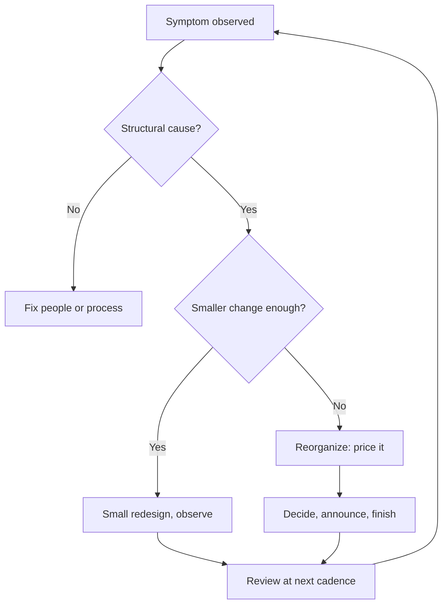
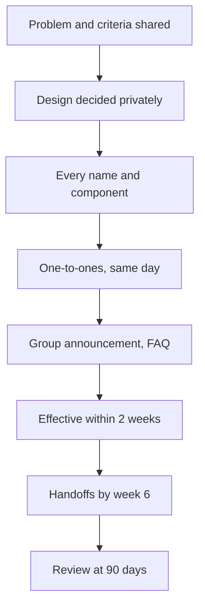
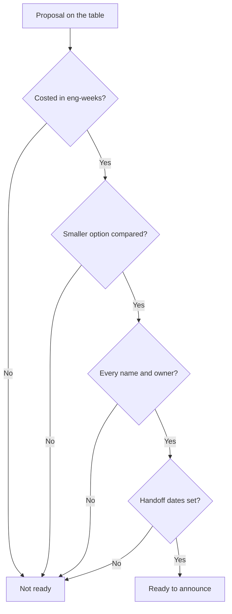

# Chapter 36 — Reorganizations, Organizational Evolution, and Succession

This chapter is about changing an organization that already exists: deciding whether a
reorganization is the right tool, pricing it, finishing it in weeks rather than quarters, preferring
small redesigns to periodic big ones, and making sure every critical role has someone who could step
into it. Chapter 33 supplies the vocabulary of team types and cognitive load, Chapter 34 spans and the
dependency map, and Chapter 35 the target design. Layoffs and mergers, which carry different moral and legal weight,
belong to Chapter 58. The running example is the year-2 reorganization proposed at Northstar
Technologies, the fictional company in the [case study](../../case-studies/northstar/index.md).

## Why This Matters

At team scale, a reorganization is something that happens to people. An engineer learns that their
manager, teammates, code, or on-call rotation will change. Each is a loss of accumulated context that
takes weeks to rebuild, and the dip in output lands on whatever the team had promised.

At organization scale, structure decides which conversations are cheap and which are expensive
(Chapter 33), so a wrong structure taxes every cross-team piece of work, every quarter. Leaving a
broken structure alone is not free either. The skill is telling a structural problem from a people,
process, or priority problem.

At executive scale, a reorganization is a lever a leader can pull alone: visible, decisive-feeling,
with costs spread across small losses nobody adds up. Succession is the quieter counterpart. An organization in which the director, a staff
engineer, or the one person who understands the ledger cannot be replaced for six months is fragile,
whatever its chart says.

## Learning Objectives

After this chapter you will be able to:

- Decide whether a reorganization is the right tool, testing first whether the problem is structural
  and whether a smaller change would do.
- Estimate a reorganization's transition cost in engineer-weeks, with stated assumptions, and compare
  it with the expected benefit and with smaller alternatives.
- Plan and communicate a reorganization so that it is finished within weeks, with on-call continuity
  protected.
- Run organizational evolution as a cadence of small, reversible redesigns.
- Build and maintain succession coverage for every critical role, and turn its gaps into development
  work.

## The Mental Model

> **Mental model:** A reorganization is a large, irreversible batch of change with a predictable
> transition cost and an uncertain benefit. Make the batch as small as the problem allows, and when
> you must ship a big one, ship it fast and finish it.

As in software delivery, a large batch is hard to stabilize and to revert: moving forty people changes
reporting lines, ownership, on-call, and relationships in one step. A small redesign (one component changes owner, one person moves, one boundary is
redrawn) carries the same kind of cost at a fraction of the size, and its effect can be observed
before the next step.

Most symptoms that prompt a reorganization (missed dates, two managers in conflict, a slow team) have
causes a new chart does not touch, and many structural ones yield to moving one component or person.
A full reorganization fits broad misfit: many wrong boundaries, or a changed strategy.

The second idea: a structure is only as durable as the people in its critical roles. Succession
coverage asks what happens to the chart when a name on it disappears.

## Deep Conceptual Explanation

### What the evidence says about restructuring

Research does not answer the question a director most wants answered: does reorganizing improve
delivery? What exists is narrower, and points one way: change has costs, and how it is run changes
their size.

A systematic review of 39 longitudinal studies (2000 to 2012) found that restructuring, with and
without staff reductions, mainly harmed employee well-being, in most studies over both the short and
the long term ([de Jong et al., 2016](../../references/bibliography.md#dejong2016restructuring)).
Factors that intervened included job control, communication, provision of information, training,
procedural justice (whether people see the process as fair), job insecurity, and acceptance of the
change. Those are research findings with a caution: many restructurings studied were mergers or
downsizings, larger than redrawing team boundaries, and the outcome is well-being, not delivery.

A review of 79 quantitative studies of reactions to organizational change sorts their antecedents into
the people and context before the change and features of the change itself: its process, perceived
benefit or harm, and content ([Oreg, Vakola, and Armenakis, 2011](../../references/bibliography.md#oreg2011recipients)).
The abstract supports a narrower point: how a change is run is a lever separate from what it is.

In software, one study of a large project found proximity to an organizational change significantly
associated with a higher probability of customer-reported defects, and recent departures associated
with more of them ([Mockus, 2010](../../references/bibliography.md#mockus2010volatility)). It is one
observational project, but it names the risk to plan for: quality drops where knowledge moved.

This book does not rely on consulting-firm surveys claiming most reorganizations fail. Their authors
sell reorganization advice and define failure in different ways, so the evidence on failure rates is
thin.

### Is a reorganization the right tool?

A reorganization is one of four levers. The others are the people (coaching, a role change, a hire),
the process (cadences, decision rights, interfaces), and the priorities. This book's recommendation
is to reorganize only when three tests pass:

1. **The problem is structural.** The evidence points at boundaries: work that repeatedly needs two or
   more teams, components with no owner or several, spans far out of range (Chapter 34), or
   [cognitive load](../../glossary.md#cognitive-load) beyond what a team can carry (Chapter 33). Friction between managers or a missed roadmap is
   not structural evidence by itself.
2. **A smaller change will not do.** Moving one component, person, or interface would leave most of
   the misfit in place.
3. **The benefit outlasts the transition.** The expected gain over the next year exceeds the
   transition cost, with the cost estimated honestly and the gain treated as a forecast.

Will Larson's writing is the best-known practitioner treatment. He argues that reorganizations are
expensive and belong to structural problems, not to people or process problems
([Larson, 2019](../../references/bibliography.md#larson2019elegant); **expert opinion**). Two
reasons that fail the tests are common: reorganizing around a person (a team created as a promotion,
or dissolved to avoid a performance conversation), and reorganizing so a new leader's organization
feels different.

### Pricing the transition

The [transition cost](../../glossary.md#transition-cost) is the capacity lost while people rebuild
context, relationships, rotations, and planning rhythm. This chapter measures it in engineer-weeks (one
engineer's working week).

| Cost | Who bears it | How to estimate |
|---|---|---|
| Ramp-up | People who change team or ownership | Weeks at reduced output per person |
| Handoff | People who hand over or train | A fraction of their time for the handoff period |
| Management | Managers and the director | Hours of design, conversations, follow-up |
| Risk | Customers and the business | Defects near changed boundaries; attrition |

No research gives reliable ramp-up figures for engineers who change teams; the figures in this chapter
are this book's assumptions, to be replaced with an organization's own onboarding data. The risk line
is the one most often left out. The Mockus finding argues for planning it explicitly: freeze
nonessential changes on [tier 1](../../glossary.md#tier-1) components (the most business-critical
tier) while their ownership moves, and require the operational
readiness check of [Chapter 24](../05-engineering-quality/24-reliability-slos-and-operational-readiness.md)
before an on-call rotation changes hands.

### Finishing in weeks

Most of the damage happens between the first rumor and the moment everyone knows where they sit and
has started the new work: people cannot plan, managers cannot commit, and the best engineers talk to
recruiters. The de Jong review's intervening variables
(communication, information, procedural justice, control) are what a fast, well-run announcement
provides. This book's recommendation has three properties:

- **Consult on the problem, decide the names privately.** Ask widely what is broken and what the
  criteria should be. Do not run the assignment of people as a public discussion; it turns every name
  into a negotiation.
- **Tell each affected person before any group.** Everyone whose manager, team, or ownership changes
  hears it one to one, on announcement day and before the group does.
- **Set dates for the work, not only the chart.** Reporting lines on one date; each component's
  ownership, rotation, planning, and budget line on its own date. The reorganization is finished when
  those dates have passed.

Patrick Lencioni argues that leaders should agree on a few answers and repeat them far more often
than feels necessary ([Lencioni, 2012](../../references/bibliography.md#lencioni2012advantage);
**expert opinion**).
Here: why the structure changes, what does not, where each person sits, and when uncertainty ends.

A manager who inherits a team is in a new role. Michael Watkins treats the first months in a new role
as a period that needs its own plan: diagnose, secure early wins, build key relationships deliberately
([Watkins, 2003](../../references/bibliography.md#watkins2003first); **expert opinion**). Each
changed manager therefore gets a short transition plan, reviewed by the director, as
[Chapter 2](../01-foundations/02-from-individual-contributor-to-leader.md) recommends for a first
management role.

### Organizational evolution

The alternative to the periodic large reorganization is continuous small redesign. The organization
reviews its structure quarterly, using the dependency map
([Chapter 16](../04-execution/16-flow-lead-time-dependencies-and-unplanned-work.md) and Chapter 34),
the ownership inventory, and span counts, and allows itself a few changes per review: a component
changes owner, an interface is formalized, a person moves with consent, a mission is narrowed. Each
costs a few engineer-weeks, and its effect is visible by the next review.

Evolution has limits: local fixes can drift into a structure nobody would design, and a new team
type or management layer cannot be made in small steps. Those need a deliberate reorganization.

### Succession coverage

A review of CEO succession research notes that studies have mostly treated succession as an event,
although practice treats it as a continuous process
([Berns and Klarner, 2017](../../references/bibliography.md#berns2017succession)). The same holds for
an engineering manager or staff engineer: succession is the ongoing work of making sure someone else
can do the job, not a plan filed once.

A **critical role** is one whose sudden vacancy would stop a team, a system, or a class of decisions:
every manager, every staff engineer, the director, and the holders of concentrated knowledge on tier
1 systems. Knowledge concentration and the
[truck factor](../../glossary.md#single-point-of-knowledge-failure) (how many people could leave
before a project stalls) are taught in
[Chapter 12](../03-high-performing-teams/12-team-charters-working-agreements-and-knowledge-sharing.md)
([Avelino et al., 2016](../../references/bibliography.md#avelino2016truck)). One finding matters here.
In Chrome and a project at Avaya, designated successors reduced expected loss from turnover by as much
as 15 percent ([Rigby et al., 2016](../../references/bibliography.md#rigby2016turnover)). These are
research findings about code. That prepared successors also reduce the cost of losing a manager is
this book's inference.

| Readiness | Meaning |
|---|---|
| Ready now | Could hold the role for three months or more from next week, with support |
| Ready with development | Could hold it in 6 to 18 months, given named development work |
| Interim only | Could keep it running for a few weeks while a decision is made |
| None | Nobody identified |

[Succession coverage](../../glossary.md#succession-coverage) is adequate (this book's rule) when all
three hold:

1. Someone can step in now: at least one person is ready now or interim.
2. Someone is being developed: at least one person is ready with development.
3. Neither of them already holds another critical role or is the main cover for one.

A person covering two roles is coverage on paper only.

## Engineering Organization Example

An illustrative organization of 60 engineers in six teams sees 30 work items a quarter that need two
or more teams. The director believes 12 would become single-team work if three teams were redrawn
around customer journeys, moving 14 engineers and changing two managers. All numbers are invented;
the assumptions are this book's.

| Part | Assumption | Engineer-weeks |
|---|---|---|
| Ramp-up | 14 engineers at 50 percent output for 4 weeks, then 75 percent for 4: 3 each | 42 |
| Handoff | 30 engineers on four affected teams at 10 percent for 6 weeks: 0.6 each | 18 |
| Management | 4 managers at 20 percent for 12 weeks: 2.4 each | 9.6 |
| Total | | about 70 |

Share of a quarter: about 70 of 780 engineer-weeks (60 engineers × 13 weeks), about 9 percent.

The transition costs about 9 percent of one quarter, before the risk line. On the Mockus finding,
expect more customer-reported defects at the redrawn boundaries for some weeks.

**Benefit.** Assume each cross-team item costs about 2 engineer-weeks more than single-team work.
Converting 12 items saves 24 engineer-weeks a quarter. The benefit is a forecast; the cost is nearly
certain.

**The smaller alternative.** Eight of the 12 items touch one component that two teams change. Giving it
a single owner moves two engineers. The comparison:

| Option | Cost (engineer-weeks) | Saving per quarter | Payback |
|---|---|---|---|
| Single owner for the component | 12 (6 ramp-up for 2 engineers, 6 handoff for 10) | 16 (8 items × 2) | about 0.75 quarters |
| Full reorganization | 70 | 24 (12 items × 2) | about 2.9 quarters |
| Increment of the full reorganization over the smaller option | 58 | 8 | about 7 quarters |

The full reorganization captures four more items, and its extra cost takes about seven quarters to
repay. A proposal without this comparison is not ready for a decision.

## Decision Framework

| Situation | Structural? | Prefer |
|---|---|---|
| One component changed by many teams, owned by none | Yes, narrow | Assign an owner; formalize its interface |
| Cross-team items concentrated on one pair of teams | Yes, narrow | Move the boundary between the two |
| Cross-team items across most pairs; strategy changed | Yes, broad | Reorganize, priced and fast |
| A manager's span far over range | Yes, narrow | Split the team or add a lead (Chapter 34) |
| A slow team with sound boundaries | No | Coaching, process, or a people decision |
| Two managers in conflict | No | Address the conflict; do not redraw around it |
| A new leader wants things to feel different | No | Diagnose first |
| A critical role has no cover | No | Succession work, not a new chart |

The gates check readiness to announce, not the design: announcing without names or handoff dates
starts an uncertain period with no end.

## Trade-offs

**Speed against consultation.** Speed shortens the uncertain period; consultation improves the design
and the sense of fairness, which the same evidence values. Consulting on problem and criteria while
keeping individual assignments private is a compromise: some people will feel decided about.
Confidential conversations with people whose role changes materially reduce that cost and raise the
risk of leaks.

**One big batch against many small ones.** Small redesigns are cheaper and reversible, but a long run
of them can feel like permanent instability, and some changes cannot be made in steps. A large
reorganization is expensive once and can settle a structure for a year or more.

**Stability against fit.** Structures fit the work less well over time; the transition cost is the
price of restoring fit.

**Succession depth against focus.** Developing successors takes time from role holders and candidates,
and named successors raise expectations that may not be met. Leaving it unnamed avoids that conversation
and the exposure remains.

## Failure Modes

**The perpetual reorganization.** A new chart every two or three quarters. Detection: count how many
managers a typical engineer has had in two years; three or more means transition costs never end.

**The leaked reorganization.** Rumors run for weeks. Detection: questions about "the reorg" in
one-on-ones before anything is said.

**The boxes-only reorganization.** The chart changes; ownership, rotations, planning, and budgets do
not. Detection: two months later the ownership inventory and incident routing still show old teams.

**The orphan factory.** Components of dissolved teams end with no owner or two. Detection: compare the
ownership inventory before and after; every component must appear exactly once.

**Succession theater.** Names filed and never revisited. Detection: named successors do not know,
and no development action has happened since.

**The heir apparent.** One successor named publicly; others stop developing; the heir leaves when the
role does not open. Detection: a role's development list is always one name.

## Enterprise Application

In an organization of 50 to 150 engineers, a reorganization touches several managers and a large
share of engineers, and the director owns it. What keeps it in weeks is preparation: every name,
every component's owner, and a calendar of announcement-day conversations. Involve human resources early; where job content changes
substantially, local employment rules may require consultation, so check before promising dates.

In distributed organizations, second-site and remote people get their one-to-ones in their working
hours, and nobody attends the announcement as the remote audience of a room.

At this size, succession coverage fits in one table of 10 to 20 roles, reviewed twice a year with the
managers and human resources. Each gap becomes a development action owned by a manager, connecting the
table to career conversations (Chapter 8) and retention work
([Chapter 10](../02-people-management/10-motivation-retention-and-senior-engineers.md)). Knowledge
concentration on tier 1 systems belongs in the same table, with the knowledge map of
[Chapter 12](../03-high-performing-teams/12-team-charters-working-agreements-and-knowledge-sharing.md)
as input.

## CTO Perspective

At executive scale the question shifts from how to reorganize to how often, and who absorbs the cost.
Each director's reorganization is reasonable alone; together they keep engineers in permanent
transition. A useful rule: large reorganizations come with
this chapter's arithmetic, are reviewed by the executive team, and are spaced so that no part of the
organization goes through two in a year. Breaking a team's pairing with its product manager has costs the
engineering arithmetic does not show.

The board and chief executive see succession for the top roles. A CTO who cannot say who would run
engineering for the next three months has a governance gap, not a personal one. The CTO should be able
to name possible successors for each director and show them already doing parts of the job.

## Practical Playbook

1. **State the problem as evidence.** The symptom, the structural data (dependency map, ownership,
   spans, cognitive load), and what else could explain it.
2. **List the smaller alternatives,** with what each moves and how much of the problem it solves.
3. **Price each option.** Ramp-up, handoff, management, and risk, with written assumptions; payback
   against a forecast benefit.
4. **Complete the design.** Every person's team and manager, every component's owner, rotation,
   planning and budget line. No announcement before it is complete.
5. **Announce in one day.** Individuals, then managers, then the group, then the written rationale,
   what does not change, and an FAQ.
6. **Make it effective within two weeks,** on a named date.
7. **Finish handoffs by week six,** each after a readiness check, with tier 1 changes frozen while
   ownership moves.
8. **Give each changed manager a transition plan,** reviewed in the first month.
9. **Review at 90 days.** Forecast against actual; record the transition cost.
10. **Maintain the succession table** twice a year; every gap gets an action and an owner.
11. **Run evolution quarterly,** with a cap on changes per review.

## Case Study

!!! info "Northstar so far"
    Week 44, in quarter 4 (weeks 40 to 52) of the director's first year. Quarter 3 had 14 [Sev1 and
    Sev2](../../glossary.md#severity-sev1-sev2-sev3) incidents against 30 at baseline, and both renewal
    commitments are delivered. The director has just drafted a year-2 organization for the CTO. See the
    [timeline](../../case-studies/northstar/timeline.md).

This case is **fictional**. It is set at Northstar in week 44, and it is a plan, not a result: whether
Victor Lindqvist (CTO) approves the reorganization, and how it goes, is left open. The starting state is
in the [baseline data](../../case-studies/northstar/baseline-data.md) and
[the director's first year](../../case-studies/northstar/first-quarter.md).

**The proposal in brief.** Chapter 35 describes the design and its alternatives in full. In short,
effective in week 53 (the first week of year 2):

- Customer Experience splits into Web (Daniel Cho, its current manager, with 11 engineers) and Mobile
  (5 engineers in Bogotá under Mateo Arango Ríos, their informal lead, whose seat is not backfilled).
- core/permissions, an unowned tier 1 module of Core, moves to Orders (Priya Raman's team); search-svc
  moves from Orders to Data and Analytics (Farah Haddad's team).
- Platform Operations becomes Developer Platform under Tom Becker. The result is 79 engineers and seven
  managers.

Against the three tests, the evidence is structural. Daniel has 17 reports. Mobile and web share one
board and cadence. Two Sev2 incidents sat at the mobile-bff and mobile boundary. core/permissions has
been tier 1 without an owner since before the director arrived. Each part is also close to the
smallest change that answers its problem: six people change manager (Mateo and his five engineers),
and two components change owner.

**Transition cost (this chapter's assumptions).**

| Part | Assumption | Engineer-weeks |
|---|---|---|
| Ramp-up, Mobile | 5 engineers change manager, keep code and teammates: 0.5 each | 2.5 |
| Ramp-up, core/permissions | 2 Orders engineers learn the module and build its runbook, alerts, and rotation: 3 each | 6 |
| Ramp-up, search-svc | 1 Data and Analytics engineer: 1 | 1 |
| Handoff | 5 past core/permissions contributors elsewhere and 2 Orders engineers on search-svc at 0.6 each (4.2); 16 Web and Mobile engineers separating board and cadence at 10 percent for 2 weeks (3.2) | 7.4 |
| Management | Daniel 20 percent for 8 weeks (1.6); Priya 10 percent for 8 weeks (0.8); Farah 5 percent for 4 weeks (0.2); director 20 percent for 6 weeks (1.2) | 3.8 |
| Total | | about 21 |

Share of a quarter: about 21 of 1,040 engineer-weeks (80 engineers × 13 weeks), about 2 percent.

Two costs sit outside the total. The first is Mateo's seat, about 13 engineer-weeks a quarter, which
Chapter 35 counts as one seat. The second is concentrated risk. core/permissions is a tier 1 module that
gets an owner, a runbook, and an on-call rotation for the first time. mobile-app and mobile-bff move with
Mobile to a rotation of six people in one city (the plan names backup cover). That is exactly where the
Mockus finding says to expect trouble.

**The transition plan the director attaches** (fictional; it applies only if the proposal is approved):

| Week | Step |
|---|---|
| 45 | Victor Lindqvist reviews proposal and plan; no announcement |
| 46 | Victor decides on Mateo's unbackfilled seat; the director and Daniel confirm with Mateo that he wants the role |
| 47–49 | Ownership table, rotations, and dates complete; Priya and the director agree the core/permissions readiness criteria; Mobile's board and cadence designed with Mateo |
| 51 | Announcement day (a Tuesday): the director and Daniel in Bogotá; one-to-ones with Mateo's five engineers there, then Hannah Lindgren (the informal web lead) and the web engineers in Minneapolis by video, then managers and staff engineers, then an all-engineering call with everyone on their own screen, then the written rationale and FAQ |
| 53 | Reporting lines effective; Web and Mobile start separate boards |
| 54 | search-svc ownership moves to Data and Analytics |
| 53–56 | core/permissions: runbook and user-facing alerts, Orders engineers shadow incidents, readiness check (Chapter 24), then Orders' on-call starts; nonessential changes frozen in the handover week |
| 57 | All handoffs done; every component appears once in the ownership inventory |
| 64 | 90-day review: forecast against actual, transition cost recorded |

What does not change: pay, levels, the ledger rotation, the weekly Core release, and every other
team's membership. The plan also names that Mateo becomes the first manager based in Bogotá.

**Succession coverage.** Writing the plan raised a question the proposal had not asked: if a name on
the new chart left, who would step in? In week 44 the director rated cover for the ten critical roles
(six managers, three staff engineers, the director). The ratings are fictional judgments.

The table names people who have not appeared yet in this chapter: Aisha Bello and Rafael Duarte,
senior engineers in Orders; Teodora Vasquez-Lund, Billing's senior ledger expert; Sunil Varghese, a
senior engineer in Data and Analytics who designed the warehouse pipelines; Bram Verhoeven, a senior
infrastructure engineer who built Core's Jenkins pipeline; and Payments and Integrations' informal tech
lead, who is not named. The staff engineers are Ines Carvalho (Core domain), Kwame Mensah
(infrastructure and reliability), and Li Na Zhou (data and integration).

| Critical role | Ready now or interim | In development | Gap |
|---|---|---|---|
| Orders (Priya Raman) | Aisha Bello, interim | Aisha Bello; Rafael Duarte if he chooses management | Nobody ready now |
| Billing (Marcus Oyelaran) | None | None | Teodora covers ledger knowledge, not management |
| Payments and Integrations (Elena Sokolova) | Informal tech lead, interim | Same person | One person in both columns |
| Customer Experience (Daniel Cho) | Hannah Lindgren, interim | Mateo Arango Ríos | Each covers half the team |
| Data and Analytics (Farah Haddad) | None | Sunil, architecture half only | Farah holds two roles |
| Platform Operations (Tom Becker) | Kwame, interim | None | Kwame holds a critical role |
| Staff, Core domain (Ines) | None | Aisha, Rafael (order capture); Teodora (ledger) | Nobody covers the whole domain |
| Staff, infrastructure (Kwame) | Bram, Core Jenkins only | None | Bram's expectations plan is open (Chapter 9) |
| Staff, data and integration (Li Na) | None | Sunil (warehouse); Payments' informal tech lead (integration) | Split cover |
| Director | Elena, interim | Elena | If Elena acts, Payments falls to its informal tech lead |

In total: none of the 10 roles has a ready-now cover, 6 have an interim cover, and 4 have none (Billing,
Data and Analytics, and the Core-domain and data-and-integration staff roles). Kwame and Elena already
hold critical roles. By the coverage rule only Orders, Payments and Integrations, and Customer
Experience are covered, two of them by one person in both columns.

The table also changes the reorganization. Promoting Mateo Arango Ríos, Customer Experience's
development candidate, leaves the new Mobile manager role with no cover, in a site where nobody else
leads. Web keeps Hannah Lindgren as its interim cover. The
director adds a step: the table is redone in week 49 with seven teams, and Mobile's gap gets a
development action, such as a senior mobile engineer running Mobile's planning, before the
announcement.

Other proposed actions (fictional): Teodora Vasquez-Lund is asked, without commitment, about a
management trial; Sunil Varghese co-owns warehouse architecture with Farah Haddad; Elena Sokolova
chairs the operations review during the director's two weeks of leave. Outcomes are open.

## Exercises

Worked solutions are in the [chapter 36 solutions](../../solutions/ch36-solutions.md).

### Foundational

**F1.** Four complaints reach Northstar's director in one month: Billing and Orders blame each other
after an incident caused by a release of Core, the monolith; core/permissions still has no owner; Daniel Cho has 17 reports; Data
and Analytics has little contact with other teams. For each, decide whether the evidence points at
structure, name the smallest change you would try first, and say what data would change your mind.

**F2.** Recompute the case study's transition cost under pessimistic assumptions: the two Orders
engineers need 5 engineer-weeks each to take on core/permissions instead of 3, the Mobile engineers
lose 1 each instead of 0.5, and the handoff fractions run for twice as long; keep the management line.
State the total and its share of a quarter's capacity, and explain which assumption matters most.

**F3.** List every place where the case study's succession table breaks the chapter's coverage rule.
Then choose the two gaps you would close first, and justify the order by the cost to Northstar if the
role fell vacant next month.

### Applied Leadership

**A1.** Prepare announcement day for the Northstar reorganization. Mateo's five engineers are in
Bogotá, two web engineers are remote, Hannah Lindgren has led web informally, and one mobile engineer
had told Daniel they also wanted to lead. Write the day's
schedule, who speaks to whom in what order, and the five questions the FAQ must answer.

**A2.** The role of Marcus Oyelaran (Billing manager) has no cover. Teodora Vasquez-Lund, the only candidate the director
sees, enjoys ledger work and has never mentioned management, and Billing still depends on its three
ledger engineers for most pages. Design two quarters of succession work for Billing without pulling a
ledger expert off the rotation or creating an heir apparent.

**A3.** In week 48, three weeks before the planned announcement, a web engineer asks Hannah Lindgren
whether "mobile is leaving and Mateo is getting a promotion", and says the Bogotá engineers are
already discussing it. Victor has approved Mateo's seat and Mateo has accepted, but the
five mobile engineers have not been told. Decide
what Hannah, Daniel, and the director say, and whether the plan's dates should change.

### Executive Decision-Making

**X1.** Victor Lindqvist (CTO) approves the design but asks to delay the announcement a quarter, so as not
to unsettle teams while reliability is still recovering and the largest customers are watching. Rajiv
Menon (CFO) wants to start now so that year 2's budget reflects the new teams. Decide the timing and argue
it to both, using the transition cost, the Mockus finding, and the cost of an unfinished change.

**X2.** Victor asks who would run engineering if the director left tomorrow. The honest answer is
Elena Sokolova (Payments and Integrations manager), whose team would then fall to an informal tech
lead, with Victor above. Propose how Northstar should build director-level succession over the next
year under flat headcount, and say whether that changes your view of Chapter 35's alternative D (two
managers of managers above the teams).

## Reflection Questions

1. When did the last reorganization you lived through actually finish, and what told you it had?
2. Which of your organization's problems would a new chart not touch, and are any being presented as
   structural?
3. If you left tomorrow, who would run your part of the organization next week, and do they know?
4. How many managers has a typical engineer in your organization had in two years, and did anyone
   choose that number?
5. What would you lose by replacing your next large reorganization with four quarters of small ones?

## Key Takeaways

- Test that a problem is structural before changing the structure; most symptoms that prompt a
  reorganization are not.
- Compare every reorganization with the smallest change that solves most of the problem, and prefer
  a cadence of small redesigns.
- Price the transition in engineer-weeks with written assumptions, and name the quality and attrition
  risk the arithmetic leaves out.
- Consult on problem and criteria, decide names privately, and tell each affected person before any
  group.
- A reorganization is finished when ownership, on-call, planning, and budgets have moved, not when the
  chart is published.
- Protect reliability in the transition: freeze nonessential tier 1 changes while ownership moves, and
  check readiness before rotations change hands.
- Every critical role needs an interim or ready-now cover and a successor in development, and no person
  should cover two roles.

## References and Further Reading

- [de Jong et al., 2016](../../references/bibliography.md#dejong2016restructuring). Review of
  longitudinal studies of restructuring and well-being; the human cost and what moderates it.
- [Oreg, Vakola, and Armenakis, 2011](../../references/bibliography.md#oreg2011recipients). Six decades
  of quantitative studies of reactions to change.
- [Mockus, 2010](../../references/bibliography.md#mockus2010volatility). Organizational change and
  customer-reported defects; the reliability case for planning the transition.
- [Rigby et al., 2016](../../references/bibliography.md#rigby2016turnover). Turnover-induced knowledge
  loss and the value of designated successors.
- [Avelino et al., 2016](../../references/bibliography.md#avelino2016truck). Estimating truck factors.
- [Berns and Klarner, 2017](../../references/bibliography.md#berns2017succession). CEO succession
  research; succession as a process.
- [Larson, 2019](../../references/bibliography.md#larson2019elegant). *An Elegant Puzzle*. When and how
  to reorganize engineering teams.
- [Watkins, 2003](../../references/bibliography.md#watkins2003first). *The First 90 Days*. Planning
  each changed manager's transition.
- [Lencioni, 2012](../../references/bibliography.md#lencioni2012advantage). *The Advantage*. Clarity
  and repetition in leadership communication.
