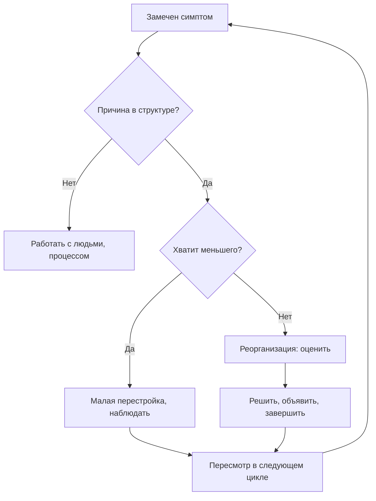
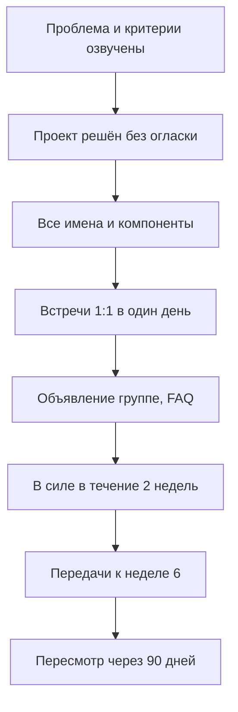
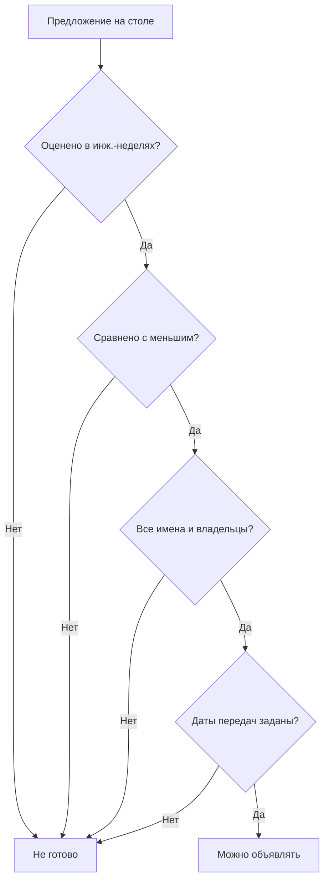

# Глава 36 — Реорганизации, эволюция организации и преемственность { #chapter-36-reorganizations-organizational-evolution-and-succession }

Эта глава о том, как менять уже существующую организацию: решать, подходит ли для задачи реорганизация,
оценивать её стоимость, завершать её за недели, а не за кварталы, предпочитать небольшие перестройки
периодическим крупным и следить, чтобы для каждой критической роли нашёлся человек, способный её занять.
Словарь типов команд и когнитивной нагрузки даёт глава 33, охват управления и карту зависимостей —
глава 34, целевой проект — глава 35. Сокращения штата и слияния, у которых иной моральный и юридический
вес, разбирает глава 58. Сквозной пример — реорганизация, которую предлагают провести во второй год в
Northstar Technologies, вымышленной компании из [кейса](../../case-studies/northstar/index.md).

## Почему это важно { #why-this-matters }

Для команды реорганизация — это то, что происходит с людьми. Инженер узнаёт, что у него сменятся
руководитель, коллеги, код или график дежурств. С каждой такой сменой теряется накопленный контекст, на
его восстановление уходят недели, а просадка в выпуске бьёт по всем обещаниям команды.

В масштабе организации структура определяет, какие разговоры дёшевы, а какие дороги (глава 33), поэтому
неправильная структура квартал за кварталом взимает налог с любой межкомандной работы. Но и сломанная
структура, оставленная как есть, обходится недёшево. Мастерство в том, чтобы отличить структурную
проблему от проблемы людей, процесса или приоритетов.

Для высшего руководства реорганизация — рычаг, за который лидер может потянуть в одиночку. Она заметна,
создаёт ощущение решительности, а её стоимость рассеяна по мелким потерям, которые никто не складывает.
Преемственность — её тихий двойник. Если директора, staff-инженера или единственного человека,
разбирающегося в ledger, нельзя заменить в течение полугода, организация хрупка, что бы ни показывала её
оргструктура.

## Цели главы { #learning-objectives }

Прочитав эту главу, вы сможете:

- Решать, подходит ли реорганизация для задачи, сначала проверяя, структурна ли проблема и не хватит
  ли изменения поменьше.
- Оценивать стоимость перехода при реорганизации в инженеро-неделях с явными допущениями и сравнивать
  её с ожидаемой пользой и с менее масштабными альтернативами.
- Планировать реорганизацию и сообщать о ней так, чтобы она завершилась за несколько недель и не прервала
  дежурства.
- Вести эволюцию организации как регулярный ритм небольших обратимых перестроек.
- Выстраивать и поддерживать покрытие преемниками для каждой критической роли и превращать пробелы в
  работу по развитию.

## Ментальная модель { #the-mental-model }

> **Ментальная модель:** реорганизация — это большая необратимая пачка изменений с предсказуемой
> стоимостью перехода и неопределённой пользой. Делайте пачку настолько маленькой, насколько позволяет
> проблема, а если без большой не обойтись, выпускайте её быстро и доводите до конца.

Как и в поставке ПО, большую пачку трудно стабилизировать и трудно откатить: если за один шаг переместить
сорок человек, меняются линии подчинения, владение, дежурства и рабочие отношения. Небольшая перестройка
(один компонент меняет владельца, один человек переходит в другую команду, одна граница перерисовывается)
несёт затраты того же рода, но в малой доле, и её эффект виден до следующего шага.

У большинства симптомов, которые подталкивают к реорганизации (сорванные сроки, конфликт двух
руководителей, медленная команда), причины лежат там, куда новая оргструктура не дотягивается. А многие
структурные проблемы решаются перемещением одного компонента или одного человека. Полная реорганизация
нужна при широком несоответствии: когда неверны многие границы или изменилась стратегия.

Вторая идея: структура долговечна ровно настолько, насколько надёжны люди на её критических ролях.
Покрытие преемниками отвечает на вопрос, что станет с оргструктурой, если одно из имён на ней исчезнет.

## Подробный разбор { #deep-conceptual-explanation }

### Что говорят данные о реструктуризации { #what-the-evidence-says-about-restructuring }

Главный для директора вопрос, улучшает ли реорганизация поставку, исследования оставляют без
ответа. Есть данные поуже, и указывают они в одну сторону: у изменений есть цена, и от того, как их
проводят, зависит её размер.

Систематический обзор 39 лонгитюдных исследований показал, что реструктуризация, с сокращением штата и
без него, в основном вредила благополучию сотрудников, причём в большинстве исследований и в краткой, и
в долгой перспективе ([de Jong et al., 2016](../../references/bibliography.md#dejong2016restructuring)).
Среди промежуточных факторов были контроль над собственной работой, коммуникация, информированность,
процедурная справедливость (считают ли люди процесс честным) и неуверенность в сохранении работы. Это
научные результаты, но с оговоркой: многие изученные реструктуризации были слияниями или сокращениями,
то есть масштабнее, чем перерисовка границ команд, а измеряемый исход — благополучие, а не поставка.

Обзор 79 количественных исследований реакций на изменения поддерживает более узкий вывод: то, как
проводят изменение, — отдельный рычаг, не зависящий от того, в чём изменение состоит
([Oreg, Vakola, and Armenakis, 2011](../../references/bibliography.md#oreg2011recipients)).

В разработке ПО одно исследование крупного проекта обнаружило, что близость к организационному изменению
значимо связана с более высокой вероятностью дефектов, о которых сообщают клиенты, а недавние уходы
сотрудников — с большим числом таких дефектов
([Mockus, 2010](../../references/bibliography.md#mockus2010volatility)). Это наблюдение за одним
проектом, но оно указывает на риск, который надо закладывать в план: качество падает там, куда
переместилось знание.

Книга не опирается на опросы консалтинговых фирм, утверждающие, что большинство реорганизаций
проваливается. Их авторы продают консультации по реорганизациям и определяют провал по-разному, поэтому
данные о доле провалов слабые.

### Подходит ли реорганизация для задачи? { #is-a-reorganization-the-right-tool }

Реорганизация — один из четырёх рычагов. Остальные — люди (коучинг, смена роли, найм), процесс (ритмы,
права на решения, интерфейсы) и приоритеты. Рекомендация книги: реорганизуйтесь, только если пройдены все
три проверки.

1. **Проблема структурная.** Данные указывают на границы: работа, которой раз за разом нужны две команды
   или больше; компоненты без владельца или с несколькими владельцами; охват далеко за пределами
   диапазона (глава 34); [когнитивная нагрузка](../../glossary.md#cognitive-load) больше, чем команда
   способна нести (глава 33). Трения между руководителями или сорванная дорожная карта сами по себе не
   доказывают, что проблема в структуре.
2. **Меньшего изменения не хватит.** Перемещение одного компонента, человека или интерфейса оставило бы
   на месте большую часть несоответствия.
3. **Польза переживёт переход.** Ожидаемый выигрыш за следующий год превышает стоимость перехода, причём
   стоимость оценена честно, а выигрыш понимается как прогноз.

Самое известное описание у практиков — тексты Will Larson. Он доказывает, что реорганизации дороги и
уместны при структурных проблемах, а не при проблемах людей или процессов
([Larson, 2019](../../references/bibliography.md#larson2019elegant); **мнение эксперта**). Часто
встречаются две причины, которые этих проверок не проходят: реорганизация вокруг человека (команду
создают ради повышения или распускают, чтобы не вести разговор о результативности) и реорганизация ради
того, чтобы в организации нового лидера всё ощущалось по-другому.

### Как оценить стоимость перехода { #pricing-the-transition }

[Стоимость перехода](../../glossary.md#transition-cost) — это ресурс, который теряется, пока люди
восстанавливают контекст, рабочие отношения, графики дежурств и ритм планирования. В этой главе её
измеряют в инженеро-неделях (одна рабочая неделя одного инженера).

| Затраты | Кто их несёт | Как оценить |
|---|---|---|
| Вхождение в работу | Те, у кого меняется команда или зона владения | Недели сниженного выпуска на человека |
| Передача дел | Те, кто передаёт дела или обучает | Доля их времени на период передачи |
| Управление | Руководители и директор | Часы на проектирование, разговоры, последующую работу |
| Риск | Клиенты и бизнес | Дефекты у изменённых границ; текучесть |

Надёжных цифр о том, сколько времени входят в работу инженеры, сменившие команду, не даёт ни одно
исследование. Цифры в этой главе — допущения книги; их стоит заменить собственными данными организации
об онбординге.
Строку риска чаще всего пропускают. Результат Mockus говорит в пользу того, чтобы планировать её явно:
пока владение компонентами [tier 1](../../glossary.md#tier-1) (самого критичного для бизнеса уровня)
переходит к другой команде, замораживайте на них несущественные изменения, а прежде чем график дежурств
перейдёт в другие руки, требуйте проверки операционной готовности из
[главы 24](../05-engineering-quality/24-reliability-slos-and-operational-readiness.md).

### Как завершить за недели { #finishing-in-weeks }

Основной ущерб приходится на промежуток между первым слухом и моментом, когда каждый знает своё новое
место и уже взялся за новую работу. В этот промежуток люди не могут планировать, руководители не могут брать
обязательства, а лучшие инженеры разговаривают с рекрутерами. Промежуточные факторы из обзора de Jong
(коммуникация, информированность, процедурная справедливость, контроль) — как раз то, что даёт быстрое
и хорошо проведённое объявление. Рекомендация книги сводится к трём правилам:

- **Советуйтесь о проблеме, имена решайте без огласки.** Широко спрашивайте, что сломано и какими
  должны быть критерии. Но не превращайте распределение людей в публичное обсуждение: так каждое имя
  становится предметом торга.
- **Говорите с каждым затронутым человеком раньше, чем с группой.** Каждый, у кого меняется
  руководитель, команда или зона владения, узнаёт об этом в день объявления на встрече один на один (1:1),
  раньше группы.
- **Назначайте даты для работы, а не только для оргструктуры.** Линии подчинения меняются в одну дату;
  владение каждым компонентом, график дежурств, планирование и статья бюджета — каждое в свою.
  Реорганизация завершена, когда все эти даты прошли.

Patrick Lencioni считает, что руководителям стоит договориться о нескольких ответах и повторять их
гораздо чаще, чем кажется нужным ([Lencioni, 2012](../../references/bibliography.md#lencioni2012advantage);
**мнение эксперта**). Здесь это ответы на вопросы: почему меняется структура, что не меняется, где
теперь каждый человек и когда закончится неопределённость.

Каркас письменного объявления (**рекомендация книги**), которое рассылают после встреч 1:1:

1. **Проблема** с данными, в двух-трёх предложениях.
2. **Изменение**: новые команды, их руководители и то, чем владеет каждая.
3. **Что не меняется**: оплата, уровни, а также команды и системы, которых изменение не касается.
4. **Даты**: когда меняются линии подчинения и когда проходит каждая передача дел.
5. **Куда обращаться с вопросами**: названный человек и открытая встреча в течение недели.

Заголовки FAQ, которые закрывают большую часть вопросов: Почему сейчас? Почему не изменение поменьше?
Меняются ли моя работа, уровень или оплата? Кто мой руководитель и кто оценивает мою работу? Что будет с
моей текущей работой и дежурствами? Когда мы узнаем, сработало ли?

Руководителю, чья зона ответственности сокращается, сообщите раньше всех, лично, с объяснением причины
и с уже определённой новой зоной ответственности. Спросите, что ему нужно сказать своей команде, и дайте
ему сказать это самому.

Руководитель, получивший команду, оказывается в новой роли. Michael Watkins рассматривает первые месяцы в
новой роли как период, которому нужен собственный план: диагностировать ситуацию, добиться первых побед,
сознательно выстроить ключевые отношения
([Watkins, 2003](../../references/bibliography.md#watkins2003first); **мнение эксперта**). Поэтому каждый
затронутый изменением руководитель получает короткий план перехода, а директор его проверяет, как
[глава 2](../01-foundations/02-from-individual-contributor-to-leader.md) советует для первой
управленческой роли.

### Эволюция организации { #organizational-evolution }

Альтернатива периодической большой реорганизации — непрерывная небольшая перестройка. Организация
раз в квартал пересматривает свою структуру по карте зависимостей
([глава 16](../04-execution/16-flow-lead-time-dependencies-and-unplanned-work.md) и глава 34),
инвентаризации владения и подсчёту охватов и позволяет себе несколько изменений за один пересмотр:
компонент меняет владельца, интерфейс формализуется, человек с его согласия переходит в другую команду,
миссия сужается. Каждое такое изменение обходится в несколько инженеро-недель, а его эффект виден к
следующему пересмотру.

У эволюции есть пределы. Локальные исправления могут постепенно привести к структуре, которую никто бы
не спроектировал, а новый тип команды или новый уровень управления небольшими шагами не создать. Для
этого нужна сознательная реорганизация.

### Как отменить неудачную реорганизацию { #undoing-a-reorganization-that-failed }

Откат — это вторая реорганизация, поэтому он должен пройти те же проверки, и его стоимость оценивают
так же (**рекомендация книги**). Прежнее состояние он никогда не возвращает: у людей новые рабочие
отношения, у компонентов новые ранбуки (runbooks), а кого-то уже повысили.

Решите заранее, когда должен прозвучать вердикт. Пересмотр через 90 дней сравнивает прогноз с тем, что
произошло: межкомандные задачи, lead time, инциденты на изменённых границах, текучесть и то, что люди
говорят на встречах 1:1. Затем разведите две картины:

- **Просадка перехода** сильнее всего в первые недели и уменьшается с каждым месяцем. Её нужно
  переждать.
- **Несоответствие** и через квартал не уменьшается или даже растёт. Новая граница рассекает работу, которая
  меняется вместе, или команда несёт больше, чем может.

На несоответствие есть три ответа, от самого дешёвого к самому дорогому:

| Ответ | Когда подходит | Стоимость |
|---|---|---|
| Корректировка | Несоответствие сосредоточено на одном компоненте, интерфейсе или человеке | Небольшая перестройка: несколько инженеро-недель |
| Частичный откат | Одна часть не сработала, остальное работает | Ещё один переход для одной команды |
| Полный откат | Диагноз, на котором строилось изменение, был неверным | Полная стоимость перехода плюс потеря доверия к следующему предложению |

Большинству неудачных реорганизаций нужна корректировка. Возьмём иллюстративную реорганизацию из примера
этой главы: в организации из 60 инженеров она перемещает 14 инженеров, стоит около 70 инженеро-недель и,
по прогнозу, сокращает число межкомандных задач с 30 до 18 в квартал. Допустим, через два квартала их число
снизилось лишь до 26, и большинство из этих 26 затрагивает один компонент, который новая граница разрезала пополам.
Ответ — перенести этот компонент. Отменить весь проект значило бы потратить ещё 70 инженеро-недель, чтобы
вернуться к старой проблеме.

Сообщайте об откате так, как должны были сообщить о самой реорганизации: данные, в чём ошибся прогноз,
что меняется и с какой даты. Ошибка — на лидере, а не на людях, которые взяли на себя новые роли.
Руководителю, чья роль исчезает, нужна настоящая следующая роль, согласованная до объявления.

### Покрытие преемниками { #succession-coverage }

Авторы обзора исследований преемственности CEO отмечают, что исследователи в основном рассматривали
преемственность как событие, хотя на практике это непрерывный процесс
([Berns and Klarner, 2017](../../references/bibliography.md#berns2017succession)). То же верно для
руководителя разработки или staff-инженера: преемственность — это постоянная забота о том, чтобы кто-то
ещё мог выполнять эти обязанности, а не план, который однажды положили в папку.

**Критическая роль** — роль, внезапное освобождение которой остановило бы команду, систему или целый
класс решений: каждый руководитель, каждый staff-инженер, директор и носители сосредоточенного знания
о системах tier 1. Концентрацию знаний и
[truck factor](../../glossary.md#single-point-of-knowledge-failure) (он же bus factor: сколько людей
может уйти, прежде чем проект встанет) подробно разбирает
[глава 12](../03-high-performing-teams/12-team-charters-working-agreements-and-knowledge-sharing.md)
([Avelino et al., 2016](../../references/bibliography.md#avelino2016truck)). Здесь важен один
результат. В Chrome и в одном проекте Avaya назначенные преемники снижали ожидаемые потери от
текучести вплоть до 15% ([Rigby et al., 2016](../../references/bibliography.md#rigby2016turnover)).
Это научные результаты, относящиеся к коду. То, что подготовленные преемники снижают и цену потери
руководителя, — вывод книги.

| Готовность | Что означает |
|---|---|
| Готов сейчас | Мог бы со следующей недели занимать роль три месяца и дольше, при поддержке |
| Готов после развития | Мог бы занять её через 6–18 месяцев при названной работе по развитию |
| Только временно | Мог бы поддерживать работу несколько недель, пока принимается решение |
| Никого | Никто не определён |

[Покрытие преемниками](../../glossary.md#succession-coverage) достаточно (правило книги), если
выполнены все три условия:

1. Кто-то может заменить человека прямо сейчас: хотя бы один человек готов сейчас или готов временно.
2. Кого-то развивают: хотя бы один человек готов после развития.
3. Ни один из них уже не занимает другую критическую роль и не служит основной заменой для другой такой роли.

Человек, прикрывающий две роли, — покрытие только на бумаге.

## Пример из инженерной организации { #engineering-organization-example }

В иллюстративной организации из 60 инженеров в шести командах за квартал набирается 30 задач, которым
нужны две команды или больше. Директор считает, что 12 из них стали бы работой одной команды, если
перерисовать три команды вокруг клиентских сценариев. Для этого придётся переместить 14 инженеров и
сменить двух руководителей. Все числа вымышлены, допущения принадлежат книге.

| Часть | Допущение | Инженеро-недели |
|---|---|---|
| Вхождение в работу | 14 инженеров на 50% выпуска 4 недели, затем на 75% ещё 4: по 3 на каждого | 42 |
| Передача дел | 30 инженеров в четырёх затронутых командах на 10% в течение 6 недель: по 0.6 на каждого | 18 |
| Управление | 4 руководителя на 20% в течение 12 недель: по 2.4 на каждого | 9.6 |
| Итого | | около 70 |

Доля квартала: около 70 из 780 инженеро-недель (60 инженеров × 13 недель), примерно 9%.

Переход обходится примерно в 9% квартала, и это ещё без строки риска. Судя по результату Mockus, на
перерисованных границах несколько недель стоит ждать больше дефектов, о которых сообщают клиенты.

**Польза.** Допустим, каждая межкомандная задача обходится примерно на 2 инженеро-недели дороже работы
одной команды. Если 12 задач станут работой одной команды, это сэкономит 24 инженеро-недели в квартал.
Польза — это прогноз, а стоимость почти достоверна.

**Альтернатива поменьше.** Восемь из 12 задач затрагивают один компонент, который меняют две команды.
Если назначить ему единственного владельца, переместить придётся двух инженеров. Сравнение:

| Вариант | Стоимость (инженеро-недели) | Экономия за квартал | Окупаемость |
|---|---|---|---|
| Единственный владелец компонента | 12 (6 на вхождение в работу для 2 инженеров, 6 на передачу дел для 10) | 16 (8 задач × 2) | около 0.75 квартала |
| Полная реорганизация | 70 | 24 (12 задач × 2) | около 2.9 квартала |
| Прирост полной реорганизации по сравнению с меньшим вариантом | 58 | 8 | около 7 кварталов |

Полная реорганизация захватывает ещё четыре задачи, а её дополнительная стоимость окупается примерно
за семь кварталов. Предложение без такого сравнения к решению не готово.

## Как принимать решение { #decision-framework }

| Ситуация | Структурная проблема? | Что предпочесть |
|---|---|---|
| Один компонент меняют многие команды, а не владеет никто | Да, узкая | Назначить владельца; формализовать его интерфейс |
| Межкомандные задачи сосредоточены на одной паре команд | Да, узкая | Сдвинуть границу между этими двумя |
| Межкомандные задачи у большинства пар; стратегия изменилась | Да, широкая | Реорганизация, с оценкой стоимости и быстрая |
| Охват руководителя далеко за пределами диапазона | Да, узкая | Разделить команду или добавить лида (глава 34) |
| Медленная команда при здоровых границах | Нет | Коучинг, процесс или кадровое решение |
| Два руководителя в конфликте | Нет | Разобраться с конфликтом; не перерисовывать структуру вокруг него |
| Новый лидер хочет, чтобы всё ощущалось по-другому | Нет | Сначала диагностика |
| У критической роли нет замены | Нет | Работа над преемственностью, а не новая оргструктура |

Эти контрольные точки проверяют готовность к объявлению, а не сам проект: объявление без имён или дат
передачи дел открывает период неопределённости без конца.

## Компромиссы { #trade-offs }

**Скорость или консультации.** Скорость сокращает период неопределённости; консультации улучшают проект и
укрепляют ощущение справедливости, ценность которого показывают те же данные. Советоваться о проблеме и
критериях, но держать индивидуальные назначения в тайне — компромисс: кто-то почувствует, что за него всё
решили. Конфиденциальные разговоры с теми, чья роль существенно меняется, снижают эту цену, но повышают
риск утечки.

**Одна большая пачка или много маленьких.** Небольшие перестройки дешевле и обратимы, но длинная череда
таких перестроек может ощущаться как постоянная нестабильность, а некоторые изменения шагами не сделать.
Большая реорганизация дорога, но платят за неё один раз, и она может закрепить структуру на год и дольше.

**Стабильность или соответствие задаче.** Со временем структура всё хуже подходит к работе; стоимость
перехода — цена за то, чтобы это соответствие вернуть.

**Глубина преемственности или фокус.** Развитие преемников отнимает время и у тех, кто занимает роль, и
у кандидатов, а названные преемники порождают ожидания, которые могут не оправдаться. Если никого не
называть, этого разговора удаётся избежать, но уязвимость остаётся.

## Типичные провалы { #failure-modes }

**Вечная реорганизация.** Новая оргструктура каждые два-три квартала. Как заметить: посчитайте, сколько
руководителей было у типичного инженера за два года; три и больше — значит, затраты на переход не
кончаются никогда.

**Утёкшая реорганизация.** Слухи ходят неделями. Как заметить: на встречах 1:1 спрашивают о
«реорганизации» раньше, чем о ней что-либо сказано.

**Реорганизация квадратиков.** Меняется оргструктура, а владение, графики дежурств, планирование и
бюджеты остаются прежними. Как заметить: через два месяца инвентаризация владения и маршрутизация
инцидентов всё ещё показывают старые команды.

**Фабрика бесхозных компонентов.** Компоненты распущенных команд остаются без владельца или с двумя.
Как заметить: сравните инвентаризацию владения до и после; каждый компонент должен встречаться в ней
ровно один раз.

**Театр преемственности.** Имена записаны и больше не пересматриваются. Как заметить: названные
преемники об этом не знают, и с тех пор не было ни одного действия по их развитию.

**Назначенный наследник.** Публично назван один преемник; остальные перестают развиваться; наследник
уходит, не дождавшись, пока роль освободится. Как заметить: в списке развития по роли всегда одно имя.

## Применение в крупной организации { #enterprise-application }

В организации из 50–150 инженеров реорганизация затрагивает нескольких руководителей и большую долю
инженеров, а отвечает за неё директор. Уложиться в недели помогает подготовка: все имена, владелец
каждого компонента и календарь разговоров в день объявления. Подключайте HR пораньше: если содержание
работы существенно меняется, местное трудовое законодательство может требовать консультаций, поэтому
проверьте это, прежде чем обещать даты.

В распределённых организациях люди со второй площадки и удалённые сотрудники получают встречи 1:1 в
своё рабочее время, и никто не слушает объявление как удалённый зритель чужой переговорной.

При таком размере покрытие преемниками умещается в одну таблицу на 10–20 ролей, которую дважды в год
пересматривают вместе с руководителями и HR. Каждый пробел превращается в действие по развитию, за
которое отвечает руководитель; так таблица связывается с разговорами о карьере (глава 8) и работой по
удержанию ([глава 10](../02-people-management/10-motivation-retention-and-senior-engineers.md)).
Концентрация знаний о системах tier 1 входит в ту же таблицу, а исходными данными служит карта знаний
из [главы 12](../03-high-performing-teams/12-team-charters-working-agreements-and-knowledge-sharing.md).

## Взгляд CTO { #cto-perspective }

На этом уровне вопрос уже не в том, как реорганизовываться, а в том, как часто это делать и кто несёт
затраты. По отдельности реорганизация каждого директора разумна, но вместе они держат инженеров в
состоянии постоянного перехода. Полезное правило: к крупной реорганизации прилагается расчёт из этой
главы, её рассматривает команда высшего руководства, и реорганизации разносят во времени так, чтобы ни
одна часть организации не проходила через две за год. Если разорвать связку команды с её
продакт-менеджером, появятся затраты, которых инженерный расчёт не покажет.

Совет директоров и генеральный директор видят преемственность на высших ролях. Если CTO не может
сказать, кто будет руководить разработкой ближайшие три месяца, это пробел в корпоративном управлении,
а не личный. CTO должен уметь назвать возможных преемников каждого директора и показать, что они уже
выполняют часть этой работы.

## Практический плейбук { #practical-playbook }

1. **Опишите проблему, опираясь на данные.** Симптом, структурные данные (карта зависимостей, владение,
   охваты, когнитивная нагрузка) и то, чем ещё это можно объяснить.
2. **Перечислите менее масштабные альтернативы**, указав, что перемещает каждая и какую часть проблемы
   решает.
3. **Оцените стоимость каждого варианта.** Вхождение в работу, передача дел, управление и риск, с
   записанными допущениями; окупаемость относительно прогнозируемой пользы.
4. **Доведите проект до конца.** Команда и руководитель каждого человека, владелец каждого компонента,
   график дежурств, планирование и статья бюджета. Никаких объявлений, пока проект не завершён.
5. **Объявите за один день.** Сначала отдельные люди, потом руководители, потом группа, затем письменное
   обоснование, что не меняется, и FAQ.
6. **Введите изменения в силу в течение двух недель**, в названную дату.
7. **Завершите передачи дел к шестой неделе**, каждую после проверки готовности; пока владение
   переходит, изменения в tier 1 заморожены.
8. **Дайте каждому затронутому руководителю план перехода** и проверьте его в первый месяц.
9. **Проведите пересмотр через 90 дней.** Сравните прогноз с фактом; запишите стоимость перехода.
10. **Поддерживайте таблицу преемников**, пересматривая её дважды в год; у каждого пробела есть действие
    и ответственный.
11. **Ведите эволюцию раз в квартал**, с ограничением числа изменений за один пересмотр.

## Кейс { #case-study }

!!! info "Northstar: что уже известно"
    Неделя 44, квартал 4 (недели 40–52) первого года директора. В квартале 3 было 14 инцидентов
    [Sev1 и Sev2](../../glossary.md#severity-sev1-sev2-sev3) против 30 на исходном уровне, и оба
    обязательства по продлению выполнены. Директор только что подготовил для CTO проект организации
    второго года. См. [хронологию](../../case-studies/northstar/timeline.md). Впервые читаете о
    Northstar? Прочитайте [«Год вкратце»](../../case-studies/northstar/year-in-brief.md) и
    [список действующих лиц](../../case-studies/northstar/cast.md).

Этот кейс — **вымысел**. Действие происходит в Northstar на неделе 44, и это план, а не результат:
одобрит ли Victor Lindqvist (CTO) реорганизацию и как она пройдёт, остаётся открытым.

**Коротко о предложении.** Полностью проект и альтернативы описаны в главе 35. Суть такова: с
недели 53 (первой недели второго года):

- Customer Experience делится на Web (Daniel Cho, нынешний руководитель, и 11 инженеров) и Mobile
  (5 инженеров в Боготе под руководством Mateo Arango Ríos, их неформального лида; его место не
  заполняют наймом на замену).
- core/permissions — модуль Core уровня tier 1: его меняют четыре команды, а владельца у него нет с исходного
  уровня. Модуль переходит в Orders (команду Priya Raman); search-svc переходит из Orders в
  Data and Analytics (команду Farah Haddad).
- Platform Operations становится Developer Platform под руководством Tom Becker. В итоге получается
  79 инженеров и семь руководителей.

Данные указывают на структуру: у Daniel 17 подчинённых, мобильная и веб-разработка делят одну доску и
один ритм, а два инцидента Sev2 пришлись на границу между mobile-bff и мобильным приложением. Каждая
часть близка к минимальному изменению, которое решает свою проблему: руководитель меняется у шести
человек, владелец — у двух компонентов.

**Стоимость перехода (по допущениям этой главы).**

| Часть | Допущение | Инженеро-недели |
|---|---|---|
| Вхождение в работу, Mobile | 5 инженеров меняют руководителя, но сохраняют код и коллег: по 0.5 на каждого | 2.5 |
| Вхождение в работу, core/permissions | 2 инженера Orders осваивают модуль и создают для него ранбук, алерты и график дежурств: по 3 на каждого | 6 |
| Вхождение в работу, search-svc | 1 инженер Data and Analytics: 1 | 1 |
| Передача дел | 5 бывших участников разработки core/permissions из других команд и 2 инженера Orders по search-svc, по 0.6 на каждого (4.2); 16 инженеров Web и Mobile разделяют доску и ритм, 10% времени в течение 2 недель (3.2) | 7.4 |
| Управление | Daniel 20% в течение 8 недель (1.6); Priya 10% в течение 8 недель (0.8); Farah 5% в течение 4 недель (0.2); директор 20% в течение 6 недель (1.2) | 3.8 |
| Итого | | около 21 |

Доля квартала: около 21 из 1 040 инженеро-недель (80 инженеров × 13 недель), примерно 2%.

Две статьи затрат в итог не входят. Первая — место Mateo, около 13 инженеро-недель в квартал; глава 35
считает его одним местом. Вторая — сосредоточенный риск. core/permissions — модуль tier 1, у которого
впервые появляются владелец, ранбук и график дежурств. mobile-app и mobile-bff вместе с Mobile переходят
к графику дежурств из шести человек в одном городе (в плане названо резервное покрытие). Именно здесь,
согласно результату Mockus, и стоит ждать неприятностей.

**План перехода, который прилагает директор** (вымышленный; он действует, только если предложение
одобрено):

| Неделя | Шаг |
|---|---|
| 45 | Victor Lindqvist изучает предложение и план; объявления нет |
| 46 | Victor принимает решение о месте Mateo без найма на замену; директор и Daniel убеждаются, что Mateo хочет эту роль |
| 47–49 | Таблица владения, графики дежурств и даты готовы; Priya и директор согласуют критерии готовности для core/permissions; доска и ритм Mobile проектируются вместе с Mateo |
| 51 | День объявления (вторник); порядок ниже |
| 53 | Новые линии подчинения вступают в силу; у Web и Mobile появляются отдельные доски |
| 54 | Владение search-svc переходит к Data and Analytics |
| 53–56 | core/permissions: ранбук и алерты по пользовательским симптомам, инженеры Orders участвуют в инцидентах как наблюдатели, проверка готовности (глава 24), затем начинаются дежурства Orders; в неделю передачи несущественные изменения заморожены |
| 57 | Все передачи дел завершены; каждый компонент встречается в инвентаризации владения один раз |
| 64 | Пересмотр через 90 дней: прогноз против факта, стоимость перехода записана |

В день объявления директор и Daniel находятся в Боготе. Сначала они проводят встречи 1:1 с пятью
инженерами Mateo на месте, затем по видеосвязи с Hannah Lindgren (неформальным лидом веба) и
веб-инженерами в Миннеаполисе, потом с руководителями и staff-инженерами. За этим следует общий звонок
для всей разработки, где каждый сидит у своего экрана, а затем письменное обоснование и FAQ. Что не
меняется: оплата, уровни, график дежурств по ledger, еженедельный релиз Core и состав всех остальных
команд.

**Покрытие преемниками.** Смысл таблицы в том, чтобы показать разницу между покрытием на бумаге и
реальным. Работа над планом подняла вопрос, которого в предложении не было: если кто-то из людей на
новой оргструктуре уйдёт, кто его заменит? На неделе 44 директор оценил покрытие для десяти
критических ролей (шесть руководителей, три staff-инженера, директор). Оценки — вымышленные суждения.
Несколько человек впервые появляются в этой главе; все они перечислены в
[списке действующих лиц](../../case-studies/northstar/cast.md).

| Критическая роль | Готов сейчас или временно | В развитии | Пробел |
|---|---|---|---|
| Orders (Priya Raman) | Aisha Bello, временно | Aisha; Rafael Duarte, если выберет управленческий трек | Готовых сейчас нет |
| Billing (Marcus Oyelaran) | Никого | Никого | Замены нет |
| Payments (Elena Sokolova) | Неформальный техлид, временно | Тот же человек | Один человек в обеих колонках |
| Customer Experience (Daniel Cho) | Hannah Lindgren, временно | Mateo Arango Ríos | Каждый покрывает половину команды |
| Data and Analytics (Farah Haddad) | Никого | Sunil Varghese, только архитектура | Farah совмещает две роли |
| Platform Operations (Tom Becker) | Kwame Mensah, временно | Никого | Замена занимает критическую роль |
| Staff, домен Core (Ines Carvalho) | Никого | Aisha, Rafael; Teodora Vasquez-Lund | Весь домен не покрывает никто |
| Staff, инфраструктура (Kwame) | Bram Verhoeven, только Jenkins | Никого | Частичное покрытие |
| Staff, данные и интеграции (Li Na Zhou) | Никого | Sunil; техлид Payments | Покрытие разделено |
| Директор | Elena, временно | Elena | Тогда Payments переходит к техлиду команды |

Кто эти люди. Aisha Bello и Rafael Duarte — senior-инженеры в Orders. Teodora Vasquez-Lund — старший
эксперт Billing по ledger; знания о ledger она покрывает, а управление — нет. Sunil Varghese —
senior-инженер Data and Analytics, спроектировавший пайплайны хранилища данных. Bram Verhoeven —
senior-инженер инфраструктуры, построивший Jenkins-пайплайн Core. Неформальный техлид Payments and
Integrations не назван.

Итог: ни у одной из 10 ролей нет замены, готовой сейчас, у 6 есть временная замена, у 4 нет никого.
По правилу покрытия покрыты только Orders, Payments and Integrations и Customer Experience, причём две
из них — за счёт одного человека в обеих колонках.

Таблица меняет и саму реорганизацию. Повышение Mateo Arango Ríos, кандидата на развитие в Customer
Experience, оставляет новую роль руководителя Mobile без замены, причём на площадке, где больше никто не
руководит. У Web временной заменой остаётся Hannah Lindgren. Директор добавляет шаг: на неделе 49 таблицу
пересчитывают уже для семи команд, и до объявления пробел Mobile получает действие по развитию, например:
senior-инженер из мобильной команды начинает вести планирование Mobile.

Другие предлагаемые действия: у Teodora без обязательств спрашивают о пробном периоде в управлении;
Sunil вместе с Farah владеет архитектурой хранилища данных. Чем это закончится, пока неизвестно.

## Упражнения { #exercises }

Разборы упражнений — на странице [решений к главе 36](../../solutions/ch36-solutions.md).

### Базовый уровень { #foundational }

**F1.** За один месяц к директору Northstar приходят четыре жалобы. Billing и Orders обвиняют друг
друга после инцидента, вызванного релизом монолита Core; у core/permissions по-прежнему нет владельца;
у Daniel Cho 17 подчинённых; Data and Analytics мало контактирует с другими командами. Для каждой
жалобы решите, указывают ли данные на структуру, назовите минимальное изменение, которое вы попробовали
бы первым, и скажите, какие данные заставили бы вас передумать.

**F2.** Пересчитайте стоимость перехода из кейса при пессимистичных допущениях: двум инженерам Orders,
чтобы принять core/permissions, нужно по 5 инженеро-недель вместо 3, мобильные инженеры теряют по 1
вместо 0,5, а доли времени на передачу дел действуют вдвое дольше; строку управления оставьте как есть.
Назовите итог и его долю в ресурсе квартала и объясните, какое допущение важнее всего.

**F3.** Перечислите все места, где таблица преемников из кейса нарушает правило покрытия из этой главы.
Затем выберите два пробела, которые вы закрыли бы первыми, и обоснуйте порядок тем, во что обойдётся
Northstar вакансия на этой роли в следующем месяце.

### Прикладное лидерство { #applied-leadership }

**A1.** Подготовьте день объявления реорганизации в Northstar. Пятеро инженеров Mateo находятся в
Боготе, два веб-инженера работают удалённо, Hannah Lindgren неформально руководила веб-разработкой, а
один мобильный инженер говорил Daniel, что тоже хотел бы руководить. Составьте расписание дня: кто с кем
и в каком порядке говорит, и пять вопросов, на которые должен ответить FAQ.

**A2.** У роли Marcus Oyelaran (руководитель Billing) нет замены. Teodora Vasquez-Lund, единственный
кандидат, которого видит директор, любит работу с ledger и ни разу не заговаривала об управлении, а в
большинстве вызовов дежурных Billing по-прежнему зависит от трёх инженеров по ledger. Спроектируйте два
квартала работы над преемственностью в Billing так, чтобы не снимать эксперта по ledger с графика
дежурств и не создавать назначенного наследника.

**A3.** На неделе 48, за три недели до запланированного объявления, веб-инженер спрашивает Hannah
Lindgren, правда ли, что «мобильная разработка уходит, а Mateo повышают», и говорит, что инженеры в
Боготе уже это обсуждают. Victor одобрил место для Mateo, и Mateo согласился, но пятерым мобильным
инженерам ещё ничего не сказали. Решите, что говорят Hannah, Daniel и директор и нужно ли менять даты
плана.

### Решения на уровне руководства { #executive-decision-making }

**X1.** Victor Lindqvist (CTO) одобряет проект, но просит отложить объявление на квартал, чтобы не
будоражить команды, пока надёжность ещё восстанавливается, а крупнейшие клиенты пристально за этим следят.
Rajiv Menon (CFO, финансовый директор) хочет начать сейчас, чтобы бюджет второго года отражал новые
команды. Решите, когда объявлять, и обоснуйте это перед обоими, опираясь на стоимость перехода,
результат Mockus и цену незавершённого изменения.

**X2.** Victor спрашивает, кто будет руководить разработкой, если директор уйдёт завтра. Честный ответ —
Elena Sokolova (руководитель Payments and Integrations) под началом Victor, а её команда тогда перейдёт
к неформальному техлиду. Предложите, как за следующий год выстроить в Northstar преемственность
на уровне директора без роста численности, и скажите, меняет ли это ваш взгляд на альтернативу D из
главы 35 (два руководителя руководителей над командами).

## Вопросы для размышления { #reflection-questions }

1. Когда на самом деле завершилась последняя реорганизация, которую вы пережили, и как вы это поняли?
2. Каких проблем вашей организации новая оргструктура не коснётся, и не выдают ли какие-то из них за
   структурные?
3. Если бы вы ушли завтра, кто руководил бы вашей частью организации на следующей неделе, и знает ли он
   об этом?
4. Сколько руководителей было у типичного инженера в вашей организации за два года, и выбирал ли
   кто-нибудь это число сознательно?
5. Что вы потеряете, если замените следующую большую реорганизацию четырьмя кварталами небольших?

## Главное { #key-takeaways }

- Прежде чем менять структуру, убедитесь, что проблема структурная; у большинства симптомов,
  подталкивающих к реорганизации, причина не в структуре.
- Сравнивайте каждую реорганизацию с минимальным изменением, которое решает большую часть проблемы, и
  предпочитайте регулярный ритм небольших перестроек.
- Оценивайте стоимость перехода в инженеро-неделях с записанными допущениями и называйте риски для
  качества и текучести, которые расчёт не учитывает.
- Советуйтесь о проблеме и критериях, имена решайте без огласки и говорите с каждым затронутым
  человеком раньше, чем с группой.
- Реорганизация завершена, когда перешли владение, дежурства, планирование и бюджеты, а не когда
  опубликована оргструктура.
- Защищайте надёжность во время перехода: пока переходит владение, замораживайте несущественные
  изменения в tier 1 и проверяйте готовность, прежде чем графики дежурств перейдут в другие руки.
- Каждой критической роли нужны замена (готовая сейчас или временная) и преемник в развитии; никто
  не должен прикрывать две роли.

## Источники и что почитать { #references-and-further-reading }

- [de Jong et al., 2016](../../references/bibliography.md#dejong2016restructuring). Обзор лонгитюдных
  исследований реструктуризации и благополучия; человеческая цена и то, что её смягчает.
- [Oreg, Vakola, and Armenakis, 2011](../../references/bibliography.md#oreg2011recipients). Шесть
  десятилетий количественных исследований реакций на изменения.
- [Mockus, 2010](../../references/bibliography.md#mockus2010volatility). Организационные изменения и
  дефекты, о которых сообщают клиенты; довод надёжности в пользу планирования перехода.
- [Rigby et al., 2016](../../references/bibliography.md#rigby2016turnover). Потеря знаний из-за
  текучести и ценность назначенных преемников.
- [Avelino et al., 2016](../../references/bibliography.md#avelino2016truck). Оценка truck factor.
- [Berns and Klarner, 2017](../../references/bibliography.md#berns2017succession). Исследования
  преемственности CEO; преемственность как процесс.
- [Larson, 2019](../../references/bibliography.md#larson2019elegant). *An Elegant Puzzle*. Когда и как
  реорганизовывать инженерные команды.
- [Watkins, 2003](../../references/bibliography.md#watkins2003first). *The First 90 Days*.
  Планирование перехода для каждого затронутого руководителя.
- [Lencioni, 2012](../../references/bibliography.md#lencioni2012advantage). *The Advantage*. Ясность и
  повторение в коммуникации руководителей.
