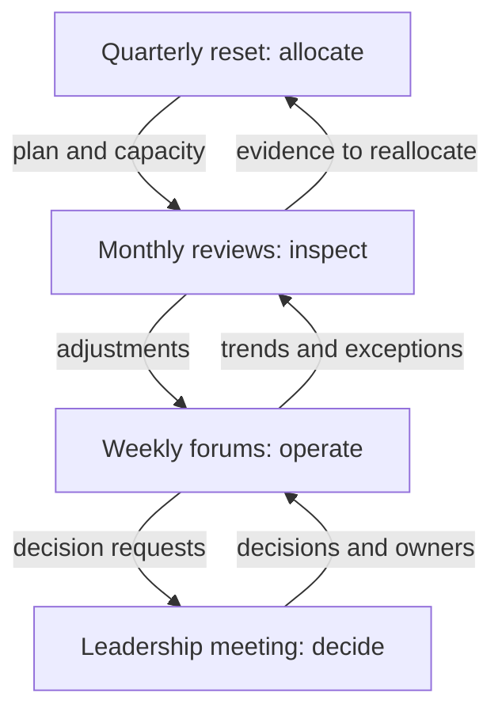
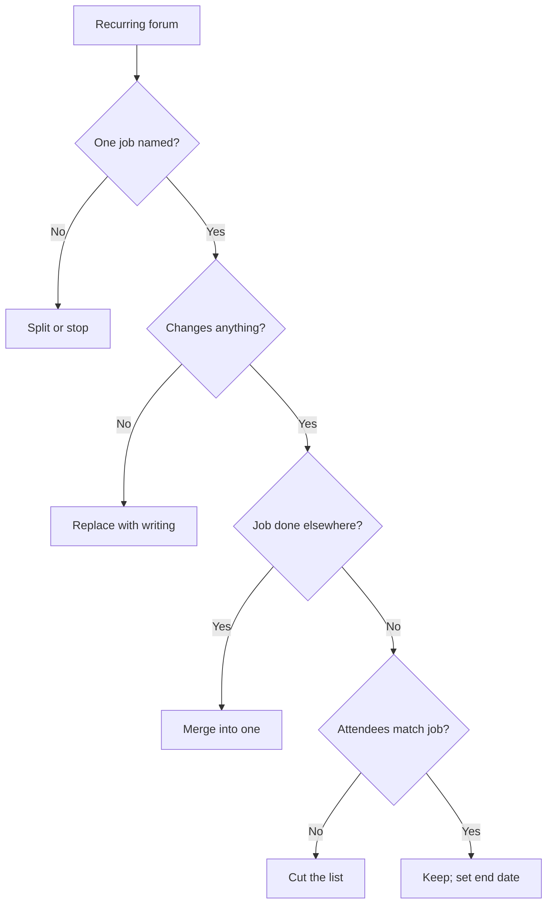
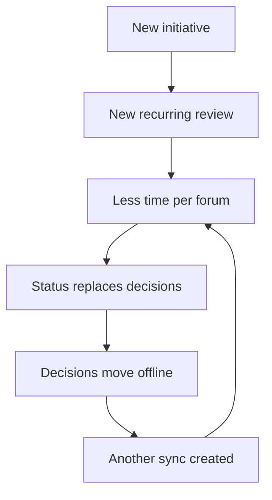

# Chapter 37 — The Management Operating System: Cadences and Leadership Meetings

This chapter is about the recurring meetings and written rhythms through which a leader runs an
organization. It covers designing weekly, monthly, and quarterly cadences in which each meeting has one
job, running a leadership team meeting that actually decides things, and auditing the whole system
for duplicated work and for loops that nobody closes. Earlier chapters put pieces of this system in
place and deferred its overall design here: the weekly operational review, the monthly quality review,
and the quarterly reset of [Chapter 27](../05-engineering-quality/27-quality-transformation-at-enterprise-scale.md),
the forecast refresh of [Chapter 17](../04-execution/17-predictability-and-managing-uncertainty.md),
and the open-decisions list of [Chapter 13](../03-high-performing-teams/13-decision-making-in-teams.md).
Chapter 38 owns scorecards and quarterly planning, and Chapter 39 owns reviews, decision logs,
escalation, and executive reporting. The running example is the Engineering Director's calendar at
Northstar Technologies, the fictional company of the [case study](../../case-studies/northstar/index.md).

## Why This Matters

At team scale, a manager's meetings are few and visible; when they go wrong, the team notices within
weeks.

At organization scale, the meetings are where the director's work actually happens. A director of 80
engineers cannot see the work directly; information arrives through forums, and decisions leave
through them. If two forums do the same job, managers report the same status twice and hear
contradictory answers. If no forum does a job, such as deciding cross-team disputes, the job is done
by whoever is loudest in a hallway, or not at all. Without deliberate design, the calendar grows by accretion
until nobody can say which meeting decides what.

At executive scale, the cost becomes large and invisible. Consultants at Bain reported that at one
large company people spent about 300,000 hours a year supporting a single weekly executive committee
meeting
([Mankins, 2014](../../references/bibliography.md#mankins2014weekly); **expert opinion**: a
consultancy's account of one client, method not published). A CTO's cadence sets the
preparation work of everyone below, so its design is one of the few decisions that changes how every
engineer's week is spent.

## Learning Objectives

After this chapter you will be able to:

- Design a set of weekly, monthly, and quarterly cadences in which each meeting has one named job,
  explicit inputs and outputs, and an owner.
- Run a leadership team meeting that ends with recorded decisions, owners, and dates, rather than
  with a round of status.
- Audit an existing operating system for redundancy (the same job in several forums) and for
  missing loops (a job no forum does).
- Estimate the cost of a cadence in attendee-hours and preparation, and decide what to stop.
- Detect, from observable signals, when a forum has drifted from its job.

## The Mental Model

> **Mental model:** A management operating system is a set of nested feedback loops at different
> time horizons. Each loop needs exactly one home, and each meeting should be the home of exactly
> one loop.

A loop senses something, decides, acts, and checks the result. Short loops run often and handle
operations: what broke this week, which follow-ups are due. Medium loops inspect a team's system in
depth: is the allocation buying what it was meant to buy. Long loops reallocate: capacity, priorities,
structure. Decisions that cannot wait for the long loop need their own forum, and each loop passes
exceptions upward and commitments downward.

Two consequences follow. A meeting with two jobs does both badly, because status crowds out
decisions. And a job with no home does not disappear; it migrates to one-on-ones, chat threads, and
incident calls, where it is done without the right people or information.

## Deep Conceptual Explanation

### What the system is made of

Andrew Grove's account of managing at Intel is known for treating meetings as the medium of
managerial work rather than an interruption of it, and for separating process-oriented meetings that
recur on a schedule (one-on-ones, staff meetings, operation reviews) from mission-oriented meetings
called to make a specific decision ([Grove, 1983](../../references/bibliography.md#grove1983high)).
Patrick Lencioni's book on organizational health is known for a similar idea at the leadership team:
different meeting types for different horizons, from short tactical meetings to less frequent
strategic and off-site ones, rather than one meeting that tries to cover everything
([Lencioni, 2012](../../references/bibliography.md#lencioni2012advantage)). Peter Drucker's book on
executive effectiveness is known for the argument that time is the executive's scarcest resource,
that it should be recorded before it is managed, and that a large number of meetings is a symptom of
poor organization ([Drucker, 1967](../../references/bibliography.md#drucker1967effective)). All three are
practitioner books, credited only for these ideas.

This book's synthesis is that an operating system has four components: **forums** (meetings),
**artifacts** (the written inputs and outputs: scorecards, pre-reads, decision logs), **horizons**
(weekly, monthly, quarterly), and **routing rules** (what moves from one forum to another, and when).
Most dysfunctional systems have plenty of forums and too few artifacts and routing rules.

### One meeting, one job

A meeting's job is the change it is supposed to produce. Seven jobs cover nearly every recurring
leadership meeting (**this book's recommendation**):

| Job | What it produces | Typical horizon | Can writing replace it? |
|---|---|---|---|
| Inform | Shared awareness | Weekly | Mostly |
| Operate | Actions on this week's failures and follow-ups | Weekly | Partly |
| Decide | Recorded decisions with owners | Weekly or on demand | No, but writing prepares it |
| Inspect | A judgment on one team's system, with adjustments | Monthly | No |
| Allocate | Capacity and priorities for the next period | Quarterly | No |
| Develop | Growth of a person | Weekly to monthly | No |
| Connect | Trust and context across a group | Monthly or less | No |

"Inform" is the job most often given a meeting and least in need of one. A status round of seven
managers at seven minutes each spends 49 minutes of a one-hour meeting transmitting what a written
update delivers in five minutes of reading. The test for every recurring meeting is: name its one
job, its inputs, its outputs, and who would notice within two weeks if it stopped.

### What the research on meetings supports

The science of meetings is younger and thinner than its importance suggests, and almost none of it
studies engineering leadership teams.

- In two internet surveys of employees working 35 hours or more a week (676 and 304 people), the relationship between the
  time demanded by meetings and job attitudes and well-being depended on task interdependence, on the
  quality of the meeting experience, and on how strongly people strove to get their own work done;
  perceived meeting effectiveness had a strong direct relationship with job attitudes and well-being
  ([Rogelberg et al., 2006](../../references/bibliography.md#rogelberg2006not)). **Research finding**:
  how good meetings are matters at least as much as how many there are.
- A two-wave survey of 319 working adults found that when managers made workgroup meetings relevant,
  allowed employee voice, and managed time, employees reported higher engagement, through the
  psychological conditions for engagement
  ([Allen and Rogelberg, 2013](../../references/bibliography.md#allen2013manager)). **Research
  finding**, self-reported and correlational.
- A study that videotaped and coded 92 regular team meetings found that functional interaction, such
  as problem solving and action planning, went with higher meeting satisfaction and team productivity,
  and with organizational success two and a half years later; dysfunctional communication such as
  criticizing or complaining had negative relationships that were stronger than the positive ones
  ([Kauffeld and Lehmann-Willenbrock, 2012](../../references/bibliography.md#kauffeld2012meetings)).
  **Research finding**, read at abstract level.
- A review of the field organizes the evidence around what happens before, during, and after a
  meeting, and ends with practical recommendations
  ([Mroz et al., 2018](../../references/bibliography.md#mroz2018meetings)). Read at abstract level;
  its specific checklist is not reported here.
- The summary of a Harvard Business Review article reports that executives spend nearly 23 hours a
  week in meetings, up from under 10 in the 1960s, based on the authors' interviews and earlier
  research ([Perlow, Hadley, and Eun, 2017](../../references/bibliography.md#perlow2017stop)).
  **Expert opinion** for the trend; the method behind the figure is not visible in the summary.

Two older findings bear on design. A field study of a software team found that constant
interruptions made individual work difficult and that changing the group's collective use of time
improved its productivity ([Perlow, 1999](../../references/bibliography.md#perlow1999time)): a
cadence that scatters meetings across every day of every manager costs the engineers who wait for
those managers. And among IT professionals working from home in the pandemic, meeting and coordination
time rose while uninterrupted time fell
([Gibbs, Mengel, and Siemroth, 2023](../../references/bibliography.md#gibbs2023wfh)): hybrid
organizations drift toward meetings unless writing carries the informing job.

The research does not tell you how many forums to run or how often; no study found compares a weekly
with a fortnightly leadership meeting. The cadence designs below are **this book's
recommendation**.

### The leadership team meeting that decides

Most leadership meetings fail in the same way: they are designed to inform and expected to decide.
Five design choices make a weekly leadership meeting a decision forum (**this book's
recommendation**).

1. **Status moves to writing.** Each member posts a short update by a fixed time before the meeting.
   The meeting opens with questions on the updates, not their recital.
2. **Decision items arrive framed.** Each item names the question, the options, the recommendation,
   who decides, and by when. [Chapter 13](../03-high-performing-teams/13-decision-making-in-teams.md)
   owns decision methods and decision rights; this meeting is where cross-team decisions that have a
   decider but no forum get made.
3. **The pre-read carries unshared information.** Groups discussing a decision tend to dwell on what
   everyone already knows; a meta-analysis of 65 hidden-profile studies found that groups mentioned
   shared information far more than unique information, and were much less likely to reach the
   correct answer when unique information had to be pooled in discussion
   ([Lu, Yuan, and McLeod, 2012](../../references/bibliography.md#lu2012hiddenprofiles); the effect
   was first described by [Stasser and Titus, 1985](../../references/bibliography.md#stasser1985pooling)).
   A written pre-read that states each team's specific facts puts them on the table before the
   discussion converges. These are laboratory tasks with correct answers, so the transfer to
   engineering decisions is an inference.
4. **Members treat the leadership team as their first team.** Lencioni is known for the idea that
   leaders who see themselves mainly as representatives of their own teams turn the leadership
   meeting into a negotiation ([Lencioni, 2012](../../references/bibliography.md#lencioni2012advantage)).
   In practice: a manager may argue for their team before the decision and must carry the decision
   to their team after it.
5. **It ends with commitments.** The last five minutes restate each decision, its owner, and what
   each member will tell their team, so that the decision cascades the same way from every manager.
   Decisions go into the decision log that Chapter 39 describes.

### Auditing for redundancy and missing loops

An audit has four steps. Inventory every recurring forum with its cadence, length, attendees, and the
job it claims. Read a few weeks of agendas or notes and record the job each forum actually does.
Build a topic-by-forum matrix: rows are recurring topics (incident follow-ups, a renewal's status, a
cross-team decision), columns are forums, cells mark where each topic appeared and where it was
resolved. Then check each loop the organization needs against the matrix. A row with marks in four
columns is redundancy; a row with no "resolved" mark is a missing loop.

## Engineering Organization Example

The figures in this section are **illustrative**, invented for Northstar (fictional) and recorded as
additions to the canon. In quarter 1, the director replaced the six teams' separate weekly status
meetings with the weekly operational review (canon, from the 90-day quality plan). By week 20, midway
through quarter 2, the calendar had grown again. The director reconstructed it from weeks 14 to 19.

Assumptions: a month counts as four weeks; a quarter as 13 weeks; one-on-ones with the six managers
are weekly for 45 minutes, with the three staff engineers weekly for 30, and with Victor Lindqvist
weekly for 30.

| Forum | Cadence and length | Attendees | Director hours per week, from week 16 |
|---|---|---|---|
| Weekly operational review | Booked 30 minutes; averaged 75 | 16: director, managers, staff engineers, six on-call leads | 1.25 |
| Managers' meeting (inherited) | Weekly, 60 | 7 | 1.0 |
| Renewal check-in | Weekly, 45 | 6: director, Priya Raman, Elena Sokolova, Amara Okafor, two product managers | 0.75 |
| Product and engineering sync | Weekly, 60 | 5: director, Amara Okafor, three product managers | 1.0 |
| Billing and Orders sync | Weekly, 30 (from week 14) | 3 | 0.5 |
| Release working group | Weekly, 45 | 8 | 0.75 |
| Staff group | Every two weeks, 60 | 4 | 0.5 |
| One-on-ones | Weekly | Managers, staff engineers, CTO | 6.5 |
| Skip-level conversations | Four a week, 30 each, from week 16 | | 2.0 |
| Monthly quality reviews | Six of 45 minutes | Director, each manager, staff engineers | 1.125 |
| Monthly delivery review | 90 | 13 | 0.375 |
| Engineering all-hands | Monthly, 60 | Everyone | 0.25 |
| Quarterly reset | Half a day (4 hours) | Director, managers, CTO, CPO | 0.31 |
| **Total recurring** | | | **16.3** |

The one-on-one line is 4.5 hours for managers (6 × 0.75), 1.5 for staff engineers (3 × 0.5), and 0.5
for the CTO. Skip-levels started in week 16, so over weeks 14 to 19 they averaged 1.33 hours (4 of 6
weeks) and the recurring total averaged 15.6; the comparison with quarter 3 uses the rate from week
16 (none in weeks 1 to 15). With 9.5
hours a week of unscheduled meetings and incident reviews, about 25 hours of a 47-hour week were in
meetings.

Hours were not the main finding. The topic-by-forum matrix for weeks 14 to 19 was:

| Topic | Forums where it appeared | Where it was resolved |
|---|---|---|
| Renewal status (accounting integration, bulk ordering) | Managers' meeting, renewal check-in, product sync, operational review, two one-on-ones | Renewal check-in |
| Incident follow-ups due | Operational review, managers' meeting, release working group, quality reviews | Operational review |
| Platform requests and environment waits | Managers' meeting, product sync, delivery review | Nowhere |
| Cross-team decisions (ADR-0001, the core/permissions owner) | Managers' meeting, staff group, Billing and Orders sync | Nowhere |
| Technology risk register (TR-01 to TR-09) | None | Nowhere |
| The calibrated promotion cycle due at the start of quarter 3 | One-on-ones only | Nowhere |

In the six managers' meetings, the director's notes record 38 agenda items and 5 decisions, two of
which were reopened in the product sync. The round of status took about 42 of the 60 minutes. The
operational review had overrun its booking in every week since items were added to it (the severity
audit in week 7, the error budgets in quarter 2), and its 16 attendees spent about 20 person-hours a
week in it (1.25 × 16), most of them on-call leads, who are engineers.

The two cross-team decisions stay open (the canon leaves both open); the point is that no forum had
the job of deciding them, so each appearance ended without a decider.

## Decision Framework

For each recurring forum in an audit:

"Changes anything" means a decision, action, adjustment, or someone's growth, visible in notes. A
forum with none in six weeks is informing, which writing does more cheaply. Every keep gets an end or
review date.

To place a loop in a cadence, match its horizon to how fast its signal moves and how fast you can act:

| Loop | Signal moves | Horizon | Home |
|---|---|---|---|
| Incidents, follow-ups, error budgets, dated forecasts | Days | Weekly | Operational review |
| Cross-team decisions, escalations | Days to weeks | Weekly | Leadership team meeting |
| One team's quality and delivery system | Weeks | Monthly | Team review (Chapter 27) |
| Flow, forecast calibration, debt spending, technology risk | Weeks to months | Monthly | Business review |
| Capacity, priorities, structure, talent calibration | Quarters | Quarterly | Reset and talent review |
| The operating system itself | Quarters | Quarterly | Thirty minutes of the reset |

## Trade-offs

**Fewer forums against narrower attendance.** Merging forums saves hours but tempts everyone to
attend the merged one; keep attendance tight.

**Writing against conversation.** Written status saves time and carries unshared information, but
costs each manager 15 to 20 minutes a week, and weak writers are underheard. It works only if the
leader reads the updates and asks about them.

**Predictability against responsiveness.** A fixed cadence makes decisions wait for the next
meeting. Allow an explicit fast path (the decider decides, records it, and reports at the next
meeting) for decisions with a cost of delay measured in days.

**Breadth against depth.** Delegating a forum, such as the release working group, saves hours and
loses direct signal; a routing rule (what the forum reports, and to whom) replaces the director's
presence.

## Failure Modes

**Status theater.** The meeting is a round of updates already in the tracker. Signal: in six weeks of
notes, fewer than one decision per meeting. Countermeasure: written status; the meeting starts with
questions.

**The meeting that outlived its job.** A forum created for a commitment continues after it. Signal: nobody can name what would break if it stopped.
Countermeasure: an end date at creation.

**Growth by accretion.** Each initiative adds a review, and nothing is removed. Signal: recurring hours
rise quarter on quarter while decisions per week do not.

It is a reinforcing loop. Countermeasure: a rule that a new recurring forum names the one it replaces
or the agenda it joins.

**Corridor decisions** (Chapter 39 names the failure mode). Decisions are made in one-on-ones or hallways and announced, or relitigated, in
the leadership meeting. Signal: decisions reopened in a second forum. Countermeasure: decisions count
only when recorded in the log, with the decider named.

**The preparation cascade.** A senior forum asks for data that each layer prepares in its own
meeting, multiplying the cost several times over; the Mankins figure measures this kind of support cost. Signal:
"pre-meetings" on managers' calendars. Countermeasure: a fixed, small input format, produced from
systems rather than by hand.

**The empty chair.** A loop the organization needs has no forum, so it surfaces only in crises.
Signal: a row with no "resolved" mark in the topic matrix. Countermeasure: assign every needed loop
one home.

**The measure gamed.** Count decisions per meeting and trivial items get framed as decisions; count
reopened decisions and they get reopened informally. Read the log, not only its count.

## Enterprise Application

In an organization of 50 to 150 engineers, the operating system has three layers: the director's
forums, each team's own rhythm (planning, retrospectives, operations reviews), and the routing between
them. The director designs the first and the routing, and leaves each team's rhythm to its manager,
with one constraint: team forums produce the inputs the director's forums consume, in a common format,
so that nobody prepares the same facts twice.

A workable default for a director with six to ten reports (**this book's recommendation**): a weekly
operational review of 30 to 45 minutes; a weekly leadership team meeting of 60 to 90 minutes with a
written pre-read; monthly reviews of each team's system (Chapter 27) and one monthly business review;
a quarterly reset and a quarterly talent review; one-on-ones on the cadence Chapter 5 recommends;
and a protected block of meeting-free time for managers on the days most engineers are in the office.
About 12 to 16 recurring hours a week leaves the director room for unplanned work. In hybrid and
multi-site organizations, every forum works for remote attendees by default.

Audit the system each quarter with one manager who is asked to challenge the director's reading.

## CTO Perspective

At executive scale, the operating system is the company's main lever over how engineering leaders
spend their time, and its cost is mostly hidden in preparation below. Three questions matter.

First, what does each executive forum require from engineering, and in what form? A CTO who asks for
a fresh slide every week creates a cascade; one who asks for the same scorecard every month, produced
from systems, creates almost none. Chapter 38 owns the scorecard and Chapter 39 the executive report.

Second, are engineering and product cadences one system or two? Separate forums that both discuss the
roadmap make some decisions twice; a joint monthly business review is usually cheaper.

Third, does the CTO's own leadership team decide? A CTO who uses the staff meeting to hear status
teaches every director below to do the same.

## Practical Playbook

1. Record two weeks of your calendar and inventory every recurring forum: cadence, length,
   attendees, claimed job, owner, and preparation.
2. Read six weeks of notes; record the job each forum actually does and count decisions.
3. Build the topic-by-forum matrix and mark where each topic was resolved.
4. List the loops your organization needs, using the horizon table; mark each as homed, duplicated,
   or missing.
5. Apply the decision diagram to each forum: stop, replace with writing, merge, cut attendees, or
   keep with an end date.
6. Write a one-page charter per remaining forum: job, inputs, outputs, attendees, length, end or
   review date.
7. Move status to a written update with a fixed format and deadline; read it before every meeting.
8. Redesign the leadership meeting with the five design choices; start a decision log.
9. Announce the new cadence with what stops, what replaces it, and when it will be reviewed.
10. After six weeks, recount decisions, reopened decisions, and recurring hours, and adjust.
11. Each quarter, spend 30 minutes of the reset auditing the system itself.

## Case Study

This case is **fictional**. It is set in quarter 2 and at the start of quarter 3 at Northstar, after
the events on [the first quarter](../../case-studies/northstar/first-quarter.md) page; the facts it
adds are recorded as additions to the canon. The question at the end is a decision the reader faces.

In week 22, the director drafted a redesign of the operating system for quarter 3 (weeks 27 to 39),
for the managers to review in week 24.

| Forum, quarter 2 | Proposal for quarter 3 | Director hours per week |
|---|---|---|
| Operational review, 75 minutes, 16 people | Hard 45 minutes; fixed agenda (incidents, error budgets, follow-ups due, severity audit); status removed; 14 people, with Ines Carvalho and Li Na Zhou optional | 0.75 |
| Managers' meeting and weekly product sync | Merged into a weekly leadership team meeting, 75 minutes: director, six managers, three staff engineers, Amara Okafor or a product manager she names; written pre-read by the previous working day; open-decisions list | 1.25 |
| Product sync remainder | Director and Amara Okafor every two weeks, 45 minutes, on roadmap trades | 0.375 |
| Renewal check-in | Ends at week 26, when bulk ordering is due | 0 |
| Billing and Orders sync | Monthly, 30 minutes, reviewed at week 39 | 0.125 |
| Release working group | Director stops attending; Kwame Mensah reports exceptions in the operational review | 0 |
| Monthly delivery review | Becomes a 120-minute monthly business review: delivery and flow, forecast calibration, debt spending, the technology risk register | 0.5 |
| (none) | Quarterly talent review, 3 hours, first in week 27 alongside the calibrated promotion cycle | 0.23 |
| Quarterly reset | Adds 30 minutes auditing the operating system | 0.35 |
| Unchanged | One-on-ones 6.5, skip-levels 2.0, staff group 0.5, quality reviews 1.125, all-hands 0.25 | 10.375 |
| **Total recurring** | | **14.0** |

The director's recurring load falls from 16.3 to about 14.0 hours a week. The larger saving is in the
operational review, from about 20 to 10.5 person-hours a week (0.75 × 14), mostly engineers' time.

The managers' own load does not fall. A typical manager attended about 4.1 recurring hours of
leadership forums a week in quarter 2 (operational review 1.25, managers' meeting 1.0, one-on-one
0.75, their quality review 0.19, delivery review 0.375, all-hands 0.25, reset 0.31). Under the
proposal it is about 4.6 (0.75, 1.25, 0.75, 0.19, 0.5, 0.25, 0.35, the talent review 0.23, and 0.33
hours writing the pre-read). Priya Raman falls from about 5.4 to 4.7, because the renewal check-in
ends and the Billing and Orders sync becomes monthly; Marcus Oyelaran rises from about 4.6 to 4.7. The
redesign moves managers' hours from listening to status toward deciding and writing; it does not
give hours back.

The proposal gives every loop in the matrix one home: renewal status in the pre-read, cross-team
decisions in the leadership meeting, platform requests and the risk register in the business review,
promotion calibration in the talent review. It does not decide ADR-0001 or the core/permissions
owner; it only gives them a forum and a decider's slot. Victor Lindqvist's recurring touchpoints stay the weekly
one-on-one and the quarterly reset.

Three objections arrived before week 24. Elena Sokolova argued that losing the renewal check-in while
the bulk-ordering date is still at risk would be premature if the feature slips. Tom Becker asked why
Platform Operations' requests should wait for a monthly forum. Daniel Cho asked whether Bogotá
engineers would be served by a leadership meeting held in a Minneapolis room. What the managers
decided in week 24, and how the system performed in quarter 3, is left open for the exercises.

## Exercises

Solutions are in [chapter 37 solutions](../../solutions/ch37-solutions.md). Northstar data is on the
[baseline page](../../case-studies/northstar/baseline-data.md).

### Foundational

**F1.** A director's weekly managers' meeting runs 60 minutes: a seven-person status round of about
six minutes each, then "any other business". In six weeks its notes record 31 items and 3 decisions.
Classify the job the meeting claims and the job it actually does, apply the chapter's audit diagram,
and say what you would replace it with and what you would measure afterward.

**F2.** For each loop, choose a horizon and a home, and justify the choice by how fast its signal moves
and how fast you can act: the error budget for order submission; a request to move a component between
teams; the share of capacity spent on technical debt entries; calibrating forecast accuracy across
teams; a Sev1 follow-up due next Tuesday; deciding which team owns a disputed shared module.

**F3.** Recompute the director's quarter 2 recurring hours at Northstar (at the rate from week 16) under a different assumption:
the operational review has been brought back to its 30-minute booking, the staff group meets weekly,
and the manager one-on-ones drop to 30 minutes every week. State each changed line, the new total,
and what the change would cost in signal.

### Applied Leadership

**A1.** You are the director in week 24, facing Elena Sokolova's objection: the renewal check-in should
not end at week 26 if bulk ordering might slip. Decide whether the check-in ends, continues, or changes
form, and design the rule that would end it later. State what information you would want before
deciding and what you would not accept.

**A2.** Design the agenda, pre-read format, and closing routine for Northstar's proposed weekly
leadership team meeting, for its first four weeks. Include how an item such as ADR-0001 would be
brought to it without the meeting deciding who has the decision right, and how Bogotá participants
and the three staff engineers are kept from being spectators.

**A3.** Tom Becker objects that Platform Operations' cross-team requests, which took about 20 points of
its capacity at baseline, cannot wait for a monthly business review. Propose how platform demand
should be routed through the operating system in quarter 3 without adding a new recurring meeting,
and say how you would know in six weeks whether it worked.

### Executive Decision-Making

**X1.** As CTO, Victor Lindqvist sees the director's redesign and proposes a monthly engineering
business review with himself, the director, Amara Okafor, and Rajiv Menon, plus a weekly written note
from the director. Assess what this adds to the director's and managers' preparation load, which
existing forums it should replace or feed, and how you would prevent a preparation cascade. Decide
what you would recommend he ask for.

**X2.** Two quarters after the redesign, the leadership meeting records about four decisions a week,
reopened decisions have fallen, and recurring hours are flat. In skip-levels, engineers say decisions
arrive faster but "nobody explains them". Diagnose what this pattern suggests about the operating
system, decide what you would change and what you would leave alone, and say how the evidence you are
using could mislead you.

## Reflection Questions

1. Which meeting on your calendar would nobody notice was gone for two weeks?
2. Where in your organization is a decision made, and where is it merely discussed? Are those the same
   place?
3. How many hours of preparation below you does your most important meeting create?
4. Which loop in your organization has no home, and how do you currently find out that it has failed?
5. When did you last stop a recurring meeting, and what replaced it?

## Key Takeaways

- Treat the operating system as nested loops at weekly, monthly, and quarterly horizons; each loop has
  one home, and each forum one job.
- Name every forum's job, inputs, outputs, owner, and an end or review date.
- Move informing to writing; keep meetings for operating, deciding, inspecting, allocating,
  developing, and connecting.
- A leadership meeting decides when status is written, items arrive framed with a decider, the
  pre-read carries each team's unshared facts, and it ends with commitments recorded.
- Audit with a topic-by-forum matrix: many marks in one row is redundancy; no "resolved" mark is a
  missing loop.
- Count cost in attendee-hours and preparation, not only the leader's hours.
- A new recurring forum must name what it replaces or which agenda it joins.
- The evidence supports caring about meeting quality but prescribes no cadence; review yours
  quarterly.

## References and Further Reading

- [Grove, 1983](../../references/bibliography.md#grove1983high). *High Output Management*. Meetings as
  managerial work.
- [Lencioni, 2012](../../references/bibliography.md#lencioni2012advantage). *The Advantage*. Meeting
  types by horizon; the leadership team as first team.
- [Drucker, 1967](../../references/bibliography.md#drucker1967effective). *The Effective Executive*.
  Recording and consolidating an executive's time.
- [Rogelberg et al., 2006](../../references/bibliography.md#rogelberg2006not). Why meeting quality
  matters as much as count.
- [Allen and Rogelberg, 2013](../../references/bibliography.md#allen2013manager). Relevance, voice,
  and time in manager-led meetings.
- [Kauffeld and Lehmann-Willenbrock, 2012](../../references/bibliography.md#kauffeld2012meetings).
  Coded team meetings: functional and dysfunctional interaction and later outcomes.
- [Mroz et al., 2018](../../references/bibliography.md#mroz2018meetings). A short review of meeting
  science.
- [Perlow, Hadley, and Eun, 2017](../../references/bibliography.md#perlow2017stop). "Stop the Meeting
  Madness": the growth of executive meeting time. Read at summary level only.
- [Mankins, 2014](../../references/bibliography.md#mankins2014weekly). The hidden cost of one weekly
  executive meeting; read for the preparation cascade.
- [Lu, Yuan, and McLeod, 2012](../../references/bibliography.md#lu2012hiddenprofiles) and
  [Stasser and Titus, 1985](../../references/bibliography.md#stasser1985pooling). Why groups underuse
  unshared information; the case for written pre-reads.
- [Perlow, 1999](../../references/bibliography.md#perlow1999time) and
  [Gibbs, Mengel, and Siemroth, 2023](../../references/bibliography.md#gibbs2023wfh). Interruptions,
  collective time use, and the drift toward meetings in remote work.
