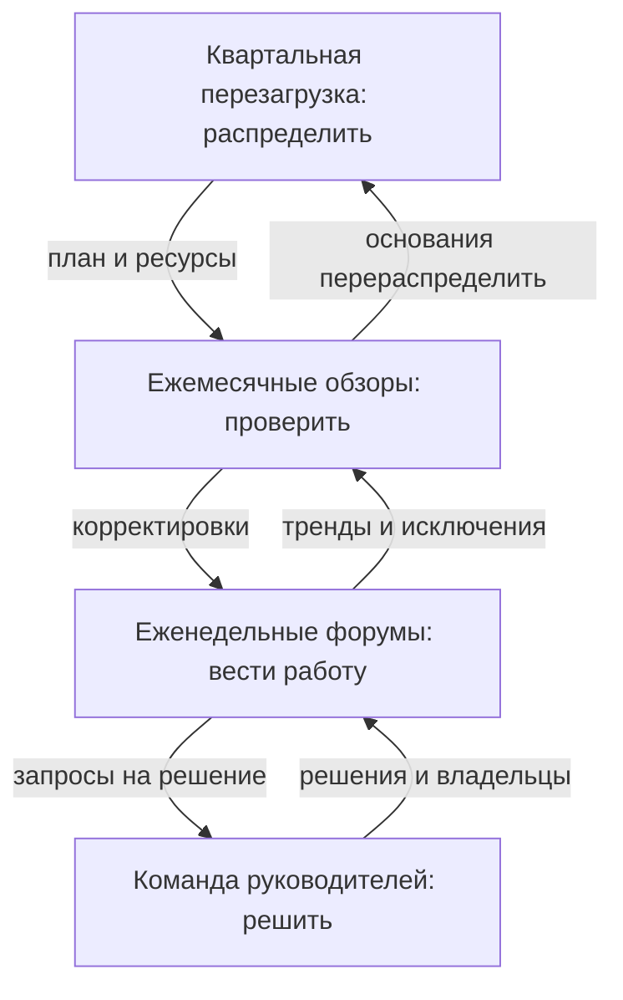
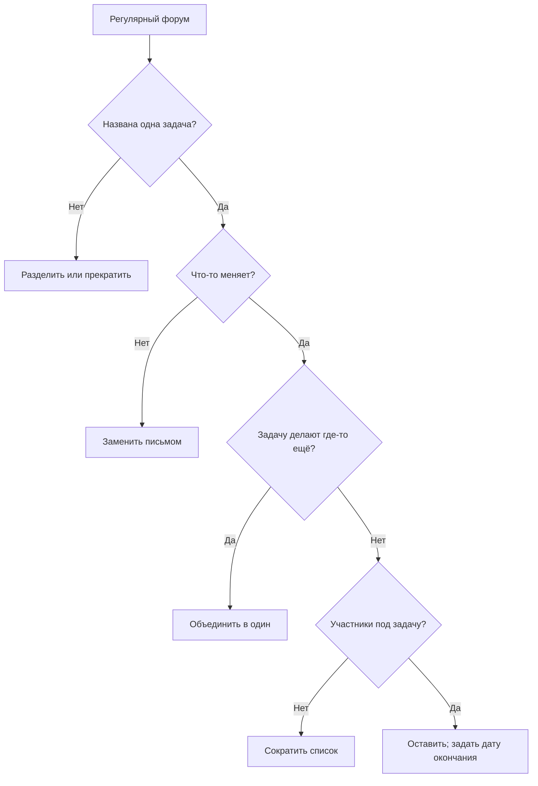
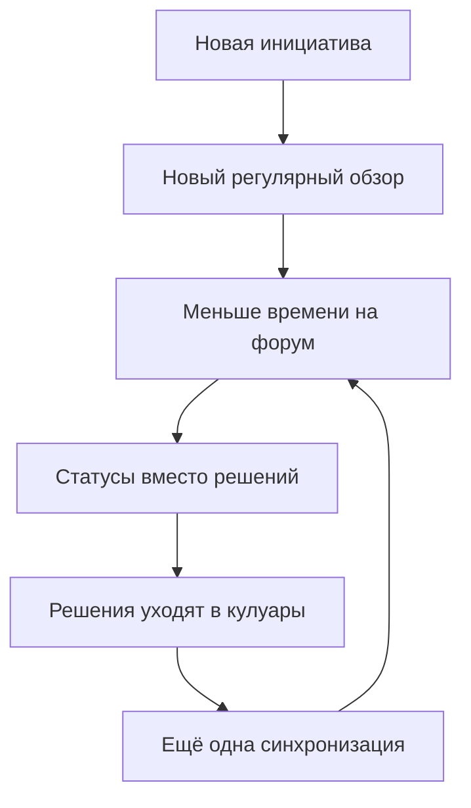

# Глава 37 — Операционная система управления: ритмы и встречи руководителей { #chapter-37-the-management-operating-system-cadences-and-leadership-meetings }

Эта глава — о регулярных встречах и письменных ритмах, через которые руководитель управляет организацией.
Вы узнаете, как выстроить еженедельный, ежемесячный и квартальный ритм (cadence), чтобы у каждой встречи
была одна задача; как провести встречу команды руководителей, на которой действительно что-то решают; как
проверить всю систему на дублирование работы и на петли, которые никто не замыкает. Сквозной пример —
календарь директора по разработке в Northstar Technologies, вымышленной компании из
[кейса](../../case-studies/northstar/index.md).

!!! info "Связанные главы"
    Части этой системы появились в предыдущих главах: еженедельный операционный разбор, ежемесячный
    обзор качества и квартальная перезагрузка
    ([глава 27](../05-engineering-quality/27-quality-transformation-at-enterprise-scale.md)),
    обновление прогноза ([глава 17](../04-execution/17-predictability-and-managing-uncertainty.md)) и
    список открытых решений ([глава 13](../03-high-performing-teams/13-decision-making-in-teams.md)).
    Карты показателей и квартальное планирование разобраны в
    [главе 38](38-scorecards-quarterly-planning-and-capacity-allocation.md); ревью, журналы решений,
    эскалация и отчётность для руководства — в
    [главе 39](39-reviews-decision-logs-escalation-and-executive-reporting.md). Часть VIII написана с
    позиции директора; эту роль описывает [глава 40](../09-engineering-directorship/40-the-directors-job.md).

## Почему это важно { #why-this-matters }

В команде встреч у руководителя немного, и все они на виду. Если что-то идёт не так, команда
замечает это за несколько недель.

В масштабе организации работа директора и происходит на встречах. Директор, у которого 80 инженеров, не
видит работу своими глазами: информация приходит к нему через форумы, через них же уходят и решения. Если
два форума делают одно и то же, руководители дважды докладывают один и тот же статус и слышат
противоречивые ответы. Если какую-то задачу, например разрешать межкомандные споры, не выполняет ни один
форум, её берёт на себя тот, кто громче всех в коридоре, или не делает никто. Без продуманного устройства
календарь обрастает встречами, пока никто уже не может сказать, какая из них что решает.

У высшего руководства эта цена велика и при этом незаметна. Консультанты Bain сообщили, что в одной
крупной компании на подготовку к одному еженедельному заседанию исполнительного комитета уходило около
300 000 часов в год ([Mankins, 2014](../../references/bibliography.md#mankins2014weekly); **мнение
эксперта**: рассказ консалтинговой фирмы об одном клиенте, метод не опубликован). Ритм CTO определяет,
сколько готовиться всем ниже по иерархии. Поэтому его устройство — одно из немногих решений, от которых
зависит, на что уходит неделя каждого инженера.

## Цели главы { #learning-objectives }

Прочитав эту главу, вы сможете:

- Выстроить набор еженедельных, ежемесячных и квартальных ритмов, в которых у каждой встречи есть
  одна названная задача, явные входы и выходы и владелец.
- Проводить встречу команды руководителей так, чтобы она заканчивалась записанными решениями,
  владельцами и сроками, а не кругом статусов.
- Проверять действующую операционную систему на избыточность (одна задача в нескольких форумах) и на
  недостающие петли (задача, которую не делает ни один форум).
- Оценивать стоимость ритма в человеко-часах участников и времени на подготовку и решать, что
  прекратить.
- Распознавать по наблюдаемым признакам, что форум отошёл от своей задачи.

## Ментальная модель { #the-mental-model }

> **Ментальная модель:** операционная система управления — это набор вложенных петель обратной связи
> с разными горизонтами времени. У каждой петли должно быть ровно одно место, и каждая встреча должна
> быть местом ровно одной петли.

Петля что-то замечает, принимает решение, действует и проверяет результат. Короткие петли срабатывают
часто и отвечают за текущую работу: что сломалось на этой неделе, каким задачам по итогам разборов
подошёл срок. Средние петли подробно проверяют систему одной команды: приносит ли выделенный ресурс то,
ради чего его выделили. Длинные петли перераспределяют ресурсы, приоритеты и структуру. Решениям, которые
не могут ждать длинной петли, нужен свой форум. Каждая петля передаёт наверх исключения, а вниз —
обязательства.

Отсюда два следствия. Первое: встреча с двумя задачами плохо справляется с обеими: статусы вытесняют
решения. Второе: задача, у которой нет места, не исчезает. Она перебирается во встречи один на один, в
чаты и в созвоны по инцидентам, и там её делают без нужных людей и без нужной информации.

## Подробный разбор { #deep-conceptual-explanation }

### Из чего состоит система { #what-the-system-is-made-of }

Авторы трёх классических книг практиков видят во встречах не помеху управленческой работе, а среду, в
которой она идёт (**мнение эксперта**). Andrew Grove, описывая управление в Intel, различает процессные
встречи, которые идут по расписанию (встречи один на один, совещания с подчинёнными, операционные
обзоры), и целевые, которые собирают ради одного решения
([Grove, 1983](../../references/bibliography.md#grove1983high)). Patrick Lencioni считает, что вместо
одной встречи обо всём нужны разные встречи для разных горизонтов: от коротких тактических до более
редких стратегических и выездных
([Lencioni, 2012](../../references/bibliography.md#lencioni2012advantage)). Peter Drucker утверждает:
время — самый дефицитный ресурс руководителя; прежде чем им управлять, его нужно учесть; обилие встреч —
симптом плохой организации ([Drucker, 1967](../../references/bibliography.md#drucker1967effective)).

**Синтез книги**: у операционной системы четыре составные части. Это **форумы** (встречи), **артефакты**
(письменные входы и выходы: карты показателей, материалы к встрече, журналы решений), **горизонты**
(неделя, месяц, квартал) и **правила маршрутизации** (что и когда переходит из одного форума в другой). В
большинстве неработающих систем форумов с избытком, а артефактов и правил маршрутизации не хватает.

### Одна встреча, одна задача { #one-meeting-one-job }

Задача встречи — изменение, которого она должна добиться. Семь задач покрывают почти любую
регулярную встречу руководителей (**рекомендация книги**):

| Задача | Что даёт | Обычный горизонт | Можно ли заменить письмом? |
|---|---|---|---|
| Информировать | Общую осведомлённость | Неделя | В основном |
| Вести текущую работу | Действия по сбоям недели и задачам по итогам разборов | Неделя | Частично |
| Решать | Записанные решения с владельцами | Неделя или по запросу | Нет, но письмо помогает подготовиться |
| Проверять | Суждение о системе одной команды и корректировки | Месяц | Нет |
| Распределять | Ресурсы и приоритеты на следующий период | Квартал | Нет |
| Развивать | Рост человека | От недели до месяца | Нет |
| Сплачивать | Доверие и общий контекст в группе | Месяц или реже | Нет |

Чаще всего встречу отводят под информирование, хотя именно этой задаче встреча нужна меньше всего. Круг
статусов из семи руководителей по семь минут занимает 49 минут часовой встречи. Всё это время уходит на
то, что письменный отчёт донёс бы за пять минут чтения. Каждую регулярную встречу проверяйте так:
назовите её единственную задачу, входы, выходы и того, кто в течение двух недель заметил бы её
исчезновение.

### Что подтверждают исследования встреч { #what-the-research-on-meetings-supports }

Для такой важной темы наука о встречах на удивление молода и бедна данными, а о командах руководителей в
разработке в ней почти ничего нет.

- **Качество важно не меньше количества.** В двух опросах сотрудников воспринимаемая эффективность
  встреч сильно и напрямую связана с отношением к работе и благополучием
  ([Rogelberg et al., 2006](../../references/bibliography.md#rogelberg2006not)). Сотрудники также
  сообщали о большей вовлечённости, когда руководители держали встречи по делу, давали людям
  высказаться и следили за временем
  ([Allen and Rogelberg, 2013](../../references/bibliography.md#allen2013manager)). **Научный
  результат**, самоотчётный и корреляционный.
- **Жалобы вредят сильнее, чем помогает решение проблем.** В одном исследовании закодировали
  видеозаписи 92 встреч команд. Решение проблем и планирование действий были связаны с
  удовлетворённостью, продуктивностью и успехом организации два с половиной года спустя, а у критики и
  жалоб отрицательная связь была сильнее
  ([Kauffeld and Lehmann-Willenbrock, 2012](../../references/bibliography.md#kauffeld2012meetings)).
  **Научный результат** в изложении аннотации.
- **Продумывайте, что происходит до, во время и после.** Авторы обзора области выстраивают данные вокруг
  этих трёх фаз и завершают его практическими рекомендациями
  ([Mroz et al., 2018](../../references/bibliography.md#mroz2018meetings)).
- **Руководители проводят на встречах всё больше времени.** В резюме статьи Harvard Business Review
  сказано, что руководители проводят на встречах почти 23 часа в неделю, а в 1960-х проводили меньше 10
  ([Perlow, Hadley, and Eun, 2017](../../references/bibliography.md#perlow2017stop)). **Мнение
  эксперта**: метод, которым получена цифра, в резюме не показан.

К устройству ритма относятся два более старых результата. Встречи, разбросанные по дню, дорого обходятся
инженерам, которым приходится ждать своих руководителей: в одной команде разработчиков продуктивность
выросла, когда в группе изменили правила общего распоряжения временем
([Perlow, 1999](../../references/bibliography.md#perlow1999time)). А удалённые организации, где
информирование не перешло в письменную форму, сползают ко встречам: у ИТ-специалистов, работавших из
дома, времени на встречах стало больше, а непрерывного рабочего времени — меньше
([Gibbs, Mengel, and Siemroth, 2023](../../references/bibliography.md#gibbs2023wfh)).

Сколько форумов держать и как часто их проводить, исследования не говорят: работ, где еженедельную
встречу руководителей сравнивали бы со встречей раз в две недели, найти не удалось. Описанные ниже ритмы
— **рекомендация книги**.

### Встреча команды руководителей, которая принимает решения { #the-leadership-team-meeting-that-decides }

Большинство встреч руководителей проваливаются одинаково: их устраивают, чтобы информировать, а ждут
от них решений. Пять правил устройства превращают еженедельную встречу руководителей в форум для
решений (**рекомендация книги**).

1. **Статус переходит в письменную форму.** Каждый участник публикует короткий отчёт к
   фиксированному времени до встречи. Встреча начинается с вопросов по отчётам, а не с их
   пересказа.
2. **Вопросы для решения приходят подготовленными.** В каждом пункте названы вопрос, варианты,
   рекомендация, кто решает и к какому сроку. Способы принятия решений и права на решения разобраны
   в [главе 13](../03-high-performing-teams/13-decision-making-in-teams.md). Именно на этой встрече
   принимают межкомандные решения, у которых есть решающий, но нет форума.
3. **Материалы к встрече несут информацию, которой нет у остальных.** Группа, обсуждая решение,
   задерживается на том, что и так знают все. [Метаанализ](../../glossary.md#meta-analysis)
   (исследование, которое объединяет результаты многих исследований) 65 экспериментов со скрытыми
   профилями показал: группы гораздо чаще упоминали общую информацию, чем уникальную. Если для
   правильного ответа нужно было свести вместе уникальные факты, группы находили его гораздо реже
   ([Lu, Yuan, and McLeod, 2012](../../references/bibliography.md#lu2012hiddenprofiles); впервые эффект
   описали [Stasser and Titus, 1985](../../references/bibliography.md#stasser1985pooling)). Письменные
   материалы к встрече (pre-read), где изложены факты каждой команды, показывают эти факты всем до того,
   как обсуждение сойдётся на одном мнении. Правда, это лабораторные задачи с правильными ответами, так
   что перенос на инженерные решения — вывод, а не доказанный факт.
4. **Участники считают команду руководителей своей первой командой.** Lencioni известен идеей: если
   руководители видят себя прежде всего представителями своих команд, встреча руководителей превращается
   в переговоры ([Lencioni, 2012](../../references/bibliography.md#lencioni2012advantage)). На практике
   это значит: до решения руководитель может отстаивать интересы своей команды, а после — обязан донести
   решение до неё.
5. **Встреча заканчивается обязательствами.** В последние пять минут повторяют каждое решение, его
   владельца и то, что каждый участник скажет своей команде. Тогда все руководители передают решение вниз
   в одном и том же виде. Решения заносят в [журнал решений](../../glossary.md#decision-log), который
   описывает глава 39.

### Проверка на избыточность и недостающие петли { #auditing-for-redundancy-and-missing-loops }

Проверка состоит из четырёх шагов. Сначала составьте перечень всех регулярных форумов: ритм,
длительность, участники и задача, которую форум за собой заявляет. Затем прочитайте повестки или заметки
за несколько недель и запишите, какую задачу каждый форум выполняет на деле. Потом постройте матрицу
«тема × форум»: строки — повторяющиеся темы (задачи по итогам разборов инцидентов, статус продления,
межкомандное решение), столбцы — форумы, в ячейках отмечено, где тема появлялась и где её закрыли.
Наконец, сверьте с матрицей каждую петлю, которая нужна организации. Строка с отметками в четырёх
столбцах — избыточность, строка без единой отметки «закрыто» — недостающая петля.

## Пример из инженерной организации { #engineering-organization-example }

!!! info "Northstar: что уже известно"
    Неделя 20 первого года директора, середина квартала 2. За первый квартал изменения во владении,
    серьёзности и релизах сократили число инцидентов
    [Sev1 и Sev2](../../glossary.md#severity-sev1-sev2-sev3) (два самых серьёзных уровня) с 30 до 21.
    Одно [обязательство по продлению](../../glossary.md#renewal-commitments) (интеграция с
    бухгалтерской системой) запущено на неделе 19, срок второго (массовый заказ) — неделя 26. См.
    [хронологию](../../case-studies/northstar/timeline.md). Впервые читаете о Northstar? Прочитайте
    [«Год вкратце»](../../case-studies/northstar/year-in-brief.md) и
    [список действующих лиц](../../case-studies/northstar/cast.md).

Цифры в этом разделе — **иллюстрация** (Northstar — вымышленная компания). В квартале 1 директор заменил
отдельные еженедельные встречи по статусу шести команд одним еженедельным
[операционным разбором](../../glossary.md#operational-review-and-operating-review): инциденты, задачи по
итогам разборов и [бюджеты ошибок](../../glossary.md#error-budget-and-burn-rate) (сколько ненадёжности
может позволить себе сервис, прежде чем работа над надёжностью получит приоритет). К неделе 20 календарь
снова разросся. Директор восстановил его по записям за недели 14–19 и первым делом построил матрицу «тема
× форум»: важнее было понять, куда уходят темы, чем сколько уходит часов.

| Тема | Где появлялась | Где закрыта |
|---|---|---|
| Статус продлений (интеграция с бухгалтерской системой, массовый заказ) | Встреча руководителей, сверка по продлениям, синхронизация с продуктом, операционный разбор, две встречи один на один | Сверка по продлениям |
| Задачи по итогам инцидентов, у которых подошёл срок | Операционный разбор, встреча руководителей, рабочая группа по релизам, обзоры качества | Операционный разбор |
| Запросы к платформе и ожидание окружений | Встреча руководителей, синхронизация с продуктом, обзор поставки | Нигде |
| Межкомандные решения: ADR-0001 и владелец core/permissions | Встреча руководителей, staff-группа, синхронизация Billing и Orders | Нигде |
| Реестр технологических рисков (девять записей, TR-01 – TR-09) | Нигде | Нигде |
| Цикл повышений с калибровкой в начале квартала 3 | Только встречи один на один | Нигде |

ADR-0001 — первая в Northstar
[запись архитектурного решения (ADR)](../../glossary.md#architecture-decision-record-adr): как
интеграциям читать проведённые данные из ledger. core/permissions — общий модуль tier 1,
команду-владельца которого так и не выбрали. Оба вопроса до сих пор открыты. Причина в том, что принять
их не было задачей ни одного форума, поэтому каждое обсуждение заканчивалось без решающего.

А те форумы, что собирались, в основном информировали. На шести встречах руководителей, судя по заметкам
директора, было 38 пунктов повестки и 5 решений, причём два из них потом пересмотрели на синхронизации с
продуктом. Круг статусов занимал около 42 из 60 минут. С тех пор как в операционный разбор добавили новые
пункты (сначала аудит серьёзности инцидентов, потом бюджеты ошибок), он каждую неделю выходил за
забронированное время. Его 16 участников проводили на нём около 20 человеко-часов в неделю; большинство
из них — старшие по дежурствам, то есть инженеры.

Сам календарь (недельная нагрузка с недели 16, когда начались
[встречи через уровень](../../glossary.md#skip-level), то есть встречи с подчинёнными своих
руководителей):

| Форум | Длительность | Участники | Часов директора в неделю |
|---|---|---|---|
| Операционный разбор, еженедельно | Забронировано 30 мин, идёт 75 | 16 | 1.25 |
| Встреча руководителей, еженедельно | 60 мин | 7 | 1.0 |
| Сверка по продлениям, еженедельно | 45 мин | 6 | 0.75 |
| Синхронизация продукта и разработки, еженедельно | 60 мин | 5 | 1.0 |
| Синхронизация Billing и Orders, еженедельно | 30 мин | Две команды | 0.5 |
| Рабочая группа по релизам, еженедельно | 45 мин | Ведут staff-инженеры | 0.75 |
| Staff-группа, раз в две недели | 60 мин | Staff-инженеры | 0.5 |
| Встречи один на один, еженедельно | 45 или 30 мин | 10 человек | 6.5 |
| Встречи через уровень, четыре в неделю | 30 мин | Инженеры | 2.0 |
| Ежемесячные форумы (обзоры качества, обзор поставки, общее собрание) | От 45 до 90 мин | По-разному | 1.75 |
| Квартальная перезагрузка | Полдня | 9 | 0.3 |
| **Всего регулярных** | | | **16.3** |

Встречи один на один длятся по 45 минут с каждым из шести руководителей и по 30 минут с каждым из трёх
staff-инженеров и с Victor Lindqvist (CTO, технический директор). В сверке по продлениям участвуют Amara
Okafor (CPO, директор по продукту) и двое руководителей. Месяц считается за четыре недели, квартал —
за 13. Сверх этого около 9,5 часа в неделю занимают внеплановые встречи и разборы инцидентов, так что из
47-часовой недели на встречи уходило около 25 часов.

## Как принимать решение { #decision-framework }

Для каждого регулярного форума, попавшего в проверку:

«Что-то меняет» — значит, в заметках видны решение, действие, корректировка или чей-то рост. Если за
шесть недель у форума ничего такого нет, он только информирует, а письмо делает это дешевле. Каждому
оставленному форуму задают дату окончания или пересмотра.

Чтобы вписать петлю в ритм, подберите ей горизонт по двум скоростям: как быстро меняется её сигнал и как
быстро вы можете действовать:

| Петля | Сигнал меняется | Горизонт | Место |
|---|---|---|---|
| Инциденты, задачи по итогам разборов, бюджеты ошибок, прогнозы с датами | За дни | Неделя | Операционный разбор |
| Межкомандные решения, эскалации | За дни или недели | Неделя | Встреча команды руководителей |
| Система качества и поставки одной команды | За недели | Месяц | Обзор команды (глава 27) |
| Поток, калибровка прогнозов, расход на долг, технологические риски | За недели или месяцы | Месяц | Бизнес-обзор |
| Ресурсы, приоритеты, структура, калибровка талантов | За кварталы | Квартал | Перезагрузка и обзор талантов |
| Сама операционная система | За кварталы | Квартал | Тридцать минут перезагрузки |

Ежемесячный бизнес-обзор — единый форум для тех петель всей организации, что меняются за недели: поставка
и поток, точность прогнозов, расход на долг и технологические риски. Он ищет закономерности по всем
командам, а обзор команды смотрит на одну команду.

## Компромиссы { #trade-offs }

**Меньше форумов или уже состав.** Объединив форумы, вы сэкономите часы, но на объединённый форум захотят
ходить все. Держите состав узким.

**Письмо или разговор.** Письменный статус экономит время и доносит информацию, которой нет у остальных.
Но он обходится каждому руководителю в 15–20 минут в неделю, а тех, кто слабо пишет, слышат хуже. И
работает он, только если руководитель читает отчёты и задаёт по ним вопросы.

**Предсказуемость или отзывчивость.** При фиксированном ритме решения ждут следующей встречи. Если
стоимость задержки решения измеряется днями, разрешите явный быстрый путь: решающий решает сам,
записывает решение и сообщает о нём на следующей встрече.

**Охват или глубина.** Делегировав форум, например рабочую группу по релизам, вы сэкономите часы, но
потеряете прямой сигнал. Вместо присутствия директора работает правило маршрутизации: что форум
сообщает и кому.

## Типичные провалы { #failure-modes }

**Театр статусов.** Встреча превращается в круг новостей, которые и так есть в трекере. Как заметить: в
заметках за шесть недель меньше одного решения на встречу. Что делать: перевести статус в письменную
форму, а встречу начинать с вопросов.

**Встреча, пережившая свою задачу.** Форум, созданный ради одного обязательства, продолжает собираться и
после того, как оно закрыто. Как заметить: никто не может назвать, что сломается, если его отменить. Что
делать: задавать дату окончания уже при создании форума.

**Рост наслоением.** Каждая инициатива добавляет свой обзор, и ничего не убирается. Как заметить:
регулярные часы растут от квартала к кварталу, а число решений в неделю — нет.

Это усиливающая петля. Что делать: ввести правило — каждый новый регулярный форум называет форум, который
заменяет, или повестку, к которой присоединяется.

**Решения в коридоре** (см. также главу 39). Решения принимают на встречах один на один или в
коридоре, а на встрече команды руководителей их объявляют или снова оспаривают. Как заметить: решения
пересматривают на другом форуме. Что делать: решение считается принятым, только когда оно записано в
журнал с именем решающего.

**Каскад подготовки.** Старший форум запрашивает данные, и каждый уровень готовит их на своей встрече,
так что стоимость умножается в несколько раз. Цифра из статьи Mankins — как раз стоимость такой
подготовки. Как заметить: в календарях руководителей появляются «предвстречи». Что делать: задать
фиксированный компактный формат входных данных и собирать их из систем, а не вручную.

**Пустой стул.** У петли, которая нужна организации, нет форума, поэтому она всплывает только в
кризис. Как заметить: в матрице тем есть строка без отметки «закрыто». Что делать: дать каждой нужной
петле одно место.

**Подогнанная метрика.** Если считать решения на встречу, мелкие пункты начнут оформлять как решения.
Если считать пересмотренные решения, их начнут пересматривать неформально. Читайте сам журнал, а не
только число записей в нём.

## Применение в крупной организации { #enterprise-application }

В организации из 50–150 инженеров у операционной системы три слоя: форумы директора, собственный ритм
каждой команды (планирование, ретроспективы, операционные разборы) и маршрутизация между ними. Директор
проектирует первый слой и маршрутизацию, а ритм команды оставляет её руководителю, но с одним
ограничением: командные форумы готовят входные данные для форумов директора в общем формате, чтобы никто
не собирал одни и те же факты дважды.

Вариант по умолчанию для директора, у которого от шести до десяти подчинённых
(**рекомендация книги**):

- каждую неделю: операционный разбор на 30–45 минут и встреча команды руководителей на
  60–90 минут с письменными материалами к встрече;
- каждый месяц: обзор системы каждой команды (глава 27) и один бизнес-обзор;
- каждый квартал: перезагрузка и обзор талантов;
- встречи один на один в ритме, который рекомендует глава 5;
- защищённый блок времени без встреч для руководителей в те дни, когда большинство инженеров в
  офисе.

Около 12–16 регулярных часов в неделю оставляют директору место для незапланированной работы.

### Форумы на нескольких площадках и в разных часовых поясах { #forums-across-sites-and-time-zones }

Форум, который проходит в переговорной одного офиса, прежде всего служит этому офису. Три правила не дают
удалённым участникам и тем, кто сидит на других площадках, превратиться в зрителей (**рекомендация
книги**):

1. **Чередуйте неудобное время.** Если ни один слот не подходит всем, каждый месяц передавайте
   неудобный слот другой стороне, а не оставляйте его навсегда меньшей площадке.
2. **Сначала решайте письменно.** Подготовленные вопросы и материалы к встрече рассылают за рабочий
   день, а комментарии в документе считаются полноценным участием. Чтобы вас услышали, не нужно
   перекрикивать комнату.
3. **Дайте другой площадке место председателя.** Очерёдность вопросов ведёт сопредседатель или сменный
   ведущий с другой площадки. Все подключаются каждый со своего экрана, даже те, кто сидит в
   переговорной.

Проверяйте это по заметкам: посчитайте по площадкам, кто поднимает вопросы и кто ими владеет. Если
участники с какой-то площадки ни разу не владели ни одним пунктом, для неё форум не работает.

Каждый квартал проверяйте систему вместе с одним из руководителей, которому прямо поручено оспаривать
взгляд директора.

## Взгляд CTO { #cto-perspective }

Для высшего руководства операционная система — главный рычаг компании: от неё зависит, на что
руководители разработки тратят время. При этом её стоимость в основном скрыта в подготовке на нижних
уровнях. Важны три вопроса.

Первый: что каждый форум высшего руководства требует от разработки и в какой форме? Если CTO каждую
неделю просит свежий слайд, он запускает каскад. Если каждый месяц просит одну и ту же карту показателей,
собранную из систем, почти ничего не запускает. Карту показателей разбирает глава 38, отчёт для
руководства — глава 39.

Второй: ритмы разработки и продукта — одна система или две? Если дорожную карту обсуждают на двух
отдельных форумах, некоторые решения принимают дважды. Совместный ежемесячный бизнес-обзор обычно
обходится дешевле.

Третий: принимает ли решения команда руководителей самого CTO? Если на совещании с подчинёнными CTO
слушает статусы, каждый директор ниже учится делать то же самое.

## Практический плейбук { #practical-playbook }

1. Выпишите свой календарь за две недели и составьте перечень всех регулярных форумов: ритм,
   длительность, участники, заявленная задача, владелец и подготовка.
2. Прочитайте заметки за шесть недель. Запишите, какую задачу каждый форум выполняет на деле, и
   посчитайте решения.
3. Постройте матрицу «тема × форум» и отметьте, где каждую тему закрыли.
4. По таблице горизонтов составьте список петель, которые нужны вашей организации. Пометьте каждую:
   есть место, дублируется или места нет.
5. Проведите каждый форум через схему решений: прекратить, заменить письмом, объединить, сократить
   состав или оставить с датой окончания.
6. Для каждого оставшегося форума напишите хартию на одну страницу: задача, входы, выходы, участники,
   длительность, дата окончания или пересмотра.
7. Переведите статус в письменный отчёт с фиксированным форматом и сроком; читайте его перед каждой
   встречей.
8. Перестройте встречу команды руководителей по пяти правилам устройства и заведите журнал решений.
9. Объявите новый ритм: что прекращается, что приходит на смену и когда ритм пересмотрят.
10. Через шесть недель снова посчитайте решения, пересмотренные решения и регулярные часы, затем
    скорректируйте ритм.
11. Каждый квартал тратьте 30 минут перезагрузки на проверку самой системы.

### Пример хартии форума { #a-sample-forum-charter }

Хартия отвечает на вопросы проверки ещё до того, как кто-то придёт на встречу, и умещается на
полстраницы. Ниже — хартия еженедельной встречи команды руководителей у гипотетического директора
(**иллюстрация**):

| Поле | Содержание |
|---|---|
| Задача | Решать межкомандные вопросы, у которых есть решающий, но нет другого форума |
| Не её задача | Статус (письменный отчёт), инциденты и задачи по итогам разборов (операционный разбор), планирование одной команды |
| Входы | Письменный отчёт каждого участника до полудня предыдущего рабочего дня: что изменилось, риски, какие нужны решения, просьбы, ссылка на метрики. Список открытых решений с решающим и датой «нужно к» |
| Выходы | Решения, записанные в журнал с владельцем и датой; что каждый участник скажет своей команде |
| Участники | Директор (председатель), руководители, staff-инженеры, один представитель продукта; остальных приглашают под конкретный пункт |
| Длительность | 75 минут еженедельно; встречу отменяют, если в списке нет ни одного подготовленного вопроса |
| Показатели | Решения на встречу; решения, пересмотренные на другом форуме |
| Пересмотр | Конец квартала. Встречу прекращают или объединяют с другой, если шесть недель подряд на ней в среднем меньше одного решения |

Главное в хартии — две строки. «Не её задача» указывает, куда уходят остальные темы, чтобы встреча не
стала для них свалкой. Правило отмены делает пустую повестку поводом вернуть людям час, а не заполнять
его статусами. А формат отчёта заодно даёт тот письменный статус, которого требует шаг 7.

## Кейс { #case-study }

Этот кейс — **вымысел**. Действие происходит в Northstar в квартале 2 и в начале квартала 3 и продолжает
пример выше (вся история — в [хронике года 1](../../case-studies/northstar/first-quarter.md)).

На неделе 22 директор подготовил черновик того, как перестроить операционную систему в квартале 3 (недели
27–39); руководители должны были обсудить его на неделе 24.

| Форум в квартале 2 | Изменение | Форма в квартале 3 | Часов директора в неделю |
|---|---|---|---|
| Операционный разбор | Сократить | Жёстко 45 мин, фиксированная повестка, без статусов, 14 человек | 0.75 |
| Встреча руководителей и синхронизация с продуктом | Объединить | Встреча команды руководителей, 75 мин, письменные материалы к встрече | 1.25 |
| Остаток синхронизации с продуктом | Сократить | Директор и CPO, 45 мин раз в две недели | около 0.4 |
| Сверка по продлениям | Прекратить | Заканчивается на неделе 26 | 0 |
| Синхронизация Billing и Orders | Сократить | Ежемесячно, 30 мин, пересмотр на неделе 39 | около 0.1 |
| Рабочая группа по релизам | Делегировать | Сообщает об исключениях на операционный разбор | 0 |
| Ежемесячный обзор поставки | Расширить | Ежемесячный бизнес-обзор, 120 мин | 0.5 |
| (нет) | Добавить | Квартальный обзор талантов, 3 часа | около 0.25 |
| Квартальная перезагрузка | Расширить | Добавляется 30-минутная проверка системы | около 0.35 |
| Всё остальное | Оставить | Встречи один на один, встречи через уровень, staff-группа, обзоры качества, общее собрание | около 10.4 |
| **Всего регулярных** | | | **14.0** |

Во встрече команды руководителей участвуют директор, шесть руководителей, три staff-инженера и Amara
Okafor или продакт-менеджер, которого она назовёт. Для двух staff-инженеров операционный разбор
становится необязательным. Директор перестаёт ходить на рабочую группу по релизам; вместо этого об
исключениях сообщает Kwame Mensah, staff-инженер, который ведёт эту группу. Первый обзор талантов
приходится на неделю 27 и совпадает с циклом повышений, включающим калибровку.

Регулярная нагрузка директора снижается с 16,3 примерно до 14,0 часа в неделю. Но главная экономия — на
операционном разборе: примерно с 20 до 10,5 человеко-часа в неделю, в основном за счёт времени инженеров.

А у самих руководителей нагрузка не снижается: у типичного руководителя часы на форумах даже немного
растут, примерно с 4,1 до 4,6 в неделю, включая около 20 минут на подготовку материалов к встрече.
Перестройка меняет то, на что руководители тратят это время: меньше слушать статусы, больше решать и
писать. Часов она им не возвращает.

Предложение даёт каждой петле из матрицы одно место: статус продлений — в материалах к встрече,
межкомандные решения — на встрече команды руководителей, запросы к платформе и реестр рисков — на
бизнес-обзоре, калибровку повышений — на обзоре талантов. Вопросы ADR-0001 и владельца core/permissions
оно не решает, а только даёт им форум и место для решающего. Регулярные точки контакта с Victor Lindqvist
не меняются: еженедельная встреча один на один и квартальная перезагрузка.

К неделе 24 пришли три возражения. Elena Sokolova (руководитель Payments and Integrations) заметила, что
отменять сверку по продлениям, пока дата массового заказа всё ещё под угрозой, преждевременно: функция
может сдвинуться. Tom Becker (руководитель Platform Operations) спросил, почему запросы к его команде
должны ждать ежемесячного форума. Daniel Cho (руководитель Customer Experience; мобильные инженеры его
команды работают в Боготе) спросил, какая польза инженерам в Боготе от встречи команды руководителей,
которая проходит в переговорной в Миннеаполисе.

Открытый выбор: какие возражения меняют устройство ритма, а на какие оно уже отвечает.

## Упражнения { #exercises }

Разборы упражнений — на странице [решений к главе 37](../../solutions/ch37-solutions.md). Данные
Northstar — на [странице исходного уровня](../../case-studies/northstar/baseline-data.md).

### Базовый уровень { #foundational }

**F1.** Еженедельная встреча руководителей у директора длится 60 минут: круг статусов из семи
человек, примерно по шесть минут на каждого, а затем «разное». За шесть недель в её заметках
записан 31 пункт и 3 решения. Определите, какую задачу встреча за собой заявляет и какую выполняет
на деле, проведите её через схему проверки из главы и скажите, чем бы вы её заменили и что бы измеряли
потом.

**F2.** Для каждой петли выберите горизонт и место и обоснуйте выбор тем, как быстро меняется её
сигнал и как быстро вы можете действовать: бюджет ошибок для оформления заказа; запрос на передачу
компонента из одной команды в другую; доля ресурса, которая уходит на записи реестра технического
долга; калибровка точности прогнозов по командам; задача по итогам Sev1 со сроком в следующий
вторник; решение о том, какая команда владеет спорным общим модулем.

**F3.** Пересчитайте регулярные часы директора Northstar в квартале 2 (таблица календаря, недельная
нагрузка с недели 16) с учётом трёх изменений: операционный разбор возвращают к забронированным
30 минутам, staff-группа собирается каждую неделю, а еженедельные встречи один на один с руководителями
сокращаются до 30 минут. Назовите каждую изменённую строку, новый итог и то, что вы при этом потеряете в
сигнале.

### Прикладное лидерство { #applied-leadership }

**A1.** Вы — директор на неделе 24, и перед вами возражение Elena Sokolova: сверка по продлениям не
должна заканчиваться на неделе 26, если массовый заказ может сдвинуться. Решите, заканчивается ли
сверка, продолжается или меняет форму, и придумайте правило, по которому она закончится позже.
Скажите, какую информацию вы хотели бы получить до решения и чего бы не приняли.

**A2.** Спроектируйте повестку, формат материалов к встрече и порядок завершения для предлагаемой
еженедельной встречи команды руководителей Northstar на первые четыре недели. Покажите, как вынести
на неё пункт вроде ADR-0001 так, чтобы встреча не решала, у кого право на это решение, и как не дать
участникам из Боготы и трём staff-инженерам превратиться в зрителей.

**A3.** Tom Becker возражает: межкомандные запросы к Platform Operations не могут ждать
ежемесячного бизнес-обзора. В базовом квартале эти запросы занимали около 20 процентов ресурса
команды, а по повторной выборке недели 18 — около 14 процентов. С квартала 2 у команды единая
входная очередь и ротация на прерываниях из двух человек. Предложите, как в квартале 3 провести
запросы к платформе через операционную систему, не добавляя новой регулярной встречи, и скажите, как
через шесть недель вы поймёте, сработало ли это.

### Решения на уровне руководства { #executive-decision-making }

**X1.** Victor Lindqvist как CTO знакомится с перестройкой, которую подготовил директор, и предлагает
ежемесячный бизнес-обзор разработки с участием его самого, директора, Amara Okafor и Rajiv Menon (CFO,
финансовый директор), а также еженедельную письменную записку от директора. Оцените, сколько подготовки
это добавит директору и руководителям, какие существующие форумы эти встречи должны заменить или для
каких служить входом и как вы не допустите каскада подготовки. Решите, о чём вы посоветовали бы ему
просить.

**X2.** Через два квартала после перестройки встреча команды руководителей записывает около четырёх решений
в неделю, пересмотренных решений стало меньше, регулярные часы не изменились. На встречах через
уровень инженеры говорят, что решения приходят быстрее, но «никто их не объясняет». Определите, что
эта картина говорит об операционной системе, решите, что бы вы изменили, а что оставили как есть, и
скажите, чем данные, на которые вы опираетесь, могут ввести вас в заблуждение.

## Вопросы для размышления { #reflection-questions }

1. Какой встречи в вашем календаре никто не хватился бы в течение двух недель?
2. Где в вашей организации решения принимают, а где их только обсуждают? Это одно и то же место?
3. Сколько часов подготовки на нижних уровнях порождает ваша самая важная встреча?
4. У какой петли в вашей организации нет места и как вы сейчас узнаёте, что она дала сбой?
5. Когда вы в последний раз прекратили регулярную встречу и что пришло ей на смену?

## Главное { #key-takeaways }

- Рассматривайте операционную систему как вложенные петли с горизонтом в неделю, месяц и квартал: у
  каждой петли одно место, у каждого форума одна задача.
- Назовите для каждого форума задачу, входы, выходы, владельца и дату окончания или пересмотра.
- Переведите информирование в письменную форму; встречи оставьте для текущей работы, решений,
  проверки, распределения ресурсов, развития людей и сплочения.
- Встреча команды руководителей принимает решения, когда статус написан заранее, вопросы приходят
  подготовленными и с решающим, материалы к встрече несут факты каждой команды, которых нет у
  остальных, а в конце записаны обязательства.
- Проверяйте систему матрицей «тема × форум»: много отметок в одной строке — избыточность, ни одной
  отметки «закрыто» — недостающая петля.
- Считайте стоимость в человеко-часах участников и времени на подготовку, а не только в часах
  руководителя.
- Новый регулярный форум должен назвать, что он заменяет или к какой повестке присоединяется.
- Данные подтверждают, что о качестве встреч стоит заботиться, но не предписывают никакого ритма;
  пересматривайте свой каждый квартал.

## Источники и что почитать { #references-and-further-reading }

- [Grove, 1983](../../references/bibliography.md#grove1983high). *High Output Management*. Встречи
  как работа руководителя.
- [Lencioni, 2012](../../references/bibliography.md#lencioni2012advantage). *The Advantage*. Типы
  встреч по горизонтам; команда руководителей как первая команда.
- [Drucker, 1967](../../references/bibliography.md#drucker1967effective). *The Effective Executive*.
  Как учитывать и собирать в крупные блоки время руководителя.
- [Rogelberg et al., 2006](../../references/bibliography.md#rogelberg2006not). Почему качество
  встреч важно не меньше их числа.
- [Allen and Rogelberg, 2013](../../references/bibliography.md#allen2013manager). Актуальность,
  возможность высказаться и время на встречах, которые ведёт руководитель.
- [Kauffeld and Lehmann-Willenbrock, 2012](../../references/bibliography.md#kauffeld2012meetings).
  Закодированные встречи команд: полезное и вредное взаимодействие и последующие результаты.
- [Mroz et al., 2018](../../references/bibliography.md#mroz2018meetings). Краткий обзор науки о
  встречах.
- [Perlow, Hadley, and Eun, 2017](../../references/bibliography.md#perlow2017stop). «Stop the Meeting
  Madness»: как росло время руководителей на встречах.
- [Mankins, 2014](../../references/bibliography.md#mankins2014weekly). Скрытая стоимость одного
  еженедельного заседания руководства; читать ради каскада подготовки.
- [Lu, Yuan, and McLeod, 2012](../../references/bibliography.md#lu2012hiddenprofiles) и
  [Stasser and Titus, 1985](../../references/bibliography.md#stasser1985pooling). Почему группы
  недоиспользуют информацию, которой нет у остальных; довод в пользу письменных материалов к встрече.
- [Perlow, 1999](../../references/bibliography.md#perlow1999time) и
  [Gibbs, Mengel, and Siemroth, 2023](../../references/bibliography.md#gibbs2023wfh). Прерывания,
  коллективное использование времени и сползание ко встречам при удалённой работе.
