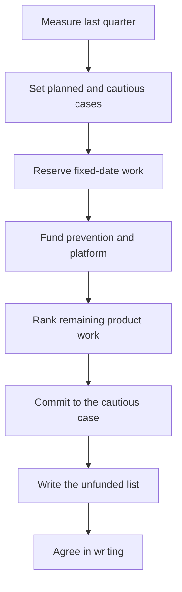
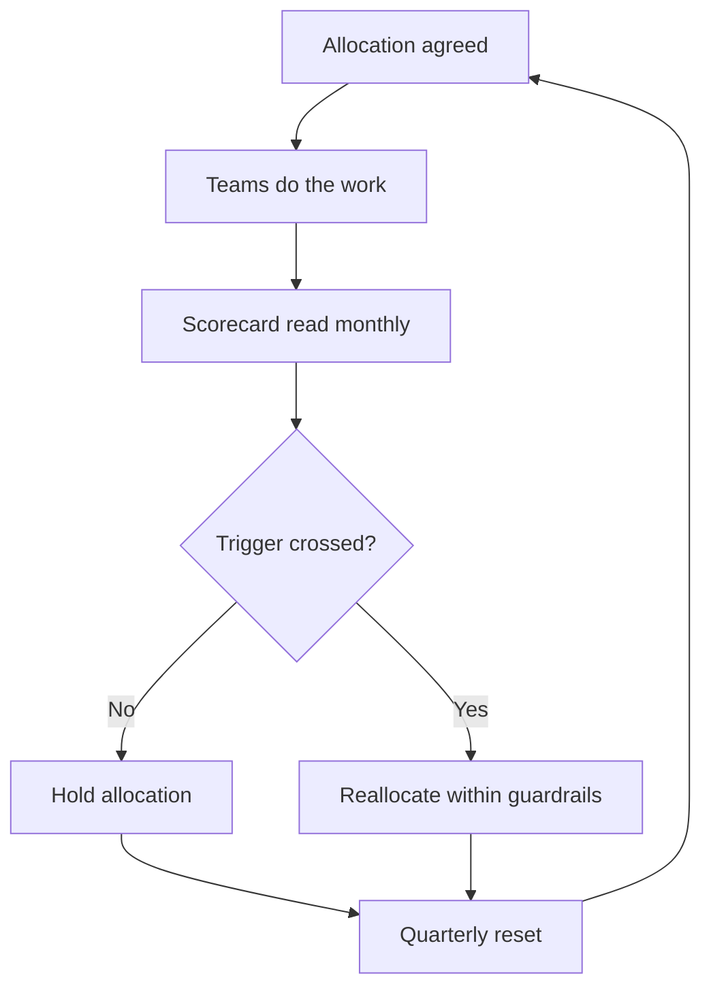

# Chapter 38 — Scorecards, Quarterly Planning, and Capacity Allocation

!!! warning "Awaiting human review"
    This chapter has passed the book's automated validation and an editorial self-review, but not yet
    the human review in which each cited claim is checked against its source. Treat it as a reviewed
    draft. Corrections are welcome; see the repository's CONTRIBUTING file.

This chapter is about three instruments a director uses to steer an organization between quarters: an
organization scorecard, a quarterly plan that ends in funded commitments and named trade-offs, and a
capacity allocation across product, quality, and platform work. It argues that they are one mechanism:
the allocation is a budget, the plan spends it, and the scorecard shows whether the spending bought
what it promised. The running example is quarter 3 planning at Northstar Technologies, the fictional
company in the [case study](../../case-studies/northstar/index.md).

Chapter 15 owns team-level planning and prioritization, Chapter 17 forecasts and commitments, Chapter
18 metric design and gaming, Chapter 27 the quality scorecard and the prevention capacity model, and
Chapter 32 the platform roadmap. Chapter 37 places the quarterly cycle among the other cadences,
Chapter 39 covers reviews and executive reporting, and Chapter 45 cost of delay.

## Why This Matters

At team level, planning mistakes show within a sprint and are cheap to fix. At organization level,
the same decisions are made once a quarter for six or more teams, and errors
compound. An over-committed plan does not fail evenly: cross-team items fail first, interrupts land on
the teams with least slack, and quality work nobody asked for is dropped first. Northstar's baseline
shows the pattern: 7 of 17 committed items delivered, 8 of the 10 misses cross-team, about 560
engineer-weeks committed against roughly 686 that unplanned work left, and four quarters at about 42
percent.

At executive scale, the plan is where engineering spending becomes visible. A CFO with flat operating
expense and a CPO with dates promised to customers ask the same question: is the money going to the
right places, and is that improving? A director who shows the allocation, the commitments it funds,
what it does not fund, and a scorecard that tracks the return can hold a position, and change it when
evidence changes.

## Learning Objectives

After this chapter you will be able to:

- Build an organization scorecard with paired measures, explicit owners, and data sources, including
  the quality scorecard by reference.
- Run quarterly planning that starts from measured capacity and ends with funded commitments, labeled
  targets, and a written list of what is not funded.
- Allocate capacity across product, quality prevention, and platform work, and defend the split with
  evidence and with the conditions that would change it.
- Evaluate OKRs against the research on goal setting, and decide where they help and where they
  distort.
- Recognize the failure modes of quarterly planning early.

## The Mental Model

> **Mental model:** Capacity is a budget, not a wish. The plan spends it in a few named categories,
> commits only what the cautious case can pay for, and writes down what it is not buying. The
> scorecard is the receipt.

Three ideas follow. First, **unplanned work is not allocated; it is a tax you measure**, paid before
any plan is made. Chapter 16 shows how to make it visible
([unplanned work, visible and classified](../04-execution/16-flow-lead-time-dependencies-and-unplanned-work.md#unplanned-work-visible-and-classified)).

Second, **what remains buys three investments with different payback shapes.** Product work pays when
it ships. Prevention pays later by reducing the unplanned tax. Platform work pays later and across
teams by shortening feedback loops. An allocation states how much future capacity you will buy with
present capacity.

Third, **a commitment is a promise funded by the cautious case.** Chapter 17 separates forecasts,
targets, and commitments
([forecasts, targets, and commitments](../04-execution/17-predictability-and-managing-uncertainty.md#forecasts-targets-and-commitments)).
At organization level this becomes arithmetic: commit what the pessimistic case can deliver, label the
rest as targets, and name what nobody will work on.

## Deep Conceptual Explanation

### The organization scorecard

An organization scorecard tells the director, and through them the CTO, whether the allocation and the
plan are working. It needs several areas, because one can improve while the organization gets worse; the SPACE authors argue that
productivity cannot be captured by any single metric or dimension
([Forsgren et al., 2021](../../references/bibliography.md#forsgren2021space)).

| Area | Question | Typical measures |
|---|---|---|
| Outcomes | Are customers and contracts better served? | Contractual availability, service credits |
| Quality | Is the inflow of failures falling? | Chapter 27's quality scorecard, by reference |
| Delivery | Is change flowing faster and safer? | DORA's throughput and instability measures |
| Commitments and investment | Did we do what we said, and spend where we said? | Committed items delivered, capacity by category against plan |
| People | Is the system sustainable? | Survey items on feedback loops and cognitive load, after-hours pages |

Do not copy the quality rows. Chapter 27 and the
[engineering quality scorecard template](../../templates/engineering-quality-scorecard.md) define them,
their pairs, and their audits; the organization scorecard includes them as one block.

Two rules carry over. **Pair every measure** with one that exposes its likely gaming (Chapter 18,
[how each metric is gamed, and its pair](../04-execution/18-measuring-engineering-productivity.md#how-each-metric-is-gamed-and-its-pair)).
The idea of paired indicators is usually credited to Andrew Grove
([Grove, 1983](../../references/bibliography.md#grove1983high)). And **prefer system-generated data**,
auditing anything that depends on human classification
([scorecard design rules](../05-engineering-quality/27-quality-transformation-at-enterprise-scale.md#scorecard-design-rules)).

This chapter adds **explicit ownership in two roles**. A **row owner** explains the measure's movement
in the monthly review and proposes what to do. A **data steward** owns the definition and the pipeline,
and is the only person who may change either. The person who answers for a number should not also be
able to redefine it quietly. Keep the scorecard to about ten entries, the quality block counting as
one, and drop any row that has not changed a decision in two quarters.

**Most rows should carry a direction, not a target.** DORA's guide warns that setting its metrics as
goals makes gaming more likely, and that the aim is improvement over time rather than competition
between teams ([DORA, metrics guide](../../references/bibliography.md#dora-metrics-guide))
(**industry research**). A few outcome rows carry targets because someone has a legitimate reason to
set them: Northstar's 99.9 percent availability is set by contract. The test: if hitting the number by
any means would be welcome, it can be a target; if only some ways would be, it is a measure to
understand.

### What the research says about goals, and about OKRs

OKRs (objectives and key results) pair a qualitative objective with a few measurable results that
would show it was reached. John Doerr popularized the format, crediting its origin to Grove's practice
at Intel ([Doerr, 2018](../../references/bibliography.md#doerr2018measure)) (**practitioner
consensus**, at the level of the idea).

The research underneath is goal-setting theory. Locke and Latham's reviews summarize decades of
studies on the effectiveness of specific, difficult goals, the mechanisms through which goals work,
the moderators that change their effect, and the theory's limits
([Locke and Latham, 2002](../../references/bibliography.md#locke2002building);
[Locke and Latham, 2006](../../references/bibliography.md#locke2006new)) (**research finding**, read at
abstract level).

The side effects are disputed. Ordóñez and colleagues accept that specific, challenging goals can boost
performance but argue that the benefits are overstated and the harms ignored: neglect of everything
outside the goal, distorted risk-taking, more unethical behavior, inhibited learning, corroded culture,
and reduced intrinsic motivation ([Ordóñez et al., 2009](../../references/bibliography.md#ordonez2009goals)).
Locke and Latham replied that the critique rests on anecdote and unrepresentative citations, and that
its pitfalls were already in the goal-setting literature
([Locke and Latham, 2009](../../references/bibliography.md#locke2009goal)). Both sides accept the
mechanism that matters here: a goal focuses attention, and what lies outside it gets less. That is why
scorecard pairs exist. Treat the size of the side effects as **disputed**.

Evidence on OKRs specifically is thin. One qualitative case study of two teams in a large distributed
agile project found that OKRs helped knowledge sharing, goal alignment, and insight across teams, and
that people needed support writing key results
([Stray et al., 2022](../../references/bibliography.md#stray2022okrs)) (**research finding**: one
project, interviews, no performance outcome). This book found no controlled study of OKRs' effect on
software delivery.

**This book's recommendation:** if your company uses OKRs, use them to say which few outcomes the
allocation is meant to move, and keep the scorecard watching everything else. Pair each key result
with a row that would show it being hit the wrong way, and do not attach individual pay to them.

### Quarterly planning at organization level

The organization plan is not the sum of team plans. Team methods and ranking belong to Chapter 15
([prioritization as economics](../04-execution/15-planning-prioritization-and-delivery-methods.md#prioritization-as-economics));
the organization plan sets the envelope team plans fill. Order matters, because each step consumes
capacity later steps cannot use.

| Step | Common shortcut | Its cost |
|---|---|---|
| Measure last quarter | Planning from headcount | Repeats last quarter's error |
| Two capacity cases | One number | Every surprise becomes a miss |
| Reserve fixed dates | Ranking them against everything | They win late and displace work mid-quarter |
| Fund prevention and platform | Funding from "slack" | They vanish at the first slip |
| Commit to the cautious case | Committing to the planned case | A coin-flip promise |
| Write the unfunded list | Leaving it implied | Requesters assume their items are coming |
| Agree in writing | Verbal agreement | Renegotiated in week 6 |

The **unfunded list** is the step most often skipped and the one that makes the plan honest. It turns "engineering is slow"
into "we chose these over those, together, in week 26".

### Allocating capacity, and defending the split

An allocation is defensible when each category answers four questions (**this book's
recommendation**):

1. **What does it buy?** Product: revenue, retention, or risk retired. Prevention: less unplanned work
   and fewer incidents. Platform: shorter waits and fewer interrupts for every team.
2. **What evidence sized it?** Prevention follows where failures come from; platform follows measured
   friction; product follows value estimates written by requesters.
3. **Which scorecard row shows the return, and when?**
4. **What would change it?** A written trigger, such as "if the unplanned share sampled in week 31 is
   above 26 percent, prevention does not fall again in quarter 4".

An allocation with a published exit condition is a bet with a review date, and those are easier to
approve.

Chapter 27 explains why prevention must be funded explicitly
([funding the work](../05-engineering-quality/27-quality-transformation-at-enterprise-scale.md#funding-the-work)).
Its model has prevention and "feature capacity", meaning everything that remains. At organization
level that remainder also pays for platform work, so this chapter splits it into product and platform.

## Engineering Organization Example

This example is **illustrative**: canonical Northstar numbers where they exist, every other assumption
stated. It is set in weeks 25 and 26, planning quarter 3 (weeks 27 to 39).

**Starting figures.** 80 engineers. Chapter 27's projection for quarter 3: unplanned work 22 percent
(17.6 FTE), prevention 8 FTE, leaving 54.4 FTE. Platform Operations is Tom Becker and five
infrastructure engineers; two rotate on interrupts and three do planned work, as in Chapter 32's
quarter 2 roadmap
([Chapter 32 case study](../06-technical-leadership/32-platform-engineering-developer-experience-and-modernization.md#case-study)).

**Assumptions added for this example** (fictional additions):

- **Cautious case.** Unplanned work stays at quarter 2's measured 28 percent (22.4 FTE), the figure in
  the director's quarter 2 report (Chapter 39).
- **Platform.** 3 FTE of Platform Operations planned work, plus 1.5 FTE in product teams for migrating
  their own services to the pipeline template, held until the consolidation target is decided.
- **Bulk ordering reserve.** Bulk ordering is due in week 26; two engineers stay on support for its
  first four weeks: 8 engineer-weeks, about 0.6 FTE-quarters.
- **Growth.** Orders' features grew 15 to 35 percent between start and delivery, so product capacity is
  divided by 1.25, the middle of that range, before estimates are committed against it.
- **Demand.** Amara Okafor's candidate list holds 24 items, about 62 FTE-quarters (806 engineer-weeks)
  of estimated effort.

| Line | Planned case (FTE) | Cautious case (FTE) |
|---|---|---|
| Unplanned work (measured tax) | 17.6 (22%) | 22.4 (28%) |
| Quality prevention | 8.0 | 8.0 |
| Platform | 4.5 | 4.5 |
| Product | 49.9 | 45.1 |
| Product after bulk ordering reserve | 49.3 | 44.5 |
| Estimated effort it can absorb (÷ 1.25) | 39.4 | 35.6 |

Check: 17.6 + 8 + 4.5 + 49.9 = 80.0, and 22.4 + 8 + 4.5 + 45.1 = 80.0. Product plus platform in the
planned case is 54.4 FTE, Chapter 27's quarter 3 feature capacity.

**What the plan commits.** About 35.6 FTE-quarters of estimated effort, from the top of the ranked list,
each cross-team item with a lead team. The next 3.8 are targets that start only if the planned case
holds. The remaining 22.6 (about 36 percent of the list) go on the unfunded list.

Two observations. The committed scope, about 463 engineer-weeks, is smaller than the 560 the
baseline committed; the difference is the growth allowance, the cautious case, and the investment
lines, none of which the baseline plan had. And prevention is a third below quarters 1 and 2, as Chapter 27 projected, which rests on unplanned work actually falling; the week 31 trigger
keeps that honest.

**Prevention by team.** The director proposes sizing the 8 FTE by where failures come from:

| Team | Engineers (from week 10) | Prevention FTE | Share |
|---|---|---|---|
| Billing | 15 | 2.5 | 17% |
| Orders | 16 | 2.0 | 13% |
| Customer Experience | 17 | 1.5 | 9% |
| Payments and Integrations | 13 | 1.0 | 8% |
| Data and Analytics | 11 | 1.0 | 9% |
| **Total** | | **8.0** | |

Billing keeps the largest share: 6 of the 11 baseline recurrences and the highest unplanned share among product teams.
Orders' share rises from quarter 1's 10 percent because bulk ordering no longer holds its capacity.
Platform Operations takes none; its planned work is the platform line. Whether quarter 1's 2 FTE
security earmark stays inside the 8 is a trade-off the plan must name.

## Decision Framework

The scorecard and the allocation form a loop: the scorecard is read monthly, the allocation changes
quarterly unless a written trigger fires earlier.

Sizing each category (**this book's recommendation**; thresholds are starting points, not research
results):

| Situation | Prevention | Platform | Product |
|---|---|---|---|
| Unplanned share above about 30 percent and rising | Grow it | Hold; fix the inflow first | Commit less, and say so before the quarter |
| Unplanned share falling as projected | Step down on schedule | Grow if friction measures are flat | Commit more, still from the cautious case |
| Unplanned share falling slower than projected | Do not step down; revisit the diagnosis | Hold | Commit from the cautious case only |
| High friction (environment waits, several build systems) | Hold | Grow, with adoption measures | Expect a short dip |
| Fixed-date commitment at risk | Protect the at-risk team's share | Defer non-blocking items | Reserve first, with margin |

Guardrails in every case: no category is cut mid-quarter without a written trade agreed by those who
agreed the plan; prevention and platform are never "whatever is left over"; nothing is committed above
the cautious case. For scorecard rows, apply three tests: does it change a decision someone owns, does
it have a pair, can a system compute it? Fail the first and the row goes; fail the second and it gets a
pair before publication; fail the third and it gets a data steward and an audit.

## Trade-offs

**Commitment size against credibility.** Committing to the cautious case feels like lost ambition to
product leaders; committing to the planned case wins the meeting and loses the quarter. Northstar's 42
percent record is the cost of the second.

**Prevention against features, every quarter.** Cutting prevention shows up as product capacity
immediately and as unplanned work later, where nobody connects the two. Cut on evidence, through the
trigger, not on pressure.

**Platform investment against near-term delivery.** Funding the platform team without funding
adoption produces a platform nobody uses (Chapter 32); funding adoption takes time from teams that did
not ask for it.

**Goal focus against breadth.** Too few key results and the rows outside them drift; too many and
nothing is focused. Three to five organization key results, each paired, is a workable compromise.

**Stable allocation against responsiveness.** Quarterly changes plus written triggers trade some
responsiveness for the predictability teams need to plan.

## Failure Modes

**The wish list plan.** Everything requested, sized against headcount. Signal: committed effort above
the planned case, or no unplanned-work line. Countermeasure: open the planning document with the
capacity table and rank nothing until it is agreed.

**The paper allocation.** Prevention and platform disappear in week 5, borrowed for a slipping feature.
Signal: time sampling diverges from plan by more than about a fifth. Countermeasure: allocation spent
against plan as a scorecard row, owned by the director.

**The invisible unfunded list.** Requesters assume unlisted items are coming and escalate in week 8.
Countermeasure: publish the list with reasons and the earliest quarter each could return.

**Scorecard sprawl.** Thirty rows nobody reads. Signal: rows without owners or decisions.
Countermeasure: a fixed limit, and a removal before any addition.

**Key results on mechanism measures.** "Change fail rate below 15 percent" invites reclassification and
fewer deployments. Signal: the target improves while its pair worsens. Countermeasure: key results on
outcomes, each paired, classifications audited.

**Renegotiation by attrition.** Teams quietly stop committed work to absorb new requests. Signal:
items "in progress" all quarter. Countermeasure: every change to a commitment is an explicit, recorded
trade.

## Enterprise Application

In an organization of 50 to 150 engineers, the director owns the organization plan and managers own
their teams' plans inside it:

| Who | Owns |
|---|---|
| Director | Capacity model and its two cases, the allocation, cross-team commitments, the unfunded list, the organization scorecard |
| Engineering managers | Their team's plan inside the envelope, its prevention spending, the team scorecard, one organization row where it fits |
| Staff engineers | Data stewardship for technical rows; the technical case for prevention and platform items |
| Product leadership | Value estimates, ranking input, agreement to the commitment line |
| CTO | Approval of the allocation and triggers; arbitration |

A workable calendar for a quarter starting in week 27: week 24, last quarter's figures and the draft
capacity table circulate; week 25, teams and product managers rank and size candidates, staff
engineers review cross-team items; week 26, a half-day session agrees the allocation, commitment line,
and unfunded list, and the CTO and CPO sign the written plan. Chapter 37 fits this into the wider
rhythm.

Past about five teams the director cannot judge every item, so team plans must follow common rules:
the same capacity units, growth allowance, and treatment of cross-team items. Some scorecard rows
should come from systems the director can query directly, not only from the people they measure.

## CTO Perspective

At CTO level, the allocation is a portfolio decision presented to a board and a CFO.

**Categories become investment classes:** run (unplanned work and maintenance), grow (product), and
improve (prevention and platform), with the trend. At $185,000 per engineer, the quarter 3 planned case
spends about $814,000 in the quarter on unplanned work alone (17.6 FTE × $185,000 ÷ 4). Budgeting
belongs to Chapter 52.

**The scorecard becomes a few exposures.** A board needs four or five numbers: availability against
commitment, service credits, delivery against commitment, spending by class, and one people measure.
The director's scorecard is the source; the CTO chooses what to lift.

**Goal frameworks become company-wide.** The CTO decides how engineering's key results connect to
company objectives and protects the scorecard from being replaced by them. The goal-setting dispute is
a reason to watch for side effects, not to ban goals.

## Practical Playbook

1. **Measure last quarter first:** unplanned share, delivery against commitment, capacity spent by
   category against plan.
2. **Build two capacity cases** with stated unplanned-work assumptions and a growth allowance from your
   own history.
3. **Reserve fixed-date work first,** with margins and a support reserve for launches at the boundary.
4. **Size prevention from failure data and platform from friction data;** write what each buys, its
   scorecard row, and its trigger.
5. **Rank the rest by value over duration** (Chapter 15); give every cross-team item a lead team.
6. **Draw the commitment line at the cautious case,** label the band above it as targets, and put the
   rest on the unfunded list with reasons.
7. **Get CTO and CPO sign-off in writing,** including the unfunded list and triggers.
8. **Publish the scorecard:** about ten entries, quality block by reference, each row with a pair, an
   owner, and a data steward.
9. **If OKRs are required, write them last,** three to five, each paired with a scorecard row.
10. **Read monthly, reallocate quarterly,** mid-quarter only through a trigger or a recorded trade.

## Case Study

This case is **fictional**. The prevention allocations, the bulk-ordering date, and the platform
roadmap's structure come from the [first quarter](../../case-studies/northstar/first-quarter.md) page
and Chapters 27 and 32. The candidate list, cautious case, support reserve, per-team prevention split,
scorecard proposal, and Victor Lindqvist's request for OKRs are additions for this chapter. The case is
set in weeks 25 and 26; the decisions are the reader's.

**The situation.** Bulk ordering is due at the end of week 26 and has not shipped. The consolidation
target for the pipeline template is still undecided. Greg Tanaka's two deal features are among the
committed items. The draft allocation is the one in the Engineering Organization Example.

**The proposed organization scorecard,** eight entries:

| # | Measure | Paired with | Row owner | Data steward |
|---|---|---|---|---|
| 1 | Contractual availability (target 99.9%, set by contract) | Customer-detected share | Director | Kwame Mensah |
| 2 | Quality block: Chapter 27's rows, by reference | As defined there | As defined there | As defined there |
| 3 | Deployment frequency and change fail rate, by component | Each other | Elena Sokolova | Kwame Mensah |
| 4 | Committed items delivered | Forecast calibration (Chapter 17) | Director | Planning tool owner |
| 5 | Capacity by category against plan | Unplanned share by team | Director | Tom Becker |
| 6 | Corrective-action closure | Recurrence | Marcus Oyelaran | Kwame Mensah |
| 7 | Median environment wait | Other teams' requests on Platform Operations | Tom Becker | Platform Operations |
| 8 | Survey: feedback loops, cognitive load (teams of five or more respondents) | After-hours pages | Daniel Cho | Survey administrator |

Delivery rows come from the deployment-event store once it runs; until then from the hand-joined
numbers, with that caveat beside them.

**The complications.**

- **Amara Okafor** asks that the 3.8 FTE-quarters of targets be committed, "since the planned case is
  your own projection".
- **Marcus Oyelaran** wants Billing's prevention share kept at quarter 1's 25 percent, not 17, because
  ledger knowledge is still concentrated in three people.
- **Tom Becker** says the 1.5 FTE held for migrations will be lost to product if the target decision
  slips past week 30, and asks for a date.
- **Priya Raman** cannot yet say whether bulk ordering will need more than four weeks of support.
- **Victor Lindqvist** asks each director for three OKRs for quarter 3 and suggests "Sev1 and Sev2
  incidents below 10" as a key result.

**The reader decides:** whether to commit the target band; how to answer Marcus within the 8 FTE or by
reopening it; what happens to the held platform line in week 30; how the plan changes if bulk ordering
slips; and which three OKRs to send Victor, each with its scorecard pair.

## Exercises

Solutions are in [chapter 38 solutions](../../solutions/ch38-solutions.md). Northstar data is on the
[baseline page](../../case-studies/northstar/baseline-data.md) and the
[first quarter](../../case-studies/northstar/first-quarter.md) page.

### Foundational

**F1.** A peer director shows you their organization scorecard: lines of code changed per engineer,
story points completed per team, Sev1 and Sev2 count, test line coverage, number of deployments,
committed items delivered, and employee net promoter score. Nobody is named as owner of any row.
Rebuild it into no more than eight entries, give each a pair and an owner role, and explain each
removal.

**F2.** Using the Engineering Organization Example, recompute Northstar's quarter 3 committed effort if
the growth allowance is 1.35 (the top of Orders' historical range) instead of 1.25, and again if
unplanned work in the cautious case is 30 percent. State which change matters more and what that tells
you about where to spend effort improving the plan.

**F3.** A team lead proposes this key result for quarter 3: "Increase deployment frequency of Core from
weekly to daily." Using the goal-setting research and the scorecard rules in this chapter, explain what
the key result would likely produce, what could go wrong, and how you would rewrite or pair it.

### Applied Leadership

**A1.** Write the director's reply to Amara Okafor's request to commit the 3.8 FTE-quarters of targets.
She points out that the planned case is engineering's own projection and that customers were given
dates before sizing in the baseline quarter. Your reply must keep her as an ally and hold or move the
line with a stated reason.

**A2.** Marcus Oyelaran asks for Billing's prevention share to stay at 25 percent in quarter 3. Within
the 8 FTE total, show at least two ways to meet part of his request, what each costs other teams, and
which scorecard rows would tell you in quarter 4 whether the choice was right.

**A3.** In week 33, time sampling shows prevention actually received 5.1 FTE of its planned 8, with
the difference spent on a slipping cross-team product item. The item's owner says it would have
missed otherwise. Decide what you do this quarter and what you change in the next plan, and write the
two-sentence note for the monthly review.

### Executive Decision-Making

**X1.** Victor Lindqvist asks for three engineering OKRs for quarter 3 and proposes "Sev1 and Sev2
incidents below 10" as one key result. Draft the three objectives with key results, decide whether to
accept his key result, and show the scorecard pair that would expose each key result being met the
wrong way.

**X2.** Rajiv Menon proposes that from quarter 4 engineering report its spending only as "roadmap" and
"keep the lights on", and that any category below 10 percent of capacity be folded into the larger
one. Assess the proposal from the CFO's, CPO's, and director's points of view, and decide what you
would agree to, what you would refuse, and what you would offer instead.

## Reflection Questions

1. When your organization last missed a quarterly commitment, was it drawn at a cautious case, a
   planned case, or no case at all?
2. Which scorecard row has not changed a decision in two quarters, and why is it still there?
3. Could each manager explain, without notes, what their team's prevention or platform time is meant
   to buy?
4. Who can redefine a measure on your scorecard without telling you?
5. Where is your unfunded list, and would the people on it agree it is accurate?
6. If all your company's OKRs were met next quarter, what could have gotten worse unnoticed?

## Key Takeaways

- Treat unplanned work as a measured tax, paid before anything is allocated.
- Split what remains into product, prevention, and platform, each with an owner, a purpose, a
  scorecard row that shows its return, and a written trigger for change.
- Build two capacity cases, apply a growth allowance from your own history, and commit only what the
  cautious case can deliver.
- Write the unfunded list and get it agreed; it prevents mid-quarter escalations.
- Keep the organization scorecard to about ten entries, include the quality scorecard by reference,
  and give every row a pair, a row owner, and a separate data steward.
- Most rows carry a direction, not a target; targets belong on outcomes someone has reason to set.
- Goals work and have side effects whose size is disputed; pair every key result with a measure that
  would show it being met the wrong way.

## References and Further Reading

- [Doerr, 2018](../../references/bibliography.md#doerr2018measure). *Measure What Matters*. The
  popular account of OKRs; read it for the method, not as evidence of effect.
- [Grove, 1983](../../references/bibliography.md#grove1983high). *High Output Management*. Paired
  indicators, managerial output, and the practice OKRs descend from.
- [DORA, metrics guide](../../references/bibliography.md#dora-metrics-guide). Current delivery metric
  definitions and the warning against using them as goals.
- [Forsgren et al., 2021](../../references/bibliography.md#forsgren2021space). SPACE; why productivity
  needs several dimensions.
- [Locke and Latham, 2002](../../references/bibliography.md#locke2002building) and
  [Locke and Latham, 2006](../../references/bibliography.md#locke2006new). Reviews of goal-setting
  theory by its originators.
- [Ordóñez et al., 2009](../../references/bibliography.md#ordonez2009goals) and
  [Locke and Latham, 2009](../../references/bibliography.md#locke2009goal). The exchange on goal
  setting's side effects; read both before adopting company-wide goals.
- [Stray et al., 2022](../../references/bibliography.md#stray2022okrs). OKRs as a coordination aid in a
  large distributed agile project; the closest software-specific evidence found.
