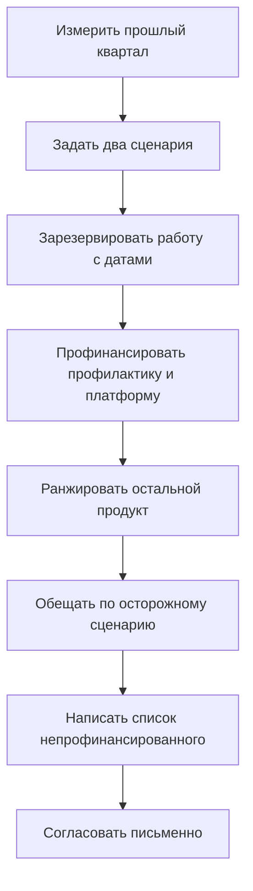
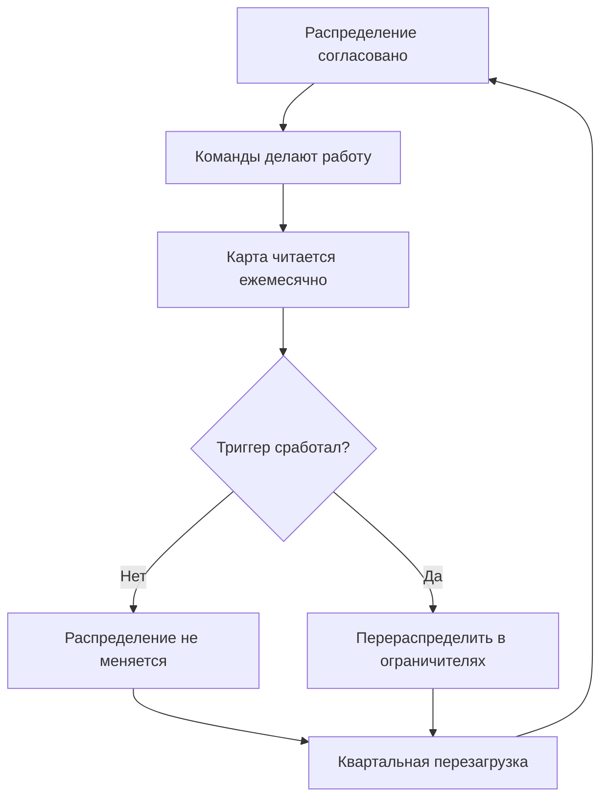

# Глава 38 — Карты показателей, квартальное планирование и распределение ресурсов { #chapter-38-scorecards-quarterly-planning-and-capacity-allocation }

Эта глава — о трёх инструментах, которыми директор управляет организацией от квартала к кварталу: о карте
показателей (scorecard) организации; о квартальном плане, итог которого — профинансированные
обязательства и названные компромиссы; о распределении ресурсов между продуктовой работой, качеством и
платформой. Главная мысль главы: это один механизм. Распределение — бюджет, план его тратит, а карта
показателей показывает, принесли ли траты то, что обещали. Сквозной пример — планирование квартала 3 в
Northstar Technologies, вымышленной компании из [кейса](../../case-studies/northstar/index.md).

!!! info "Связанные главы"
    Планирование на уровне команды разобрано в главе 15, прогнозы и обязательства — в главе 17,
    устройство метрик и их подгонка — в главе 18, карта показателей качества и модель ресурса на
    профилактику — в главе 27, дорожная карта платформы — в главе 32.
    [Глава 37](37-cadences-and-leadership-meetings.md) показывает место квартального цикла среди
    других ритмов; [глава 39](39-reviews-decision-logs-escalation-and-executive-reporting.md) разбирает
    ревью и отчётность для руководства.

## Почему это важно { #why-this-matters }

В команде ошибки планирования видны в пределах спринта, и исправить их дёшево. В организации те же
решения принимают раз в квартал для шести и более команд, и ошибки накапливаются. Перегруженный
обязательствами план проваливается неравномерно: первыми срываются межкомандные задачи, прерывания
достаются командам с наименьшим запасом, а работу над качеством, о которой никто не просил, выбрасывают в
первую очередь. Northstar — именно такой случай: за четыре квартала до прихода директора компания
выполнила около 42 процентов обещанных пунктов дорожной карты, и большинство срывов пришлось на
межкомандные задачи.

Для высшего руководства план — то место, где расходы на разработку становятся видны. CFO при неизменных
[операционных расходах (opex)](../../glossary.md#operating-expense) (текущие затраты, в основном
зарплаты) и CPO с обещанными клиентам датами задают один и тот же вопрос: идут ли деньги туда, куда
нужно, и становится ли от этого лучше? Если директор показывает распределение, обязательства, которые оно
финансирует, то, чего оно не финансирует, и карту показателей, по которой видна отдача, он может отстоять
свою позицию, а когда данные изменятся — пересмотреть её.

## Цели главы { #learning-objectives }

Прочитав эту главу, вы сможете:

- Построить карту показателей организации с парными метриками, явными владельцами и источниками
  данных, включив в неё карту показателей качества по ссылке.
- Проводить квартальное планирование, которое начинается с измеренного ресурса и заканчивается
  профинансированными обязательствами, помеченными целями и письменным списком того, что не
  профинансировано.
- Распределять ресурс между продуктовой работой, профилактикой проблем качества и платформой и
  отстаивать это распределение данными и условиями, при которых оно изменится.
- Оценивать OKR в свете исследований о постановке целей и решать, где они помогают, а где искажают
  картину.
- Рано распознавать типичные провалы квартального планирования.

## Ментальная модель { #the-mental-model }

> **Ментальная модель:** ресурс — это бюджет, а не пожелание. План тратит его по нескольким названным
> категориям, берёт обязательства только в том объёме, который оплатит осторожный сценарий, и
> записывает, чего не покупает. Карта показателей — чек.

!!! note "Термины этой главы"
    - **[FTE](../../glossary.md#fte)** (full-time equivalent, полная ставка): полное рабочее время
      одного инженера. Таблицы ресурсов в этой главе даны в FTE, усреднённых за квартал из 13 недель.
    - **[FTE-квартал](../../glossary.md#fte-quarter)**: один FTE на один квартал, мера объёма работы.
      1 FTE-квартал = 13 [инженеро-недель](../../glossary.md#engineer-week-engineer-day-engineer-year).
    - **[Плановый сценарий](../../glossary.md#planned-case-and-cautious-case)**: ресурс, который
      останется, если незапланированной работы придёт столько, сколько спрогнозировано.
      **Осторожный сценарий**: ресурс, который останется, если она сохранится на более высоком
      уровне прошлого квартала.
    - **Поправка на рост**: насколько работа исторически вырастает между оценкой и поставкой;
      используется как делитель. Если функции вырастают на 25 процентов, 10 FTE ресурса вмещают
      только 10 ÷ 1,25 = 8 FTE оценок. «Оценённые трудозатраты» всегда означают оценки до роста.
    - **Целевой диапазон**: работа выше черты обязательств; её начинают, только если плановый сценарий
      подтверждается.

Из этого следуют три идеи. Первая: **незапланированную работу не распределяют; это налог, который
измеряют**, и платят его до составления любого плана. Как сделать её видимой, показывает глава 16
([незапланированная работа: видимая и классифицированная](../04-execution/16-flow-lead-time-dependencies-and-unplanned-work.md#unplanned-work-visible-and-classified)).

Вторая: **на то, что остаётся, покупают три вида инвестиций с разным профилем окупаемости.** Продуктовая
работа окупается, когда её выпускают. Профилактика окупается позже, уменьшая налог незапланированной
работы. Платформенная работа окупается позже и сразу для многих команд, потому что укорачивает петли
обратной связи. Распределение показывает, сколько будущего ресурса вы покупаете ценой нынешнего.

Третья: **обязательство — это обещание, которое финансирует осторожный сценарий.** Глава 17 разделяет
прогнозы, цели и обязательства
([прогнозы, цели и обязательства](../04-execution/17-predictability-and-managing-uncertainty.md#forecasts-targets-and-commitments)).
В масштабе организации это различие превращается в арифметику: обещайте то, что может выполнить
пессимистичный сценарий, остальное пометьте как цели и назовите то, над чем никто работать не будет.

## Подробный разбор { #deep-conceptual-explanation }

### Карта показателей организации { #the-organization-scorecard }

По карте показателей организации директор, а через него и CTO, видит, работают ли распределение и план.
Областей в ней должно быть несколько: одна может улучшаться, пока организация в целом становится хуже.
Авторы [SPACE](../../glossary.md#space), набора измерений продуктивности разработчиков, утверждают, что
продуктивность нельзя уловить одной метрикой или одним измерением
([Forsgren et al., 2021](../../references/bibliography.md#forsgren2021space)).

| Область | Вопрос | Типичные метрики |
|---|---|---|
| Результаты | Лучше ли обслуживаются клиенты и контракты? | Доступность по контракту, [сервисные кредиты](../../glossary.md#service-credits) (компенсации, которые положены клиенту за недобор доступности) |
| Качество | Уменьшается ли приток сбоев? | Карта показателей качества из главы 27, по ссылке |
| Поставка | Идут ли изменения быстрее и безопаснее? | Метрики пропускной способности и нестабильности [DORA](../../glossary.md#dora-metrics) |
| Обязательства и инвестиции | Сделали ли мы то, что обещали, и потратили ли туда, куда говорили? | Выполненные обещанные пункты, ресурс по категориям в сравнении с планом |
| Люди | Устойчива ли система? | Вопросы опроса о петлях обратной связи и когнитивной нагрузке, вызовы в нерабочее время |

Не копируйте строки качества. Сами строки, их парные метрики и порядок аудита задают глава 27 и
[шаблон карты показателей инженерного качества](../../templates/engineering-quality-scorecard.md);
карта показателей организации включает их одним блоком.

Два правила переходят сюда без изменений. **Давайте каждой метрике пару**, которая выдаёт её
вероятную подгонку (глава 18,
[как подгоняют каждую метрику и какая у неё пара](../04-execution/18-measuring-engineering-productivity.md#how-each-metric-is-gamed-and-its-pair)).
Идею парных индикаторов обычно приписывают Andrew Grove
([Grove, 1983](../../references/bibliography.md#grove1983high)). И **отдавайте предпочтение данным,
которые порождает система**, а всё, что зависит от классификации людьми, проверяйте аудитом
([правила устройства карты показателей](../05-engineering-quality/27-quality-transformation-at-enterprise-scale.md#scorecard-design-rules)).

Эта глава добавляет **явное владение в двух ролях**. **Владелец строки** объясняет на ежемесячном
обзоре, почему метрика сдвинулась, и предлагает, что делать. **Хранитель данных (data steward)**
владеет определением и пайплайном, и только он может менять и то, и другое. Тот, кто отвечает за
число, не должен иметь возможности тихо его переопределить. Держите в карте показателей около десяти
записей, считая блок качества за одну, и убирайте любую строку, которая за два квартала не изменила
ни одного решения.

**У большинства строк должно быть направление, а не цель.** Руководство DORA предупреждает: если
превратить его метрики в цели, подгонка становится вероятнее; смысл метрик — в улучшении со временем, а
не в соревновании команд ([DORA, metrics guide](../../references/bibliography.md#dora-metrics-guide))
(**отраслевое исследование**). У некоторых строк результатов цели всё же есть, потому что у кого-то есть
законное основание их ставить: доступность 99,9% у Northstar задана контрактом. Проверка такая: если
достижение числа любыми средствами было бы желанным, его можно сделать целью; если желанны лишь некоторые
способы, это метрика, которую нужно понимать.

### Что исследования говорят о целях и об OKR { #what-the-research-says-about-goals-and-about-okrs }

[OKR](../../glossary.md#okr) (objectives and key results, цели и ключевые результаты) связывают
качественную цель (objective) с несколькими измеримыми результатами, которые покажут, что она
достигнута. Формат популяризировал John Doerr, который возводит его к практике Grove в Intel
([Doerr, 2018](../../references/bibliography.md#doerr2018measure)) (**консенсус практиков**).

В основе формата — теория постановки целей: конкретные и трудные цели, как правило, повышают
результативность. В обзорах Locke и Latham подытожены десятилетия исследований: сам эффект, его
механизмы, условия, которые его меняют, и границы теории
([Locke and Latham, 2002](../../references/bibliography.md#locke2002building);
[Locke and Latham, 2006](../../references/bibliography.md#locke2006new)) (**научный результат** в
изложении аннотаций этих обзоров).

О побочных эффектах спорят. Ordóñez и соавторы признают, что конкретные и амбициозные цели могут повышать
результативность. Но, по их мнению, польза преувеличена, а вред игнорируют: всё, что вне цели,
забрасывают, отношение к риску искажается, неэтичного поведения становится больше, обучение тормозится,
культура разъедается, а внутренняя мотивация падает
([Ordóñez et al., 2009](../../references/bibliography.md#ordonez2009goals)). Locke и Latham ответили, что
критика опирается на анекдотические случаи и нерепрезентативные цитаты, а ловушки, о которых идёт речь, в
литературе о постановке целей уже рассмотрены
([Locke and Latham, 2009](../../references/bibliography.md#locke2009goal)). Обе стороны признают
механизм, который здесь важен: цель фокусирует внимание, и всему, что вне её, достаётся меньше. Ради
этого и существуют пары в карте показателей. Размер побочных эффектов — **вопрос спорный**.

Данных именно об OKR мало. В одном качественном кейс-исследовании наблюдали за двумя командами в большом
распределённом agile-проекте. OKR помогали обмену знаниями, согласованию целей и пониманию того, что
происходит в других командах, а с формулировкой ключевых результатов людям требовалась помощь
([Stray et al., 2022](../../references/bibliography.md#stray2022okrs)) (**научный результат**: один
проект, интервью, без данных о результативности). Контролируемых исследований влияния OKR на поставку ПО
книга не нашла.

**Рекомендация книги:** если в вашей компании приняты OKR, используйте их, чтобы назвать те немногие
результаты, которые распределение должно сдвинуть, а за всем остальным пусть следит карта
показателей. Давайте каждому ключевому результату в пару строку, которая покажет, что его достигают
неправильным способом, и не привязывайте к ним индивидуальное вознаграждение.

### Хороший OKR и плохой { #a-good-okr-and-a-bad-one }

Ключевой результат хорош, когда его достижение любыми средствами было бы желанным, а парная метрика
выдала бы плохие средства. Два варианта для гипотетической организации (**иллюстрация**):

**Плохой.** Цель: «Выпускать быстрее». Ключевые результаты: «Каждый сервис развёртывается ежедневно»;
«Закрыть 200 тикетов». Оба — метрики механизмов. Чтобы их достичь, команды могут дробить развёртывания и
тикеты, а клиенты не увидят никаких улучшений. И ни у одного ключевого результата нет пары, которая бы
это показала.

**Хороший.** Цель: «Клиенты могут положиться на оформление заказа».

| Ключевой результат | Парная метрика | Что выдаёт пара |
|---|---|---|
| Оформление заказа укладывается в свой [SLO](../../glossary.md#sli-slo-and-sla) (целевой уровень сервиса) 99.9 процента в каждом 28-дневном окне этого квартала | Доля инцидентов, которые клиенты обнаружили раньше нас | SLO выполняют, пропуская или переклассифицируя сбои |
| Медианное ожидание тестового окружения сокращается с 3 дней до менее чем 1 | Запросы в обход единого входа | Очередь сократилась, потому что запросы вывели из учёта |

Цель называет результат, который заметил бы клиент. Каждый ключевой результат — число с исходным уровнем
и сроком, и у кого-то есть законное основание его сдвигать. Каждая пара берётся из другого источника
данных, поэтому один человек не может сдвинуть обе метрики. К тому же обе строки уже есть в карте
показателей: ключевые результаты добавляют фокус, но не добавляют измерений.

### Квартальное планирование на уровне организации { #quarterly-planning-at-organization-level }

План организации — не сумма планов команд. Методы и ранжирование внутри команд разбирает глава 15
([приоритизация как экономика](../04-execution/15-planning-prioritization-and-delivery-methods.md#prioritization-as-economics));
план организации задаёт рамки, а планы команд их заполняют. Порядок шагов важен: каждый шаг забирает
ресурс, которым следующие уже не воспользуются.

| Шаг | Частое упрощение | Чем оно обходится |
|---|---|---|
| Измерить прошлый квартал | Планировать от численности | Повторяется ошибка прошлого квартала |
| Два сценария ресурсов | Одно число | Каждый сюрприз превращается в срыв |
| Зарезервировать работу с фиксированными датами | Ранжировать её наравне со всем остальным | Она выигрывает поздно и вытесняет работу посреди квартала |
| Профинансировать профилактику и платформу | Финансировать из «запаса» | Они исчезают при первом же отставании |
| Обещать по осторожному сценарию | Обещать по плановому сценарию | Обещание с шансами пятьдесят на пятьдесят |
| Написать список непрофинансированного | Оставить его подразумеваемым | Заказчики считают, что их пункты будут сделаны |
| Согласовать письменно | Устная договорённость | Пересматривается на неделе 6 |

[Список непрофинансированного](../../glossary.md#unfunded-list) пропускают чаще всего, и именно он делает
план честным. С ним «разработка работает медленно» превращается в «на неделе 26 мы вместе выбрали эти
задачи вместо тех».

### Как распределить ресурс и отстоять распределение { #allocating-capacity-and-defending-the-split }

Распределение удаётся отстоять, если для каждой категории есть ответ на четыре вопроса (**рекомендация
книги**):

1. **Что она покупает?** Продукт — выручку, удержание клиентов или снятый риск. Профилактика — меньше
   незапланированной работы и меньше инцидентов. Платформа — меньше ожидания и меньше прерываний для
   каждой команды.
2. **На каких данных основан её размер?** Профилактика идёт туда, откуда приходят сбои; платформа —
   туда, где измерено трение; продукт — по оценкам ценности от заказчиков.
3. **Какая строка карты показателей покажет отдачу и когда?**
4. **Что её изменит?** Письменный триггер, например: «если доля незапланированной работы по выборке
   недели 31 выше 26 процентов, в квартале 4 профилактику больше не сокращают».

Распределение с опубликованным условием выхода — ставка с датой пересмотра, а такие ставки
утвердить легче.

Почему профилактику нужно финансировать явно, объясняет глава 27
([финансирование работы](../05-engineering-quality/27-quality-transformation-at-enterprise-scale.md#funding-the-work)).
В её модели есть профилактика и «ресурс на функции», то есть всё остальное. В масштабе организации из
этого остатка платят ещё и за платформу, поэтому в этой главе он разделён на продукт и платформу.

## Пример из инженерной организации { #engineering-organization-example }

!!! info "Northstar: что уже известно"
    Неделя 25 первого года директора, ближе к концу квартала 2. Число инцидентов
    [Sev1 и Sev2](../../glossary.md#severity-sev1-sev2-sev3) (два самых серьёзных уровня) в
    квартале 1 упало с 30 до 21, а доля незапланированной работы — с 34 до 31 процента ресурса. Одно
    [обязательство по продлению](../../glossary.md#renewal-commitments) (интеграция с бухгалтерской
    системой) работает с недели 19; срок массового заказа — конец недели 26. См.
    [хронологию](../../case-studies/northstar/timeline.md). Впервые читаете о Northstar? Прочитайте
    [«Год вкратце»](../../case-studies/northstar/year-in-brief.md) и
    [список действующих лиц](../../case-studies/northstar/cast.md).

Этот пример — **иллюстрация**: там, где у Northstar есть записанные числа, взяты они, все остальные
допущения названы. Действие происходит на неделях 25 и 26, когда планируют квартал 3 (недели 27–39). Весь
ресурс указан в FTE за квартал — это то же число, что и FTE-кварталы работы; инженеро-недели даны только
в скобках (1 FTE-квартал = 13 инженеро-недель).

!!! note "Исходные данные"
    - **Люди.** 80 инженеров: 77 в шести командах плюс три staff-инженера.
    - **Незапланированная работа.** На квартал 3 прогноз — 22 процента ресурса (модель главы 27);
      в квартале 2 измерено 28 процентов.
    - **Профилактика.** 8 FTE вместо 12 в кварталах 1 и 2, потому что работа переходит от создания
      возможностей (релизные проверки, обнаружение) к их поддержке.
    - **Платформа.** Platform Operations (руководитель Tom Becker и пять инженеров инфраструктуры)
      переводит сборки команд на единый шаблон CI-пайплайна. Какая CI-система станет стандартом
      (целевая система CI), ещё не решено. Двое из пятерых по очереди дежурят на прерываниях, трое
      заняты плановой работой.

**Допущения этого примера:**

- **Осторожный сценарий.** Незапланированная работа остаётся на измеренном в квартале 2 уровне
  28 процентов (22,4 FTE).
- **Платформа.** 3 FTE плановой работы Platform Operations плюс 1,5 FTE в продуктовых командах на
  перевод собственных сервисов на шаблон пайплайна. Эти 1,5 FTE придержаны, пока не выбрана целевая
  система CI.
- **Резерв на массовый заказ.** Два инженера остаются на поддержке в первые четыре недели после
  запуска: около 0,6 FTE-квартала (8 инженеро-недель).
- **Поправка на рост.** Функции Orders вырастали на 15–35 процентов между стартом и поставкой, поэтому
  план берёт середину этого диапазона — 1,25.
- **Спрос.** У Amara Okafor (CPO, директор по продукту) есть список из 24 кандидатов общим объёмом около
  62 FTE-кварталов (806 инженеро-недель) оценённых трудозатрат.

| Строка | Плановый сценарий (FTE) | Осторожный сценарий (FTE) |
|---|---|---|
| Незапланированная работа (измеренный налог) | 17.6 (22%) | 22.4 (28%) |
| Профилактика проблем качества | 8.0 | 8.0 |
| Платформа | 4.5 | 4.5 |
| Продукт | 49.9 | 45.1 |
| Продукт за вычетом резерва на массовый заказ | 49.3 | 44.5 |
| Оценённые трудозатраты, которые он вмещает (÷ 1.25) | 39.4 | 35.6 |

Первые четыре строки каждого столбца в сумме дают 80 инженеров. Последняя строка выражена в оценках
до роста — именно в них заказчики и указывают размер.

**Что обещает план.** Около 35,6 FTE-квартала оценённых трудозатрат (около 463 инженеро-недель) из
верхней части ранжированного списка, причём у каждой межкомандной задачи есть ведущая команда. Следующие
3,8 FTE-квартала — целевой диапазон. Оставшиеся 22,6 (около 36 процентов списка) уходят в список
непрофинансированного.

Два наблюдения. Первое: обещанный объём меньше, чем в базовом квартале, — там было 560 инженеро-недель
(около 43 FTE-кварталов). Разницу объясняют поправка на рост, осторожный сценарий и инвестиционные
строки, которых в базовом плане не было. Второе: профилактика на треть меньше, чем в кварталах 1 и 2, как
и прогнозировала глава 27. Расчёт держится на том, что незапланированной работы действительно станет
меньше; триггер недели 31 не даёт принять это на веру.

**Профилактика по командам.** Директор предлагает распределить 8 FTE в зависимости от того, откуда
приходят сбои:

| Команда | Инженеров | FTE на профилактику | Профилактика, % команды |
|---|---|---|---|
| Billing | 15 | 2.5 | 17% |
| Orders | 16 | 2.0 | 13% |
| Customer Experience | 17 | 1.5 | 9% |
| Payments and Integrations | 13 | 1.0 | 8% |
| Data and Analytics | 11 | 1.0 | 9% |
| **Всего** | | **8.0** | |

Размеры команд указаны с учётом перехода QA-инженеров в продуктовые команды на неделе 10. У Billing
остаётся самая большая доля: на эту команду пришлось 6 из 11
[повторных инцидентов](../../glossary.md#recurrence) (инцидентов того вида, который уже случался) в
базовом квартале, и у неё самая высокая доля незапланированной работы среди продуктовых команд. Доля
Orders растёт с 10 процентов в квартале 1, потому что массовый заказ больше не занимает её ресурс.
Platform Operations не получает ничего: её плановая работа и есть строка платформы. В квартале 1 из
профилактики выделили 2 FTE на работу по безопасности; останется ли эта работа внутри 8 FTE — компромисс,
который план должен назвать явно.

## Как принимать решение { #decision-framework }

Карта показателей и распределение образуют петлю: карту читают каждый месяц, а распределение меняют
раз в квартал, если раньше не сработает письменный триггер.

Как задать размер каждой категории (**рекомендация книги**; пороги — отправные точки, а не
результаты исследований):

| Ситуация | Профилактика | Платформа | Продукт |
|---|---|---|---|
| Доля незапланированной работы выше примерно 30 процентов и растёт | Увеличить | Не менять; сначала остановить приток | Обещать меньше и сказать об этом до начала квартала |
| Доля незапланированной работы падает, как прогнозировали | Снижать по графику | Увеличить, если метрики трения не меняются | Обещать больше, по-прежнему по осторожному сценарию |
| Доля незапланированной работы падает медленнее прогноза | Не снижать; пересмотреть диагноз | Не менять | Обещать только по осторожному сценарию |
| Сильное трение (ожидание окружений, несколько систем сборки) | Не менять | Увеличить, с метриками принятия | Ожидать короткую просадку |
| Обязательство с фиксированной датой под угрозой | Защитить долю команды, у которой риск | Отложить неблокирующие пункты | Сначала резерв, с запасом |

Ограничители действуют всегда: ни одну категорию не урезают посреди квартала без письменного обмена,
согласованного теми, кто согласовал план; профилактика и платформа никогда не получают «что
останется»; ничего не обещают сверх осторожного сценария. К строкам карты показателей применяйте три
проверки. Меняет ли строка решение, у которого есть владелец? Есть ли у неё пара? Может ли её
вычислить система? Не прошла первую — строку убирают; не прошла вторую — до публикации ей дают пару;
не прошла третью — ей назначают хранителя данных и аудит.

## Компромиссы { #trade-offs }

**Объём обязательств или доверие.** Продуктовым руководителям обещания по осторожному сценарию кажутся
отказом от амбиций, а обещания по плановому сценарию выигрывают встречу, но проигрывают квартал.
Результат Northstar в 42 процента — цена второго подхода.

**Профилактика или функции, каждый квартал.** Сокращение профилактики сразу выглядит как прибавка
продуктового ресурса, а позже оборачивается незапланированной работой, и эти две вещи уже никто не
связывает. Сокращайте по данным, через триггер, а не под давлением.

**Инвестиции в платформу или ближайшая поставка.** Если финансировать платформенную команду, но не
переход на платформу, получится платформа, которой никто не пользуется (глава 32). Если финансировать
переход, время отнимут у команд, которые о нём не просили.

**Фокус целей или широта.** Слишком мало ключевых результатов — и строки за их пределами дрейфуют;
слишком много — и фокуса нет ни на чём. Рабочий компромисс — от трёх до пяти ключевых результатов
организации, у каждого своя пара.

**Стабильное распределение или отзывчивость.** Меняя распределение раз в квартал и по письменным
триггерам, вы жертвуете частью отзывчивости ради предсказуемости, без которой командам трудно
планировать.

## Типичные провалы { #failure-modes }

**План-список желаний.** В план попадает всё, что запросили, а ресурс оценён по численности. Как
заметить: обещанные трудозатраты выше планового сценария или в плане нет строки незапланированной работы.
Что делать: открывать документ планирования таблицей ресурсов и ничего не ранжировать, пока её не
согласуют.

**Распределение на бумаге.** Профилактика и платформа исчезают на неделе 5: их ресурс отдали отстающей
функции. Как заметить: выборка времени (периодическая выборка того, над чем инженеры работали на самом
деле, как в
[главе 16](../04-execution/16-flow-lead-time-dependencies-and-unplanned-work.md#unplanned-work-visible-and-classified))
расходится с планом больше чем примерно на пятую часть. Что делать: вынести в карту показателей строку
«фактическое распределение в сравнении с планом» и закрепить её за директором.

**Невидимый список непрофинансированного.** Раз пункты нигде не записаны как непрофинансированные,
заказчики считают, что они будут сделаны, и на неделе 8 эскалируют. Что делать: опубликовать список с причинами и самым ранним
кварталом, в котором каждый пункт может вернуться.

**Разрастание карты показателей.** Тридцать строк, которые никто не читает. Как заметить: строки без
владельцев или без решений. Что делать: ввести жёсткий лимит; прежде чем добавить строку, удалить другую.

**Ключевые результаты на метриках механизмов.**
«[Доля неудачных изменений](../../glossary.md#change-failure-rate) ниже 15 процентов» (доля
развёртываний, которые вызывают сбой) подталкивает к переклассификации и к сокращению числа
развёртываний. Как заметить: цель улучшается, а её пара ухудшается. Что делать: ставить ключевые
результаты только на результаты, каждому давать пару, классификацию проверять аудитом.

**Пересмотр измором.** Команды тихо перестают делать обещанную работу, чтобы взять новые запросы. Как
заметить: пункты, которые весь квартал «в работе». Что делать: оформлять каждое изменение обязательства
как явный обмен и записывать его.

## Применение в крупной организации { #enterprise-application }

В организации из 50–150 инженеров директор владеет планом организации, а руководители — планами
своих команд внутри него:

| Кто | Чем владеет |
|---|---|
| Директор | Модель ресурсов и её два сценария, распределение, межкомандные обязательства, список непрофинансированного, карта показателей организации |
| Руководители разработки | План своей команды в общих рамках, её расход на профилактику, карта показателей команды, одна строка организации, где это уместно |
| Staff-инженеры | Хранение данных для технических строк; техническое обоснование пунктов профилактики и платформы |
| Руководство продукта | Оценки ценности, вклад в ранжирование, согласие с чертой обязательств |
| CTO | Утверждение распределения и триггеров; арбитраж |

Рабочий календарь для квартала, который начинается на неделе 27. Неделя 24: рассылают цифры прошлого
квартала и черновик таблицы ресурсов. Неделя 25: команды и продакт-менеджеры ранжируют и оценивают
кандидатов, staff-инженеры просматривают межкомандные задачи. Неделя 26: на полудневной сессии согласуют
распределение, черту обязательств и список непрофинансированного, а CTO и CPO подписывают письменный
план. Как это вписывается в общий ритм, показывает глава 37.

Когда команд больше примерно пяти, директор уже не может оценить каждый пункт, поэтому планы команд
должны следовать общим правилам: одни и те же единицы ресурса, одна поправка на рост, одинаковый
подход к межкомандным задачам. Часть строк карты показателей должна поступать из систем, к которым
директор может обратиться напрямую, а не только от людей, которых эти строки измеряют.

## Взгляд CTO { #cto-perspective }

Для CTO распределение — портфельное решение, которое представляют совету директоров и CFO.

**Категории становятся классами инвестиций:** поддержание (run: незапланированная работа и
сопровождение), рост (grow: продукт) и улучшение (improve: профилактика и платформа); показывают и их
динамику. По плановой ставке книги $46 250 за FTE-квартал
([полная стоимость сотрудника](../../glossary.md#fully-loaded-cost) $185 000 за инженеро-год) в плановом
сценарии квартала 3 одна только незапланированная работа обходится примерно в $814 000 за квартал.
Бюджетирование разбирает глава 52.

**Карта показателей сжимается до нескольких чисел на виду у совета.** Совету директоров нужны четыре-пять
чисел: доступность в сравнении с обязательством, сервисные кредиты, поставка в сравнении с
обязательствами, расходы по классам и один показатель по людям. Источник — карта показателей
директора; CTO выбирает, что поднять наверх.

**Системы целей становятся общекорпоративными.** CTO решает, как ключевые результаты разработки
связаны с целями компании, и не даёт им вытеснить карту показателей. Спор о постановке целей — повод
следить за побочными эффектами, а не запрещать цели.

## Практический плейбук { #practical-playbook }

1. **Сначала измерьте прошлый квартал:** долю незапланированной работы, поставку в сравнении с
   обязательствами, расход ресурса по категориям в сравнении с планом.
2. **Постройте два сценария ресурсов** с названными допущениями о незапланированной работе и
   поправкой на рост по вашей собственной истории.
3. **Сначала зарезервируйте работу с фиксированными датами,** с запасом и с резервом на поддержку для
   запусков на границе кварталов.
4. **Задайте размер профилактики по данным о сбоях, а платформы — по данным о трении;** запишите, что
   покупает каждая категория, её строку в карте показателей и её триггер.
5. **Ранжируйте остальное по отношению ценности к длительности** (глава 15); у каждой межкомандной
   задачи должна быть ведущая команда.
6. **Проведите черту обязательств по осторожному сценарию,** пометьте работу над ней как целевой диапазон, а
   остальное с причинами внесите в список непрофинансированного.
7. **Получите письменное согласие CTO и CPO,** в том числе на список непрофинансированного и
   триггеры.
8. **Опубликуйте карту показателей:** около десяти записей, блок качества по ссылке, у каждой строки
   пара, владелец и хранитель данных.
9. **Если OKR обязательны, пишите их последними:** от трёх до пяти, каждый в паре со строкой карты
   показателей.
10. **Читайте ежемесячно, перераспределяйте ежеквартально,** а посреди квартала — только по триггеру
    или через записанный обмен.

## Кейс { #case-study }

Этот кейс — **вымысел**. Действие происходит на неделях 25 и 26 и продолжает пример выше; решения
принимает читатель.

**Ситуация.** Массовый заказ должен выйти к концу недели 26, но пока не выпущен. Целевая система CI
всё ещё не выбрана. Greg Tanaka (VP по продажам) пообещал две функции в открытых сделках, и обе входят
в число обещанных пунктов. Черновик распределения — тот, что в примере из инженерной организации.

**Предлагаемая карта показателей организации,** восемь записей:

| # | Метрика | В паре с | Владелец строки |
|---|---|---|---|
| 1 | Доступность по контракту (99.9%, задана контрактом) | Доля инцидентов, обнаруженных клиентами | Директор |
| 2 | Блок качества (глава 27), по ссылке | Как определено там | Как определено там |
| 3 | Частота развёртываний и доля неудачных изменений | Друг с другом | Руководитель Payments and Integrations |
| 4 | Выполненные обещанные пункты | Калибровка прогнозов | Директор |
| 5 | Ресурс по категориям в сравнении с планом | Доля незапланированной работы по командам | Директор |
| 6 | Закрытие корректирующих действий | Повторные инциденты | Руководитель Billing |
| 7 | Медианное ожидание окружения | Запросы других команд к Platform | Руководитель Platform |
| 8 | Опрос: петли обратной связи, когнитивная нагрузка | Вызовы в нерабочее время | Руководитель Customer Experience |

Kwame Mensah (staff-инженер, надёжность) — хранитель данных для строк 1, 3 и 6; Platform Operations — для
строки 7; Tom Becker — для строки 5; владелец инструмента планирования — для строки 4; администратор
опроса — для строки 8. Результаты опроса показывают только для команд, где ответили пять человек или
больше. Данные для строк поставки будут поступать из хранилища событий развёртывания, когда оно
заработает, а до тех пор их сводят вручную и помечают это оговоркой.

**Осложнения.**

- **Amara Okafor** просит включить 3,8 FTE-квартала целей в обязательства, «раз плановый сценарий —
  ваш же прогноз».
- **Marcus Oyelaran** (руководитель Billing) хочет сохранить долю профилактики Billing на уровне
  квартала 1 — 25 процентов, а не 17, потому что знания о ledger всё ещё сосредоточены у трёх человек.
- **Tom Becker** говорит, что 1,5 FTE, придержанные для миграции, уйдут в продукт, если решение о
  целевой системе сдвинется дальше недели 30, и просит назвать дату.
- **Priya Raman** (руководитель Orders) пока не может сказать, понадобится ли массовому заказу
  поддержка дольше четырёх недель.
- **Kwame Mensah** указывает, что строки 1, 3 и 6 повторяют метрики, которые уже есть в блоке
  качества, а хранитель данных строки 7 — собственная команда Tom Becker.
- **Victor Lindqvist** (CTO, технический директор) просит каждого директора прислать три OKR на
  квартал 3 и предлагает ключевой результат «меньше 10 инцидентов Sev1 и Sev2».

**Читатель решает** пять вопросов: включать ли целевой диапазон в обязательства; как ответить Marcus — в
пределах 8 FTE или пересмотрев эту сумму; что будет с придержанной строкой платформы на неделе 30; как
меняется план, если массовый заказ сдвинется; и какие три OKR отправить Victor, каждый с парной строкой
карты показателей.

## Упражнения { #exercises }

Разборы упражнений — на странице [решений к главе 38](../../solutions/ch38-solutions.md). Данные
Northstar — на [странице исходного уровня](../../case-studies/northstar/baseline-data.md) и в
[хронике года 1](../../case-studies/northstar/first-quarter.md).

### Базовый уровень { #foundational }

**F1.** Коллега-директор показывает вам карту показателей своей организации: изменённые строки кода
на инженера, выполненные стори-поинты на команду, число инцидентов Sev1 и Sev2, покрытие строк
тестами, число развёртываний, выполненные обещанные пункты и индекс лояльности сотрудников (employee
net promoter score). Ни у одной строки не назван владелец. Перестройте её так, чтобы записей было не
больше восьми, дайте каждой пару и роль владельца и объясните каждое удаление.

**F2.** По данным примера из инженерной организации пересчитайте обещанные трудозатраты Northstar на
квартал 3, если поправка на рост равна 1,35 (верхняя граница исторического диапазона Orders), а не
1,25. Затем пересчитайте ещё раз для случая, когда незапланированная работа в осторожном сценарии
составляет 30 процентов. Скажите, какое изменение важнее и что это говорит о том, куда вкладывать
усилия, чтобы улучшить план.

**F3.** Тимлид предлагает на квартал 3 такой ключевой результат: «Повысить частоту развёртываний Core
с еженедельной до ежедневной». Опираясь на исследования о постановке целей и на правила карты
показателей из этой главы, объясните, к чему, скорее всего, приведёт этот ключевой результат, что
может пойти не так и как бы вы его переписали или какую пару ему дали бы.

### Прикладное лидерство { #applied-leadership }

**A1.** Напишите ответ директора на просьбу Amara Okafor включить 3,8 FTE-квартала целей в обязательства.
Она указывает, что плановый сценарий — собственный прогноз разработки и что в базовом квартале клиентам
называли даты ещё до оценки. Ваш ответ должен сохранить в ней союзника и при этом либо удержать черту,
либо сдвинуть её, назвав причину.

**A2.** Marcus Oyelaran просит сохранить долю профилактики Billing в квартале 3 на уровне 25 процентов. В
пределах общей суммы 8 FTE покажите как минимум два способа частично выполнить его просьбу, чего каждый
из них будет стоить другим командам и по каким строкам карты показателей вы поймёте в квартале 4, был ли
выбор правильным.

**A3.** На неделе 33 выборка времени показывает, что профилактика на деле получила 5,1 FTE из
запланированных 8, а разница ушла на отстающую межкомандную продуктовую задачу. Владелец задачи
говорит, что иначе она бы сорвалась. Решите, что вы делаете в этом квартале и что меняете в
следующем плане, и напишите записку в два предложения для ежемесячного обзора.

### Решения на уровне руководства { #executive-decision-making }

**X1.** Victor Lindqvist просит три OKR разработки на квартал 3 и предлагает в качестве одного ключевого
результата «меньше 10 инцидентов Sev1 и Sev2». Составьте три цели (objectives) с ключевыми результатами,
решите, принимать ли его ключевой результат, а для каждого ключевого результата покажите парную строку
карты показателей, которая выдала бы, что его достигают неправильным способом.

**X2.** Rajiv Menon (CFO, финансовый директор) предлагает, чтобы с квартала 4 разработка отчитывалась о
расходах только по двум категориям, «дорожная карта» и «поддержание работы» (keep the lights on), а
любую категорию меньше 10 процентов ресурса вливали в более крупную. Оцените предложение с точки
зрения CFO, CPO и директора и решите, на что вы согласитесь, от чего откажетесь и что предложите
взамен.

## Вопросы для размышления { #reflection-questions }

1. Когда ваша организация в последний раз сорвала квартальное обязательство, по какому сценарию оно
   было взято: по осторожному, по плановому или вообще без сценария?
2. Какая строка карты показателей за два квартала не изменила ни одного решения и почему она всё ещё
   там?
3. Сможет ли каждый руководитель без заметок объяснить, что должно дать время, которое его команда тратит
   на профилактику или платформу?
4. Кто может переопределить метрику в вашей карте показателей, не сказав вам?
5. Где ваш список непрофинансированного и согласятся ли люди, чьи пункты в нём стоят, что он точен?
6. Если в следующем квартале все OKR вашей компании будут достигнуты, что могло незаметно ухудшиться?

## Главное { #key-takeaways }

- Считайте незапланированную работу измеренным налогом, который платят до любого распределения.
- Делите остаток на продукт, профилактику и платформу; у каждой категории есть владелец, назначение,
  строка карты показателей, которая показывает отдачу, и письменный триггер для изменения.
- Стройте два сценария ресурсов, применяйте поправку на рост по собственной истории и обещайте только
  то, что может выполнить осторожный сценарий.
- Пишите список непрофинансированного и добивайтесь его согласования: он предотвращает эскалации
  посреди квартала.
- Держите карту показателей организации в пределах примерно десяти записей, включайте карту
  показателей качества по ссылке и давайте каждой строке пару, владельца строки и отдельного
  хранителя данных.
- У большинства строк — направление, а не цель; цели ставят для результатов, когда у кого-то
  есть законное основание их задать.
- Цели работают и дают побочные эффекты, размер которых — вопрос спорный; давайте каждому ключевому
  результату в пару метрику, которая покажет, что его достигают неправильным способом.

## Источники и что почитать { #references-and-further-reading }

- [Doerr, 2018](../../references/bibliography.md#doerr2018measure). *Measure What Matters*.
  Популярное изложение OKR; читать ради метода, а не как доказательство эффекта.
- [Grove, 1983](../../references/bibliography.md#grove1983high). *High Output Management*. Парные
  индикаторы, результат руководителя и практика, от которой происходят OKR.
- [DORA, metrics guide](../../references/bibliography.md#dora-metrics-guide). Актуальные определения
  метрик поставки и предупреждение против того, чтобы делать их целями.
- [Forsgren et al., 2021](../../references/bibliography.md#forsgren2021space). SPACE; почему
  продуктивности нужно несколько измерений.
- [Locke and Latham, 2002](../../references/bibliography.md#locke2002building) и
  [Locke and Latham, 2006](../../references/bibliography.md#locke2006new). Обзоры теории постановки
  целей от её авторов.
- [Ordóñez et al., 2009](../../references/bibliography.md#ordonez2009goals) и
  [Locke and Latham, 2009](../../references/bibliography.md#locke2009goal). Спор о побочных эффектах
  постановки целей; прочитайте обе стороны, прежде чем вводить цели на уровне всей компании.
- [Stray et al., 2022](../../references/bibliography.md#stray2022okrs). OKR как средство координации
  в большом распределённом agile-проекте; самые близкие к разработке ПО данные, которые удалось
  найти.
