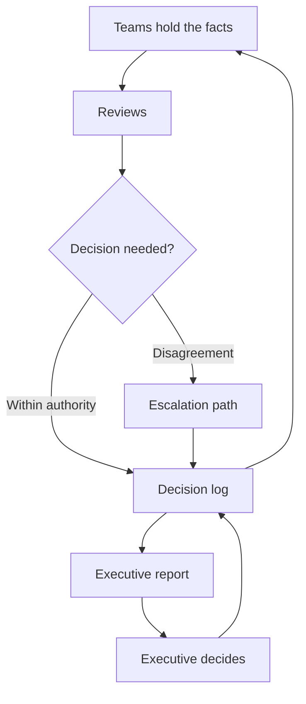
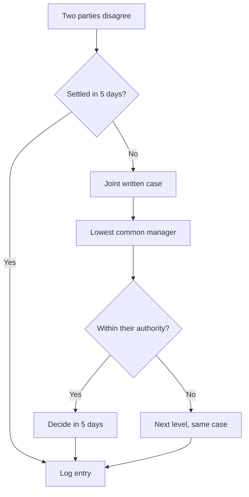
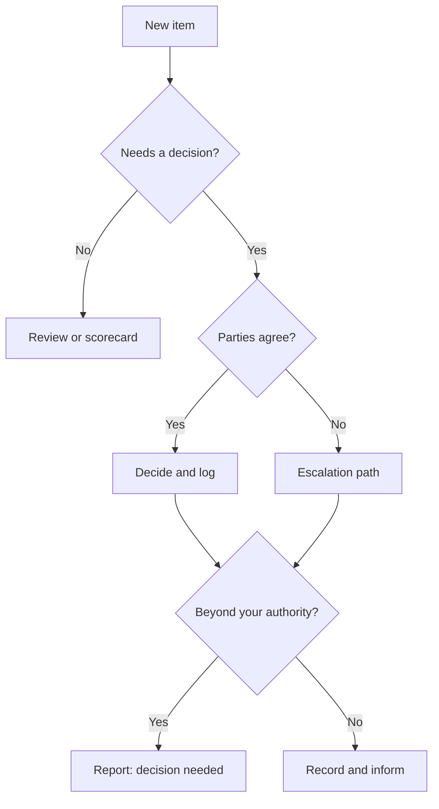

# Chapter 39 — Reviews, Decision Logs, Escalation, and Executive Reporting

This chapter covers four mechanisms that move information and decisions through an engineering
organization: reviews, the decision log, escalation paths, and the report to the executive above you.
They work only as one system, and they fail the same way: when the people who hold the facts expect to
be judged by what they say, the facts arrive late, softened, or not at all. The running example is
Northstar Technologies, the fictional company in the [case study](../../case-studies/northstar/index.md).

!!! info "Related chapters"
    The content of the
    [quality review](../05-engineering-quality/27-quality-transformation-at-enterprise-scale.md#enterprise-application)
    is in Chapter 27,
    [architecture decision records](../06-technical-leadership/28-architecture-decision-making-and-governance.md#architecture-decision-records)
    in Chapter 28,
    [calibration](../02-people-management/08-career-development-promotion-and-compensation.md#calibration-what-it-fixes-and-what-it-breaks)
    in Chapter 8, and
    [decision rights](../03-high-performing-teams/13-decision-making-in-teams.md#decision-rights-made-explicit)
    in Chapter 13. The cadences are in [Chapter 37](37-cadences-and-leadership-meetings.md) and the
    scorecards in [Chapter 38](38-scorecards-quarterly-planning-and-capacity-allocation.md). This
    chapter is about the mechanisms that connect them.

## Why This Matters

At team scale, a manager learns most of what matters by being in the room. Disagreements are settled at
the next standup and status is something the manager can see.

At 50 to 150 engineers, the director is in almost none of the rooms. What the director knows arrives
through reviews and reports written by the people whose work is being reported on. Decisions are made
in six teams, three staff engineers' queues, and the director's own meetings, and within a quarter
nobody remembers who decided what. Disagreements between teams have no natural owner, so they die
unresolved or travel upward through whoever has the executive's ear.

Northstar at the director's arrival shows each failure. Architecture was decided in chat threads,
during incidents, or by Victor Lindqvist (CTO) in unrecorded conversations. After INC-417, a Sev1 in
which payments were posted to the wrong accounting period after a release, a two-day thread between
Billing and Orders got no manager response. Victor's handover notes say he had "let the two of them
sort it out" ([baseline data](../../case-studies/northstar/baseline-data.md)).

At executive scale, a CTO who learns of a slipping commitment from the customer has lost weeks of
options and will discount the next green report.

## Learning Objectives

After this chapter you will be able to:

- Run quality, architecture, and talent reviews as inspections of the system, and recognize when a
  review has become a trial of the presenter.
- Explain the research on why bad news travels slowly upward, and design reporting that does not
  depend on individual courage.
- Keep an organization-level decision log with deciders, "needed by" dates, and review triggers.
- Define escalation paths that move a disagreement to the lowest common decider, with a written joint
  case and a clock.
- Write an executive report that states status, risk, and the decision needed, in that order.

## The Mental Model

> **Mental model:** Reviews, the decision log, escalation, and the executive report are one
> information system. Reviews bring facts up, the log keeps decisions findable, escalation moves
> disagreements to a decider on a clock, and the report turns all three into risks and requests. Every
> part inspects the system, never the presenter, because the moment it judges the messenger, the
> information degrades.

The loop matters more than any node. A review without a decision is a presentation, a log nobody
reads is an archive, and an escalation that ends in conversation will be fought again. Every arrow
starts with someone choosing what to say, so the system works only if saying the true thing early is
cheaper for them than saying it late.

## Deep Conceptual Explanation

### Inspection of the system, not of the people

A review should inspect the machinery, not the person presenting. Andrew Grove holds that a
manager's output is the output of the organization they lead
([Grove, 1983](../../references/bibliography.md#grove1983high)). A review inspects that output and
the machinery producing it; the presenter is the best-informed witness, not the defendant. System
questions ask what changed, what the data predicts, and what would reverse the trend. People
questions ask whose fault it was; they feel rigorous and produce defensive preparation.

| Review | System question | Inputs | Output | Content owner |
|---|---|---|---|---|
| Quality | Is failure inflow falling, and what did prevention buy? | Scorecard, incidents, actions | Allocation changes, action owners | Chapter 27 |
| Architecture | Are cross-team decisions made, by the right people, and kept? | Open records, fitness checks | Deciders named, records reopened | Chapter 28 |
| Talent | Do conditions for growth and continuity exist? | Career conversations, knowledge concentration, succession | Actions by team | Chapters 8, 36 |

The last column names the chapter that treats each review's content.

**A talent review** inspects whether the organization grows and keeps people, not who is good. It is
the hardest review to keep systemic. Inputs, sent two working days ahead: career conversations held per
team, components only one person can change, roles with no successor, promotion and "not yet"
outcomes, and [regretted attrition](../../glossary.md#attrition-and-regretted-attrition) (leavers the
organization wanted to keep). It asks three questions. Where did growth conversations not happen, and
why? Where would one departure stop a [tier 1](../../glossary.md#tier-1) component (one whose failure
stops orders or payments)? Which roles have no ready successor within a year? Its outputs are actions by
team, each with an owner and date: pairing on a single-owner component, a rotation, a stretch
assignment, a ladder fix. It must never produce a ranking of individuals, a "flight risk" list shared
beyond the managers concerned, or ratings that bypass calibration (Chapter 8).

**An architecture review** inspects whether cross-team technical decisions get made, by the right
people, and stay made. It may decide three things: who decides an open record, whether a record is
ready for its decider (options, consequences, a way to check the outcome), and whether a decision
reopens because its review trigger fired. Designs that belong to one team go back with questions, not
verdicts. Measure it by the age of open cross-team records, decisions reopened outside the review, and
proposals returned without a stated reason
([Chapter 28](../06-technical-leadership/28-architecture-decision-making-and-governance.md)).

Three rules keep any review an inspection (**this book's recommendation**). Send the data before the
meeting. Let the presenter name the problems first, and treat a self-reported problem as the review
working. End every item with a decision, an owner, and a date, or an explicit "no action".

### Why bad news travels slowly

Evidence of project failure often exists in the lower ranks but does not travel up, or is distorted
on the way. The field calls this reluctance to pass on bad news the **mum effect**. Models and
laboratory experiments find it is stronger when the news is worse and when the reporter might be
blamed ([Smith and Keil, 2003](../../references/bibliography.md#smith2003reluctance);
[Smith, Keil, and Depledge, 2001](../../references/bibliography.md#smith2001keeping);
[Park, Im, and Keil, 2008](../../references/bibliography.md#park2008mum)). These are **research
findings**, as the abstracts report them, from models and experiments rather than field outcomes.

Status reports are often biased. Summarizing about fourteen of their studies, Keil and colleagues
report that experienced software project managers recalled biased status reports 60 percent of the
time ([Keil et al., 2014](../../references/bibliography.md#keil2014pitfalls)). Aggressive auditing can
backfire into more misreporting, and a powerful executive sponsor can make a team less candid. Their
advice: corroborate with several people close to the work. DORA's guide to generative culture adds survey-based **industry research** in which
the treatment of messengers distinguishes cultures that pass information well
([DORA, generative culture](../../references/bibliography.md#dora-cap-generative-culture)); Chapter 11
covers [silence](../03-high-performing-teams/11-high-performance-trust-safety-and-accountability.md#comfort-liking-and-silence)
inside a team.

Three consequences follow (**this book's recommendation**). Report evidence, not assertions, so that
status is a forecast against a commitment rather than a mood. Make lateness more expensive than bad
news by asking "when did you first know?" about every surprise. And corroborate through structure
(data the teams do not produce, [skip-levels](../../glossary.md#skip-level), staff engineers' views), not
through audits of the reporters.
[Chapter 40](../09-engineering-directorship/40-the-directors-job.md#building-your-own-signal-sources)
covers building those signal sources.

### The decision log

[Architecture decision records](../../glossary.md#architecture-decision-record-adr) (ADRs) preserve rationale so that successors neither accept nor reverse old
decisions blindly ([Nygard, 2011](../../references/bibliography.md#nygard2011adr)). An organization also
makes decisions that belong to no repository: component ownership, capacity splits, severity
definitions, what happens to a role, which exemption expires when. Chapter 13 recommends one shared
[decision log](../../glossary.md#decision-log) for them; this section is about running it.

| Field | The question it answers |
|---|---|
| Id, date, title | What was decided, and when? |
| Decider and method | Who decided, and who was consulted? |
| Options | What else was on the table? |
| Status | Proposed, decided, superseded, expired, open |
| Needed by | After what date does not deciding cost something? |
| Review trigger | What event or date reopens it? |

Peter Drucker insists that a decision is unfinished until action and follow-up are built into it
([Drucker, 1967](../../references/bibliography.md#drucker1967effective)); the log makes that checkable.
"Needed by" is the most neglected field and the most useful, because it makes avoidance visible. An
open decision past its date has a cost somebody is paying. Two rules keep the log alive: every
escalation ends as an entry, and open entries past their date are reviewed weekly, with those the
director cannot close listed in the executive report.

### Escalation paths

Escalation, in this book, always means moving a decision to someone with authority over the parties
who disagree (paging a more experienced incident responder is a different mechanism, in Chapter 25).
The route is the [escalation path](../../glossary.md#escalation-path). A clean
escalation (**this book's recommendation**) is **joint**: both parties write one short case with the
options, each side's recommendation, and the cost of delay, so that reaching the boss first wins
nothing. It goes to the **lowest common level** with authority over both parties and the consequences.
It runs on a **clock**. And it **ends in the log**.

The clock is the point. Jeff Bezos argues for escalating fundamental misalignment early, before the
side with more stamina wins ([Bezos, 2017](../../references/bibliography.md#bezos2016letter);
**documented practice** from one company).

Escalation also moves authority without moving information. Aghion and Tirole's model separates formal
authority, the right to decide, from real authority, which goes with the relevant information
([Aghion and Tirole, 1997](../../references/bibliography.md#aghion1997formal)). The joint case carries
the information up with the question. Its two common corruptions are the
**backchannel decision** (an executive answers in passing, one party treats it as settled) and
**escalation as threat** ("I'll take this to Victor"). One rule fixes both: a decision exists only when
it is in the log.

### A joint escalation write-up

The joint case is one page that both parties sign before it goes up. Its format (**this book's
recommendation**):

| Field | What goes in it |
|---|---|
| Question | The decision needed, in one sentence ending in a question mark |
| Agreed facts | What both sides accept as true, with sources |
| Option A, and the case for it | Written by the side that prefers it |
| Option B, and the case for it | Written by the other side |
| Cost of each option to the other team | In engineer-weeks, dates, or risk, each side's own estimate |
| Cost of delay and "needed by" | What not deciding costs, and from which date |
| Consulted | Who else is affected and what they said |
| After the decision | What both parties will do, whichever option wins |

Each side writes its own option, so neither can frame the other's badly. A dispute about facts goes
back down to be settled, not up. The last row commits both sides before the decider chooses.

### The executive report

An executive report lets a busy person see the state of commitments, the risks to them, and what you
need from them, in a few minutes. Put the main point first
([Minto, 2002](../../references/bibliography.md#minto2002pyramid)), write prose that exposes reasoning
([Bezos, 2018](../../references/bibliography.md#bezos2017letter)), and solve the company's problem
rather than advocate for engineering
([Larson, 2023](../../references/bibliography.md#larson2023balancing)); a report that reads as
advocacy is discounted.

The structure this book recommends:

1. a **headline** of one or two sentences;
2. **commitments**, each with status and change since last time;
3. the few **measures** the executive tracks (Chapter 38), with an honest reading;
4. **risks**, each with owner and the trigger at which it becomes a request;
5. **decisions needed**, with options, recommendation, date, and the cost of deciding late;
6. what was **decided since last report**.

Status colors need definitions, or they report the author's mood. The definitions below use
[percentile forecasts](../../glossary.md#percentile-forecast-and-monte-carlo-simulation): the 85
percent forecast is the date by which, on past throughput, the work finishes with 85 percent
probability.

| Color | Definition for a dated commitment |
|---|---|
| Green | The 85 percent forecast meets the date with the agreed scope |
| Amber | The 50 percent forecast meets it; the 85 percent does not |
| Red | The 50 percent forecast misses it, or an outside dependency is unresolved |

The thresholds are a choice; what matters is computing them the same way every time (Chapter 17
covers the forecasts).

### When you are pressed to make the numbers look better

A report is worth reading only if it is never shaded, so treat a request to "show it differently" as
a request about honesty until you know otherwise. The pressure rarely arrives as "lie". It arrives as
"can we leave out the maintenance window" or "it's amber, not red, surely" before a board meeting.

The line (**this book's recommendation**) runs between framing and misleading. Framing is legitimate:
adding context, choosing which measures lead, explaining a cause. Misleading is not: changing a
definition without saying so, picking the time window that flatters, dropping a known red, or
reporting a forecast you do not believe. The test is whether the reader, learning everything you
know, would feel the report was fair.

When asked to cross it:

1. Show both versions side by side, with the definitions stated. Most requests dissolve here, because
   the requester wanted a better story, not a false one.
2. If a definition really should change, change it openly, footnote it, and restate the past periods
   on the new basis.
3. If you are asked to send something you believe is false, say so in writing and decline. Numbers
   that reach customers, the board, or auditors can carry contractual or legal consequences, so
   involve finance or legal rather than settling it between two people.

The cost is an awkward conversation with your manager. The alternative costs more: once one shaded
report is found, every later report is discounted.

## Engineering Organization Example

!!! info "Northstar so far"
    Quarter 2 of the director's first year (weeks 14 to 26). A first quarter of ownership, severity,
    and release changes cut [Sev1 and Sev2](../../glossary.md#severity-sev1-sev2-sev3) incidents (the
    two most serious levels) from 30 to 21. One
    [renewal commitment](../../glossary.md#renewal-commitments) (the accounting integration) is due in
    week 19, the other (bulk ordering) in week 26. See the
    [timeline](../../case-studies/northstar/timeline.md). New to Northstar? Read
    [the year in brief](../../case-studies/northstar/year-in-brief.md) and the
    [cast](../../case-studies/northstar/cast.md).

This example is **illustrative**. Northstar's whole review system takes under 1 percent of
engineering time, so meeting time is not the cost to watch. Distorted information and undated
decisions are.

**Corroboration through structure.** In week 7 the record showed four consecutive incidents rated
Sev3, below the level the weekly operational review discussed. One of them was a two-hour payment delay for nine
customers. The director read the incident itself rather than the count, re-rated it, and added a
weekly audit of a sample of severity ratings to the operational review. The reports had been green
on their own terms. The audit makes the second look routine, so it carries no suspicion of any one
team.

**The cost of a decision with no date.** In week 14 Li Na Zhou (staff engineer, data and integration)
opened ADR-0001: how integrations should read posted ledger data. The accounting integration, due in
week 19, needed an answer. Billing had reserved two engineers for weeks 14 to 16 to build the ledger
export, and the option Li Na recommended, a versioned export contract (option B), needs 5 of those 6
engineer-weeks.

| When the decision is made | Reserved engineer-weeks left | Does option B fit? |
|---|---|---|
| Middle of week 14 | 6 | Yes, with 1 to spare |
| Start of week 15 | 4 | No: one engineer-week must come from Billing's other work |
| Start of week 16 | 2 | No: three engineer-weeks must be borrowed |
| After week 16 | 0 | Only on borrowed capacity, competing with week 19 |

The decision's "needed by" was the middle of week 14, almost the day ADR-0001 was opened. Writing
that date in the log would have chosen no option, but it would have shown the cost of not choosing
from day one.

## Decision Framework

The first decision is where an item belongs. Disputes raised in reviews and decisions taken in reports
are common misroutings.

The second is how heavy each mechanism should be. Log only cross-team, hard-to-reverse, and escalated
decisions:

| Situation | Reviews | Decision log | Escalation | Executive report |
|---|---|---|---|---|
| Stable, trusted data | Monthly, short | Decisions only | Rare; clock still written | Monthly, one page |
| Transformation under way | Weekly operational, monthly by team | Decisions and open list | Defined path, joint cases | Monthly, two pages, risks first |
| Crisis (contract at risk) | Daily operational | Open list daily | One level for the duration | Weekly, plus a same-day trigger |
| Low-trust history | Data first; presenter names problems | Everything cross-team | Joint cases mandatory | Corroborated by system data |

Northstar in quarter 2 is the second row, with the fourth row's joint-case rule for Billing and
Orders.

## Trade-offs

**Written against spoken.** Writing forces clear reasoning and leaves a record, but costs hours; a
fixed two-page structure is the usual compromise.

**Candor against comparability.** Standard formats let the director compare teams; comparison invites
ranking, and ranking invites optimizing the report. Compare a team against its own trend, and teams
against each other only on measures computed from systems.

**Escalation speed against ownership.** A short clock unblocks work and can teach managers to escalate
instead of negotiate; a long one teaches endurance. Start at five working days per level and watch the
count per manager pair: a rising count is a design problem between those teams.

## Failure Modes

**The review as trial.** Data arrives polished; nobody reports a problem the director does not already
know. Signal: no self-reported issues for two months. Countermeasure: data first, presenter's problems
first, and a question about the system as the first response to bad news.

**The watermelon report.** Practitioners' name for reports green outside and red inside. Signal: items
jump from green to red with no amber. Countermeasure: computed colors, and "when did we first know?"
for every red.

**The corridor decision.** An executive answers in passing and one party acts on it. Signal: teams cite
"Victor said" for decisions nobody can find. Countermeasure: decisions exist only in the log; ask the
executive, privately, to send such questions back through the path.

**The archive.** The log grows and nobody reads it. Signal: entries without "needed by" dates; expired
exemptions nobody noticed. Countermeasure: the open list in the weekly leadership team meeting.

**Escalation by stamina.** Disputes last until one side gives up. Signal: long threads, the same pair
of managers in every dispute. Countermeasure: the clock and joint cases.

**The director as router.** Every disagreement comes up; the director becomes the queue Chapter 13
calls escalation by default. Countermeasure: named deciders for decision classes.

**The report that asks for nothing.** The executive learns to skim it, and skims the month it matters.
Countermeasure: a "decisions needed" section that may say "none", and rarely does.

## Enterprise Application

In an organization of 50 to 150 engineers, the director designs these mechanisms and owns the report,
the log, the escalation rules, and review agendas. Managers own the content they present. Staff engineers prepare
any architecture review and own records in their domains (Chapter 29). A rotating log steward checks
that every entry has a decider and a date.

An **escalation map** lists recurring dispute types with their deciders:

| Dispute type | First decider | Then | Clock |
|---|---|---|---|
| Interface change between two teams | The two managers, with the domain's staff engineer | Director | 5 + 5 working days |
| Component ownership | Director | CTO, only if a customer commitment moves | 5 working days |
| Standards exemption | Domain owner (staff engineer) | Director | 10 working days (Chapter 20) |
| Capacity against a customer commitment | Director with the product lead | CTO and CPO together | 5 working days |

The log, cases, and reports live in one searchable place; Chapter 13's test applies (a new manager can
find in ten minutes why their team owns what it owns). **Transition cost:** expect more escalations at
first, as disputes that used to die silently surface.

## CTO Perspective

At CTO level the four mechanisms reappear one level up.

**Reader and writer.** The CTO reads directors' reports and writes to the CEO and board. Passing
directors' reports upward unedited abdicates. The board needs a few exposures (availability against
contract, credits, revenue at risk, delivery against commitments, one people measure). Larson's
executive primer is a practitioner guide to this layer
([Larson, 2024](../../references/bibliography.md#larson2024primer)).

**The price of bad news.** Keil and colleagues report that powerful sponsors reduce candor. The CTO's reaction
to the first red report teaches every director what to send next time.

**The CTO's own decisions.** Victor Lindqvist's unrecorded decisions were part of Northstar's problem.
A CTO who logs their own decisions, including those made in passing, makes the system credible; one
who is exempt makes it optional.

## Practical Playbook

1. **List last quarter's cross-team decisions**, who decided each, and where it is written. The gaps
   are your first log entries.
2. **Start the log** with those and every open decision; give each open one a decider and a "needed by"
   date.
3. **Write the escalation map** for the four or five recurring dispute types; publish it with the joint
   case template and the clock.
4. **Convert reviews to inspections**: data out two working days before, the presenter's problem list
   first, every item ending in a decision, an owner, or "no action".
5. **Agree the report contract with your executive**: content, frequency, color definitions, and the
   trigger for same-day notice.
6. **Review the open list weekly**; anything past its date is decided or goes into the next report.
7. **Ask "when did we first know?"** after every surprise, and credit early warnings publicly.
8. **After a quarter, review the system**: escalations by pair, decisions open past date, reds that
   skipped amber. Adjust the design, not the people.

## Case Study

This case is **fictional**, set in quarter 2 (weeks 14 to 26); the full story is in
[the year 1 record](../../case-studies/northstar/first-quarter.md).

**How disputes moved before.** Most Billing–Orders disputes went nowhere: the thread after INC-417
got no manager response, and the review of INC-427 (credit notes applied twice after a release) opened
with blame of an Orders change. Other disputes reached Victor and were decided in conversation,
unrecorded. In week 14 he told
Elena Sokolova (Payments and Integrations manager) in passing to "read the tables now and clean it up
later" while ADR-0001 was open.

**The decision log.** In week 14 the director opened an organization decision log and backfilled it
from quarter 1. The lesson is in the last column: four of ten entries are open, three without a named
decider. Before week 14 they were open and invisible.

| Id | Week | Decision | Decider | Status at week 26 |
|---|---|---|---|---|
| DL-01 | 3 | Severity definitions | Director | In force |
| DL-02 | 4 | Capacity model: 12 [FTE](../../glossary.md#fte) of prevention | CTO and CPO | In force to week 26 |
| DL-03 | 4 | Owners for four unowned components | Director | In force |
| DL-04 | 5 | [Tier 1 minimums](../../glossary.md#tier-1-operational-minimums); one shared module exempt until owned | Director | Open: that module's owner |
| DL-05 | 9 | Rule: no ledger schema change and dependent code in one release | Director | Replaced week 11 by an automatic pipeline check |
| DL-06 | 10 | QA engineers move into product teams | Director | In force |
| DL-07 | 10 | Rehearse migrations of tier 1 data | Director | In force |
| DL-08 | 14 | ADR-0001: how integrations read ledger data | Not named | Open |
| DL-09 | Q2 | Build, buy, or hybrid for the tax service | Not named | Open |
| DL-10 | Q2 | Which CI system to standardize on | Not named | Open |

The shared module in DL-04 is core/permissions. The tax service (tax-svc) calculates sales tax from a
rate table one Billing engineer updates by hand.

**The escalation path**, published in week 15: five working days for the parties, then a
joint written case to the director, decided within five working days and logged. The director takes a
case to Victor only if it moves a customer commitment or exceeds the director's budget authority. The
director also asked Victor to send questions that reach him directly back through the path; whether he
does is left open for the exercises.

**The week 26 report.** In week 26 the director sent the first written report since the day-90
report, proposed as a monthly two-page report from quarter 3. Kwame Mensah (staff engineer,
reliability) owns the first risk.

> **Engineering report to Victor Lindqvist, end of quarter 2 (week 26)**
>
> **Headline.** Both renewal commitments are on track to close this quarter: the accounting
> integration has been live since week 19 and bulk ordering is in final customer acceptance. Incidents
> are down again, availability is still below contract, and the Core release improvement has stalled.
> I need two decisions from you before week 27.
>
> | Commitment | Due | Status |
> |---|---|---|
> | Accounting integration (Payments and Integrations) | Week 19 | Delivered; daily reconciliation running |
> | Bulk ordering (Orders) | Week 26 | Green: 44 contractual items complete; in final customer acceptance |
>
> | Measure | Q1 | Q2 | Reading |
> |---|---|---|---|
> | Sev1 and Sev2 incidents | 21 | 17 (3 Sev1) | Down; small counts, direction only |
> | Customer-detected share | 29% | 29% (5 of 17) | Flat |
> | Core change failure rate | 22% | 23% (3 of 13 releases) | Flat |
> | Unplanned work | 31% | 28% | Down, as projected |
> | Tier 1 at four operational minimums | 8 of 15 | 11 of 15 | Up |
> | Corrective-action closure | 70% | 78% (21 of 27) | Up |
> | Availability, order and payment paths | — | 99.86% | Below 99.9%; credits $95,000 |
>
> **Risks.** (1) Core change failure rate is flat. Owner: Kwame Mensah. The cheap gains are taken; the
> next need contract tests at the remaining tier 1 boundaries. I will ask you for capacity if it has not
> moved by week 32. (2) Ledger knowledge is concentrated in three Billing engineers. Owner: Marcus
> Oyelaran (Billing manager). (3) Four log decisions are open, three without a named decider, and the core/permissions
> exemption lapses at the end of quarter 3 (week 39).
>
> **Decisions needed.** (1) Sign-off of the quarter 3 plan before week 27; the open point is whether to
> commit the target band. Late sign-off starts week 27 on last quarter's allocation. (2)
> [Error budget](../../glossary.md#error-budget-and-burn-rate) policy: stay in reporting mode (A) or enforce it with you arbitrating (B). I recommend B for order
> submission and payments only; deciding late means another quarter of budgets with no consequence.
>
> **Decided this quarter.** Two Billing–Orders cases went through the escalation path, both decided
> at my level within the clock and logged.

The headline answers the first question; flat measures are shown, not left out; each request carries
options, a recommendation, and the cost of lateness. The report decides nothing that is still open.

**The open choice.** How do DL-08 to DL-10 get named deciders without the director deciding all three,
and what does the director do the next time a team cites "Victor said"?

## Exercises

Solutions are in [chapter 39 solutions](../../solutions/ch39-solutions.md). Northstar data is on the
[baseline page](../../case-studies/northstar/baseline-data.md) and in
[the year 1 record](../../case-studies/northstar/first-quarter.md).

### Foundational

**F1.** Route each of these Northstar items to a review, the decision log, the escalation path, or the
executive report, and say why: a third consecutive month in which customer-detected share is flat;
Tom Becker (Platform Operations manager) and Marcus Oyelaran disagreeing on who maintains the test
environments that hold ledger data (at baseline, 4 of Billing's 7 requests to Platform Operations
were for such environments); the auth-svc pipeline exemption reaching its end-of-quarter-2 expiry; a renewal customer asking
for a new feature by week 30.

**F2.** A manager's monthly status reads: "All green. Bulk ordering progressing well, team morale high,
minor risk around scope, being managed." Using this chapter's color definitions and report structure,
list what is missing, write the questions you would send back, and rewrite the entry, marking every
fact you invent as an assumption.

**F3.** Write the decision log entry for the core/permissions ownership decision as it stands at the
start of quarter 3, using this chapter's fields. The facts: in the baseline quarter Orders made 17 of
the module's 38 changes and Platform Operations none. Priya Raman (Orders manager) would accept it
after week 26. Tom Becker sees it next to auth-svc, which his team owns, but his team cannot support
Core Java. Exemptions last at most two quarters. Fill in only what these facts and the case support,
and for each empty field say what the director must do to fill it.

### Applied Leadership

**A1.** Priya Raman and Marcus Oyelaran disagree about who changes the order-to-invoice mapping when
Orders adds a field. Given their history (the INC-417 thread, the INC-427 review), design how this
dispute moves under the week 15 escalation path, fill in the chapter's joint escalation write-up as
far as the facts allow, and say what you do if one of them escalates alone.

**A2.** Ines Carvalho (staff engineer, Core domain) proposes to restart and chair a monthly
architecture review, lapsed since 2021. In weeks 7 to 12 she rejected 8 of 14 Core design proposals,
5 without a reason. Design the review so that it inspects decisions
rather than designers: who attends, what is sent beforehand, what the meeting may decide, and how you
will know in two months whether it works.

**A3.** In week 22, Elena Sokolova tells you that Victor Lindqvist told her in the corridor to "just use
the replicas" for a new reporting feed. ADR-0001 is still open in the log. Plan the next two days: what
you do with Elena, with Victor, and with the log.

### Executive Decision-Making

**X1.** You are Victor Lindqvist. Helena Marsh (CEO) wants the CEO's monthly
[board pack](../../glossary.md#board-pack) to show engineering
figures beyond committed items delivered and the Sev1 and Sev2 count. Using the director's week 26
report, choose at most five figures for the board, say what you leave out and why, and say how you will
stop the board pack from reshaping the directors' reports.

**X2.** You are a CTO with three directors. One director's reports were green for four months; then a
customer commitment slipped six weeks and you heard it from Sales. You are tempted to require weekly
audited status from all three. Decide what you will change, using the research on status reporting,
and explain what the audit option would cost.

**X3.** Two days before a renewal meeting, your CTO asks you to report quarterly availability
"excluding the planned maintenance window", which lifts it from just under the contractual 99.9
percent to just over. The contract does not exclude planned maintenance. Decide what you send, what you
say to the CTO, and what you do if the CTO insists.

## Reflection Questions

1. Which decision in your organization would you struggle to find the decider of? What does that say
   about who really holds the authority?
2. When did you last report bad news upward early? What did it cost you?
3. If your manager read only the first two sentences of your last report, what would they believe?
   Would it be true?
4. Which of your reviews do people prepare for defensively, and what in the meeting rewards that?
5. How many disputes last quarter were settled by stamina rather than by a decider?
6. Which of your own decisions would you rather not see in a log, and why?

## Key Takeaways

- Design reviews, the decision log, escalation, and the executive report together, as one information
  system.
- Inspect the system, not the presenter: data before the meeting, the presenter's problems first.
- Assume upward reports are optimistic; the mum-effect research says bad news is withheld and
  distorted. Design for it rather than relying on courage.
- Define status colors by forecasts against commitments, and ask "when did we first know?" about every
  surprise.
- Log organization-level decisions with a decider, a "needed by" date, and a review trigger.
- Escalate jointly, in writing, to the lowest common decider, on a clock, and end in the log.
- A decision made in passing, including the executive's, is not a decision until it is logged.
- Lead the executive report with the answer, then commitments, measures, risks, and decisions needed
  with options and the cost of deciding late.

## References and Further Reading

- [Grove, 1983](../../references/bibliography.md#grove1983high). Managerial output as organizational
  output.
- [Drucker, 1967](../../references/bibliography.md#drucker1967effective). Decisions that include
  action and follow-up.
- [Smith and Keil, 2003](../../references/bibliography.md#smith2003reluctance),
  [Smith, Keil, and Depledge, 2001](../../references/bibliography.md#smith2001keeping), and
  [Park, Im, and Keil, 2008](../../references/bibliography.md#park2008mum). Model and experiments on
  reluctance to report bad news.
- [Keil et al., 2014](../../references/bibliography.md#keil2014pitfalls). The most usable single read
  on status reporting.
- [DORA, generative culture](../../references/bibliography.md#dora-cap-generative-culture). Culture
  and messengers.
- [Nygard, 2011](../../references/bibliography.md#nygard2011adr). The original decision record format.
- [Aghion and Tirole, 1997](../../references/bibliography.md#aghion1997formal). Formal and real
  authority; why escalation must carry information.
- [Bezos, 2017](../../references/bibliography.md#bezos2016letter) and
  [Bezos, 2018](../../references/bibliography.md#bezos2017letter). Early escalation, and narrative memos
  in place of slides, as one company's practice.
- [Minto, 2002](../../references/bibliography.md#minto2002pyramid). Leading with the main point.
- [Larson, 2023](../../references/bibliography.md#larson2023balancing) and
  [Larson, 2024](../../references/bibliography.md#larson2024primer). The engineering executive between
  the CEO, peers, and the organization.
