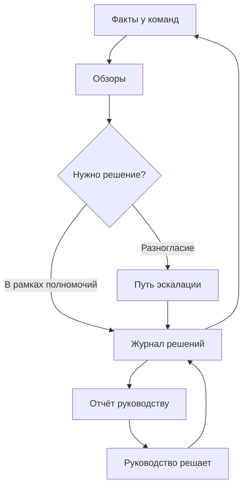
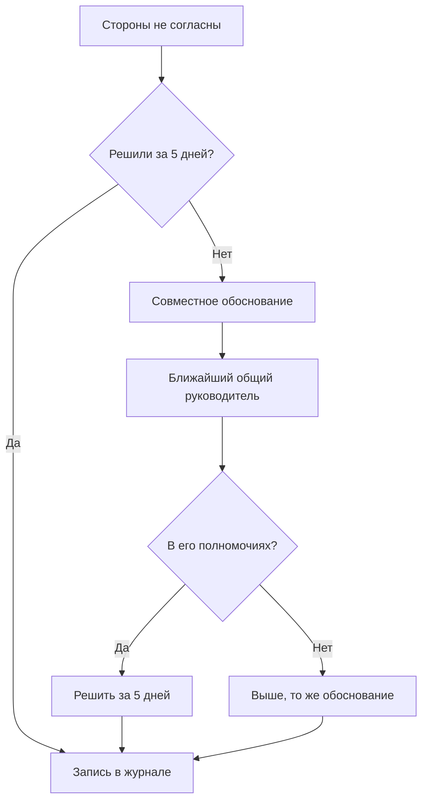
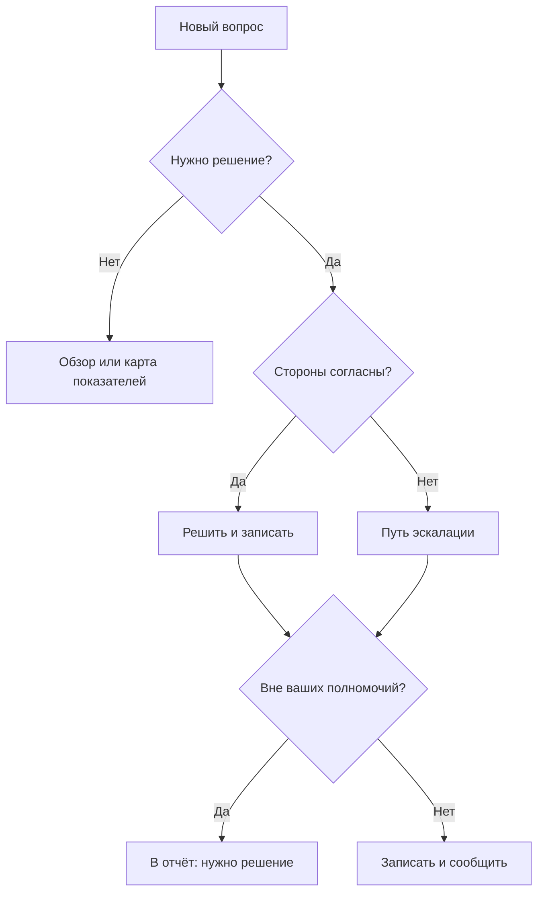

# Глава 39 — Обзоры, журналы решений, эскалация и отчётность перед руководством { #chapter-39-reviews-decision-logs-escalation-and-executive-reporting }

Эта глава о четырёх механизмах, по которым информация и решения движутся через инженерную организацию:
обзорах, журнале решений, путях эскалации и отчёте для руководителя, которому вы подчиняетесь. Работают
они только как единая система и ломаются одинаково. Если те, у кого есть факты, ожидают, что за сказанное
их будут судить, факты приходят поздно, в смягчённом виде или не приходят вовсе. Сквозной пример — Northstar
Technologies, вымышленная компания из [кейса](../../case-studies/northstar/index.md).

!!! info "Связанные главы"
    Содержание
    [обзора качества](../05-engineering-quality/27-quality-transformation-at-enterprise-scale.md#enterprise-application)
    разобрано в главе 27,
    [записи архитектурных решений](../06-technical-leadership/28-architecture-decision-making-and-governance.md#architecture-decision-records)
    — в главе 28,
    [калибровка](../02-people-management/08-career-development-promotion-and-compensation.md#calibration-what-it-fixes-and-what-it-breaks)
    — в главе 8,
    [права на решения](../03-high-performing-teams/13-decision-making-in-teams.md#decision-rights-made-explicit)
    — в главе 13. Ритмы описаны в [главе 37](37-cadences-and-leadership-meetings.md), карты показателей —
    в [главе 38](38-scorecards-quarterly-planning-and-capacity-allocation.md). Эта глава — о механизмах,
    которые их связывают.

## Почему это важно { #why-this-matters }

В команде руководитель узнаёт почти всё важное, просто находясь рядом. Разногласия улаживаются на
следующем стендапе, а статус работы видно своими глазами.

В организации из 50–150 инженеров директор почти нигде не бывает лично. Всё, что он знает, он узнаёт из
обзоров и отчётов, а пишут их те самые люди, о чьей работе идёт речь. Решения принимаются в шести
командах, в очередях трёх staff-инженеров и на встречах самого директора, и через квартал никто уже не
помнит, кто что решил. У разногласий между командами нет естественного владельца. Поэтому они либо глохнут
нерешёнными, либо доходят наверх через того, к кому руководство охотнее прислушивается.

К приходу директора в Northstar налицо все эти провалы. Архитектурные решения принимались в
ветках чата, во время инцидентов или самим Victor Lindqvist (CTO, технический директор) в разговорах,
которые никто не записывал. После INC-417 (Sev1: после релиза платежи разнесли не в тот учётный период)
двухдневная переписка между Billing и Orders так и не дождалась ответа ни от одного руководителя. В
заметках Victor при передаче дел сказано, что он «оставил их двоих разбираться самим»
([исходные данные](../../case-studies/northstar/baseline-data.md)).

На уровне высшего руководства CTO, узнавший о срыве обязательства от клиента, уже потерял недели,
когда у него ещё были варианты, и следующему зелёному отчёту поверит меньше.

## Цели главы { #learning-objectives }

Прочитав эту главу, вы сможете:

- Проводить обзоры качества, архитектуры и талантов как проверку системы и замечать, когда обзор
  превратился в суд над докладчиком.
- Объяснять, что говорят исследования о том, почему плохие новости медленно идут наверх, и строить
  отчётность, которая не зависит от личной смелости.
- Вести журнал решений на уровне организации, где у каждого решения есть решающий, дата «нужно к» и
  условие пересмотра.
- Задавать пути эскалации: разногласие уходит к ближайшему общему решающему с совместным письменным
  обоснованием и сроком.
- Писать отчёт для руководства, в котором по порядку изложены статус, риски и нужные решения.

## Ментальная модель { #the-mental-model }

> **Ментальная модель:** обзоры, журнал решений, эскалация и отчёт для руководства — одна
> информационная система. Обзоры поднимают факты наверх, журнал позволяет найти принятые решения,
> эскалация в ограниченный срок доводит разногласие до решающего, а отчёт превращает всё это в риски и
> запросы. Каждая часть проверяет систему, а не докладчика: как только начинают судить гонца, информация
> портится.

Петля важнее любого узла. Обзор без решения — это презентация, журнал, который никто не читает, — архив,
а эскалация, закончившаяся разговором, повторится. Каждая стрелка начинается с того, что кто-то решает,
что сказать. Поэтому система работает, только если человеку дешевле сказать правду рано, чем поздно.

## Подробный разбор { #deep-conceptual-explanation }

### Проверка системы, а не людей { #inspection-of-the-system-not-of-the-people }

Обзор должен проверять механизм, а не того, кто докладывает. Andrew Grove считает, что результат
руководителя — это результат организации, которой он руководит
([Grove, 1983](../../references/bibliography.md#grove1983high)). Обзор проверяет этот результат и
механизм, который его создаёт. Докладчик здесь — самый осведомлённый свидетель, а не подсудимый.
Вопросы о системе выясняют, что изменилось, что предсказывают данные и что могло бы развернуть тренд.
Вопросы о людях выясняют, кто виноват. Такие вопросы кажутся строгими, но приучают людей готовиться к
обороне.

| Обзор | Вопрос о системе | Входные данные | Результат | Где разобрано содержание |
|---|---|---|---|---|
| Качество | Сокращается ли приток сбоев и что дала профилактика? | Карта показателей, инциденты, действия | Изменения в распределении ресурсов, владельцы действий | Глава 27 |
| Архитектура | Принимаются ли межкомандные решения, теми ли людьми, соблюдаются ли они? | Открытые записи, проверки фитнес-функций | Названные решающие, повторно открытые записи | Глава 28 |
| Таланты | Есть ли условия для роста и преемственности? | Разговоры о карьере, концентрация знаний, преемники | Действия по командам | Главы 8, 36 |

В последнем столбце указана глава, где разобрано содержание каждого обзора.

**Обзор талантов** проверяет, умеет ли организация растить и удерживать людей, а не выясняет, кто хорош.
Именно этому обзору труднее всего оставаться проверкой системы. Входные данные рассылают за два рабочих
дня: сколько разговоров о
карьере провели в каждой команде, какие компоненты может менять только один человек, у каких ролей нет
преемника, итоги повышений и решений «пока нет», а также
[нежелательная текучесть](../../glossary.md#attrition-and-regretted-attrition) (ушли люди, которых
организация хотела удержать). Обзор задаёт три вопроса. Где разговоров о росте не было и почему? Где
уход одного человека остановит компонент [tier 1](../../glossary.md#tier-1), то есть такой, при сбое
которого встают заказы или платежи? У каких ролей нет преемника, готового в течение года? Результат —
действия по командам, у каждого действия есть владелец и срок: парная работа над компонентом с
единственным владельцем, ротация, задача на вырост, исправление карьерной лестницы. Чего обзор не должен
выдавать никогда: рейтинг отдельных людей, список «рисков ухода», доступный кому-то кроме причастных
руководителей, и оценки в обход калибровки (глава 8).

**Архитектурный обзор** проверяет, принимаются ли межкомандные технические решения, теми ли людьми и
остаются ли они в силе. Решать он вправе три вопроса: кто решает по открытой записи; готова ли запись для
решающего (есть варианты, последствия и способ проверить результат); не пора ли открыть решение заново,
потому что сработало его условие пересмотра. Проекты одной команды возвращаются к ней с вопросами, а не с
вердиктами. Работу обзора измеряют так: возраст открытых межкомандных записей, число решений,
пересмотренных в обход обзора, и число предложений, возвращённых без объяснения причин
([глава 28](../06-technical-leadership/28-architecture-decision-making-and-governance.md)).

Любой обзор остаётся проверкой системы, если соблюдать три правила (**рекомендация книги**). Рассылайте
данные до встречи. Дайте докладчику первым назвать проблемы и считайте проблему, о которой он сообщил
сам, признаком того, что обзор работает. Завершайте каждый пункт решением, владельцем и сроком или явным
«ничего не делаем».

### Почему плохие новости идут медленно { #why-bad-news-travels-slowly }

Признаки провала проекта часто видны на нижних уровнях, но наверх не доходят или искажаются по дороге.
Нежелание передавать плохие новости исследователи называют **эффектом умолчания (mum effect)**. Модели и
лабораторные эксперименты показывают, что он сильнее, когда новость хуже и когда сообщающего могут
обвинить ([Smith and Keil, 2003](../../references/bibliography.md#smith2003reluctance);
[Smith, Keil, and Depledge, 2001](../../references/bibliography.md#smith2001keeping);
[Park, Im, and Keil, 2008](../../references/bibliography.md#park2008mum)). Это **научные результаты** в
изложении аннотаций, полученные на моделях и в экспериментах, а не на исходах реальных проектов.

Отчёты о статусе часто смещены. Keil с коллегами, обобщая около четырнадцати своих исследований, сообщают,
что опытные руководители программных проектов вспоминали смещённые отчёты о статусе в 60 процентах
случаев ([Keil et al., 2014](../../references/bibliography.md#keil2014pitfalls)). Жёсткие проверки могут
дать обратный эффект и умножить искажения, а влиятельный спонсор из высшего руководства может сделать
команду менее откровенной. Их совет: перепроверяйте сведения у нескольких людей, близких к работе.
Руководство DORA по генеративной культуре добавляет к этому **отраслевое исследование** на основе опросов:
культуры, где информация проходит хорошо, отличаются тем, как в них обращаются с гонцами
([DORA, generative culture](../../references/bibliography.md#dora-cap-generative-culture)). О
[молчании](../03-high-performing-teams/11-high-performance-trust-safety-and-accountability.md#comfort-liking-and-silence)
внутри команды рассказывает глава 11.

Отсюда три следствия (**рекомендация книги**). Сообщайте свидетельства, а не утверждения, чтобы статус
был прогнозом относительно обязательства, а не настроением. Сделайте опоздание дороже плохой новости:
после каждого сюрприза спрашивайте «когда вы впервые узнали?». И перепроверяйте через структуру (данные,
которые производят не сами команды, [встречи через уровень](../../glossary.md#skip-level), мнения
staff-инженеров), а не устраивайте проверки тем, кто отчитывается. Как выстроить такие источники сигналов,
рассказывает [глава 40](../09-engineering-directorship/40-the-directors-job.md#building-your-own-signal-sources).

### Журнал решений { #the-decision-log }

[Записи архитектурных решений](../../glossary.md#architecture-decision-record-adr) (ADR) сохраняют
обоснование, чтобы преемники не соглашались со старыми решениями и не отменяли их вслепую
([Nygard, 2011](../../references/bibliography.md#nygard2011adr)). Но организация принимает и решения,
которые не принадлежат ни одному репозиторию: кто владеет компонентом, как делится ресурс, как определяется
серьёзность, что будет с ролью, когда истекает какое исключение. Для них глава 13 рекомендует единый
[журнал решений](../../glossary.md#decision-log); этот раздел о том, как его вести.

| Поле | На какой вопрос отвечает |
|---|---|
| Id, дата, название | Что решили и когда? |
| Решающий и способ | Кто решал и с кем советовался? |
| Варианты | Что ещё рассматривали? |
| Статус | Предложено, решено, заменено, истекло, открыто |
| Нужно к | После какой даты отсутствие решения начинает чего-то стоить? |
| Условие пересмотра | Какое событие или дата открывает решение заново? |

Peter Drucker настаивает: решение не закончено, пока в него не встроены действия и контроль исполнения
([Drucker, 1967](../../references/bibliography.md#drucker1967effective)). Журнал позволяет это
проверить. Поле «нужно к» заполняют реже всех, хотя оно самое полезное: оно делает уклонение от решения
видимым. Если открытое решение пережило свою дату, кто-то уже платит за это. Живым журнал остаётся при
двух правилах. Каждая эскалация заканчивается записью в журнале. Открытые записи с прошедшей датой
разбирают каждую неделю, а те, что директор закрыть не может, попадают в отчёт для руководства.

### Пути эскалации { #escalation-paths }

В этой книге эскалация всегда означает передачу решения тому, у кого есть полномочия над несогласными
сторонами. (Вызов более опытного специалиста во время инцидента — другой механизм, о нём глава 25.)
Маршрут такой передачи — [путь эскалации](../../glossary.md#escalation-path). Чистая эскалация
(**рекомендация книги**) **совместна**: обе стороны пишут одно короткое обоснование с вариантами,
рекомендацией каждой стороны и стоимостью задержки, так что тот, кто первым добежит до начальника, ничего
не выигрывает. Она идёт на **ближайший общий уровень**, у которого есть полномочия и над обеими сторонами,
и над последствиями. Она ограничена **сроком**. И она **заканчивается в журнале**.

Весь смысл — в сроке. Jeff Bezos призывает эскалировать принципиальные расхождения рано, пока спор не
выиграла самая выносливая сторона ([Bezos, 2017](../../references/bibliography.md#bezos2016letter);
**задокументированная практика** одной компании).

Но эскалация передаёт полномочия, а информацию — нет. Aghion и Tirole в своей модели различают
формальную власть, то есть право решать, и реальную власть, которая принадлежит тому, у кого есть нужная
информация ([Aghion and Tirole, 1997](../../references/bibliography.md#aghion1997formal)). Совместное
обоснование поднимает информацию наверх вместе с вопросом. Портится эскалация обычно двумя способами.
Первый — **решение в обход пути** (руководитель отвечает мимоходом, и одна из сторон считает вопрос
закрытым). Второй — **эскалация как угроза** («я дойду с этим до Victor»). Против обоих помогает одно
правило: решение существует, только если оно записано в журнале.

### Совместная записка для эскалации { #a-joint-escalation-write-up }

Совместное обоснование умещается на одной странице, и обе стороны подписывают его, прежде чем отправить
наверх. Формат (**рекомендация книги**):

| Поле | Что в нём пишут |
|---|---|
| Вопрос | Нужное решение одним предложением, которое заканчивается вопросительным знаком |
| Согласованные факты | Что обе стороны признают верным, с источниками |
| Вариант A и доводы за него | Пишет сторона, которая его предпочитает |
| Вариант B и доводы за него | Пишет другая сторона |
| Цена каждого варианта для другой команды | В инженеро-неделях, датах или рисках, по оценке каждой стороны |
| Стоимость задержки и «нужно к» | Во что обходится отсутствие решения и с какой даты |
| С кем советовались | Кого ещё это затрагивает и что они сказали |
| После решения | Что сделают обе стороны, какой бы вариант ни победил |

Каждая сторона пишет свой вариант сама, поэтому ни одна не может невыгодно подать чужой. Спор о фактах
возвращают вниз, чтобы его уладили там, а не поднимают наверх. Последняя строка связывает обе стороны
обязательством ещё до того, как решающий сделает выбор.

### Отчёт для руководства { #the-executive-report }

Отчёт для руководства позволяет занятому человеку за несколько минут увидеть, в каком состоянии
обязательства, что им угрожает и что вам от него нужно. Начинайте с главного
([Minto, 2002](../../references/bibliography.md#minto2002pyramid)), пишите связным текстом, в котором видно
рассуждение ([Bezos, 2018](../../references/bibliography.md#bezos2017letter)), и решайте задачу компании,
а не отстаивайте интересы разработки
([Larson, 2023](../../references/bibliography.md#larson2023balancing)). Отчёту, который читается как
лоббирование, верят меньше.

Структура, которую рекомендует книга:

1. **главный вывод** в одном-двух предложениях;
2. **обязательства**, по каждому — статус и что изменилось с прошлого раза;
3. несколько **показателей**, за которыми следит руководитель (глава 38), с честной интерпретацией;
4. **риски**, у каждого — владелец и условие, при котором риск превращается в запрос;
5. **нужные решения** с вариантами, рекомендацией, сроком и ценой запоздалого решения;
6. что **решено с прошлого отчёта**.

Цвета статуса нужно определить, иначе они передают настроение автора. Определения ниже опираются на
[процентильные прогнозы](../../glossary.md#percentile-forecast-and-monte-carlo-simulation): прогноз
85 процентов — это дата, к которой, судя по прошлой пропускной способности, работа завершится с
вероятностью 85 процентов.

| Цвет | Определение для обязательства с датой |
|---|---|
| Зелёный | Прогноз 85 процентов укладывается в дату с согласованным объёмом |
| Жёлтый | Прогноз 50 процентов укладывается; прогноз 85 процентов — нет |
| Красный | Прогноз 50 процентов не укладывается, или не снята внешняя зависимость |

Пороги можно выбрать по-разному; важно каждый раз рассчитывать их одинаково (прогнозы разобраны в главе 17).

### Когда на вас давят, чтобы цифры выглядели лучше { #when-you-are-pressed-to-make-the-numbers-look-better }

Отчёт стоит читать, только если его никогда не приукрашивают. Поэтому считайте просьбу «показать это
по-другому» вопросом о честности, пока не выяснится обратное. Давление редко звучит как «соврите». Обычно
оно звучит как «а можно не учитывать окно обслуживания?» или «это ведь жёлтый, а не красный?» перед заседанием
совета директоров.

Граница (**рекомендация книги**) проходит между подачей и введением в заблуждение. Подача допустима:
добавить контекст, выбрать, какие показатели поставить первыми, объяснить причину. Введение в заблуждение
недопустимо: молча поменять определение, выбрать выгодное временное окно, убрать известный красный статус,
сообщить прогноз, в который вы сами не верите. Проверка простая: если бы читатель узнал всё, что знаете вы,
счёл бы он отчёт честным?

Если вас просят перейти эту границу:

1. Покажите обе версии рядом и укажите определения. Большинство просьб на этом и заканчивается: человеку
   нужна была история получше, а не ложная.
2. Если определение действительно стоит поменять, меняйте его открыто: сделайте сноску и пересчитайте
   прошлые периоды по новой методике.
3. Если вас просят отправить то, что вы считаете ложью, скажите об этом письменно и откажитесь. Цифры,
   которые доходят до клиентов, совета директоров или аудиторов, могут иметь договорные или юридические
   последствия. Поэтому подключите финансовую или юридическую службу, а не решайте вопрос вдвоём.

Цена — неловкий разговор с руководителем. Альтернатива обходится дороже: стоит обнаружиться одному
приукрашенному отчёту, и всем следующим будут верить меньше.

## Пример из инженерной организации { #engineering-organization-example }

!!! info "Northstar: что уже известно"
    Квартал 2 первого года директора (недели 14–26). За первый квартал изменения во владении,
    определениях серьёзности и релизах сократили число инцидентов
    [Sev1 и Sev2](../../glossary.md#severity-sev1-sev2-sev3) (два самых серьёзных уровня) с 30 до 21.
    Срок одного [обязательства по продлению](../../glossary.md#renewal-commitments) (интеграция с
    бухгалтерской системой) — неделя 19, другого (массовый заказ) — неделя 26. См.
    [хронологию](../../case-studies/northstar/timeline.md). Впервые читаете о Northstar? Прочитайте
    [«Год вкратце»](../../case-studies/northstar/year-in-brief.md) и
    [действующих лиц](../../case-studies/northstar/cast.md).

Этот пример — **иллюстрация**. Вся система обзоров Northstar отнимает меньше 1 процента времени
инженеров, так что следить нужно не за временем на встречи. Настоящая цена — искажённая информация и
решения без даты.

**Перепроверка через структуру.** На неделе 7 в записях значились четыре инцидента подряд с уровнем Sev3,
то есть ниже порога, с которого их обсуждали на еженедельном операционном разборе. Один из них — задержка
платежей на два часа у девяти клиентов. Директор не стал смотреть на счётчик, а прочитал описание самого
инцидента, переоценил его серьёзность и добавил в операционный разбор еженедельный аудит выборки оценок
серьёзности. Отчёты при этом были зелёными по их собственным меркам. Аудит превращает перепроверку в
рутину, поэтому подозрение не падает ни на одну команду.

**Цена решения без даты.** На неделе 14 Li Na Zhou (staff-инженер, данные и интеграции) открыла
ADR-0001: как интеграциям читать проведённые данные ledger. Ответ был нужен интеграции с бухгалтерской
системой, срок которой — неделя 19. Команда Billing зарезервировала двух инженеров на недели 14–16, чтобы
сделать экспорт из ledger. Вариант, который рекомендовала Li Na (вариант B, версионированный контракт
экспорта), требует 5 из этих 6 инженеро-недель.

| Когда принято решение | Осталось зарезервированных инженеро-недель | Помещается ли вариант B? |
|---|---|---|
| Середина недели 14 | 6 | Да, и 1 остаётся в запасе |
| Начало недели 15 | 4 | Нет: одну инженеро-неделю придётся забрать у другой работы Billing |
| Начало недели 16 | 2 | Нет: три инженеро-недели придётся занять |
| После недели 16 | 0 | Только на заёмном ресурсе, в конкуренции со сроком недели 19 |

Дата «нужно к» у этого решения — середина недели 14, почти тот же день, когда открыли ADR-0001. Если бы
эту дату записали в журнал, выбор от этого не сделался бы сам, зато цена промедления была бы видна с
первого дня.

## Как принимать решение { #decision-framework }

Первое, что нужно решить, — куда относится вопрос. Типичные ошибки маршрутизации — разбирать спор на
обзоре и принимать решение в отчёте.

Второе — насколько тяжёлым делать каждый механизм. Записывайте в журнал только межкомандные,
трудно обратимые и эскалированные решения:

| Ситуация | Обзоры | Журнал решений | Эскалация | Отчёт для руководства |
|---|---|---|---|---|
| Данные стабильны, им доверяют | Ежемесячно, коротко | Только решения | Редко; срок всё равно записан | Ежемесячно, одна страница |
| Идёт трансформация | Еженедельный операционный, ежемесячный по командам | Решения и список открытых | Заданный путь, совместные обоснования | Ежемесячно, две страницы, риски первыми |
| Кризис (контракт под угрозой) | Ежедневный операционный | Список открытых ежедневно | Один уровень на всё время кризиса | Еженедельно, плюс условие для сообщения в тот же день |
| История низкого доверия | Сначала данные; докладчик называет проблемы | Всё межкомандное | Совместные обоснования обязательны | Подтверждается системными данными |

Northstar в квартале 2 соответствует второй строке, но для Billing и Orders действует правило совместных
обоснований из четвёртой.

## Компромиссы { #trade-offs }

**Письменно или устно.** Письмо заставляет рассуждать ясно и оставляет след, но отнимает часы. Обычный
компромисс — фиксированная структура на две страницы.

**Откровенность или сопоставимость.** Стандартные форматы позволяют директору сравнивать команды. Но
сравнение подталкивает к рейтингам, а рейтинги — к оптимизации отчёта. Сравнивайте команду с её
собственной динамикой, а команды между собой — только по показателям, которые рассчитываются из систем.

**Скорость эскалации или ответственность.** Короткий срок разблокирует работу, но может приучить
руководителей эскалировать вместо того, чтобы договариваться. Длинный приучает спорить на выносливость.
Начните с пяти рабочих дней на уровень и следите за числом эскалаций по каждой паре руководителей: если оно
растёт, значит, в устройстве работы между этими командами есть проблема.

## Типичные провалы { #failure-modes }

**Обзор как суд.** Данные приходят отполированными, никто не сообщает о проблемах, которых директор ещё не
знает. Как заметить: два месяца никто сам не назвал ни одной проблемы. Что делать: сначала данные, первыми
— проблемы, которые называет докладчик, а на плохую новость первым делом отвечать вопросом о системе.

**Отчёт-арбуз.** Так практики называют отчёты, зелёные снаружи и красные внутри. Как заметить: пункты
перескакивают из зелёного в красный, минуя жёлтый. Что делать: расчётные цвета и вопрос
«когда мы впервые узнали?» по каждому красному.

**Решение в коридоре.** Руководитель отвечает мимоходом, и одна из сторон действует по этому ответу. Как
заметить: команды ссылаются на «Victor сказал», а найти такие решения никто не может. Что делать: решения
существуют только в журнале; наедине попросите руководителя возвращать такие вопросы на путь эскалации.

**Архив.** Журнал растёт, но никто его не читает. Как заметить: записи без даты «нужно к»; истёкшие
исключения, которых никто не заметил. Что делать: список открытых решений на еженедельной встрече команды
руководителей.

**Эскалация на выносливость.** Споры длятся, пока одна сторона не сдастся. Как заметить: длинные
переписки, в каждом споре одна и та же пара руководителей. Что делать: срок и совместные обоснования.

**Директор-маршрутизатор.** Наверх поднимается любое разногласие, и директор становится той самой
очередью, которую глава 13 называет эскалацией по умолчанию. Что делать: назначить решающих для классов
решений.

**Отчёт, который ничего не просит.** Руководитель привыкает пробегать его глазами и пробегает именно в тот
месяц, когда это важно. Что делать: раздел «нужные решения», где допустимо «нет», но такое бывает редко.

## Применение в крупной организации { #enterprise-application }

В организации из 50–150 инженеров эти механизмы проектирует директор. Ему принадлежат отчёт, журнал,
правила эскалации и повестки обзоров. Руководители отвечают за содержание того, что докладывают.
Staff-инженеры готовят архитектурные обзоры и владеют записями в своих доменах (глава 29). Хранитель
журнала (роль переходит по кругу) проверяет, что у каждой записи есть решающий и дата.

**Карта эскалаций** перечисляет повторяющиеся типы споров и тех, кто по ним решает:

| Тип спора | Кто решает сначала | Затем | Срок |
|---|---|---|---|
| Изменение интерфейса между двумя командами | Два руководителя вместе со staff-инженером домена | Директор | 5 + 5 рабочих дней |
| Владение компонентом | Директор | CTO, только если сдвигается обязательство перед клиентом | 5 рабочих дней |
| Исключение из стандарта | Владелец домена (staff-инженер) | Директор | 10 рабочих дней (глава 20) |
| Ресурсы против обязательства перед клиентом | Директор вместе с руководителем продукта | CTO и CPO вместе | 5 рабочих дней |

Журнал, обоснования и отчёты хранятся в одном месте с поиском. Действует проверка из главы 13: новый
руководитель за десять минут находит, почему его команда владеет тем, чем владеет. **Стоимость
перехода:** поначалу эскалаций станет больше, потому что всплывут споры, которые раньше тихо затухали.

## Взгляд CTO { #cto-perspective }

Для CTO те же четыре механизма работают уровнем выше.

**Читатель и автор.** CTO читает отчёты директоров и пишет для CEO (генерального директора) и совета
директоров. Пересылать отчёты директоров наверх без правки — значит отказаться от своей работы. Совету
нужно несколько показателей того, чем рискует компания: доступность относительно контракта, сервисные
кредиты (компенсации по SLA), выручка под угрозой, выполнение обязательств и один показатель по людям.
Практическое руководство по этому уровню — книга Larson для руководителей высшего звена
([Larson, 2024](../../references/bibliography.md#larson2024primer)).

**Цена плохих новостей.** Keil с коллегами сообщают, что влиятельные спонсоры снижают откровенность. То,
как CTO отреагирует на первый красный отчёт, научит каждого директора, что присылать в следующий раз.

**Собственные решения CTO.** Незаписанные решения Victor Lindqvist были частью проблемы Northstar. Если
CTO записывает и собственные решения, в том числе принятые мимоходом, система становится убедительной.
Если же сам CTO от неё освобождён, она становится необязательной.

## Практический плейбук { #practical-playbook }

1. **Составьте список межкомандных решений прошлого квартала**: кто принял каждое и где оно записано.
   Пробелы станут первыми записями журнала.
2. **Заведите журнал** с этими решениями и всеми открытыми вопросами; у каждого открытого назначьте
   решающего и дату «нужно к».
3. **Составьте карту эскалаций** для четырёх-пяти повторяющихся типов споров и опубликуйте её вместе с
   шаблоном совместного обоснования и сроком.
4. **Превратите обзоры в проверку системы**: данные рассылаются за два рабочих дня, первым идёт список
   проблем от докладчика, каждый пункт заканчивается решением, владельцем или «ничего не делаем».
5. **Договоритесь с руководителем об отчёте**: содержание, частота, определения цветов и условие, при
   котором вы сообщаете в тот же день.
6. **Каждую неделю разбирайте список открытых решений**: всё, что пережило свою дату, либо решается, либо
   попадает в следующий отчёт.
7. **Спрашивайте «когда мы впервые узнали?»** после каждого сюрприза и публично отмечайте ранние
   предупреждения.
8. **Через квартал проверьте саму систему**: эскалации по парам, решения, открытые после своей даты,
   красные статусы, которые миновали жёлтый. Меняйте устройство, а не людей.

## Кейс { #case-study }

Этот кейс — **вымысел**, действие происходит в квартале 2 (недели 14–26); полностью история изложена в
[хронике года 1](../../case-studies/northstar/first-quarter.md).

**Как споры двигались раньше.** Большинство споров между Billing и Orders так никуда и не продвинулись. Переписка
после INC-417 не получила ответа ни от одного руководителя, а разбор INC-427 (после релиза кредит-ноты
применились дважды) начался с обвинений в адрес изменения Orders. Другие споры доходили до Victor и
решались в разговоре, без записи. На неделе 14, пока ADR-0001 оставалась открытой, он мимоходом сказал Elena
Sokolova (руководитель Payments and Integrations): «Читайте таблицы сейчас, а порядок наведёте потом».

**Журнал решений.** На неделе 14 директор завёл журнал решений организации и задним числом внёс туда
решения квартала 1. Главное видно в последнем столбце: четыре записи из десяти открыты, у трёх нет
названного решающего. До недели 14 они тоже были открыты, только этого никто не видел.

| Id | Неделя | Решение | Решающий | Статус на неделе 26 |
|---|---|---|---|---|
| DL-01 | 3 | Определения серьёзности | Директор | Действует |
| DL-02 | 4 | Модель ресурсов: 12 [FTE](../../glossary.md#fte) на профилактику | CTO и CPO | Действует до недели 26 |
| DL-03 | 4 | Владельцы для четырёх бесхозных компонентов | Директор | Действует |
| DL-04 | 5 | [Минимумы tier 1](../../glossary.md#tier-1-operational-minimums); один общий модуль освобождён, пока у него нет владельца | Директор | Открыто: владелец этого модуля |
| DL-05 | 9 | Правило: не выпускать изменение схемы ledger и зависящий от него код в одном релизе | Директор | На неделе 11 заменено автоматической проверкой в пайплайне |
| DL-06 | 10 | QA-инженеры переходят в продуктовые команды | Директор | Действует |
| DL-07 | 10 | Репетировать миграции данных tier 1 | Директор | Действует |
| DL-08 | 14 | ADR-0001: как интеграции читают данные ledger | Не назначен | Открыто |
| DL-09 | Q2 | Разработать, купить или гибрид для налогового сервиса | Не назначен | Открыто |
| DL-10 | Q2 | На какой системе CI стандартизироваться | Не назначен | Открыто |

Общий модуль из DL-04 — core/permissions. Налоговый сервис (tax-svc) рассчитывает налог с продаж по
таблице ставок, которую вручную обновляет один инженер Billing.

**Путь эскалации**, опубликованный на неделе 15: пять рабочих дней сторонам на то, чтобы договориться,
затем совместное письменное обоснование директору, который решает в течение пяти рабочих дней и заносит
решение в журнал. До Victor директор доводит вопрос, только если тот сдвигает обязательство перед
клиентом или выходит за пределы бюджетных полномочий директора. Кроме того, директор попросил Victor
возвращать на этот путь вопросы, которые приходят к нему напрямую. Делает ли Victor это, кейс оставляет
открытым: это вопрос для упражнений.

**Отчёт недели 26.** На неделе 26 директор отправил первый письменный отчёт после отчёта Дня 90 и
предложил с квартала 3 сделать его ежемесячным, на две страницы. Первый риск ведёт Kwame Mensah
(staff-инженер, надёжность).

> **Отчёт о разработке для Victor Lindqvist, конец квартала 2 (неделя 26)**
>
> **Главный вывод.** Оба обязательства по продлению идут к закрытию в этом квартале: интеграция с
> бухгалтерской системой работает с недели 19, массовый заказ проходит финальную приёмку у клиента.
> Инцидентов снова стало меньше, доступность по-прежнему ниже договорной, улучшение релизов Core
> застопорилось. До недели 27 мне нужны от вас два решения.
>
> | Обязательство | Срок | Статус |
> |---|---|---|
> | Интеграция с бухгалтерской системой (Payments and Integrations) | Неделя 19 | Выполнено; ежедневная сверка работает |
> | Массовый заказ (Orders) | Неделя 26 | Зелёный: 44 пункта контракта выполнены; идёт финальная приёмка у клиента |
>
> | Показатель | Q1 | Q2 | Интерпретация |
> |---|---|---|---|
> | Инциденты Sev1 и Sev2 | 21 | 17 (3 Sev1) | Снижение; числа малые, видно только направление |
> | Доля инцидентов, обнаруженных клиентами | 29% | 29% (5 из 17) | Без изменений |
> | Доля неудачных изменений Core | 22% | 23% (3 из 13 релизов) | Без изменений |
> | Незапланированная работа | 31% | 28% | Снижение, как и прогнозировалось |
> | Tier 1, выполняющие четыре операционных минимума | 8 из 15 | 11 из 15 | Рост |
> | Закрытие корректирующих действий | 70% | 78% (21 из 27) | Рост |
> | Доступность путей заказа и оплаты | — | 99.86% | Ниже 99.9%; кредиты $95,000 |
>
> **Риски.** (1) Доля неудачных изменений Core не меняется. Владелец: Kwame Mensah. Дешёвые улучшения
> уже сделаны, дальше нужны контрактные тесты на оставшихся границах tier 1. Если к неделе 32 показатель
> не сдвинется, я попрошу у вас ресурс. (2) Знания о ledger сосредоточены у трёх инженеров Billing.
> Владелец: Marcus Oyelaran (руководитель Billing). (3) Четыре решения в журнале открыты, у трёх нет
> названного решающего, а исключение для core/permissions истекает в конце квартала 3 (неделя 39).
>
> **Нужные решения.** (1) Утверждение плана на квартал 3 до недели 27; открытый вопрос — брать ли
> обязательство по целевому диапазону. Если утвердить план позже, неделя 27 начнётся с распределением
> ресурсов прошлого квартала. (2) Политика
> [бюджета ошибок](../../glossary.md#error-budget-and-burn-rate): оставить её в режиме отчётности (A)
> или применять всерьёз с вами в роли арбитра (B). Я рекомендую B, но только для оформления заказов и
> платежей; запоздалое решение означает ещё один квартал бюджетов без последствий.
>
> **Решено в этом квартале.** Два спора между Billing и Orders прошли по пути эскалации; оба решены на
> моём уровне в пределах срока и занесены в журнал.

Главный вывод отвечает на первый вопрос. Показатели, которые не меняются, не выброшены, а показаны. Каждый
запрос содержит варианты, рекомендацию и цену промедления. Отчёт не решает ничего из того, что ещё
открыто.

**Открытый вопрос.** Как назначить решающих для DL-08 – DL-10, чтобы директор не решал все три вопроса
сам? И что директору делать в следующий раз, когда команда сошлётся на «Victor сказал»?

## Упражнения { #exercises }

Разборы упражнений: [решения к главе 39](../../solutions/ch39-solutions.md). Данные Northstar — на
[странице исходных данных](../../case-studies/northstar/baseline-data.md) и в
[хронике года 1](../../case-studies/northstar/first-quarter.md).

### Базовый уровень { #foundational }

**F1.** Распределите эти вопросы Northstar между обзором, журналом решений, путём эскалации и отчётом для
руководства и объясните выбор. Третий месяц подряд не меняется доля инцидентов, обнаруженных клиентами.
Tom Becker (руководитель Platform Operations) и Marcus Oyelaran не могут договориться, кто поддерживает
тестовые окружения с данными ledger (в исходном квартале 4 из 7 запросов Billing к Platform Operations
касались таких окружений). Срок исключения для пайплайна auth-svc истекает в конце квартала 2.
Клиент, продлевающий контракт, просит новую функцию к неделе 30.

**F2.** Ежемесячный статус от руководителя: «Всё зелёное. Массовый заказ продвигается хорошо, настрой в
команде высокий, есть небольшой риск по объёму работ, работаем над ним». Опираясь на определения цветов и
структуру отчёта из этой главы, перечислите, чего здесь не хватает, напишите вопросы, которые вы отправили
бы в ответ, и перепишите запись, помечая каждый придуманный вами факт как допущение.

**F3.** Используя поля из этой главы, напишите запись журнала о владении core/permissions в том виде, в
каком это решение стоит в начале квартала 3. Факты: в базовом квартале команда Orders внесла 17 из 38
изменений модуля, Platform Operations — ни одного. Priya Raman (руководитель Orders) готова взять модуль
после недели 26. Tom Becker считает, что модулю место рядом с auth-svc, которым владеет его команда, но
его команда не может поддерживать Java-код Core. Исключения действуют не дольше двух кварталов. Заполните
только то, что подтверждают эти факты и кейс, а для каждого пустого поля скажите, что должен сделать
директор, чтобы его заполнить.

### Прикладное лидерство { #applied-leadership }

**A1.** Priya Raman и Marcus Oyelaran спорят, кто меняет сопоставление заказов и счетов, когда Orders
добавляет поле. С учётом их истории (переписка после INC-417, разбор INC-427) спроектируйте, как этот спор
пойдёт по пути эскалации, введённому на неделе 15, заполните совместную записку для эскалации из этой
главы, насколько позволяют факты, и скажите, что вы сделаете, если один из них эскалирует в одиночку.

**A2.** Ines Carvalho (staff-инженер, домен Core) предлагает возобновить ежемесячный архитектурный обзор,
заброшенный с 2021 года, и вести его. На неделях 7–12 она отклонила 8 из 14 проектных предложений по
Core, причём 5 — без объяснения причин. Спроектируйте обзор так, чтобы он проверял решения, а не их
авторов: кто участвует, что рассылается заранее, что встреча вправе решать и как через два месяца вы
поймёте, работает ли он.

**A3.** На неделе 22 Elena Sokolova рассказывает вам, что Victor Lindqvist в коридоре велел ей «просто
использовать реплики» в новом потоке данных для отчётности. ADR-0001 в журнале всё ещё открыта.
Спланируйте следующие два дня: что вы делаете с Elena, с Victor и с журналом.

### Решения на уровне руководства { #executive-decision-making }

**X1.** Вы — Victor Lindqvist. Helena Marsh (CEO) хочет, чтобы в ежемесячном
[пакете для совета директоров](../../glossary.md#board-pack), который готовит CEO, были инженерные
показатели помимо выполненных обязательств и числа инцидентов Sev1 и Sev2. Опираясь на отчёт директора за
неделю 26, выберите для совета не больше пяти показателей, скажите, что вы не включите и почему, и
объясните, как не дать пакету для совета перекроить отчёты директоров.

**X2.** Вы — CTO, у вас три директора. Отчёты одного из них четыре месяца были зелёными, а потом
обязательство перед клиентом сдвинулось на шесть недель, и вы узнали об этом от отдела продаж. Вам хочется
потребовать от всех троих еженедельный статус с аудитом. Решите, что вы измените, опираясь на исследования
об отчётах о статусе, и объясните, во что обошёлся бы вариант с аудитом.

**X3.** За два дня до встречи о продлении контракта ваш CTO просит указать квартальную доступность «без
учёта планового окна обслуживания». Так она поднимается с уровня чуть ниже договорных 99,9% до уровня
чуть выше. Договор не исключает плановое обслуживание. Решите, что вы отправите, что скажете CTO и что
сделаете, если CTO будет настаивать.

## Вопросы для размышления { #reflection-questions }

1. Для какого решения в вашей организации вам было бы трудно найти, кто его принял? Что это говорит о том,
   у кого на самом деле власть?
2. Когда вы в последний раз рано сообщили плохую новость наверх? Чего вам это стоило?
3. Если бы ваш руководитель прочитал только первые два предложения вашего последнего отчёта, что бы он
   подумал? Было бы это правдой?
4. К какому из ваших обзоров люди готовятся как к обороне и что именно на встрече это поощряет?
5. Сколько споров в прошлом квартале решила выносливость, а не решающий?
6. Какие из собственных решений вы предпочли бы не видеть в журнале и почему?

## Главное { #key-takeaways }

- Проектируйте обзоры, журнал решений, эскалацию и отчёт для руководства вместе, как одну информационную
  систему.
- Проверяйте систему, а не докладчика: данные до встречи, первыми — проблемы, которые называет докладчик.
- Исходите из того, что отчёты наверх оптимистичны: исследования эффекта умолчания показывают, что плохие
  новости утаивают и искажают. Стройте систему с поправкой на это, а не полагайтесь на смелость.
- Определяйте цвета статуса через прогнозы относительно обязательств и после каждого сюрприза спрашивайте
  «когда мы впервые узнали?».
- Записывайте решения уровня организации с решающим, датой «нужно к» и условием пересмотра.
- Эскалируйте совместно, письменно, к ближайшему общему решающему, в ограниченный срок, и заканчивайте
  записью в журнале.
- Решение, принятое мимоходом, в том числе руководителем, не считается решением, пока его не записали.
- Начинайте отчёт для руководства с ответа, за ним — обязательства, показатели, риски и нужные решения с
  вариантами и ценой запоздалого решения.

## Источники и что почитать { #references-and-further-reading }

- [Grove, 1983](../../references/bibliography.md#grove1983high). Результат руководителя как результат
  организации.
- [Drucker, 1967](../../references/bibliography.md#drucker1967effective). Решения, в которые встроены
  действия и контроль исполнения.
- [Smith and Keil, 2003](../../references/bibliography.md#smith2003reluctance),
  [Smith, Keil, and Depledge, 2001](../../references/bibliography.md#smith2001keeping) и
  [Park, Im, and Keil, 2008](../../references/bibliography.md#park2008mum). Модель и эксперименты о
  нежелании сообщать плохие новости.
- [Keil et al., 2014](../../references/bibliography.md#keil2014pitfalls). Самое полезное чтение об
  отчётах о статусе, если выбирать один источник.
- [DORA, generative culture](../../references/bibliography.md#dora-cap-generative-culture). Культура и
  отношение к гонцам.
- [Nygard, 2011](../../references/bibliography.md#nygard2011adr). Исходный формат записи решения.
- [Aghion and Tirole, 1997](../../references/bibliography.md#aghion1997formal). Формальная и реальная
  власть; почему эскалация должна нести с собой информацию.
- [Bezos, 2017](../../references/bibliography.md#bezos2016letter) и
  [Bezos, 2018](../../references/bibliography.md#bezos2017letter). Ранняя эскалация и связные записки
  вместо слайдов как практика одной компании.
- [Minto, 2002](../../references/bibliography.md#minto2002pyramid). Как начинать с главного.
- [Larson, 2023](../../references/bibliography.md#larson2023balancing) и
  [Larson, 2024](../../references/bibliography.md#larson2024primer). Руководитель разработки высшего
  уровня между CEO, коллегами и организацией.
