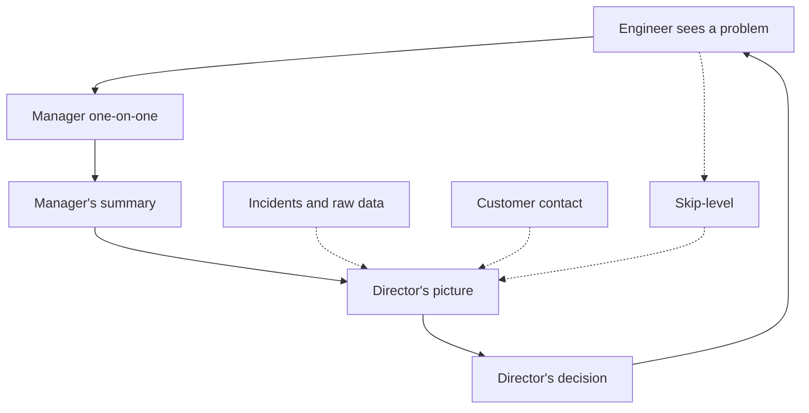
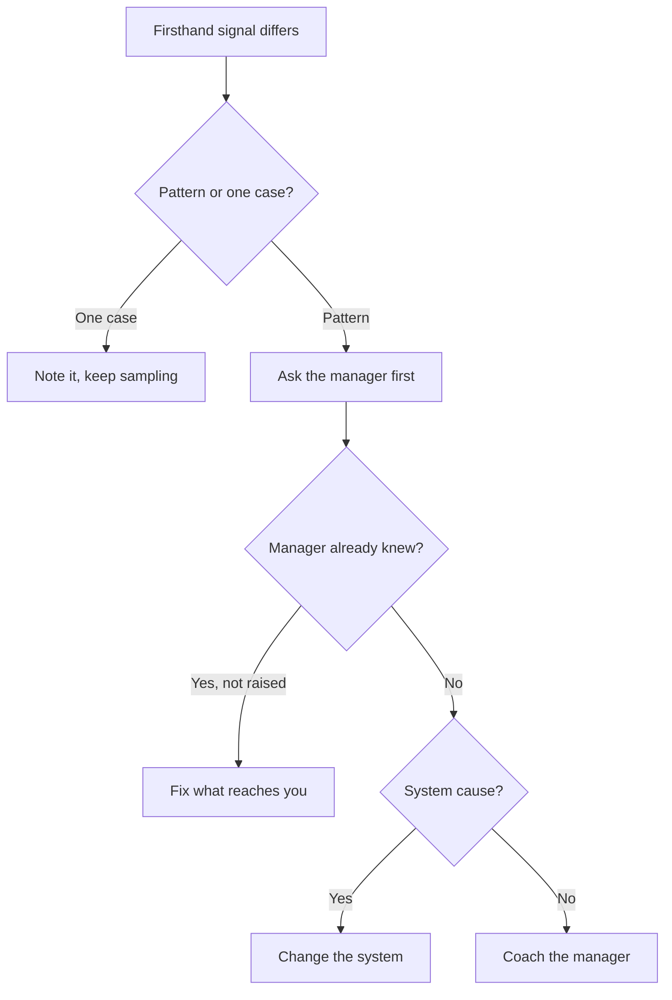

# Chapter 40 — The Director's Job: Leading 50 to 150 Engineers

!!! warning "Awaiting human review"
    This chapter has passed the book's automated validation and an editorial self-review, but not yet
    the human review in which each cited claim is checked against its source. Treat it as a reviewed
    draft. Corrections are welcome; see the repository's CONTRIBUTING file.

This chapter is about the engineering director: one person responsible for 50 to 150 engineers in
several teams, each with its own manager. It covers what changes when you manage managers, how to
build signal sources so that you are not run by your reports' summaries, how to own quality as a
property of the organization, and how to design the director's calendar. The example is the
director's own role at Northstar, the book's fictional
[case study](../../case-studies/northstar/index.md), over the first two quarters.

## Why This Matters

**For the teams**, the director decides what no single team can: who owns a component four teams
change, how capacity is split between roadmap and prevention, which standard is mandatory. Decided on
filtered information, these go wrong for every team at once.

**For the organization**, the director is the first level at which nobody sees the work directly.
Everything arrives through someone, usually a manager with reasons to present their team well. Unnoticed, this leaves a picture months old and too optimistic.

**For the executive team**, the director translates company priorities into team plans and team
reality into executive information. Chapter 4 places the director on the level map
([Chapter 4](../01-foundations/04-the-leadership-ladder.md)); this chapter owns the role in depth.

## Learning Objectives

- Explain how information, time horizon, and leverage change when you manage managers, and what that
  does to a director's judgment.
- Design a portfolio of signal sources (skip-levels, direct data, customer contact, incident reviews)
  and use them to test, not replace, your managers' accounts.
- Treat engineering quality as an organizational property, and identify the decisions about it that
  only a director can make.
- Audit a director's calendar against signal coverage and time horizon, and redesign it.
- Handle a discrepancy between a manager's summary and a firsthand signal without undermining the
  manager.

## The Mental Model

> **Mental model:** A director sees the organization through other people's summaries, and every
> summary is a decision about what to leave out. The job is to design an organization that produces
> the outcome, and to keep enough unfiltered signal to know whether it does.

Two ideas follow. First, **the director's product is the system, not the work.** Andrew Grove's
well-known definition, a manager's output is the output of the organization under their influence
([Grove, 1983](../../references/bibliography.md#grove1983high)), becomes literal at this level: a
director who fixes a team's problem has produced one fix, while a director who changes the ownership
rule, the allocation, or the review loop has changed what every team produces. Will Larson's book is
known for treating engineering management as the design of such systems
([Larson, 2019](../../references/bibliography.md#larson2019elegant)).

Second, **the channel is lossy and biased.** Information that travels up through managers loses
detail, arrives late, and loses bad news faster than good. The director cannot remove the channel
(managers are the main source and should be) but can add channels that do not pass through it, and
use them to calibrate it.

The solid path is the main channel; each hop filters. The dotted paths are the director's own signal
sources, a way to judge how much to trust the solid path, team by team.

## Deep Conceptual Explanation

### What changes when you manage managers

**Information.** A first-line manager watches the work. A director watches managers watching the
work, so the director's information is second-hand, aggregated, late, and selected: most managers raise
problems once they have a plan for them.

**Time horizon.** Chapter 4 gives the director a horizon of about a year, because that is when the
director's levers (ownership, allocation, hiring, manager development) show their effect. A director
who fills the week with this week's problems is spending the only person whose job is the year.

**Leverage.** Camille Fournier's widely read progression describes the move to managing managers as
the point where you stop being able to manage the work and must manage through other managers
([Fournier, 2017](../../references/bibliography.md#fournier2017manager)). The director's main levers
are structure (who owns what), allocation (where capacity goes), decision rights (who decides), the
information system (what everybody sees), and the managers themselves. Chapter 3 ranks such levers
([Chapter 3](../01-foundations/03-managerial-leverage-and-systems-thinking.md)); Chapter 41 covers
developing managers, Chapter 42 the portfolio and influence, Chapter 43 change and the director's
failure patterns.

### How information degrades on the way up

The concern is old. Oliver Williamson's model of firm size opens with the argument that organizational
structures distort the information that reaches decision makers, more so in larger and more
authoritarian organizations, and the article is known for treating the loss at each level as
compounding ("control loss")
([Williamson, 1967](../../references/bibliography.md#williamson1967hierarchical)). It is a
theoretical model, read at abstract level and disputed; the use here is narrow: each layer is a filter.

The behavioral mechanism has more direct support. In an exploratory interview study of 40 employees,
Milliken, Morrison, and Hewlin found that most had been in situations where they were concerned about
an issue and did not raise it with a supervisor, and the most frequently mentioned reason was fear of
being viewed or labeled negatively and damaging valued relationships
([Milliken et al., 2003](../../references/bibliography.md#milliken2003silence)). This is a **research
finding** from a small qualitative sample, read at abstract level. A director has two such hops, and
the second carries the manager's own reputation.

Two consequences follow, and both are **this book's reasoning**. Bad news travels slower than good,
so a director's picture is biased toward optimism, not just blurred. And the filter is strongest
exactly where the director most needs signal: a team whose manager is struggling is the team least
likely to say so. Chapter 11 owns psychological safety, the condition that weakens the filter
([Chapter 11](../03-high-performing-teams/11-high-performance-trust-safety-and-accountability.md)).

### What research says middle managers do

Directors are what management research calls middle managers. A 2008 review describes 25 years of
strategy research on them
([Wooldridge et al., 2008](../../references/bibliography.md#wooldridge2008middle)). Two studies by
Floyd and Wooldridge treat their influence as running both ways. In a survey of 259 middle managers in 25 organizations, they built measures of middle managers'
strategic roles and found that managers in firms pursuing new markets and products ("Prospectors")
reported more upward and divergent strategic involvement than those in more stable firms
([Floyd and Wooldridge, 1992](../../references/bibliography.md#floyd1992middle)). In the same sample,
managers in boundary-spanning units reported more strategic influence, and firm performance was
associated with more uniform downward influence and more varied upward influence
([Floyd and Wooldridge, 1997](../../references/bibliography.md#floyd1997middle)).

These are **research findings** from self-reported surveys, read at abstract level, outside software,
and correlational. This book's reading is modest: the job includes carrying the organization's
reality up, including views that disagree with the plan, not only passing strategy down.

### Building your own signal sources

A **signal source** is a recurring way of learning about the organization that does not pass through
the manager whose team it describes. Four are standard. The table is **this book's synthesis**.

| Source | What it shows | What distorts it | Rough cost |
|---|---|---|---|
| Skip-levels (with engineers two levels down) | Morale, friction, what managers do not raise, people the director should know | Fear of labeling, the halo of the director's attention, group effects | 1 to 3 hours a week at 50 to 150 engineers |
| Direct data (incident records, pages, pipeline and board data, read raw) | What happened, before anyone summarized it | Measurement gaps, reading without context | 1 to 2 hours a week |
| Customer contact (escalation reviews, calls with customers, support tickets) | What the product is like to depend on | The loudest customer, sales framing | 1 hour a week |
| Incident reviews, attended in person | How the organization learns, and how teams treat each other under stress | The director's presence changes the room | 1 hour a week |

GitLab's public handbook documents one practice for skip-levels: engineers fill in a short written
template before the meeting, the meeting serves feedback, praise, coaching, and a view of team health
other than the manager's, and feedback is shared with the manager by default, with a separate
confidential meeting available on request ([GitLab, Skip level meetings](../../references/bibliography.md#gitlab-skip-level)).
That is **documented practice** from one organization; this book found no study of skip-levels'
effects. Its default, transparency to the manager, is
right in this book's view: a back channel makes the director the managers' rival.

This book's **skip-level rule** (**this book's recommendation**), which Chapter 41 uses for coaching:
everyone two levels down once a quarter, in groups of three (the rotation in the case study); themes
always go back to the manager, quotes never; anyone can ask for a confidential individual
conversation; and no decisions or work assignments in the room.

Two rules make signal sources work (**this book's recommendation**). Use them to **calibrate, not to
manage**: a disagreement with a manager's account leads to a conversation with the manager, not an
instruction to the team. And make them **routine, not reactive**: a skip-level scheduled because
something is wrong reads as an investigation.

### Quality as an organizational property

At team level, quality is a practice. At director level, it is a property of the organization: what
the system produces when nobody is watching a particular change. Chapter 19 defines quality and its
ownership models ([Chapter 19](../05-engineering-quality/19-defining-measuring-and-owning-quality.md)),
and Chapter 27 owns the transformation: diagnosis, sequencing, scorecard, funding
([Chapter 27](../05-engineering-quality/27-quality-transformation-at-enterprise-scale.md)). The
director's part is three things that no team can do.

1. **Decisions only the director can make.** Ownership of components that several teams change,
   the prevention allocation, mandatory standards, severity definitions. Each unmade decision is a
   quality defect with no owner.
2. **The signals the director reads personally.** Customer-detected share, recurrences, and the raw
   record of a few incidents a month. A director who reads only the scorecard learns what the
   scorecard can measure, and nothing about how it is being gamed.
3. **What the organization rewards.** Leslie Perlow's nine-month field study of a software team found
   that constant interruption, a crisis mentality, and rewards for individual heroics perpetuated the
   team's time famine, and that changing how the engineers used their time raised collective
   productivity ([Perlow, 1999](../../references/bibliography.md#perlow1999time)). One team, read at
   abstract level; the director who praises the weekend fix and ignores prevention pays for the next
   incident.

### The director's calendar

Henry Mintzberg's classic article is known for showing that managerial work, unlike the folklore of
planning and controlling, is brief, fragmented, interrupted, and mostly conversation
([Mintzberg, 1990](../../references/bibliography.md#mintzberg1990job)). A director's calendar fills
the same way: by invitation, escalation, and recurrence, with no one deciding the whole. Chapter 1's
audit sorts a manager's hours by job
([Chapter 1](../01-foundations/01-what-engineering-management-is.md#managerial-output-and-the-calendar))
and Chapter 3's by leverage. For a director, this book adds two more cuts:

- **By source of information.** What share of the hours brings information that has not passed
  through a direct report? Below about a tenth (**this book's recommendation**, not a measured
  threshold), the director is effectively managed by summaries.
- **By horizon.** What share of the hours is about decisions whose effect lands in a quarter or more?
  If that share is small, the year has no owner.

Michael Watkins's book on leadership transitions is known for arguing that new leaders should learn
deliberately, with a plan for what to learn and from whom
([Watkins, 2003](../../references/bibliography.md#watkins2003first)). Directors usually do this in
their first months and stop. The calendar redesign in this chapter's case is that learning plan made
permanent.

## Engineering Organization Example

How much do skip-levels cost, and how does the cost scale? The figures are **illustrative**; the
assumptions are stated so that you can change them. Assume each engineer two levels down is seen
once a quarter (13 weeks), in either a 30-minute individual meeting or a 45-minute group of three.

| Engineers two levels down | Individual: hours a quarter | Individual: hours a week | Groups of three: groups | Groups: hours a quarter | Groups: hours a week |
|---|---|---|---|---|---|
| 50 | 25 | 1.9 | 17 | 12.75 | 1.0 |
| 100 | 50 | 3.8 | 34 | 25.5 | 2.0 |
| 150 | 75 | 5.8 | 50 | 37.5 | 2.9 |

Arithmetic: individual hours are engineers × 0.5; groups are engineers ÷ 3 rounded up, × 0.75 hours;
weekly figures divide by 13. At 150 engineers, individual skip-levels cost almost six hours a week,
before preparation. Groups cost half as much. They also
change what is said: peers in the room can make some topics easier ("we all see this") and personal
ones harder. A common design is groups by default and individual meetings for a short list.

Coverage also has latency: a concern may wait up to 13 weeks for its slot, which is why incident
reviews and raw data, which arrive weekly, sit beside skip-levels.

How lossy is the main channel? Suppose, as an **illustrative assumption only**, that each hop passes
on seven in ten concerns; two hops pass on about half (0.7 × 0.7 = 0.49). The true fractions are
unknown and differ by team, and a director cannot estimate them from the summaries alone.

## Decision Framework

Which source to use depends on the question. The table pairs common director questions with the
source that tests them best (**this book's recommendation**).

| Question | Primary source | Cross-check | Warning sign |
|---|---|---|---|
| Is this team healthy? | Manager's account; team health check (Chapter 14) | Skip-level group | Health check and skip-level disagree with the manager |
| Is quality improving? | Scorecard (Chapter 27) | Raw incident records; severity audit | Severities drifting down while customer escalations do not |
| Is this commitment real? | Manager's forecast (Chapter 17) | Board and dependency data | Status green, dependencies unstarted |
| What do customers experience? | Customer Success reports | Joining escalation reviews; reading tickets | Engineering and Customer Success describe different problems |
| Is this manager effective? | Evidence across four areas (Chapter 4) | Skip-levels, neighboring teams | Only the manager's own account is available |

When a cross-check disagrees with the primary source, the sequence matters:

"Fix what reaches you" means changing what the manager is expected to raise, and when. "Coach the
manager" leads into Chapter 41. Going around the manager is deliberately absent: it fixes one problem
and teaches every manager to manage the director's attention.

## Trade-offs

**Firsthand signal against the managers' authority.** Every skip-level tells the manager that the
director checks. Routine and transparent, that is healthy; selective, it undermines the managers.

**Signal against time horizon.** Hours spent listening are not spent on the year. The case study's
redesign takes signal hours mainly from escalations and administration.

**Group against individual skip-levels.** Groups scale and surface shared problems; individual meetings
surface personal ones (careers, conflicts with the manager) at twice the cost per person.

**Raw data against context.** Raw incident records catch what the summary softened, such as a severity
that does not match the impact, but invite second-guessing. A small regular sample is the compromise.

**Customer contact against the roadmap owner.** A director who talks to customers can become a second
product manager; the purpose is learning what reliability means to them.

## Failure Modes

**Managed by summaries.** The calendar is all direct reports, executives, and escalations. The
director learns of problems when they become incidents or resignations. Detect it with the source cut
of the calendar audit.

**The super-manager.** The director uses skip-levels to assign work and overrule plans. Managers stop
bringing problems. Ask managers whether they hear of your skip-levels before their teams act on them.

**The data tourist.** One alarming case in raw data is treated as a pattern. Before acting, count
the cases.

**Incident commander in chief.** The director joins every Sev1 call; responders defer to rank and the
pager sets the week. Attend the review, not the response.

**Quality delegated.** Quality is "QA's job" or the platform team's or the scorecard's. Nobody owns the
cross-team decisions, so they are not made. Northstar's baseline managers described quality this way.

**Calendar by default.** Every inherited meeting survives. Ask which three blocks you would not
recreate on an empty calendar.

**Learning stops at day 90.** Firsthand learning fills the arrival period and then decays, as the
case study shows.

## Enterprise Application

In an organization of 50 to 150 engineers, the director typically has five to ten managers and a few
staff engineers as direct reports, and 40 to 140 people two levels down: few enough to know, but only
with a system.

Three practices fit this size (**this book's recommendation**): a **skip-level rotation** covering
everyone once a quarter in groups, plus an individual list of fewer than ten; a **weekly hour of raw
data** (pages, a postmortem, customer escalations, the board of the team you know least); and a
**written skip-level rule** (above), announced to managers first.

Multi-site organizations need the rotation more and get it less: people at a second site have the
least informal contact with the director, so their concerns travel the longest filtered path.
Schedule the other site first (Chapter 14 covers distance). Chapter 37 covers the operating cadences (weekly
review, monthly business review) into which these signals feed.

## CTO Perspective

A CTO above several directors faces the same problem with three hops instead of two. The CTO's signal
sources are similar but sparser, and their main use is to calibrate the directors.

The CTO also sets the conditions for directors' signal sources: punish the director whose
skip-levels surfaced a problem, and every director stops looking.

Larson argues that an engineering executive's job is to merge the views of the CEO, executive peers,
and engineering into the company's actual problem
([Larson, 2023](../../references/bibliography.md#larson2023balancing)). That is **expert opinion**.
For a director, the corollary is that the director's upward account is one of those views: honest
about the organization's limits, including those that make the director look worse. The Floyd and
Wooldridge findings point the same way: the upward half of the role is part of the job, not a
courtesy.

## Practical Playbook

1. **Audit two weeks of calendar** by job (Chapter 1), leverage (Chapter 3), source, and horizon.
2. **List what you learned firsthand last quarter**, and what reached you late through summaries.
3. **Write the skip-level rule** and discuss it with your managers before the first meeting.
4. **Schedule the rotation** for everyone two levels down once a quarter, starting with whoever you
   hear from least; add an individual list of fewer than ten.
5. **Protect one hour a week of raw data** and one incident review of your choosing.
6. **Join a customer escalation review** at least every two weeks, as a listener.
7. **Cut escalations at the source**: for each recent escalation, give the decision to whoever should
   have made it (Chapter 13).
8. **Protect two half-days a week** for decisions whose effect lands in a quarter or later.
9. **Close the loop** monthly: tell managers the patterns you heard and what you are changing.
10. **Re-audit at the end of the quarter.** Calendars drift back within weeks.

## Case Study

This case is **fictional**. Events come from [the first quarter](../../case-studies/northstar/first-quarter.md)
page and the chapters that tell quarter 2; the time shares and the weeks 14 and 15 sample are
additions for this chapter, and the quarter 3 calendar is a proposal.

**The role.** The director's written role definition covers reliability and delivery of the whole
organization, the managers' development, staff mandates, cross-team commitments, and owners for
cross-team decisions; it excludes team planning, incident response, and production code. At the end of week 26 the director
reconstructed the two quarters from calendar and chat history, as Chapter 1 asks every manager to.

**Two quarters by period.** The share of hours spent on firsthand signal (sources not passing through
a direct report) is the director's own estimate, except for weeks 14 and 15, which were measured. The
recurring forums are those Chapter 37 reconstructs for quarter 2.

| Weeks | Canon events that shaped the time | Firsthand share |
|---|---|---|
| 1–4 | Incident classification with Kwame Mensah; severity definitions; capacity model; first owners | about 25% |
| 5–9 | Weekly Core releases; week 7 severity re-rating; week 9 Billing Sev1 | about 12% |
| 10–13 | QA transition announced; migration check lands; day-90 report | about 8% |
| 14–15 | Ines Carvalho's stay interview; technical strategy draft; ADR-0001 opened | 4.7% (measured) |
| 16–19 | Skip-level conversations start (four a week); health check; Mateo Arango Ríos (week 17) | about 9% |
| 20–26 | Individual skip-levels continue; Tomasz Wierzbicki's offer; bulk ordering due | about 9% |

The shape: firsthand time fell as the operating system routed information through managers, to a
twentieth of the week by weeks 14 and 15; skip-levels from week 16 recovered some of it.

**The weeks 14 and 15 sample.** Two weeks of 48 hours, 96 in total; the two sampled weeks ran an hour
over the 47-hour average Chapter 37 uses:

| Block | Hours, two weeks | Source of information |
|---|---|---|
| One-on-ones: managers 45 minutes, staff engineers 30, Victor Lindqvist 30, weekly; plus Ines's stay interview | 14 | Direct reports, CTO |
| Managers' meeting (60 minutes weekly) and one staff group (60 minutes) | 3 | Direct reports |
| Renewal check-in, product sync, Billing and Orders sync, release working group | 6 | Mixed |
| Weekly operational review (booked 30 minutes, averaging 75) | 2.5 | Mixed |
| Monthly forums falling in these weeks (two quality reviews, all-hands) | 2.5 | Mixed |
| Strategy and structure (technical strategy draft, ADR-0001, Orders' load, span table) | 22 | Mixed |
| Executives and peers outside the forums | 4 | Executives |
| Unscheduled meetings and escalations | 18 | Direct reports and others |
| Administration, approvals, hiring, writing | 19.5 | Mixed |
| Firsthand: one incident review, raw data, informal conversations with engineers | 4.5 | Firsthand |
| **Total** | **96** | |

Check: 14 + 3 + 6 + 2.5 + 2.5 + 22 + 4 + 18 + 19.5 + 4.5 = 96. Firsthand share 4.5 ÷ 96 = 4.7 percent.
Unscheduled meetings plus the incident review match Chapter 37's 9.5 hours a week. No skip-level, no customer contact, and no conversation with any Bogotá engineer.

**What firsthand signal had found.** Through firsthand channels: in week 7, reading the incidents in the weekly review
exposed four consecutive Sev3 ratings, one of them a two-hour payment delay for nine customers, and
the director re-rated it. Through a designed channel: in week 16, the health check Elena Sokolova
facilitated showed mobile rating four areas red. Through a skip-level conversation: in week 17, in the
director's first conversation with a mobile engineer, Mateo said he had been doing a lead's job for
over a year without anyone saying so, and that his one-on-ones were "where I tell Daniel where mobile
is" (Chapter 5). He agreed the director could raise it.

Through summaries, things arrived late: the slipped migration check surfaced in the week 9 Sev1, and
mobile's frustration appeared in none of Daniel's one-on-ones for weeks 14 to 19 (Chapter 5). The main
channel carried status, which is what it was built to carry.

**The quarter 3 proposal.** Chapter 37 proposes the director's recurring forums for quarter 3 (a
75-minute leadership team meeting, a shorter operational review, a monthly business review, about 14
hours a week including one-on-ones and skip-levels). Under it the director drafted a personal 48-hour
week:

| Block | Weeks 14–15, per week | Quarter 3, per week | Change |
|---|---|---|---|
| Recurring forums and one-on-ones (Chapter 37), excluding skip-levels | 14 | 12 | −2 |
| Skip-levels | 0 | 2 | +2 |
| Strategy and structure, two protected half-days | 11 | 11 | 0 |
| Executives and peers outside the forums | 2 | 1.5 | −0.5 |
| Unscheduled meetings and escalations | 9 | 6 | −3 |
| Administration, approvals, hiring, writing | 9.75 | 8 | −1.75 |
| Other firsthand signal (detail below) | 2.25 | 3.5 | +1.25 |
| Unallocated buffer | 0 | 4 | +4 |
| **Total** | **48** | **48** | **0** |

The skip-level hours are Chapter 37's two (four 30-minute conversations a week) in a new format: two
groups of three, 45 minutes each, plus one individual conversation. Other firsthand signal: one incident review chosen by the director (1 hour), a raw-data hour plus half an hour
for a postmortem (1.5), and Sofia Alvarez's customer escalation review every two weeks with one call a
month to a large customer (about 1). Firsthand in total: 5.5 hours, 11.5 percent of the week.

Coverage: 2 groups × 3 people × 13 weeks = 78 places for the 77 engineers on the teams (16 + 15 +
13 + 17 + 11 + 5), assuming nobody leaves; Tomasz's offer is still open. Four individual conversations a
week would reach 52; this would be Northstar's first systematic round. The 13 individual slots go to a list of eight, each about every eight weeks: the
informal leads Hannah Lindgren and Mateo; Orders' senior engineers Rafael Duarte and Aisha Bello; the
ledger experts Teodora Vasquez-Lund and Tomasz; and Bram Verhoeven and Sunil Varghese, who hold
concentrated knowledge. The 16 Bogotá engineers come in the first five weeks, plus one two-day visit
that needs travel budget Northstar has never had as a line.

The hours come mainly from escalations and administration. Open questions: whether managers will read the individual list as a watch list;
whether groups lose what individual conversations found (Mateo spoke one to one); whether the buffer
survives an incident-heavy week; and whether, after Mateo's conversation, the Customer Experience
groups look like an investigation. The exercises take these in turn.

## Exercises

Solutions are in [chapter 40 solutions](../../solutions/ch40-solutions.md). Northstar data is on the
[baseline page](../../case-studies/northstar/baseline-data.md) and
[the first quarter](../../case-studies/northstar/first-quarter.md) page.

### Foundational

**F1.** A director of 120 engineers in eight teams says: "My managers are excellent and tell me
everything; I don't need skip-levels." Their calendar shows no meeting with anyone two levels down in
the last quarter. Using the research in this chapter, explain what the director's confidence can and
cannot tell them, and what would test it at low cost.

**F2.** Classify each of these as a skip-level, direct data, customer contact, or incident review, and
name its main distortion: reading the on-call pages for Billing's last two weekends; a 45-minute group
with three Orders engineers; listening to a renewal customer's quarterly review; attending the review
of a Sev2 in payments-gateway; a manager's slide on Customer Experience's health.

**F3.** Using the Engineering Organization Example's assumptions, compute the weekly cost of covering
an organization of 85 engineers two levels down once a quarter in groups of four, 45 minutes each, and
the latency an engineer's concern can face. Then say what would change if the director chose
groups of two.

### Applied Leadership

**A1.** You are the Northstar director at the start of quarter 3. Write the skip-level rule you will
announce to the six managers: what you pass on, what stays confidential, what you will never do in a
skip-level, and how you will tell managers about patterns. Then decide whether Daniel Cho hears about
Mateo's request before or after the first Customer Experience group.

**A2.** In a skip-level group in week 29, two Billing engineers say the after-hours escalation path for
the ledger has not changed since quarter 1, while Marcus Oyelaran's updates describe it as "in
progress". Walk through the chapter's discrepancy diagram and decide what you do in the next two weeks,
and what you do not do.

**A3.** From week 16 the director held four individual 30-minute skip-levels a week, 44 conversations
by week 26, with no group skip-levels. The quarter 3 proposal spends the same two hours on two groups
of three and one individual conversation. Decide which format to run in
quarter 3, for whom, and what you would watch to know you chose wrong.

### Executive Decision-Making

**X1.** Victor Lindqvist reviews the quarter 3 calendar and objects: "Five and a half hours a week of
listening is a luxury. I need you on next year's organization." Write your response: what the
firsthand hours buy, what you would cut if he insists, and what evidence at the end of quarter 3 would
show whether the hours were worth it.

**X2.** Rajiv Menon declines the Bogotá travel budget for quarter 3 as non-essential under flat
operating expense. Sixteen of the 77 engineers on the teams are in Bogotá, Mobile's health check is
the worst in the organization, and the Customer Experience structure question, still open, could produce Northstar's first
Bogotá-based manager. Decide whether to escalate, find the money elsewhere, or redesign the Bogotá coverage, and
make the case to the person who decides.

## Reflection Questions

1. What did you learn last month that did not pass through one of your direct reports?
2. Which of your managers would tell you first if their team were failing, and which would tell you
   last? What is your evidence?
3. If your skip-levels stopped tomorrow, how long would it take you to notice the difference in what
   you know?
4. Which decisions about quality in your organization have no owner because they belong to you?
5. Which block on your calendar would you not recreate if the calendar were empty?
6. When did you last pass bad news upward that made you look worse?

## Key Takeaways

- A director's information is second-hand, late, and biased toward good news. Plan for it.
- The director's product is the system: ownership, allocation, decision rights, information, and
  managers.
- Build four signal sources (skip-levels, raw data, customer contact, incident reviews) and use them
  to calibrate the managers' accounts, not to bypass them.
- When a firsthand signal disagrees with a manager, talk to the manager first, then change the
  system or the reporting.
- Quality is an organizational property; the decisions no team can make (shared ownership,
  allocation, severity, standards) are the director's.
- Audit the calendar by source of information and by horizon, not only by job.
- Firsthand learning decays after the first months; make the learning plan permanent.
- Carry the organization's reality upward, including what reflects badly on you.

## References and Further Reading

- [Grove, 1983](../../references/bibliography.md#grove1983high). Managerial output and leverage.
- [Fournier, 2017](../../references/bibliography.md#fournier2017manager). The move to managing managers.
- [Larson, 2019](../../references/bibliography.md#larson2019elegant). Management as system design.
- [Watkins, 2003](../../references/bibliography.md#watkins2003first). Deliberate learning in transitions.
- [Williamson, 1967](../../references/bibliography.md#williamson1967hierarchical). Hierarchy distorts
  information.
- [Milliken et al., 2003](../../references/bibliography.md#milliken2003silence). Why concerns are not
  raised upward.
- [Floyd and Wooldridge, 1992](../../references/bibliography.md#floyd1992middle),
  [1997](../../references/bibliography.md#floyd1997middle), and
  [Wooldridge et al., 2008](../../references/bibliography.md#wooldridge2008middle). Middle managers'
  upward and downward influence.
- [Perlow, 1999](../../references/bibliography.md#perlow1999time). Interruption and rewarded heroics.
- [Mintzberg, 1990](../../references/bibliography.md#mintzberg1990job). The fragmented manager's day.
- [GitLab, Skip level meetings](../../references/bibliography.md#gitlab-skip-level). A documented
  skip-level template.
- [Larson, 2023](../../references/bibliography.md#larson2023balancing). Merging the executive views.
