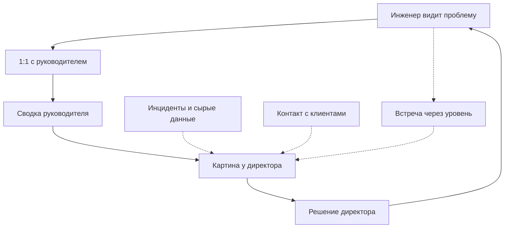
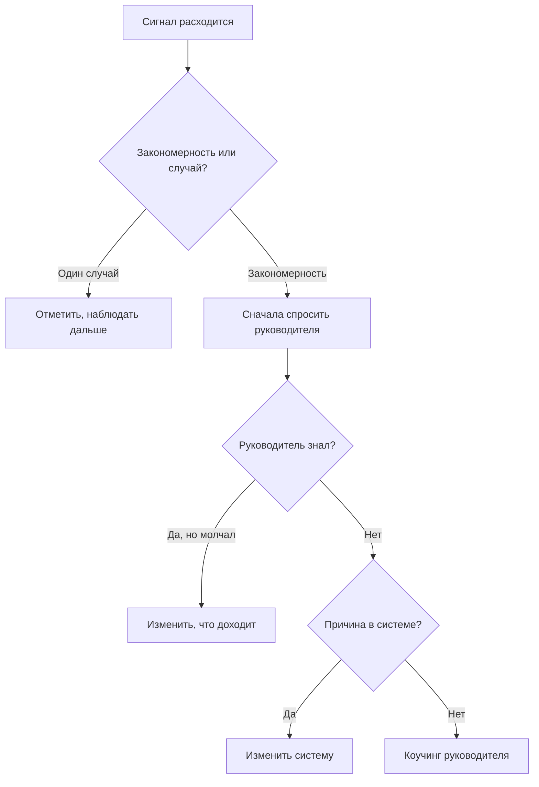

# Глава 40 — Работа директора: руководство 50–150 инженерами { #chapter-40-the-directors-job-leading-50-to-150-engineers }

Эта глава о директоре по разработке: одном человеке, который отвечает за 50–150 инженеров в нескольких
командах, и у каждой команды свой руководитель. В ней разобрано, что меняется, когда вы руководите
руководителями; как выстроить источники сигналов, чтобы вами не управляли сводки подчинённых; как
отвечать за качество как за свойство организации и как устроить календарь директора. Пример — роль самого
директора в Northstar, вымышленной компании из [кейса](../../case-studies/northstar/index.md), за первые
два квартала.

## Почему это важно { #why-this-matters }

**Для команд** директор решает то, что не может решить ни одна команда в одиночку: кто владеет
компонентом, который меняют четыре команды; как делить ресурс между дорожной картой и профилактикой; какой
стандарт обязателен. Если такие решения принимают по отфильтрованной информации, ошибка ложится сразу на
все команды.

**Для организации** директор — первый уровень, с которого работу уже не видно напрямую. Всё доходит
через посредников, обычно через руководителя, у которого есть причины показать свою команду в выгодном
свете. Если об этом забыть, картина отстаёт от реальности на месяцы и выглядит оптимистичнее, чем есть.

**Для высшего руководства** директор переводит приоритеты компании в планы команд, а реальность команд —
в информацию для руководства. [Глава 4](../01-foundations/04-the-leadership-ladder.md) помещает директора
на карту уровней, а эта глава разбирает роль подробно.

## Цели главы { #learning-objectives }

- Объяснять, как меняются информация, горизонт времени и рычаг, когда вы руководите руководителями, и как
  это влияет на суждения директора.
- Составлять портфель источников сигналов (встречи через уровень, прямые данные, контакт с клиентами,
  разборы инцидентов) и пользоваться ими, чтобы проверять рассказы руководителей, а не подменять их.
- Относиться к качеству разработки как к свойству организации и выделять решения о нём, которые может
  принять только директор.
- Проверять календарь директора на охват источников сигналов и горизонт времени и перестраивать его.
- Разбираться с расхождением между сводкой руководителя и сигналом из первых рук, не подрывая авторитет
  руководителя.

## Ментальная модель { #the-mental-model }

> **Ментальная модель:** директор видит организацию через сводки других людей, и каждая сводка — это
> решение о том, что опустить. Работа директора — спроектировать организацию, которая производит нужный
> результат, и сохранить достаточно нефильтрованного сигнала, чтобы знать, производит ли она его.

Отсюда две идеи. Первая: **продукт директора — система, а не работа.** Andrew Grove известен
определением: результат руководителя — это результат организации, на которую он влияет
([Grove, 1983](../../references/bibliography.md#grove1983high)). На этом уровне его надо понимать
буквально. Решив проблему одной команды, директор вносит одно исправление. Изменив правило владения,
распределение ресурсов или петлю обзоров, он меняет то, что производит каждая команда.
Will Larson рассматривает управление разработкой как проектирование таких систем
([Larson, 2019](../../references/bibliography.md#larson2019elegant)).

Вторая: **канал теряет информацию и искажает её.** По пути наверх через руководителей информация теряет
детали и опаздывает, причём плохие новости теряются быстрее хороших. Убрать этот канал директор
не может (руководители — главный источник, и так и должно быть), но может добавить каналы в обход него и
по ним калибровать основной.

Сплошной путь — основной канал, и на каждом его переходе информация фильтруется. Пунктирные пути —
собственные источники сигналов директора. По ним можно судить, насколько доверять сплошному пути в каждой
команде.

## Подробный разбор { #deep-conceptual-explanation }

### За что отвечает директор { #what-a-director-owns }

Директор отвечает за результаты организации, не выполняя её работу. Разделение ниже —
**рекомендация книги** для организации из 50–150 инженеров; кейс показывает вариант одной компании.

| | Что сюда входит |
|---|---|
| Отвечает (за результат) | Надёжность и поставка всей организации; межкомандные обязательства; развитие руководителей; информационная система (карта показателей, журнал решений, отчёты наверх) |
| Решает | Владельцы компонентов, которые меняют несколько команд; распределение ресурсов между продуктом, профилактикой и платформой; обязательные стандарты и определения серьёзности; мандаты staff-инженеров; кто решает каждый межкомандный вопрос |
| Делегирует | Планы команд и способы работы; дизайн внутри границ команды; найм в команду по общей планке; координацию инцидентов |
| Не делает | Не пишет продакшн-код на критическом пути; не ведёт инциденты; не планирует работу команды; не раздаёт задачи инженерам через уровень |

Риск сосредоточен в двух строках. Каждый нерешённый пункт из «Решает» становится межкомандной проблемой
без владельца. Каждый пункт из «Не делает», за который директор всё же берётся, отнимает работу у
руководителя и неделю у года.

### Что меняется, когда вы руководите руководителями { #what-changes-when-you-manage-managers }

**Информация.** Линейный руководитель наблюдает за работой. Директор наблюдает за тем, как руководители
наблюдают за работой. Поэтому его информация — из вторых рук, агрегированная, запоздалая и отобранная:
большинство руководителей поднимают проблему, когда у них уже есть план, как её решать.

**Горизонт времени.** Глава 4 отводит директору горизонт около года, потому что примерно за такой срок
проявляется действие его рычагов (владение, распределение ресурсов, найм, развитие руководителей).
Если директор заполняет неделю проблемами этой недели, он тратит впустую единственного человека, чья
работа — год.

**Рычаг.** Camille Fournier в широко известном описании карьерного пути говорит, что переход к руководству
руководителями — это момент, когда вы больше не можете управлять работой и должны управлять через других
руководителей ([Fournier, 2017](../../references/bibliography.md#fournier2017manager)). Главные рычаги
директора — структура (кто чем владеет), распределение ресурсов (куда идёт ресурс), права на решения (кто
решает), информационная система (что видят все) и сами руководители. Такие рычаги ранжирует
[глава 3](../01-foundations/03-managerial-leverage-and-systems-thinking.md). Следующие три главы
посвящены развитию руководителей (41), портфелю и влиянию (42), изменениям и типичным провалам директора
(43).

### Как информация портится по пути наверх { #how-information-degrades-on-the-way-up }

Каждый уровень управления — фильтр, и потери накапливаются. Почему плохие новости медленно идут наверх,
объясняет глава 39
([эффект умолчания](../08-management-operating-system/39-reviews-decision-logs-escalation-and-executive-reporting.md#why-bad-news-travels-slowly));
этот раздел добавляет, что это значит для директора. Oliver Williamson в теоретической модели утверждает,
что организационные структуры искажают информацию, которая доходит до принимающих решения, причём тем
сильнее, чем крупнее и авторитарнее организация, и на каждом уровне что-то теряется
([Williamson, 1967](../../references/bibliography.md#williamson1967hierarchical)). Модель спорная, и здесь
она нужна только для этого узкого тезиса.

Для поведенческого механизма доказательства прямее. В разведочном исследовании на основе интервью с
40 сотрудниками большинство признались, что хотя бы раз не сказали руководителю о своём опасении. Чаще
всего они объясняли это страхом получить негативный ярлык и испортить ценные отношения
([Milliken et al., 2003](../../references/bibliography.md#milliken2003silence)). Это **научный
результат** на небольшой качественной выборке. У директора таких переходов два, и на втором на кону ещё и
репутация самого руководителя.

Отсюда два следствия, оба — **рассуждение книги**. Плохие новости идут медленнее хороших, поэтому картина
у директора не просто размыта, а смещена в сторону оптимизма. И фильтр сильнее всего именно там, где
директору сигнал нужнее всего: меньше всех склонна говорить об этом команда, у руководителя которой дела
идут плохо. [Психологическая безопасность](../../glossary.md#psychological-safety), которая ослабляет
фильтр, разобрана в
[главе 11](../03-high-performing-teams/11-high-performance-trust-safety-and-accountability.md).

### Что, по данным исследований, делают руководители среднего звена { #what-research-says-middle-managers-do }

Руководители среднего звена влияют не только вниз, но и вверх. В исследованиях менеджмента директора
относятся к среднему звену; обзор 2008 года подводит итог 25 годам исследований стратегии, посвящённых
этому звену ([Wooldridge et al., 2008](../../references/bibliography.md#wooldridge2008middle)). Floyd
и Wooldridge опросили 259 руководителей среднего звена в 25 организациях. Те, чьи компании осваивали
новые рынки и продукты, сообщали о большем участии в стратегии — направленном вверх и расходящемся с
текущей линией, — чем коллеги из стабильных компаний
([Floyd and Wooldridge, 1992](../../references/bibliography.md#floyd1992middle)). Результаты компании были
связаны с более единообразным влиянием вниз и более разнообразным влиянием вверх
([Floyd and Wooldridge, 1997](../../references/bibliography.md#floyd1997middle)).

Это **научные результаты** самоотчётных опросов; они корреляционные и получены вне разработки ПО. Книга
делает из них скромный вывод: работа включает не только передачу стратегии вниз, но и передачу
реальности организации наверх, в том числе взглядов, которые расходятся с планом.

### Как выстроить собственные источники сигналов { #building-your-own-signal-sources }

**Источник сигналов** — регулярный способ узнавать об организации в обход руководителя той команды, о
которой идёт речь. Стандартных источников четыре. Таблица — **синтез книги**.

| Источник | Что показывает | Что его искажает | Примерная цена |
|---|---|---|---|
| [Встречи через уровень (skip-level)](../../glossary.md#skip-level) (с инженерами на два уровня ниже) | Настрой, трения, то, о чём руководители не говорят, люди, которых директору стоит знать | Страх получить ярлык, ореол директорского внимания, групповые эффекты | 1–3 часа в неделю при 50–150 инженерах |
| Прямые данные (записи об инцидентах, вызовы дежурных, данные пайплайнов и досок, прочитанные в сыром виде) | Что произошло, пока никто это не обобщил | Пробелы в измерениях, чтение без контекста | 1–2 часа в неделю |
| Контакт с клиентами (разборы эскалаций, звонки с клиентами, тикеты поддержки) | Каково зависеть от продукта | Самый громкий клиент, подача со стороны продаж | 1 час в неделю |
| Разборы инцидентов, лично | Как организация учится и как команды обращаются друг с другом под давлением | Присутствие директора меняет обстановку | 1 час в неделю |

По умолчанию встречи через уровень должны быть прозрачны для руководителя. Публичный справочник GitLab
описывает одну такую практику. Перед встречей инженеры заполняют короткий письменный шаблон. Он служит
для обратной связи, похвалы и коучинга и даёт взгляд на здоровье команды, отличный от взгляда
руководителя.
Обратной связью по умолчанию делятся с руководителем, а по запросу можно провести отдельную
конфиденциальную встречу ([GitLab, Skip level meetings](../../references/bibliography.md#gitlab-skip-level)).
Это **задокументированная практика** одной организации; исследований того, как действуют встречи через
уровень, книга не нашла. Но, по мнению книги, вариант по умолчанию выбран верно: тайный канал делает
директора соперником руководителей.

**Правило встреч через уровень** (**рекомендация книги**), на которое опирается глава 41, когда говорит о
коучинге:

- раз в квартал — со всеми, кто на два уровня ниже, группами по три человека (ротация из кейса);
- темы всегда возвращаются к руководителю, цитаты — никогда;
- любой может попросить конфиденциальный разговор один на один;
- на встрече не принимают решений и не раздают задач.

Источники сигналов работают при двух правилах (**рекомендация книги**). Пользуйтесь ими, чтобы
**калибровать, а не управлять**: если сигнал расходится с рассказом руководителя, это повод поговорить с
руководителем, а не давать указания команде. И делайте их **регулярными, а не реактивными**: встреча через
уровень, назначенная потому, что что-то не так, воспринимается как расследование.

### Качество как свойство организации { #quality-as-an-organizational-property }

Для команды качество — практика. Для директора — свойство организации: то, что система производит, когда
никто не следит за конкретным изменением. Определения качества и модели владения им даёт
[глава 19](../05-engineering-quality/19-defining-measuring-and-owning-quality.md), а трансформацию
качества (диагностику, последовательность шагов, карту показателей, финансирование) —
[глава 27](../05-engineering-quality/27-quality-transformation-at-enterprise-scale.md). На долю
директора остаются три вещи, которые не может сделать ни одна команда.

1. **Решения, которые может принять только директор.** Владение компонентами, которые меняют несколько
   команд, выделение на профилактику, обязательные стандарты, определения серьёзности. Каждое непринятое
   решение — дефект качества без владельца.
2. **Сигналы, которые директор читает сам.** Доля инцидентов, обнаруженных клиентами, повторные инциденты
   и первичные записи о нескольких инцидентах в месяц. Если директор читает только карту показателей, он
   узнаёт то, что карта способна измерить, и ничего — о том, как её подгоняют.
3. **То, что организация вознаграждает.** Leslie Perlow девять месяцев изучала в полевом исследовании
   одну команду разработки. Постоянные прерывания, кризисное мышление и награды за индивидуальный героизм
   поддерживали в команде хроническую нехватку времени (time famine), а изменение того, как инженеры
   распоряжались временем, повысило коллективную продуктивность
   ([Perlow, 1999](../../references/bibliography.md#perlow1999time)). Это одна команда, но урок
   переносится: если директор хвалит исправление в выходные и не замечает профилактику, он расплачивается
   следующим инцидентом.

### Календарь директора { #the-directors-calendar }

Henry Mintzberg в классической статье показывает: вопреки фольклору о планировании и контроле, работа
руководителя состоит из коротких, раздробленных, прерываемых эпизодов, и в основном это разговоры
([Mintzberg, 1990](../../references/bibliography.md#mintzberg1990job)). Календарь директора заполняется
так же: приглашениями, эскалациями и повторяющимися встречами, а целиком его никто не проектирует. Аудит
из главы 1 раскладывает часы руководителя по работам
([глава 1](../01-foundations/01-what-engineering-management-is.md#managerial-output-and-the-calendar)), а
аудит из главы 3 — по рычагу. Для директора книга добавляет ещё два среза:

- **По источнику информации.** Какая доля часов приносит информацию, которая не прошла через прямого
  подчинённого? Если меньше примерно десятой части (**рекомендация книги**, а не измеренный порог),
  директором фактически управляют сводки.
- **По горизонту.** Какая доля часов уходит на решения, результат которых скажется через квартал или
  позже? Если эта доля мала, у года нет владельца.

Michael Watkins в книге о переходе на новую руководящую должность утверждает, что новым руководителям
стоит учиться осознанно, с планом: что узнать и у кого
([Watkins, 2003](../../references/bibliography.md#watkins2003first)). Директора обычно так и делают в
первые месяцы, а потом перестают. Перестройка календаря в кейсе этой главы — тот же план обучения, ставший
постоянным.

## Пример из инженерной организации { #engineering-organization-example }

Сколько стоят встречи через уровень и как цена растёт с размером организации? Цифры — **иллюстрация**;
допущения указаны, чтобы вы могли их поменять. Допустим, каждого инженера на два уровня ниже директор
видит раз в квартал (13 недель): либо на индивидуальной встрече на 30 минут, либо в группе из трёх
человек на 45 минут.

| Инженеров на два уровня ниже | Индивидуально: часов в квартал | Индивидуально: часов в неделю | Группы по три: число групп | Группы: часов в квартал | Группы: часов в неделю |
|---|---|---|---|---|---|
| 50 | 25 | 1.9 | 17 | 12.75 | 1.0 |
| 100 | 50 | 3.8 | 34 | 25.5 | 2.0 |
| 150 | 75 | 5.8 | 50 | 37.5 | 2.9 |

Расчёт: индивидуальные часы = число инженеров × 0,5; группы = число инженеров ÷ 3 с округлением вверх,
× 0,75 часа; недельные цифры — квартальные, делённые на 13. При 150 инженерах индивидуальные встречи
через уровень отнимают почти шесть часов в неделю, не считая подготовки. Группы обходятся вдвое дешевле.
Кроме того, группы меняют и то, о чём говорят: при коллегах одни темы обсуждать легче («мы все это видим»), а
личные — труднее. Распространённый вариант — группы по умолчанию и индивидуальные встречи для короткого
списка людей.

У охвата есть и задержка: опасению, возможно, придётся ждать своего слота до 13 недель. Поэтому рядом со
встречами через уровень стоят разборы инцидентов и сырые данные: они поступают каждую неделю.

Сколько теряет основной канал? Предположим — **исключительно как иллюстративное допущение**, — что каждый
переход передаёт дальше семь опасений из десяти; тогда два перехода передают примерно половину
(0,7 × 0,7 = 0,49). Настоящие доли неизвестны и различаются от команды к команде, а оценить их по одним
сводкам директор не может.

## Как принимать решение { #decision-framework }

Какой источник использовать, зависит от вопроса. В таблице к типичным вопросам директора подобраны
источники, которые лучше всего их проверяют (**рекомендация книги**).

| Вопрос | Основной источник | Перекрёстная проверка | Тревожный признак |
|---|---|---|---|
| Здорова ли команда? | Рассказ руководителя; проверка здоровья команды (глава 14) | Групповая встреча через уровень | Проверка здоровья и встреча через уровень расходятся с рассказом руководителя |
| Улучшается ли качество? | Карта показателей (глава 27) | Первичные записи об инцидентах; аудит серьёзности | Серьёзность ползёт вниз, а эскалации клиентов — нет |
| Реально ли это обязательство? | Прогноз руководителя (глава 17) | Данные доски и зависимостей | Статус зелёный, работа по зависимостям не начата |
| Что видят клиенты? | Отчёты Customer Success | Участие в разборах эскалаций; чтение тикетов | Разработка и Customer Success описывают разные проблемы |
| Эффективен ли этот руководитель? | Свидетельства о результатах, здоровье команды, росте людей, рычаге (глава 4) | Встречи через уровень, соседние команды | Доступен только рассказ самого руководителя |

Если перекрёстная проверка расходится с основным источником, важен порядок действий:

«Изменить, что доходит» означает поменять ожидания: о чём руководитель должен сообщать и когда. «Коучинг
руководителя» ведёт к главе 41. Варианта «действовать в обход руководителя» в схеме намеренно нет: так
решается одна проблема, а каждый руководитель при этом учится управлять вниманием директора.

## Компромиссы { #trade-offs }

**Сигнал из первых рук или авторитет руководителей.** Каждая встреча через уровень сообщает руководителю,
что директор проверяет. Если встречи регулярны и прозрачны, это здоровая практика; если выборочны, они
подрывают авторитет руководителей.

**Сигнал или горизонт времени.** Часы, которые уходят на то, чтобы слушать, не уходят на работу с
горизонтом в год. При перестройке календаря в кейсе часы на сигналы берутся в основном у эскалаций
и административной работы.

**Групповые или индивидуальные встречи через уровень.** Группы масштабируются и выявляют общие проблемы.
Индивидуальные встречи выявляют личные (карьера, конфликты с руководителем), но на одного человека
обходятся вдвое дороже.

**Сырые данные или контекст.** Первичные записи об инцидентах ловят то, что сводка смягчила, например
серьёзность, которая не соответствует ущербу. Но они же подталкивают перепроверять задним числом каждое
решение. Компромисс — небольшая регулярная выборка.

**Контакт с клиентами или владелец дорожной карты.** Разговаривая с клиентами, директор рискует стать
вторым продакт-менеджером. А цель — понять, что для клиентов значит надёжность.

## Типичные провалы { #failure-modes }

**Управляемый сводками.** В календаре только прямые подчинённые, высшее руководство и эскалации. Директор
узнаёт о проблемах, когда они становятся инцидентами или заявлениями об уходе. Как заметить: срез
аудита календаря по источнику информации.

**Сверхруководитель.** Директор использует встречи через уровень, чтобы раздавать задачи и отменять
планы. Руководители перестают приносить проблемы. Спросите руководителей, узнают ли они о
ваших встречах через уровень раньше, чем их команды начинают действовать по итогам.

**Турист в данных.** Один тревожный случай в сырых данных принимают за закономерность. Прежде чем
действовать, посчитайте случаи.

**Главнокомандующий инцидентами.** Директор подключается к каждому звонку по Sev1 (высшая
[серьёзность](../../glossary.md#severity-sev1-sev2-sev3): не работает путь заказа или оплаты либо клиенты
видят неверные финансовые записи). Те, кто чинит, оглядываются на ранг, а неделей распоряжается пейджер.
Приходите на разбор, а не на реагирование.

**Делегированное качество.** Качество считается «работой QA», платформенной команды или карты
показателей. Межкомандными решениями никто не владеет, поэтому их не принимают. Именно так описывали
качество руководители Northstar в исходном квартале.

**Календарь по умолчанию.** Выживает каждая унаследованная встреча. Спросите себя, какие три
блока вы не стали бы создавать в пустом календаре.

**Обучение заканчивается на Дне 90.** Обучение из первых рук заполняет первые месяцы в должности, а затем
угасает, как показывает кейс.

## Применение в крупной организации { #enterprise-application }

В организации из 50–150 инженеров у директора обычно пять–десять руководителей и несколько
staff-инженеров в прямом подчинении и 40–140 человек на два уровня ниже. Это достаточно мало, чтобы знать
людей, но только если есть система.

Этому размеру подходят три практики (**рекомендация книги**): **ротация встреч через уровень**, которая
раз в квартал охватывает всех в группах, плюс индивидуальный список меньше чем из десяти человек;
**еженедельный час сырых данных** (вызовы дежурных, описание одного разбора инцидента, эскалации клиентов,
доска команды, которую вы знаете хуже всех); **письменное правило встреч через уровень** (см. выше),
о котором сначала объявляют руководителям.

Организациям с несколькими площадками ротация нужнее, а получают они её реже. У людей на второй площадке
меньше всего неформальных контактов с директором, поэтому их опасения проходят самый длинный путь через
фильтры. Начинайте расписание с другой площадки (о работе на расстоянии — глава 14). Эти сигналы питают
операционные ритмы из главы 37 (еженедельный операционный разбор, ежемесячный бизнес-обзор).

### Собственная устойчивость директора и сеть коллег { #the-directors-own-sustainability-and-peer-network }

Директор часто занимает самое одинокое место в организации, и его усталость обходится дороже всего.
Руководители подчиняются директору, высшее руководство находится уровнем выше, а коллег внутри разработки
у директора может не быть вовсе. Неделю директора целиком никто не видит, поэтому никто, кроме него, её и
не защитит.

**Коллеги.** Выстройте небольшую сеть вне линии подчинения (**рекомендация книги**):

- директора других функций (продукт, работа с клиентами, финансы), которые видят то же высшее руководство
  с другой стороны;
- два-три директора по разработке из других компаний, с которыми вы встречаетесь раз в месяц, чтобы
  задать вопрос «это нормально?»;
- коуч или бывший руководитель для решений, которые нельзя обсуждать внутри, например результативность
  одного из руководителей или собственные сомнения.

Пользуйтесь ими, чтобы калибровать свои суждения, а не чтобы жаловаться на конкретных людей.
Конфиденциальное остаётся за дверью.

**Устойчивость.** Сигналы, которые предупреждают вас о выгорании инженера, относятся и к вам (выгорание
разобрано в [главе 10](../02-people-management/10-motivation-retention-and-senior-engineers.md)). Три из
них характерны именно для директоров: в тяжёлую неделю первыми урезают часы на сигналы из первых рук;
нераспределённый резерв пропадает на целый месяц; растёт раздражение на руководителей, которые приносят
проблемы, и они учатся проблем не приносить. Практические меры защиты: фиксированный конец рабочего дня,
о котором знают ваши руководители; никакого участия в реагировании на инциденты (оставьте это обученным
координаторам инцидентов, incident commanders); один руководитель, которому явно разрешено сказать вам,
что вы выглядите перегруженным. У директора, который работает на пределе, нет запаса для инцидента,
ухода или реорганизации, а они обязательно случатся.

## Взгляд CTO { #cto-perspective }

CTO (технический директор), у которого в подчинении несколько директоров, сталкивается с той же
проблемой, только переходов не два, а три. Источники сигналов у CTO похожие, но скуднее, и главное их
назначение — калибровать директоров.

Кроме того, CTO задаёт условия для источников сигналов директоров. Стоит наказать директора, чьи встречи
через уровень выявили проблему, и все директора перестанут смотреть.

Larson утверждает, что работа руководителя разработки высшего уровня — свести взгляды CEO, коллег по
высшему руководству и разработки к реальной проблеме компании
([Larson, 2023](../../references/bibliography.md#larson2023balancing)). Это **мнение эксперта**. Для
директора отсюда следует, что его рассказ наверх — один из этих взглядов, и он должен честно говорить о
пределах организации, в том числе о тех, что выставляют директора в худшем свете. Результаты Floyd и
Wooldridge указывают в ту же сторону: верхняя половина роли — часть работы, а не любезность.

## Практический плейбук { #practical-playbook }

1. **Проведите аудит двух недель календаря** по работам (глава 1), рычагу (глава 3), источнику и
   горизонту.
2. **Перечислите, что вы узнали из первых рук за прошлый квартал**, а что дошло до вас поздно через
   сводки.
3. **Напишите правило встреч через уровень** и обсудите его с руководителями до первой встречи.
4. **Составьте расписание ротации**, чтобы раз в квартал увидеть всех на два уровня ниже, начиная с тех,
   от кого вы слышите меньше всего; добавьте индивидуальный список меньше чем из десяти человек.
5. **Защитите один час в неделю на сырые данные** и один разбор инцидента на ваш выбор.
6. **Подключайтесь к разбору эскалаций клиентов** хотя бы раз в две недели — как слушатель.
7. **Сокращайте эскалации у источника**: каждое недавнее эскалированное решение передайте тому, кто
   должен был его принять (глава 13).
8. **Защитите два полудня в неделю** для решений, результат которых скажется через квартал или позже.
9. **Замыкайте петлю** раз в месяц: рассказывайте руководителям, какие закономерности вы услышали и что
   меняете.
10. **В конце квартала повторите аудит.** Календари сползают обратно за несколько недель.

## Кейс { #case-study }

!!! info "Northstar: что уже известно"
    Конец недели 26, завершение квартала 2. Число инцидентов Sev1 и Sev2 упало с 30 в исходном
    квартале до 21 в квартале 1. Из двух [обязательств по продлению](../../glossary.md#renewal-commitments)
    интеграция с бухгалтерской системой работает с недели 19, а массовый заказ по прогнозу выйдет на этой
    неделе. С недели 16 директор проводит индивидуальные встречи через уровень. См.
    [хронологию](../../case-studies/northstar/timeline.md). Впервые читаете о Northstar? Прочитайте
    [«Год вкратце»](../../case-studies/northstar/year-in-brief.md) и
    [действующих лиц](../../case-studies/northstar/cast.md).

Этот кейс — **вымысел**. Доли времени, кроме недель 14 и 15, — оценки самого директора, а календарь на
квартал 3 — предложение.

**Роль.** Письменное описание роли директора в Northstar следует таблице «За что отвечает директор»: из
него исключены планирование работы команд, реагирование на инциденты и продакшн-код. В конце недели 26
директор восстановил два квартала по календарю и истории чатов, как глава 1 советует делать каждому
руководителю.

**Два квартала по периодам.** В таблице — доля часов, потраченных на сигналы из первых рук (источники, не
проходящие через прямого подчинённого).

| Недели | Чем было занято время | Доля из первых рук |
|---|---|---|
| 1–4 | Изучение системы: классификация инцидентов вместе со staff-инженером, определение серьёзности, назначение первых владельцев | около 25% |
| 5–9 | Ведение еженедельных релизов; серьёзный инцидент в Billing на неделе 9 | около 12% |
| 10–13 | Переход QA-инженеров в продуктовые команды; отчёт Дня 90 | около 8% |
| 14–15 | Черновик технической стратегии, интервью об удержании (stay interview), первое архитектурное решение | 4.7% (измерено) |
| 16–19 | Начало индивидуальных встреч через уровень, по четыре в неделю | около 9% |
| 20–26 | Встречи через уровень продолжаются; риск ухода в Billing; срок по массовому заказу | около 9% |

По мере того как операционная система направляла информацию через руководителей, время на сигналы из
первых рук сокращалось и к неделям 14 и 15 дошло до двадцатой части недели. С недели 16 встречи через
уровень вернули часть этого времени.

**Выборка недель 14 и 15.** Две измеренные недели по 48 часов (47-часовая неделя из главы 37 —
типичная неделя начиная с недели 16). Часы на форумы — это календарь из главы 37 без встреч через
уровень, которые тогда ещё не начались:

| Блок | Часов за две недели |
|---|---|
| Из первых рук: один разбор инцидента, сырые данные, неформальные разговоры с инженерами | 4.5 |
| Форумы, встречи один на один, работа над стратегией и высшее руководство (сводки и смешанные источники) | 54 |
| Незапланированные встречи, эскалации и административная работа | 37.5 |
| **Итого** | **96** |

Не было ни одной встречи через уровень, ни одного контакта с клиентами и ни одного разговора с
инженерами из Боготы.

**Что нашли сигналы из первых рук.** На неделе 7 на еженедельном операционном разборе директор прочитал
сами инциденты и обнаружил четыре оценки Sev3 подряд. Одна из них — задержка платежей на два часа
у девяти клиентов, и директор переоценил её серьёзность. На неделе 16 проверка здоровья команды, которую
провела Elena Sokolova (руководитель Payments and Integrations), показала, что мобильные инженеры
Customer Experience оценили четыре области красным. На неделе 17, на первой встрече директора через
уровень с мобильным инженером, Mateo Arango Ríos (неформальный лид мобильной разработки, Богота) сказал,
что больше года выполняет работу лида, хотя никто этого не признаёт. Его встречи один на один с Daniel
Cho (руководитель Customer Experience), по его словам, — это встречи, «где я рассказываю Daniel, как дела
у мобильной разработки». Он согласился, чтобы директор поднял этот вопрос.

Через сводки всё приходило с опозданием. Проверку релизов, обещанную после INC-427 (после релиза
кредит-ноты применились дважды), должны были сделать к неделе 7, но срок сорвался. Директор узнал об
этом, только когда на неделе 9 инцидент Sev1 попал именно в этот пробел. Недовольство мобильной команды
не всплыло ни на одной встрече один на один у Daniel Cho на неделях 14–19. Основной канал передавал
статус — то, для чего он и был построен.

**Предложение на квартал 3.** Глава 37 предлагает для директора на квартал 3 регулярные форумы общим
объёмом около 14 часов в неделю, включая встречи один на один и встречи через уровень. На этой основе
директор набросал собственную 48-часовую неделю:

| Блок | Недели 14–15, в неделю | Квартал 3, в неделю |
|---|---|---|
| Регулярные форумы и встречи один на один, без встреч через уровень | 14 | 12 |
| Встречи через уровень | 0 | 2 |
| Стратегия и структура, два защищённых полудня | 11 | 11 |
| Высшее руководство, эскалации и административная работа | 20.75 | 15.5 |
| Прочие сигналы из первых рук | 2.25 | 3.5 |
| Нераспределённый резерв | 0 | 4 |
| **Итого** | **48** | **48** |

Два часа на встречи через уровень меняют формат: две группы по три человека по 45 минут плюс один
индивидуальный разговор. Так раз в квартал охватываются все 77 инженеров в командах (80 за вычетом трёх
staff-инженеров, которых директор видит на встречах один на один), а 16 инженеров из Боготы — в первые
пять недель. Индивидуальные слоты достаются восьми людям, выбранным за неформальное лидерство или
сосредоточенные у них знания; каждого директор видит примерно раз в восемь недель. Прочие сигналы из
первых рук — один разбор инцидента на выбор директора, час сырых данных с описанием разбора инцидента и
разбор эскалаций клиентов, который раз в две недели проводит Sofia Alvarez (VP Customer Success). Всего
на сигналы из первых рук приходится 5,5 часа, около 11,5% недели. Для двухдневной поездки в Боготу нужен
бюджет на командировки, которого у Northstar никогда не было отдельной статьёй.

Часы берутся в основном у эскалаций и административной работы. Но открытые вопросы остаются. Не воспримут
ли руководители индивидуальный список как список неблагонадёжных? Не потеряют ли группы то, что нашли
индивидуальные разговоры (Mateo говорил один на один)? Выдержит ли резерв неделю, перегруженную
инцидентами? Не будут ли после разговора с Mateo группы в Customer Experience выглядеть как
расследование? Упражнения разбирают эти вопросы по очереди.

## Упражнения { #exercises }

Разборы упражнений: [решения к главе 40](../../solutions/ch40-solutions.md). Данные Northstar — на
[странице исходных данных](../../case-studies/northstar/baseline-data.md) и в
[хронике года 1](../../case-studies/northstar/first-quarter.md).

### Базовый уровень { #foundational }

**F1.** Директор, у которого 120 инженеров в восьми командах, говорит: «Мои руководители отличные и
рассказывают мне всё; встречи через уровень мне не нужны». В его календаре за последний квартал нет ни
одной встречи с кем-то на два уровня ниже. Опираясь на исследования из этой главы, объясните, о чём
уверенность директора может и не может ему сказать и как недорого её проверить.

**F2.** Отнесите каждый пункт к встречам через уровень, прямым данным, контакту с клиентами или разборам
инцидентов и назовите его главное искажение: чтение вызовов дежурных Billing за последние два выходных;
45-минутная группа с тремя инженерами Orders; присутствие на квартальном обзоре клиента, продлевающего
контракт; участие в разборе Sev2 в payments-gateway; слайд руководителя о здоровье Customer Experience.

**F3.** По допущениям из раздела «Пример из инженерной организации» рассчитайте, сколько часов в неделю
стоит раз в квартал охватить организацию, где 85 инженеров на два уровня ниже, группами по четыре человека по
45 минут, и какую задержку может испытать опасение инженера. Затем скажите, что изменится, если директор
выберет группы по два человека.

### Прикладное лидерство { #applied-leadership }

**A1.** Вы — директор Northstar в начале квартала 3. Напишите правило встреч через уровень, которое вы
объявите шести руководителям: что вы передаёте, что остаётся конфиденциальным, чего вы никогда не будете
делать на такой встрече и как будете рассказывать руководителям о закономерностях. Затем решите, узнает ли
Daniel Cho о просьбе Mateo до первой группы в Customer Experience или после.

**A2.** На групповой встрече через уровень на неделе 29 два инженера Billing говорят, что путь эскалации
по ledger в нерабочее время не менялся с квартала 1, а в обновлениях Marcus Oyelaran (руководитель
Billing) он описан как «в работе». Tomasz Wierzbicki, один из трёх экспертов Billing по ledger, на
неделе 20 сообщил о предложении от другой компании. Пройдите по схеме расхождений из этой главы и решите,
что вы делаете в ближайшие две недели и чего не делаете.

**A3.** С недели 16 директор проводил четыре индивидуальные встречи через уровень по 30 минут в неделю —
44 разговора к неделе 26, без групповых встреч. Предложение на квартал 3 тратит те же два часа на две
группы по три человека и один индивидуальный разговор. Решите, какой формат использовать в квартале 3 и
для кого, и за чем вы будете следить, чтобы понять, что ошиблись.

### Решения на уровне руководства { #executive-decision-making }

**X1.** Victor Lindqvist (CTO) смотрит календарь на квартал 3 и возражает: «Пять с половиной часов в
неделю на то, чтобы слушать, — роскошь. Вы нужны мне для работы над организацией следующего года».
Напишите ответ: что дают часы на сигналы из первых рук, что вы урежете, если он будет настаивать, и какие
свидетельства в конце квартала 3 покажут, стоили ли эти часы того.

**X2.** Rajiv Menon (CFO, финансовый директор) отказывает в бюджете на поездки в Боготу на квартал 3 как
в необязательных расходах: [операционные расходы (opex)](../../glossary.md#operating-expense), то есть
текущие затраты, в основном зарплаты, расти не должны. Шестнадцать из 77 инженеров в командах находятся
в Боготе, у мобильной команды худшая проверка здоровья в организации, а вопрос о структуре Customer Experience,
который всё ещё открыт, может привести к появлению первого руководителя Northstar в Боготе. Решите,
эскалировать ли вопрос, найти деньги в другом месте или перестроить охват Боготы, и изложите аргументы
тому, кто принимает решение.

## Вопросы для размышления { #reflection-questions }

1. Что вы узнали за прошлый месяц, минуя своих прямых подчинённых?
2. Кто из ваших руководителей сказал бы вам первым, что его команда проваливается, а кто последним? На чём
   основано ваше мнение?
3. Если бы ваши встречи через уровень завтра прекратились, сколько времени прошло бы, прежде чем вы
   заметили разницу в том, что знаете?
4. Какие решения о качестве в вашей организации остаются без владельца, потому что принадлежат вам?
5. Какой блок в календаре вы не стали бы создавать заново, если бы календарь был пуст?
6. Когда вы в последний раз передали наверх плохую новость, которая выставила вас в худшем свете?

## Главное { #key-takeaways }

- Информация директора получена из вторых рук, запаздывает и смещена в сторону хороших новостей.
  Планируйте с поправкой на это.
- Продукт директора — система: владение, распределение ресурсов, права на решения, информация и
  руководители.
- Выстройте четыре источника сигналов (встречи через уровень, сырые данные, контакт с клиентами, разборы
  инцидентов) и калибруйте по ним рассказы руководителей, а не обходите руководителей.
- Если сигнал из первых рук расходится с рассказом руководителя, сначала поговорите с руководителем, а
  затем меняйте систему или отчётность.
- Качество — свойство организации; решения, которые не может принять ни одна команда (общее владение,
  распределение ресурсов, серьёзность, стандарты), принадлежат директору.
- Проверяйте календарь по источнику информации и по горизонту, а не только по работам.
- Обучение из первых рук угасает после первых месяцев; сделайте план обучения постоянным.
- Передавайте наверх реальность организации, включая то, что выставляет в плохом свете вас самих.

## Источники и что почитать { #references-and-further-reading }

- [Grove, 1983](../../references/bibliography.md#grove1983high). Результат руководителя и рычаг.
- [Fournier, 2017](../../references/bibliography.md#fournier2017manager). Переход к руководству
  руководителями.
- [Larson, 2019](../../references/bibliography.md#larson2019elegant). Управление как проектирование
  систем.
- [Watkins, 2003](../../references/bibliography.md#watkins2003first). Осознанное обучение при переходе на
  новую должность.
- [Williamson, 1967](../../references/bibliography.md#williamson1967hierarchical). Иерархия искажает
  информацию.
- [Milliken et al., 2003](../../references/bibliography.md#milliken2003silence). Почему об опасениях не
  говорят наверх.
- [Floyd and Wooldridge, 1992](../../references/bibliography.md#floyd1992middle),
  [1997](../../references/bibliography.md#floyd1997middle) и
  [Wooldridge et al., 2008](../../references/bibliography.md#wooldridge2008middle). Влияние руководителей
  среднего звена вверх и вниз.
- [Perlow, 1999](../../references/bibliography.md#perlow1999time). Прерывания и вознаграждаемый героизм.
- [Mintzberg, 1990](../../references/bibliography.md#mintzberg1990job). Раздробленный день руководителя.
- [GitLab, Skip level meetings](../../references/bibliography.md#gitlab-skip-level). Задокументированный
  шаблон встречи через уровень.
- [Larson, 2023](../../references/bibliography.md#larson2023balancing). Как свести взгляды высшего
  руководства.
