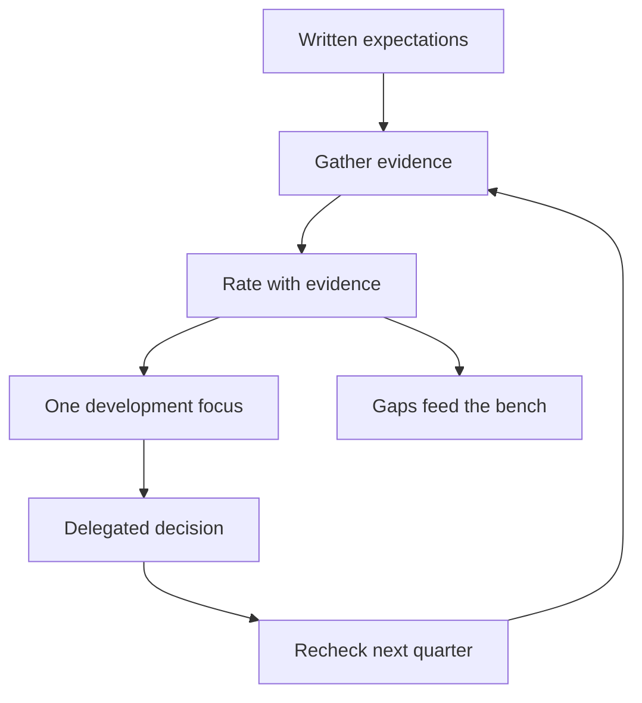
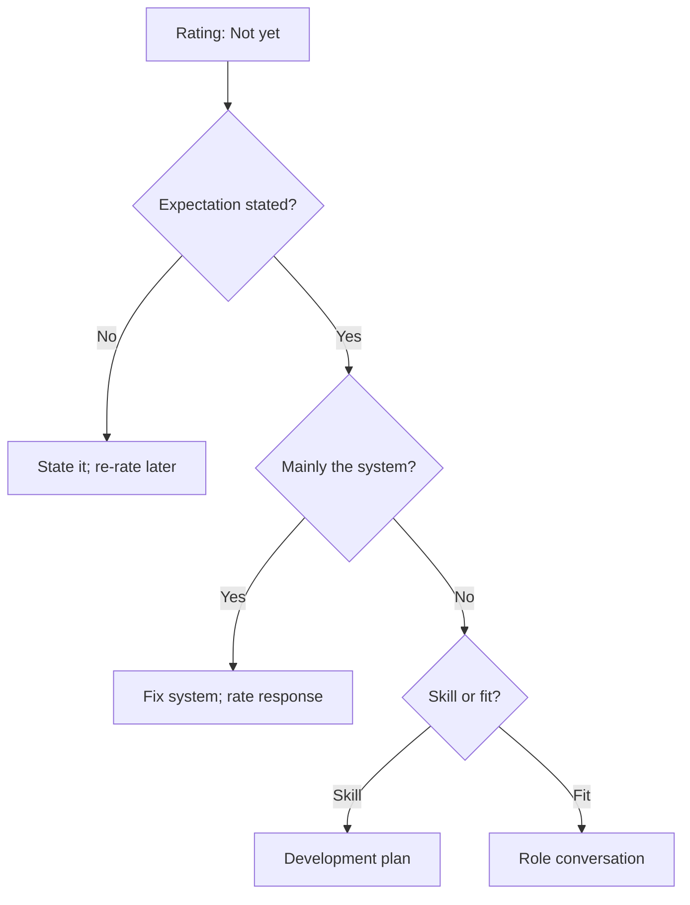

# Chapter 41 — Managing and Developing Engineering Managers

!!! warning "Awaiting human review"
    This chapter has passed the book's automated validation and an editorial self-review, but not yet
    the human review in which each cited claim is checked against its source. Treat it as a reviewed
    draft. Corrections are welcome; see the repository's CONTRIBUTING file.

A director's main product is the managers. This chapter covers assessing an engineering manager
against a rubric with observable evidence, coaching managers through skip-levels, manager artifact reviews, and
delegated decisions, and building a bench for every management seat. Chapter 4 owns measuring
managerial effectiveness in general and Chapter 5 owns coaching an individual; here the individual is a
manager and the coach is the director. The running example is the end of quarter 2 at Northstar
Technologies, the fictional company in the [case study](../../case-studies/northstar/index.md), where
the director assesses the six managers for the first time.

## Why This Matters

At team scale, a manager decides most of what an engineer experiences: what they work on, whether they
grow, whether their concerns travel anywhere. A director who cannot tell a strong manager from a busy
one rewards the busy one. At Northstar's baseline, managers were reviewed once a year on roadmap
delivery only, against a one-line job description. On that basis Daniel Cho, whose team deployed most,
looked strongest, and nothing measured showed that his mobile engineers felt like pawns.

At organization scale, the managers are the director's leverage. The director's product is the system
(Chapter 40), and a director reaches that system almost entirely through six or eight people.

At executive scale, the question is whether managers are ready when needed. At Northstar each of the six
managers is a single point of failure, and under the flat-headcount rule a new manager can come only from
an engineering seat that is not backfilled. The bench is built from current engineers or not at all.

## Learning Objectives

After this chapter you will be able to:

- Assess an engineering manager on six dimensions, with dated, observable evidence behind every rating
  and an explicit "No evidence" where there is none.
- Separate what a manager controls from what the system controls, and decide what a "Not yet" calls for.
- Run skip-level conversations that inform coaching without undermining the manager.
- Develop managers through manager artifact reviews and delegated decisions, with a one-quarter plan and a check.
- Build a leadership bench for each management seat from the people the organization already has.

## The Mental Model

> **Mental model:** A rating without evidence is an opinion; development without a rating is drift.
> Make the manager's work observable, rate it against expectations the manager knew, pick one thing to
> develop, and give them a real decision to practice it on.

A manager's results arrive late, mixed with the system's, and through other people (Chapter 2's slow,
noisy loop). The director's answer is more ways of observing, not more reporting: the manager's
artifacts, metrics read in context, skip-level themes, and what peers and staff engineers see.

The loop starts with written expectations because a rating against an unstated expectation says more
about the director than the manager, and ends with a recheck because an unchecked plan becomes a
document. The second idea: developing managers and building the bench are the same work. A manager
strong on people growth has people who could take more of the job; a seat with no such person is both a
development gap and a succession gap.

## Deep Conceptual Explanation

### The rubric: six dimensions of observable evidence

Chapter 4 measures a manager across four areas (unit outcomes, team health, people growth, leverage)
over at least two quarters ([Chapter 4](../01-foundations/04-the-leadership-ladder.md)). For assessment
and development this book splits them into six, separating out two things engineering managers most
often differ on: owning production and running the role itself. The rubric is **this book's
recommendation**, not a validated instrument; the Engineering Manager performance rubric template in
Part XIV uses the same dimensions and levels.

| Dimension | Observable evidence | Not evidence |
|---|---|---|
| 1. Outcomes in context | Commitments as made and as delivered; reliability trend; the manager's account of causes, checked | Activity counts; renegotiated targets |
| 2. Operational ownership | On-call load by person; corrective actions closed; tier 1 minimums on owned components | "A quiet quarter" |
| 3. People growth | Work delegated with a named level; career conversations; gaps addressed; a named successor | One-on-ones held |
| 4. Team health | Regretted attrition; skip-level themes; health checks; concentration of pages and knowledge | Survey scores without comments |
| 5. Cross-team leverage | Dependencies resolved; ownership clarified; help to peers, confirmed by them | Self-reported heroics |
| 6. Running the role | Time allocation; delegation; escalation timing; bad news reported early | Hours worked |

Each dimension gets **Not yet**, **Solid**, **Strong**, or **No evidence**. The fourth matters most: a
director who has not seen a dimension tends to rate it "Solid", turning ignorance into judgment. "No
evidence" is a finding about the director's information, and it sets an action: go and look.

Three rules (**this book's recommendation**). Every rating cites a dated evidence item and its source.
"Not yet" is rated only against an expectation the manager knew; where none was stated, the gap is the
director's too, and it may inform development but not pay this cycle. And there is no composite: ratings
are not averaged and managers are not ranked, because their teams sit in different parts of the system.

### Why the evidence rule exists

In two large samples of managers rated by seven raters each, idiosyncratic rater effects explained more
than half the rating variance (62 and 53 percent), more than twice the effect of the managers'
performance ([Scullen, Mount, and Goff, 2000](../../references/bibliography.md#scullen2000latent)). That
**research finding** concerns developmental ratings (Chapter 9 treats rating error); its consequence is
that a rating should be traceable to something another person could check.

Feedback alone changes managers little. A meta-analysis of 24 longitudinal studies found improvement
after multisource feedback generally small; the authors' review suggests it is likelier when the feedback
shows change is needed, the recipient believes change is feasible, sets goals, and acts
([Smither, London, and Reilly, 2005](../../references/bibliography.md#smither2005multisource)). Hence the
loop does not stop at the rating: one focus, a goal, a real decision to practice on.

Retention has the strongest evidence. At one large technology firm, survey-measured people management
skills had a strong negative relation to turnover, with designs supporting a causal reading, but did not
consistently improve other outcomes ([Hoffman and Tadelis, 2021](../../references/bibliography.md#hoffman2021people));
Google reports a similar pattern (**documented practice**, one company, method not published)
([Google re:Work](../../references/bibliography.md#rework-great-managers)). Team health carries real
weight; outcomes need context before they carry any.

### Coaching managers through three channels

**Skip-levels.** The director's conversations with engineers two levels down check what the manager's
channel carries; they must not replace it. Chapter 40 owns the design and the rule
([Chapter 40](40-the-directors-job.md#building-your-own-signal-sources)): everyone once a quarter in
groups of three, themes always back to the manager, quotes never, a confidential individual
conversation for anyone who asks, and no decisions in the room. A skip-level that yields a director's
decision has bypassed the manager. For coaching, four questions travel well: Which decision did you
wait on longest, and who made it? What would you tell your manager if you were sure it was safe? What
can you do now that you could not two quarters ago? What should the director stop doing? The second
probes safety toward the manager (Chapter 11); the third is evidence for people growth.

**Manager artifact reviews.** In the director's weekly meeting with the managers, one slot goes to one manager
presenting one artifact (a quarter plan, an incident review, a promotion packet) for peers to question.
Chapter 37 owns the cadence. Peers see each
other's work, and the artifact becomes rubric evidence. Keep the question "what would you change?", not "who got it wrong?".

**Delegated decisions.** The strongest tool is a real decision handed over at an explicit level of
control; Chapter 2's five levels work for managers too. David Marquet is known for moving decisions to the
people with the information ([Marquet, 2012](../../references/bibliography.md#marquet2013turn)), and Liz
Wiseman for the idea that some leaders amplify others' capability while others diminish it
([Wiseman, 2010](../../references/bibliography.md#wiseman2010multipliers)); both are **expert opinion**.
Research is sobering: managers say they delegate to develop people, yet many hold back important
decisions from those they see as inexperienced ([Yukl and Fu, 1999](../../references/bibliography.md#yukl1999determinants)).
So hand over a decision that matters at level 2 or 3, not a trivial one at level 5.

### What the research on manager development says

A meta-analysis of 335 samples found leadership training substantially more effective than earlier
estimates, improving reactions, learning, transfer to the job, and results (effect sizes of about 0.63,
0.73, 0.82, and 0.72), and more effective with needs analysis, feedback, several methods (especially
practice), spaced sessions, on-site location, and face-to-face delivery
([Lacerenza et al., 2017](../../references/bibliography.md#lacerenza2017leadership)). That **research
finding**, read at abstract level, concerns formal programs, not a director's coaching. It still argues
against one off-site course from a catalog: the rubric is the needs analysis, real decisions are the
practice, quarterly rechecks are the spacing.

A review of 25 years of leader development research notes that the field's systematic study is fairly
young and stresses multisource feedback and longitudinal studies
([Day et al., 2014](../../references/bibliography.md#day2014advances)). Linda Hill's study of nineteen new
managers is described by its publisher as showing the transition is learned mainly from experience and
that many do not make it ([Hill, 2019](../../references/bibliography.md#hill2019becoming)). Practitioner
guides by Camille Fournier, known for walking the management path level by level
([Fournier, 2017](../../references/bibliography.md#fournier2017manager)), and Julie Zhuo
([Zhuo, 2019](../../references/bibliography.md#zhuo2019making)) also treat management as learned on the
job. None of this says which manager will grow, so recheck every quarter.

### Building the bench

Chapter 36 owns the succession table, readiness scale, and coverage rule
([Chapter 36](../07-organization-design/36-reorganizations-evolution-and-succession.md#succession-coverage));
this chapter adds how to grow the names in it. Select on evidence of managerial work, not engineering
excellence: firms tend to promote on current performance even when other traits predict managerial
success better ([Benson, Li, and Shue, 2019](../../references/bibliography.md#benson2019promotions)).
Create that evidence with trial assignments that are real management work: running planning, leading an
incident review, owning a hiring loop, facilitating a health check. And sponsor, not just mentor:
sponsorship means a senior person using influence on the candidate's behalf, and survey research found
high-potential women over-mentored and under-sponsored
([Ibarra, Carter, and Silva, 2010](../../references/bibliography.md#ibarra2010promotions)). Every
people-growth rating therefore asks: who on your team is doing a piece of your job this quarter?

## Engineering Organization Example

What running this for six managers costs a director. The figures are **illustrative**, for Northstar
after week 10 (77 engineers in teams; the staff engineers are managed separately).

| Activity | Assumption | Hours per quarter |
|---|---|---|
| One-on-ones with managers | 6 × 45 minutes × 13 weeks | 58.5 |
| Skip-levels | Chapter 40's rotation: two groups of three a week, 45 minutes, 13 weeks | 19.5 |
| Rubric assessment | 6 managers × 4 hours every two quarters = 24 | 12 |
| **Total** | | **90** |

Recomputed: 58.5 + 19.5 + 12 = 90 hours, about 6.9 hours a week, about 15 percent of a 47-hour week.
The artifact-review slot is not counted: it sits inside the weekly managers' meeting, already in
Chapter 37's load. Chapter 34's span analysis applies to the director too.

What it can buy: at baseline eight engineers left in a year, with a median 15 weeks to a replacement's
first day. Catching one avoidable departure a year saves about 15 engineer-weeks, roughly $53,000
(15 ÷ 52 × $185,000 = $53,365), before ramp-up. A plausibility check, not a forecast.

The more telling number: in the first Northstar rubric (Case Study), drafted before any group skip-level, 5 of 36 cells are "No evidence".
Rating all 36 from impression would have produced a tidy table and no idea where to look.

## Decision Framework

A rating is the start of a decision. The flow for "Not yet" separates four causes, because each calls
for a different response.

| Pattern | Likely meaning | Response |
|---|---|---|
| "Not yet" on one dimension, expectation stated | Skill gap | One-quarter plan with a delegated decision and a check |
| "Not yet" caused by the system (release train, span, ownership) | The director's problem | Fix the system; rate the manager's response |
| "Not yet" on several dimensions for two quarters despite a plan | Possible role fit | Chapter 9's expectations process, including a return to engineering |
| "No evidence" anywhere | Information gap | Go and look; do not rate |
| "Strong" on people growth and leverage | Ready for more scope | Stretch decision at level 3 or 4; bench for a larger role |
| "Strong" everywhere, team runs without them | Ready now, or about to leave | Career conversation this month |

Two more criteria (**this book's recommendation**). Weigh dimensions by the team's situation: outcomes
weigh more for a team carrying a renewal commitment, operational ownership and health for a team with
concentrated on-call load. And treat the manager's response to a "Not yet" (curiosity, a draft plan,
changed behavior within weeks) as evidence in its own right.

## Trade-offs

**Consistency against context.** One rubric makes comparison fair to read, and also invites comparing a
team on the Core train with one that deploys at will. Keep dimensions common, evidence local, and never rank.

**Skip-level information against the manager's authority.** More frequent skip-levels buy information at
a rising cost to the manager's standing, especially if themes return as directives.

**Real decisions against risk.** A delegated decision that matters can go wrong and the director owns the
result; a trivial one develops nobody. The level of control, not the size of the decision, is the valve.

**Transparency against candor.** Showing managers their ratings and evidence makes the process checkable;
it also makes peers more careful about what they tell the director. Share evidence items, never who said
what in a skip-level.

**Bench development against delivery.** A senior engineer running planning engineers less, a real cost
under flat headcount; a vacancy with no cover costs more, without warning.

**Internal coaching against external programs.** Coaching is specific but bounded by the director's
skill and time; a program brings practice and peers.

## Failure Modes

**The halo from outcomes.** The team hit its numbers, so everything is "Strong". Detection: ratings move
together, and five cells cite the same delivery result.

**"No evidence" rated "Solid".** Detection: the evidence for a "Solid" is a sentence about the manager,
not a dated item.

**Judging against unset expectations.** Detection: the manager is surprised by the dimension, not just
the rating. Northstar's one-line job description made this the default.

**The skip-level shadow channel.** The director acts on issues that never reached the manager. Detection:
the manager learns of a decision about their team from the team.

**The director as super-manager.** Coaching becomes doing the manager's job. Detection: the manager's
artifacts improve only when the director touched them.

**Development plans without stretch.** Detection: nothing in the plan is a decision the manager will make
that they could not make before.

**Bench on paper.** Chapter 36's succession theater: named successors who do no management work.
Detection: ask the named person.

## Enterprise Application

With 50 to 150 engineers there are usually six to fifteen managers and often two directors. Three things
change. **Calibrate manager ratings** across directors twice a year on evidence items, as Chapter 8 does
for engineers; with several raters the rater-effect research applies directly. **Run a cohort, not a
catalog:** with ten or more managers, an internal program of a few spaced, face-to-face sessions built on
practice (a difficult conversation, an incident review chaired, a plan defended), each followed by a
real decision on the job; the training moderators are the design brief. **Keep the bench
organization-wide:** the best candidate for one team's seat may sit in another, and trial assignments can
cross teams. New managers get the rubric on day one, so expectations are stated before they are judged.

## CTO Perspective

The CTO manages managers of managers, and running the role now means a management system that works
without the director in the room. Ask each director twice a year: Which of your managers would you hire
again, and on what evidence? Who could do each manager's job in six months? What did you delegate to a
manager this half that you used to decide yourself? The board sees succession for the top roles; the CTO
sees whether it exists below, where engineering continuity lives. A CTO who finds every manager rated
"Solid" has found a measurement problem. Funding a course without protecting the director's coaching
hours buys the visible half of manager development.

## Practical Playbook

1. Write each manager's expectations on the six dimensions, including the decisions they own, before
   any rating.
2. Keep an evidence file per manager: artifacts, metrics with context, artifact-review notes, peer and
   staff-engineer observations, the manager's self-assessment.
3. Run Chapter 40's skip-level rotation, once a quarter in groups of three, under its written rule, with
   the four questions above.
4. Draft ratings with one dated evidence item per cell; mark "No evidence" and close the gaps before the
   conversation.
5. Run every "Not yet" through the decision flow.
6. In the conversation, hear the manager's self-assessment first, then agree one development focus.
7. Write a one-quarter plan: focus, one delegated decision with its level, one bench action, and a dated
   check naming the evidence.
8. Put each manager's key artifact in the artifact-review slot at least twice a quarter.
9. Recheck the development plan quarterly; re-rate every two quarters.
10. Update each seat in Chapter 36's succession table with what the quarter added.

## Case Study

This case is **fictional**. The director drafts the assessment in week 24, holds the conversations in
weeks 25 and 26, and finalizes it in week 27, the first week of quarter 3. It uses evidence from the
[baseline page](../../case-studies/northstar/baseline-data.md), [the first quarter](../../case-studies/northstar/first-quarter.md)
page, and earlier chapters (including Chapter 39's end-of-quarter-2 report), plus Priya Raman's monthly
time checks, a new fact recorded for the canon. The ratings are fictional judgments; the quarter 3 outcomes are open.

**Where the director started.** Expectations existed only in pieces: prevention allocations, tier 1
minimums, incident commander training, manager ownership of corrective actions. Nobody had set Daniel Cho
expectations for leading across sites (Chapter 14) or told Farah Haddad which of her two roles came
first. In week 22 the director wrote the six dimensions into a one-page expectation.

**The thin channel.** The director held no skip-levels in weeks 1 to 15. From week 16 there were
individual skip-level conversations, four a week for 30 minutes (Chapter 37), 36 by week 24;
Mateo Arango Ríos's in week 17 was the director's first with a mobile engineer. They inform the ratings
below, but one person at a time is not a team's view, and no group skip-level had yet been held. The
"No evidence" cells are partly that gap. Systematic group skip-levels start with Chapter 40's quarter 3
rotation, covering all 77 team engineers; its groups are where the checks below get their evidence.

**The draft ratings, week 24.**

| Manager | Outcomes | Operational | People growth | Team health | Leverage | Running the role |
|---|---|---|---|---|---|---|
| Priya Raman | No evidence (bulk ordering due week 26) | Solid | Solid | No evidence | Solid | Not yet |
| Marcus Oyelaran | Solid | Not yet | No evidence | Not yet | Solid | Not yet |
| Elena Sokolova | Strong | Strong | Solid | Strong | Strong | Solid |
| Daniel Cho | Solid | Not yet | Not yet | Not yet (unset) | No evidence | Solid |
| Farah Haddad | Solid | Solid | Not yet | No evidence | Solid | Not yet (unset) |
| Tom Becker | Solid | Solid | Not yet | Not yet | Solid | Solid |

Counted both ways: 16 Solid, 11 Not yet (two against unset expectations), 5 No evidence,
4 Strong; 36 cells. Priya's outcomes cell waits for bulk ordering, due in week 26.

**The evidence.**

*Priya Raman.* Delegation held where written down: Aisha Bello leads bulk ordering, and Rafael Duarte and
Aisha own order-capture reviews (Chapter 2); Orders tagged every core/customer change for a quarter
(Chapter 21). Rafael's career question is still open (Chapter 4). The "Not yet": her monthly checks show
hands-on time of 8, 10, and 12 hours a week in weeks 16, 20, and 24 against the agreed cap of 8, rising
as the renewal date nears. Team health is "No evidence": nobody has asked how candid Orders is with
Priya, the question Chapter 11 left open.

*Marcus Oyelaran.* Seven of Billing's eight baseline incidents came through Core releases or migrations
(Chapter 27), so outcomes are read in that context. Billing reserved weeks 1 to 3 for the ledger export
(Chapter 16), reviewed contract expectations for meaning (Chapter 22), and Marcus raised the tax-svc risk
himself (Chapter 30): leverage is Solid. Against that: three engineers handled 126 of 180 pages at
baseline; his earlier responses were a stipend, alerts, and "document as you go"; he asked to skip
incident commander training; "no capacity" was Billing's first answer on testing, flaky tests, and
runbooks (Chapters 19, 20, 22). The ledger knowledge map is a
good first artifact, but nothing yet shows anyone new able to respond alone, so people growth is "No
evidence". Team health is "Not yet": the after-hours load the stay interviews named, and Tomasz
Wierzbicki's offer, whose handling is open (Chapter 10).

*Elena Sokolova.* Outcomes are Strong on what she controlled: the accounting integration has been live
for the renewal customer since week 19, with daily reconciliation running (Chapter 39). The record still
has to say how integrations read posted
ledger data, which the report does not name and ADR-0001 leaves open (Chapter 28). Her controllable
evidence: the payment SLI in two weeks (Chapter 24); contract tests accepted on a condition that
caught a rounding change (Chapter 22); a three-week webhook key rotation (Chapter 26); WIP limits lowered
and defended (Chapter 16); the Customer Experience health check facilitated (Chapter 14). The blind spot
stays visible: payments-gateway configuration edits never reached her near-miss log (Chapter 11). People
growth is Solid, not Strong, because her informal tech lead is the only cover for her seat.

*Daniel Cho.* Delivery measures look healthy (Chapter 14). People growth is "Not yet": 55 of 84
one-on-ones mainly status, 9 of 15 engineers without a career conversation in six weeks, and Mateo Arango
Ríos doing a lead's job unrecognized for over a year (Chapter 5). Operational ownership is "Not yet" on
mobile: two of four baseline Sev2 incidents at the mobile boundary, INC-426 restored after 1,310 minutes.
Team health is "Not yet (unset)": mobile rated four areas red, but nobody had set expectations for
leading across sites. In his favor, he drafted the one-on-one changes himself. The structure stays open.

*Farah Haddad.* Her charter answers INC-423 with a maintenance notice and gives other teams one queue
(Chapter 12): leverage and operational ownership are Solid. People growth is "Not yet": one promotion to
Senior in two years and a team holding Senior to a staff standard (Chapter 8). Running the role is "Not
yet (unset)": 45 percent of her time is technical, and technical direction lives with her.

*Tom Becker.* By week 18 environment waits fell from about 6 days to 2 and other teams' requests from 20
to 14 points (Chapter 16); he drafted the platform roadmap with Kwame Mensah (Chapter 32). People growth
and team health are "Not yet" on one pattern: for nine months he moved 31 of Bram Verhoeven's 74 tickets
without saying why, wrote "meets expectations", and left two colleagues covering (Chapter 9). His quarter
2 proposal for Bram is recorded as a strong response; the decision on it remains open.

**Quarter 3 plans (proposed, outcomes open).**

| Manager | Focus | Delegated decision | Bench action | Check |
|---|---|---|---|---|
| Priya | Running the role | Aisha Bello runs Orders' quarter 3 planning at level 3 | Aisha as named interim cover | Hands-on hours at or below 8 in weeks 32 and 38 |
| Marcus | Operational ownership | Teodora Vasquez-Lund leads the TR-07 pairing plan (Chapter 30) at level 3; Marcus joins ledger incidents only as commander | A senior engineer takes one named piece of his job | Knowledge map recount, week 38 |
| Elena | Organization-wide leverage | Chairs a monthly artifact-review slot on operational readiness, level 3 | Informal tech lead represents the team in cross-team planning | Peer managers asked, week 38 |
| Daniel | People growth | A career conversation with every engineer; a sponsorship action each for Hannah Lindgren and Mateo | Hannah and Mateo as half-team covers | One-on-one recode, weeks 32 to 37 |
| Farah | Running the role | Sunil Varghese leads one warehouse design decision at level 3 | Sunil on the architecture half | Technical share in the week 38 calendar |
| Tom | People growth | Raises any performance gap with the person within two weeks | None yet | Quarter 3 skip-level group: is work moved silently? |

The director's own line: written expectations for every manager by week 27, answering or explicitly
deferring the leading-across-sites and dual-role questions. How the plans interact with the open
decisions (Customer Experience's structure, Bram's plan, Tomasz's offer, Rafael's track) is for the exercises.

## Exercises

Solutions are in [chapter 41 solutions](../../solutions/ch41-solutions.md). Northstar data is on the
[baseline page](../../case-studies/northstar/baseline-data.md) and [the first quarter](../../case-studies/northstar/first-quarter.md) page.

### Foundational

**F1.** A director's draft assessment says: "Marcus is defensive about capacity", "Elena is the best
manager we have", "Daniel really cares about his people", and "Farah is too technical". Rewrite each into
dated, observable evidence from the Northstar record, name the dimension it bears on, and say which
statement you could not rewrite without new evidence and what you would collect.

**F2.** Priya Raman's monthly checks show hands-on time of 8, 10, and 12 hours a week as the bulk-ordering
date approaches. She argues the renewal feature is the company's most important deliverable and the rise
is temporary. Decide how to rate running the role, what else you would look at first, and what you would
agree with her for weeks 25 and 26.

**F3.** Design the next skip-level round for Customer Experience: nine web engineers and two quality
engineers in Minneapolis and remote, six mobile engineers in Bogotá, with the team's structure still
undecided. Specify groups, questions, what goes back to Daniel Cho, and what you will not do with what you hear.

### Applied Leadership

**A1.** The accounting integration went live in week 19 (Chapter 39). Suppose instead it had landed two
weeks late, in week 21, because the ledger export took longer than Billing's reserved weeks. Rate Elena
Sokolova's and Marcus Oyelaran's outcomes in both cases, and explain what evidence separates each
manager's contribution from the system's.

**A2.** Marcus Oyelaran accepts his operational ownership rating but says he cannot spread ledger
knowledge in quarter 3: two of the three experts are critical to every incident and one has an outside
offer. Write the quarter 3 plan you would agree with him, including the delegated decision, and say what
you would do if he declines it.

**A3.** Tom Becker says his "Not yet" on people growth is unfair: he has already drafted a fair plan for
Bram Verhoeven, and HR will read the rating in his file. Decide whether to change the rating, how to
record the evidence, and what Tom needs to show by week 38.

### Executive Decision-Making

**X1.** Victor Lindqvist asks you for a single ranking of the six managers for year-end pay, and
separately asks who would run Payments and Integrations if Elena Sokolova were promoted. Respond to both
using the rubric's rules and the bench evidence, and say what you would refuse to produce.

**X2.** An HR partner proposes sending all six managers to an external leadership program: five days
off-site in one block, at an illustrative $8,000 per person. The alternative is an internal cohort of four
half-day sessions spaced three weeks apart in Minneapolis, built on the rubric gaps, with about four
director-days of preparation. Decide, using the training research and Northstar's constraints, and say how
you would know in two quarters whether it worked.

## Reflection Questions

- Which of your managers would you rate "Solid" on a dimension where you have never seen their work?
- When a manager's team does well, how much do you credit to them, and on what evidence?
- Who has done a manager's job this quarter without the title, and who knows it?
- What decision did you hand a manager this quarter that you would have preferred to make yourself?
- If your skip-levels stopped tomorrow, what would you no longer know, and does any manager know it?
- Which "Not yet" on your managers is really about an expectation you never stated?

## Key Takeaways

- Rate managers on six dimensions with a dated, observable evidence item behind every rating.
- Treat "No evidence" as a finding about your information, and go and look before rating.
- Rate "Not yet" only against an expectation the manager knew; otherwise the gap is yours too.
- Never average the dimensions or rank managers whose teams sit in different parts of the system.
- Separate what the manager controls from what the system does, and rate the manager's response.
- Use skip-levels to check the manager's channel; themes always go back to the manager, quotes never.
- Develop managers through real decisions at an explicit level of control, one focus per quarter.
- Make development needs-based, practiced, spaced, and checked, as the training research suggests.
- Grow the bench through trial management work and sponsorship, and keep Chapter 36's table current.

## References and Further Reading

- [Lacerenza et al., 2017](../../references/bibliography.md#lacerenza2017leadership) and
  [Day et al., 2014](../../references/bibliography.md#day2014advances). What makes leadership
  development work, and how young the research is.
- [Smither, London, and Reilly, 2005](../../references/bibliography.md#smither2005multisource) and
  [Scullen, Mount, and Goff, 2000](../../references/bibliography.md#scullen2000latent). Limits of
  feedback and ratings.
- [Hoffman and Tadelis, 2021](../../references/bibliography.md#hoffman2021people),
  [Google re:Work](../../references/bibliography.md#rework-great-managers), and
  [Hill, 2019](../../references/bibliography.md#hill2019becoming). Managers, retention, and the first year.
- [Yukl and Fu, 1999](../../references/bibliography.md#yukl1999determinants),
  [Benson, Li, and Shue, 2019](../../references/bibliography.md#benson2019promotions), and
  [Ibarra, Carter, and Silva, 2010](../../references/bibliography.md#ibarra2010promotions). Delegating,
  selecting, and sponsoring.
- [Marquet, 2012](../../references/bibliography.md#marquet2013turn),
  [Wiseman, 2010](../../references/bibliography.md#wiseman2010multipliers),
  [Fournier, 2017](../../references/bibliography.md#fournier2017manager), and
  [Zhuo, 2019](../../references/bibliography.md#zhuo2019making). Practitioner accounts of delegation,
  amplifying others, and the management path.
